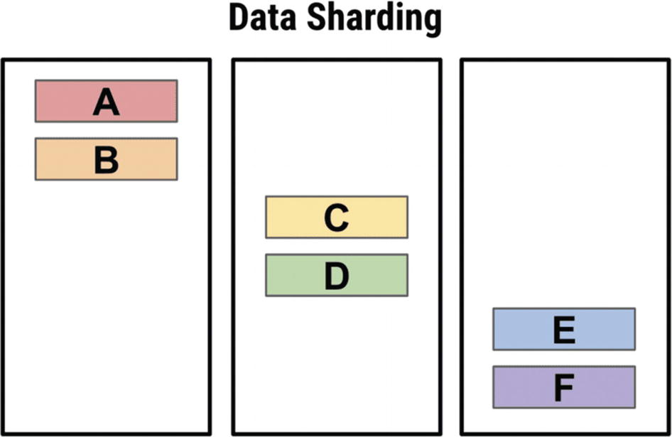
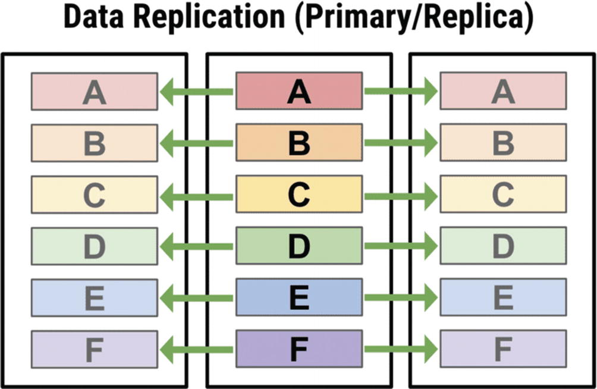
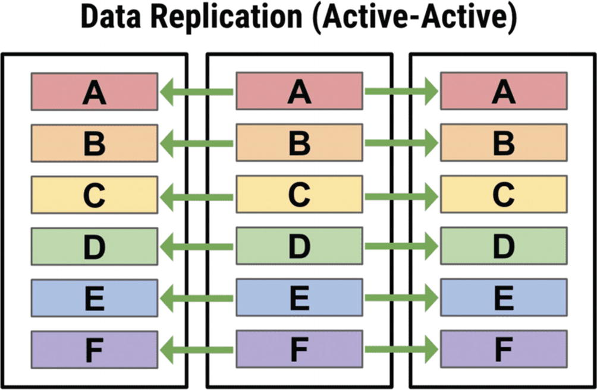
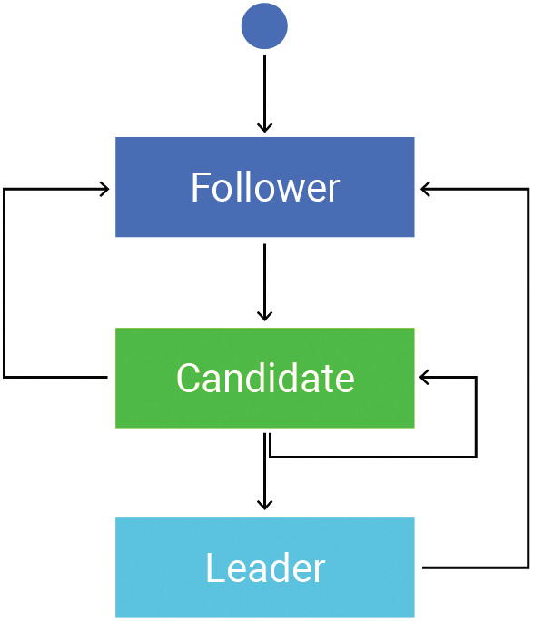
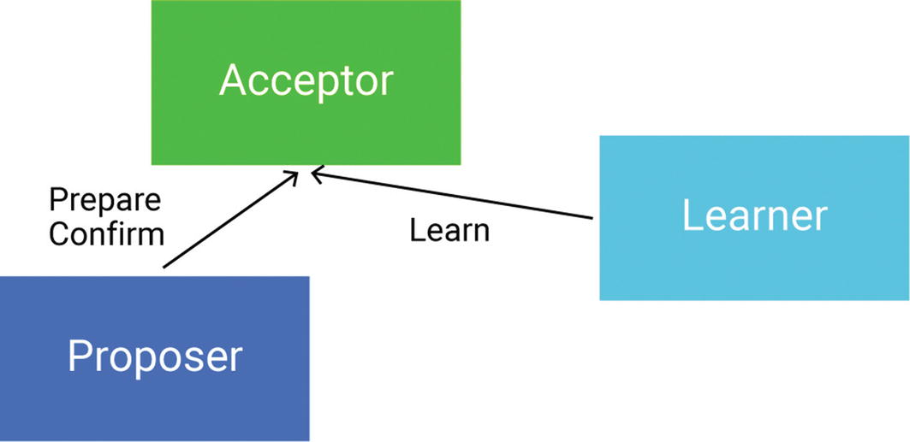
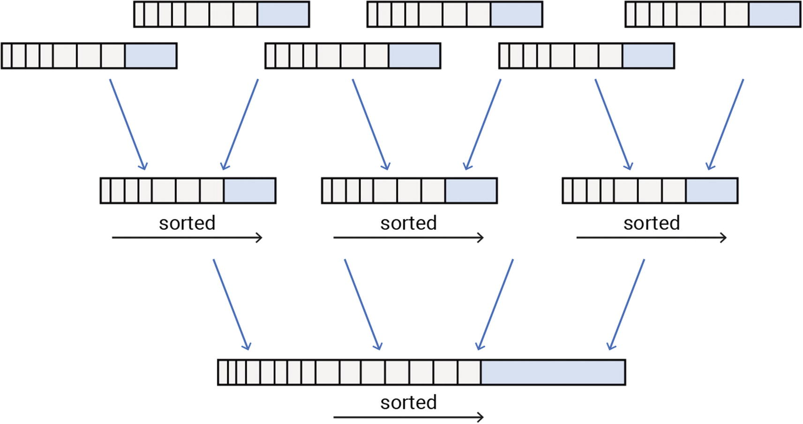
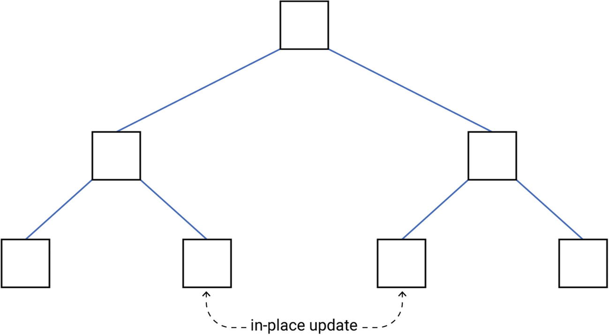
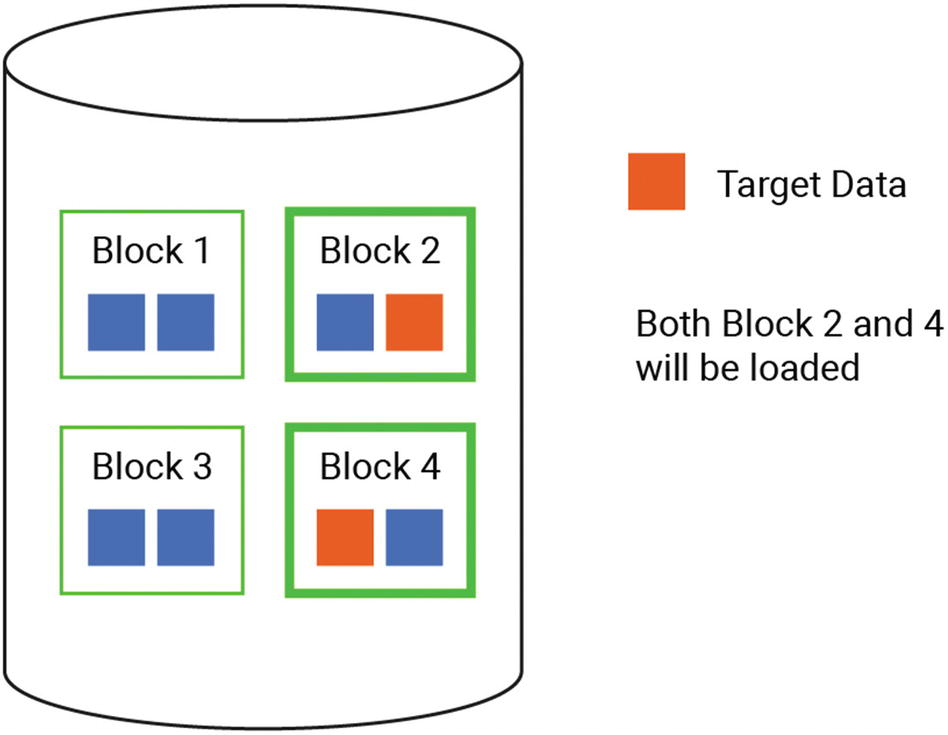
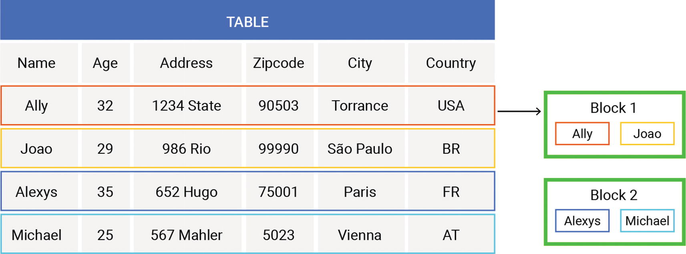
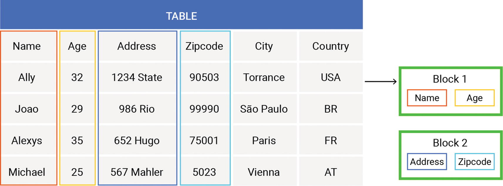

## Appendix A: A Brief Look at Fundamental Database Design Decisions

This appendix briefly touches on a number of fundamental database design decisions that impact database performance. Why “briefly?” First, because we suspect that many readers are already familiar with them. But, more importantly, because other resources have covered them quite extensively, and extremely well. Honestly, there’s not much to add. So, we’ll offer a short take on some of the most pressing decisions that any distributed database must make, then share our top picks for learning more on each topic.

### Sharding and Replication

Modern databases can rarely afford to be a single-node instance. The most obvious reason for being distributed is the need to avoid data loss in the case of a crash of any kind. Keeping data distributed across several nodes in a cluster inevitably means that the data needs to be split up (sharded) and copied between those nodes (replicated). The result is a distributed system in which users can quickly access data according to their queries.

#### Sharding

The point of sharding is to ensure that data is well-balanced across your cluster for reading and writing. You’re going to get the best performance by having all available nodes reading and writing data—not by overloading some nodes while others are idle or highly underutilized.

With most databases, sharding is built into its architecture. If that’s the case, it’s important to get the data modeling correct (e.g., high cardinality partition keys) to help the database’s automated sharding approach achieve an efficient balance across nodes. However, if the database requires you to define the sharding strategy, you’re going to have to bear the burden of more decisions that can impact balancing and, ultimately, performance. If you see that certain shards are receiving or handling more requests than others, it’s time to reconsider your strategy.

Also, all automated sharding is not the same. The two most common approaches used in the class of databases we’ve been covering in this book are:

- **Range-based sharding**: Dividing data into contiguous ranges determined by the shard key values. This offers the best performance for range lookups, but is otherwise prone to hotspots. (Bigtable and HBase use this approach.)
- **Hash-based sharding**: Dividing data evenly and randomly across shards as determined by a sharding algorithm. This offers the best performance for most scenarios. (Cassandra, ScyllaDB, DynamoDB, and Redis use this approach.)

The level at which the sharding is performed also matters. The most common approach is to shard per node: Distribute data into separate database server nodes. Another option is to shard per each core in your server, across all the servers in the cluster. This divides a server’s resources into shared-nothing units of CPU core, RAM, persistent storage, and network I/O. The advantage of this approach is that it maximizes utilization of all the available cores of multi-CPU hardware architectures. If paired with shard-aware drivers, each client writing or requesting data can send queries directly to the CPU core responsible for that shard of data. This minimizes hot shards and removes extra hops—improving performance. However, if you’re not running on powerful servers, you’re less likely to take full advantage of the potential performance gains here.

#### Replication

Being synchronous, replication affects the performance of the database at runtime. Poorly designed or inappropriately selected replication can cause performance bottlenecks.

There are many possible approaches to the design and implementation of database replication. Database replication can either happen on an explicit command or be an ongoing background process. Either approach should be well-accommodated by the infrastructure that the database is running on.

For data replication, the database engineer needs to select a replication strategy: The process for selecting the nodes to which each portion of data will be copied. Some replication strategies don’t just copy data to a set of nodes; they also apply prioritization. One or more nodes are called *primary replicas* for this portion of data, while the other nodes are called *secondary replicas*.

Think about the number of nodes in the replica sets. To begin with, each piece of data can be replicated to a single node, as shown in Figure A-1.

**Figure A-1. Replicating data to a single node**

Here, data is sharded across the different nodes for load balancing, but it doesn’t provide high availability because none of the shards is replicated.

In more complex cases (shown in Figure A-2), there’s one primary replica and one or more secondary replica nodes.

**Figure A-2. Replicating data to several nodes, with a single primary and multiple secondary replicas**

Here, one node writes data, which then can be propagated to other read-only nodes. This approach provides some level of high availability since a replica can take over the cluster if the primary goes offline. However, it does not properly balance your workload. All writes must be handled by the primary—which means that the primary becomes a bottleneck. As a result, this method of data replication may be impractical for write-intensive workloads. Spreading out the primary replicas for different portions of data across different nodes in the cluster is one potential way to address this.

In a more extreme form, there are no secondary replicas (like in Figure A-3).

**Figure A-3. Full active-active-style replication**

Here, all data is replicated in an active-active leaderless topology. Every node can accept read and write operations, so all are peers in managing the workload. When this strategy is applied, any loss to part of the cluster will not result in lost data.

This active-active leaderless topology leads to what is called *eventual consistency*: The guarantee that when an update is made in a distributed database, that update will eventually be reflected in all nodes that store the data—resulting in the same response every time the data is queried. In an eventually consistent system, the replication strategy defines a number called the “replication factor” (RF), which is the number of nodes on which the portion of data can be found. Writing the data to (and reading the data from) such a system also conforms to different consistency requirements, which is referred to as consistency level (CL).

The most restrictive consistency level is often called “all.” Writing in this mode means that the data must be written on disk on all replica nodes in the cluster. Reading returns the data after all replicas have responded, and the read operation fails if at least one replica does not respond.

Some less restrictive, but more performant, consistency levels may specify the exact number of nodes that must confirm the operation. Usually, this number is selected in the range of one through three, depending on how many replicas the cluster operator expects to crash.

“Quorum” consistency level provides much stronger consistency for the data. Writing or reading the data at this level means that the majority of nodes from the replica set should confirm the operation. In multi-datacenter setups, quorum consistency often has sub-levels depending on which datacenters the nodes from the replica set belong to.

Note that read and write consistency levels are independent of each other. Even if data was written with one consistency level (e.g. quorum), reading can use a different consistency level depending on the intention. For example, a CL of ONE can be used for data that doesn’t need to be consistent, QUORUM CL can be used for a regular (or “unsure”) case, and the most restrictive level of ALL can be used to effectively force full data repair.

#### Learning More

[*Designing Data-Intensive Applications*](https://www.oreilly.com/library/view/designing-data-intensive-applications/9781491903063/), by Martin Kleppman (Chapters 5 and 6)

[*Database Internals: A Deep Dive Into How Distributed Data Systems Work*](https://www.oreilly.com/library/view/database-internals/9781492040330/), by Alex Petrov (Chapters 11, 12, and 13)

[*NoSQL Distilled: A Brief Guide to the Emerging World of Polyglot Persistence*](https://martinfowler.com/books/nosql.html), by Pramod J. Sadalage and Martin Fowler (Chapters 4 and 5)

### Consensus Algorithms

Even though quorum consistency level works extremely well and provides data persistence, data consistency, and low latency access, it still does not guarantee the linearizability, isolation, and atomicity required by transactions: queries that heavily rely on ACID properties. One of the simplest and most obvious examples of a transaction can be any CAS (compare-and-set) operation (e.g., increment a counter provided its value is below 42). When transactions come into play, simple eventually consistent models stop working and call for stronger means. One option can be a consensus algorithm on a distributed system.

Consensus algorithms provide strong consistency guarantees about the underlying data and allow a set of replicas to work together as a coherent unit. Provided the nodes conform to the protocol, algorithms tolerate failures of less than half of replicas even in the presence of message loss and reordering. They guarantee the following properties:

- **Validity**: If a decision is made, it must have been proposed by at least one of the replicas.
- **Agreement**: If a decision is made at some point, nodes shouldn’t decide differently.
- **Stability**: If a decision is made at some point, it remains such forever.
- **Termination**: If a decision is made, it eventually gets spread to all correct replicas.

Consensus algorithms fall into two large classes—those that need a leader to make a decision and those that don’t. The latter are called leaderless. Algorithms from the former class can suffer from periods of silence if the leader fails, so the new leader election process is started and the cluster cannot service requests while it’s happening.

#### Raft

Raft is an example of a consensus algorithm with a leader. Raft was invented to be simple. It replicates a log of commands from a leader to follower nodes; that log of commands is called a “replicated state machine.” And, of course, it has the leader-election algorithm on board too.

Each replica participating in Raft replication can be in one of three states: follower, candidate, or leader (see Figure A-4). Any attempt to make a decision over the cluster must be described in terms of a state change in the replicated state machine. Since the client may not know who the leader is, it sends its decision requests to whatever node it selects first. Thus, if the decision request is not sent to the leader, followers would re-route it to one, and then the leader would replicate the decision across its followers. In the case of leader failure, the followers turn into candidates. The election process ultimately converts one of those candidates into a leader after it obtains votes from a majority of replicas.

**Figure A-4. Each replica participating in Raft replication can be a follower, leader, or candidate; upon leader failure, followers can turn into candidates, and a candidate is elected leader**

#### Paxos

Paxos appeared earlier than Raft. It’s an example of a leaderless algorithm, and it was one of the first algorithms that proved the quorum-based way of making distributed decisions.

According to the algorithm, each replica can play one or more of three roles—the proposer, the acceptor, and the learner (see Figure A-5). The decision is made through a two-step process in which the roles are involved, but from a practical perspective, nodes usually combine those roles. The first step, or, as it’s usually called—the phase—is in proposing some value. In order to be proposed, the value must be accompanied with the sequence number. After the proposal is confirmed by the majority of acceptors, the proposer may proceed to the confirmation phase. After the confirmation phase is confirmed (again) by the majority of acceptors, the decision is made.

**Figure A-5. Each replica participating in Paxos can be the proposer, accepter, or learner**

Once the decision is made, none of the participants may fall back to the first phase. If the next decision should be made, a new run of the algorithm should be taken. Due to this, Paxos is never used alone. It’s always part of a larger algorithm that implements all the necessary “paperwork” needed to instantiate, execute, and wrap up algorithm runs for individual decisions. One example of such a larger algorithm might be “distributed log replication.”

Note

It’s worth mentioning that Paxos was one of the first consensus algorithms that appeared and its goal was to prove how the distributed consensus is made. It’s not used in its pure form; it’s commonly extended with something else. One such extension was Raft, which (pretty successfully) tried to reduce Paxos’ complexity at the cost of a potential imbalance in nodes’ roles.

#### Comparing Leaderless and “Leader-Based” Classes

Although both leaderless and leader-based algorithm classes solve similar problems, the approach that involves a leader in the decision is considered to be simpler to implement and maintain. It also requires less time to converge upon a decision.

Even though “new leader selection” is just as complex as leaderless algorithms, it happens rarely and is considered to be a necessary evil. On the other hand, the single-leader approach often becomes a limitation to scaling consensus on large clusters—then, leader-less algorithms come to the rescue. Another option to overcome the leadership bottleneck is to apply some sharding on the decisions themselves. However, even when this is feasible, the added complexity might not be worth it.

#### Learning More

[*Designing Data-Intensive Applications*](https://www.oreilly.com/library/view/designing-data-intensive-applications/9781491903063/), by Martin Kleppman (Chapter 9)

[*Database Internals: A Deep Dive Into How Distributed Data Systems Work*](https://www.oreilly.com/library/view/database-internals/9781492040330/), by Alex Petrov (Chapter 14)

[*NoSQL Distilled: A Brief Guide to the Emerging World of Polyglot Persistence*](https://martinfowler.com/books/nosql.html), by Pramod J. Sadalage and Martin Fowler (Chapter 4)

### B-Tree vs LSM Tree

As mentioned when talking about read-write ratios back in Chapter 2, LSM trees, illustrated in Figure A-6, are optimized for heavy write workloads and B-trees are optimized for heavy read workloads. LSM-based databases are append-only. They never update values; they just add new ones. This means that when the database is servicing reads, it might have to search quite a while to find the appropriate value. However, compaction can help to avoid this read amplification. Choosing an effective compaction strategy for your workload, as well as optimizing when compactions are performed, can significantly impact the read penalty sometimes associated with LSM trees. Also, mechanisms like built-in caching can enable an LSM-based database to achieve fast reads as well as writes.

**Figure A-6. With LSM trees, compaction creates fewer (and larger) files**

On the other hand, B-tree based databases (as in Figure A-7) are optimized for reads. B-trees offer fast reads since their structure—and lack of duplication—makes them much more efficient to search than LSM trees. Traversing the tree is a straightforward path down a tree (as opposed to searching through potentially many files, as is the case with LSM trees).

**Figure A-7. B-trees are updated in place (vs LSM trees, which are append only**

The B-tree write path is not optimized for speed, though. Each time there’s a write, the database must traverse the tree to find the appropriate location. If a value already exists there, it’s updated. If not, a new leaf is added. This is quite disk-intensive, even for small records. In some cases, moving to faster disks can improve performance.

The database creates a snapshot of the tree each time, which enables you to perform rollback (including point-in-time restore). B-trees are also well suited to transactions. When you are going to perform a transaction, you typically want to read the data and then start snapshotting everything. If the conflict resolution doesn’t go as planned, you can simply roll it all back. B-trees make this feasible.

#### Learning More

[*Designing Data-Intensive Applications*](https://www.oreilly.com/library/view/designing-data-intensive-applications/9781491903063/), by Martin Kleppman (Chapter 3)

[*Database Internals: A Deep Dive Into How Distributed Data Systems Work*](https://www.oreilly.com/library/view/database-internals/9781492040330/), by Alex Petrov (Chapters 2, 4, 6, and 7)

[*The B-Tree, LSM-Tree, and the Bw-Tree in Between*](https://photondb.io/2022/08/15/bw-tree.html), by PhotonDB

### Record Storage Approach

One of the fundamental properties of the database is the way to store the data records in persistent storage. A wrong choice at this stage may force end-users into one of two alternatives—exabytes of data migrations vs extremely inefficient disk usage on user queries. To explore the impact, let’s look at two fundamentally different approaches—row-oriented and column-oriented, each of which is suitable for different use cases.

Data stored on a hard disk is always split into blocks of a fixed size, which is the smallest I/O unit the application can use (see Figure A-8). Databases looking for the data will need to load all the information from the blocks that contain it. Respectively, the fewer blocks the target data is stored in, the faster the database operates. For spinning disks, this requirement always comes next to the data locality one—it’s better for the blocks the database reads to get data that’s adjacent rather than dispersed across the disk.

**Figure A-8. Data is split into blocks of a fixed size; adjacent data is preferred over data dispersed across the disk**

There are many algorithms to group data in a logical way, each trying to improve search efficiency (for example, partition and clustering).

When data is organized in the form of a table, the cells can be stored in at least two ways: row-oriented (e.g., wide column) and column-oriented. It’s not feasible to shift from one approach to the other because of the amount of I/O required to convert data between versions. At the same time, this decision has a major impact on the database’s performance. The choice between row-oriented or column-oriented usually aligns with different access patterns (i.e. whether it’s optimized for analytical or transactional workloads).

#### Row-Oriented Databases

Let’s look at a sample table for a better understanding of how different storage approaches work. Figure A-9 shows a table containing information about a person in each row (the person’s name, age, address, etc.).

**Figure A-9. Row-based storage**

With row-oriented storage, data is put on disk row-by-row, and each chunk of data from a block consists of the cells from one table row. This design is perfect for so-called OLTP (Online Transaction Processing) applications, since such workloads can often modify the data by adding—or deleting—entities in the table. Writing a new row is optimal because it involves just appending an entire row to the existing blocks or putting it into new blocks. Another reason that row-oriented storage is good for OLTP workloads is because these workloads are typically loaded with requests retrieving every attribute from a single entity. Some examples of row-oriented databases are Cassandra, ScyllaDB, Postgres, and MySQL.

In other words, row-oriented storage is beneficial when all or most of the record needs to be accessed in the same query or transaction. In this case, it’s better to have narrow tables. The more columns there are in a given table, the less likely it is that your query will need all of them. In the extreme case when the query requires only a few columns (or even a single column), the row-store becomes too expensive. It needs to read the whole block, but the whole block will likely contain redundant data that would just be thrown away after being read.

#### Column-Oriented Databases

On the other hand, column-oriented databases store data on disk column-by-column. Let’s take the same table, but consider each data chunk to be its column, not the row. As shown in Figure A-10, the “names” will be grouped together on the disk, the “ages” will be grouped together on the disk, the “addresses” will be grouped together on the disk, and so on and so forth.

**Figure A-10. Column-based storage**

This approach is a good choice for OLAP (Online Analytical Processing) workloads because those workloads generally aggregate specific data over a very large number of records. OLAP queries are mainly interested in a small subset of columns; for example, calculating the average age of the people from the table. Also, these workloads rarely modify data, and even when they do, the modification is appending new records. Some examples of column-oriented databases are Google BigQuery and Amazon Redshift.

It’s also worth mentioning that the compression rate is often much higher in column-store rather than in row-store. That’s because in column-store, all cells from the column have the same data type, and that makes it quite compression-friendly.

Table A-1 breaks down the impact of these different approaches to storing records on the disk.

**Table A-1 Row-Oriented and Column-Oriented Approaches at a Glance**

|  | Pros | Cons |
| --- | --- | --- |
| **Row-oriented databases** | • Good for OLTP applications • Inserting, updating, and deleting data is easy | • The compression rate is often not very high, so the data takes up more space • Queries might result in reading unnecessary data |
| **Column-oriented databases** | • Perfect for OLAP applications • The compression rate can be made very high even with simple methods like RLE (Run Length Encoding) because the compression algorithms usually work better on values having the same data type • The query may skip scanning unnecessary columns, which is extremely useful for aggregation queries | • Reading and writing a full record is significantly slower • Modifying data is only efficient when appending |

These are just two representative examples. Data can also be stored using document, graph, and other models. See the following resources for a comprehensive discussion of how the various models store data, and the best and worst use cases for each.

#### Learning More

[*Designing Data-Intensive Applications*](https://www.oreilly.com/library/view/designing-data-intensive-applications/9781491903063/), by Martin Kleppman (Chapter 3)

[*Database Internals: A Deep Dive Into How Distributed Data Systems Work*](https://www.oreilly.com/library/view/database-internals/9781492040330/), by Alex Petrov (Chapter 1)

[*NoSQL Distilled: A Brief Guide to the Emerging World of Polyglot Persistence*](https://martinfowler.com/books/nosql.html), by Pramod J. Sadalage and Martin Fowler (Chapters 8-11)
