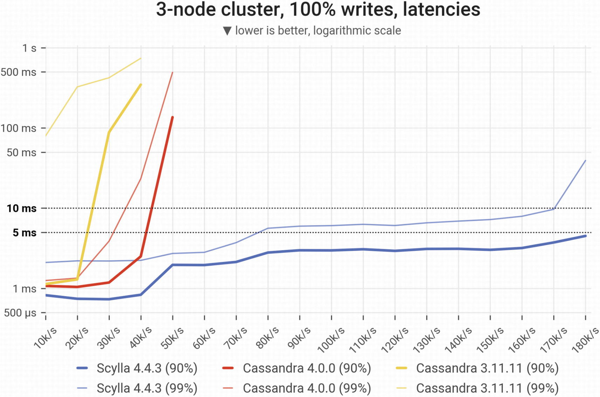
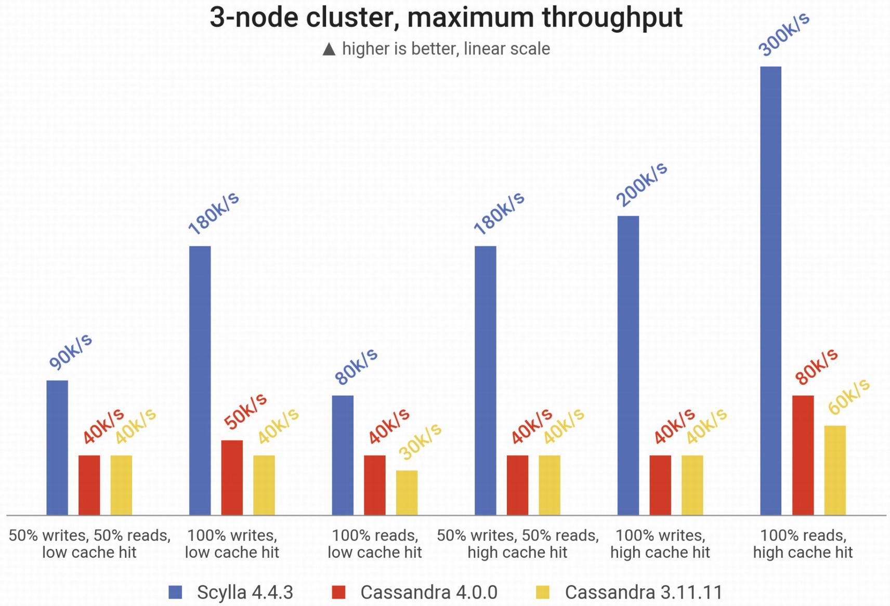
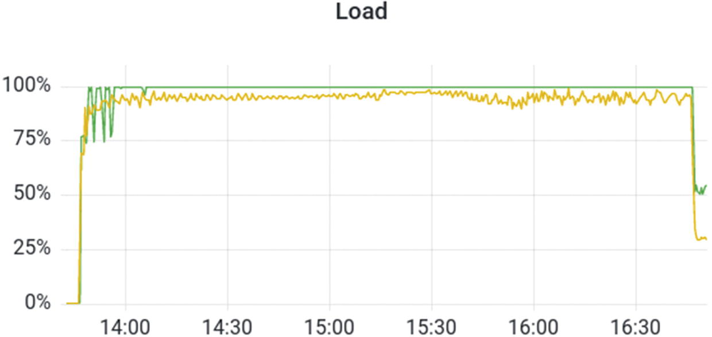
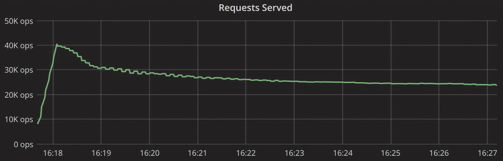
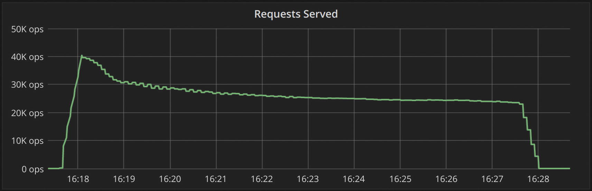
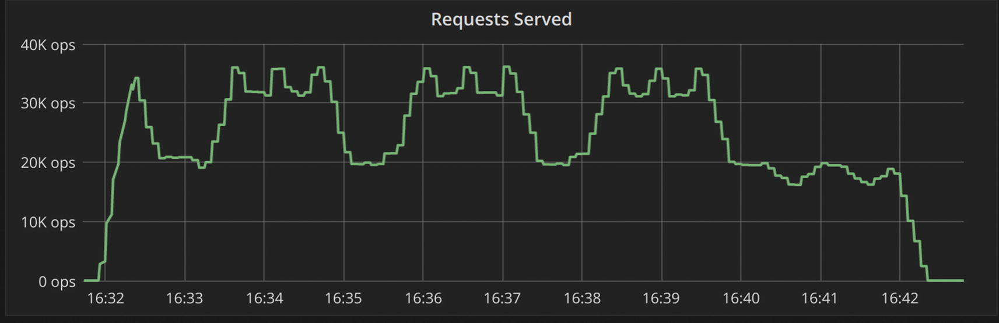

We won’t sugarcoat it: database benchmarking is hard. There are many moving parts and nuances to consider and manage—and a bit of homework is required to really see what a database is capable of and measure it properly. It’s not easy to properly generate system load to reflect your real-life scenarios.^1 It’s often not obvious how to correctly measure and analyze the end results. And after extracting benchmarking results, you need to be able to read them, understand potential performance bottlenecks, analyze potential performance improvements, and possibly dive into other issues. You need to make your benchmarking results meaningful, ensure they are easily reproducible, and also be able to clearly explain these results to your team and other interested parties in a way that reflects your business needs. There’s also hard mathematics involved: statistics and queueing theory to help with black boxes and measurements, not to mention domain-specific knowledge of the system internals of the servers, platforms, operating systems, and the software running on it.

But when performance is a top priority, careful—and sometimes frequent—benchmarking is essential. And in the long run, it will pay off. An effective benchmark can save you from even worse pains, like the high-pressure database migration project that ensues after you realize—too late—that your existing solution can’t support the latest phase of company growth with acceptable latencies and/or throughput.

The goal of this chapter is to share strategies that ease the pain slightly and, more importantly, increase the chances that the pain pays off by helping you select options that meet your performance needs. The chapter begins by looking at the two key types of benchmarks and highlighting critical considerations for each objective. Then, it presents a phased approach that should help you expose problems faster and with lower costs. Next, it dives into the do’s and don’ts of benchmark planning, execution, and reporting, with a focus on lessons learned from the best and worst benchmarks we’ve witnessed over the past several years. Finally, the chapter closes with a look at some less common benchmarking approaches you might want to consider for specialized needs.

## Latency or Throughput: Choose Your Focus

When benchmarking, you need to decide upfront whether you want to focus on throughput or latency. Latency is measured in both cases. But here’s the difference:

- **Throughput focus**: You measure the maximum throughput by sending a new request as soon as the previous request completes. This helps you understand the highest number of IOPS that the database can sustain. Throughput-focused benchmarks are often the focus for analytics use cases (fraud detection, cybersecurity, etc.)
- **Latency focus**: You assess how many IOPS the database can handle without compromising latency. This is usually the focus for most user-facing and real-time applications.

Throughput tests are quite common, but latency tests are a better choice if you already know the desired throughput (e.g., 1M OPS). This is especially true if your production system must meet a specific latency goal (for example, the 99.99 percentile should have a read latency of less than 10ms).

If you’re focused solely on latency, you need to measure and compare latency at the same throughput rates. If you know only that database A can handle 30K OPS with a certain P99 latency and database B can handle 50K OPS with a slightly higher P99 latency, you can’t really say which one is “more efficient.” For a fair comparison, you would need to measure each database’s latencies at either 30K OPS or 50K OPS—or both. Even better, you would track latency across a broader span of intervals (e.g., measuring at 10K OPS increments up until when neither database could achieve the required P99 latency, as demonstrated in Figure 9-1.)

**Figure 9-1. A latency-oriented benchmark**

Not all latency benchmarks need to take that form, however. Consider the example of an AdTech company with a real-time bidding use case. For them, a request that takes longer than 31ms is absolutely useless because it will fall outside of the bidding window. It’s considered a timeout. And any request that is 30ms or less is fine; a 2ms response is not any more valuable to them than a 20ms response. They care only about which requests time out and which don’t.

Their benchmarking needs are best served by a latency benchmark measuring how many OPS were generating timeouts over time. For example, Figure 9-2 shows that the first database in their benchmark (the top line) resulted in over 100K timeouts a second around 11:30; the other (the horizontal line near the bottom) experienced only around 200 timeouts at that same point in time, and throughout the duration of that test.

**Figure 9-2. A latency-oriented benchmark measuring how many OPS were generating timeouts over time**

For contrast, Figure 9-3 shows an example of a throughput benchmark.

**Figure 9-3. A throughput-oriented benchmark**

With a throughput benchmark, you want to see one of the resources (e.g., the CPU or disk) maxing out in order to understand how much the database can deliver under extreme load conditions. If you don’t reach this level, it’s a sign that you’re not really effectively benchmarking the database’s throughput. For example, Figure 9-4 demonstrates the load of two clusters during a benchmark run. Note how one cluster is fully utilized whereas the other is very close to reaching its limits.

**Figure 9-4. Two clusters’ load comparison: one fully maxed out and another very close to reaching its limit**

## Less Is More (at First): Taking a Phased Approach

With either focus, the number one rule of benchmarking is to start simple. Always keep a laser focus on the specific questions you want the benchmark to answer (more on that shortly). But, realize that it could take a number of phases—each with a fair amount of trial and error—to get meaningful results.

What could go wrong? A lot. For example:

- Your client might be a bottleneck
- Your database sizing might need adjustment
- Your tests might need tuning
- A sandbox environment could have very different resources than a production one
- Your testing methodology might be too artificial to predict reality

If you start off with too much complexity, it will be a nightmare to discover what’s going wrong and pinpoint the source of the problem. For example, assume you want to test if a database can handle 1M OPS of traffic from your client with a P99 latency of 1ms or less. However, you notice the latencies are exceeding the expected threshold. You might spend days adjusting database configurations to no avail, then eventually figure out that the problem stemmed from a bug in client-side concurrency. This would have been much more readily apparent if you started out with just a fraction of that throughput. In addition to avoiding frustration and lost time, you would have saved your team a lot of unnecessary infrastructure costs.

As a general rule of thumb, consider at least two phases of benchmarking: one with a specialized stress tool and one with your real workload (or at least a sampling of it—e.g., sending 30 percent of your queries to a cluster for benchmarking). For each phase, start super small (at around 10 percent of the throughput you ultimately want to test), troubleshoot as needed, then gradually increase the scope until you reach your target loads. Keep optimization in mind throughout. Do you need to add more servers or more clients to achieve a certain throughput? Or are you limited (by budget or infrastructure) to a fixed hardware configuration? Can you achieve your performance goals with less?

The key is to move incrementally. Of course, the exact approach will vary from situation to situation. Consider a leading travel company’s approach. Having recently moved from PostgreSQL to Cassandra, they were quite experienced benchmarkers when they decided to evaluate Cassandra alternatives. The goal was to test the new database candidate’s raw speed and performance, along with its support for their specific workloads.

First, they stood up a five-node cluster and ran database comparisons with synthetic traffic from cassandra-stress. This gave them confidence that the new database could meet their performance needs with some workloads. However, their real workloads are nothing like even customized cassandra-stress workloads. They experience highly variable and unpredictable traffic (for example, massive surges and disruptions stemming from a volcanic eruption). For a more realistic assessment, they started shadowing production traffic. This second phase of benchmarking provided the added confidence they needed to move forward with the migration.

Finally, they used the same shadowed traffic to determine the best deployment option. Moving to a larger 21-node cluster, they tested across cloud provider A and cloud provider B on bare metal. They also experimented with many different options on cloud provider B: various storage options, CPUs, and so on.

The bottom line here: Start simple, confirm, then scale incrementally. It’s safer and ultimately faster. Plus, you’ll save on costs. As you move through the process, check if you need to tweak your setup during your testing. Once you are eventually satisfied with the results, scale your infrastructure accordingly to meet your defined criteria.

## Benchmarking Do’s and Don’ts

The specific step-by-step instructions for how to configure and run a benchmark vary across databases and benchmarking tools, so we’re not going to get into that. Instead, let’s look at some of the more universal “do’s and don’ts” based on what we’ve seen in the field.

Tip

If you haven’t done so yet, be sure to review the chapters on drivers, infrastructure, and topology considerations before you begin benchmarking.

### Know What’s Under the Hood of Your Database (Or Find Someone Who Knows)

Understand and anticipate what parts of the system your chosen workload will affect and how. How will it stress your CPUs? Your memory? Your disks? Your network? Do you know if the database automatically analyzes the system it’s running on and prioritizes application requests as opposed to internal tasks? What’s going on as far as background operations and how these may skew your results? And why does all this matter if you’re just trying to run a benchmark?

Let’s take the example of compaction with LSM-tree based databases. As we’ll cover in Chapter 11, compactions do have a significant impact on performance. But compactions are unlikely to kick in if you run a benchmark for just a few minutes. Given that compactions have dramatically different performance impacts on different databases, it’s essential to know that they will occur and ensure that tests last long enough to measure their impact.

The important thing here is to try to understand the system that you’re benchmarking. The better you understand it, the better you can plan tests and interpret the results. If there are vendors and/or user groups behind the database you’re benchmarking, try to probe them for a quick overview of how the database works and what you should watch out for. Otherwise, you might overlook something that comes back to haunt you, such as finding out that your projected scale was too optimistic. Or, you might freak out over some KPI that’s really a non-issue.

### Choose an Environment That Takes Advantage of the Database’s Potential

This is really a corollary to the previous tip. With a firm understanding of your database’s superpowers, you can design benchmark scenarios that fully reveal its potential. For example, if you want to compare two databases designed for commodity hardware, don’t worry about benchmarking them on a broad array of powerful servers. But if you’re comparing a database that’s architected to take advantage of powerful servers, you’d be remiss to benchmark it only on commodity hardware (or even worse, using a Docker image on a laptop). That would be akin to test driving a race car on the crowded streets of New York City rather than your local equivalent of the Autobahn highway.

Likewise, if you think some aspect of the database or your data modeling will be problematic for your use case, now’s the time to push it to the limits and assess its true impact. For example, if you think a subset of your data might have imbalanced access patterns due to user trends, use the benchmark phase to reproduce that and assess the impacts.

### Use an Environment That Represents Production

Benchmarking in the wrong environment can easily lead to an order-of-magnitude performance difference. For example, a laptop might achieve 20K OPS where a dedicated server could easily achieve 200K OPS. Unless you intend to have your production system running on a laptop, do not benchmark (or run comparisons) on a laptop.

If you are using shared hardware in a containerized/virtualized environment, be aware that one guest can increase latency in other guests. As a result, you’ll typically want to ensure that hardware resources are dedicated to your database and that you avoid resource overcommitment by any means possible.

Also, don’t overlook the environment for your load generators. If you underprovision load generators, the load generators themselves will be the bottleneck. Another consideration: Ensure that the database and the data loader are not running under the same nodes. Pushing and pulling data is resource intensive, so the loader will definitely steal resources from the database. This will impact your results with any database.

### Don’t Overlook Observability

Having observability into KPIs beyond throughput and latency is critical for identifying and troubleshooting issues. For instance, you might not be hitting the cache as much as intended. Or a network interface might be overwhelmed with data to the point that it interferes with latency. Observability is also your primary tool for validating that you’re not being overly optimistic—or pessimistic—when reviewing results. You may discover that even read requests served from disk, with a cold cache, are within your latency requirements.

Note

For extensive discussion on this topic, see Chapter 10.

### Use Standardized Benchmarking Tools Whenever Feasible

Don’t waste resources building—and debugging and maintaining—your own version of a benchmarking tool that has already been solved for. The community has developed an impressive set of tools that can cover a wide range of needs. For example:

- YCSB^2
- TPC-C^3
- NdBench^4
- Nosqlbench^5
- pgbench^6
- TLP-stress^7
- Cassandra-stress^8
- and more…

They are all relatively the same and provide similar configuration parameters. Your task is to understand which one better reflects the workload you are interested in and how to run it properly. When in doubt, consult with your vendor for specific tooling compatible with your database of choice.

Of course, these options won’t cover everything. It makes sense to develop your own tools if:

- Your workloads look nothing like the ones offered by standard tools (for example, you rely on multiple operations that are not natively supported by the tools)
- It helps you test against real (or more realistic) workloads in the later phases of your benchmarking strategy

Ideally, the final stages of your benchmarking would involve connecting your application to the database and seeing how it responds to your real workload. But what if, for example, you are comparing two databases that require you to implement the application logic in two totally different ways? In this case, the different application logic implementations could influence your results as much as the difference in databases. Again, we recommend starting small: Testing just the basic functionality of the application against both targets (following each one’s best practices) and seeing what the initial results look like.

### Use Representative Data Models, Datasets, and Workloads

As you progress past the initial “does this even work” phase of your benchmarking, it soon becomes critical to gravitate to representative data models, datasets, and workloads. The closer you approximate your production environment, the better you can trust that your results accurately represent what you will experience in production.

#### Data Models

Tools such as cassandra-stress use a default data model that does not completely reflect what most teams use in production. For example, the cassandra-stress default data model has a replication factor set to 1 and uses LOCAL_ONE as a consistency level. Although cassandra-stress is a convenient way to get some initial performance impressions, it is critical to benchmark the same/similar data model that you will use in production. That’s why we recommend using a custom data model and tuning your consistency level and queries. cassandra-stress and other benchmarking tools commonly provide ways to specify a user profile, where you can specify your own schema, queries, replication factor, request distribution and sizes, throughput rates, number of clients, and other aspects.

#### Dataset Size

If you run the benchmark with a dataset that’s smaller than your production dataset, you may have misleading or incorrect results due to the reduced number of I/O operations. Eventually, you should configure a test that realistically reflects a fraction of your production dataset size corresponding to your current scale.

#### Workloads

Run the benchmark using a load that represents, as closely as possible, your anticipated production workload. This includes the queries submitted by the load generator. When you use the right type of queries, they are distributed over the cluster and the ratio between reads and writes remains relatively constant.

The read/write ratio is important. Different combinations will impact your disk in different ways. If you want results representative of production, use a realistic workload mix.

Eventually, you will max out your storage I/O throughput and starve your disk, which causes requests to start queuing on the database. If you continue pushing past that point, latency will increase. When you hit that point of increased latency with unsatisfactory results, stop, reflect on what happened, analyze how you can improve, and iterate through the test again. Rinse and repeat as needed.

Here are some tips on creating realistic workloads for common use cases:

- **Ingestion**: Ingest data as fast as possible for at least a few hours, and do it in a way that doesn’t produce timeouts or errors. The goal here is to ensure that you’ve got a stable system, capable of keeping up with your expected traffic rate for long periods.
- **Real-time bidding**: Use bulk writes coming in after hours or constantly low background loads; the core of the workload is a lot of reads with extremely strict latency requirements (perhaps below a specific threshold).
- **Time series**: Use heavy and constant writes to ever-growing partitions split and bucketed by time windows; reads tend to focus on the latest rows and/or a specific range of time.
- **Metadata store**: Use writes occasionally, but focus on random reads representing users accessing your site. There’s usually good cacheability here.
- **Analytics**: Periodically write a lot of information and perform a lot of full table scans (perhaps in parallel with some of the other workloads).

The bottom line is to try to emulate what your workloads look like and run something that’s meaningful to you.

### Exercise Your Cache Realistically

Unless you can absolutely guarantee that your workload has a high cache hit rate frequency, be pessimistic and exercise it well.

You might be running workloads, getting great results, and seeing cache hits all the way up to 90 percent. That’s great. But is this the way you’re going to be running in practice all the time? Do you have periods throughout the day when your cache is not going to be that warm, maybe because there’s something else running? In real-life situations, you will likely have times when the cache is colder or even super cold (e.g., after an upgrade or after a hardware failure). Consider testing those scenarios in the benchmark as well.

If you want to make sure that all requests are coming from the disk, you can disable the cache altogether. However, be aware that this is typically an extreme situation, as most workloads (one way or another) exercise some caching. Sometimes you can create a cold cache situation by just restarting the nodes or restarting the processes.

### Look at Steady State

Most databases behave differently in real life than they do in short transient test situations. They usually run for days or years—so when you test a database for two minutes, you’re probably not getting a deep understanding of how it behaves, unless you are working in memory only. Also, when you’re working with a database that is built to serve tens or hundreds of terabytes—maybe even petabytes—know that it’s going to behave rather differently at various data levels. Requests become more expensive, especially read requests. If you’re testing something that only serves a gigabyte, it really isn’t the same as testing something that’s serving a terabyte.

Figure 9-5 exemplifies the importance of looking at steady state. Can you tell what throughput is being sustained by the database in question?

**Figure 9-5. A throughput graph that is not focused on steady state**

Well, if you look just at the first minute, it seems that it’s serving 40K OPS. But if you wait for a few minutes, the throughput decreases.

Whenever you want to make a statement about the maximum throughput that your database can handle, do that from a steady state. Make sure that you’re inserting an amount of data that is meaningful, not just a couple of gigabytes, and make sure that it runs for enough time so it’s a realistic scenario. After you are satisfied with how many requests can be sustained over a prolonged period of time, consider adding noise, such as scaling clients, and introducing failure situations.

### Watch Out for Client-Side Bottlenecks

One of the most common mistakes with benchmarks is overlooking the fact that the bottleneck could be coming from the application side. You might have to tune your application clients to allow for a higher concurrency. You may also be running many application pods on the same tenant—with all instances contending for the same hardware resources. Make sure your application is running in a proper environment, as is your database.

### Also Watch Out for Networking Issues

Networking issues could also muddle the results of your benchmarking. If the database is consuming too much softirq from processing, this will degrade your performance. You can detect this by analyzing CPU interrupt shares, for example. And you can typically resolve it by using CPU pinning, which tells the system that all network interrupts should be handled by specific CPUs that are not being used by the database.

Similarly, running your application through a slow link, such as routing traffic via the Internet rather than via a private link, can easily introduce a networking bottleneck.

### Document Meticulously to Ensure Repeatability

It’s difficult to anticipate when or why you might want to repeat a benchmark. Maybe you want to assess the impact of optimizations you made after getting some great tips at the vendor’s user conference. Maybe you just learned that your company was acquired and you should prepare to support ten times your current throughput—or much stricter latency SLAs. Perhaps you learned about a cool new database that’s API-compatible with your current one, and you’re curious how the performance stacks up. Or maybe you have a new boss with a strong preference for another database and you suddenly need to re-justify your decision with a head-to-head comparison.

Whatever the reason you’re repeating a benchmark scenario, one thing is certain: You will be immensely appreciative of the time that you previously spent documenting exactly what you did and why.

## Reporting Do’s and Don’ts

So you’ve completed your benchmark and you’ve gathered all sorts of data—what’s the best way to report it? Don’t skimp on this final, yet critical step. Clear and compelling reporting is critical for convincing others to support your recommended course of action—be it embarking on a database migration, changing your configuration or data modeling, or simply sticking with what’s working well for you.

Here are some reporting-focused do’s and don’ts.

### Be Careful with Aggregations

When it comes to aggregations, proceed with extreme caution. You could report the result of a benchmark by saying something like “I ran this benchmark for three days, and this is my throughput.” However, this overlooks a lot of critical information. For example, consider the two graphs presented in Figures 9-6 and 9-7.

**Figure 9-6. Lower baseline throughput that’s almost constant and predictable throughout a ten-minute period**

**Figure 9-7. A bumpier path to a similar throughput at the end**

Both of these loads have roughly the same throughput at the end. Figure 9-6 shows lower baseline throughput—but it’s constant and very predictable throughout the period. The OPS in Figure 9-7 dip much lower than the first baseline, but it also spikes to a much higher value. The behavior shown in Figure 9-6 is obviously more desirable. But if you aggregate your results, it would be really hard to notice a difference.

Another aggregation mistake is aggregating tail latencies: taking the average of P99 latencies from multiple load generators. The correct way to determine the percentiles over multiple load generators is to merge the latency distribution of each load generator and then determine the percentiles. If that isn’t an option, then the next best alternative is to take the maximum (the P99, for example) of each of the load generators. The actual P99 will be equal to or smaller than the maximum P99.

For example, assume you have the following clients:

- Client1: 100 total requests: 98 of them took 1ms, 2 took 3ms
- Client2: 100 total requests: 99 of them took 30ms, 1 took 31ms

The 99th percentile in the first example is 3 milliseconds. The 99th percentile for the second client is 30 milliseconds. Average that out, and you get 16.5 milliseconds. However, the true 99th percentile is acquired by putting those two arrays together and taking the 99th percentile from there. The actual 99th percentile was 30 milliseconds. That 16.5 millisecond “average” is meaningless—it doesn’t correlate to anything in reality.

Also, do not blindly trust only your application latencies. In general, when evaluating benchmarking results, be sure to consult your database-reported latencies to rule out bottlenecks related to the database itself. Situations where the database latencies are within your specific thresholds, but the client-side results deviate from your expected numbers are fairly common—and may indicate a problem on either the network or at the client side.

### Don’t Assume People Will Believe You

Assume that any claim you make will be met with a healthy dose of skepticism. One of the best ways to combat this is to share fine granularity details about your setup. Just reporting something like “Our cluster has a P99 which is lower than 1ms” is not sufficient.

A better statement is: “We set up three cluster nodes with 3x i3.4xlarge (16vCPU, 122GiB RAM, up to 10Gbps network, 2x1.9TB NVMe). For loaders, we used 3x c5n.9xlarge (36vCPU, 96GiB RAM, up to 50Gbps network). Here’s the graph of our P99 over time. Here’s the benchmarking profile used to stress the given workload.”

Also, provide enough detail so that the benchmark can be repeated. For example, for a Cassandra benchmark, consider including details such as:

- JVM settings
- Any non-default settings used in `cassandra.yaml`
- Cassandra-stress parameters (driver version, replication factor, compaction strategy, etc.)
- Exactly how you inserted data, warmed up the cache, and so on

Finally, keep in mind that the richer your reports, the easier it is for someone to support your recommendation that option A is preferable to option B. For example, if you’re looking into how two different databases compare on the same hardware, you might share details in Table 9-1 in addition to the standard throughput and latency graphs.

**Table 9-1 Communicating the Results of Comparing Two Different Databases on the Same Hardware**

| Test | Database A | Database B | Difference | Better Is: |
| --- | --- | --- | --- | --- |
| Time to populate | 5h 21m 29s | 4h 27m 19s | 20% | Lower |
| Time to compact | 7h 32m | 21m | 21x | Lower |
| Total quiesce time (populate and compact) | 12h 43m | 4h 48m | 2.68x | Lower |
| Read throughput (small dataset) | 51,267 reads/second | 124,958 reads/second | 2.43x | Higher |
| Read throughput (medium dataset) | 7,363 reads/second | 6,958 reads/second | -5% | Higher |
| Read throughput (large dataset) | 5,089 reads/second | 5,592 reads/second | 9.8% | Higher |
| Reads during writes | 547 reads/second | 920 reads/second | 68% | Higher |
| 99.9th latency (at 5,000 writes/second) | 130.3 milliseconds | 11.9 milliseconds | 10.9x | Lower |
| 99.9th latency (at 10,000 writes/second) | 153.3 milliseconds | 16.9 milliseconds | 9.0x | Lower |

### Take Coordinated Omission Into Account

A common problem when measuring latencies is the coordinated omission problem, which causes the worst latencies to be omitted from the measurements and, as a consequence, renders the higher percentiles useless.

Gil Tene coined this term to describe what happens when a measuring system inadvertently coordinates with the system being measured in a way that avoids measuring outliers and misses sending requests.^9

Here’s a great analogy by Ivan Prisyazhynyy:^10

“Let’s imagine a coffee-fueled office. Each hour a worker has to make a coffee run to the local coffee shop. But what if there’s a road closure in the middle of the day? You have to wait a few hours to go on that run. Not only is that hour’s particular coffee runner late, but all the other coffee runs get backed up for hours behind that. Sure, it takes the same amount of time to get the coffee once the road finally opens, but if you don’t measure that gap caused by the road closure, you’re missing measuring the total delay in getting your team their coffee. And, of course, in the meanwhile you will be woefully undercaffeinated.”

Prisyazhynyy notes that most standard benchmarking tools now account for coordinated omission (e.g., cassandra-stress and YCSB do; TLP-stress did not at the time of writing). However, by default, they do not respect coordinated omissions, so anyone using these tools still needs to be vigilant about spotting and combatting coordinated omission. We strongly recommend reading his complete article. But, for brevity’s sake, here’s his conclusion:

“We found that the best implementation involves a static schedule with queueing and latency correction, and we showed how those approaches can be combined together to effectively solve coordinated omission issues: queueing with correction or simulation, or queueless with simulation.

To mitigate coordinated omission effects, you must:

- Explicitly set the throughput target, the number of worker threads, the total number of requests to send, or the total test duration
- Explicitly set the mode of latency measurementCorrect for queueing implementationsSimulate non-queuing implementations
- Correct for queueing implementations
- Simulate non-queuing implementations

For example, for YCSB the correct flags are:

- *-target 120000 -threads 840 -p recordcount=1000000000 -p measurement.interval=both*

For cassandra-stress, they are:

- `duration=3600s -rate fixed=100000/s threads=840”`

Beyond these tips, there are even more parameters that impact coordinated omissions. We strongly recommend that you seek recommendations from your vendor, Stack Overflow, or other community resources.

## Special Considerations for Various Benchmarking Goals

Many database benchmarks are performed primarily so the team can check a “due diligence” box in the selection process. Since you’re now pretty deep into a book focused on database performance, we assume that’s not your team. You have some lofty performance goals and you know that benchmarking is key to achieving them. So what exactly are you hoping to achieve with your latest and greatest benchmark? Here are some common reasons and use cases, as well as tips and caveats for each.

### Preparing for Growth

You just learned that your application is expected to handle increased traffic—perhaps as a result of a merger/acquisition, from some unexpected publicity or market movement, or just the slow and steady accumulation of more users over time. Is your database up to the task? You may want to test how your database scales under pressure. How long does it take to add more resources? What about scaling it up?

### Comparing Different Databases

Maybe you have the luxury of architecting an application with “the best” database from the ground up. Maybe you’ve hit the wall with your existing database and need to justify a potentially painful and costly migration. Or maybe you’re curious if it’s worth it to move across your existing database vendor’s various offerings. It’s critical to know how each database is built and understand both how to test its strengths as well as how to assess the true impact of its constraints.

### Comparing the Same Database on Different Infrastructure

Your preferred cloud vendor just released a shiny new series of instances with the potential for great power. But will you see any impact given your database and your workloads? Could vertical scaling reduce the size of your clusters (and the scope of your maintenance headaches)?

Pay attention to any configuration changes that might be needed (and sometimes unintended!) between both infrastructure settings. Recognize that some level of tuning will inevitably be required to ensure you get the maximum out of each.

Also keep in mind that some databases have limits as to how far they can scale. Some databases will be more efficient if you horizontally scale using smaller nodes. Others will excel when they’re run on larger capacity nodes.

Finally, consider the application latency. In some cases, you can “bring” a testing application with you to the same cloud environment and reproduce it as if it were a local datacenter in order to reduce network RTT. In other cases, you might need to account for network latency on top of the results you received. If the application is in a separate environment, that can contribute to additional latency toward the database.

### Assessing the Impact of a Data Modeling or Database Configuration Change

Say you just started reworking your data model and want to “unit test” it to check if you’re going down the right path. Your team is debating among different options and wants an objective assessment of how much they will optimize—or undermine—your performance.

In this case, you have to consider a multitude of aspects. For instance, while assessing the impact of encryption-in-transit on your workload, you might collect the initial tests while the database was running with a hot cache. Then, after applying the necessary changes, you restart your database and get higher latencies as a result. You might think, “Oh no! The encryption setting is really hurting my latency!” But, you forgot that restarting the cluster to apply the change also cleared the cache—and upon restarting your tests, you’re basically reading from disk. In the end, after warming up the cache, you notice the encryption option barely impacted your latency. Whew!

## Beyond the Usual Benchmark

Considering that you’re now many chapters deep into this book, you’re clearly quite obsessed. Perhaps you want to put your database to some less common or more extreme tests? Here are a few options.

### Benchmarking Admin Operations

Even if you don’t anticipate expanding capacity often or dramatically, checking how long it takes to add a new node or increase your cluster capacity certainly falls under the realm of “due diligence.” And if you do expect sudden and significant increases, it’s a good idea to test something more extreme—like how rapidly you can double capacity.

Keep in mind that databases must stream data into new nodes, and that this will consume some CPU time, along with disk I/O and networking bandwidth—so it’s important to assess this in a safe and controlled environment.

Other admin operations you might want to benchmark include the time required to replace nodes as well as the latency impacts of compaction and other background operations. For example, in Cassandra or ScyllaDB, you might look into how repair operations running in the background impact the live workload. If you notice that the operation causes latency increases, you might be able to schedule a time window to run repairs weekly or run them with a lower intensity.

### Testing Disaster Recovery

You need to test your ability to sustain regular life events. Nodes will crash. Disks will become corrupt. And network cables will be disconnected. That will happen for sure—and it could very well be during the worst possible time (e.g., Black Friday or during the big game you’re streaming to millions). You need to account for potential disasters and test capacity planning with reduced nodes, a network partition, or other undesired events. This has the added benefit of teaching you about the true capabilities of the system’s resiliency.

Also, test the time and effort required to restore from a backup. Yes, this requires spending a fair bit of time and money on what’s essentially a fire drill. But knowing what to expect in a time of crisis is quite valuable—and avoiding databases with unacceptable recovery times can be priceless.

If you’re running on the cloud, you might think you’re safe from disaster. “I’ll just spin up another cluster and move forward. Right?” Wrong! Apart from the data migration itself, there are a ton of other things that can go wrong. You’ll need to reconnect all network VPCs, redo all the networking configuration between the application and database, and so on. You may also run out of instances of the desired type in a given region or availability zone. Did you ever go to the supermarket to buy a basic item, say toilet paper, and find empty shelves because everybody suddenly started filling their carts with it (e.g., due to a disaster)? This can happen to anything, even virtual instances. It’s best to test disaster scenarios to gain a better understanding of what issues you could experience—and practice how you’ll react.

### Benchmarking at Extreme Scale

Benchmarks performed at petabyte scale can help you understand how a particular database handles extremely large workloads that your company expects (or at least hopes) to encounter. However, such benchmarks can be challenging to design and execute.

The ScyllaDB engineering team recently decided to perform a petabyte-scale benchmark on a rather short timeline. We constructed a 20-node ScyllaDB cluster and loaded it with 1PB (replicated) of user data and 1TB of application data. The user workload was ~5 million TPS, and we measured two variants of it: one read-only and another with 80 percent reads and 20 percent writes. Since this workload simulated online analytics, high throughput was critical. At the same time, we ran a smaller 200,000 TPS application workload with 50 percent reads and 50 percent writes. Since this workload represented online transaction processing, low latency was prioritized over high throughput.

To give you an idea of what this involved from a setup perspective, we provisioned 20 x i3en.metal AWS instances for the ScyllaDB cluster. Each instance had:

- 96 vCPUs
- 768 GiB RAM
- 60 TB NVMe disk space
- 100 Gbps network bandwidth

For the load generators, we used 50 x c5n.9xlarge AWS instances. Each instance had:

- 36 vCPUs
- 96 GiB RAM
- 50 Gbps network bandwidth

If you’re thinking about performing your own extreme-scale benchmark, here are some lessons learned that you might want to consider:

- **Provisioning**: It took a few days to find an availability zone in AWS that had sufficient instance types for a petabyte-scale benchmark. If you plan to deploy such a large cluster, make sure to provision your resources well ahead.
- **Hardware tuning/interrupt handling**: At the time, our default assignment of cores to I/O queue handling wasn’t optimized for this extreme scenario. Interrupt handling CPUs had to be manually assigned to maximize throughput.
- **Hardware tuning/CPU power governor**: We needed to set the CPU power governor on each node to “performance” to maximize the performance of the system.
- **cassandra-stress**: cassandra-stress was not designed for this scale (the default population distribution is too small). Be prepared to experiment with non-default settings if you’re aiming to create and iterate through a petabyte dataset.

## Summary

Benchmarking is tedious and painstaking, so make sure that you have clear goals and effective reporting to ensure the work pays off. Some of the top tips we shared include:

- Start small so you don’t end up wasting time and money.
- Understand your database in order to craft tests that showcase its strengths and assess whether you can live with its weaknesses.
- Rely on standard tools to start, but be sure to work up to representative data models, datasets, and workloads.
- Get your monitoring stack in shape prior to benchmarking, and use it to benchmark strategically (e.g., to exercise your cache realistically).
- Plan to dedicate a good amount of time to crafting convincing reports and beware of challenges such as coordinated omission.

The next chapter dives into best practices for the ongoing monitoring that is critical to interpreting many benchmarking results, as well as preventing and troubleshooting performance issues in production.

Open Access This chapter is licensed under the terms of the Creative Commons Attribution 4.0 International License ([http://​creativecommons.​org/​licenses/​by/​4.​0/​](http://creativecommons.org/licenses/by/4.0/)), which permits use, sharing, adaptation, distribution and reproduction in any medium or format, as long as you give appropriate credit to the original author(s) and the source, provide a link to the Creative Commons license and indicate if changes were made.

The images or other third party material in this chapter are included in the chapter's Creative Commons license, unless indicated otherwise in a credit line to the material. If material is not included in the chapter's Creative Commons license and your intended use is not permitted by statutory regulation or exceeds the permitted use, you will need to obtain permission directly from the copyright holder.

[^1]: For an example of realistic benchmarking executed with impressive mastery, see Brian Taylor’s talk, “How Optimizely (Safely) Maximizes Database Concurrency,” at [`www.youtube.com/watch?v=cSiVoX_nq1s`](http://www.youtube.com/watch?v=cSiVoX_nq1s).

[^2]: [`https://github.com/brianfrankcooper/YCSB`](https://github.com/brianfrankcooper/YCSB)

[^3]: [`http://tpc.org/tpcc/default5.asp`](http://tpc.org/tpcc/default5.asp)

[^4]: [`https://github.com/Netflix/ndbench`](https://github.com/Netflix/ndbench)

[^5]: [`https://github.com/nosqlbench/nosqlbench`](https://github.com/nosqlbench/nosqlbench)

[^6]: [`www.postgresql.org/docs/current/pgbench.html`](http://www.postgresql.org/docs/current/pgbench.html)

[^7]: [`https://github.com/thelastpickle/tlp-stress`](https://github.com/thelastpickle/tlp-stress)

[^8]: [`https://github.com/scylladb/scylla-tools-java/tree/master/tools/stress`](https://github.com/scylladb/scylla-tools-java/tree/master/tools/stress)

[^9]: See Tene’s talk, “*How NOT to Measure Latency” (*[`https://www.youtube.com/watch?v=lJ8ydIuPFeU`](https://www.youtube.com/watch?v=lJ8ydIuPFeU))

[^10]: See Prisyazhynyy’s blog, “On Coordinated Omission” ([`https://www.scylladb.com/2021/04/22/on-coordinated-omission/`](https://www.scylladb.com/2021/04/22/on-coordinated-omission/))
