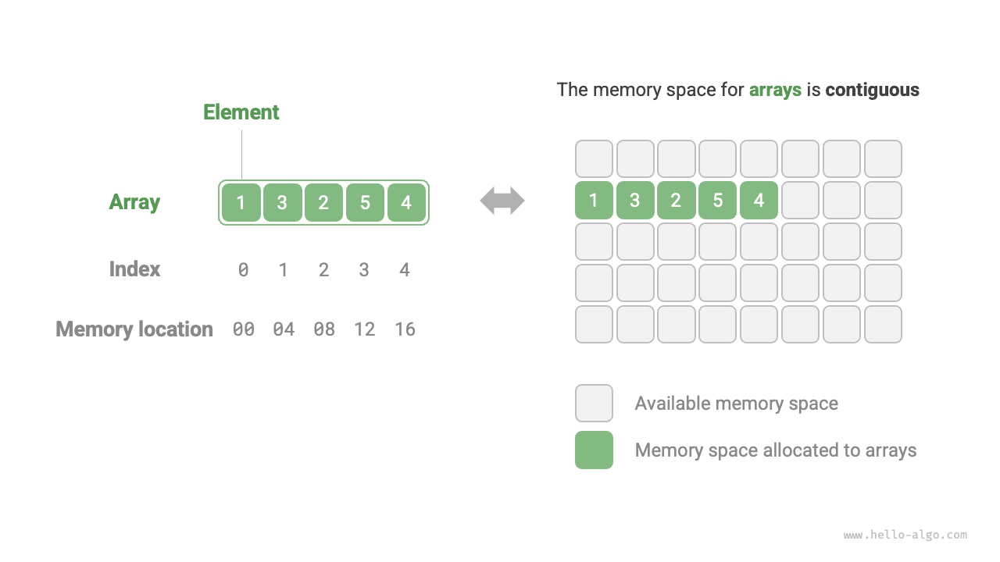
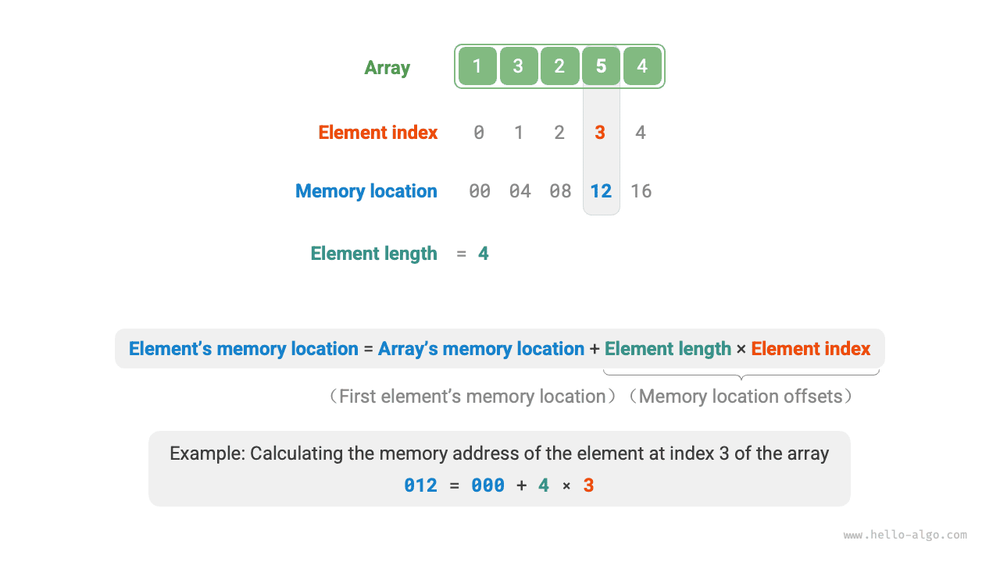
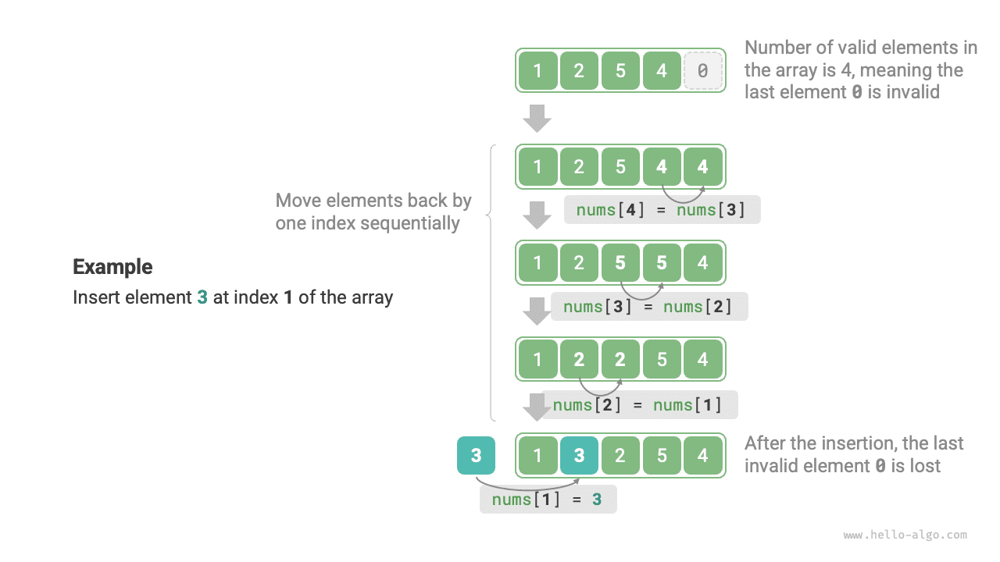
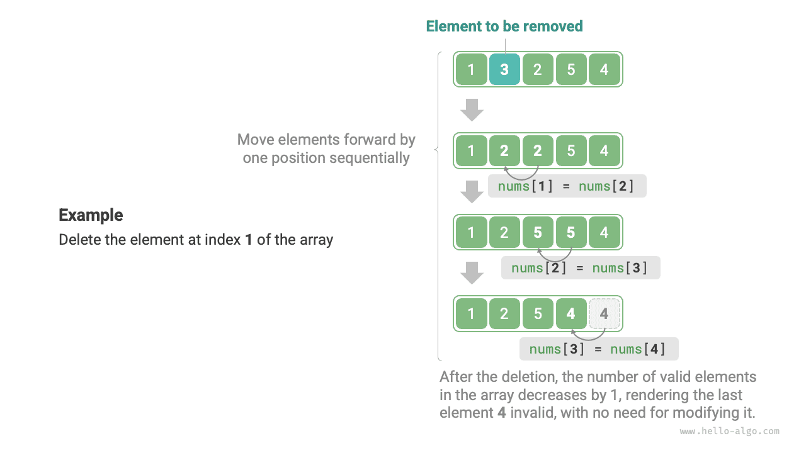

An <u>array</u> is a linear data structure that stores elements of the same type in contiguous memory space. The position of an element in the array is called the element's <u>index</u>. The figure below illustrates the main concepts and storage method of arrays.



## Common Array Operations

### Initializing Arrays

We can choose between two array initialization methods based on our needs: with or without initial values. When no initial values are specified, most programming languages initialize array elements to $0$:

<div class="lang-tab">
<p class="lang-tab__label">Python</p>

```python title="array.py"
# Initialize array
arr: list[int] = [0] * 5  # [ 0, 0, 0, 0, 0 ]
nums: list[int] = [1, 3, 2, 5, 4]
```

</div>

### Accessing Elements

Array elements are stored in contiguous memory space, which means calculating the memory address of array elements is very easy. Given the array's memory address (the memory address of the first element) and an element's index, we can use the formula shown in the figure below to calculate the element's memory address and directly access that element.



Observing the figure above, we find that the first element of an array has an index of $0$, which may seem counterintuitive since counting from $1$ would be more natural. However, from the perspective of the address calculation formula, **an index is essentially an offset from the memory address**. The address offset of the first element is $0$, so it is reasonable for its index to be $0$.

Accessing elements in an array is highly efficient; we can randomly access any element in the array in $O(1)$ time.

<div class="lang-tab">
<p class="lang-tab__label">Python</p>

```py
def random_access(nums: list[int]) -> int:
    """Access an element at a random index"""
    # اختر عددًا عشوائيًا في النطاق [0, len(nums)-1]
    random_index = random.randint(0, len(nums) - 1)
    # احصل على العنصر المختار عشوائيًا وأعده
    random_num = nums[random_index]
    return random_num
```

</div>

### Inserting Elements

Array elements are packed tightly together in memory, with no extra space between them for additional data. As shown in the figure below, if we want to insert an element in the middle of an array, we need to shift all subsequent elements one position to the right and then assign the value at that index.



It is worth noting that since the length of an array is fixed, inserting an element will inevitably push the last element out of the array. We will leave the solution to this problem for discussion in the "List" chapter.

<div class="lang-tab">
<p class="lang-tab__label">Python</p>

```py
def insert(nums: list[int], num: int, index: int):
    """Insert element num at index `index` in the array"""
    # أزح كل العناصر من الفهرس `index` وما بعده موضعًا واحدًا إلى اليمين
    for i in range(len(nums) - 1, index, -1):
        nums[i] = nums[i - 1]
    # أسند num إلى العنصر عند الفهرس `index`
    nums[index] = num
```

</div>

### Removing Elements

Similarly, as shown in the figure below, to delete the element at index $i$, we need to shift all elements after index $i$ forward by one position.



Note that after the deletion is complete, the original last element is no longer meaningful, so we do not need to modify it explicitly.

<div class="lang-tab">
<p class="lang-tab__label">Python</p>

```py
def remove(nums: list[int], index: int):
    """Remove the element at index `index`"""
    # أزح كل العناصر بعد الفهرس `index` موضعًا واحدًا إلى اليسار
    for i in range(index, len(nums) - 1):
        nums[i] = nums[i + 1]
```

</div>

Overall, array insertion and deletion operations have the following drawbacks:

- **High time complexity**: The average time complexity for both insertion and deletion in arrays is $O(n)$, where $n$ is the length of the array.
- **Loss of elements**: Since the length of an array is immutable, after inserting an element, elements that exceed the array's length will be lost.
- **Memory waste**: We can initialize a relatively long array and use only the front portion, so that any overwritten tail elements are merely unused placeholders, but this wastes some memory space.

### Traversing Arrays

In most programming languages, we can traverse an array either by index or by directly iterating through each element in the array:

<div class="lang-tab">
<p class="lang-tab__label">Python</p>

```py
def traverse(nums: list[int]):
    """Traverse the array"""
    count = 0
    # اجتز المصفوفة بالفهرس
    for i in range(len(nums)):
        count += nums[i]
    # تكرّر مباشرةً على عناصر المصفوفة
    for num in nums:
        count += num
    # تكرّر على الفهارس والعناصر معًا
    for i, num in enumerate(nums):
        count += nums[i]
        count += num
```

</div>

### Finding Elements

Finding a specified element in an array requires traversing the array and checking whether the element value matches in each iteration; if it matches, output the corresponding index.

Since an array is a linear data structure, the above search operation is called a "linear search".

<div class="lang-tab">
<p class="lang-tab__label">Python</p>

```py
def find(nums: list[int], target: int) -> int:
    """Find a specified element in the array"""
    for i in range(len(nums)):
        if nums[i] == target:
            return i
    return -1
```

</div>

### Expanding Arrays

In complex system environments, programs cannot guarantee that the memory space after an array is available, making it unsafe to expand the array's capacity. Therefore, in most programming languages, **the length of an array is immutable**.

If we want to expand an array, we need to create a new, larger array and then copy the original array elements to the new array one by one. This is an $O(n)$ operation, which is very time-consuming when the array is large. The code is shown below:

<div class="lang-tab">
<p class="lang-tab__label">Python</p>

```py
# لاحظ أن قائمة Python مصفوفة ديناميكية يمكن مدّها مباشرةً
# لأغراض التعلم، تعامل هذه الدالة مع القائمة بوصفها مصفوفة ثابتة الطول
def extend(nums: list[int], enlarge: int) -> list[int]:
    """Extend the array length"""
    # مهّد مصفوفة بالطول الممدود
    res = [0] * (len(nums) + enlarge)
    # انسخ كل العناصر من المصفوفة الأصلية إلى المصفوفة الجديدة
    for i in range(len(nums)):
        res[i] = nums[i]
    # أعد المصفوفة الجديدة الممدودة
    return res
```

</div>

## Advantages and Limitations of Arrays

Arrays are stored in contiguous memory space with elements of the same type. This approach contains rich prior information that the system can use to optimize the efficiency of data structure operations.

- **High space efficiency**: Arrays allocate contiguous memory blocks for data without additional structural overhead.
- **Support for random access**: Arrays allow accessing any element in $O(1)$ time.
- **Cache locality**: When accessing array elements, the computer not only loads the element but also caches the surrounding data, thereby leveraging the cache to improve the execution speed of subsequent operations.

Contiguous space storage is a double-edged sword with the following limitations:

- **Low insertion and deletion efficiency**: When an array has many elements, insertion and deletion operations require shifting a large number of elements.
- **Immutable length**: After an array is initialized, its length is fixed. Expanding the array requires copying all data to a new array, which is very costly.
- **Space waste**: If the allocated size of an array exceeds what is actually needed, the extra space is wasted.

## Typical Applications of Arrays

Arrays are a fundamental and common data structure, frequently used in various algorithms and for implementing various complex data structures.

- **Random access**: If we want to randomly sample some items, we can use an array to store them and generate a random sequence to implement random sampling based on indices.
- **Sorting and searching**: Arrays are the most commonly used data structure for sorting and searching algorithms. Quick sort, merge sort, binary search, and others are primarily performed on arrays.
- **Lookup tables**: When we need to quickly find an element or its corresponding relationship, we can use an array as a lookup table. For example, if we want to implement a mapping from characters to ASCII codes, we can use the ASCII code value of a character as an index, with the corresponding element stored at that position in the array.
- **Machine learning**: Neural networks make extensive use of linear algebra operations between vectors, matrices, and tensors, all of which are constructed in the form of arrays. Arrays are the most commonly used data structure in neural network programming.
- **Data structure implementation**: Arrays can be used to implement stacks, queues, hash tables, heaps, graphs, and other data structures. For example, the adjacency matrix representation of a graph is essentially a two-dimensional array.
