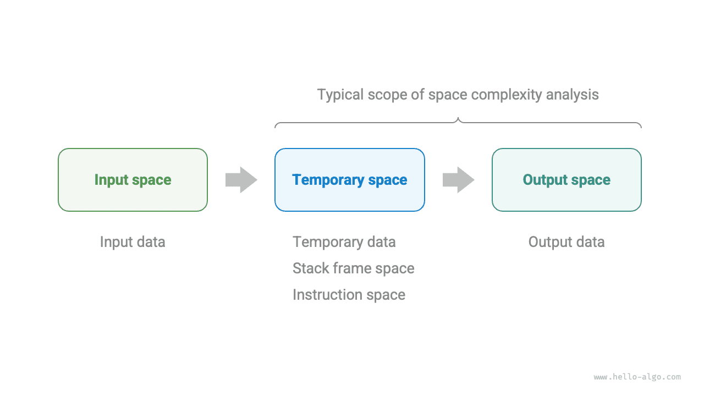
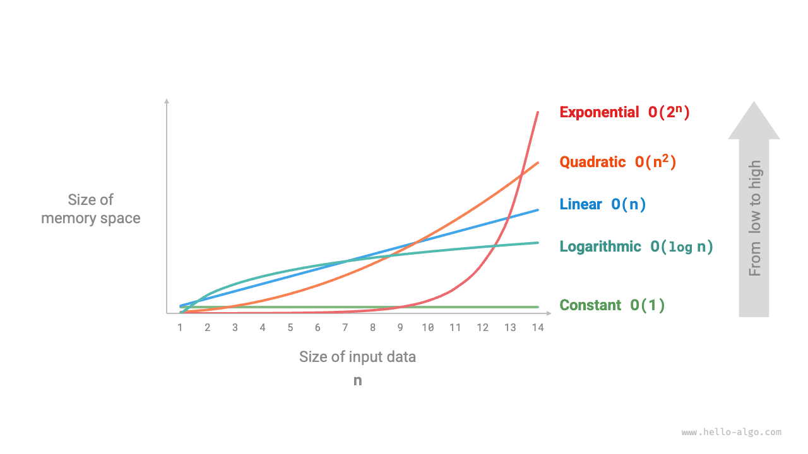
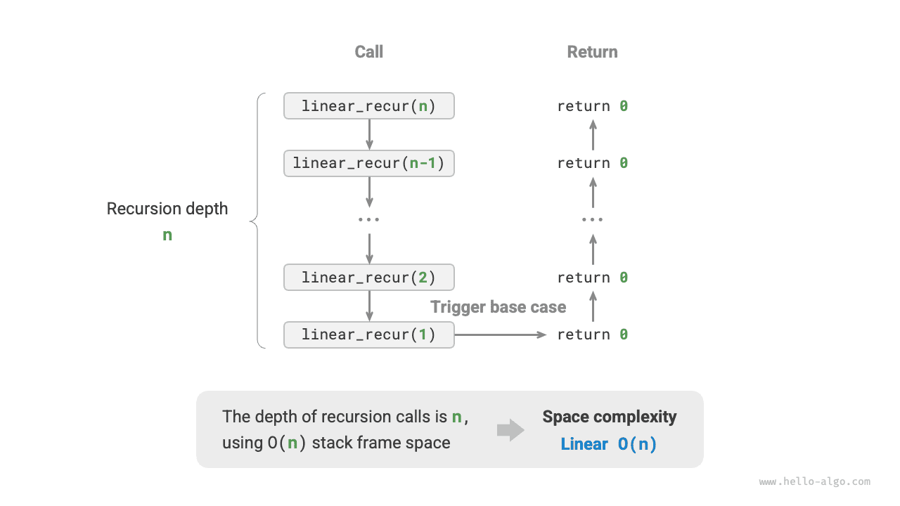
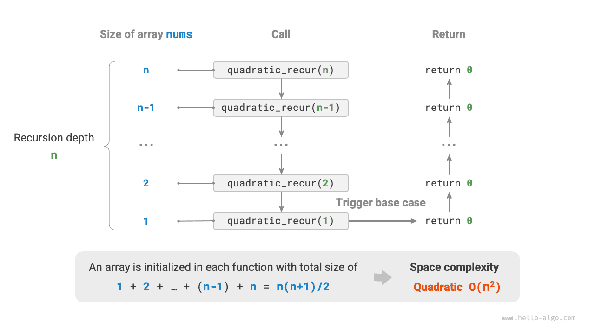
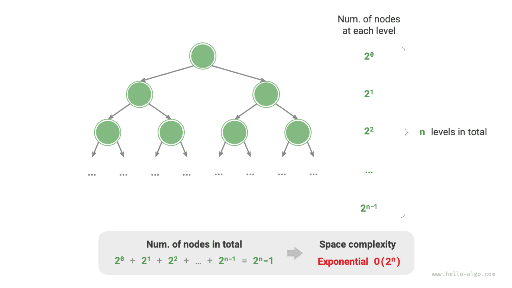

<u>Space complexity</u> measures the growth trend of memory space occupied by an algorithm as the data size increases. This concept is very similar to time complexity, except that "running time" is replaced with "occupied memory space".

## Algorithm-Related Space

The memory space used by an algorithm during execution mainly includes the following types.

- **Input space**: Used to store the input data of the algorithm.
- **Temporary space**: Used to store variables, objects, function contexts, and other data during the algorithm's execution.
- **Output space**: Used to store the output data of the algorithm.

In general, the scope of space complexity statistics is "temporary space" plus "output space".

Temporary space can be further divided into three parts.

- **Temporary data**: Used to save various constants, variables, objects, etc., during the algorithm's execution.
- **Stack frame space**: Used to save the context data of called functions. The system creates a stack frame at the top of the stack each time a function is called, and the stack frame space is released after the function returns.
- **Instruction space**: Used to save compiled program instructions, which are usually ignored in actual statistics.

When analyzing the space complexity of a program, **we usually consider three parts: temporary data, stack frame space, and output data**, as shown in the following figure.



The related code is as follows:

<div class="lang-tab">
<p class="lang-tab__label">Python</p>

```python title=""
class Node:
    """Class"""
    def __init__(self, x: int):
        self.val: int = x              # Node value
        self.next: Node | None = None  # Reference to the next node

def function() -> int:
    """Function"""
    # Perform some operations...
    return 0

def algorithm(n) -> int:  # Input data
    A = 0                 # Temporary data (constant, usually represented by uppercase letters)
    b = 0                 # Temporary data (variable)
    node = Node(0)        # Temporary data (object)
    c = function()        # Stack frame space (function call)
    return A + b + c      # Output data
```

</div>

## Calculation Method

The calculation method for space complexity is roughly the same as for time complexity, except that what we measure changes from the "number of operations" to the "amount of space used".

Unlike time complexity, **we usually only focus on the worst-case space complexity**. This is because memory space is a hard requirement, and we must ensure that sufficient memory space is reserved for all input data.

Observe the following code. Here, "worst case" in worst-case space complexity has two meanings.

1. **Based on the worst input data**: When $n < 10$, the space complexity is $O(1)$; but when $n > 10$, the initialized array `nums` occupies $O(n)$ space, so the worst-case space complexity is $O(n)$.
2. **Based on the peak memory during algorithm execution**: For example, before executing the last line, the program occupies $O(1)$ space; when initializing the array `nums`, the program occupies $O(n)$ space, so the worst-case space complexity is $O(n)$.

<div class="lang-tab">
<p class="lang-tab__label">Python</p>

```python title=""
def algorithm(n: int):
    a = 0               # O(1)
    b = [0] * 10000     # O(1)
    if n > 10:
        nums = [0] * n  # O(n)
```

</div>

**In recursive functions, it is necessary to count the stack frame space**. Observe the following code:

<div class="lang-tab">
<p class="lang-tab__label">Python</p>

```python title=""
def function() -> int:
    # Perform some operations
    return 0

def loop(n: int):
    """Loop has space complexity of O(1)"""
    for _ in range(n):
        function()

def recur(n: int):
    """Recursion has space complexity of O(n)"""
    if n == 1:
        return
    return recur(n - 1)
```

</div>

The time complexity of both functions `loop()` and `recur()` is $O(n)$, but their space complexities are different.

- The function `loop()` calls `function()` $n$ times in a loop. In each iteration, `function()` returns and releases its stack frame space, so the space complexity remains $O(1)$.
- The recursive function `recur()` has $n$ unreturned `recur()` instances existing simultaneously during execution, thus occupying $O(n)$ stack frame space.

## Common Types

Let the input data size be $n$. The following figure shows common types of space complexity (arranged from low to high).

$$
\begin{aligned}
& O(1) < O(\log n) < O(n) < O(n^2) < O(2^n) \newline
& \text{Constant} < \text{Logarithmic} < \text{Linear} < \text{Quadratic} < \text{Exponential}
\end{aligned}
$$



### Constant Order $O(1)$

Constant order is common for constants, variables, and objects whose number is independent of the input data size $n$.

It should be noted that memory occupied by initializing variables or calling functions in a loop is released when entering the next iteration, so it does not accumulate space, and the space complexity remains $O(1)$:

<div class="lang-tab">
<p class="lang-tab__label">Python</p>

```py
def constant(n: int):
    """Constant complexity"""
    # الثوابت والمتغيرات والكائنات تشغل مساحة O(1)
    a = 0
    nums = [0] * 10000
    node = ListNode(0)
    # المتغيرات في الحلقة تشغل مساحة O(1)
    for _ in range(n):
        c = 0
    # استدعاءات الدوال في الحلقة تشغل مساحة O(1)
    for _ in range(n):
        function()
```

</div>

### Linear Order $O(n)$

Linear order is common in arrays, linked lists, stacks, queues, etc., where the number of elements is proportional to $n$:

<div class="lang-tab">
<p class="lang-tab__label">Python</p>

```py
def linear(n: int):
    """Linear complexity"""
    # قائمة بطول n تشغل مساحة O(n)
    nums = [0] * n
    # جدول تجزئة فيه n إدخالًا يشغل مساحة O(n)
    hmap = dict[int, str]()
    for i in range(n):
        hmap[i] = str(i)
```

</div>

As shown in the following figure, the recursion depth of this function is $n$, meaning that there are $n$ unreturned `linear_recur()` functions existing simultaneously, using $O(n)$ stack frame space:

<div class="lang-tab">
<p class="lang-tab__label">Python</p>

```py
def linear_recur(n: int):
    """Linear complexity (recursive implementation)"""
    print("Recursion: n =", n)
    if n == 1:
        return
    linear_recur(n - 1)
```

</div>



### Quadratic Order $O(n^2)$

Quadratic order is common in matrices and graphs, where the number of elements is quadratically related to $n$:

<div class="lang-tab">
<p class="lang-tab__label">Python</p>

```py
def quadratic(n: int):
    """Quadratic complexity"""
    # القائمة ثنائية الأبعاد تشغل مساحة O(n^2)
    num_matrix = [[0] * n for _ in range(n)]
```

</div>

As shown in the following figure, the recursion depth of this function is $n$, and an array is initialized in each recursive function with lengths of $n$, $n-1$, $\dots$, $2$, $1$, with an average length of $n / 2$, thus occupying $O(n^2)$ space overall:

<div class="lang-tab">
<p class="lang-tab__label">Python</p>

```py
def quadratic_recur(n: int) -> int:
    """Quadratic complexity (recursive implementation)"""
    if n <= 0:
        return 0
    # أطوال المصفوفة nums هي n، n-1، ...، 2، 1
    nums = [0] * n
    return quadratic_recur(n - 1)
```

</div>



### Exponential Order $O(2^n)$

Exponential order is common in binary trees. Observe the following figure: a "full binary tree" with $n$ levels has $2^n - 1$ nodes, occupying $O(2^n)$ space:

<div class="lang-tab">
<p class="lang-tab__label">Python</p>

```py
def build_tree(n: int) -> TreeNode | None:
    """Exponential complexity (building a perfect binary tree)"""
    if n == 0:
        return None
    root = TreeNode(0)
    root.left = build_tree(n - 1)
    root.right = build_tree(n - 1)
    return root
```

</div>



### Logarithmic Order $O(\log n)$

Logarithmic order is common in divide-and-conquer algorithms. For example, merge sort: given an input array of length $n$, each recursion divides the array in half from the midpoint, forming a recursion tree of height $\log n$, using $O(\log n)$ stack frame space.

Another example is converting a number to a string. Given a positive integer $n$, it has $\lfloor \log_{10} n \rfloor + 1$ digits, i.e., the corresponding string length is $\lfloor \log_{10} n \rfloor + 1$, so the space complexity is $O(\log_{10} n + 1) = O(\log n)$.

## Trading Time for Space

Ideally, we hope that both the time complexity and space complexity of an algorithm can reach optimal. However, in practice, optimizing both time complexity and space complexity simultaneously is usually very difficult.

**Reducing time complexity usually comes at the cost of increasing space complexity, and vice versa**. Sacrificing memory space to improve execution speed is called "trading space for time"; the reverse is called "trading time for space".

The choice of which approach depends on which aspect we value more. In most cases, time is more precious than space, so "trading space for time" is usually the more common strategy. Of course, when the data volume is very large, controlling space complexity is also very important.
