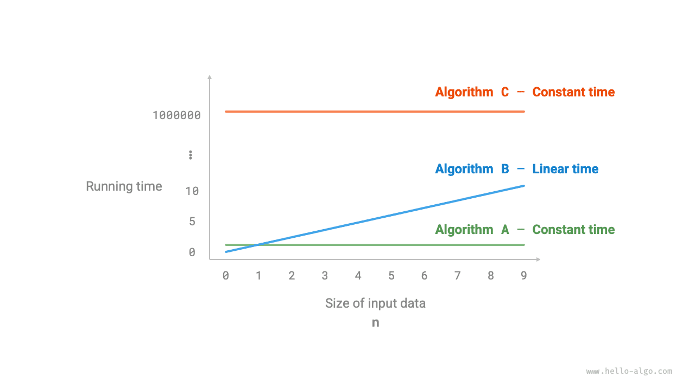
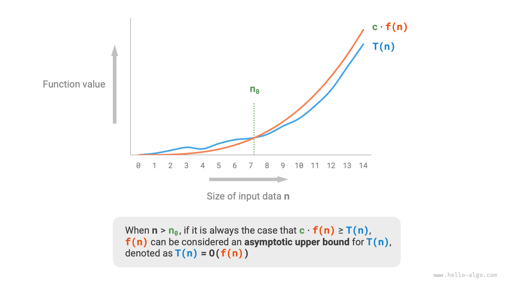
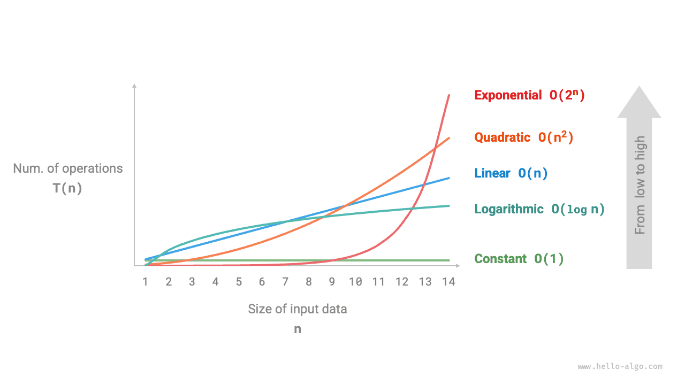
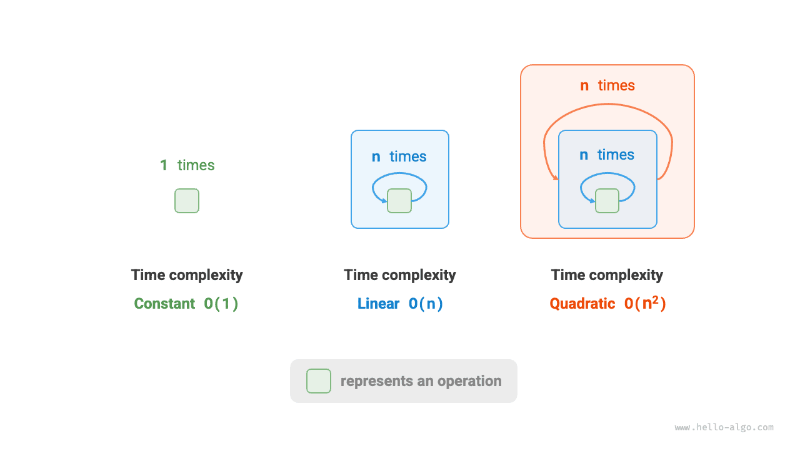
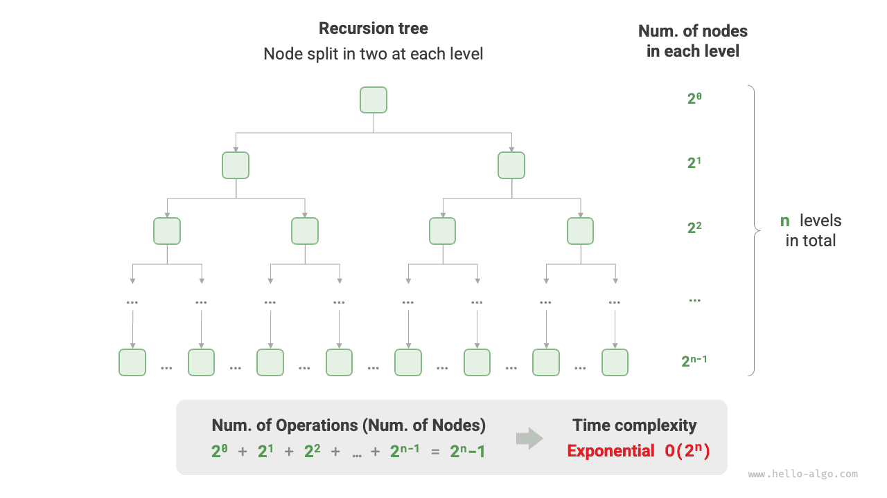
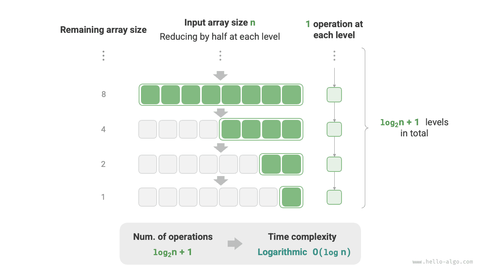
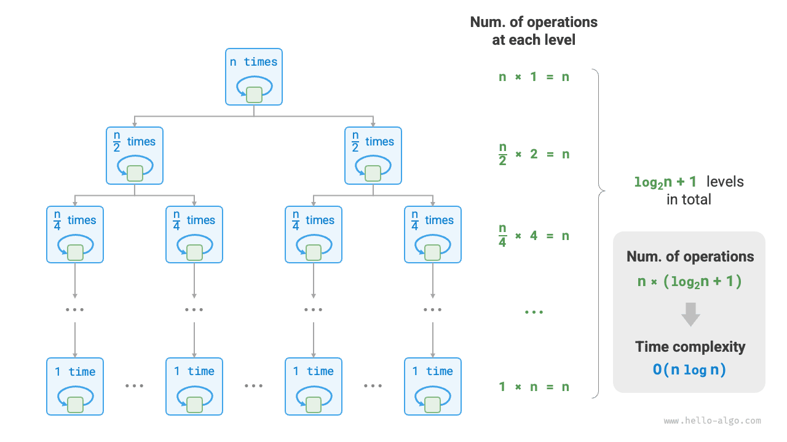
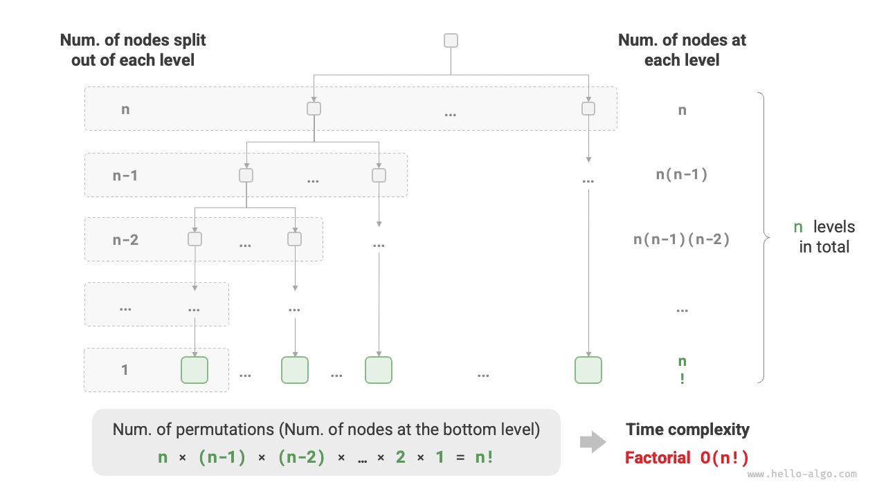

Runtime can intuitively and accurately reflect the efficiency of an algorithm. If we want to accurately estimate the runtime of a piece of code, how should we proceed?

1. **Determine the running platform**, including hardware configuration, programming language, system environment, etc., as these factors all affect code execution efficiency.
2. **Evaluate the runtime required for various computational operations**, for example, an addition operation `+` requires 1 ns, a multiplication operation `*` requires 10 ns, a print operation `print()` requires 5 ns, etc.
3. **Count all computational operations in the code**, and sum the execution times of all operations to obtain the runtime.

For example, in the following code, the input data size is $n$:

<div class="lang-tab">
<p class="lang-tab__label">Python</p>

```python title=""
# On a certain running platform
def algorithm(n: int):
    a = 2      # 1 ns
    a = a + 1  # 1 ns
    a = a * 2  # 10 ns
    # Loop n times
    for _ in range(n):  # 1 ns
        print(0)        # 5 ns
```

</div>

According to the above method, the algorithm's runtime can be obtained as $(6n + 12)$ ns:

$$
1 + 1 + 10 + (1 + 5) \times n = 6n + 12
$$

In reality, however, **trying to count an algorithm's exact runtime is neither practical nor realistic**. First, we do not want to tie the estimated time to the running platform, because algorithms need to run on many different platforms. Second, it is difficult to know the runtime of each type of operation, which makes the estimation process extremely difficult.

## Counting Time Growth Trends

Time complexity analysis does not count the algorithm's runtime, **but rather counts the growth trend of the algorithm's runtime as the data volume increases**.

The concept of "time growth trend" is rather abstract; let us understand it through an example. Suppose the input data size is $n$, and given three algorithms `A`, `B`, and `C`:

<div class="lang-tab">
<p class="lang-tab__label">Python</p>

```python title=""
# Time complexity of algorithm A: constant order
def algorithm_A(n: int):
    print(0)
# Time complexity of algorithm B: linear order
def algorithm_B(n: int):
    for _ in range(n):
        print(0)
# Time complexity of algorithm C: constant order
def algorithm_C(n: int):
    for _ in range(1000000):
        print(0)
```

</div>

The figure below shows the time complexity of the above three algorithm functions.

- Algorithm `A` has only $1$ print operation, and the algorithm's runtime does not grow as $n$ increases. We call the time complexity of this algorithm "constant order".
- In algorithm `B`, the print operation needs to loop $n$ times, and the algorithm's runtime grows linearly as $n$ increases. The time complexity of this algorithm is called "linear order".
- In algorithm `C`, the print operation needs to loop $1000000$ times. Although the runtime is very long, it is independent of the input data size $n$. Therefore, the time complexity of `C` is the same as `A`, still "constant order".



Compared to directly counting the algorithm's runtime, what are the characteristics of time complexity analysis?

- **Time complexity can effectively evaluate algorithm efficiency**. For example, the runtime of algorithm `B` grows linearly; when $n > 1$ it is slower than algorithm `A`, and when $n > 1000000$ it is slower than algorithm `C`. In fact, as long as the input data size $n$ is sufficiently large, an algorithm with "constant order" complexity will always be superior to one with "linear order" complexity, which is precisely the meaning of time growth trend.
- **The derivation method for time complexity is simpler**. Obviously, the running platform and the types of computational operations are both unrelated to the growth trend of the algorithm's runtime. Therefore, in time complexity analysis, we can simply treat the execution time of all computational operations as the same "unit time", reducing "tracking the runtime of each operation" to "counting the number of operations", which greatly reduces the difficulty of estimation.
- **Time complexity also has certain limitations**. For example, although algorithms `A` and `C` have the same time complexity, their actual runtimes differ significantly. Similarly, although algorithm `B` has a higher time complexity than `C`, when the input data size $n$ is small, algorithm `B` is clearly superior to algorithm `C`. In such cases, it is often difficult to judge the efficiency of algorithms based solely on time complexity. Of course, despite the above issues, complexity analysis remains the most effective and commonly used method for evaluating algorithm efficiency.

## Asymptotic Upper Bound of Functions

Given a function with input size $n$:

<div class="lang-tab">
<p class="lang-tab__label">Python</p>

```python title=""
def algorithm(n: int):
    a = 1      # +1
    a = a + 1  # +1
    a = a * 2  # +1
    # Loop n times
    for i in range(n):  # +1
        print(0)        # +1
```

</div>

Let the number of operations of the algorithm be a function of the input data size $n$, denoted as $T(n)$. Then the number of operations of the above function is:

$$
T(n) = 3 + 2n
$$

$T(n)$ is a linear function, indicating that its runtime growth trend is linear, and therefore its time complexity is linear order.

We denote the time complexity of linear order as $O(n)$. This mathematical symbol is called <u>big-$O$ notation</u>, representing the <u>asymptotic upper bound</u> of the function $T(n)$.

Time complexity analysis essentially calculates the asymptotic upper bound of "the number of operations $T(n)$", which has a clear mathematical definition.

<div class="note">
<p class="note__title">Asymptotic upper bound of functions</p>

If there exist positive real numbers $c$ and $n_0$ such that for all $n > n_0$, we have $T(n) \leq c \cdot f(n)$, then $f(n)$ can be considered as an asymptotic upper bound of $T(n)$, denoted as $T(n) = O(f(n))$.

</div>

As shown in the figure below, calculating the asymptotic upper bound is to find a function $f(n)$ such that when $n$ tends to infinity, $T(n)$ and $f(n)$ are at the same growth level, differing only by a constant coefficient $c$.



## Derivation Method

The idea of an asymptotic upper bound is somewhat mathematical. If you feel you haven't fully understood it, don't worry. We can first master the derivation method, and gradually grasp its mathematical meaning through continuous practice.

According to the definition, after determining $f(n)$, we can obtain the time complexity $O(f(n))$. So how do we determine the asymptotic upper bound $f(n)$? Overall, it is divided into two steps: first count the number of operations, then determine the asymptotic upper bound.

### Step 1: Count the Number of Operations

For code, count from top to bottom line by line. However, since the constant coefficient $c$ in $c \cdot f(n)$ above can be of any size, **coefficients and constant terms in the number of operations $T(n)$ can all be ignored**. According to this principle, the following counting simplification techniques can be summarized.

1. **Ignore constants in $T(n)$**. Because they are all independent of $n$, they do not affect time complexity.
2. **Omit all coefficients**. For example, looping $2n$ times, $5n + 1$ times, etc., can all be simplified as $n$ times, because the coefficient before $n$ does not affect time complexity.
3. **Use multiplication for nested loops**. The total number of operations equals the product of the number of operations in the outer and inner loops, with each layer of loop still able to apply techniques `1.` and `2.` separately.

Given a function, we can use the above techniques to count the number of operations:

<div class="lang-tab">
<p class="lang-tab__label">Python</p>

```python title=""
def algorithm(n: int):
    a = 1      # +0 (Technique 1)
    a = a + n  # +0 (Technique 1)
    # +n (Technique 2)
    for i in range(5 * n + 1):
        print(0)
    # +n*n (Technique 3)
    for i in range(2 * n):
        for j in range(n + 1):
            print(0)
```

</div>

The following formula shows the counting results before and after using the above techniques; both derive a time complexity of $O(n^2)$.

$$
\begin{aligned}
T(n) & = 2n(n + 1) + (5n + 1) + 2 & \text{Complete count (-.-|||)} \newline
& = 2n^2 + 7n + 3 \newline
T(n) & = n^2 + n & \text{Simplified count (o.O)}
\end{aligned}
$$

### Step 2: Determine the Asymptotic Upper Bound

**Time complexity is determined by the highest-order term in $T(n)$**. This is because as $n$ tends to infinity, the highest-order term will play a dominant role, and the influence of other terms can be ignored.

The table below shows some examples, where some exaggerated values are used to emphasize the conclusion that "coefficients cannot shake the order". When $n$ tends to infinity, these constants become insignificant.

<p align="center"> Table <id> &nbsp; Time complexities corresponding to different numbers of operations </p>

| Number of Operations $T(n)$ | Time Complexity $O(f(n))$ |
| ---------------------- | -------------------- |
| $100000$               | $O(1)$               |
| $3n + 2$               | $O(n)$               |
| $2n^2 + 3n + 2$        | $O(n^2)$             |
| $n^3 + 10000n^2$       | $O(n^3)$             |
| $2^n + 10000n^{10000}$ | $O(2^n)$             |

## Common Types

Let the input data size be $n$. Common time complexity types are shown in the figure below (arranged in order from low to high).

$$
\begin{aligned}
& O(1) < O(\log n) < O(n) < O(n \log n) < O(n^2) < O(2^n) < O(n!) \newline
& \text{Constant} < \text{Logarithmic} < \text{Linear} < \text{Linearithmic} < \text{Quadratic} < \text{Exponential} < \text{Factorial}
\end{aligned}
$$



### Constant Order $O(1)$

The number of operations in constant order is independent of the input data size $n$, meaning it does not change as $n$ changes.

In the following function, although the value of `size` may be large, it is independent of the input data size $n$, so the time complexity remains $O(1)$:

<div class="lang-tab">
<p class="lang-tab__label">Python</p>

```py
def constant(n: int) -> int:
    """تعقيد ثابت"""
    count = 0
    size = 100000
    for _ in range(size):
        count += 1
    return count
```

</div>

### Linear Order $O(n)$

The number of operations in linear order grows linearly relative to the input data size $n$. Linear order typically appears in single-layer loops:

<div class="lang-tab">
<p class="lang-tab__label">Python</p>

```py
def linear(n: int) -> int:
    """تعقيد خطي"""
    count = 0
    for _ in range(n):
        count += 1
    return count
```

</div>

Operations such as traversing arrays and traversing linked lists have a time complexity of $O(n)$, where $n$ is the length of the array or linked list:

<div class="lang-tab">
<p class="lang-tab__label">Python</p>

```py
def array_traversal(nums: list[int]) -> int:
    """التعقيد الخطي (اجتياز مصفوفة)"""
    count = 0
    # عدد التكرارات يتناسب مع طول المصفوفة
    for num in nums:
        count += 1
    return count
```

</div>

It is worth noting that **the input data size $n$ should be determined according to the type of input data**. For example, in the first example, the variable $n$ is the input data size; in the second example, the array length $n$ is the data size.

### Quadratic Order $O(n^2)$

The number of operations in quadratic order grows quadratically relative to the input data size $n$. Quadratic order typically appears in nested loops, where both the outer and inner loops have a time complexity of $O(n)$, resulting in an overall time complexity of $O(n^2)$:

<div class="lang-tab">
<p class="lang-tab__label">Python</p>

```py
def quadratic(n: int) -> int:
    """تعقيد تربيعي"""
    count = 0
    # عدد التكرارات يتناسب مع مربع حجم المُدخل n
    for i in range(n):
        for j in range(n):
            count += 1
    return count
```

</div>

The figure below compares constant order, linear order, and quadratic order time complexities.



Taking bubble sort as an example, the outer loop executes $n - 1$ times, and the inner loop executes $n-1$, $n-2$, $\dots$, $2$, $1$ times, averaging $n / 2$ times, resulting in a time complexity of $O((n - 1) n / 2) = O(n^2)$:

<div class="lang-tab">
<p class="lang-tab__label">Python</p>

```py
def bubble_sort(nums: list[int]) -> int:
    """التعقيد التربيعي (الترتيب الفقاعي)"""
    count = 0  # العدّاد
    # الحلقة الخارجية: النطاق غير المرتب هو [0, i]
    for i in range(len(nums) - 1, 0, -1):
        # الحلقة الداخلية: انقل أكبر عنصر في النطاق غير المرتب [0, i] إلى نهايته اليمنى بالتبديل
        for j in range(i):
            if nums[j] > nums[j + 1]:
                # بدّل nums[j] و nums[j + 1]
                tmp: int = nums[j]
                nums[j] = nums[j + 1]
                nums[j + 1] = tmp
                count += 3  # تستغرق مبادلة عنصرين 3 عمليات ابتدائية
    return count
```

</div>

### Exponential Order $O(2^n)$

Biological "cell division" is a typical example of exponential order growth: the initial state is $1$ cell, after one round of division it becomes $2$, after two rounds it becomes $4$, and so on; after $n$ rounds of division there are $2^n$ cells.

The figure below and the following code simulate the cell division process, with a time complexity of $O(2^n)$. Note that the input $n$ represents the number of division rounds, and the return value `count` represents the total number of divisions.

<div class="lang-tab">
<p class="lang-tab__label">Python</p>

```py
def exponential(n: int) -> int:
    """التعقيد الأسي (تنفيذ تكراري)"""
    count = 0
    base = 1
    # تنقسم كل خلية إلى اثنتين في كل جولة، فينتج التتابع 1، 2، 4، 8، ...، 2^(n-1)
    for _ in range(n):
        for _ in range(base):
            count += 1
        base *= 2
    # count = 1 + 2 + 4 + 8 + .. + 2^(n-1) = 2^n - 1
    return count
```

</div>



In actual algorithms, exponential order often appears in recursive functions. For example, in the following code, it recursively splits in two, stopping after $n$ splits:

<div class="lang-tab">
<p class="lang-tab__label">Python</p>

```py
def exp_recur(n: int) -> int:
    """التعقيد الأسي (تنفيذ تعاودي)"""
    if n == 1:
        return 1
    return exp_recur(n - 1) + exp_recur(n - 1) + 1
```

</div>

Exponential order growth is very rapid and is common in exhaustive methods (brute force search, backtracking, etc.). For problems with large data scales, exponential order is unacceptable and typically requires dynamic programming or greedy algorithms to solve.

### Logarithmic Order $O(\log n)$

In contrast to exponential order, logarithmic order reflects the situation of "reducing to half each round". Let the input data size be $n$. Since it is reduced to half each round, the number of loops is $\log_2 n$, which is the inverse function of $2^n$.

The figure below and the following code simulate the process of "reducing to half each round", with a time complexity of $O(\log_2 n)$, abbreviated as $O(\log n)$:

<div class="lang-tab">
<p class="lang-tab__label">Python</p>

```py
def logarithmic(n: int) -> int:
    """التعقيد اللوغاريتمي (تنفيذ تكراري)"""
    count = 0
    while n > 1:
        n = n / 2
        count += 1
    return count
```

</div>



Like exponential order, logarithmic order also commonly appears in recursive functions. The following code forms a recursion tree of height $\log_2 n$:

<div class="lang-tab">
<p class="lang-tab__label">Python</p>

```py
def log_recur(n: int) -> int:
    """التعقيد اللوغاريتمي (تنفيذ تعاودي)"""
    if n <= 1:
        return 0
    return log_recur(n / 2) + 1
```

</div>

Logarithmic order commonly appears in algorithms based on the divide-and-conquer strategy, reflecting the idea of repeatedly splitting a problem and simplifying it. It grows slowly and is the ideal time complexity second only to constant order.

<div class="note">
<p class="note__title">What is the base of $O(\log n)$?</p>

To be precise, "dividing into $m$" corresponds to a time complexity of $O(\log_m n)$. And through the logarithmic base change formula, we can obtain time complexities with different bases that are equal:

$$
O(\log_m n) = O(\log_k n / \log_k m) = O(\log_k n)
$$

That is to say, the base $m$ can be converted without affecting the complexity. Therefore, we usually omit the base $m$ and denote logarithmic order simply as $O(\log n)$.

</div>

### Linearithmic Order $O(n \log n)$

Linearithmic order commonly appears in nested loops, where the time complexities of the two layers of loops are $O(\log n)$ and $O(n)$ respectively. The relevant code is as follows:

<div class="lang-tab">
<p class="lang-tab__label">Python</p>

```py
def linear_log_recur(n: int) -> int:
    """التعقيد الخطي-اللوغاريتمي"""
    if n <= 1:
        return 1
    # قسّم إلى مسألتين جزئيتين كل واحدة نصف الحجم الأصلي
    count = linear_log_recur(n // 2) + linear_log_recur(n // 2)
    # تشمل المسألة الجزئية الحالية n عملية
    for _ in range(n):
        count += 1
    return count
```

</div>

The figure below shows how linearithmic order is generated. Each level of the binary tree has a total of $n$ operations, and the tree has $\log_2 n + 1$ levels, resulting in a time complexity of $O(n \log n)$.



Mainstream sorting algorithms typically have a time complexity of $O(n \log n)$, such as quicksort, merge sort, and heap sort.

### Factorial Order $O(n!)$

Factorial order corresponds to the mathematical "permutation" problem. Given $n$ distinct elements, find all possible permutation schemes; the number of schemes is:

$$
n! = n \times (n - 1) \times (n - 2) \times \dots \times 2 \times 1
$$

Factorials are typically implemented using recursion. As shown in the figure below and the following code, the first level splits into $n$ branches, the second level splits into $n - 1$ branches, and so on, until the $n$-th level when splitting stops:

<div class="lang-tab">
<p class="lang-tab__label">Python</p>

```py
def factorial_recur(n: int) -> int:
    """التعقيد المضروبي (تنفيذ تعاودي)"""
    if n == 0:
        return 1
    count = 0
    # قسّم مسألة واحدة إلى n مسألة جزئية
    for _ in range(n):
        count += factorial_recur(n - 1)
    return count
```

</div>



Note that because when $n \geq 4$ we always have $n! > 2^n$, factorial order grows faster than exponential order, and is also unacceptable for large $n$.

## Worst, Best, and Average Time Complexities

**The time efficiency of an algorithm is often not fixed, but is related to the distribution of the input data**. Suppose we input an array `nums` of length $n$, where `nums` consists of numbers from $1$ to $n$, with each number appearing only once, but the element order is randomly shuffled. The task is to return the index of element $1$. We can draw the following conclusions.

- When `nums = [?, ?, ..., 1]`, i.e., when the last element is $1$, it requires a complete traversal of the array, **reaching worst-case time complexity $O(n)$**.
- When `nums = [1, ?, ?, ...]`, i.e., when the first element is $1$, no matter how long the array is, there is no need to continue traversing, **reaching best-case time complexity $\Omega(1)$**.

The "worst-case time complexity" corresponds to the function's asymptotic upper bound, denoted using big-$O$ notation. Correspondingly, the "best-case time complexity" corresponds to the function's asymptotic lower bound, denoted using $\Omega$ notation:

<div class="lang-tab">
<p class="lang-tab__label">Python</p>

```py
def find_one(nums: list[int]) -> int:
    """العثور على فهرس العدد 1 في المصفوفة nums"""
    for i in range(len(nums)):
        # عندما يكون 1 في بداية المصفوفة، يكون التعقيد الزمني في أفضل الحالات O(1)
        # عندما يكون 1 في نهاية المصفوفة، يكون التعقيد الزمني في أسوأ الحالات O(n)
        if nums[i] == 1:
            return i
    return -1
```

</div>

It is worth noting that we rarely use best-case time complexity in practice, because it can usually only be achieved with a very small probability and may be somewhat misleading. **The worst-case time complexity is more practical because it gives a safety value for efficiency**, allowing us to use the algorithm with confidence.

From the above example, we can see that both worst-case and best-case time complexities arise only under particular input distributions, which may occur with very low probability and may not truly reflect the algorithm's running efficiency. In contrast, **average time complexity can reflect the algorithm's running efficiency under random input data**, denoted using the $\Theta$ notation.

For some algorithms, we can simply derive the average case under random data distribution. For example, in the above example, since the input array is shuffled, the probability of element $1$ appearing at any index is equal, so the algorithm's average number of loops is half the array length $n / 2$, giving an average time complexity of $\Theta(n / 2) = \Theta(n)$.

But for more complex algorithms, calculating average time complexity is often quite difficult, because it is hard to analyze the overall mathematical expectation under data distribution. In this case, we usually use worst-case time complexity as the criterion for judging algorithm efficiency.

<div class="note">
<p class="note__title">Why is the $\Theta$ symbol rarely seen?</p>

This may be because the $O$ symbol is too catchy, so we often use it to represent average time complexity. But strictly speaking, this practice is not standard. In this book and other materials, if you encounter expressions like "average time complexity $O(n)$", please understand it directly as $\Theta(n)$.

</div>
