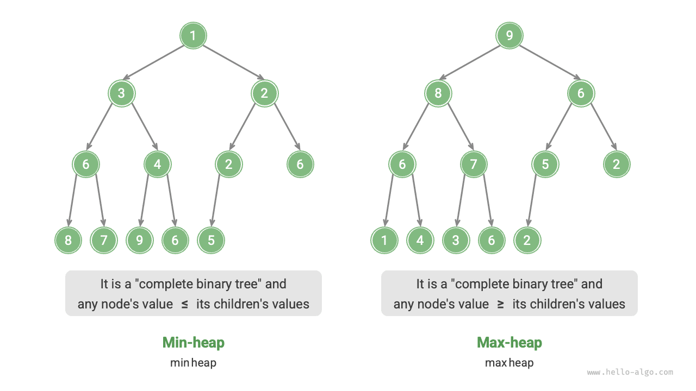
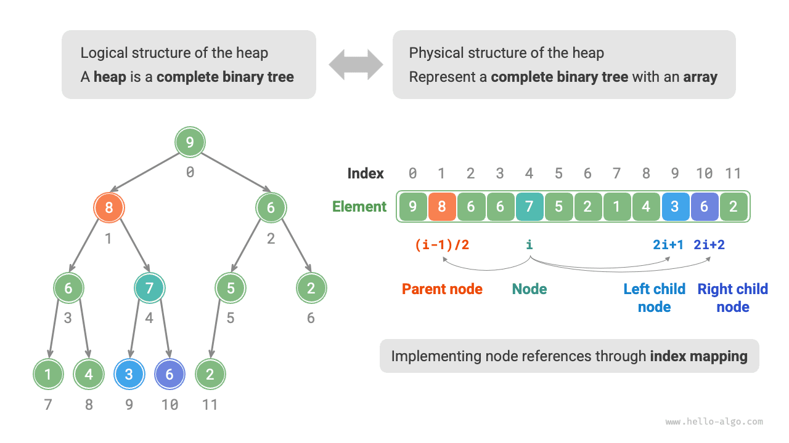

A <u>heap</u> is a complete binary tree that satisfies specific conditions and can be mainly categorized into two types, as shown in the figure below.

- <u>min heap</u>: The value of any node $\leq$ the values of its child nodes.
- <u>max heap</u>: The value of any node $\geq$ the values of its child nodes.



As a special case of a complete binary tree, heaps have the following characteristics.

- The bottom layer nodes are filled from left to right, and nodes in other layers are fully filled.
- We call the root node of the binary tree the "heap top" and the bottom-rightmost node the "heap bottom."
- For max heaps (min heaps), the value of the heap top element (root node) is the largest (smallest).

## Common Heap Operations

It should be noted that many programming languages provide a <u>priority queue</u>, an abstract data structure defined as a queue whose elements are ordered by priority.

In fact, **heaps are typically used to implement priority queues, with max heaps corresponding to priority queues where elements are dequeued in descending order**. From a usage perspective, we can regard "priority queue" and "heap" as equivalent data structures. Therefore, this book does not make a special distinction between the two and uniformly refers to them as "heap."

Common heap operations are shown in the table below, and method names need to be determined based on the programming language.

<p align="center"> Table <id> &nbsp; Efficiency of Heap Operations </p>

| Method name | Description                                                       | Time complexity |
| ----------- | ----------------------------------------------------------------- | --------------- |
| `push()`    | Insert an element into the heap                                   | $O(\log n)$     |
| `pop()`     | Remove the heap top element                                       | $O(\log n)$     |
| `peek()`    | Access the heap top element (max/min value for max/min heap)     | $O(1)$          |
| `size()`    | Get the number of elements in the heap                            | $O(1)$          |
| `isEmpty()` | Check if the heap is empty                                        | $O(1)$          |

In practical applications, we can directly use the heap class (or priority queue class) provided by programming languages.

Similar to "ascending order" and "descending order" in sorting algorithms, we can implement conversion between "min heap" and "max heap" by setting a `flag` or modifying the `Comparator`. The code is as follows:

<div class="lang-tab">
<p class="lang-tab__label">Python</p>

```python title="heap.py"
# Initialize a min heap
min_heap, flag = [], 1
# Initialize a max heap
max_heap, flag = [], -1

# Python's heapq module implements a min heap by default
# Consider negating elements before pushing them to the heap, which inverts the size relationship and thus implements a max heap
# In this example, flag = 1 corresponds to a min heap, flag = -1 corresponds to a max heap

# Push elements into the heap
heapq.heappush(max_heap, flag * 1)
heapq.heappush(max_heap, flag * 3)
heapq.heappush(max_heap, flag * 2)
heapq.heappush(max_heap, flag * 5)
heapq.heappush(max_heap, flag * 4)

# Get the heap top element
peek: int = flag * max_heap[0] # 5

# Remove the heap top element
# The removed elements will form a descending sequence
val = flag * heapq.heappop(max_heap) # 5
val = flag * heapq.heappop(max_heap) # 4
val = flag * heapq.heappop(max_heap) # 3
val = flag * heapq.heappop(max_heap) # 2
val = flag * heapq.heappop(max_heap) # 1

# Get the heap size
size: int = len(max_heap)

# Check if the heap is empty
is_empty: bool = not max_heap

# Build a heap from an input list
min_heap: list[int] = [1, 3, 2, 5, 4]
heapq.heapify(min_heap)
```

</div>

## Implementation of the Heap

The following implementation is for a max heap. To convert it to a min heap, simply reverse all comparison logic related to ordering (for example, replace $\geq$ with $\leq$). Interested readers are encouraged to implement this on their own.

### Heap Storage and Representation

As mentioned in the "Binary Tree" chapter, complete binary trees are well-suited for array representation. Since heaps are a type of complete binary tree, **we will use arrays to store heaps**.

When representing a binary tree with an array, elements represent node values, and indexes represent node positions in the binary tree. **Parent-child relationships are represented through index-mapping formulas**.

As shown in the figure below, given an index $i$, the index of its left child is $2i + 1$, the index of its right child is $2i + 2$, and the index of its parent is $(i - 1) / 2$ (floor division). When an index is out of bounds, it indicates a null node or that the node does not exist.



We can encapsulate the index mapping formula into functions for convenient subsequent use:

<div class="lang-tab">
<p class="lang-tab__label">Python</p>

```py
    def parent(self, i: int) -> int:
        """Get the parent index"""
        return (i - 1) // 2  # Floor division
```

</div>

### Accessing the Heap Top Element

The heap top element is the root node of the binary tree, which is also the first element of the list:

<div class="lang-tab">
<p class="lang-tab__label">Python</p>

```py
    def peek(self) -> int:
        """Access the top element of the heap"""
        return self.max_heap[0]
```

</div>

### Inserting an Element Into the Heap

Given an element `val`, we first add it to the bottom of the heap. After insertion, because `val` may be larger than other elements in the heap, the heap property may be violated. **Therefore, we need to restore the heap property along the path from the inserted node to the root**. This operation is called <u>heapify</u>.

Starting from the inserted node, **perform heapify from bottom to top**. As shown in the figure below, we compare the inserted node with its parent, and if the inserted node is larger, we swap them. We continue this process from bottom to top until we move past the root or reach a node that no longer needs to be swapped.

Given a total of $n$ nodes, the tree height is $O(\log n)$. Thus, the number of loop iterations in the heapify operation is at most $O(\log n)$, **making the time complexity of the element insertion operation $O(\log n)$**. The code is as follows:

<div class="lang-tab">
<p class="lang-tab__label">Python</p>

```py
    def sift_up(self, i: int):
        """Sift up starting from node i"""
        while True:
            # Get the parent of node i
            p = self.parent(i)
            # Stop sifting when the root has been passed or the node needs no repair
            if p < 0 or self.max_heap[i] <= self.max_heap[p]:
                break
            # Swap the two nodes
            self.swap(i, p)
            # Continue sifting up
            i = p
```

</div>

### Removing the Heap Top Element

The heap top element is the root node of the binary tree, which is the first element of the list. If we directly remove the first element from the list, all node indexes in the binary tree would change, making subsequent repair with heapify difficult. To minimize changes in element indexes, we use the following steps.

1. Swap the heap top element with the heap bottom element (swap the root node with the rightmost leaf node).
2. After swapping, remove the heap bottom from the list (note that since we've swapped, we're actually removing the original heap top element).
3. Starting from the root node, **perform heapify from top to bottom**.

As shown in the figure below, **the direction of "top-to-bottom heapify" is opposite to "bottom-to-top heapify"**. We compare the root node's value with its two children and swap it with the largest child. Then loop this operation until we pass a leaf node or encounter a node that doesn't need swapping.

Similar to the element insertion operation, the time complexity of the heap top element removal operation is also $O(\log n)$. The code is as follows:

<div class="lang-tab">
<p class="lang-tab__label">Python</p>

```py
    def sift_down(self, i: int):
        """Sift down starting from node i"""
        while True:
            # Find the node with the largest value among i, l, and r, and store its index in ma
            l, r, ma = self.left(i), self.right(i), i
            if l < self.size() and self.max_heap[l] > self.max_heap[ma]:
                ma = l
            if r < self.size() and self.max_heap[r] > self.max_heap[ma]:
                ma = r
            # Stop if node i is largest or both child indices l and r are out of bounds
            if ma == i:
                break
            # Swap the two nodes
            self.swap(i, ma)
            # Continue sifting down
            i = ma
```

</div>

## Common Applications of Heaps

- **Priority queue**: Heaps are typically the preferred data structure for implementing priority queues. The time complexity of both enqueue and dequeue operations is $O(\log n)$, and heap construction has a time complexity of $O(n)$, making these operations highly efficient.
- **Heap sort**: Given a set of data, we can build a heap with them and then continuously perform element removal operations to obtain sorted data. However, we usually use a more elegant approach to implement heap sort, as detailed in the "Heap Sort" chapter.
- **Getting the largest $k$ elements**: This is a classic algorithm problem and also a typical application, such as selecting the top 10 trending news items for Weibo Hot Search or the top 10 best-selling products.
