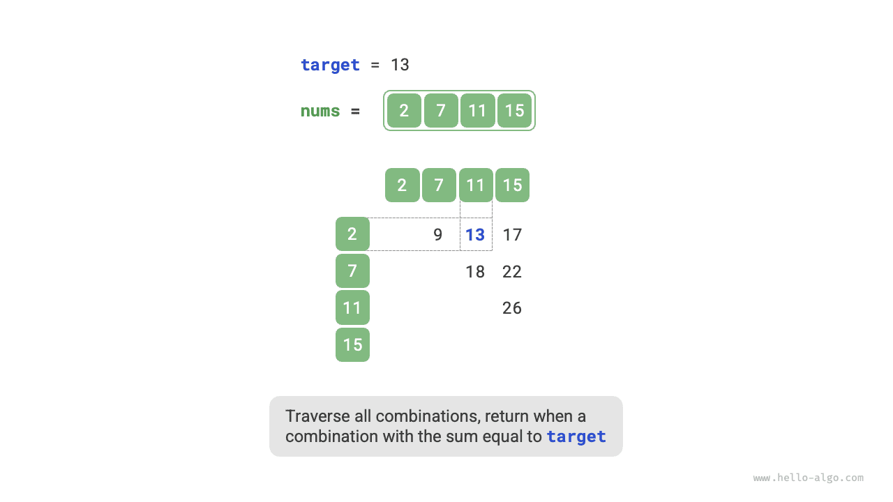

In algorithm problems, **we often reduce the time complexity of algorithms by replacing linear search with hash-based search**. Let's use an algorithm problem to deepen our understanding.

<div class="note">

Given an integer array `nums` and a target value `target`, find two elements in the array whose sum is `target`, and return their indices. Any solution will do.

</div>

## Linear Search: Trading Time for Space

Consider directly traversing all possible combinations. As shown in the figure below, we use nested loops and check in each iteration whether the sum of two integers is `target`. If so, return their indices.



The code is shown below:

<div class="lang-tab">
<p class="lang-tab__label">Python</p>

```py
def two_sum_brute_force(nums: list[int], target: int) -> list[int]:
    """Method 1: brute-force enumeration"""
    # Two nested loops give a time complexity of O(n^2)
    for i in range(len(nums) - 1):
        for j in range(i + 1, len(nums)):
            if nums[i] + nums[j] == target:
                return [i, j]
    return []
```

</div>

This method has a time complexity of $O(n^2)$ and a space complexity of $O(1)$, making it very time-consuming on large inputs.

## Hash-Based Search: Trading Space for Time

Consider using a hash table whose keys are array elements and whose values are their indices. Traverse the array and perform the steps shown in the figure below in each iteration:

1. Check if the number `target - nums[i]` is in the hash table. If so, directly return the indices of these two elements.
2. Add the key-value pair `nums[i]` and index `i` to the hash table.

The implementation is shown below and requires only a single loop:

<div class="lang-tab">
<p class="lang-tab__label">Python</p>

```py
def two_sum_hash_table(nums: list[int], target: int) -> list[int]:
    """Method 2: auxiliary hash table"""
    # The auxiliary hash table uses O(n) space
    dic = {}
    # A single loop with average O(1) hash operations gives an average time complexity of O(n)
    for i in range(len(nums)):
        if target - nums[i] in dic:
            return [dic[target - nums[i]], i]
        dic[nums[i]] = i
    return []
```

</div>

This method reduces the time complexity from $O(n^2)$ to $O(n)$ through hash-based search, greatly improving runtime efficiency.

Since an additional hash table needs to be maintained, the space complexity is $O(n)$. **Nevertheless, this method offers a more balanced overall time-space trade-off, making it the optimal solution to this problem**.
