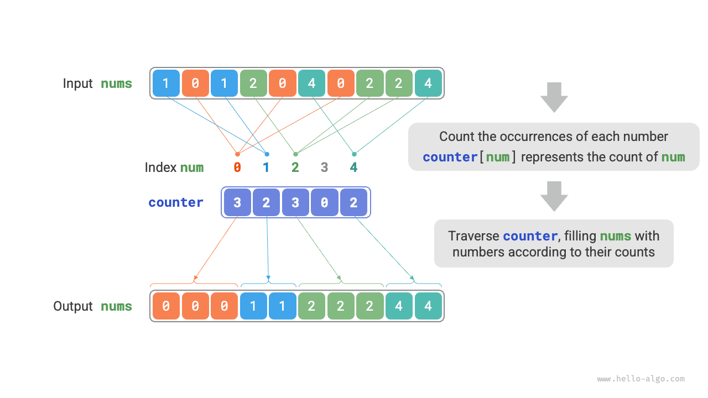

<u>Counting sort</u> sorts by counting the occurrences of elements and is typically applied to integer arrays.

## Simple Implementation

Let's start with a simple example. Given an array `nums` of length $n$, where the elements are all "non-negative integers", the overall flow of counting sort is shown in the figure below.

1. Traverse the array to find the largest number, denoted as $m$, and then create an auxiliary array `counter` of length $m + 1$.
2. **Use `counter` to count how many times each number appears in `nums`**, where `counter[num]` stores the number of occurrences of `num`. This is simple: traverse `nums` (denote the current number by `num`) and increment `counter[num]` by $1$ each time.
3. **Because the indices of `counter` are naturally ordered, the numbers are effectively already sorted**. Next, traverse `counter` and write the numbers back into `nums` in ascending order according to their occurrence counts.



The code is as follows:

<div class="lang-tab">
<p class="lang-tab__label">Python</p>

```py
def counting_sort_naive(nums: list[int]):
    """الترتيب بالعدّ"""
    # تنفيذ بسيط؛ لا يمكن استخدامه لترتيب الكائنات
    # 1. أوجد أكبر عنصر في المصفوفة m
    m = max(nums)
    # 2. عُد تكرارات كل عدد
    # يمثل counter[num] عدد تكرارات num
    counter = [0] * (m + 1)
    for num in nums:
        counter[num] += 1
    # 3. اجتز counter واملأ المصفوفة الأصلية nums بالعناصر
    i = 0
    for num in range(m + 1):
        for _ in range(counter[num]):
            nums[i] = num
            i += 1
```

</div>

<div class="note">
<p class="note__title">Connection between counting sort and bucket sort</p>

From the perspective of bucket sort, each index of the counting array `counter` can be viewed as a bucket, and the counting process can be seen as distributing elements into their corresponding buckets. Essentially, counting sort is a special case of bucket sort for integer data.

</div>

## Complete Implementation

Observant readers may have noticed that **if the input consists of objects, step `3.` above no longer works**. Suppose the input consists of product objects and we want to sort them by price (a member variable of the class); the above algorithm can only produce the sorted order of the prices themselves.

So how can we obtain the sorted order of the original data? We first compute the prefix sums of `counter`. As the name suggests, the prefix sum at index `i`, `prefix[i]`, equals the sum of the elements from index `0` through `i`:

$$
\text{prefix}[i] = \sum_{j=0}^i \text{counter[j]}
$$

**The prefix sum has a clear interpretation: `prefix[num] - 1` gives the index of the last occurrence of element `num` in the result array `res`**. This information is crucial because it tells us where each element should be placed in the result array. Next, we traverse the original array `nums` in reverse, and for each element `num`, perform the following two steps.

1. Place `num` at index `prefix[num] - 1` of the array `res`.
2. Decrease the prefix sum `prefix[num]` by $1$ to get the index for the next placement of `num`.

After the traversal is complete, the array `res` contains the sorted result, and finally `res` is used to overwrite the original array `nums`. The complete counting sort flow is shown in the figure below.

The counting sort implementation is shown below:

<div class="lang-tab">
<p class="lang-tab__label">Python</p>

```py
def counting_sort(nums: list[int]):
    """الترتيب بالعدّ"""
    # تنفيذ كامل؛ مستقر وقابل للتكيف لترتيب الكائنات
    # 1. أوجد أكبر عنصر في المصفوفة m
    m = max(nums)
    # 2. عُد تكرارات كل عدد
    # يمثل counter[num] عدد تكرارات num
    counter = [0] * (m + 1)
    for num in nums:
        counter[num] += 1
    # 3. احسب مجاميع البادئة لـ counter لتحوّل أعداد التكرارات إلى مواضع نهاية
    # أي أن counter[num]-1 هو فهرس آخر تكرار لـ num في res
    for i in range(m):
        counter[i + 1] += counter[i]
    # 4. اجتز nums بالعكس وضع كل عنصر في مصفوفة النتيجة res
    # مهّد المصفوفة res لتخزين النتيجة
    n = len(nums)
    res = [0] * n
    for i in range(n - 1, -1, -1):
        num = nums[i]
        res[counter[num] - 1] = num  # ضع num في الفهرس المقابل
        counter[num] -= 1  # أنقص مجموع البادئة بمقدار 1 لتحديد موضع وضع التكرار التالي لـ num
    # اكتب مصفوفة النتيجة res فوق المصفوفة الأصلية nums
    for i in range(n):
        nums[i] = res[i]
```

</div>

## Algorithm Characteristics

- **Time complexity is $O(n + m)$, and counting sort is non-adaptive**: Traversing `nums` and `counter` both takes linear time. In general, when $n \gg m$, the time complexity approaches $O(n)$.
- **Space complexity of $O(n + m)$, non-in-place sorting**: Uses arrays `res` and `counter` of lengths $n$ and $m$ respectively.
- **Stable sorting**: Since elements are filled into `res` in a "right-to-left" order, traversing `nums` in reverse can avoid changing the relative positions of equal elements, thereby achieving stable sorting. In fact, traversing `nums` in forward order can also yield correct sorting results, but the result would be unstable.

## Limitations

At this point, you might think counting sort is quite ingenious because it achieves efficient sorting simply by counting occurrences. However, the prerequisites for using counting sort are fairly restrictive.

**Counting sort is only applicable to non-negative integers**. To apply it to other types of data, you must ensure that they can be converted to non-negative integers without changing the relative ordering of the elements. For example, for an integer array containing negative numbers, you can first add a constant to every number to shift them into the non-negative range, and then shift them back after sorting.

**Counting sort is well suited to cases with many elements but a small value range**. For example, in the above scenario, $m$ cannot be too large; otherwise, it consumes too much space. And when $n \ll m$, counting sort takes $O(m)$ time, which may be slower than sorting algorithms with $O(n \log n)$ time complexity.
