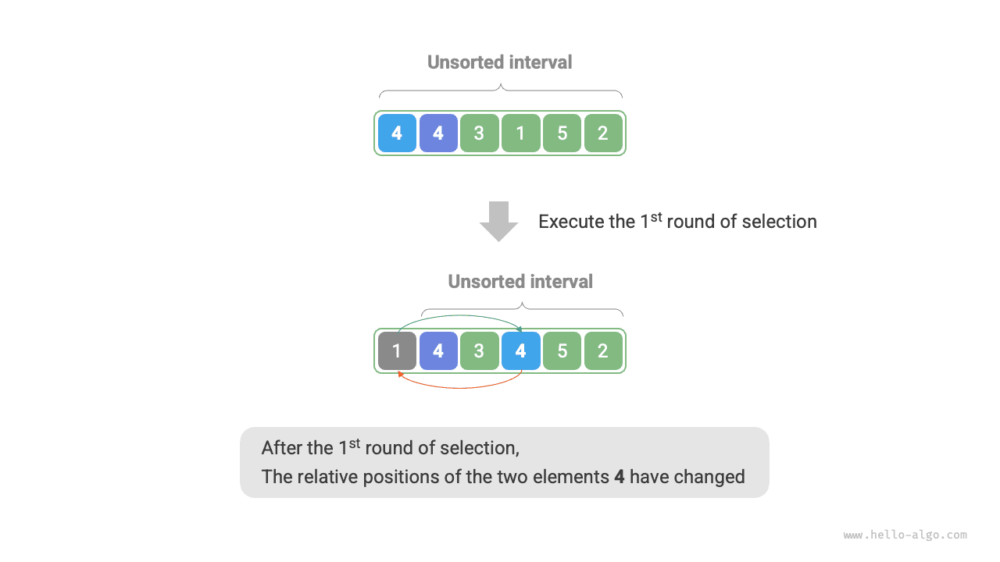

<u>Selection sort</u> works very simply: in each round, it selects the smallest element from the unsorted interval and places it at the end of the sorted interval.

Assume the array has length $n$. The procedure of selection sort is shown in the figure below.

1. Initially, all elements are unsorted, i.e., the unsorted (index) interval is $[0, n-1]$.
2. Select the smallest element in the interval $[0, n-1]$ and swap it with the element at index $0$. After completion, the first element of the array is sorted.
3. Select the smallest element in the interval $[1, n-1]$ and swap it with the element at index $1$. After completion, the first 2 elements of the array are sorted.
4. And so on. After $n - 1$ rounds of selection and swapping, the first $n - 1$ elements of the array are sorted.
5. The only remaining element must be the largest, so no further sorting is needed and the array is sorted.

In the code, we use $k$ to track the smallest element within the unsorted interval:

<div class="lang-tab">
<p class="lang-tab__label">Python</p>

```py
def selection_sort(nums: list[int]):
    """Selection sort"""
    n = len(nums)
    # الحلقة الخارجية: النطاق غير المرتب هو [i, n-1]
    for i in range(n - 1):
        # الحلقة الداخلية: أوجد أصغر عنصر في النطاق غير المرتب
        k = i
        for j in range(i + 1, n):
            if nums[j] < nums[k]:
                k = j  # سجّل فهرس أصغر عنصر
        # بدّل أصغر عنصر مع أول عنصر في النطاق غير المرتب
        nums[i], nums[k] = nums[k], nums[i]
```

</div>

## Algorithm Characteristics

- **Time complexity $O(n^2)$, non-adaptive sorting**: The outer loop has $n - 1$ rounds in total. The inner loop runs $n - 1$ times in the first round and $1$ time in the last round. Thus, it runs $n - 1$, $n - 2$, $\dots$, $2$, and $1$ times across the rounds, summing to $\frac{n(n - 1)}{2}$.
- **Space complexity $O(1)$, in-place sorting**: Pointers $i$ and $j$ use a constant amount of extra space.
- **Unstable sorting**: As shown in the figure below, element `nums[i]` may be swapped to the right of an element equal to it, causing a change in their relative order.


