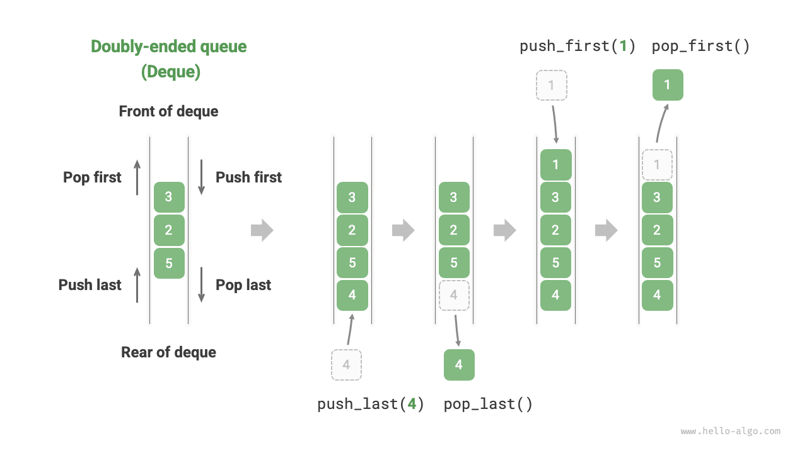

In a queue, we can only remove elements from the front or add elements at the rear. As shown in the figure below, a <u>double-ended queue (deque)</u> provides greater flexibility, allowing elements to be added or removed at both the front and the rear.



## Common Deque Operations

The common operations on a deque are shown in the table below. The specific method names depend on the programming language used.

<p align="center"> Table <id> &nbsp; Efficiency of Deque Operations </p>

| Method         | Description               | Time Complexity |
| -------------- | ------------------------- | --------------- |
| `push_first()` | Add element to front      | $O(1)$          |
| `push_last()`  | Add element to rear       | $O(1)$          |
| `pop_first()`  | Remove front element      | $O(1)$          |
| `pop_last()`   | Remove rear element       | $O(1)$          |
| `peek_first()` | Access front element      | $O(1)$          |
| `peek_last()`  | Access rear element       | $O(1)$          |

Similarly, we can directly use the deque classes provided by the programming language:

<div class="lang-tab">
<p class="lang-tab__label">Python</p>

```python title="deque.py"
from collections import deque

# Initialize deque
deq: deque[int] = deque()

# Enqueue elements
deq.append(2)      # Add to rear
deq.append(5)
deq.append(4)
deq.appendleft(3)  # Add to front
deq.appendleft(1)

# Access elements
front: int = deq[0]  # Front element
rear: int = deq[-1]  # Rear element

# Dequeue elements
pop_front: int = deq.popleft()  # Front element dequeue
pop_rear: int = deq.pop()       # Rear element dequeue

# Get deque length
size: int = len(deq)

# Check if deque is empty
is_empty: bool = len(deq) == 0
```

</div>

## Deque Implementation *

The implementation of a deque is similar to that of a queue. You can choose either a linked list or an array as the underlying data structure.

### Doubly Linked List Implementation

Reviewing the previous section, we used a regular singly linked list to implement a queue because it conveniently allows deleting the head node (corresponding to dequeue) and adding new nodes after the tail node (corresponding to enqueue).

For a deque, both the front and rear can perform enqueue and dequeue operations. In other words, a deque needs to implement operations in the opposite direction as well. For this reason, we use a "doubly linked list" as the underlying data structure for the deque.

As shown in the figure below, we treat the head and tail nodes of the doubly linked list as the front and rear of the deque, implementing functionality to add and remove nodes at both ends.

The implementation code is shown below:

<div class="lang-tab">
<p class="lang-tab__label">Python</p>

```py
class LinkedListDeque:
    """طابور مزدوج منفذ بقائمة مترابطة مزدوجة"""

    def __init__(self):
        """المنشئ"""
        self._front: ListNode | None = None  # عقدة الرأس front
        self._rear: ListNode | None = None  # عقدة الذيل rear
        self._size: int = 0  # حجم الطابور المزدوج

    def size(self) -> int:
        """احصل على حجم الطابور المزدوج"""
        return self._size

    def is_empty(self) -> bool:
        """تحقق مما إذا كان الطابور المزدوج فارغًا"""
        return self._size == 0

    def push(self, num: int, is_front: bool):
        """عملية الإدخال"""
        node = ListNode(num)
        # إذا كانت القائمة المترابطة فارغة، اجعل front و rear يشيران إلى العقدة معًا
        if self.is_empty():
            self._front = self._rear = node
        # إدخال من المقدمة
        elif is_front:
            # أضف العقدة إلى رأس القائمة المترابطة
            self._front.prev = node
            node.next = self._front
            self._front = node  # حدّث عقدة الرأس
        # إدخال من المؤخرة
        else:
            # أضف العقدة إلى ذيل القائمة المترابطة
            self._rear.next = node
            node.prev = self._rear
            self._rear = node  # حدّث عقدة الذيل
        self._size += 1  # حدّث حجم الطابور المزدوج

    def push_first(self, num: int):
        """إدخال من المقدمة"""
        self.push(num, True)

    def push_last(self, num: int):
        """إدخال من المؤخرة"""
        self.push(num, False)

    def pop(self, is_front: bool) -> int:
        """عملية الإخراج"""
        if self.is_empty():
            raise IndexError("Deque is empty")
        # عندما يكون حجم الطابور المزدوج 1، يشير الرأس والذيل إلى العقدة نفسها
        if self._size == 1:
            val: int = self._front.val
            self._front = None
            self._rear = None
        # إخراج من المقدمة
        elif is_front:
            val: int = self._front.val  # احفظ قيمة عقدة الرأس
            # احذف العقدة الرأس
            fnext: ListNode | None = self._front.next
            fnext.prev = None
            self._front.next = None
            self._front = fnext  # حدّث عقدة الرأس
        # إخراج من المؤخرة
        else:
            val: int = self._rear.val  # احفظ قيمة عقدة الذيل
            # احذف عقدة الذيل
            rprev: ListNode | None = self._rear.prev
            rprev.next = None
            self._rear.prev = None
            self._rear = rprev  # حدّث عقدة الذيل
        self._size -= 1  # حدّث حجم الطابور المزدوج
        return val

    def pop_first(self) -> int:
        """إخراج من المقدمة"""
        return self.pop(True)

    def pop_last(self) -> int:
        """إخراج من المؤخرة"""
        return self.pop(False)

    def peek_first(self) -> int:
        """وصول إلى عنصر المقدمة"""
        if self.is_empty():
            raise IndexError("Deque is empty")
        return self._front.val

    def peek_last(self) -> int:
        """الوصول إلى عنصر المؤخرة"""
        if self.is_empty():
            raise IndexError("Deque is empty")
        return self._rear.val

    def to_array(self) -> list[int]:
        """إعادة مصفوفة للطباعة"""
        node = self._front
        res = [0] * self.size()
        for i in range(self.size()):
            res[i] = node.val
            node = node.next
        return res
```

</div>

### Array Implementation

As shown in the figure below, similar to implementing a queue based on an array, we can also use a circular array to implement a deque.

Based on the queue implementation, we only need to add methods for "enqueue at front" and "dequeue from rear":

<div class="lang-tab">
<p class="lang-tab__label">Python</p>

```py
class ArrayDeque:
    """طابور مزدوج منفذ بمصفوفة دائرية"""

    def __init__(self, capacity: int):
        """المنشئ"""
        self._nums: list[int] = [0] * capacity
        self._front: int = 0
        self._size: int = 0

    def capacity(self) -> int:
        """الحصول على سعة الطابور المزدوج"""
        return len(self._nums)

    def size(self) -> int:
        """احصل على حجم الطابور المزدوج"""
        return self._size

    def is_empty(self) -> bool:
        """تحقق مما إذا كان الطابور المزدوج فارغًا"""
        return self._size == 0

    def index(self, i: int) -> int:
        """حساب فهرس في المصفوفة الدائرية"""
        # استخدم باقي القسمة لربط نهاية المصفوفة ببدايتها
        # عندما يتجاوز i نهاية المصفوفة، التفّ إلى البداية
        # عندما يتجاوز i بداية المصفوفة، التفّ إلى النهاية
        return (i + self.capacity()) % self.capacity()

    def push_first(self, num: int):
        """إدخال من المقدمة"""
        if self._size == self.capacity():
            print("Deque is full")
            return
        # حرّك مؤشر المقدمة موضعًا واحدًا إلى اليسار
        # استخدم باقي القسمة لالتفاف front إلى النهاية عندما يتجاوز بداية المصفوفة
        self._front = self.index(self._front - 1)
        # أضف num إلى المقدمة
        self._nums[self._front] = num
        self._size += 1

    def push_last(self, num: int):
        """إدخال من المؤخرة"""
        if self._size == self.capacity():
            print("Deque is full")
            return
        # احسب مؤشر المؤخرة، وهو يشير إلى موضع واحد بعد آخر عنصر
        rear = self.index(self._front + self._size)
        # أضف num إلى المؤخرة
        self._nums[rear] = num
        self._size += 1

    def pop_first(self) -> int:
        """إخراج من المقدمة"""
        num = self.peek_first()
        # ورّر مؤشر المقدمة موضعًا واحدًا
        self._front = self.index(self._front + 1)
        self._size -= 1
        return num

    def pop_last(self) -> int:
        """إخراج من المؤخرة"""
        num = self.peek_last()
        self._size -= 1
        return num

    def peek_first(self) -> int:
        """وصول إلى عنصر المقدمة"""
        if self.is_empty():
            raise IndexError("Deque is empty")
        return self._nums[self._front]

    def peek_last(self) -> int:
        """الوصول إلى عنصر المؤخرة"""
        if self.is_empty():
            raise IndexError("Deque is empty")
        # احسب فهرس آخر عنصر
        last = self.index(self._front + self._size - 1)
        return self._nums[last]

    def to_array(self) -> list[int]:
        """إعادة مصفوفة للطباعة"""
        # حوّل عناصر القائمة في النطاق المشغول فقط
        res = []
        for i in range(self._size):
            res.append(self._nums[self.index(self._front + i)])
        return res
```

</div>

## Deque Applications

A deque combines the logic of both stacks and queues. **Therefore, it can implement all application scenarios of both, while providing greater flexibility**.

We know that the "undo" function in software is typically implemented using a stack: the system pushes each change operation onto the stack and then implements undo through pop. However, considering system resource limitations, software usually limits the number of undo steps (for example, only allowing 50 steps to be saved). When the stack length exceeds 50, the software needs to perform a deletion operation at the bottom of the stack (front of the queue). **But a stack cannot implement this functionality, so a deque is needed to replace the stack**. Note that the core logic of "undo" still follows the LIFO principle of a stack; it's just that the deque can more flexibly implement some additional logic.
