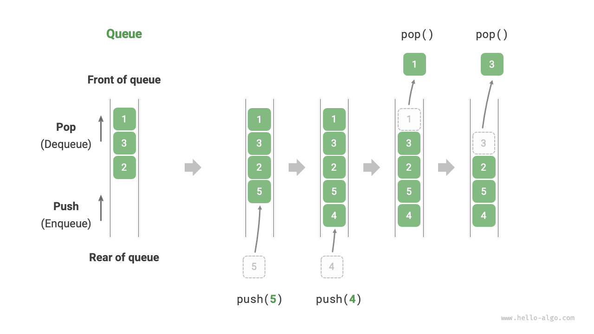

A <u>queue</u> is a linear data structure that follows the First In, First Out (FIFO) rule. As the name suggests, it models people lining up: newcomers continuously join the rear of the queue, while the people at the front leave one by one.

As shown in the figure below, we call the front of the queue the "front" and the end the "rear." The operation of adding an element to the rear is called "enqueue," and the operation of removing the front element is called "dequeue."



## Common Queue Operations

The common operations on a queue are shown in the table below. Note that method names may vary across programming languages. Here, we use the same naming convention as for stacks.

<p align="center"> Table <id> &nbsp; Efficiency of Queue Operations </p>

| Method   | Description                                | Time Complexity |
| -------- | ------------------------------------------ | --------------- |
| `push()` | Enqueue element, add element to rear       | $O(1)$          |
| `pop()`  | Dequeue front element                      | $O(1)$          |
| `peek()` | Access front element                       | $O(1)$          |

We can directly use the queue classes provided by the programming language:

<div class="lang-tab">
<p class="lang-tab__label">Python</p>

```python title="queue.py"
from collections import deque

# Initialize queue
# In Python, we generally use the deque class as a queue
# Although queue.Queue() is a pure queue class, it is not very user-friendly, so it is not recommended
que: deque[int] = deque()

# Enqueue elements
que.append(1)
que.append(3)
que.append(2)
que.append(5)
que.append(4)

# Access front element
front: int = que[0]

# Dequeue element
pop: int = que.popleft()

# Get queue length
size: int = len(que)

# Check if queue is empty
is_empty: bool = len(que) == 0
```

</div>

## Queue Implementation

To implement a queue, we need a data structure that allows adding elements at one end and removing elements at the other end. Both linked lists and arrays meet this requirement.

### Linked List Implementation

As shown in the figure below, we can treat the "head node" and "tail node" of a linked list as the "front" and "rear" of the queue, respectively, with the rule that nodes can only be added at the rear and removed from the front.

Below is the code for implementing a queue using a linked list:

<div class="lang-tab">
<p class="lang-tab__label">Python</p>

```py
class LinkedListQueue:
    """Queue implemented with a linked list"""

    def __init__(self):
        """Constructor"""
        self._front: ListNode | None = None  # عقدة الرأس front
        self._rear: ListNode | None = None  # عقدة الذيل rear
        self._size: int = 0

    def size(self) -> int:
        """Get the queue size"""
        return self._size

    def is_empty(self) -> bool:
        """Check whether the queue is empty"""
        return self._size == 0

    def push(self, num: int):
        """Enqueue"""
        # أضف num بعد عقدة الذيل
        node = ListNode(num)
        # إذا كان الطابور فارغًا، اجعل الرأس والذيل يشيران إلى هذه العقدة معًا
        if self._front is None:
            self._front = node
            self._rear = node
        # إذا لم يكن الطابور فارغًا، أضف هذه العقدة بعد عقدة الذيل
        else:
            self._rear.next = node
            self._rear = node
        self._size += 1

    def pop(self) -> int:
        """Dequeue"""
        num = self.peek()
        # احذف العقدة الرأس
        self._front = self._front.next
        self._size -= 1
        return num

    def peek(self) -> int:
        """Access the front element"""
        if self.is_empty():
            raise IndexError("Queue is empty")
        return self._front.val

    def to_list(self) -> list[int]:
        """Convert to a list for printing"""
        queue = []
        temp = self._front
        while temp:
            queue.append(temp.val)
            temp = temp.next
        return queue
```

</div>

### Array Implementation

Deleting the first element in an array has a time complexity of $O(n)$, which would make the dequeue operation inefficient. However, we can use the following clever method to avoid this problem.

We can use a variable `front` to point to the index of the front element and maintain a variable `size` to record the queue length. We define `rear = front + size`, which calculates the position right after the rear element.

Based on this design, **the valid interval containing elements in the array is `[front, rear - 1]`**. The implementation methods for various operations are shown in the figure below:

- Enqueue operation: Assign the input element to the `rear` index and increase `size` by 1.
- Dequeue operation: Simply increase `front` by 1 and decrease `size` by 1.

As you can see, both enqueue and dequeue operations require only one operation, with a time complexity of $O(1)$.

You may notice a problem: as we continuously enqueue and dequeue, both `front` and `rear` move to the right. **When they reach the end of the array, they cannot continue moving**. To solve this problem, we can treat the array as a "circular array" with head and tail connected.

For a circular array, we need to let `front` or `rear` wrap around to the beginning of the array when they cross the end. This periodic pattern can be implemented using the "modulo operation," as shown in the code below:

<div class="lang-tab">
<p class="lang-tab__label">Python</p>

```py
class ArrayQueue:
    """Queue implemented with a circular array"""

    def __init__(self, size: int):
        """Constructor"""
        self._nums: list[int] = [0] * size  # المصفوفة التي تخزن عناصر الطابور
        self._front: int = 0  # مؤشر المقدمة، يشير إلى أول عنصر
        self._size: int = 0  # حجم الطابور

    def capacity(self) -> int:
        """Get the queue capacity"""
        return len(self._nums)

    def size(self) -> int:
        """Get the queue size"""
        return self._size

    def is_empty(self) -> bool:
        """Check whether the queue is empty"""
        return self._size == 0

    def push(self, num: int):
        """Enqueue"""
        if self._size == self.capacity():
            raise IndexError("Queue is full")
        # احسب مؤشر المؤخرة، وهو يشير إلى موضع واحد بعد آخر عنصر
        # استخدم باقي القسمة لالتفاف rear إلى البداية عندما يتجاوز نهاية المصفوفة
        rear: int = (self._front + self._size) % self.capacity()
        # أضف num إلى المؤخرة
        self._nums[rear] = num
        self._size += 1

    def pop(self) -> int:
        """Dequeue"""
        num: int = self.peek()
        # ورّر مؤشر المقدمة موضعًا واحدًا، مع الالتفاف إلى البداية إن تجاوز النهاية
        self._front = (self._front + 1) % self.capacity()
        self._size -= 1
        return num

    def peek(self) -> int:
        """Access the front element"""
        if self.is_empty():
            raise IndexError("Queue is empty")
        return self._nums[self._front]

    def to_list(self) -> list[int]:
        """Return a list for printing"""
        res = [0] * self.size()
        j: int = self._front
        for i in range(self.size()):
            res[i] = self._nums[(j % self.capacity())]
            j += 1
        return res
```

</div>

The queue implemented above still has limitations: its length is immutable. However, this problem is not difficult to solve. We can replace the array with a dynamic array to introduce an expansion mechanism. Interested readers can try to implement this themselves.

The comparison conclusions for the two implementations are consistent with those for stacks and will not be repeated here.

## Typical Applications of Queue

- **Taobao orders**. After shoppers place orders, the orders are added to a queue, and the system subsequently processes the orders in the queue according to their sequence. During Double Eleven, massive orders are generated in a short time, and high concurrency becomes a key challenge that engineers need to tackle.
- **Various to-do tasks**. Any scenario that needs to implement "first come, first served" functionality, such as a printer's task queue or a restaurant's order queue, can effectively maintain the processing order using queues.
