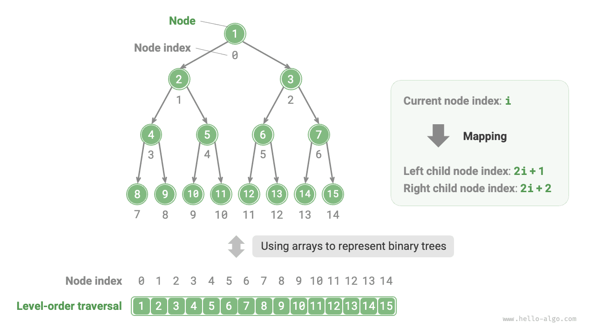
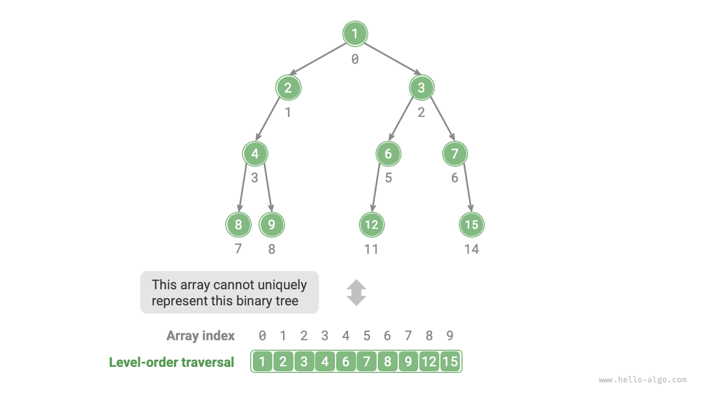
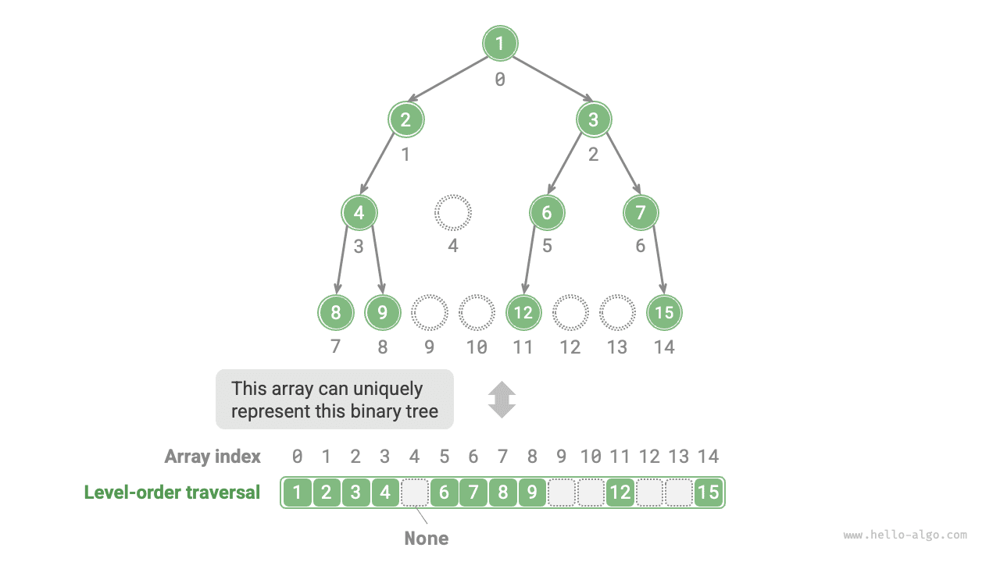
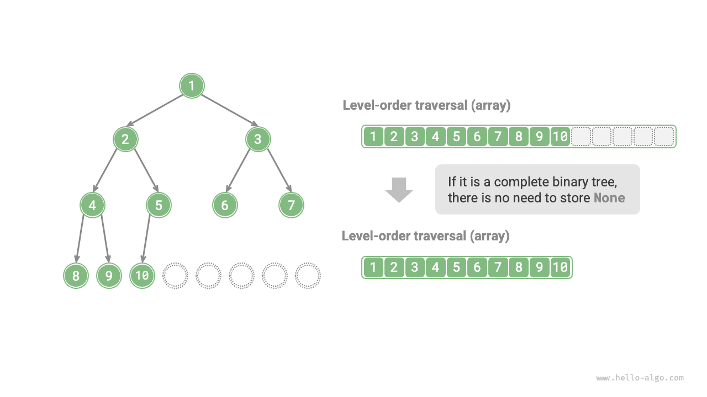

In the linked-list representation, the storage unit of a binary tree is a node `TreeNode`, and nodes are connected by pointers. The previous section introduced the basic operations of binary trees in this representation.

So, can we use an array to represent a binary tree? The answer is yes.

## Representing Perfect Binary Trees

Let's analyze a simple case first. Given a perfect binary tree, we store all nodes in an array according to the order of level-order traversal, where each node corresponds to a unique array index.

Based on the characteristics of level-order traversal, we can derive a "mapping formula" between parent node index and child node indices: **If a node's index is $i$, then its left child index is $2i + 1$ and its right child index is $2i + 2$**. The figure below shows the mapping relationships between various node indices.



**The mapping formula plays a role similar to the node references (pointers) in linked lists**. Given any node in the array, we can access its left (right) child node using the mapping formula.

## Representing Any Binary Tree

Perfect binary trees are a special case; in the middle levels of a binary tree, there are typically many `None` values. Since the level-order traversal sequence does not include these `None` values, we cannot infer the number and distribution of `None` values based on this sequence alone. **This means multiple binary tree structures can correspond to the same level-order traversal sequence**.

As shown in the figure below, given a non-perfect binary tree, the above method of array representation fails.



To solve this problem, **we can explicitly write out all `None` values in the level-order traversal sequence**. As shown in the figure below, once we do this, the level-order traversal sequence can uniquely represent a binary tree. Example code is as follows:

<div class="lang-tab">
<p class="lang-tab__label">Python</p>

```python title=""
# Array representation of a binary tree
# Using None to represent empty slots
tree = [1, 2, 3, 4, None, 6, 7, 8, 9, None, None, 12, None, None, 15]
```

</div>



It's worth noting that **complete binary trees are very well-suited for array representation**. Recalling the definition of a complete binary tree, `None` only appears at the bottom level and towards the right, **meaning all `None` values must appear at the end of the level-order traversal sequence**.

This means that when using an array to represent a complete binary tree, it's possible to omit storing all `None` values, which is very convenient. The figure below gives an example.



The following code implements a binary tree using an array representation, including the following operations:

- Given a node, obtain its value, left (right) child node, and parent node.
- Obtain the preorder, inorder, postorder, and level-order traversal sequences.

<div class="lang-tab">
<p class="lang-tab__label">Python</p>

```py
class ArrayBinaryTree:
    """Binary tree class using an array representation"""

    def __init__(self, arr: list[int | None]):
        """Constructor"""
        self._tree = list(arr)

    def size(self):
        """Length of the backing list"""
        return len(self._tree)

    def val(self, i: int) -> int | None:
        """Get the value of the node at index i"""
        # إذا خرج الفهرس عن الحدود، أعد None لتمثيل موضع فارغ
        if i < 0 or i >= self.size():
            return None
        return self._tree[i]

    def left(self, i: int) -> int | None:
        """Get the left child index of the node at index i"""
        return 2 * i + 1

    def right(self, i: int) -> int | None:
        """Get the right child index of the node at index i"""
        return 2 * i + 2

    def parent(self, i: int) -> int | None:
        """Get the parent index of the node at index i"""
        return (i - 1) // 2

    def level_order(self) -> list[int]:
        """Level-order traversal"""
        self.res = []
        # اجتز المصفوفة مباشرةً
        for i in range(self.size()):
            if self.val(i) is not None:
                self.res.append(self.val(i))
        return self.res

    def dfs(self, i: int, order: str):
        """Depth-first traversal"""
        if self.val(i) is None:
            return
        # اجتياز الطلب المسبق
        if order == "pre":
            self.res.append(self.val(i))
        self.dfs(self.left(i), order)
        # الاجتياز الداخلي
        if order == "in":
            self.res.append(self.val(i))
        self.dfs(self.right(i), order)
        # اجتياز الطلب اللاحق
        if order == "post":
            self.res.append(self.val(i))

    def pre_order(self) -> list[int]:
        """Preorder traversal"""
        self.res = []
        self.dfs(0, order="pre")
        return self.res

    def in_order(self) -> list[int]:
        """Inorder traversal"""
        self.res = []
        self.dfs(0, order="in")
        return self.res

    def post_order(self) -> list[int]:
        """Postorder traversal"""
        self.res = []
        self.dfs(0, order="post")
        return self.res
```

</div>

## Advantages and Limitations

The array representation of binary trees has the following advantages:

- Arrays are stored in contiguous memory space, which is cache-friendly, allowing faster access and traversal.
- It does not require storing pointers, which saves space.
- It allows random access to nodes.

However, the array representation also has some limitations:

- Array storage requires contiguous memory space, so it is not suitable for storing trees with a large amount of data.
- Adding or removing nodes requires array insertion and deletion operations, which have lower efficiency.
- When there are many `None` values in the binary tree, the proportion of node data contained in the array is low, leading to lower space utilization.
