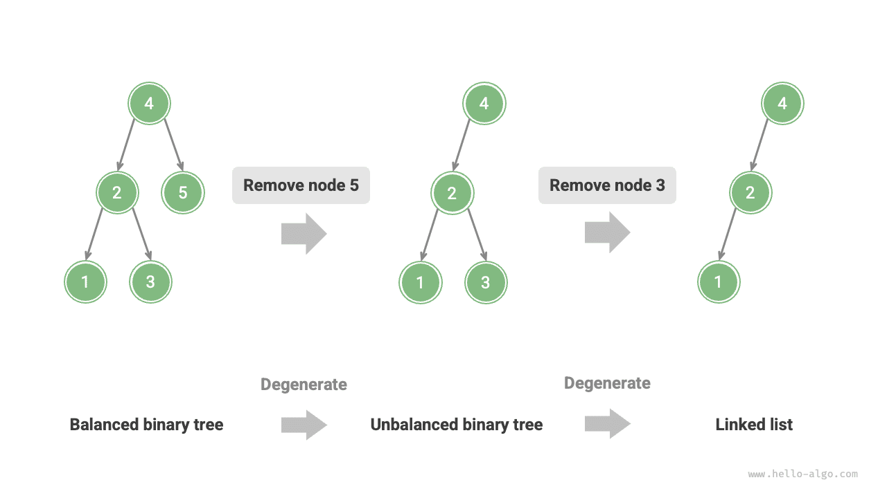
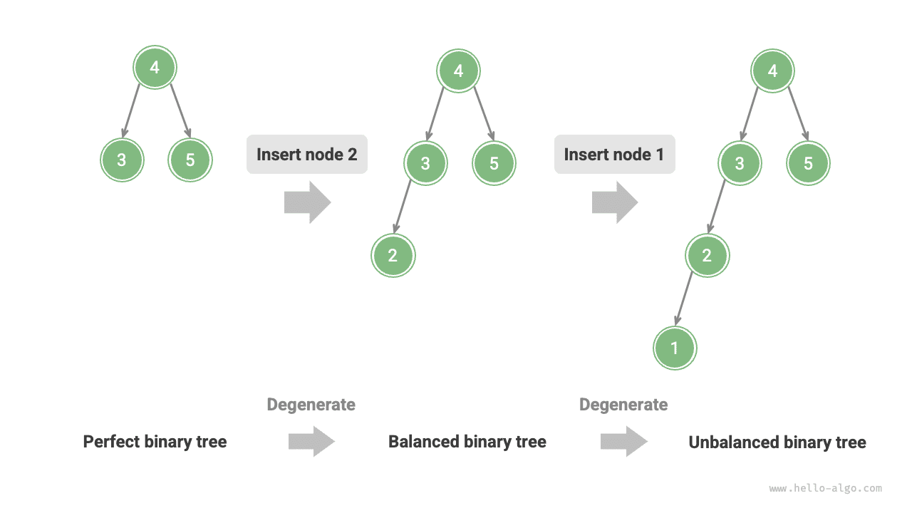
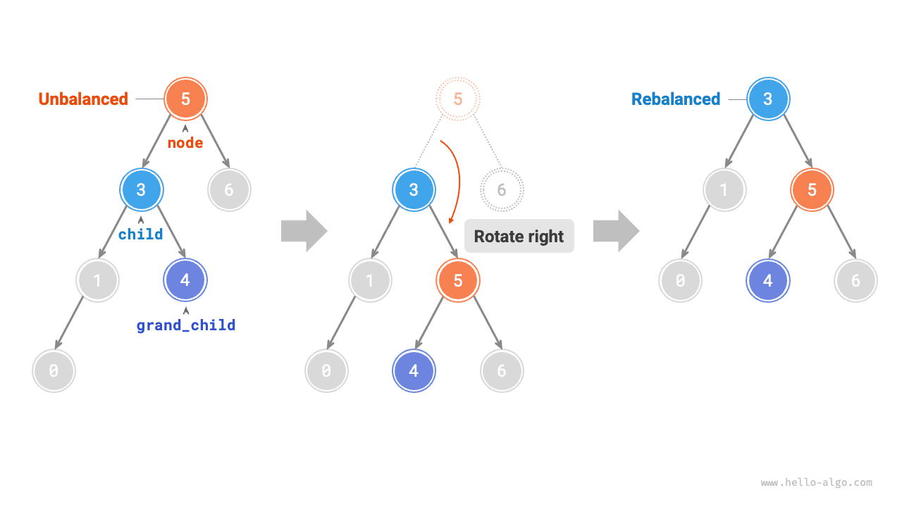
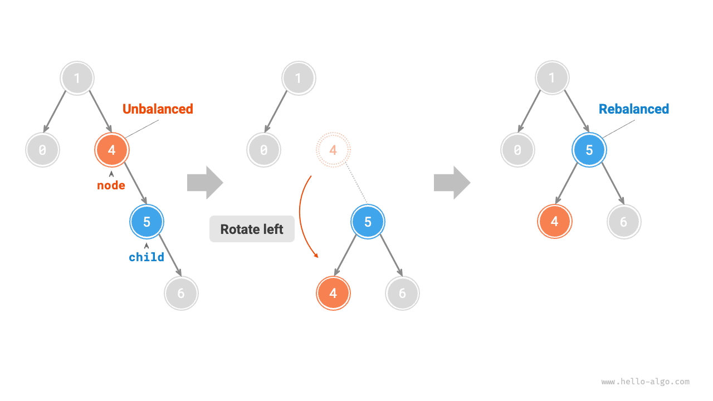
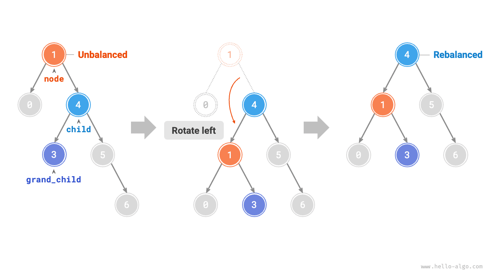
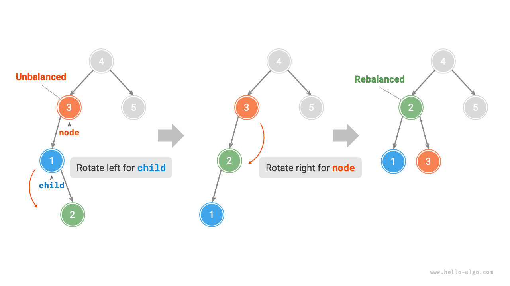
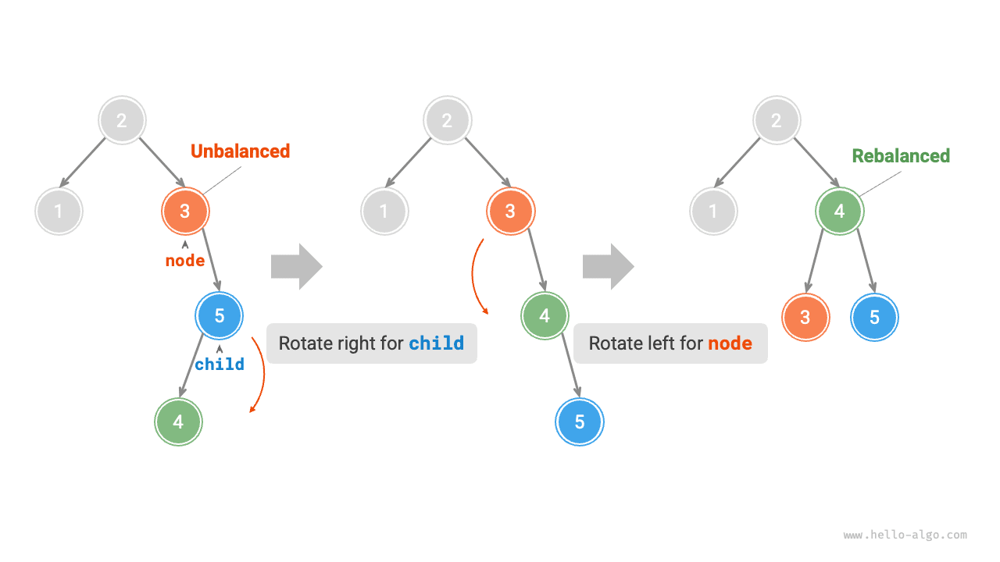
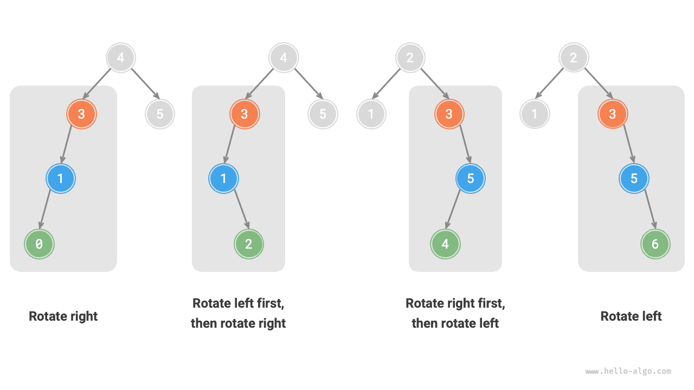

In the "Binary Search Tree" section, we mentioned that after multiple insertion and removal operations, a binary search tree may degenerate into a linked list. In this case, the time complexity of all operations degrades from $O(\log n)$ to $O(n)$.

As shown in the figure below, after two node removal operations, this binary search tree will degrade into a linked list.



For example, in the perfect binary tree shown in the figure below, after inserting two nodes, the tree will lean heavily to the left, and the time complexity of search operations will also degrade.



In 1962, G. M. Adelson-Velsky and E. M. Landis proposed the <u>AVL tree</u> in their paper "An algorithm for the organization of information". The paper describes a series of operations that prevent an AVL tree from degenerating as nodes are inserted and removed, thereby keeping the time complexity of various operations at $O(\log n)$. In other words, in scenarios that require frequent insertion, deletion, lookup, and update operations, AVL trees can maintain consistently efficient performance and therefore have strong practical value.

## Common Terminology in AVL Trees

An AVL tree is both a binary search tree and a balanced binary tree, simultaneously satisfying all the properties of these two types of binary trees, hence it is a <u>balanced binary search tree</u>.

### Node Height

Since the operations related to AVL trees require obtaining node heights, we need to add a `height` variable to the node class:

<div class="lang-tab">
<p class="lang-tab__label">Python</p>

```python title=""
class TreeNode:
    """AVL tree node"""
    def __init__(self, val: int):
        self.val: int = val                 # Node value
        self.height: int = 0                # Node height
        self.left: TreeNode | None = None   # Left child reference
        self.right: TreeNode | None = None  # Right child reference
```

</div>

The "node height" refers to the distance from that node to its farthest leaf node, i.e., the number of edges on the path. It is important to note that the height of a leaf node is $0$, and the height of a null node is $-1$. We will create two utility functions for getting and updating the height of a node:

<div class="lang-tab">
<p class="lang-tab__label">Python</p>

```py
    def update_height(self, node: TreeNode | None):
        """Update the node height"""
        # The node height equals the height of its taller subtree + 1
        node.height = max([self.height(node.left), self.height(node.right)]) + 1
```

</div>

### Node Balance Factor

The <u>balance factor</u> of a node is defined as the height of the node's left subtree minus the height of its right subtree, and the balance factor of a null node is defined as $0$. We also encapsulate the function to obtain the node's balance factor for convenient subsequent use:

<div class="lang-tab">
<p class="lang-tab__label">Python</p>

```py
    def balance_factor(self, node: TreeNode | None) -> int:
        """Get the balance factor"""
        # An empty subtree has balance factor 0
        if node is None:
            return 0
        # Node balance factor = left subtree height - right subtree height
        return self.height(node.left) - self.height(node.right)
```

</div>

<div class="note">

Let the balance factor be $f$, then the balance factor of any node in an AVL tree satisfies $-1 \le f \le 1$.

</div>

## Rotations in AVL Trees

The characteristic of AVL trees lies in the "rotation" operation, which can restore balance to unbalanced nodes without affecting the inorder traversal sequence of the binary tree. In other words, **rotation operations can both maintain the property of a "binary search tree" and make the tree return to a "balanced binary tree"**.

We call nodes with a balance factor absolute value $> 1$ "unbalanced nodes". Depending on the imbalance situation, rotation operations are divided into four types: right rotation, left rotation, right rotation then left rotation, and left rotation then right rotation. Below we describe these rotation operations in detail.

### Right Rotation

As shown in the figure below, the value below the node is the balance factor. From bottom to top, the first unbalanced node in the binary tree is "node 3". We focus on the subtree with this unbalanced node as the root, denoting the node as `node` and its left child as `child`, and perform a "right rotation" operation. After the right rotation is completed, the subtree regains balance and still maintains the properties of a binary search tree.

As shown in the figure below, when the `child` node has a right child (denoted as `grand_child`), a step needs to be added in the right rotation: set `grand_child` as the left child of `node`.



"Right rotation" is a figurative term; in practice, it is achieved by modifying node pointers, as shown in the following code:

<div class="lang-tab">
<p class="lang-tab__label">Python</p>

```py
    def right_rotate(self, node: TreeNode | None) -> TreeNode | None:
        """Right rotation"""
        child = node.left
        grand_child = child.right
        # Rotate node to the right around child
        child.right = node
        node.left = grand_child
        # Update the node height
        self.update_height(node)
        self.update_height(child)
        # Return the root of the rotated subtree
        return child
```

</div>

### Left Rotation

Correspondingly, if considering the "mirror" of the above unbalanced binary tree, the "left rotation" operation shown in the figure below needs to be performed.



Similarly, as shown in the figure below, when the `child` node has a left child (denoted as `grand_child`), a step needs to be added in the left rotation: set `grand_child` as the right child of `node`.



It can be observed that **right rotation and left rotation operations are mirror symmetric in logic, and the two imbalance cases they solve are also symmetric**. Based on symmetry, we only need to replace all `left` in the right rotation implementation code with `right`, and all `right` with `left`, to obtain the left rotation implementation code:

<div class="lang-tab">
<p class="lang-tab__label">Python</p>

```py
    def left_rotate(self, node: TreeNode | None) -> TreeNode | None:
        """Left rotation"""
        child = node.right
        grand_child = child.left
        # Rotate node to the left around child
        child.left = node
        node.right = grand_child
        # Update the node height
        self.update_height(node)
        self.update_height(child)
        # Return the root of the rotated subtree
        return child
```

</div>

### Left Rotation Then Right Rotation

For the unbalanced node 3 in the figure below, using either left rotation or right rotation alone cannot restore the subtree to balance. In this case, a "left rotation" needs to be performed on `child` first, followed by a "right rotation" on `node`.



### Right Rotation Then Left Rotation

As shown in the figure below, for the mirror case of the above unbalanced binary tree, a "right rotation" needs to be performed on `child` first, then a "left rotation" on `node`.



### Choice of Rotation

The four imbalances shown in the figure below correspond one-to-one with the above cases, requiring right rotation, left rotation then right rotation, right rotation then left rotation, and left rotation operations respectively.



As shown in the table below, we determine which case the unbalanced node belongs to by judging the signs of the balance factor of the unbalanced node and the balance factor of its taller-side child node.

<p align="center"> Table <id> &nbsp; Conditions for Choosing Among the Four Rotation Cases </p>

| Balance factor of the unbalanced node | Balance factor of the child node | Rotation method to apply          |
| -------------------------------------- | --------------------------------- | --------------------------------- |
| $> 1$ (left-leaning tree)              | $\geq 0$                          | Right rotation                    |
| $> 1$ (left-leaning tree)              | $<0$                              | Left rotation then right rotation |
| $< -1$ (right-leaning tree)            | $\leq 0$                          | Left rotation                     |
| $< -1$ (right-leaning tree)            | $>0$                              | Right rotation then left rotation |

For ease of use, we encapsulate the rotation operations into a function. **With this function, we can perform rotations for various imbalance situations, restoring balance to unbalanced nodes**. The code is as follows:

<div class="lang-tab">
<p class="lang-tab__label">Python</p>

```py
    def rotate(self, node: TreeNode | None) -> TreeNode | None:
        """Perform rotations to restore balance in this subtree"""
        # Get the balance factor of node
        balance_factor = self.balance_factor(node)
        # Left-heavy tree
        if balance_factor > 1:
            if self.balance_factor(node.left) >= 0:
                # Rotate right
                return self.right_rotate(node)
            else:
                # Rotate left, then right
                node.left = self.left_rotate(node.left)
                return self.right_rotate(node)
        # Right-heavy tree
        elif balance_factor < -1:
            if self.balance_factor(node.right) <= 0:
                # Rotate left
                return self.left_rotate(node)
            else:
                # Rotate right, then left
                node.right = self.right_rotate(node.right)
                return self.left_rotate(node)
        # The tree is balanced; return without rotating
        return node
```

</div>

## Common Operations in AVL Trees

### Node Insertion

The node insertion operation in AVL trees is similar in principle to that in binary search trees. The only difference is that after inserting a node in an AVL tree, a series of unbalanced nodes may appear on the path from that node to the root. Therefore, **we need to start from this node and perform rotation operations from bottom to top, restoring balance to all unbalanced nodes**. The code is as follows:

<div class="lang-tab">
<p class="lang-tab__label">Python</p>

```py
    def insert_helper(self, node: TreeNode | None, val: int) -> TreeNode:
        """Insert a node recursively (helper method)"""
        if node is None:
            return TreeNode(val)
        # 1. Find the insertion position and insert the node
        if val < node.val:
            node.left = self.insert_helper(node.left, val)
        elif val > node.val:
            node.right = self.insert_helper(node.right, val)
        else:
            # Return without inserting a duplicate node
            return node
        # Update the node height
        self.update_height(node)
        # 2. Perform rotations to restore balance in this subtree
        return self.rotate(node)
```

</div>

### Node Removal

Similarly, on the basis of the binary search tree's node removal method, rotation operations need to be performed from bottom to top to restore balance to all unbalanced nodes. The code is as follows:

<div class="lang-tab">
<p class="lang-tab__label">Python</p>

```py
    def remove_helper(self, node: TreeNode | None, val: int) -> TreeNode | None:
        """Remove a node recursively (helper method)"""
        if node is None:
            return None
        # 1. Find and remove the node
        if val < node.val:
            node.left = self.remove_helper(node.left, val)
        elif val > node.val:
            node.right = self.remove_helper(node.right, val)
        else:
            if node.left is None or node.right is None:
                child = node.left or node.right
                # Number of children = 0: remove node and return
                if child is None:
                    return None
                # Number of children = 1: remove node directly
                else:
                    node = child
            else:
                # Number of children = 2: remove the inorder successor and use its value to replace the current node value
                temp = node.right
                while temp.left is not None:
                    temp = temp.left
                node.right = self.remove_helper(node.right, temp.val)
                node.val = temp.val
        # Update the node height
        self.update_height(node)
        # 2. Perform rotations to restore balance in this subtree
        return self.rotate(node)
```

</div>

### Node Search

The node search operation in AVL trees is consistent with that in binary search trees, and will not be elaborated here.

## Typical Applications of AVL Trees

- Organizing and storing large-scale data, suitable for scenarios with high-frequency searches and low-frequency insertions and deletions.
- Used to build index systems in databases.
- Red-black trees are also a common type of balanced binary search tree. Compared to AVL trees, red-black trees have more relaxed balance conditions, require fewer rotation operations for node insertion and deletion, and have higher average efficiency for node addition and deletion operations.
