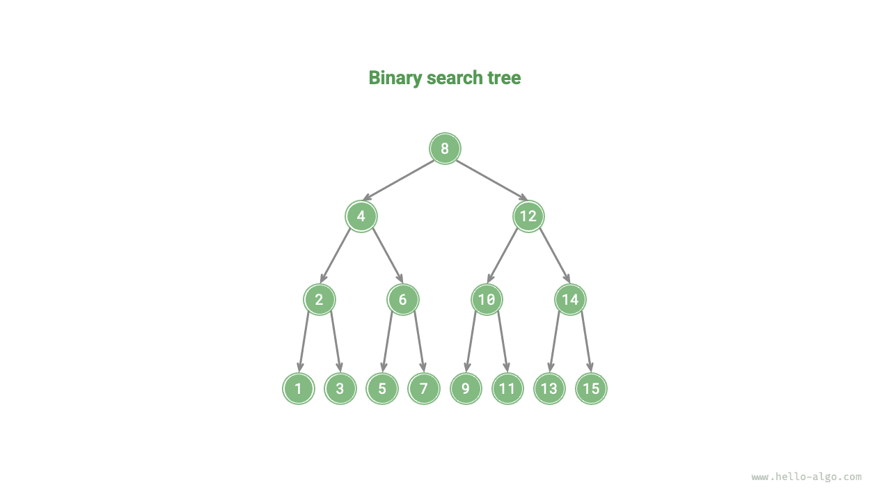
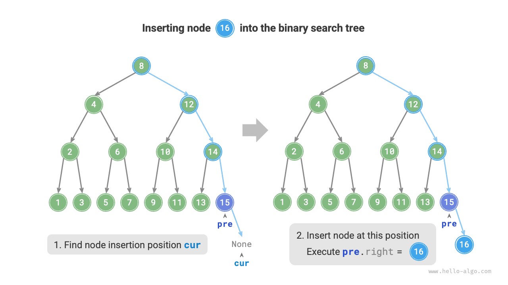
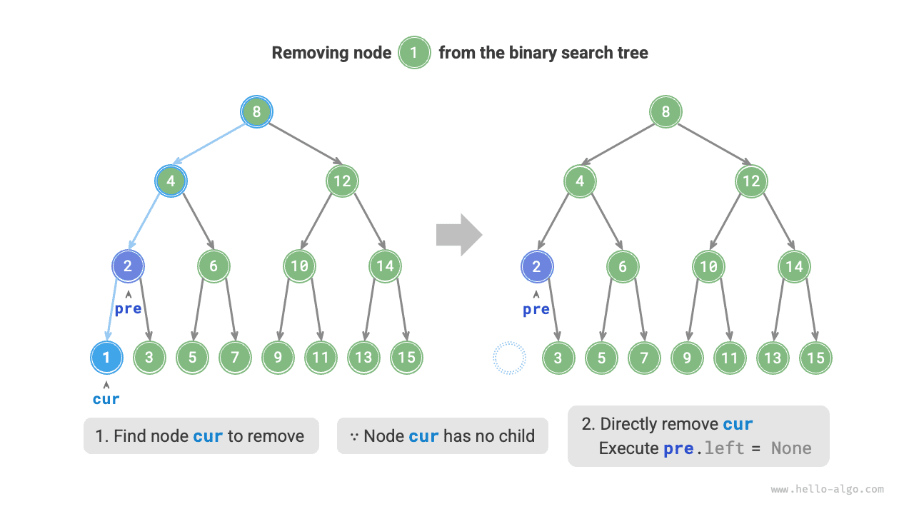
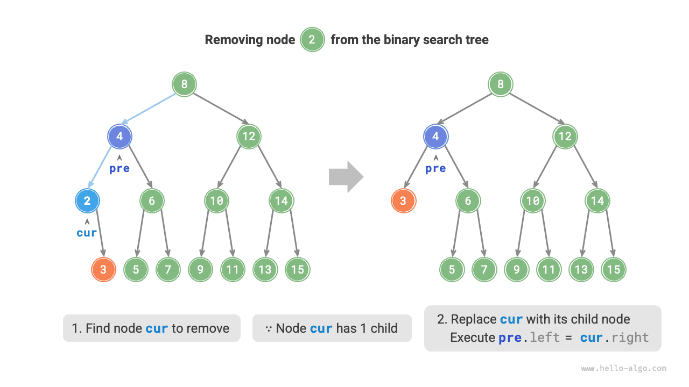
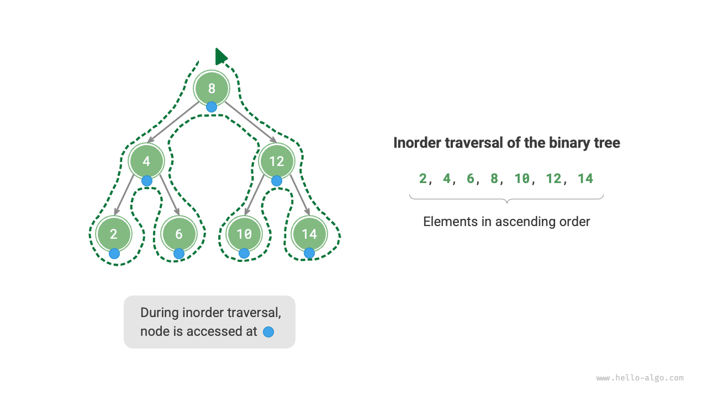
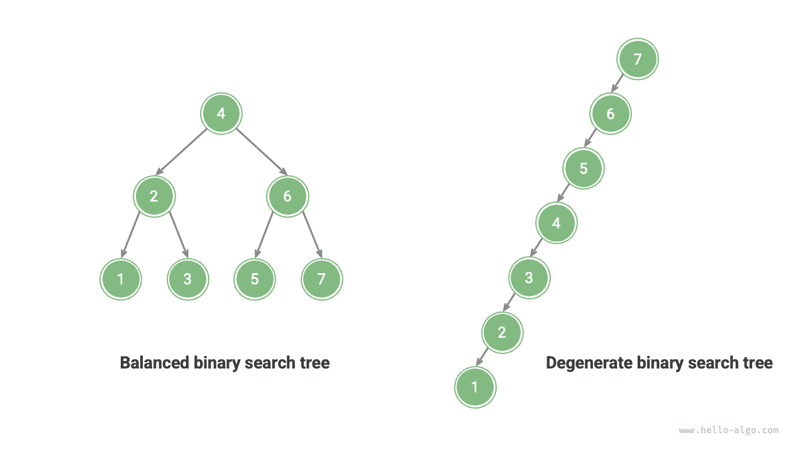

As shown in the figure below, a <u>binary search tree</u> satisfies the following conditions.

1. For the root node, the value of all nodes in the left subtree $<$ the value of the root node $<$ the value of all nodes in the right subtree.
2. The left and right subtrees of any node are also binary search trees, i.e., they satisfy condition `1.` as well.



## Operations on a Binary Search Tree

We encapsulate the binary search tree as a class `BinarySearchTree` and declare a member variable `root` pointing to the tree's root node.

### Searching for a Node

Given a target node value `num`, we can search according to the properties of the binary search tree. As shown in the figure below, we declare a node `cur` and start from the binary search tree's root node `root`, looping to compare `cur.val` with `num`.

- If `cur.val < num`, it means the target node is in `cur`'s right subtree, thus execute `cur = cur.right`.
- If `cur.val > num`, it means the target node is in `cur`'s left subtree, thus execute `cur = cur.left`.
- If `cur.val = num`, it means the target node is found, exit the loop, and return the node.

The search operation in a binary search tree follows the same principle as binary search: each round rules out half of the remaining cases. The number of loop iterations is at most the height of the tree. When the tree is balanced, the search takes $O(\log n)$ time. The example code is as follows:

<div class="lang-tab">
<p class="lang-tab__label">Python</p>

```py
    def search(self, num: int) -> TreeNode | None:
        """Find a node"""
        cur = self._root
        # Search in a loop, stopping if cur becomes None
        while cur is not None:
            # If present, the target node is in the right subtree of cur
            if cur.val < num:
                cur = cur.right
            # If present, the target node is in the left subtree of cur
            elif cur.val > num:
                cur = cur.left
            # The target node was found; exit the loop
            else:
                break
        return cur
```

</div>

### Inserting a Node

Given an element `num` to be inserted, in order to maintain the property of the binary search tree "left subtree < root node < right subtree," the insertion process is as shown in the figure below.

1. **Finding the insertion position**: Similar to the search operation, start from the root node and loop downward searching according to the size relationship between the current node value and `num`, until passing the leaf node (traversing to `None`) and then exit the loop.
2. **Insert the node at that position**: Create a node for `num` and place it at the `None` position.



In the code implementation, note the following two points:

- Binary search trees do not allow duplicate nodes; otherwise, the tree would no longer satisfy its definition. Therefore, if the node to be inserted already exists in the tree, the insertion is skipped and the function returns directly.
- To implement the node insertion, we need to use node `pre` to save the node from the previous loop iteration. This way, when traversing to `None`, we can obtain its parent node, thereby completing the node insertion operation.

<div class="lang-tab">
<p class="lang-tab__label">Python</p>

```py
    def insert(self, num: int):
        """Insert a node"""
        # If the tree is empty, initialize the root node
        if self._root is None:
            self._root = TreeNode(num)
            return
        # Search in a loop, stopping if cur becomes None
        cur, pre = self._root, None
        while cur is not None:
            # Return immediately if a duplicate node is found
            if cur.val == num:
                return
            pre = cur
            # The insertion position lies in the right subtree of cur
            if cur.val < num:
                cur = cur.right
            # The insertion position lies in the left subtree of cur
            else:
                cur = cur.left
        # Insert a node
        node = TreeNode(num)
        if pre.val < num:
            pre.right = node
        else:
            pre.left = node
```

</div>

Similar to searching for a node, inserting a node uses $O(\log n)$ time.

### Removing a Node

First, find the target node in the binary search tree, then remove it. Similar to node insertion, we need to ensure that after the removal operation is completed, the binary search tree's property of "left subtree $<$ root node $<$ right subtree" is still maintained. Therefore, depending on the number of child nodes the target node has, we consider three cases: degree $0$, degree $1$, and degree $2$, and perform the corresponding removal operation.

As shown in the figure below, when the degree of the node to be removed is $0$, it means the node is a leaf node and can be directly removed.



As shown in the figure below, when the degree of the node to be removed is $1$, replacing the node to be removed with its child node is sufficient.



When the degree of the node to be removed is $2$, we cannot directly remove it; instead, we need to use a node to replace it. To maintain the binary search tree's property of "left subtree $<$ root node $<$ right subtree," **this node can be either the smallest node in the right subtree or the largest node in the left subtree**.

Assuming we choose the smallest node in the right subtree, that is, the inorder successor, the removal process is as shown in the figure below.

1. Find the next node of the node to be removed in the "inorder traversal sequence," denoted as `tmp`.
2. Replace the value of the node to be removed with the value of `tmp`, and recursively remove node `tmp` in the tree.

The node removal operation also uses $O(\log n)$ time, where finding the node to be removed requires $O(\log n)$ time, and obtaining the inorder successor node requires $O(\log n)$ time. Example code is as follows:

<div class="lang-tab">
<p class="lang-tab__label">Python</p>

```py
    def remove(self, num: int):
        """Remove a node"""
        # Return immediately if the tree is empty
        if self._root is None:
            return
        # Search in a loop, stopping if cur becomes None
        cur, pre = self._root, None
        while cur is not None:
            # The node to remove was found; exit the loop
            if cur.val == num:
                break
            pre = cur
            # If present, the node to remove is in the right subtree of cur
            if cur.val < num:
                cur = cur.right
            # If present, the node to remove is in the left subtree of cur
            else:
                cur = cur.left
        # Return immediately if the node to remove does not exist
        if cur is None:
            return

        # Number of children = 0 or 1
        if cur.left is None or cur.right is None:
            # With 0 or 1 child, child is None or that child, respectively
            child = cur.left or cur.right
            # Remove node cur
            if cur != self._root:
                if pre.left == cur:
                    pre.left = child
                else:
                    pre.right = child
            else:
                # If the removed node is the root, assign the new root
                self._root = child
        # Number of children = 2
        else:
            # Get the inorder successor of cur
            tmp: TreeNode = cur.right
            while tmp.left is not None:
                tmp = tmp.left
            # Recursively remove node tmp
            self.remove(tmp.val)
            # Replace the value of cur with the value of tmp
            cur.val = tmp.val
```

</div>

### Inorder Traversal Is Ordered

As shown in the figure below, the inorder traversal of a binary tree follows the "left $\rightarrow$ root $\rightarrow$ right" traversal order, while the binary search tree satisfies the "left child node $<$ root node $<$ right child node" size relationship.

This means that when performing an inorder traversal in a binary search tree, the next smallest node is always traversed first, thus yielding an important property: **The inorder traversal sequence of a binary search tree is ascending**.

Using the property of inorder traversal being ascending, we can obtain ordered data in a binary search tree in only $O(n)$ time, without the need for additional sorting operations, which is very efficient.



## Efficiency of Binary Search Trees

Given a set of data, we consider using an array or a binary search tree for storage. Observing the table below, all operations in a binary search tree have logarithmic time complexity, providing stable and efficient performance. Arrays are more efficient than binary search trees only in scenarios with high-frequency additions and low-frequency searches and deletions.

<p align="center"> Table <id> &nbsp; Efficiency comparison between arrays and search trees </p>

|                | Unsorted array | Binary search tree |
| -------------- | -------------- | ------------------ |
| Search element | $O(n)$         | $O(\log n)$        |
| Insert element | $O(1)$         | $O(\log n)$        |
| Remove element | $O(n)$         | $O(\log n)$        |

In the ideal case, a binary search tree is balanced, so any node can be found within $O(\log n)$ loop iterations.

However, if we continuously insert and remove nodes in a binary search tree, it may degenerate into a linked list as shown in the figure below, where the time complexity of various operations also degrades to $O(n)$.



## Common Applications of Binary Search Trees

- Used as multi-level indexes in systems to implement efficient search, insertion, and removal operations.
- Serves as the underlying data structure for certain search algorithms.
- Used to store data streams to maintain their ordered state.
