## Chapter 1: Foundation

> I must create a System, or be enslav’d by another Man’s; I will not Reason and Compare: my business is to Create. *—William Blake*

### Problem: Building a Network

Suppose you want to build a computer network, one that has the potential to grow to global proportions and to support applications as diverse as teleconferencing, video on demand, electronic commerce, distributed computing, and digital libraries. What available technologies would serve as the underlying building blocks, and what kind of software architecture would you design to integrate these building blocks into an effective communication service? Answering this question is the overriding goal of this book—to describe the available building materials and then to show how they can be used to construct a network from the ground up.

Before we can understand how to design a computer network, we should first agree on exactly what a computer network is. At one time, the term *network* meant the set of serial lines used to attach dumb terminals to mainframe computers. Other important networks include the voice telephone network and the cable TV network used to disseminate video signals. The main things these networks have in common are that they are specialized to handle one particular kind of data (keystrokes, voice, or video) and they typically connect to special-purpose devices (terminals, hand receivers, and television sets).

What distinguishes a computer network from these other types of networks? Probably the most important characteristic of a computer network is its generality. Computer networks are built primarily from general-purpose programmable hardware, and they are not optimized for a particular application like making phone calls or delivering television signals. Instead, they are able to carry many different types of data, and they support a wide, and ever-growing, range of applications. Today’s computer networks have pretty much taken over the functions previously performed by single-use networks. This chapter looks at some typical applications of computer networks and discusses the requirements that a network designer who wishes to support such applications must be aware of.

Once we understand the requirements, how do we proceed? Fortunately, we will not be building the first network. Others, most notably the community of researchers responsible for the Internet, have gone before us. We will use the wealth of experience generated from the Internet to guide our design. This experience is embodied in a *network architecture* that identifies the available hardware and software components and shows how they can be arranged to form a complete network system.

In addition to understanding how networks are built, it is increasingly important to understand how they are operated or managed and how network applications are developed. Almost all of us now have computer networks in our homes, offices, and in some cases in our cars, so operating networks is no longer a matter only for a few specialists. And with the proliferation of smartphones, many more people in this generation are developing networked applications than in the past. So we need to consider networks from these multiple perspectives: builders, operators, and application developers.

To start us on the road toward understanding how to build, operate, and program a network, this chapter does four things. First, it explores the requirements that different applications and different communities of people place on the network. Second, it introduces the idea of a network architecture, which lays the foundation for the rest of the book. Third, it introduces some of the key elements in the implementation of computer networks. Finally, it identifies the key metrics that are used to evaluate the performance of computer networks.

### 1.1 Applications

Most people know the Internet through its applications: the World Wide Web, email, social media, streaming music or movies, videoconferencing, instant messaging, file-sharing, to name just a few examples. That is to say, we interact with the Internet as *users* of the network. Internet users represent the largest class of people who interact with the Internet in some way, but there are several other important constituencies.

There is the group of people who *create* the applications—a group that has greatly expanded in recent years as powerful programming platforms and new devices such as smartphones have created new opportunities to develop applications quickly and to bring them to a large market.

Then there are those who *operate* or *manage* networks—mostly a behind-the-scenes job, but a critical one and often a very complex one. With the prevalence of home networks, more and more people are also becoming, if only in a small way, network operators.

Finally, there are those who *design* and *build* the devices and protocols that collectively make up the Internet. That final constituency is the traditional target of networking textbooks such as this one and will continue to be our main focus. However, throughout this book we will also consider the perspectives of application developers and network operators.

Considering these perspectives will enable us to better understand the diverse requirements that a network must meet. Application developers will also be able to make applications that work better if they understand how the underlying technology works and interacts with the applications. So, before we start figuring out how to build a network, let’s look more closely at the types of applications that today’s networks support.

#### 1.1.1 Classes of Applications

The World Wide Web is the Internet application that catapulted the Internet from a somewhat obscure tool used mostly by scientists and engineers to the mainstream phenomenon that it is today. The Web itself has become such a powerful platform that many people confuse it with the Internet, and it’s a bit of a stretch to say that the Web is a single application.

In its basic form, the Web presents an intuitively simple interface. Users view pages full of textual and graphical objects and click on objects that they want to learn more about, and a corresponding new page appears. Most people are also aware that just under the covers each selectable object on a page is bound to an identifier for the next page or object to be viewed. This identifier, called a Uniform Resource Locator (URL), provides a way of identifying all the possible objects that can be viewed from your web browser. For example,

```html
http://www.cs.princeton.edu/~llp/index.html
```

is the URL for a page providing information about one of this book’s authors: the string http indicates that the Hypertext Transfer Protocol (HTTP) should be used to download the page, www.cs.princeton.edu is the name of the machine that serves the page, and /~llp/index.html uniquely identifies Larry’s home page at this site.

What most web users are not aware of, however, is that by clicking on just one such URL over a dozen messages may be exchanged over the Internet, and many more than that if the web page is complicated with lots of embedded objects. This message exchange includes up to six messages to translate the server name (www.cs.princeton.edu) into its Internet Protocol (IP) address (128.112.136.35), three messages to set up a Transmission Control Protocol (TCP) connection between your browser and this server, four messages for your browser to send the HTTP “GET” request and the server to respond with the requested page (and for each side to acknowledge receipt of that message), and four messages to tear down the TCP connection. Of course, this does not include the millions of messages exchanged by Internet nodes throughout the day, just to let each other know that they exist and are ready to serve web pages, translate names to addresses, and forward messages toward their ultimate destination.

Another widespread application class of the Internet is the delivery of “streaming” audio and video. Services such as video on demand and Internet radio use this technology. While we frequently start at a website to initiate a streaming session, the delivery of audio and video has some important differences from fetching a simple web page of text and images. For example, you often don’t want to download an entire video file—a process that might take a few minutes—before watching the first scene. Streaming audio and video implies a more timely transfer of messages from sender to receiver, and the receiver displays the video or plays the audio pretty much as it arrives.

Note that the difference between streaming applications and the more traditional delivery of text, graphics, and images is that humans consume audio and video streams in a continuous manner, and discontinuity—in the form of skipped sounds or stalled video—is not acceptable. By contrast, a regular (non-streaming) page can be delivered and read in bits and pieces. This difference affects how the network supports these different classes of applications.

A subtly different application class is *real-time* audio and video. These applications have considerably tighter timing constraints than streaming applications. When using a voice-over-IP application such as Skype or a videoconferencing application, the interactions among the participants must be timely. When a person at one end gestures, then that action must be displayed at the other end as quickly as possible.

When one person tries to interrupt another, the interrupted person needs to hear that as soon as possible and decide whether to allow the interruption or to keep talking over the interrupter. Too much delay in this sort of environment makes the system unusable. Contrast this with video on demand where, if it takes several seconds from the time the user starts the video until the first image is displayed, the service is still deemed satisfactory. Also, interactive applications usually entail audio and/or video flows in both directions, while a streaming application is most likely sending video or audio in only one direction.

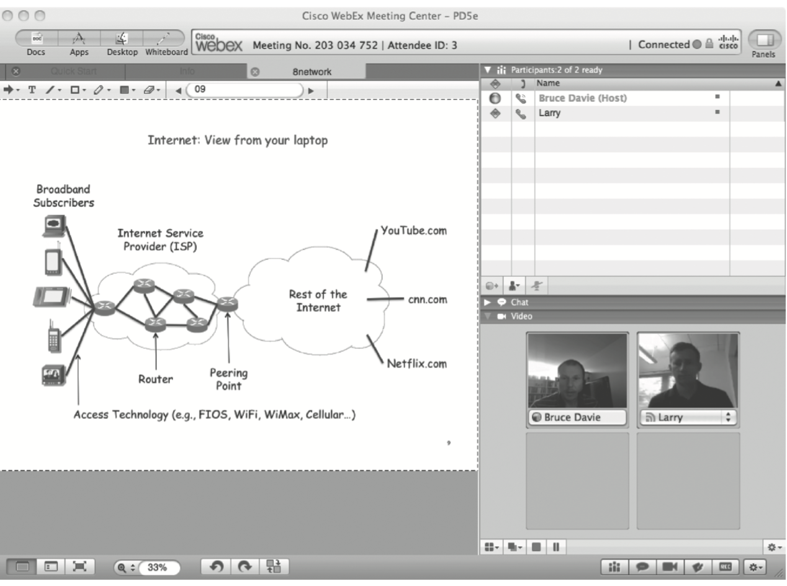

**Figure 1.1. A multimedia application including videoconferencing.**

Videoconferencing tools that run over the Internet have been around now since the early 1990s but have achieved widespread use in the last few years, with several commercial products on the market. An example of one such system is shown in Figure 1.1. Just as downloading a web page involves a bit more than meets the eye, so too with video applications. Fitting the video content into a relatively low bandwidth network, for example, or making sure that the video and audio remain in sync and arrive in time for a good user experience are all problems that network and protocol designers have to worry about. We’ll look at these and many other issues related to multimedia applications later in the book.

Although they are just two examples, downloading pages from the web and participating in a videoconference demonstrate the diversity of applications that can be built on top of the Internet and hint at the complexity of the Internet’s design. Later in the book we will develop a more complete taxonomy of application types to help guide our discussion of key design decisions as we seek to build, operate, and use networks. The book concludes by revisiting these two specific applications, as well as several others that illustrate the breadth of what is possible on today’s Internet.

For now, this quick look at a few typical applications will suffice to enable us to start looking at the problems that must be addressed if we are to build a network that supports such application diversity.

==================

### 1.2 Requirements

We have established an ambitious goal for ourselves: to understand how to build a computer network from the ground up. Our approach to accomplishing this goal will be to start from first principles and then ask the kinds of questions we would naturally ask if building an actual network. At each step, we will use today’s protocols to illustrate various design choices available to us, but we will not accept these existing artifacts as gospel. Instead, we will be asking (and answering) the question of *why* networks are designed the way they are. While it is tempting to settle for just understanding the way it’s done today, it is important to recognize the underlying concepts because networks are constantly changing as technology evolves and new applications are invented. It is our experience that once you understand the fundamental ideas, any new protocol that you are confronted with will be relatively easy to digest.

#### 1.2.1 Stakeholders

As we noted above, a student of networks can take several perspectives. When we wrote the first edition of this book, the majority of the population had no Internet access at all, and those who did obtained it while at work, at a university, or by a dial-up modem at home. The set of popular applications could be counted on one’s fingers. Thus, like most books at the time, ours focused on the perspective of someone who would design networking equipment and protocols. We continue to focus on this perspective, and our hope is that after reading this book you will know how to design the networking equipment and protocols of the future.

However, we also want to cover the perspectives of two additional stakeholders: those who develop networked applications and those who manage or operate networks. Let’s consider how these three stakeholders might list their requirements for a network:

- An *application programmer* would list the services that his or her application needs: for example, a guarantee that each message the application sends will be delivered without error within a certain amount of time or the ability to switch gracefully among different connections to the network as the user moves around.
- A *network operator* would list the characteristics of a system that is easy to administer and manage: for example, in which faults can be easily isolated, new devices can be added to the network and configured correctly, and it is easy to account for usage.
- A *network designer* would list the properties of a cost-effective design: for example, that network resources are efficiently utilized and fairly allocated to different users. Issues of performance are also likely to be important.

This section attempts to distill the requirements of different stakeholders into a high-level introduction to the major considerations that drive network design and, in doing so, identify the challenges addressed throughout the rest of this book.

#### 1.2.2 Scalable Connectivity

Starting with the obvious, a network must provide connectivity among a set of computers. Sometimes it is enough to build a limited network that connects only a few select machines. In fact, for reasons of privacy and security, many private (corporate) networks have the explicit goal of limiting the set of machines that are connected. In contrast, other networks (of which the Internet is the prime example) are designed to grow in a way that allows them the potential to connect all the computers in the world. A system that is designed to support growth to an arbitrarily large size is said to *scale*. Using the Internet as a model, this book addresses the challenge of scalability.

To understand the requirements of connectivity more fully, we need to take a closer look at how computers are connected in a network. Connectivity occurs at many different levels. At the lowest level, a network can consist of two or more computers directly connected by some physical medium, such as a coaxial cable or an optical fiber. We call such a physical medium a *link*, and we often refer to the computers it connects as *nodes*. (Sometimes a node is a more specialized piece of hardware rather than a computer, but we overlook that distinction for the purposes of this discussion.) As illustrated in Figure 1.2, physical links are sometimes limited to a pair of nodes (such a link is said to be *point-to-point*), while in other cases more than two nodes may share a single physical link (such a link is said to be *multiple-access*). Wireless links, such as those provided by cellular networks and Wi-Fi networks, are an important class of multiple-access links. It is always the case that multiple-access links are limited in size, in terms of both the geographical distance they can cover and the number of nodes they can connect. For this reason, they often implement the so-called *last mile*, connecting end users to the rest of the network.

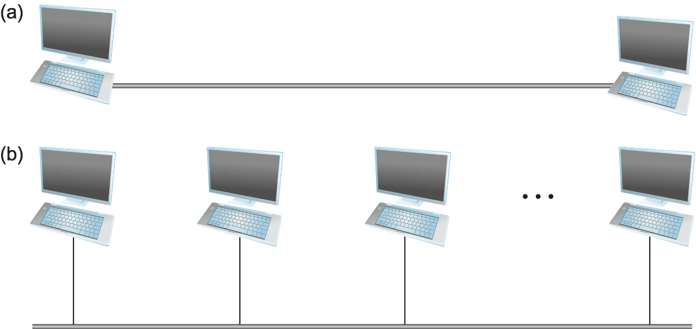

**Figure 1.2. Direct links: (a) point-to-point; (b) multiple-access.**

If computer networks were limited to situations in which all nodes are directly connected to each other over a common physical medium, then either networks would be very limited in the number of computers they could connect, or the number of wires coming out of the back of each node would quickly become both unmanageable and very expensive. Fortunately, connectivity between two nodes does not necessarily imply a direct physical connection between them—indirect connectivity may be achieved among a set of cooperating nodes. Consider the following two examples of how a collection of computers can be indirectly connected.

Figure 1.3 shows a set of nodes, each of which is attached to one or more point-to-point links. Those nodes that are attached to at least two links run software that forwards data received on one link out on another. If organized in a systematic way, these forwarding nodes form a *switched network*. There are numerous types of switched networks, of which the two most common are *circuit switched* and *packet switched*. The former is most notably employed by the telephone system, while the latter is used for the overwhelming majority of computer networks and will be the focus of this book. (Circuit switching is, however, making a bit of a comeback in the optical networking realm, which turns out to be important as demand for network capacity constantly grows.) The important feature of packet-switched networks is that the nodes in such a network send discrete blocks of data to each other. Think of these blocks of data as corresponding to some piece of application data such as a file, a piece of email, or an image. We call each block of data either a *packet* or a *message*, and for now we use these terms interchangeably.

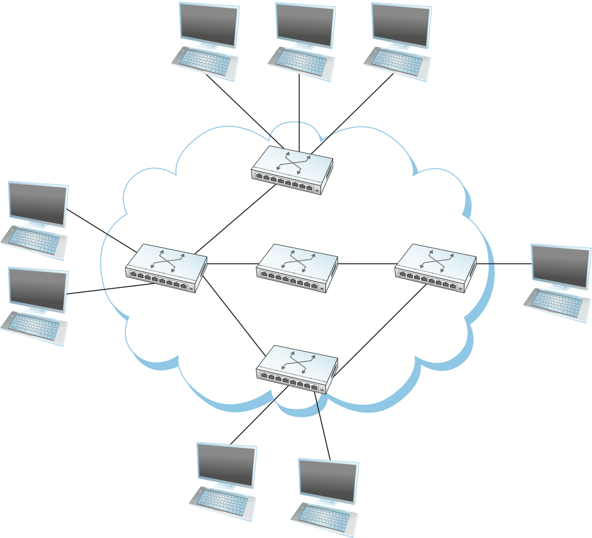

**Figure 1.3. Switched network.**

Packet-switched networks typically use a strategy called *store-and-forward*. As the name suggests, each node in a store-and-forward network first receives a complete packet over some link, stores the packet in its internal memory, and then forwards the complete packet to the next node. In contrast, a circuit-switched network first establishes a dedicated circuit across a sequence of links and then allows the source node to send a stream of bits across this circuit to a destination node. The major reason for using packet switching rather than circuit switching in a computer network is efficiency, discussed in the next subsection.

The cloud in Figure 1.3 distinguishes between the nodes on the inside that *implement* the network (they are commonly called *switches*, and their primary function is to store and forward packets) and the nodes on the outside of the cloud that *use* the network (they are traditionally called *hosts*, and they support users and run application programs). Also note that the cloud is one of the most important icons of computer networking. In general, we use a cloud to denote any type of network, whether it is a single point-to-point link, a multiple-access link, or a switched network. Thus, whenever you see a cloud used in a figure, you can think of it as a placeholder for any of the networking technologies covered in this book.

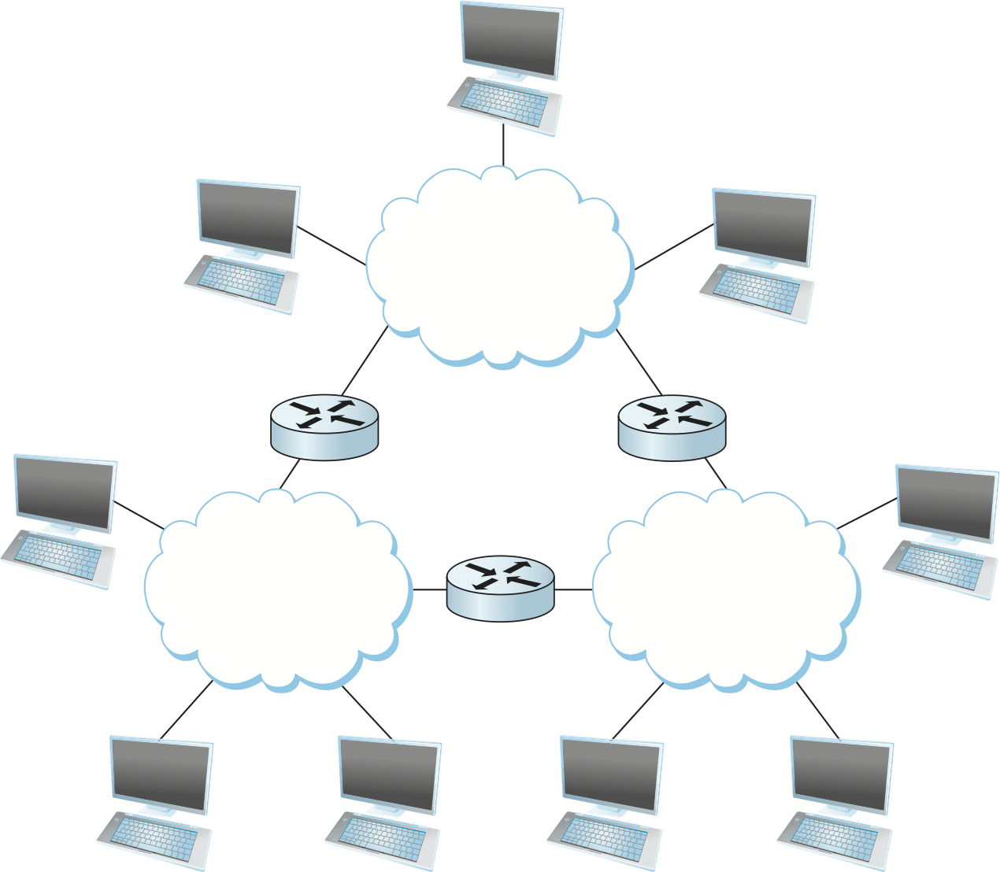

**Figure 1.4. Interconnection of networks.**

A second way in which a set of computers can be indirectly connected is shown in Figure 1.4. In this situation, a set of independent networks (clouds) are interconnected to form an *internetwork*, or internet for short. We adopt the Internet’s convention of referring to a generic internetwork of networks as a lowercase *i* internet, and the TCP/IP Internet we all use every day as the capital *I* Internet. A node that is connected to two or more networks is commonly called a *router* or *gateway*, and it plays much the same role as a switch—it forwards messages from one network to another. Note that an internet can itself be viewed as another kind of network, which means that an internet can be built from a set of internets. Thus, we can recursively build arbitrarily large networks by interconnecting clouds to form larger clouds. It can reasonably be argued that this idea of interconnecting widely differing networks was the fundamental innovation of the Internet and that the successful growth of the Internet to global size and billions of nodes was the result of some very good design decisions by the early Internet architects, which we will discuss later.

Just because a set of hosts are directly or indirectly connected to each other does not mean that we have succeeded in providing host-to-host connectivity. The final requirement is that each node must be able to say which of the other nodes on the network it wants to communicate with. This is done by assigning an *address* to each node. An address is a byte string that identifies a node; that is, the network can use a node’s address to distinguish it from the other nodes connected to the network. When a source node wants the network to deliver a message to a certain destination node, it specifies the address of the destination node. If the sending and receiving nodes are not directly connected, then the switches and routers of the network use this address to decide how to forward the message toward the destination. The process of determining systematically how to forward messages toward the destination node based on its address is called *routing*.

This brief introduction to addressing and routing has presumed that the source node wants to send a message to a single destination node (*unicast*). While this is the most common scenario, it is also possible that the source node might want to *broadcast* a message to all the nodes on the network. Or, a source node might want to send a message to some subset of the other nodes but not all of them, a situation called *multicast*. Thus, in addition to node-specific addresses, another requirement of a network is that it supports multicast and broadcast addresses.

> **Key Takeaway**
>
> The main idea to take away from this discussion is that we can define a *network* recursively as consisting of two or more nodes connected by a physical link, or as two or more networks connected by a node. In other words, a network can be constructed from a nesting of networks, where at the bottom level, the network is implemented by some physical medium. Among the key challenges in providing network connectivity are the definition of an address for each node that is reachable on the network (be it logical or physical), and the use of such addresses to forward messages toward the appropriate destination node(s). [Next]

#### 1.2.3 Cost-Effective Resource Sharing

As stated above, this book focuses on packet-switched networks. This section explains the key requirement of computer networks—efficiency—that leads us to packet switching as the strategy of choice.

Given a collection of nodes indirectly connected by a nesting of networks, it is possible for any pair of hosts to send messages to each other across a sequence of links and nodes. Of course, we want to do more than support just one pair of communicating hosts—we want to provide all pairs of hosts with the ability to exchange messages. The question, then, is how do all the hosts that want to communicate share the network, especially if they want to use it at the same time? And, as if that problem isn’t hard enough, how do several hosts share the same *link* when they all want to use it at the same time?

To understand how hosts share a network, we need to introduce a fundamental concept, *multiplexing*, which means that a system resource is shared among multiple users. At an intuitive level, multiplexing can be explained by analogy to a timesharing computer system, where a single physical processor is shared (multiplexed) among multiple jobs, each of which believes it has its own private processor. Similarly, data being sent by multiple users can be multiplexed over the physical links that make up a network.

To see how this might work, consider the simple network illustrated in Figure 1.5, where the three hosts on the left side of the network (senders S1-S3) are sending data to the three hosts on the right (receivers R1-R3) by sharing a switched network that contains only one physical link. (For simplicity, assume that host S1 is sending data to host R1, and so on.) In this situation, three flows of data—corresponding to the three pairs of hosts—are multiplexed onto a single physical link by switch 1 and then *demultiplexed* back into separate flows by switch 2. Note that we are being intentionally vague about exactly what a “flow of data” corresponds to. For the purposes of this discussion, assume that each host on the left has a large supply of data that it wants to send to its counterpart on the right.

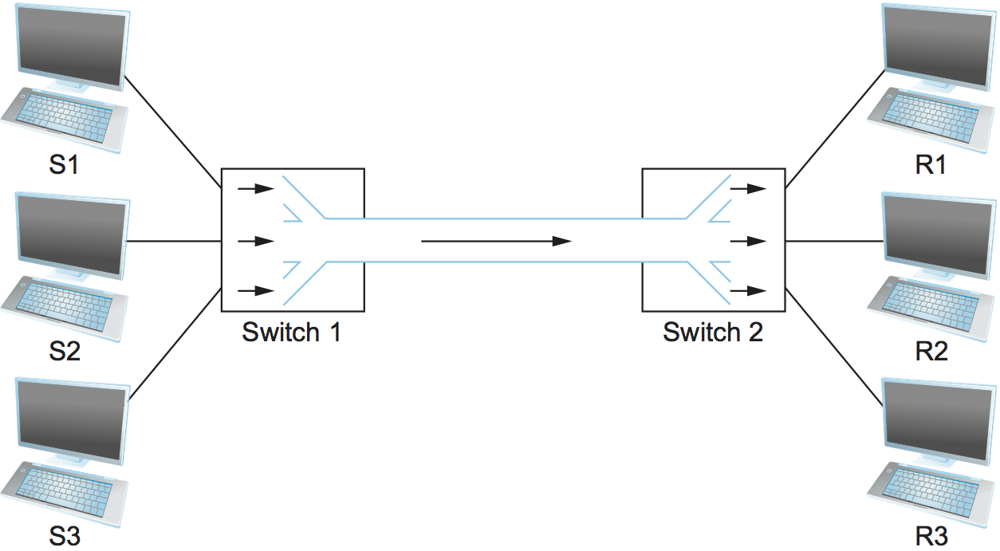

**Figure 1.5. Multiplexing multiple logical flows over a single physical link.**

There are several different methods for multiplexing multiple flows onto one physical link. One common method is *synchronous time-division multiplexing* (STDM). The idea of STDM is to divide time into equal-sized quanta and, in a round-robin fashion, give each flow a chance to send its data over the physical link. In other words, during time quantum 1, data from S1 to R1 is transmitted; during time quantum 2, data from S2 to R2 is transmitted; in quantum 3, S3 sends data to R3. At this point, the first flow (S1 to R1) gets to go again, and the process repeats. Another method is *frequency-division multiplexing* (FDM). The idea of FDM is to transmit each flow over the physical link at a different frequency, much the same way that the signals for different TV stations are transmitted at a different frequency over the airwaves or on a coaxial cable TV link.

Although simple to understand, both STDM and FDM are limited in two ways. First, if one of the flows (host pairs) does not have any data to send, its share of the physical link—that is, its time quantum or its frequency—remains idle, even if one of the other flows has data to transmit. For example, S3 had to wait its turn behind S1 and S2 in the previous paragraph, even if S1 and S2 had nothing to send. For computer communication, the amount of time that a link is idle can be very large—for example, consider the amount of time you spend reading a web page (leaving the link idle) compared to the time you spend fetching the page. Second, both STDM and FDM are limited to situations in which the maximum number of flows is fixed and known ahead of time. It is not practical to resize the quantum or to add additional quanta in the case of STDM or to add new frequencies in the case of FDM.

The form of multiplexing that addresses these shortcomings, and of which we make most use in this book, is called *statistical multiplexing*. Although the name is not all that helpful for understanding the concept, statistical multiplexing is really quite simple, with two key ideas. First, it is like STDM in that the physical link is shared over time—first data from one flow is transmitted over the physical link, then data from another flow is transmitted, and so on. Unlike STDM, however, data is transmitted from each flow on demand rather than during a predetermined time slot. Thus, if only one flow has data to send, it gets to transmit that data without waiting for its quantum to come around and thus without having to watch the quanta assigned to the other flows go by unused. It is this avoidance of idle time that gives packet switching its efficiency.

As defined so far, however, statistical multiplexing has no mechanism to ensure that all the flows eventually get their turn to transmit over the physical link. That is, once a flow begins sending data, we need some way to limit the transmission, so that the other flows can have a turn. To account for this need, statistical multiplexing defines an upper bound on the size of the block of data that each flow is permitted to transmit at a given time. This limited-size block of data is typically referred to as a *packet*, to distinguish it from the arbitrarily large *message* that an application program might want to transmit. Because a packet-switched network limits the maximum size of packets, a host may not be able to send a complete message in one packet. The source may need to fragment the message into several packets, with the receiver reassembling the packets back into the original message.

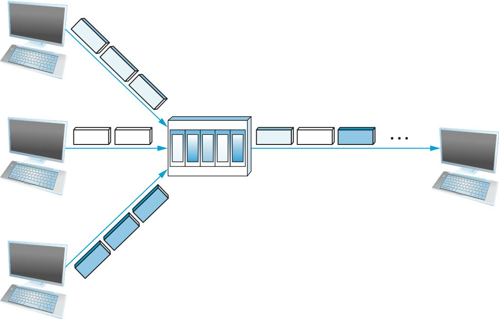

**Figure 1.6. A switch multiplexing packets from multiple sources onto one shared link.**

In other words, each flow sends a sequence of packets over the physical link, with a decision made on a packet-by-packet basis as to which flow’s packet to send next. Notice that, if only one flow has data to send, then it can send a sequence of packets back-to-back; however, should more than one of the flows have data to send, then their packets are interleaved on the link. Figure 1.6 depicts a switch multiplexing packets from multiple sources onto a single shared link.

The decision as to which packet to send next on a shared link can be made in a number of different ways. For example, in a network consisting of switches interconnected by links such as the one in Figure 1.5, the decision would be made by the switch that transmits packets onto the shared link. (As we will see later, not all packet-switched networks actually involve switches, and they may use other mechanisms to determine whose packet goes onto the link next.) Each switch in a packet-switched network makes this decision independently, on a packet-by-packet basis. One of the issues that faces a network designer is how to make this decision in a fair manner. For example, a switch could be designed to service packets on a first-in, first-out (FIFO) basis. Another approach would be to transmit the packets from each of the different flows that are currently sending data through the switch in a round-robin manner. This might be done to ensure that certain flows receive a particular share of the link’s bandwidth or that they never have their packets delayed in the switch for more than a certain length of time. A network that attempts to allocate bandwidth to particular flows is sometimes said to support *quality of service* (QoS).

Also, notice in Figure 1.6 that since the switch has to multiplex three incoming packet streams onto one outgoing link, it is possible that the switch will receive packets faster than the shared link can accommodate. In this case, the switch is forced to buffer these packets in its memory. Should a switch receive packets faster than it can send them for an extended period of time, then the switch will eventually run out of buffer space, and some packets will have to be dropped. When a switch is operating in this state, it is said to be *congested*.

> **Key Takeaway**
>
> The bottom line is that statistical multiplexing defines a cost-effective way for multiple users (e.g., host-to-host flows of data) to share network resources (links and nodes) in a fine-grained manner. It defines the packet as the granularity with which the links of the network are allocated to different flows, with each switch able to schedule the use of the physical links it is connected to on a per-packet basis. Fairly allocating link capacity to different flows and dealing with congestion when it occurs are the key challenges of statistical multiplexing. [Next]

#### 1.2.4 Support for Common Services

The previous discussion focused on the challenges involved in providing cost-effective connectivity among a group of hosts, but it is overly simplistic to view a computer network as simply delivering packets among a collection of computers. It is more accurate to think of a network as providing the means for a set of application processes that are distributed over those computers to communicate. In other words, the next requirement of a computer network is that the application programs running on the hosts connected to the network must be able to communicate in a meaningful way. From the application developer’s perspective, the network needs to make his or her life easier.

When two application programs need to communicate with each other, a lot of complicated things must happen beyond simply sending a message from one host to another. One option would be for application designers to build all that complicated functionality into each application program. However, since many applications need common services, it is much more logical to implement those common services once and then to let the application designer build the application using those services. The challenge for a network designer is to identify the right set of common services. The goal is to hide the complexity of the network from the application without overly constraining the application designer.

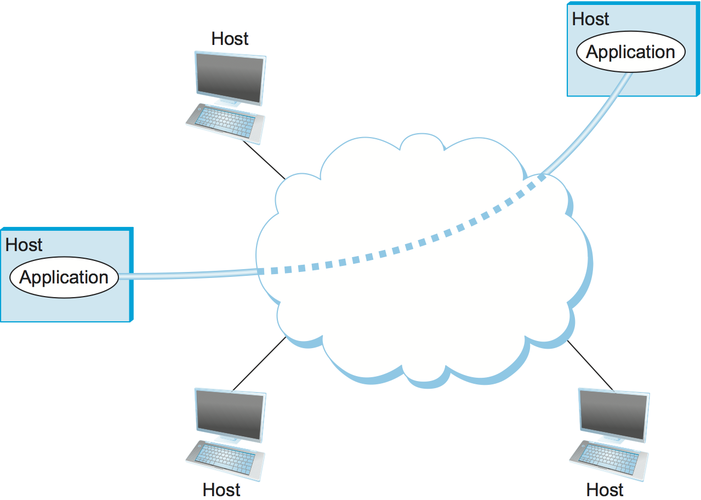

**Figure 1.7. Processes communicating over an abstract channel.**

Intuitively, we view the network as providing logical *channels* over which application-level processes can communicate with each other; each channel provides the set of services required by that application. In other words, just as we use a cloud to abstractly represent connectivity among a set of computers, we now think of a channel as connecting one process to another. Figure 1.7 shows a pair of application-level processes communicating over a logical channel that is, in turn, implemented on top of a cloud that connects a set of hosts. We can think of the channel as being like a pipe connecting two applications, so that a sending application can put data in one end and expect that data to be delivered by the network to the application at the other end of the pipe.

Like any abstraction, logical process-to-process channels are implemented on top of a collection of physical host-to-host channels. This is the essence of layering, the cornerstone of network architectures discussed in the next section.

The challenge is to recognize what functionality the channels should provide to application programs. For example, does the application require a guarantee that messages sent over the channel are delivered, or is it acceptable if some messages fail to arrive? Is it necessary that messages arrive at the recipient process in the same order in which they are sent, or does the recipient not care about the order in which messages arrive? Does the network need to ensure that no third parties are able to eavesdrop on the channel, or is privacy not a concern? In general, a network provides a variety of different types of channels, with each application selecting the type that best meets its needs. The rest of this section illustrates the thinking involved in defining useful channels.

##### Identify Common Communication Patterns

Designing abstract channels involves first understanding the communication needs of a representative collection of applications, then extracting their common communication requirements, and finally incorporating the functionality that meets these requirements in the network.

One of the earliest applications supported on any network is a file access program like the File Transfer Protocol (FTP) or Network File System (NFS). Although many details vary—for example, whether whole files are transferred across the network or only single blocks of the file are read/written at a given time—the communication component of remote file access is characterized by a pair of processes, one that requests that a file be read or written and a second process that honors this request. The process that requests access to the file is called the *client*, and the process that supports access to the file is called the *server*.

Reading a file involves the client sending a small request message to a server and the server responding with a large message that contains the data in the file. Writing works in the opposite way—the client sends a large message containing the data to be written to the server, and the server responds with a small message confirming that the write to disk has taken place.

A digital library is a more sophisticated application than file transfer, but it requires similar communication services. For example, the *Association for Computing Machinery* (ACM) operates a large digital library of computer science literature at

```html
http://portal.acm.org/dl.cfm
```

This library has a wide range of searching and browsing features to help users find the articles they want, but ultimately much of what it does is respond to user requests for files, such as electronic copies of journal articles.

Using file access, a digital library, and the two video applications described in the introduction (videoconferencing and video on demand) as a representative sample, we might decide to provide the following two types of channels: *request/reply* channels and *message stream* channels. The request/reply channel would be used by the file transfer and digital library applications. It would guarantee that every message sent by one side is received by the other side and that only one copy of each message is delivered. The request/reply channel might also protect the privacy and integrity of the data that flows over it, so that unauthorized parties cannot read or modify the data being exchanged between the client and server processes.

The message stream channel could be used by both the video on demand and videoconferencing applications, provided it is parameterized to support both one-way and two-way traffic and to support different delay properties. The message stream channel might not need to guarantee that all messages are delivered, since a video application can operate adequately even if some video frames are not received. It would, however, need to ensure that those messages that are delivered arrive in the same order in which they were sent, to avoid displaying frames out of sequence. Like the request/reply channel, the message stream channel might want to ensure the privacy and integrity of the video data. Finally, the message stream channel might need to support multicast, so that multiple parties can participate in the teleconference or view the video.

While it is common for a network designer to strive for the smallest number of abstract channel types that can serve the largest number of applications, there is a danger in trying to get away with too few channel abstractions. Simply stated, if you have a hammer, then everything looks like a nail. For example, if all you have are message stream and request/reply channels, then it is tempting to use them for the next application that comes along, even if neither type provides exactly the semantics needed by the application. Thus, network designers will probably be inventing new types of channels—and adding options to existing channels—for as long as application programmers are inventing new applications.

Also note that independent of exactly *what* functionality a given channel provides, there is the question of *where* that functionality is implemented. In many cases, it is easiest to view the host-to-host connectivity of the underlying network as simply providing a *bit pipe*, with any high-level communication semantics provided at the end hosts. The advantage of this approach is that it keeps the switches in the middle of the network as simple as possible—they simply forward packets—but it requires the end hosts to take on much of the burden of supporting semantically rich process-to-process channels. The alternative is to push additional functionality onto the switches, thereby allowing the end hosts to be “dumb” devices (e.g., telephone handsets). We will see this question of how various network services are partitioned between the packet switches and the end hosts (devices) as a recurring issue in network design.

##### Reliable Message Delivery

As suggested by the examples just considered, reliable message delivery is one of the most important functions that a network can provide. It is difficult to determine how to provide this reliability, however, without first understanding how networks can fail. The first thing to recognize is that computer networks do not exist in a perfect world. Machines crash and later are rebooted, fibers are cut, electrical interference corrupts bits in the data being transmitted, switches run out of buffer space, and, as if these sorts of physical problems aren’t enough to worry about, the software that manages the hardware may contain bugs and sometimes forwards packets into oblivion. Thus, a major requirement of a network is to recover from certain kinds of failures, so that application programs don’t have to deal with them or even be aware of them.

There are three general classes of failure that network designers have to worry about. First, as a packet is transmitted over a physical link, *bit errors* may be introduced into the data; that is, a 1 is turned into a 0 or *vice versa*. Sometimes single bits are corrupted, but more often than not a *burst error* occurs—several consecutive bits are corrupted. Bit errors typically occur because outside forces, such as lightning strikes, power surges, and microwave ovens, interfere with the transmission of data. The good news is that such bit errors are fairly rare, affecting on average only one out of every 10 ⁶ to 10 ⁷ bits on a typical copper-based cable and one out of every 10 ¹² to 10 ¹⁴ bits on a typical optical fiber. As we will see, there are techniques that detect these bit errors with high probability. Once detected, it is sometimes possible to correct for such errors—if we know which bit or bits are corrupted, we can simply flip them—while in other cases the damage is so bad that it is necessary to discard the entire packet. In such a case, the sender may be expected to retransmit the packet.

The second class of failure is at the packet, rather than the bit, level; that is, a complete packet is lost by the network. One reason this can happen is that the packet contains an uncorrectable bit error and therefore has to be discarded. A more likely reason, however, is that one of the nodes that has to handle the packet—for example, a switch that is forwarding it from one link to another—is so overloaded that it has no place to store the packet and therefore is forced to drop it. This is the problem of congestion just discussed. Less commonly, the software running on one of the nodes that handles the packet makes a mistake. For example, it might incorrectly forward a packet out on the wrong link, so that the packet never finds its way to the ultimate destination. As we will see, one of the main difficulties in dealing with lost packets is distinguishing between a packet that is indeed lost and one that is merely late in arriving at the destination.

The third class of failure is at the node and link level; that is, a physical link is cut, or the computer it is connected to crashes. This can be caused by software that crashes, a power failure, or a reckless backhoe operator. Failures due to misconfiguration of a network device are also common. While any of these failures can eventually be corrected, they can have a dramatic effect on the network for an extended period of time. However, they need not totally disable the network. In a packet-switched network, for example, it is sometimes possible to route around a failed node or link. One of the difficulties in dealing with this third class of failure is distinguishing between a failed computer and one that is merely slow or, in the case of a link, between one that has been cut and one that is very flaky and therefore introducing a high number of bit errors.

> **Key Takeaway**
>
> The key idea to take away from this discussion is that defining useful channels involves both understanding the applications’ requirements and recognizing the limitations of the underlying technology. The challenge is to fill in the gap between what the application expects and what the underlying technology can provide. This is sometimes called the *semantic gap.* [Next]

#### 1.2.5 Manageability

A final requirement, which seems to be neglected or left till last all too often (as we do here), is that networks need to be managed. Managing a network includes upgrading equipment as the network grows to carry more traffic or reach more users, troubleshooting the network when things go wrong or performance isn’t as desired, and adding new features in support of new applications. Network management has historically been a human-intensive aspect of networking, and while it is unlikely we'll get people entirely out of the loop, it is increasingly being addressed by automation and self-healing designs.

This requirement is partly related to the issue of scalability discussed above—as the Internet has scaled up to support billions of users and at least hundreds of millions of hosts, the challenges of keeping the whole thing running correctly and correctly configuring new devices as they are added have become increasingly problematic. Configuring a single router in a network is often a task for a trained expert; configuring thousands of routers and figuring out why a network of such a size is not behaving as expected can become a task beyond any single human. This is why automation is becoming so important.

One way to make a network easier to manage is to avoid change. Once the network is working, simply *do not touch it!* This mindset exposes the fundamental tension between *stability* and *feature velocity*: the rate at which new capabilities are introduced into the network. Favoring stability is the approach the telecommunications industry (not to mention University system administrators and corporate IT departments) adopted for many years, making it one of the most slow moving and risk averse industries you will find anywhere. But the recent explosion of the cloud has changed that dynamic, making it necessary to bring stability and feature velocity more into balance. The impact of the cloud on the network is a topic that comes up over and over throughout the book, and one we pay particular attention to in the *Perspectives* section at the end of each chapter. For now, suffice it to say that managing a rapidly evolving network is arguably *the* central challenge in networking today.

### 1.3 Architecture

The previous section established a pretty substantial set of requirements for network design—a computer network must provide general, cost-effective, fair, and robust connectivity among a large number of computers. As if this weren’t enough, networks do not remain fixed at any single point in time but must evolve to accommodate changes in both the underlying technologies upon which they are based as well as changes in the demands placed on them by application programs. Furthermore, networks must be manageable by humans of varying levels of skill. Designing a network to meet these requirements is no small task.

To help deal with this complexity, network designers have developed general blueprints—usually called *network architectures*—that guide the design and implementation of networks. This section defines more carefully what we mean by a network architecture by introducing the central ideas that are common to all network architectures. It also introduces two of the most widely referenced architectures—the OSI (or 7-layer) architecture and the Internet architecture.

#### 1.3.1 Layering and Protocols

Abstraction—the hiding of implementation details behind a well-defined interface—is the fundamental tool used by system designers to manage complexity. The idea of an abstraction is to define a model that can capture some important aspect of the system, encapsulate this model in an object that provides an interface that can be manipulated by other components of the system, and hide the details of how the object is implemented from the users of the object. The challenge is to identify abstractions that simultaneously provide a service that proves useful in a large number of situations and that can be efficiently implemented in the underlying system. This is exactly what we were doing when we introduced the idea of a channel in the previous section: we were providing an abstraction for applications that hides the complexity of the network from application writers.

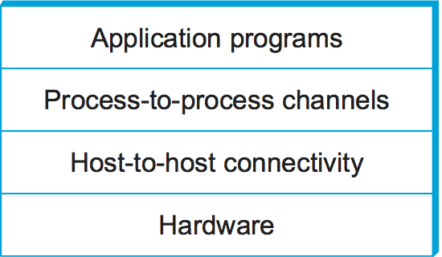

**Figure 1.8. Example of a layered network system.**

Abstractions naturally lead to layering, especially in network systems. The general idea is that you start with the services offered by the underlying hardware and then add a sequence of layers, each providing a higher (more abstract) level of service. The services provided at the high layers are implemented in terms of the services provided by the low layers. Drawing on the discussion of requirements given in the previous section, for example, we might imagine a simple network as having two layers of abstraction sandwiched between the application program and the underlying hardware, as illustrated in Figure 1.8. The layer immediately above the hardware in this case might provide host-to-host connectivity, abstracting away the fact that there may be an arbitrarily complex network topology between any two hosts. The next layer up builds on the available host-to-host communication service and provides support for process-to-process channels, abstracting away the fact that the network occasionally loses messages, for example.

Layering provides two useful features. First, it decomposes the problem of building a network into more manageable components. Rather than implementing a monolithic piece of software that does everything you will ever want, you can implement several layers, each of which solves one part of the problem. Second, it provides a more modular design. If you decide that you want to add some new service, you may only need to modify the functionality at one layer, reusing the functions provided at all the other layers.

Thinking of a system as a linear sequence of layers is an oversimplification, however. Many times there are multiple abstractions provided at any given level of the system, each providing a different service to the higher layers but building on the same low-level abstractions. To see this, consider the two types of channels discussed in the previous section. One provides a request/reply service and one supports a message stream service. These two channels might be alternative offerings at some level of a multilevel networking system, as illustrated in Figure 1.9.

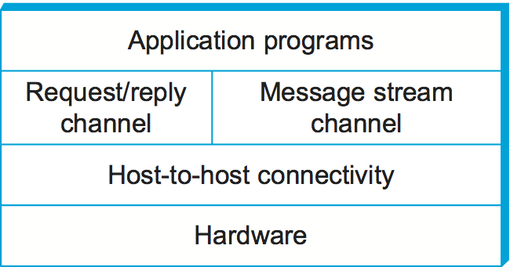

**Figure 1.9. Layered system with alternative abstractions available at a given layer.**

Using this discussion of layering as a foundation, we are now ready to discuss the architecture of a network more precisely. For starters, the abstract objects that make up the layers of a network system are called *protocols*. That is, a protocol provides a communication service that higher-level objects (such as application processes, or perhaps higher-level protocols) use to exchange messages. For example, we could imagine a network that supports a request/reply protocol and a message stream protocol, corresponding to the request/reply and message stream channels discussed above.

Each protocol defines two different interfaces. First, it defines a *service interface* to the other objects on the same computer that want to use its communication services. This service interface defines the operations that local objects can perform on the protocol. For example, a request/reply protocol would support operations by which an application can send and receive messages. An implementation of the HTTP protocol could support an operation to fetch a page of hypertext from a remote server. An application such as a web browser would invoke such an operation whenever the browser needs to obtain a new page (e.g., when the user clicks on a link in the currently displayed page).

Second, a protocol defines a *peer interface* to its counterpart (peer) on another machine. This second interface defines the form and meaning of messages exchanged between protocol peers to implement the communication service. This would determine the way in which a request/reply protocol on one machine communicates with its peer on another machine. In the case of HTTP, for example, the protocol specification defines in detail how a *GET* command is formatted, what arguments can be used with the command, and how a web server should respond when it receives such a command.

To summarize, a protocol defines a communication service that it exports locally (the service interface), along with a set of rules governing the messages that the protocol exchanges with its peer(s) to implement this service (the peer interface). This situation is illustrated in Figure 1.10.

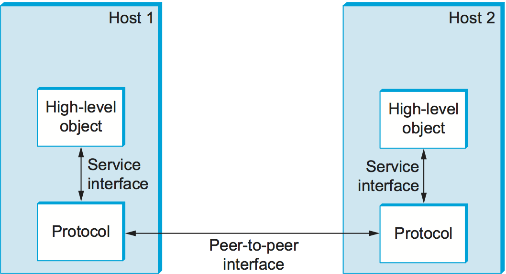

**Figure 1.10. Service interfaces and peer interfaces.**

Except at the hardware level, where peers directly communicate with each other over a physical medium, peer-to-peer communication is indirect—each protocol communicates with its peer by passing messages to some lower-level protocol, which in turn delivers the message to *its* peer. In addition, there may be more than one protocol at any given level, each providing a different communication service. We therefore represent the suite of protocols that make up a network system with a *protocol graph*. The nodes of the graph correspond to protocols, and the edges represent a *depends on* relation. For example, Figure 1.11 illustrates a protocol graph for the hypothetical layered system we have been discussing—protocols RRP (Request/Reply Protocol) and MSP (Message Stream Protocol) implement two different types of process-to-process channels, and both depend on the Host-to-Host Protocol (HHP) which provides a host-to-host connectivity service.

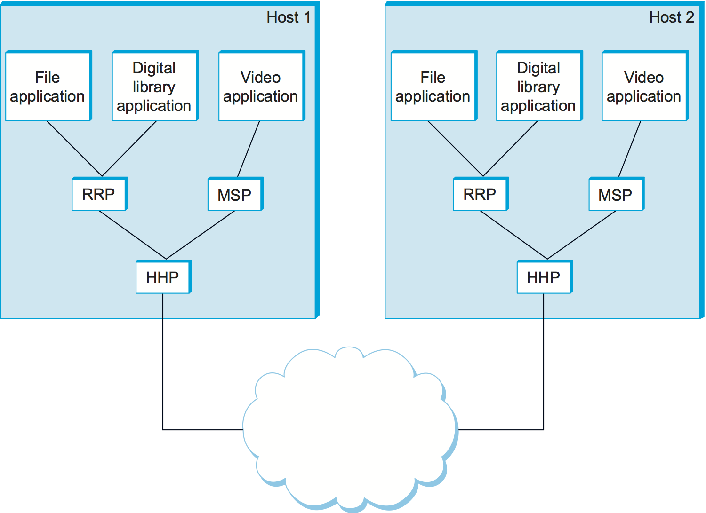

**Figure 1.11. Example of a protocol graph.**

In this example, suppose that the file access program on host 1 wants to send a message to its peer on host 2 using the communication service offered by RRP. In this case, the file application asks RRP to send the message on its behalf. To communicate with its peer, RRP invokes the services of HHP, which in turn transmits the message to its peer on the other machine. Once the message has arrived at the instance of HHP on host 2, HHP passes the message up to RRP, which in turn delivers the message to the file application. In this particular case, the application is said to employ the services of the *protocol stack* RRP/HHP.

Note that the term *protocol* is used in two different ways. Sometimes it refers to the abstract interfaces—that is, the operations defined by the service interface and the form and meaning of messages exchanged between peers, and sometimes it refers to the module that actually implements these two interfaces. To distinguish between the interfaces and the module that implements these interfaces, we generally refer to the former as a *protocol specification*. Specifications are generally expressed using a combination of prose, pseudocode, state transition diagrams, pictures of packet formats, and other abstract notations. It should be the case that a given protocol can be implemented in different ways by different programmers, as long as each adheres to the specification. The challenge is ensuring that two different implementations of the same specification can successfully exchange messages. Two or more protocol modules that do accurately implement a protocol specification are said to *interoperate* with each other.

We can imagine many different protocols and protocol graphs that satisfy the communication requirements of a collection of applications. Fortunately, there exist standardization bodies, such as the Internet Engineering Task Force (IETF) and the International Standards Organization (ISO), that establish policies for a particular protocol graph. We call the set of rules governing the form and content of a protocol graph a *network architecture*. Although beyond the scope of this book, standardization bodies have established well-defined procedures for introducing, validating, and finally approving protocols in their respective architectures. We briefly describe the architectures defined by the IETF and ISO shortly, but first there are two additional things we need to explain about the mechanics of protocol layering.

#### 1.3.2 Encapsulation

Consider what happens in Figure 1.11 when one of the application programs sends a message to its peer by passing the message to RRP. From RRP’s perspective, the message it is given by the application is an uninterpreted string of bytes. RRP does not care that these bytes represent an array of integers, an email message, a digital image, or whatever; it is simply charged with sending them to its peer. However, RRP must communicate control information to its peer, instructing it how to handle the message when it is received. RRP does this by attaching a *header* to the message. Generally speaking, a header is a small data structure—from a few bytes to a few dozen bytes—that is used among peers to communicate with each other. As the name suggests, headers are usually attached to the front of a message. In some cases, however, this peer-to-peer control information is sent at the end of the message, in which case it is called a *trailer*. The exact format for the header attached by RRP is defined by its protocol specification. The rest of the message—that is, the data being transmitted on behalf of the application—is called the message’s *body* or *payload*. We say that the application’s data is *encapsulated* in the new message created by RRP.

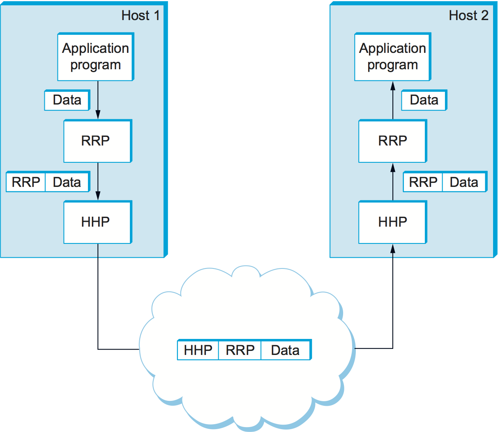

**Figure 1.12. High-level messages are encapsulated inside of low-level messages.**

This process of encapsulation is then repeated at each level of the protocol graph; for example, HHP encapsulates RRP’s message by attaching a header of its own. If we now assume that HHP sends the message to its peer over some network, then when the message arrives at the destination host, it is processed in the opposite order: HHP first interprets the HHP header at the front of the message (i.e., takes whatever action is appropriate given the contents of the header) and passes the body of the message (but not the HHP header) up to RRP, which takes whatever action is indicated by the RRP header that its peer attached and passes the body of the message (but not the RRP header) up to the application program. The message passed up from RRP to the application on host 2 is exactly the same message as the application passed down to RRP on host 1; the application does not see any of the headers that have been attached to it to implement the lower-level communication services. This whole process is illustrated in Figure 1.12. Note that in this example, nodes in the network (e.g., switches and routers) may inspect the HHP header at the front of the message.

Note that when we say a low-level protocol does not interpret the message it is given by some high-level protocol, we mean that it does not know how to extract any meaning from the data contained in the message. It is sometimes the case, however, that the low-level protocol applies some simple transformation to the data it is given, such as to compress or encrypt it. In this case, the protocol is transforming the entire body of the message, including both the original application’s data and all the headers attached to that data by higher-level protocols.

#### 1.3.3 Multiplexing and Demultiplexing

Recall that a fundamental idea of packet switching is to multiplex multiple flows of data over a single physical link. This same idea applies up and down the protocol graph, not just to switching nodes. In Figure 1.11, for example, we can think of RRP as implementing a logical communication channel, with messages from two different applications multiplexed over this channel at the source host and then demultiplexed back to the appropriate application at the destination host.

Practically speaking, this simply means that the header that RRP attaches to its messages contains an identifier that records the application to which the message belongs. We call this identifier RRP’s *demultiplexing key*, or *demux key* for short. At the source host, RRP includes the appropriate demux key in its header. When the message is delivered to RRP on the destination host, it strips its header, examines the demux key, and demultiplexes the message to the correct application.

RRP is not unique in its support for multiplexing; nearly every protocol implements this mechanism. For example, HHP has its own demux key to determine which messages to pass up to RRP and which to pass up to MSP. However, there is no uniform agreement among protocols—even those within a single network architecture—on exactly what constitutes a demux key. Some protocols use an 8-bit field (meaning they can support only 256 high-level protocols), and others use 16- or 32-bit fields. Also, some protocols have a single demultiplexing field in their header, while others have a pair of demultiplexing fields. In the former case, the same demux key is used on both sides of the communication, while in the latter case each side uses a different key to identify the high-level protocol (or application program) to which the message is to be delivered.

#### 1.3.4 OSI Model

The ISO was one of the first organizations to formally define a common way to connect computers. Their architecture, called the *Open Systems Interconnection* (OSI) architecture and illustrated in Figure 1.13, defines a partitioning of network functionality into seven layers, where one or more protocols implement the functionality assigned to a given layer. In this sense, the schematic given in Figure 1.13 is not a protocol graph, *per se*, but rather a *reference model* for a protocol graph. It is often referred to as the 7-layer model. While there is no OSI-based network running today, the terminology it defined is still widely used, so it is still worth a cursory look.

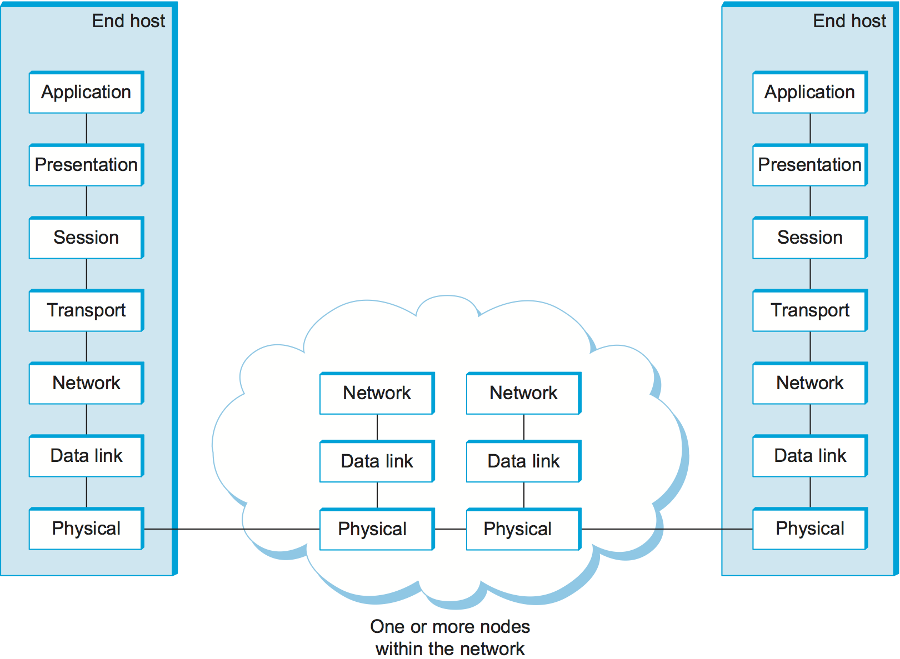

**Figure 1.13. The OSI 7-layer model.**

Starting at the bottom and working up, the *physical* layer handles the transmission of raw bits over a communications link. The *data link* layer then collects a stream of bits into a larger aggregate called a *frame*. Network adaptors, along with device drivers running in the node’s operating system, typically implement the data link level. This means that frames, not raw bits, are actually delivered to hosts. The *network* layer handles routing among nodes within a packet-switched network. At this layer, the unit of data exchanged among nodes is typically called a *packet* rather than a frame, although they are fundamentally the same thing. The lower three layers are implemented on all network nodes, including switches within the network and hosts connected to the exterior of the network. The *transport* layer then implements what we have up to this point been calling a *process-to-process channel*. Here, the unit of data exchanged is commonly called a *message* rather than a packet or a frame. The transport layer and higher layers typically run only on the end hosts and not on the intermediate switches or routers.

Skipping ahead to the top (seventh) layer and working our way back down, we find the *application* layer. Application layer protocols include things like the Hypertext Transfer Protocol (HTTP), which is the basis of the World Wide Web and is what enables web browsers to request pages from web servers. Below that, the *presentation* layer is concerned with the format of data exchanged between peers—for example, whether an integer is 16, 32, or 64 bits long, whether the most significant byte is transmitted first or last, or how a video stream is formatted. Finally, the *session* layer provides a name space that is used to tie together the potentially different transport streams that are part of a single application. For example, it might manage an audio stream and a video stream that are being combined in a teleconferencing application.

#### 1.3.5 Internet Architecture

The Internet architecture, which is also sometimes called the TCP/IP architecture after its two main protocols, is depicted in Figure 1.14. An alternative representation is given in Figure 1.15. The Internet architecture evolved out of experiences with an earlier packet-switched network called the ARPANET. Both the Internet and the ARPANET were funded by the Advanced Research Projects Agency (ARPA), one of the research and development funding agencies of the U.S. Department of Defense. The Internet and ARPANET were around before the OSI architecture, and the experience gained from building them was a major influence on the OSI reference model.

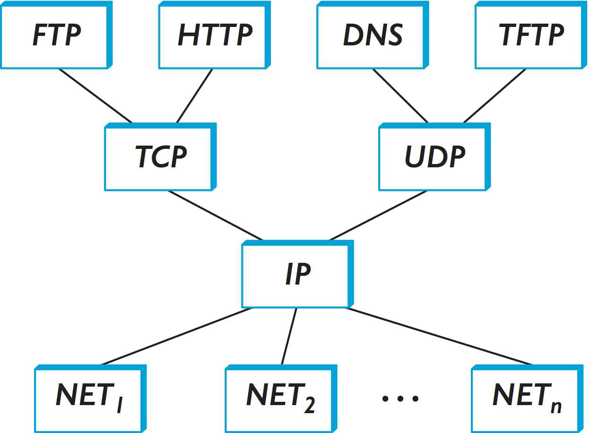

**Figure 1.14. Internet protocol graph.**

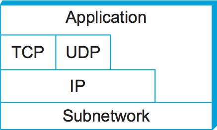

**Figure 1.15. Alternative view of the Internet architecture. The "subnetwork" layer was historically referred to as the “network” layer and is now often referred to as “Layer 2” (influenced by the OSI model).**

While the 7-layer OSI model can, with some imagination, be applied to the Internet, a simpler stack is often used instead. At the lowest level is a wide variety of network protocols, denoted NET ₁, NET ₂, and so on. In practice, these protocols are implemented by a combination of hardware (e.g., a network adaptor) and software (e.g., a network device driver). For example, you might find Ethernet or wireless protocols (such as the 802.11 Wi-Fi standards) at this layer. (These protocols in turn may actually involve several sublayers, but the Internet architecture does not presume anything about them.) The next layer consists of a single protocol—the *Internet Protocol* (IP). This is the protocol that supports the interconnection of multiple networking technologies into a single, logical internetwork. The layer on top of IP contains two main protocols—the *Transmission Control Protocol* (TCP) and the *User Datagram Protocol* (UDP). TCP and UDP provide alternative logical channels to application programs: TCP provides a reliable byte-stream channel, and UDP provides an unreliable datagram delivery channel (*datagram* may be thought of as a synonym for message). In the language of the Internet, TCP and UDP are sometimes called *end-to-end* protocols, although it is equally correct to refer to them as *transport* protocols.

Running above the transport layer is a range of application protocols, such as HTTP, FTP, Telnet (remote login), and the Simple Mail Transfer Protocol (SMTP), that enable the interoperation of popular applications. To understand the difference between an application layer protocol and an application, think of all the different World Wide Web browsers that are or have been available (e.g., Firefox, Chrome, Safari, Netscape, Mosaic, Internet Explorer). There is a similarly large number of different implementations of web servers. The reason that you can use any one of these application programs to access a particular site on the Web is that they all conform to the same application layer protocol: HTTP. Confusingly, the same term sometimes applies to both an application and the application layer protocol that it uses (e.g., FTP is often used as the name of an application that implements the FTP protocol).

Most people who work actively in the networking field are familiar with both the Internet architecture and the 7-layer OSI architecture, and there is general agreement on how the layers map between architectures. The Internet’s application layer is considered to be at layer 7, its transport layer is layer 4, the IP (internetworking or just network) layer is layer 3, and the link or subnet layer below IP is layer 2.

> **IETF and Standardization**
>
> Although we call it the "Internet architecture" rather than the "IETF architecture," it's fair to say that the IETF is the primary standardization body responsible for its definition, as well as the specification of many of its protocols, such as TCP, UDP, IP, DNS, and BGP. But the Internet architecture also embraces many protocols defined by other organizations, including IEEE's 802.3 Ethernet and 802.11 Wi-Fi standards, W3C's HTTP/HTML web specifications, 3GPP's 4G and 5G cellular network standards, and ITU-T's H.264 video encoding standard, to name a few.
>
> In addition to defining architectures and specifying protocols, there are yet other organizations that support the larger goal of interoperability. One example is the IANA (Internet Assigned Numbers Authority), which as its name implies, is responsible for handing out the unique identifiers needed to make the protocols work. IANA, in turn, is a department within the ICANN (Internet Corporation for Assigned Names and Numbers), a non-profit organization that's responsible for the overall stewardship of the Internet.

The Internet architecture has three features that are worth highlighting. First, as best illustrated by Figure 1.15, the Internet architecture does not imply strict layering. The application is free to bypass the defined transport layers and to directly use IP or one of the underlying networks. In fact, programmers are free to define new channel abstractions or applications that run on top of any of the existing protocols.

Second, if you look closely at the protocol graph in Figure 1.14, you will notice an hourglass shape—wide at the top, narrow in the middle, and wide at the bottom. This shape actually reflects the central philosophy of the architecture. That is, IP serves as the focal point for the architecture—it defines a common method for exchanging packets among a wide collection of networks. Above IP there can be arbitrarily many transport protocols, each offering a different channel abstraction to application programs. Thus, the issue of delivering messages from host to host is completely separated from the issue of providing a useful process-to-process communication service. Below IP, the architecture allows for arbitrarily many different network technologies, ranging from Ethernet to wireless to single point-to-point links.

A final attribute of the Internet architecture (or more accurately, of the IETF culture) is that in order for a new protocol to be officially included in the architecture, there must be both a protocol specification and at least one (and preferably two) representative implementations of the specification. The existence of working implementations is required for standards to be adopted by the IETF. This cultural assumption of the design community helps to ensure that the architecture’s protocols can be efficiently implemented. Perhaps the value the Internet culture places on working software is best exemplified by a quote on T-shirts commonly worn at IETF meetings:

> *We reject kings, presidents, and voting. We believe in rough consensus and running code.* **(David Clark)**

> **Key Takeaway**
>
> Of these three attributes of the Internet architecture, the hourglass design philosophy is important enough to bear repeating. The hourglass’s narrow waist represents a minimal and carefully chosen set of global capabilities that allows both higher-level applications and lower-level communication technologies to coexist, share capabilities, and evolve rapidly. The narrow-waisted model is critical to the Internet’s ability to adapt to new user demands and changing technologies. [Next]

### 1.4 Software

Network architectures and protocol specifications are essential things, but a good blueprint is not enough to explain the phenomenal success of the Internet: The number of computers connected to the Internet has grown exponentially for over three decades (although precise numbers are hard to come by). The number of users of the Internet was estimated to be around 4.1 billion by the end of 2018—roughly half of the world’s population.

What explains the success of the Internet? There are certainly many contributing factors (including a good architecture), but one thing that has made the Internet such a runaway success is the fact that so much of its functionality is provided by software running on general-purpose computers. The significance of this is that new functionality can be added readily with “just a small matter of programming.” As a result, new applications and services have been showing up at an incredible pace.

A related factor is the massive increase in computing power available in commodity machines. Although computer networks have always been capable in principle of transporting any kind of information, such as digital voice samples, digitized images, and so on, this potential was not particularly interesting if the computers sending and receiving that data were too slow to do anything useful with the information. Virtually all of today’s computers are capable of playing back digitized audio and video at a speed and resolution that are quite usable.

In the years since the first edition of this book appeared, the writing of networked applications has become a mainstream activity and not a job just for a few specialists. Many factors have played into this, including better tools to make the job easier and the opening up of new markets such as applications for smartphones.

The point to note is that knowing how to implement network software is an essential part of understanding computer networks, and while the odds are you will not be tasked to implement a low-level protocol like IP, there is a good chance you will find reason to implement an application-level protocol—the elusive “killer app” that will lead to unimaginable fame and fortune. To get you started, this section introduces some of the issues involved in implementing a network application on top of the Internet. Typically, such programs are simultaneously an application (i.e., designed to interact with users) and a protocol (i.e., communicates with peers across the network).

#### 1.4.1 Socket API

The place to start when implementing a network application is the interface exported by the network. Since most network protocols are in software (especially those high in the protocol stack), and nearly all computer systems implement their network protocols as part of the operating system, when we refer to the interface “exported by the network,” we are generally referring to the interface that the OS provides to its networking subsystem. This interface is often called the network *application programming interface* (API).

Although each operating system is free to define its own network API (and most have), over time certain of these APIs have become widely supported; that is, they have been ported to operating systems other than their native system. This is what has happened with the *socket interface* originally provided by the Berkeley distribution of Unix, which is now supported in virtually all popular operating systems, and is the foundation of language-specific interfaces, such as the Java or Python socket library. We use Linux and C for all code examples in this book, Linux because it is open source and C because it remains the language of choice for network internals. (C also has the advantage of exposing all the low-level details, which is helpful in understanding the underlying ideas.)

> **Sockets Enabled Application Explosion**
>
> It is hard to overstate the importance of the Socket API. It defines the demarcation point between the applications running on top of the Internet, and the details of how the Internet is implemented. As a consequence of Sockets providing a well-defined and stable interface, writing Internet applications exploded into a multi-billion dollar industry. Starting from the humble beginnings of the client/server paradigm and a handful of simple application programs like email, file transfer, and remote login, everyone now has access to a never-ending supply of cloud applications from their smartphones.
>
> This section lays the foundation by revisiting the simplicity of a client program opening a socket so it can exchange messages with a server program, but today a rich software ecosystem is layered on top of the Socket API. This layer includes a plethora of cloud-based tools that lower the barrier for implementing scalable applications. We return to the interplay between the cloud and the network in every chapter, starting with the *Perspective* section at the end of Chapter 1.

Before describing the socket interface, it is important to keep two concerns separate in your mind. Each protocol provides a certain set of *services*, and the API provides a *syntax* by which those services can be invoked on a particular computer system. The implementation is then responsible for mapping the tangible set of operations and objects defined by the API onto the abstract set of services defined by the protocol. If you have done a good job of defining the interface, then it will be possible to use the syntax of the interface to invoke the services of many different protocols. Such generality was certainly a goal of the socket interface, although it’s far from perfect.

The main abstraction of the socket interface, not surprisingly, is the *socket*. A good way to think of a socket is as the point where a local application process attaches to the network. The interface defines operations for creating a socket, attaching the socket to the network, sending/receiving messages through the socket, and closing the socket. To simplify the discussion, we will limit ourselves to showing how sockets are used with TCP.

The first step is to create a socket, which is done with the following operation:

```c
int socket(int domain, int type, int protocol);
```

The reason that this operation takes three arguments is that the socket interface was designed to be general enough to support any underlying protocol suite. Specifically, the domain argument specifies the protocol *family* that is going to be used: PF_INET denotes the Internet family, PF_UNIX denotes the Unix pipe facility, and PF_PACKET denotes direct access to the network interface (i.e., it bypasses the TCP/IP protocol stack). The type argument indicates the semantics of the communication. SOCK_STREAM is used to denote a byte stream. SOCK_DGRAM is an alternative that denotes a message-oriented service, such as that provided by UDP. The protocol argument identifies the specific protocol that is going to be used. In our case, this argument is UNSPEC because the combination of PF_INET and SOCK_STREAM implies TCP. Finally, the return value from socket is a *handle* for the newly created socket—that is, an identifier by which we can refer to the socket in the future. It is given as an argument to subsequent operations on this socket.

The next step depends on whether you are a client or a server. On a server machine, the application process performs a *passive* open—the server says that it is prepared to accept connections, but it does not actually establish a connection. The server does this by invoking the following three operations:

```c
int bind(int socket, struct sockaddr *address, int addr_len);
int listen(int socket, int backlog);
int accept(int socket, struct sockaddr *address, int *addr_len);
```

The bind operation, as its name suggests, binds the newly created socket to the specified address. This is the network address of the *local* participant—the server. Note that, when used with the Internet protocols, address is a data structure that includes both the IP address of the server and a TCP port number. Ports are used to indirectly identify processes. They are a form of *demux keys*. The port number is usually some well-known number specific to the service being offered; for example, web servers commonly accept connections on port 80.

The listen operation then defines how many connections can be pending on the specified socket. Finally, the accept operation carries out the passive open. It is a blocking operation that does not return until a remote participant has established a connection, and when it does complete it returns a *new* socket that corresponds to this just-established connection, and the address argument contains the *remote* participant’s address. Note that when accept returns, the original socket that was given as an argument still exists and still corresponds to the passive open; it is used in future invocations of accept.

On the client machine, the application process performs an *active* open; that is, it says who it wants to communicate with by invoking the following single operation:

```c
int connect(int socket, struct sockaddr *address, int addr_len);
```

This operation does not return until TCP has successfully established a connection, at which time the application is free to begin sending data. In this case, address contains the remote participant’s address. In practice, the client usually specifies only the remote participant’s address and lets the system fill in the local information. Whereas a server usually listens for messages on a well-known port, a client typically does not care which port it uses for itself; the OS simply selects an unused one.

Once a connection is established, the application processes invoke the following two operations to send and receive data:

```c
int send(int socket, char *message, int msg_len, int flags);
int recv(int socket, char *buffer, int buf_len, int flags);
```

The first operation sends the given message over the specified socket, while the second operation receives a message from the specified socket into the given buffer. Both operations take a set of flags that control certain details of the operation.

#### 1.4.2 Example Client/Server

We now show the implementation of a simple client/server program that uses the socket interface to send messages over a TCP connection. The program also uses other Linux networking utilities, which we introduce as we go. Our application allows a user on one machine to type in and send text to a user on another machine. It is a simplified version of the Linux talk program, which is similar to the program at the core of instant messaging applications.

##### Client

We start with the client side, which takes the name of the remote machine as an argument. It calls the Linux utility to translate this name into the remote host’s IP address. The next step is to construct the address data structure (sin) expected by the socket interface. Notice that this data structure specifies that we’ll be using the socket to connect to the Internet (AF_INET). In our example, we use TCP port 5432 as the well-known server port; this happens to be a port that has not been assigned to any other Internet service. The final step in setting up the connection is to call socket and connect. Once the operation returns, the connection is established and the client program enters its main loop, which reads text from standard input and sends it over the socket.

```c
#include <stdio.h>
#include <sys/types.h>
#include <sys/socket.h>
#include <netinet/in.h>
#include <netdb.h>
#include <stdlib.h>
#include <unistd.h>
#include <string.h>

#define SERVER_PORT 5432
#define MAX_LINE 256

int
main(int argc, char * argv[])
{
 FILE *fp;
 struct hostent *hp;
 struct sockaddr_in sin;
 char *host;
 char buf[MAX_LINE];
 int s;
 int len;

 if (argc==2) {
   host = argv[1];
 }
 else {
   fprintf(stderr, "usage: simplex-talk host\n");
   exit(1);
 }

 /* translate host name into peer's IP address */
 hp = gethostbyname(host);
 if (!hp) {
   fprintf(stderr, "simplex-talk: unknown host: %s\n", host);
   exit(1);
 }

 /* build address data structure */
 bzero((char *)&sin, sizeof(sin));
 sin.sin_family = AF_INET;
 bcopy(hp->h_addr, (char *)&sin.sin_addr, hp->h_length);
 sin.sin_port = htons(SERVER_PORT);

 /* active open */
 if ((s = socket(PF_INET, SOCK_STREAM, 0)) < 0) {
   perror("simplex-talk: socket");
   exit(1);
 }
 if (connect(s, (struct sockaddr *)&sin, sizeof(sin)) < 0)
 {
   perror("simplex-talk: connect");
   close(s);
   exit(1);
 }
 /* main loop: get and send lines of text */
 while (fgets(buf, sizeof(buf), stdin)) {
   buf[MAX_LINE-1] = '\0';
   len = strlen(buf) + 1;
   send(s, buf, len, 0);
 }
}
```

##### Server

The server is equally simple. It first constructs the address data structure by filling in its own port number (SERVER_PORT). By not specifying an IP address, the application program is willing to accept connections on any of the local host’s IP addresses. Next, the server performs the preliminary steps involved in a passive open; it creates the socket, binds it to the local address, and sets the maximum number of pending connections to be allowed. Finally, the main loop waits for a remote host to try to connect, and when one does, it receives and prints out the characters that arrive on the connection.

```c
#include <stdio.h>
#include <sys/types.h>
#include <sys/socket.h>
#include <netinet/in.h>
#include <netdb.h>
#include <stdlib.h>
#include <unistd.h>
#include <string.h>

#define SERVER_PORT  5432
#define MAX_PENDING  5
#define MAX_LINE     256

int
main()
{
 struct sockaddr_in sin;
 char buf[MAX_LINE];
 int buf_len;
 socklen_t addr_len;
 int s, new_s;

 /* build address data structure */
 bzero((char *)&sin, sizeof(sin));
 sin.sin_family = AF_INET;
 sin.sin_addr.s_addr = INADDR_ANY;
 sin.sin_port = htons(SERVER_PORT);

 /* setup passive open */
 if ((s = socket(PF_INET, SOCK_STREAM, 0)) < 0) {
   perror("simplex-talk: socket");
   exit(1);
 }
 if ((bind(s, (struct sockaddr *)&sin, sizeof(sin))) < 0) {
   perror("simplex-talk: bind");
   exit(1);
 }
 listen(s, MAX_PENDING);

/* wait for connection, then receive and print text */
 while(1) {
   if ((new_s = accept(s, (struct sockaddr *)&sin, &addr_len)) < 0) {
     perror("simplex-talk: accept");
     exit(1);
   }
   while (buf_len = recv(new_s, buf, sizeof(buf), 0))
     fputs(buf, stdout);
   close(new_s);
 }
}
```

### 1.5 Performance

Up to this point, we have focused primarily on the functional aspects of networks. Like any computer system, however, computer networks are also expected to perform well. This is because the effectiveness of computations distributed over the network often depends directly on the efficiency with which the network delivers the computation’s data. While the old programming adage “first get it right and then make it fast” remains true, in networking it is often necessary to “design for performance.” It is therefore important to understand the various factors that impact network performance.

#### 1.5.1 Bandwidth and Latency

Network performance is measured in two fundamental ways: *bandwidth* (also called *throughput*) and *latency* (also called *delay*). The bandwidth of a network is given by the number of bits that can be transmitted over the network in a certain period of time. For example, a network might have a bandwidth of 10 million bits/second (Mbps), meaning that it is able to deliver 10 million bits every second. It is sometimes useful to think of bandwidth in terms of how long it takes to transmit each bit of data. On a 10-Mbps network, for example, it takes 0.1 microsecond (μs) to transmit each bit.

Bandwidth and throughput are subtly different terms. First of all, bandwidth is literally a measure of the width of a frequency band. For example, legacy voice-grade telephone lines supported a frequency band ranging from 300 to 3300 Hz; it was said to have a bandwidth of 3300 Hz

- 300 Hz = 3000 Hz. If you see the word *bandwidth* used in a situation

in which it is being measured in hertz, then it probably refers to the range of signals that can be accommodated.

When we talk about the bandwidth of a communication link, we normally refer to the number of bits per second that can be transmitted on the link. This is also sometimes called the *data rate.* We might say that the bandwidth of an Ethernet link is 10 Mbps. A useful distinction can also be made, however, between the maximum data rate that is available on the link and the number of bits per second that we can actually transmit over the link in practice. We tend to use the word *throughput* to refer to the *measured performance* of a system. Thus, because of various inefficiencies of implementation, a pair of nodes connected by a link with a bandwidth of 10 Mbps might achieve a throughput of only 2 Mbps. This would mean that an application on one host could send data to the other host at 2 Mbps.

Finally, we often talk about the bandwidth *requirements* of an application. This is the number of bits per second that it needs to transmit over the network to perform acceptably. For some applications, this might be “whatever I can get”; for others, it might be some fixed number (preferably not more than the available link bandwidth); and for others, it might be a number that varies with time. We will provide more on this topic later in this section.

While you can talk about the bandwidth of the network as a whole, sometimes you want to be more precise, focusing, for example, on the bandwidth of a single physical link or of a logical process-to-process channel. At the physical level, bandwidth is constantly improving, with no end in sight. Intuitively, if you think of a second of time as a distance you could measure with a ruler and bandwidth as how many bits fit in that distance, then you can think of each bit as a pulse of some width. For example, each bit on a 1-Mbps link is 1 μs wide, while each bit on a 2-Mbps link is 0.5 μs wide, as illustrated in Figure 1.16. The more sophisticated the transmitting and receiving technology, the narrower each bit can become and, thus, the higher the bandwidth. For logical process-to-process channels, bandwidth is also influenced by other factors, including how many times the software that implements the channel has to handle, and possibly transform, each bit of data.

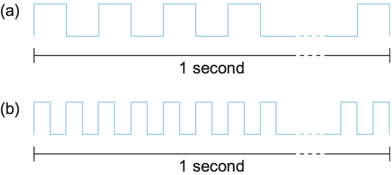

**Figure 1.16. Bits transmitted at a particular bandwidth can be regarded as having some width: (a) bits transmitted at 1 Mbps (each bit is 1 microsecond wide); (b) bits transmitted at 2 Mbps (each bit is 0.5 microseconds wide).**

The second performance metric, latency, corresponds to how long it takes a message to travel from one end of a network to the other. (As with bandwidth, we could be focused on the latency of a single link or an end-to-end channel.) Latency is measured strictly in terms of time. For example, a transcontinental network might have a latency of 24 milliseconds (ms); that is, it takes a message 24 ms to travel from one coast of North America to the other. There are many situations in which it is more important to know how long it takes to send a message from one end of a network to the other and back, rather than the one-way latency. We call this the *round-trip time* (RTT) of the network.

We often think of latency as having three components. First, there is the speed-of-light propagation delay. This delay occurs because nothing, including a bit on a wire, can travel faster than the speed of light. If you know the distance between two points, you can calculate the speed-of-light latency, although you have to be careful because light travels across different media at different speeds: It travels at 3.0 × 10 ⁸ m/s in a vacuum, 2.3 × 10 ⁸ m/s in a copper cable, and 2.0 × 10 ⁸ m/s in an optical fiber. Second, there is the amount of time it takes to transmit a unit of data. This is a function of the network bandwidth and the size of the packet in which the data is carried. Third, there may be queuing delays inside the network, since packet switches generally need to store packets for some time before forwarding them on an outbound link. So, we could define the total latency as

```text
Latency = Propagation + Transmit + Queue
Propagation =  Distance/SpeedOfLight
Transmit = Size/Bandwidth
```

where Distance is the length of the wire over which the data will travel, SpeedOfLight is the effective speed of light over that wire, Size is the size of the packet, and Bandwidth is the bandwidth at which the packet is transmitted. Note that if the message contains only one bit and we are talking about a single link (as opposed to a whole network), then the Transmit and Queue terms are not relevant, and latency corresponds to the propagation delay only.

Bandwidth and latency combine to define the performance characteristics of a given link or channel. Their relative importance, however, depends on the application. For some applications, latency dominates bandwidth. For example, a client that sends a 1-byte message to a server and receives a 1-byte message in return is latency bound. Assuming that no serious computation is involved in preparing the response, the application will perform much differently on a transcontinental channel with a 100-ms RTT than it will on an across-the-room channel with a 1-ms RTT. Whether the channel is 1 Mbps or 100 Mbps is relatively insignificant, however, since the former implies that the time to transmit a byte (Transmit) is 8 μs and the latter implies Transmit = 0.08 μs.

In contrast, consider a digital library program that is being asked to fetch a 25-megabyte (MB) image—the more bandwidth that is available, the faster it will be able to return the image to the user. Here, the bandwidth of the channel dominates performance. To see this, suppose that the channel has a bandwidth of 10 Mbps. It will take 20 seconds to transmit the image (25 × 10 ⁶ × 8-bits / 10 × 10 ⁶ bits/s = 20 seconds), making it relatively unimportant if the image is on the other side of a 1-ms channel or a 100-ms channel; the difference between a 20.001-second response time and a 20.1-second response time is negligible.

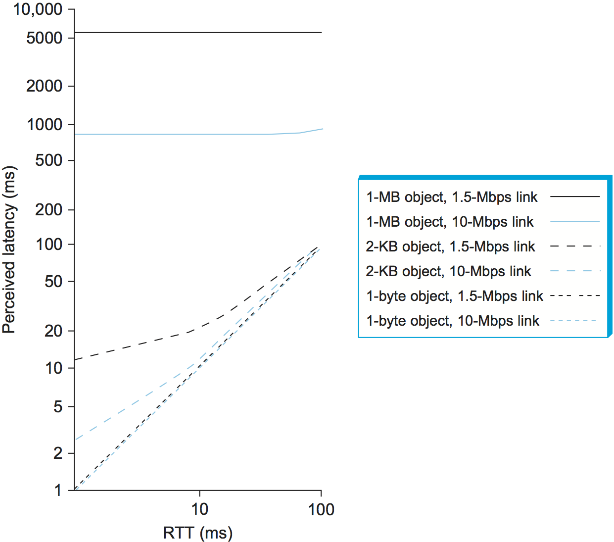

**Figure 1.17. Perceived latency (response time) versus round-trip time for various object sizes and link speeds.**

Figure 1.17 gives you a sense of how latency or bandwidth can dominate performance in different circumstances. The graph shows how long it takes to move objects of various sizes (1 byte, 2 KB, 1 MB) across networks with RTTs ranging from 1 to 100 ms and link speeds of either 1.5 or 10 Mbps. We use logarithmic scales to show relative performance. For a 1-byte object (say, a keystroke), latency remains almost exactly equal to the RTT, so that you cannot distinguish between a 1.5-Mbps network and a 10-Mbps network. For a 2-KB object (say, an email message), the link speed makes quite a difference on a 1-ms RTT network but a negligible difference on a 100-ms RTT network. And for a 1-MB object (say, a digital image), the RTT makes no difference—it is the link speed that dominates performance across the full range of RTT.

Note that throughout this book we use the terms *latency* and *delay* in a generic way to denote how long it takes to perform a particular function, such as delivering a message or moving an object. When we are referring to the specific amount of time it takes a signal to propagate from one end of a link to another, we use the term *propagation delay*. Also, we make it clear in the context of the discussion whether we are referring to the one-way latency or the round-trip time.

As an aside, computers are becoming so fast that when we connect them to networks, it is sometimes useful to think, at least figuratively, in terms of *instructions per mile*. Consider what happens when a computer that is able to execute 100 billion instructions per second sends a message out on a channel with a 100-ms RTT. (To make the math easier, assume that the message covers a distance of 5000 miles.) If that computer sits idle the full 100 ms waiting for a reply message, then it has forfeited the ability to execute 10 billion instructions, or 2 million instructions per mile. It had better have been worth going over the network to justify this waste.

#### 1.5.2 Delay × Bandwidth Product

It is also useful to talk about the product of these two metrics, often called the *delay × bandwidth product*. Intuitively, if we think of a channel between a pair of processes as a hollow pipe (see Figure 1.18), where the latency corresponds to the length of the pipe and the bandwidth gives the diameter of the pipe, then the delay × bandwidth product gives the volume of the pipe—the maximum number of bits that could be in transit through the pipe at any given instant. Said another way, if latency (measured in time) corresponds to the length of the pipe, then given the width of each bit (also measured in time) you can calculate how many bits fit in the pipe. For example, a transcontinental channel with a one-way latency of 50 ms and a bandwidth of 45 Mbps is able to hold

50 × 10 ⁻³ × 45 × 10 ⁶ *bits/sec* = 2.25 × 10 ⁶ *bits*

or approximately 280 KB of data. In other words, this example channel (pipe) holds as many bytes as the memory of a personal computer from the early 1980s could hold.

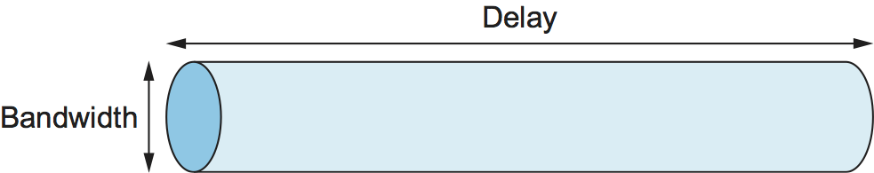

**Figure 1.18. Network as a pipe.**

The delay × bandwidth product is important to know when constructing high-performance networks because it corresponds to how many bits the sender must transmit before the first bit arrives at the receiver. If the sender is expecting the receiver to somehow signal that bits are starting to arrive, and it takes another channel latency for this signal to propagate back to the sender, then the sender can send up one *RTT × bandwidth* worth of data before hearing from the receiver that all is well. The bits in the pipe are said to be “in flight,” which means that if the receiver tells the sender to stop transmitting it might receive up to one RTT × bandwidth’s worth of data before the sender manages to respond. In our example above, that amount corresponds to 5.5 × 10 ⁶ bits (671 KB) of data. On the other hand, if the sender does not fill the pipe—i.e., does not send a whole RTT × bandwidth product’s worth of data before it stops to wait for a signal—the sender will not fully utilize the network.

Note that most of the time we are interested in the RTT scenario, which we simply refer to as the delay × bandwidth product, without explicitly saying that “delay” is the RTT (i.e., multiply the one-way delay by two). Usually, whether the “delay” in delay × bandwidth means one-way latency or RTT is made clear by the context. Table 1.1 shows some examples of RTT × bandwidth products for some typical network links.

**Table 1.1. Example delay × bandwidth products.**

| Link Type | Bandwidth | One-Way Distance | RTT | RTT x Bandwidth |
| --- | --- | --- | --- | --- |
| Wireless LAN | 54 Mbps | 50 m | 0.33 μs | 18 bits |
| Satellite | 1 Gbps | 35,000 km | 230 ms | 230 Mb |
| Cross-country fiber | 10 Gbps | 4,000 km | 40 ms | 400 Mb |

#### 1.5.3 High-Speed Networks

The seeming continual increase in bandwidth causes network designers to start thinking about what happens in the limit or, stated another way, what is the impact on network design of having infinite bandwidth available.

Although high-speed networks bring a dramatic change in the bandwidth available to applications, in many respects their impact on how we think about networking comes in what does *not* change as bandwidth increases: the speed of light. To quote Scotty from *Star Trek,* “Ye cannae change the laws of physics.” In other words, “high speed” does not mean that latency improves at the same rate as bandwidth; the transcontinental RTT of a 1-Gbps link is the same 100 ms as it is for a 1-Mbps link.

To appreciate the significance of ever-increasing bandwidth in the face of fixed latency, consider what is required to transmit a 1-MB file over a 1-Mbps network versus over a 1-Gbps network, both of which have an RTT of 100 ms. In the case of the 1-Mbps network, it takes 80 round-trip times to transmit the file; during each RTT, 1.25% of the file is sent. In contrast, the same 1-MB file doesn’t even come close to filling 1 RTT’s worth of the 1-Gbps link, which has a delay × bandwidth product of 12.5 MB.

Figure 1.19 illustrates the difference between the two networks. In effect, the 1-MB file looks like a stream of data that needs to be transmitted across a 1-Mbps network, while it looks like a single packet on a 1-Gbps network. To help drive this point home, consider that a 1-MB file is to a 1-Gbps network what a 1-KB *packet* is to a 1-Mbps network.

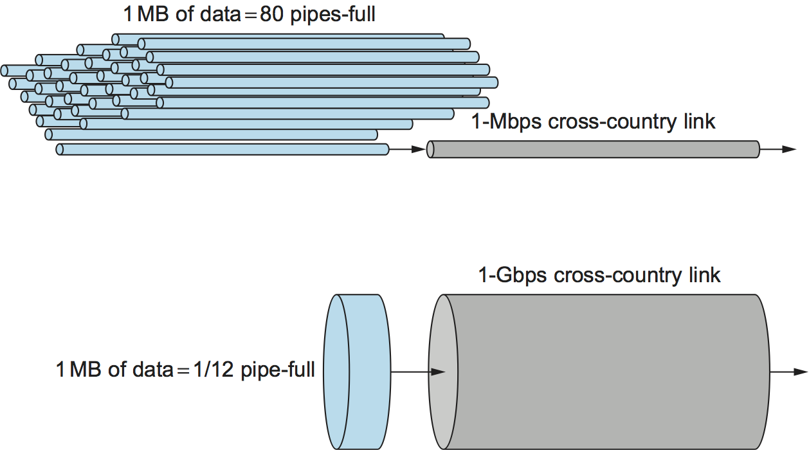

**Figure 1.19. Relationship between bandwidth and latency. A 1-MB file would fill the 1-Mbps link 80 times but only fill 1/12th of a 1-Gbps link.**

Another way to think about the situation is that more data can be transmitted during each RTT on a high-speed network, so much so that a single RTT becomes a significant amount of time. Thus, while you wouldn’t think twice about the difference between a file transfer taking 101 RTTs rather than 100 RTTs (a relative difference of only 1%), suddenly the difference between 1 RTT and 2 RTTs is significant—a 100% increase. In other words, latency, rather than throughput, starts to dominate our thinking about network design.

Perhaps the best way to understand the relationship between throughput and latency is to return to basics. The effective end-to-end throughput that can be achieved over a network is given by the simple relationship

Throughput = TransferSize / TransferTime

where TransferTime includes not only the elements of one-way latency identified earlier in this section, but also any additional time spent requesting or setting up the transfer. Generally, we represent this relationship as

TransferTime = RTT + 1/Bandwidth x TransferSize

We use RTT in this calculation to account for a request message being sent across the network and the data being sent back. For example, consider a situation where a user wants to fetch a 1-MB file across a 1-Gbps link with a round-trip time of 100 ms. This includes both the transmit time for 1 MB (1 / 1 Gbps × 1 MB = 8 ms) and the 100-ms RTT, for a total transfer time of 108 ms. This means that the effective throughput will be

1 MB / 108 ms = 74.1 Mbps

not 1 Gbps. Clearly, transferring a larger amount of data will help improve the effective throughput, where in the limit an infinitely large transfer size will cause the effective throughput to approach the network bandwidth. On the other hand, having to endure more than 1 RTT—for example, to retransmit missing packets—will hurt the effective throughput for any transfer of finite size and will be most noticeable for small transfers.

#### 1.5.4 Application Requirements

The discussion in this section has taken a network-centric view of performance; that is, we have talked in terms of what a given link or channel will support. The unstated assumption has been that application programs have simple needs—they want as much bandwidth as the network can provide. This is certainly true of the aforementioned digital library program that is retrieving a 250-MB image; the more bandwidth that is available, the faster the program will be able to return the image to the user.

However, some applications are able to state an upper limit on how much bandwidth they need. Video applications are a prime example. Suppose one wants to stream a video that is one quarter the size of a standard TV screen; that is, it has a resolution of 352 by 240 pixels. If each pixel is represented by 24 bits of information, as would be the case for 24-bit color, then the size of each frame would be (352 × 240 × 24) / 8 = 247.5 KB If the application needs to support a frame rate of 30 frames per second, then it might request a throughput rate of 75 Mbps. The ability of the network to provide more bandwidth is of no interest to such an application because it has only so much data to transmit in a given period of time.

Unfortunately, the situation is not as simple as this example suggests. Because the difference between any two adjacent frames in a video stream is often small, it is possible to compress the video by transmitting only the differences between adjacent frames. Each frame can also be compressed because not all the detail in a picture is readily perceived by a human eye. The compressed video does not flow at a constant rate, but varies with time according to factors such as the amount of action and detail in the picture and the compression algorithm being used. Therefore, it is possible to say what the average bandwidth requirement will be, but the instantaneous rate may be more or less.

The key issue is the time interval over which the average is computed. Suppose that this example video application can be compressed down to the point that it needs only 2 Mbps, on average. If it transmits 1 megabit in a 1-second interval and 3 megabits in the following 1-second interval, then over the 2-second interval it is transmitting at an average rate of 2 Mbps; however, this will be of little consolation to a channel that was engineered to support no more than 2 megabits in any one second. Clearly, just knowing the average bandwidth needs of an application will not always suffice.

Generally, however, it is possible to put an upper bound on how large a burst an application like this is likely to transmit. A burst might be described by some peak rate that is maintained for some period of time. Alternatively, it could be described as the number of bytes that can be sent at the peak rate before reverting to the average rate or some lower rate. If this peak rate is higher than the available channel capacity, then the excess data will have to be buffered somewhere, to be transmitted later. Knowing how big of a burst might be sent allows the network designer to allocate sufficient buffer capacity to hold the burst.

Analogous to the way an application’s bandwidth needs can be something other than “all it can get,” an application’s delay requirements may be more complex than simply “as little delay as possible.” In the case of delay, it sometimes doesn’t matter so much whether the one-way latency of the network is 100 ms or 500 ms as how much the latency varies from packet to packet. The variation in latency is called *jitter*.

Consider the situation in which the source sends a packet once every 33 ms, as would be the case for a video application transmitting frames 30 times a second. If the packets arrive at the destination spaced out exactly 33 ms apart, then we can deduce that the delay experienced by each packet in the network was exactly the same. If the spacing between when packets arrive at the destination—sometimes called the *inter-packet gap*—is variable, however, then the delay experienced by the sequence of packets must have also been variable, and the network is said to have introduced jitter into the packet stream, as shown in Figure 1.20. Such variation is generally not introduced in a single physical link, but it can happen when packets experience different queuing delays in a multihop packet-switched network. This queuing delay corresponds to the component of latency defined earlier in this section, which varies with time.

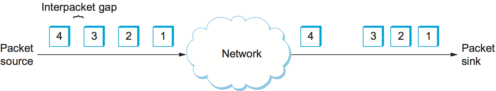

**Figure 1.20. Network-induced jitter.**

To understand the relevance of jitter, suppose that the packets being transmitted over the network contain video frames, and in order to display these frames on the screen the receiver needs to receive a new one every 33 ms. If a frame arrives early, then it can simply be saved by the receiver until it is time to display it. Unfortunately, if a frame arrives late, then the receiver will not have the frame it needs in time to update the screen, and the video quality will suffer; it will not be smooth. Note that it is not necessary to eliminate jitter, only to know how bad it is. The reason for this is that if the receiver knows the upper and lower bounds on the latency that a packet can experience, it can delay the time at which it starts playing back the video (i.e., displays the first frame) long enough to ensure that in the future it will always have a frame to display when it needs it. The receiver delays the frame, effectively smoothing out the jitter, by storing it in a buffer.

### Perspective: Feature Velocity

This chapter introduces some of the stakeholders in computer networks—network designers, application developers, end users, and network operators—to help motivate the technical requirements that shape how networks are designed and built. This presumes all design decisions are purely technical, but of course, that’s usually not the case. Many other factors, from market forces, to government policy, to ethical considerations, also influence how networks are designed and built.

Of these, the marketplace is the most influential, and corresponds to the interplay between network operators (e.g., AT&T, Comcast, Verizon, DT, NTT, China Unicom), network equipment vendors (e.g., Cisco, Juniper, Ericsson, Nokia, Huawei, NEC), application and service providers (e.g., Facebook, Google, Amazon, Microsoft, Apple, Netflix, Spotify), and of course, subscribers and customers (i.e., individuals, but also enterprises and businesses). The lines between these players are not always crisp, with many companies playing multiple roles. The most notable examples are the large cloud providers, who (a) build their own networking equipment using commodity components, (b) deploy and operate their own networks, and (c) provide end-user services and applications on top of their networks.

When you account for these other factors in the technical design process, you realize there are a couple of implicit assumptions in the textbook version of the story that need to be reevaluated. One is that designing a network is a one-time activity. Build it once and use it forever (modulo hardware upgrades so users can enjoy the benefits of the latest performance improvements). A second is that the job of building the network is largely divorced from the job of operating the network. Neither of these assumptions is quite right.

The network’s design is clearly evolving, and we have documented these changes with each new edition of the textbook over the years. Doing that on a timeline measured in years has historically been good enough, but anyone that has downloaded and used the latest smartphone app knows how glacially slow anything measured in years is by today’s standards. Designing for evolution has to be part of the decision-making process.

On the second point, the companies that build networks are almost always the same ones that operate them. They are collectively known as *network operators*, and they include the companies listed above. But if we again look to the cloud for inspiration, we see that develop-and-operate isn’t true just at the company level, but it is also how the fastest moving cloud companies organize their engineering teams: around the *DevOps* model. (If you are unfamiliar with DevOps, we recommend you read *Site Reliability Engineering: How Google Runs Production Systems* to see how it is practiced.)

What this all means is that computer networks are now in the midst of a major transformation, with network operators trying to simultaneously accelerate the pace of innovation (sometimes known as feature velocity) and yet continue to offer a reliable service (preserve stability). And they are increasingly doing this by adopting the best practices of cloud providers, which can be summarized as having two major themes: (1) take advantage of commodity hardware and move all intelligence into software, and (2) adopt agile engineering processes that break down barriers between development and operations.

This transformation is sometimes called the “cloudification” or “softwarization” of the network, and while the Internet has always had a robust software ecosystem, it has historically been limited to the applications running *on top of* the network (e.g., using the Socket API described in Section 1.4). What's changed is that today these same cloud-inspired engineering practices are being applied to the *internals* of the network. This new approach, known as *Software Defined Networks* (SDN), is a game changer, not so much in terms of how we address the fundamental technical challenges of framing, routing, fragmentation/reassembly, packet scheduling, congestion control, security, and so on, but in terms of how rapidly the network evolves to support new features.

This transformation is so important that we take it up again in the *Perspective* section at the end of each chapter. As these discussions will explore, what happens in the networking industry is partly about technology, but also partly about many other non-technical factors, all of which is a testament to how deeply embedded the Internet is in our lives.

> **Broader Perspective**
>
> To continue reading about the cloudification of the Internet, see Perspective: Race to the Edge.
>
> To learn more about DevOps, we recommend: [Site Reliability Engineering: How Google Runs Production Systems](https://www.amazon.com/Site-Reliability-Engineering-Production-Systems/dp/149192912X/ref=pd_bxgy_14_img_2/131-5109792-2268338?_encoding=UTF8&pd_rd_i=149192912X&pd_rd_r=4b77155f-234d-11e9-944e-278ce23a35b5&pd_rd_w=qIfxg&pd_rd_wg=12dE2&pf_rd_p=6725dbd6-9917-451d-beba-16af7874e407&pf_rd_r=5GN656H9VEG4WEVGB728&psc=1&refRID=5GN656H9VEG4WEVGB728), 2016.

[^1]: Not quite “as soon as possible”… Human factors research indicates 300 ms is a reasonable upper bound for how much round-trip delay can be tolerated in a telephone call before humans complain, and a 100-ms delay sounds very good.

[^2]: The use of clouds to represent networks predates the term *cloud computing* by at least a couple of decades, but there is an increasingly rich connection between these two usages, which we explore in the *Perspective* discussion at the end of each chapter.
