## Chapter 2: Direct Links

> It is a mistake to look too far ahead. Only one link in the chain of destiny can be handled at a time. *—Winston Churchill*

### Problem: Connecting to a Network

In Chapter 1 we saw that networks consist of links interconnecting nodes. One of the fundamental problems we face is how to connect two nodes together. We also introduced the “cloud” abstraction to represent a network without revealing all of its internal complexities. So we also need to address the similar problem of connecting a host to a cloud. This, in effect, is the problem every Internet Service Provider (ISP) faces when it wants to connect a new customer to its network.

Whether we want to construct a trivial two-node network with one link or connect the one-billionth host to an existing network like the Internet, we need to address a common set of issues. First, we need some physical medium over which to make the connection. The medium may be a length of wire, a piece of optical fiber, or some less tangible medium (such as air) through which electromagnetic radiation (e.g., radio waves) can be transmitted. It may cover a small area (e.g., an office building) or a wide area (e.g., transcontinental).

Connecting two nodes with a suitable medium is only the first step, however. Five additional problems must be addressed before the nodes can successfully exchange packets, and once addressed, we will have provided *Layer 2* (L2) connectivity (using terminology from the OSI architecture).

The first is *encoding* bits onto the transmission medium so that they can be understood by a receiving node. Second is the matter of delineating the sequence of bits transmitted over the link into complete messages that can be delivered to the end node. This is the *framing* problem, and the messages delivered to the end hosts are often called *frames* (or sometimes *packets*). Third, because frames are sometimes corrupted during transmission, it is necessary to detect these errors and take the appropriate action; this is the *error detection* problem. The fourth issue is making a link appear reliable in spite of the fact that it corrupts frames from time to time. Finally, in those cases where the link is shared by multiple hosts—as is often the case with wireless links, for example—it is necessary to mediate access to this link. This is the *media access control* problem.

Although these five issues—encoding, framing, error detection, reliable delivery, and access mediation—can be discussed in the abstract, they are very real problems that are addressed in different ways by different networking technologies. This chapter considers these issues in the context of specific network technologies: point-to-point fiber links (for which SONET is the prevalent example); Carrier Sense Multiple Access (CSMA) networks (of which classical Ethernet and Wi-Fi are the most famous examples); fiber-to-the home (for which PON is the dominant standard); and mobile wireless (where 4G is rapidly morphing into 5G).

The goal of this chapter is simultaneously to survey the available link-level technology and to explore these five fundamental issues. We will examine what it takes to make a wide variety of different physical media and link technologies useful as building blocks for the construction of robust, scalable networks.

### 2.1 Technology Landscape

Before diving into the challenges outlined in the problem statement at the beginning of this chapter, it is helpful to first get a lay of the land, which includes a wide array of link technologies. This is due, in part, to the diverse circumstances under which users are trying to connect their devices.

At one end of the spectrum, network operators that build global networks must deal with links that span hundreds or thousands of kilometers connecting refrigerator-sized routers. At the other end of the spectrum, a typical user encounters links mostly as a way to connect a computer to the existing Internet. Sometimes this link will be a wireless (Wi-Fi) link in a coffee shop; sometimes it’s an Ethernet link in an office building or university; sometimes it is a smartphone connected to a cellular network; for an increasingly large slice of the population it is a fiber optic link provided by an ISP; and many others use some sort of copper wire or cable to connect. Fortunately, there are many common strategies used on these seemingly disparate types of links so that they can all be made reliable and useful to higher layers in the protocol stack. This chapter examines those strategies.

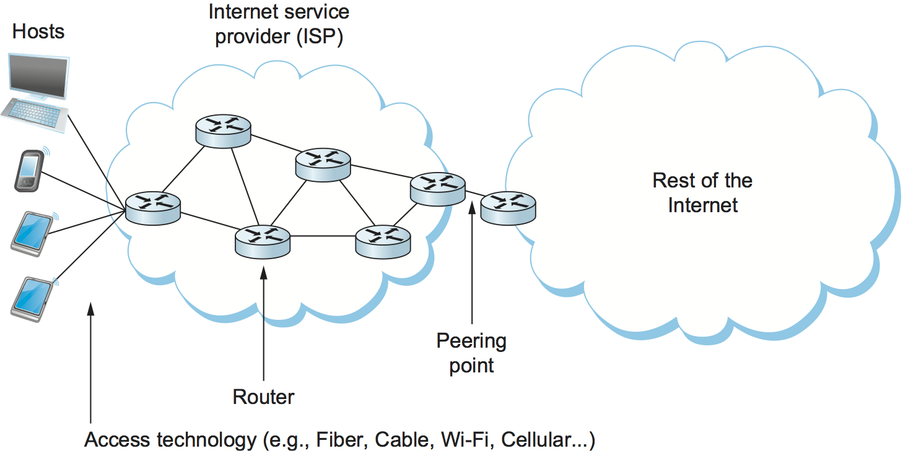

**Figure 2.1. An end-user's view of the Internet.**

Figure 2.1 illustrates various types of links that might be found in today’s Internet. On the left, we see a variety of end-user devices ranging from smartphones to tablets to full-fledged computers connected by various means to an ISP. While those links might use different technologies, they all look the same in this picture—a straight line connecting a device to a router. There are links that connect routers together inside the ISP, as well as links that connect the ISP to the “rest of the Internet,” which consists of lots of other ISPs and the hosts to which they connect.

These links all look alike not just because we’re not very good artists but because part of the role of a network architecture is to provide a common abstraction of something as complex and diverse as a link. The idea is that your laptop or smartphone doesn’t have to care what sort of link it is connected to—the only thing that matters is that it has a link to the Internet. Similarly, a router doesn’t have to care what sort of link connects it to other routers—it can send a packet on the link with a pretty good expectation that the packet will reach the other end of the link.

How do we make all these different types of links look sufficiently alike to end users and routers? Essentially, we have to deal with all the physical limitations and shortcomings of links that exist in the real world. We sketched out some of these issues in the opening problem statement for this chapter, but before we can discuss these, we need to first introduce some simple physics. All of these links are made of some physical material that can propagate signals, such as radio waves or other sorts of electromagnetic radiation, but what we really want to do is send *bits*. In the later sections of this chapter, we’ll look at how to encode bits for transmission on a physical medium, followed by the other issues mentioned above. By the end of this chapter, we’ll understand how to send complete packets over just about any sort of link, no matter what physical medium is involved.

One way to characterize links, then, is by the medium they use—typically, copper wire in some form, such as twisted pair (some Ethernets and landline phones) and coaxial (cable); optical fiber, which is used for both fiber-to-the-home and many long-distance links in the Internet’s backbone; or air/free space for wireless links.

Another important link characteristic is the *frequency*, measured in hertz, with which the electromagnetic waves oscillate. The distance between a pair of adjacent maxima or minima of a wave, typically measured in meters, is called the wave’s *wavelength*. Since all electromagnetic waves travel at the speed of light (which in turn depends on the medium), that speed divided by the wave’s frequency is equal to its wavelength. We have already seen the example of a voice-grade telephone line, which carries continuous electromagnetic signals ranging between 300 Hz and 3300 Hz; a 300-Hz wave traveling through copper would have a wavelength of

SpeedOfLightInCopper / Frequency

= 2/3 × 3 × 10 ⁸ / 300

= 667 × 10 ³ *meters*

Generally, electromagnetic waves span a much wider range of frequencies, ranging from radio waves, to infrared light, to visible light, to x-rays and gamma rays. Figure 2.2 depicts the electromagnetic spectrum and shows which media are commonly used to carry which frequency bands.

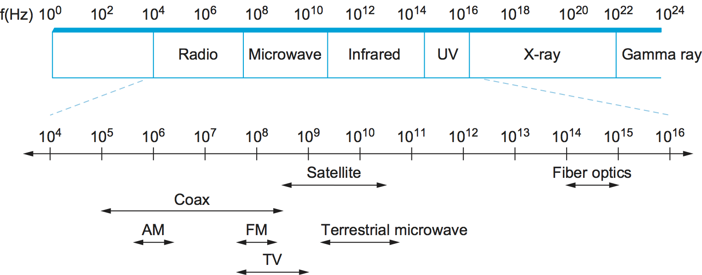

**Figure 2.2. Electromagnetic spectrum.**

What Figure 2.2 doesn't show is where the cellular network fits in. This is a bit complicated because the specific frequency bands that are licensed for cellular networks vary around the world, and even further complicated by the fact that network operators often simultaneously support both old/legacy technologies and new/next-generation technologies, each of which occupies a different frequency band. The high-level summary is that traditional cellular technologies range from 700-MHz to 2400-MHz, with new mid-spectrum allocations now happening at 6-GHz, and millimeter-wave (mmWave) allocations opening above 24-GHz. This mmWave band is likely to become an important part of the 5G mobile network.

So far we understand a link to be a physical medium carrying signals in the form of electromagnetic waves. Such links provide the foundation for transmitting all sorts of information, including the kind of data we are interested in transmitting—binary data (1s and 0s). We say that the binary data is *encoded* in the signal. The problem of encoding binary data onto electromagnetic signals is a complex topic. To help make the topic more manageable, we can think of it as being divided into two layers. The lower layer is concerned with *modulation*—varying the frequency, amplitude, or phase of the signal to effect the transmission of information. A simple example of modulation is to vary the power (amplitude) of a single wavelength. Intuitively, this is equivalent to turning a light on and off. Because the issue of modulation is secondary to our discussion of links as a building block for computer networks, we simply assume that it is possible to transmit a pair of distinguishable signals—think of them as a “high” signal and a “low” signal—and we consider only the upper layer, which is concerned with the much simpler problem of encoding binary data onto these two signals. The next section discusses such encodings.

Another way to classify links is in terms of how they are used. Various economic and deployment issues tend to influence where different link types are found. Most consumers interact with the Internet either through wireless networks (which they encounter in coffee shops, airports, universities, etc.) or through so-called *last-mile* links (or alternatively, *access networks*) provided by an ISP, as illustrated in Figure 2.1. These link types are summarized in Table 2.1. They typically are chosen because they are cost-effective ways of reaching millions of consumers. DSL (Digital Subscriber Line), for example, is an older technology that was deployed over the existing twisted pair copper wires that already existed for plain old telephone services; G.Fast is a copper-based technology typically used within multi-dwelling apartment buildings, and PON (Passive Optical Network) is a newer technology that is commonly used to connect homes and businesses over recently deployed fiber.

**Table 2.1. Common services available for the last-mile connection to your home.**

| Service | Bandwidth |
| --- | --- |
| DSL (copper) | up to 100 Mbps |
| G.Fast (copper) | up to 1 Gbps |
| PON (optical) | up to 10 Gbps |

And of course there is also the *mobile* or *cellular* network (also referred to as 4G, but which is rapidly evolving into 5G) that connects our mobile devices to the Internet. This technology can also serve as the sole Internet connection into our homes or offices, but comes with the added benefit of allowing us to maintain Internet connectivity while moving from place to place.

These example technologies are common options for the last-mile connection to your home or business, but they are not sufficient for building a complete network from scratch. To do that, you’ll also need some long-distance *backbone* links to interconnect cities. Modern backbone links are almost exclusively fiber today, and they typically use a technology called SONET (Synchronous Optical Network), which was originally developed to meet the demanding management requirements of telephone carriers.

Finally, in addition to last-mile, backbone, and mobile links, there are the links that you find inside a building or a campus—generally referred to as *local area networks* (LANs). Ethernet, and its wireless cousin Wi-Fi, are the dominant technologies in this space.

This survey of link types is by no means exhaustive, but it should have given you a taste of the diversity of link types that exist and some of the reasons for that diversity. In the coming sections, we will see how networking protocols can take advantage of that diversity and present a consistent view of the network to higher layers in spite of all the low-level complexity and economic factors.

### 2.2 Encoding

The first step in turning nodes and links into usable building blocks is to understand how to connect them in such a way that bits can be transmitted from one node to the other. As mentioned in the preceding section, signals propagate over physical links. The task, therefore, is to encode the binary data that the source node wants to send into the signals that the links are able to carry and then to decode the signal back into the corresponding binary data at the receiving node. We ignore the details of modulation and assume we are working with two discrete signals: high and low. In practice, these signals might correspond to two different voltages on a copper-based link, two different power levels on an optical link, or two different amplitudes on a radio transmission.

Most of the functions discussed in this chapter are performed by a *network adaptor*—a piece of hardware that connects a node to a link. The network adaptor contains a signalling component that actually encodes bits into signals at the sending node and decodes signals into bits at the receiving node. Thus, as illustrated in Figure 2.3, signals travel over a link between two signalling components, and bits flow between network adaptors.

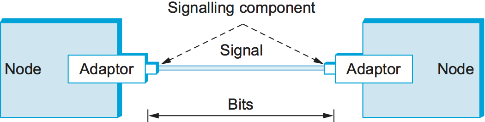

**Figure 2.3. Signals travel between signalling components; bits flow between adaptors.**

Let’s return to the problem of encoding bits onto signals. The obvious thing to do is to map the data value 1 onto the high signal and the data value 0 onto the low signal. This is exactly the mapping used by an encoding scheme called, cryptically enough, *non-return to zero* (NRZ). For example, Figure 2.4 schematically depicts the NRZ-encoded signal (bottom) that corresponds to the transmission of a particular sequence of bits (top).

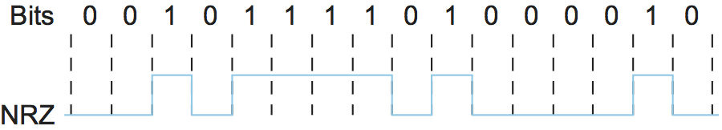

**Figure 2.4. NRZ encoding of a bit stream.**

The problem with NRZ is that a sequence of several consecutive 1s means that the signal stays high on the link for an extended period of time; similarly, several consecutive 0s means that the signal stays low for a long time. There are two fundamental problems caused by long strings of 1s or 0s. The first is that it leads to a situation known as *baseline wander*. Specifically, the receiver keeps an average of the signal it has seen so far and then uses this average to distinguish between low and high signals. Whenever the signal is significantly lower than this average, the receiver concludes that it has just seen a 0; likewise, a signal that is significantly higher than the average is interpreted to be a 1. The problem, of course, is that too many consecutive 1s or 0s cause this average to change, making it more difficult to detect a significant change in the signal.

The second problem is that frequent transitions from high to low and *vice versa* are necessary to enable *clock recovery*. Intuitively, the clock recovery problem is that both the encoding and decoding processes are driven by a clock—every clock cycle the sender transmits a bit and the receiver recovers a bit. The sender’s and the receiver’s clocks have to be precisely synchronized in order for the receiver to recover the same bits the sender transmits. If the receiver’s clock is even slightly faster or slower than the sender’s clock, then it does not correctly decode the signal. You could imagine sending the clock to the receiver over a separate wire, but this is typically avoided because it makes the cost of cabling twice as high. So, instead, the receiver derives the clock from the received signal—the clock recovery process. Whenever the signal changes, such as on a transition from 1 to 0 or from 0 to 1, then the receiver knows it is at a clock cycle boundary, and it can resynchronize itself. However, a long period of time without such a transition leads to clock drift. Thus, clock recovery depends on having lots of transitions in the signal, no matter what data is being sent.

One approach that addresses this problem, called *non-return to zero inverted* (NRZI), has the sender make a transition from the current signal to encode a 1 and stay at the current signal to encode a 0. This solves the problem of consecutive 1s, but obviously does nothing for consecutive 0s. NRZI is illustrated in Figure 2.5. An alternative, called *Manchester encoding*, does a more explicit job of merging the clock with the signal by transmitting the exclusive OR of the NRZ-encoded data and the clock. (Think of the local clock as an internal signal that alternates from low to high; a low/high pair is considered one clock cycle.) The Manchester encoding is also illustrated in Figure 2.5. Observe that the Manchester encoding results in 0 being encoded as a low-to-high transition and 1 being encoded as a high-to-low transition. Because both 0s and 1s result in a transition to the signal, the clock can be effectively recovered at the receiver. (There is also a variant of the Manchester encoding, called *Differential Manchester*, in which a 1 is encoded with the first half of the signal equal to the last half of the previous bit’s signal and a 0 is encoded with the first half of the signal opposite to the last half of the previous bit’s signal.)

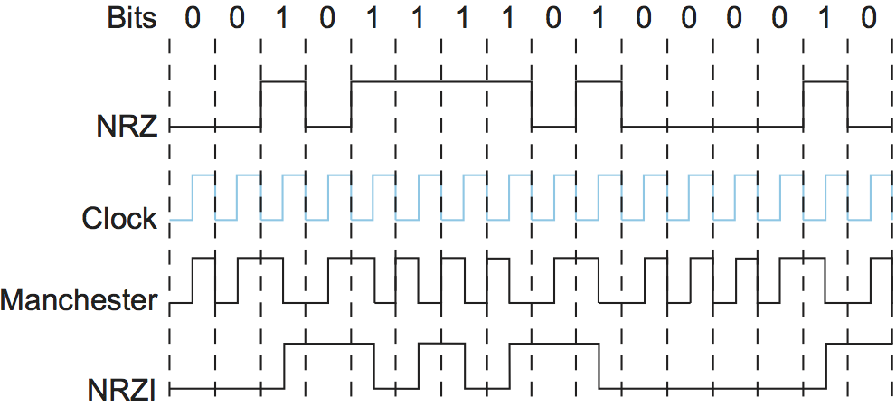

**Figure 2.5. Different encoding strategies.**

The problem with the Manchester encoding scheme is that it doubles the rate at which signal transitions are made on the link, which means that the receiver has half the time to detect each pulse of the signal. The rate at which the signal changes is called the link’s *baud rate*. In the case of the Manchester encoding, the bit rate is half the baud rate, so the encoding is considered only 50% efficient. Keep in mind that if the receiver had been able to keep up with the faster baud rate required by the Manchester encoding in Figure 2.5, then both NRZ and NRZI could have been able to transmit twice as many bits in the same time period.

Note that bit rate isn’t necessarily less than or equal to the baud rate, as the Manchester encoding suggests. If the modulation scheme is able to utilize (and recognize) four different signals, as opposed to just two (e.g., “high” and “low”), then it is possible to encode two bits into each clock interval, resulting in a bit rate that is twice the baud rate. Similarly, being able to modulate among eight different signals means being able to transmit three bits per clock interval. In general, it is important to keep in mind we have over-simplified modulation, which is much more sophisticated than transmitting "high" and "low" signals. It is not uncommon to vary a combination of a signal's phase and amplitude, making it possible to encode 16 or even 64 different patterns (often called *symbols*) during each clock interval. *QAM (Quadrature Amplitude Modulation)* is widely used example of such a modulation scheme.

A final encoding that we consider, called *4B/5B*, attempts to address the inefficiency of the Manchester encoding without suffering from the problem of having extended durations of high or low signals. The idea of 4B/5B is to insert extra bits into the bit stream so as to break up long sequences of 0s or 1s. Specifically, every 4 bits of actual data are encoded in a 5-bit code that is then transmitted to the receiver; hence, the name 4B/5B. The 5-bit codes are selected in such a way that each one has no more than one leading 0 and no more than two trailing 0s. Thus, when sent back-to-back, no pair of 5-bit codes results in more than three consecutive 0s being transmitted. The resulting 5-bit codes are then transmitted using the NRZI encoding, which explains why the code is only concerned about consecutive 0s—NRZI already solves the problem of consecutive 1s. Note that the 4B/5B encoding results in 80% efficiency.

**Table 2.2. 4B/5B encoding.**

| 4-bit Data Symbol | 5-bit Code |
| --- | --- |
| 0000 | 11110 |
| 0001 | 01001 |
| 0010 | 10100 |
| 0011 | 10101 |
| 0100 | 01010 |
| 0101 | 01011 |
| 0110 | 01110 |
| 0111 | 01111 |
| 1000 | 10010 |
| 1001 | 10011 |
| 1010 | 10110 |
| 1011 | 10111 |
| 1100 | 11010 |
| 1101 | 11011 |
| 1110 | 11100 |
| 1111 | 11101 |

Table 2.2 gives the 5-bit codes that correspond to each of the 16 possible 4-bit data symbols. Notice that since 5 bits are enough to encode 32 different codes, and we are using only 16 of these for data, there are 16 codes left over that we can use for other purposes. Of these, code 11111 is used when the line is idle, code 00000 corresponds to when the line is dead, and 00100 is interpreted to mean halt. Of the remaining 13 codes, 7 of them are not valid because they violate the “one leading 0, two trailing 0s,” rule, and the other 6 represent various control symbols. Some of the framing protocols described later in this chapter make use of these control symbols.

### 2.3 Framing

Now that we have seen how to transmit a sequence of bits over a point-to-point link—from adaptor to adaptor—let’s consider the scenario in Figure 2.6. Recall from Chapter 1 that we are focusing on packet-switched networks, which means that blocks of data (called *frames* at this level), not bit streams, are exchanged between nodes. It is the network adaptor that enables the nodes to exchange frames. When node A wishes to transmit a frame to node B, it tells its adaptor to transmit a frame from the node’s memory. This results in a sequence of bits being sent over the link. The adaptor on node B then collects together the sequence of bits arriving on the link and deposits the corresponding frame in B’s memory. Recognizing exactly what set of bits constitutes a frame—that is, determining where the frame begins and ends—is the central challenge faced by the adaptor.

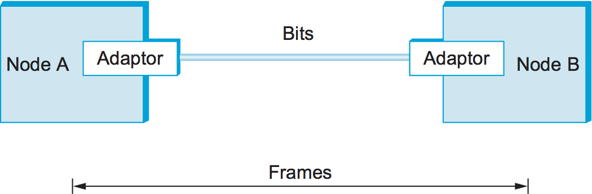

**Figure 2.6. Bits flow between adaptors, frames between hosts.**

There are several ways to address the framing problem. This section uses three different protocols to illustrate the various points in the design space. Note that while we discuss framing in the context of point-to-point links, the problem is a fundamental one that must also be addressed in multiple-access networks like Ethernet and Wi-Fi.

#### 2.3.1 Byte-Oriented Protocols (PPP)

One of the oldest approaches to framing—it has its roots in connecting terminals to mainframes—is to view each frame as a collection of bytes (characters) rather than a collection of bits. Early examples of such *byte-oriented* protocols are the Binary Synchronous Communication (BISYNC) protocol developed by IBM in the late 1960s, and the Digital Data Communication Message Protocol (DDCMP) used in Digital Equipment Corporation’s DECNET. (Once upon a time, large computer companies like IBM and DEC also built private networks for their customers.) The widely used Point-to-Point Protocol (PPP) is a recent example of this approach.

At a high level, there are two approaches to byte-oriented framing. The first is to use special characters known as *sentinel characters* to indicate where frames start and end. The idea is to denote the beginning of a frame by sending a special SYN (synchronization) character. The data portion of the frame is then sometimes contained between two more special characters: STX (start of text) and ETX (end of text). BISYNC used this approach. The problem with the sentinel approach, of course, is that one of the special characters might appear in the data portion of the frame. The standard way to overcome this problem by “escaping” the character by preceding it with a DLE (data-link-escape) character whenever it appears in the body of a frame; the DLE character is also escaped (by preceding it with an extra DLE) in the frame body. (C programmers may notice that this is analogous to the way a quotation mark is escaped by the backslash when it occurs inside a string.) This approach is often called *character stuffing* because extra characters are inserted in the data portion of the frame.

The alternative to detecting the end of a frame with a sentinel value is to include the number of bytes in the frame at the beginning of the frame, in the frame header. DDCMP used this approach. One danger with this approach is that a transmission error could corrupt the count field, in which case the end of the frame would not be correctly detected. (A similar problem exists with the sentinel-based approach if the ETX field becomes corrupted.) Should this happen, the receiver will accumulate as many bytes as the bad count field indicates and then use the error detection field to determine that the frame is bad. This is sometimes called a *framing error*. The receiver will then wait until it sees the next SYN character to start collecting the bytes that make up the next frame. It is therefore possible that a framing error will cause back-to-back frames to be incorrectly received.

The Point-to-Point Protocol (PPP), which is commonly used to carry Internet Protocol packets over various sorts of point-to-point links, uses sentinels and character stuffing. The format for a PPP frame is given in Figure 2.7.

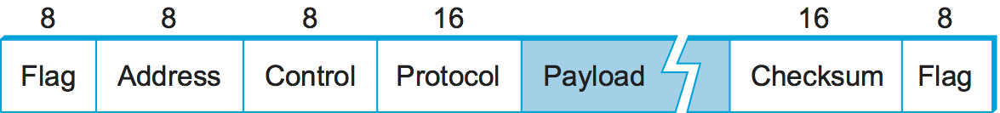

**Figure 2.7. PPP frame format.**

This figure is the first of many that you will see in this book that are used to illustrate frame or packet formats, so a few words of explanation are in order. We show a packet as a sequence of labeled fields. Above each field is a number indicating the length of that field in bits. Note that the packets are transmitted beginning with the leftmost field.

The special start-of-text character, denoted as the Flag field is 01111110. The Address and Control fields usually contain default values and so are uninteresting. The (Protocol) field is used for demultiplexing; it identifies the high-level protocol, such as IP. The frame payload size can be negotiated, but it is 1500 bytes by default. The Checksum field is either 2 (by default) or 4 bytes long. Note that despite its common name, this field is actually a CRC and not a checksum (as described in the next section).

The PPP frame format is unusual in that several of the field sizes are negotiated rather than fixed. This negotiation is conducted by a protocol called the Link Control Protocol (LCP). PPP and LCP work in tandem: LCP sends control messages encapsulated in PPP frames—such messages are denoted by an LCP identifier in the PPP (Protocol) field—and then turns around and changes PPP’s frame format based on the information contained in those control messages. LCP is also involved in establishing a link between two peers when both sides detect that communication over the link is possible (e.g., when each optical receiver detects an incoming signal from the fiber to which it connects).

#### 2.3.2 Bit-Oriented Protocols (HDLC)

Unlike byte-oriented protocols, a bit-oriented protocol is not concerned with byte boundaries—it simply views the frame as a collection of bits. These bits might come from some character set, such as ASCII; they might be pixel values in an image; or they could be instructions and operands from an executable file. The Synchronous Data Link Control (SDLC) protocol developed by IBM is an example of a bit-oriented protocol; SDLC was later standardized by the ISO as the High-Level Data Link Control (HDLC) protocol. In the following discussion, we use HDLC as an example; its frame format is given in Figure 2.8.

HDLC denotes both the beginning and the end of a frame with the distinguished bit sequence 01111110. This sequence is also transmitted during any times that the link is idle so that the sender and receiver can keep their clocks synchronized. In this way, both protocols essentially use the sentinel approach. Because this sequence might appear anywhere in the body of the frame—in fact, the bits 01111110 might cross byte boundaries—bit-oriented protocols use the analog of the DLE character, a technique known as *bit stuffing*.

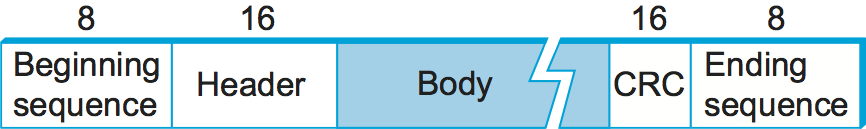

**Figure 2.8. HDLC frame format.**

Bit stuffing in the HDLC protocol works as follows. On the sending side, any time five consecutive 1s have been transmitted from the body of the message (i.e., excluding when the sender is trying to transmit the distinguished 01111110 sequence), the sender inserts a 0 before transmitting the next bit. On the receiving side, should five consecutive 1s arrive, the receiver makes its decision based on the next bit it sees (i.e., the bit following the five 1s). If the next bit is a 0, it must have been stuffed, and so the receiver removes it. If the next bit is a 1, then one of two things is true: Either this is the end-of-frame marker or an error has been introduced into the bit stream. By looking at the *next* bit, the receiver can distinguish between these two cases. If it sees a 0 (i.e., the last 8 bits it has looked at are 01111110), then it is the end-of-frame marker; if it sees a 1 (i.e., the last 8 bits it has looked at are 01111111), then there must have been an error and the whole frame is discarded. In the latter case, the receiver has to wait for the next 01111110 before it can start receiving again, and, as a consequence, there is the potential that the receiver will fail to receive two consecutive frames. Obviously, there are still ways that framing errors can go undetected, such as when an entire spurious end-of-frame pattern is generated by errors, but these failures are relatively unlikely. Robust ways of detecting errors are discussed in a later section.

An interesting characteristic of bit stuffing, as well as character stuffing, is that the size of a frame is dependent on the data that is being sent in the payload of the frame. It is in fact not possible to make all frames exactly the same size, given that the data that might be carried in any frame is arbitrary. (To convince yourself of this, consider what happens if the last byte of a frame’s body is the ETX character.) A form of framing that ensures that all frames are the same size is described in the next subsection.

#### 2.3.3 Clock-Based Framing (SONET)

A third approach to framing is exemplified by the Synchronous Optical Network (SONET) standard. For lack of a widely accepted generic term, we refer to this approach simply as *clock-based framing*. SONET was first proposed by Bell Communications Research (Bellcore), and then developed under the American National Standards Institute (ANSI) for digital transmission over optical fiber; it has since been adopted by the ITU-T. SONET has been for many years the dominant standard for long-distance transmission of data over optical networks.

An important point to make about SONET before we go any further is that the full specification is substantially larger than this book. Thus, the following discussion will necessarily cover only the high points of the standard. Also, SONET addresses both the framing problem and the encoding problem. It also addresses a problem that is very important for phone companies—the multiplexing of several low-speed links onto one high-speed link. (In fact, much of SONET’s design reflects the fact that phone companies have to be concerned with multiplexing large numbers of the 64-kbps channels that traditionally are used for telephone calls.) We begin with SONET’s approach to framing and discuss the other issues following.

As with the previously discussed framing schemes, a SONET frame has some special information that tells the receiver where the frame starts and ends; however, that is about as far as the similarities go. Notably, no bit stuffing is used, so that a frame’s length does not depend on the data being sent. So the question to ask is “How does the receiver know where each frame starts and ends?” We consider this question for the lowest-speed SONET link, which is known as STS-1 and runs at 51.84 Mbps. An STS-1 frame is shown in Figure 2.9. It is arranged as 9 rows of 90 bytes each, and the first 3 bytes of each row are overhead, with the rest being available for data that is being transmitted over the link. The first 2 bytes of the frame contain a special bit pattern, and it is these bytes that enable the receiver to determine where the frame starts. However, since bit stuffing is not used, there is no reason why this pattern will not occasionally turn up in the payload portion of the frame. To guard against this, the receiver looks for the special bit pattern consistently, hoping to see it appearing once every 810 bytes, since each frame is 9 × 90 = 810 bytes long. When the special pattern turns up in the right place enough times, the receiver concludes that it is in sync and can then interpret the frame correctly.

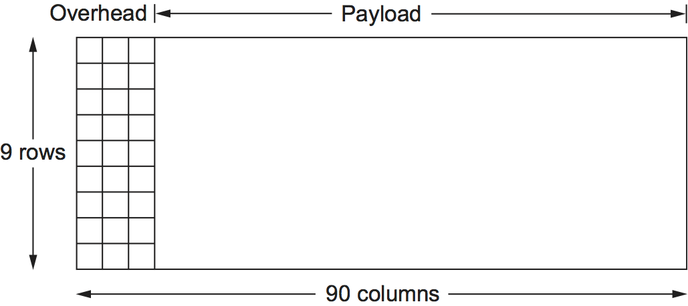

**Figure 2.9. A SONET STS-1 frame.**

One of the things we are not describing due to the complexity of SONET is the detailed use of all the other overhead bytes. Part of this complexity can be attributed to the fact that SONET runs across the carrier’s optical network, not just over a single link. (Recall that we are glossing over the fact that the carriers implement a network, and we are instead focusing on the fact that we can lease a SONET link from them and then use this link to build our own packet-switched network.) Additional complexity comes from the fact that SONET provides a considerably richer set of services than just data transfer. For example, 64 kbps of a SONET link’s capacity is set aside for a voice channel that is used for maintenance.

The overhead bytes of a SONET frame are encoded using NRZ, the simple encoding described in the previous section where 1s are high and 0s are low. However, to ensure that there are plenty of transitions to allow the receiver to recover the sender’s clock, the payload bytes are *scrambled*. This is done by calculating the exclusive OR (XOR) of the data to be transmitted and by the use of a well-known bit pattern. The bit pattern, which is 127 bits long, has plenty of transitions from 1 to 0, so that XORing it with the transmitted data is likely to yield a signal with enough transitions to enable clock recovery.

SONET supports the multiplexing of multiple low-speed links in the following way. A given SONET link runs at one of a finite set of possible rates, ranging from 51.84 Mbps (STS-1) to 39,813.12 Mbps (STS-768).  Note that all of these rates are integer multiples of STS-1. The significance for framing is that a single SONET frame can contain subframes for multiple lower-rate channels. A second related feature is that each frame is 125 μs long. This means that at STS-1 rates, a SONET frame is 810 bytes long, while at STS-3 rates, each SONET frame is 2430 bytes long. Notice the synergy between these two features: 3 × 810 = 2430, meaning that three STS-1 frames fit exactly in a single STS-3 frame.

Intuitively, the STS-N frame can be thought of as consisting of N STS-1 frames, where the bytes from these frames are interleaved; that is, a byte from the first frame is transmitted, then a byte from the second frame is transmitted, and so on. The reason for interleaving the bytes from each STS-N frame is to ensure that the bytes in each STS-1 frame are evenly paced; that is, bytes show up at the receiver at a smooth 51 Mbps, rather than all bunched up during one particular 1/N^{th} of the 125-μs interval.

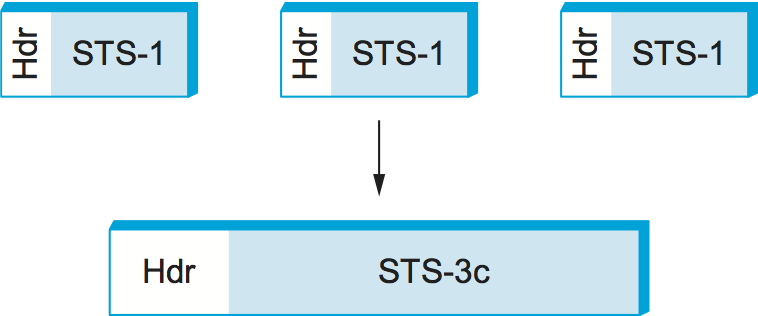

**Figure 2.10. Three STS-1 frames multiplexed onto one STS-3c frame.**

Although it is accurate to view an STS-N signal as being used to multiplex N STS-1 frames, the payload from these STS-1 frames can be linked together to form a larger STS-N payload; such a link is denoted STS-Nc (for *concatenated*). One of the fields in the overhead is used for this purpose. Figure 2.10 schematically depicts concatenation in the case of three STS-1 frames being concatenated into a single STS-3c frame. The significance of a SONET link being designated as STS-3c rather than STS-3 is that, in the former case, the user of the link can view it as a single 155.52-Mbps pipe, whereas an STS-3 should really be viewed as three 51.84-Mbps links that happen to share a fiber.

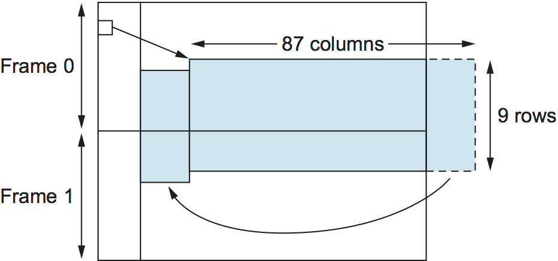

**Figure 2.11. SONET frames out of phase.**

Finally, the preceding description of SONET is overly simplistic in that it assumes that the payload for each frame is completely contained within the frame. (Why wouldn’t it be?) In fact, we should view the STS-1 frame just described as simply a placeholder for the frame, where the actual payload may *float* across frame boundaries. This situation is illustrated in Figure 2.11. Here we see both the STS-1 payload floating across two STS-1 frames and the payload shifted some number of bytes to the right and, therefore, wrapped around. One of the fields in the frame overhead points to the beginning of the payload. The value of this capability is that it simplifies the task of synchronizing the clocks used throughout the carriers’ networks, which is something that carriers spend a lot of their time worrying about.

### 2.4 Error Detection

As discussed in Chapter 1, bit errors are sometimes introduced into frames. This happens, for example, because of electrical interference or thermal noise. Although errors are rare, especially on optical links, some mechanism is needed to detect these errors so that corrective action can be taken. Otherwise, the end user is left wondering why the C program that successfully compiled just a moment ago now suddenly has a syntax error in it, when all that happened in the interim is that it was copied across a network file system.

There is a long history of techniques for dealing with bit errors in computer systems, dating back to at least the 1940s. Hamming and Reed-Solomon codes are two notable examples that were developed for use in punch card readers, when storing data on magnetic disks, and in early core memories. This section describes some of the error detection techniques most commonly used in networking.

Detecting errors is only one part of the problem. The other part is correcting errors once detected. Two basic approaches can be taken when the recipient of a message detects an error. One is to notify the sender that the message was corrupted so that the sender can retransmit a copy of the message. If bit errors are rare, then in all probability the retransmitted copy will be error free. Alternatively, some types of error detection algorithms allow the recipient to reconstruct the correct message even after it has been corrupted; such algorithms rely on *error-correcting codes*, discussed below.

One of the most common techniques for detecting transmission errors is a technique known as the *cyclic redundancy check* (CRC). It is used in nearly all the link-level protocols discussed in this chapter. This section outlines the basic CRC algorithm, but before discussing that approach, we first describe the simpler *checksum* scheme used by several Internet protocols.

The basic idea behind any error detection scheme is to add redundant information to a frame that can be used to determine if errors have been introduced. In the extreme, we could imagine transmitting two complete copies of the data. If the two copies are identical at the receiver, then it is probably the case that both are correct. If they differ, then an error was introduced into one (or both) of them, and they must be discarded. This is a rather poor error detection scheme for two reasons. First, it sends n redundant bits for an n-bit message. Second, many errors will go undetected—any error that happens to corrupt the same bit positions in the first and second copies of the message. In general, the goal of error detecting codes is to provide a high probability of detecting errors combined with a relatively low number of redundant bits.

Fortunately, we can do a lot better than this simple scheme. In general, we can provide quite strong error detection capability while sending only k redundant bits for an n-bit message, where k is much smaller than n. On an Ethernet, for example, a frame carrying up to 12,000 bits (1500 bytes) of data requires only a 32-bit CRC code, or as it is commonly expressed, uses CRC-32. Such a code will catch the overwhelming majority of errors, as we will see below.

We say that the extra bits we send are redundant because they add no new information to the message. Instead, they are derived directly from the original message using some well-defined algorithm. Both the sender and the receiver know exactly what that algorithm is. The sender applies the algorithm to the message to generate the redundant bits. It then transmits both the message and those few extra bits. When the receiver applies the same algorithm to the received message, it should (in the absence of errors) come up with the same result as the sender. It compares the result with the one sent to it by the sender. If they match, it can conclude (with high likelihood) that no errors were introduced in the message during transmission. If they do not match, it can be sure that either the message or the redundant bits were corrupted, and it must take appropriate action—that is, discarding the message or correcting it if that is possible.

One note on the terminology for these extra bits. In general, they are referred to as *error-detecting codes*. In specific cases, when the algorithm to create the code is based on addition, they may be called a *checksum*. We will see that the Internet checksum is appropriately named: It is an error check that uses a summing algorithm. Unfortunately, the word *checksum* is often used imprecisely to mean any form of error-detecting code, including CRCs. This can be confusing, so we urge you to use the word *checksum* only to apply to codes that actually do use addition and to use *error-detecting code* to refer to the general class of codes described in this section.

#### 2.4.1 Internet Checksum Algorithm

Our first approach to error detection is exemplified by the Internet checksum. Although it is not used at the link level, it nevertheless provides the same sort of functionality as CRCs, so we discuss it here.

The idea behind the Internet checksum is very simple—you add up all the words that are transmitted and then transmit the result of that sum. The result is the checksum. The receiver performs the same calculation on the received data and compares the result with the received checksum. If any transmitted data, including the checksum itself, is corrupted, then the results will not match, so the receiver knows that an error occurred.

You can imagine many different variations on the basic idea of a checksum. The exact scheme used by the Internet protocols works as follows. Consider the data being checksummed as a sequence of 16-bit integers. Add them together using 16-bit ones’ complement arithmetic (explained below) and then take the ones’ complement of the result. That 16-bit number is the checksum.

In ones’ complement arithmetic, a negative integer (-x) is represented as the complement of x; that is, each bit of x is inverted. When adding numbers in ones’ complement arithmetic, a carryout from the most significant bit needs to be added to the result. Consider, for example, the addition of -5 and -2 in ones’ complement arithmetic on 4-bit integers: +5 is 0101, so -5 is 1010; +2 is 0010, so -2 is 1101. If we add 1010 and 1101, ignoring the carry, we get 0111. In ones’ complement arithmetic, the fact that this operation caused a carry from the most significant bit causes us to increment the result, giving 1000, which is the ones’ complement representation of -7 (obtained by inverting the bits in 0111), as we would expect.

The following routine gives a straightforward implementation of the Internet’s checksum algorithm. The count argument gives the length of buf measured in 16-bit units. The routine assumes that buf has already been padded with 0s to a 16-bit boundary.

```c
u_short
cksum(u_short *buf, int count)
{
   register u_long sum = 0;

   while (count--)
   {
       sum += *buf++;
       if (sum & 0xFFFF0000)
       {
           /* carry occurred, so wrap around */
           sum &= 0xFFFF;
           sum++;
       }
   }
   return ~(sum & 0xFFFF);
}
```

This code ensures that the calculation uses ones’ complement arithmetic rather than the twos’ complement that is used in most machines. Note the if statement inside the while loop. If there is a carry into the top 16 bits of sum, then we increment sum just as in the previous example.

Compared to our repetition code, this algorithm scores well for using a small number of redundant bits—only 16 for a message of any length—but it does not score extremely well for strength of error detection. For example, a pair of single-bit errors, one of which increments a word and one of which decrements another word by the same amount, will go undetected. The reason for using an algorithm like this in spite of its relatively weak protection against errors (compared to a CRC, for example) is simple: This algorithm is much easier to implement in software. Experience has suggested that a checksum of this form was adequate, but one reason it is adequate is that this checksum is the last line of defense in an end-to-end protocol. The majority of errors are picked up by stronger error detection algorithms, such as CRCs, at the link level.

#### 2.4.2 Cyclic Redundancy Check

It should be clear by now that a major goal in designing error detection algorithms is to maximize the probability of detecting errors using only a small number of redundant bits. Cyclic redundancy checks use some fairly powerful mathematics to achieve this goal. For example, a 32-bit CRC gives strong protection against common bit errors in messages that are thousands of bytes long. The theoretical foundation of the cyclic redundancy check is rooted in a branch of mathematics called *finite fields*. While this may sound daunting, the basic ideas can be easily understood.

To start, think of an (n+1)-bit message as being represented by an n degree polynomial, that is, a polynomial whose highest-order term is xⁿ. The message is represented by a polynomial by using the value of each bit in the message as the coefficient for each term in the polynomial, starting with the most significant bit to represent the highest-order term. For example, an 8-bit message consisting of the bits 10011010 corresponds to the polynomial

M(x) = (1 × x⁷) + (0 × x⁶) + (0 × x⁵) + (1 × x⁴ )+ (1 × x³) + (0 × x²) + (1 × x¹) + (0 × x⁰)

M(x) = x⁷ + x⁴ + x³ + x¹

We can thus think of a sender and a receiver as exchanging polynomials with each other.

For the purposes of calculating a CRC, a sender and receiver have to agree on a *divisor* polynomial, C(x). C(x) is a polynomial of degree k. For example, suppose C(x) = x³ + x² + 1. In this case, k=3. The answer to the question “Where did C(x) come from?” is, in most practical cases, “You look it up in a book.” In fact, the choice of C(x) has a significant impact on what types of errors can be reliably detected, as we discuss below. There are a handful of divisor polynomials that are very good choices for various environments, and the exact choice is normally made as part of the protocol design. For example, the Ethernet standard uses a well-known polynomial of degree 32.

When a sender wishes to transmit a message M(x) that is n+1 bits long, what is actually sent is the (n+1)-bit message plus k bits. We call the complete transmitted message, including the redundant bits, P(x). What we are going to do is contrive to make the polynomial representing P(x) exactly divisible by C(x); we explain how this is achieved below. If P(x) is transmitted over a link and there are no errors introduced during transmission, then the receiver should be able to divide P(x) by C(x) exactly, leaving a remainder of zero. On the other hand, if some error is introduced into P(x) during transmission, then in all likelihood the received polynomial will no longer be exactly divisible by C(x), and thus the receiver will obtain a nonzero remainder implying that an error has occurred.

It will help to understand the following if you know a little about polynomial arithmetic; it is just slightly different from normal integer arithmetic. We are dealing with a special class of polynomial arithmetic here, where coefficients may be only one or zero, and operations on the coefficients are performed using modulo 2 arithmetic. This is referred to as “polynomial arithmetic modulo 2.” Since this is a networking book, not a mathematics text, let’s focus on the key properties of this type of arithmetic for our purposes (which we ask you to accept on faith):

- Any polynomial B(x) can be divided by a divisor polynomial C(x) if B(x) is of higher degree than C(x).
- Any polynomial B(x) can be divided once by a divisor polynomial C(x) if B(x) is of the same degree as C(x).
- The remainder obtained when B(x) is divided by C(x) is obtained by performing the exclusive OR (XOR) operation on each pair of matching coefficients.

For example, the polynomial x³ + 1 can be divided by x³ + x² + 1 (because they are both of degree 3) and the remainder would be 0 × x³ + 1 × x² + 0 × x¹ + 0 × x⁰ = x² (obtained by XORing the coefficients of each term). In terms of messages, we could say that 1001 can be divided by 1101 and leaves a remainder of 0100. You should be able to see that the remainder is just the bitwise exclusive OR of the two messages.

Now that we know the basic rules for dividing polynomials, we are able to do long division, which is necessary to deal with longer messages. An example appears below.

Recall that we wanted to create a polynomial for transmission that is derived from the original message M(x), is k bits longer than M(x), and is exactly divisible by C(x). We can do this in the following way:

1. Multiply M(x) by xᵏ; that is, add k zeros at the end of the message. Call this zero-extended message T(x).
2. Divide T(x) by C(x) and find the remainder.
3. Subtract the remainder from T(x).

It should be obvious that what is left at this point is a message that is exactly divisible by C(x). We may also note that the resulting message consists of M(x) followed by the remainder obtained in step 2, because when we subtracted the remainder (which can be no more than k bits long), we were just XORing it with the k zeros added in step 1. This part will become clearer with an example.

Consider the message x⁷ + x⁴ + x³ + x¹, or 10011010. We begin by multiplying by x³, since our divisor polynomial is of degree 3. This gives 10011010000. We divide this by C(x), which corresponds to 1101 in this case. Figure 2.12 shows the polynomial long-division operation. Given the rules of polynomial arithmetic described above, the long-division operation proceeds much as it would if we were dividing integers. Thus, in the first step of our example, we see that the divisor 1101 divides once into the first four bits of the message (1001), since they are of the same degree, and leaves a remainder of 100 (1101 XOR 1001). The next step is to bring down a digit from the message polynomial until we get another polynomial with the same degree as C(x), in this case 1001. We calculate the remainder again (100) and continue until the calculation is complete. Note that the “result” of the long division, which appears at the top of the calculation, is not really of much interest—it is the remainder at the end that matters.

You can see from the very bottom of Figure 2.12 that the remainder of the example calculation is 101. So we know that 10011010000 minus 101 would be exactly divisible by C(x), and this is what we send. The minus operation in polynomial arithmetic is the logical XOR operation, so we actually send 10011010101. As noted above, this turns out to be just the original message with the remainder from the long division calculation appended to it. The recipient divides the received polynomial by C(x) and, if the result is 0, concludes that there were no errors. If the result is nonzero, it may be necessary to discard the corrupted message; with some codes, it may be possible to *correct* a small error (e.g., if the error affected only one bit). A code that enables error correction is called an *error-correcting code* (ECC).

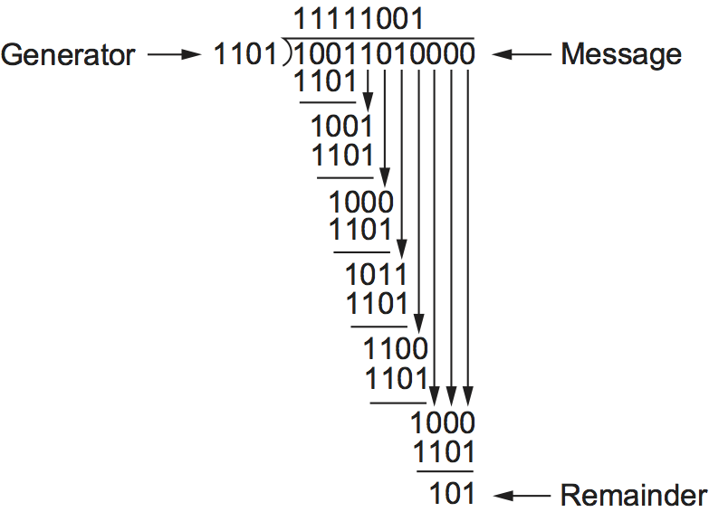

**Figure 2.12. CRC calculation using polynomial long division.**

Now we will consider the question of where the polynomial C(x) comes from. Intuitively, the idea is to select this polynomial so that it is very unlikely to divide evenly into a message that has errors introduced into it. If the transmitted message is P(x), we may think of the introduction of errors as the addition of another polynomial E(x), so the recipient sees P(x) + E(x). The only way that an error could slip by undetected would be if the received message could be evenly divided by C(x), and since we know that P(x) can be evenly divided by C(x), this could only happen if E(x) can be divided evenly by C(x). The trick is to pick C(x) so that this is very unlikely for common types of errors.

One common type of error is a single-bit error, which can be expressed as E(x) = xⁱ when it affects bit position *i*. If we select C(x) such that the first and the last term (that is, the xᵏ and x⁰ terms) are nonzero, then we already have a two-term polynomial that cannot divide evenly into the one term E(x). Such a C(x) can, therefore, detect all single-bit errors. In general, it is possible to prove that the following types of errors can be detected by a C(x) with the stated properties:

- All single-bit errors, as long as the xᵏ and x⁰ terms have nonzero coefficients
- All double-bit errors that are j bits apart, as long as the x⁰ term is nonzero and C(x) does not divide evenly into x^{j} + 1
- Any odd number of errors, as long as C(x) contains the factor (x + 1)
- Any “burst” error (i.e., sequence of consecutive errored bits) for which the length of the burst is less than k bits (Most burst errors of length greater than k bits can also be detected.)

Six versions of C(x) are widely used in link-level protocols. For example, Ethernet uses CRC-32, which is defined as follows:

- CRC-32 = x³² + x²⁶ + x²³ + x²² + x¹⁶ + x¹² + x¹¹ + x¹⁰ + x⁸ + x⁷ + x⁵ + x⁴ + x² + x + 1

We have mentioned that it is possible to use codes that not only detect the presence of errors but also enable errors to be corrected. Since the details of such codes require yet more complex mathematics than that required to understand CRCs, we will not dwell on them here. However, it is worth considering the merits of correction versus detection.

At first glance, it would seem that correction is always better, since with detection we are forced to throw away the message and, in general, ask for another copy to be transmitted. This uses up bandwidth and may introduce latency while waiting for the retransmission. However, there is a downside to correction, as it generally requires a greater number of redundant bits to send an error-correcting code that is as strong (that is, able to cope with the same range of errors) as a code that only detects errors. Thus, while error detection requires more bits to be sent when errors occur, error correction requires more bits to be sent *all the time*. As a result, error correction tends to be most useful when (1) errors are quite probable, as they may be, for example, in a wireless environment, or (2) the cost of retransmission is too high, for example, because of the latency involved retransmitting a packet over a satellite link.

The use of error-correcting codes in networking is sometimes referred to as *forward error correction* (FEC) because the correction of errors is handled “in advance” by sending extra information, rather than waiting for errors to happen and dealing with them later by retransmission. FEC is commonly used in wireless networks such as 802.11.

Finally, we note that the CRC algorithm, while seemingly complex, is easily implemented in hardware using a k -bit shift register and XOR gates. The number of bits in the shift register equals the degree of the generator polynomial (k). Figure 2.13 shows the hardware that would be used for the generator x³ + x² + 1 from our previous example. The message is shifted in from the left, beginning with the most significant bit and ending with the string of k zeros that is attached to the message, just as in the long division example. When all the bits have been shifted in and appropriately XORed, the register contains the remainder—that is, the CRC (most significant bit on the right). The position of the XOR gates is determined as follows: If the bits in the shift register are labeled 0 through k-1, left to right, then put an XOR gate in front of bit n if there is a term xⁿ in the generator polynomial. Thus, we see an XOR gate in front of positions 0 and 2 for the generator x³ + x² + x⁰.

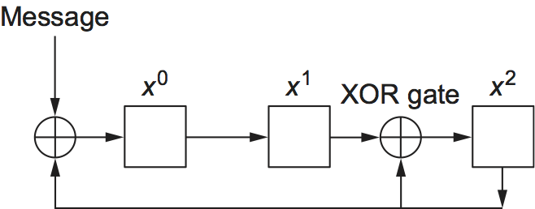

**Figure 2.13. CRC calculation using shift register.**

### 2.5 Reliable Transmission

As we saw in the previous section, frames are sometimes corrupted while in transit, with an error code like CRC used to detect such errors. While some error codes are strong enough also to correct errors, in practice the overhead is typically too large to handle the range of bit and burst errors that can be introduced on a network link. Even when error-correcting codes are used (e.g., on wireless links) some errors will be too severe to be corrected. As a result, some corrupt frames must be discarded. A link-level protocol that wants to deliver frames reliably must somehow recover from these discarded (lost) frames.

It’s worth noting that reliability is a function that *may* be provided at the link level, but many modern link technologies omit this function. Furthermore, reliable delivery is frequently provided at higher levels, including both transport and sometimes, the application layer. Exactly where it should be provided is a matter of some debate and depends on many factors. We describe the basics of reliable delivery here, since the principles are common across layers, but you should be aware that we’re not just talking about a link-layer function.

Reliable delivery is usually accomplished using a combination of two fundamental mechanisms— *acknowledgments* and *timeouts*. An acknowledgment (ACK for short) is a small control frame that a protocol sends back to its peer saying that it has received an earlier frame. By control frame we mean a header without any data, although a protocol can *piggyback* an ACK on a data frame it just happens to be sending in the opposite direction. The receipt of an acknowledgment indicates to the sender of the original frame that its frame was successfully delivered. If the sender does not receive an acknowledgment after a reasonable amount of time, then it *retransmits* the original frame. This action of waiting a reasonable amount of time is called a *timeout*.

The general strategy of using acknowledgments and timeouts to implement reliable delivery is sometimes called *automatic repeat request* (abbreviated ARQ). This section describes three different ARQ algorithms using generic language; that is, we do not give detailed information about a particular protocol’s header fields.

#### 2.5.1 Stop-and-Wait

The simplest ARQ scheme is the *stop-and-wait* algorithm. The idea of stop-and-wait is straightforward: After transmitting one frame, the sender waits for an acknowledgment before transmitting the next frame. If the acknowledgment does not arrive after a certain period of time, the sender times out and retransmits the original frame.

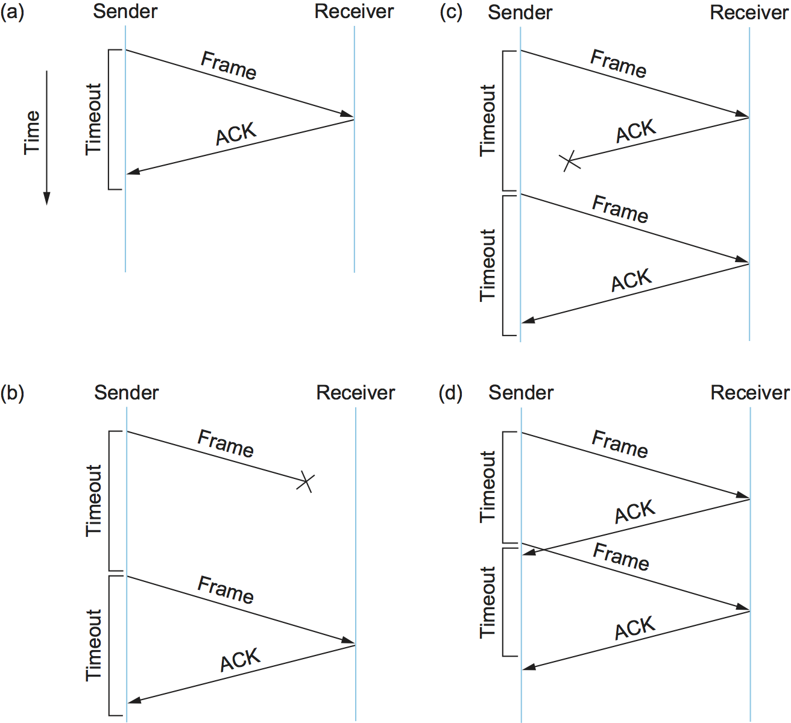

**Figure 2.14. Timeline showing four different scenarios for the stop-and-wait algorithm. (a) The ACK is received before the timer expires; (b) the original frame is lost; (c) the ACK is lost; (d) the timeout fires too soon.**

Figure 2.14 illustrates timelines for four different scenarios that result from this basic algorithm. The sending side is represented on the left, the receiving side is depicted on the right, and time flows from top to bottom. Figure 2.14 shows the situation in which the ACK is received before the timer expires; (b) and (c) show the situation in which the original frame and the ACK, respectively, are lost; and (d) shows the situation in which the timeout fires too soon. Recall that by “lost” we mean that the frame was corrupted while in transit, that this corruption was detected by an error code on the receiver, and that the frame was subsequently discarded.

The packet timelines shown in this section are examples of a frequently used tool in teaching, explaining, and designing protocols. They are useful because they capture visually the behavior over time of a distributed system—something that can be quite hard to analyze. When designing a protocol, you often have to be prepared for the unexpected—a system crashes, a message gets lost, or something that you expected to happen quickly turns out to take a long time. These sorts of diagrams can often help us understand what might go wrong in such cases and thus help a protocol designer be prepared for every eventuality.

There is one important subtlety in the stop-and-wait algorithm. Suppose the sender sends a frame and the receiver acknowledges it, but the acknowledgment is either lost or delayed in arriving. This situation is illustrated in timelines (c) and (d) of Figure 2.14. In both cases, the sender times out and retransmits the original frame, but the receiver will think that it is the next frame, since it correctly received and acknowledged the first frame. This has the potential to cause duplicate copies of a frame to be delivered. To address this problem, the header for a stop-and-wait protocol usually includes a 1-bit sequence number—that is, the sequence number can take on the values 0 and 1—and the sequence numbers used for each frame alternate, as illustrated in Figure 2.15. Thus, when the sender retransmits frame 0, the receiver can determine that it is seeing a second copy of frame 0 rather than the first copy of frame 1 and therefore can ignore it (the receiver still acknowledges it, in case the first ACK was lost).

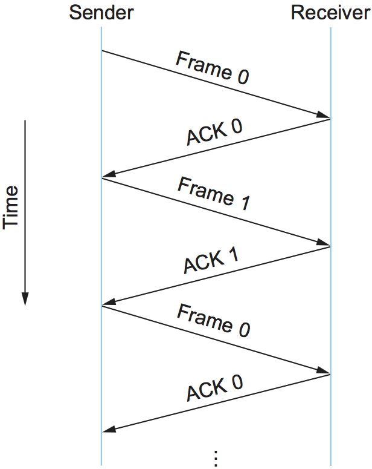

**Figure 2.15. Timeline for stop-and-wait with 1-bit sequence number.**

The main shortcoming of the stop-and-wait algorithm is that it allows the sender to have only one outstanding frame on the link at a time, and this may be far below the link’s capacity. Consider, for example, a 1.5-Mbps link with a 45-ms round-trip time. This link has a delay × bandwidth product of 67.5 Kb, or approximately 8 KB. Since the sender can send only one frame per RTT, and assuming a frame size of 1 KB, this implies a maximum sending rate of

Bits-Per-Frame / Time-Per-Frame = 1024 x 8 / 0.045 = 182 kbps

or about one-eighth of the link’s capacity. To use the link fully, then, we’d like the sender to be able to transmit up to eight frames before having to wait for an acknowledgment.

> **Key Takeaway**
>
> The significance of the delay × bandwidth product is that it represents the amount of data that could be in transit. We would like to be able to send this much data without waiting for the first acknowledgment. The principle at work here is often referred to as *keeping the pipe full*. The algorithms presented in the following two subsections do exactly this. [Next]

#### 2.5.2 Sliding Window

Consider again the scenario in which the link has a delay × bandwidth product of 8 KB and frames are 1 KB in size. We would like the sender to be ready to transmit the ninth frame at pretty much the same moment that the ACK for the first frame arrives. The algorithm that allows us to do this is called *sliding window*, and an illustrative timeline is given in Figure 2.16.

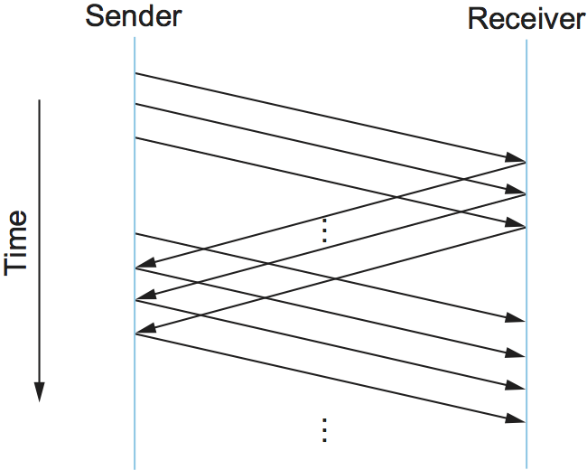

**Figure 2.16. Timeline for the sliding window algorithm.**

##### The Sliding Window Algorithm

The sliding window algorithm works as follows. First, the sender assigns a *sequence number*, denoted SeqNum, to each frame. For now, let’s ignore the fact that SeqNum is implemented by a finite-size header field and instead assume that it can grow infinitely large. The sender maintains three variables: The *send window size*, denoted SWS, gives the upper bound on the number of outstanding (unacknowledged) frames that the sender can transmit; LAR denotes the sequence number of the *last acknowledgment received*; and LFS denotes the sequence number of the *last frame sent*. The sender also maintains the following invariant:

```text
LFS - LAR <= SWS
```

This situation is illustrated in Figure 2.17.

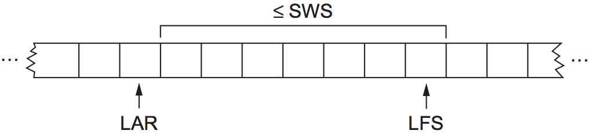

**Figure 2.17. Sliding window on sender.**

When an acknowledgment arrives, the sender moves LAR to the right, thereby allowing the sender to transmit another frame. Also, the sender associates a timer with each frame it transmits, and it retransmits the frame should the timer expire before an ACK is received. Notice that the sender has to be willing to buffer up to SWS frames since it must be prepared to retransmit them until they are acknowledged.

The receiver maintains the following three variables: The *receive window size*, denoted RWS, gives the upper bound on the number of out-of-order frames that the receiver is willing to accept; LAF denotes the sequence number of the *largest acceptable frame*; and LFR denotes the sequence number of the *last frame received*. The receiver also maintains the following invariant:

```text
LAF - LFR <= RWS
```

This situation is illustrated in Figure 2.18.

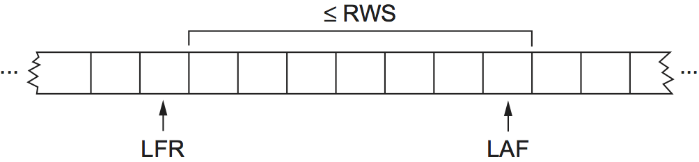

**Figure 2.18. Sliding window on receiver.**

When a frame with sequence number SeqNum arrives, the receiver takes the following action. If SeqNum <= LFR or SeqNum > LAF, then the frame is outside the receiver’s window and it is discarded. If LFR < SeqNum <= LAF, then the frame is within the receiver’s window and it is accepted. Now the receiver needs to decide whether or not to send an ACK. Let SeqNumToAck denote the largest sequence number not yet acknowledged, such that all frames with sequence numbers less than or equal to SeqNumToAck have been received. The receiver acknowledges the receipt of SeqNumToAck, even if higher numbered packets have been received. This acknowledgment is said to be cumulative. It then sets LFR = SeqNumToAck and adjusts LAF = LFR + RWS.

For example, suppose LFR = 5 (i.e., the last ACK the receiver sent was for sequence number 5), and RWS = 4. This implies that LAF = 9. Should frames 7 and 8 arrive, they will be buffered because they are within the receiver’s window. However, no ACK needs to be sent since frame 6 has yet to arrive. Frames 7 and 8 are said to have arrived out of order. (Technically, the receiver could resend an ACK for frame 5 when frames 7 and 8 arrive.) Should frame 6 then arrive—perhaps it is late because it was lost the first time and had to be retransmitted, or perhaps it was simply delayed—the receiver acknowledges frame 8, bumps LFR to 8, and sets LAF to 12.  If frame 6 was in fact lost, then a timeout will have occurred at the sender, causing it to retransmit frame 6.

We observe that when a timeout occurs, the amount of data in transit decreases, since the sender is unable to advance its window until frame 6 is acknowledged. This means that when packet losses occur, this scheme is no longer keeping the pipe full. The longer it takes to notice that a packet loss has occurred, the more severe this problem becomes.

Notice that, in this example, the receiver could have sent a *negative acknowledgment* (NAK) for frame 6 as soon as frame 7 arrived. However, this is unnecessary since the sender’s timeout mechanism is sufficient to catch this situation, and sending NAKs adds additional complexity to the receiver. Also, as we mentioned, it would have been legitimate to send additional acknowledgments of frame 5 when frames 7 and 8 arrived; in some cases, a sender can use duplicate ACKs as a clue that a frame was lost. Both approaches help to improve performance by allowing early detection of packet losses.

Yet another variation on this scheme would be to use *selective acknowledgments*. That is, the receiver could acknowledge exactly those frames it has received rather than just the highest numbered frame received in order. So, in the above example, the receiver could acknowledge the receipt of frames 7 and 8. Giving more information to the sender makes it potentially easier for the sender to keep the pipe full but adds complexity to the implementation.

The sending window size is selected according to how many frames we want to have outstanding on the link at a given time; SWS is easy to compute for a given delay × bandwidth product. On the other hand, the receiver can set RWS to whatever it wants. Two common settings are RWS = 1, which implies that the receiver will not buffer any frames that arrive out of order, and RWS = SWS, which implies that the receiver can buffer any of the frames the sender transmits. It makes no sense to set RWS > SWS since it’s impossible for more than SWS frames to arrive out of order.

##### Finite Sequence Numbers and Sliding Window

We now return to the one simplification we introduced into the algorithm—our assumption that sequence numbers can grow infinitely large. In practice, of course, a frame’s sequence number is specified in a header field of some finite size. For example, a 3-bit field means that there are eight possible sequence numbers, 0..7. This makes it necessary to reuse sequence numbers or, stated another way, sequence numbers wrap around. This introduces the problem of being able to distinguish between different incarnations of the same sequence numbers, which implies that the number of possible sequence numbers must be larger than the number of outstanding frames allowed. For example, stop-and-wait allowed one outstanding frame at a time and had two distinct sequence numbers.

Suppose we have one more number in our space of sequence numbers than we have potentially outstanding frames; that is, SWS <= MaxSeqNum - 1, where MaxSeqNum is the number of available sequence numbers. Is this sufficient? The answer depends on RWS. If RWS = 1, then MaxSeqNum >= SWS + 1 is sufficient. If RWS is equal to SWS, then having a MaxSeqNum just one greater than the sending window size is not good enough. To see this, consider the situation in which we have the eight sequence numbers 0 through 7, and SWS = RWS = 7. Suppose the sender transmits frames 0..6, they are successfully received, but the ACKs are lost. The receiver is now expecting frames 7, 0..5, but the sender times out and sends frames 0..6. Unfortunately, the receiver is expecting the second incarnation of frames 0..5 but gets the first incarnation of these frames. This is exactly the situation we wanted to avoid.

It turns out that the sending window size can be no more than half as big as the number of available sequence numbers when RWS = SWS, or stated more precisely,

```text
SWS < (MaxSeqNum + 1)/ 2
```

Intuitively, what this is saying is that the sliding window protocol alternates between the two halves of the sequence number space, just as stop-and-wait alternates between sequence numbers 0 and 1. The only difference is that it continually slides between the two halves rather than discretely alternating between them.

Note that this rule is specific to the situation where RWS = SWS. We leave it as an exercise to determine the more general rule that works for arbitrary values of RWS and SWS. Also note that the relationship between the window size and the sequence number space depends on an assumption that is so obvious that it is easy to overlook, namely that frames are not reordered in transit. This cannot happen on a direct point-to-point link since there is no way for one frame to overtake another during transmission. However, we will see the sliding window algorithm used in a different environments, and we will need to devise another rule.

##### Implementation of Sliding Window

The following routines illustrate how we might implement the sending and receiving sides of the sliding window algorithm. The routines are taken from a working protocol named, appropriately enough, Sliding Window Protocol (SWP). So as not to concern ourselves with the adjacent protocols in the protocol graph, we denote the protocol sitting above SWP as the high-level protocol (HLP) and the protocol sitting below SWP as the link-level protocol (LLP).

We start by defining a pair of data structures. First, the frame header is very simple: It contains a sequence number (SeqNum) and an acknowledgment number (AckNum). It also contains a Flags field that indicates whether the frame is an ACK or carries data.

```c
typedef uint8_t SwpSeqno;

typedef struct {
   SwpSeqno   SeqNum;   /* sequence number of this frame */
   SwpSeqno   AckNum;   /* ack of received frame */
   uint8_t     Flags;   /* up to 8 bits worth of flags */
} SwpHdr;
```

Next, the state of the sliding window algorithm has the following structure. For the sending side of the protocol, this state includes variables LAR and LFS, as described earlier in this section, as well as a queue that holds frames that have been transmitted but not yet acknowledged (sendQ). The sending state also includes a *counting semaphore* called sendWindowNotFull. We will see how this is used below, but generally a semaphore is a synchronization primitive that supports semWait and semSignal operations. Every invocation of semSignal increments the semaphore by 1, and every invocation of semWait decrements s by 1, with the calling process blocked (suspended) should decrementing the semaphore cause its value to become less than 0. A process that is blocked during its call to semWait will be allowed to resume as soon as enough semSignal operations have been performed to raise the value of the semaphore above 0.

For the receiving side of the protocol, the state includes the variable NFE. This is the *next frame expected*, the frame with a sequence number one more than the last frame received (LFR), described earlier in this section. There is also a queue that holds frames that have been received out of order (recvQ). Finally, although not shown, the sender and receiver sliding window sizes are defined by constants SWS and RWS, respectively.

```c
typedef struct {
   /* sender side state: */
   SwpSeqno    LAR;        /* seqno of last ACK received */
   SwpSeqno    LFS;        /* last frame sent */
   Semaphore   sendWindowNotFull;
   SwpHdr      hdr;        /* pre-initialized header */
   struct sendQ_slot {
       Event   timeout;    /* event associated with send-timeout */
       Msg     msg;
   }   sendQ[SWS];

   /* receiver side state: */
   SwpSeqno    NFE;       /* seqno of next frame expected */
   struct recvQ_slot {
       int     received;  /* is msg valid? */
       Msg     msg;
   }   recvQ[RWS];
} SwpState;
```

The sending side of SWP is implemented by procedure sendSWP. This routine is rather simple. First, semWait causes this process to block on a semaphore until it is OK to send another frame. Once allowed to proceed, sendSWP sets the sequence number in the frame’s header, saves a copy of the frame in the transmit queue (sendQ), schedules a timeout event to handle the case in which the frame is not acknowledged, and sends the frame to the next-lower-level protocol, which we denote as LINK.

One detail worth noting is the call to store_swp_hdr just before the call to msgAddHdr. This routine translates the C structure that holds the SWP header (state->hdr) into a byte string that can be safely attached to the front of the message (hbuf). This routine (not shown) must translate each integer field in the header into network byte order and remove any padding that the compiler has added to the C structure. The issue of byte order is a non-trivial issue, but for now it is enough to assume that this routine places the most significant bit of a multiword integer in the byte with the highest address.

Another piece of complexity in this routine is the use of semWait and the sendWindowNotFull semaphore. sendWindowNotFull is initialized to the size of the sender’s sliding window, SWS (this initialization is not shown). Each time the sender transmits a frame, the semWait operation decrements this count and blocks the sender should the count go to 0. Each time an ACK is received, the semSignal operation invoked in deliverSWP (see below) increments this count, thus unblocking any waiting sender.

```c
static int
sendSWP(SwpState *state, Msg *frame)
{
   struct sendQ_slot *slot;
   char hbuf[HLEN];

   /* wait for send window to open */
   semWait(&state->sendWindowNotFull);
   state->hdr.SeqNum = ++state->LFS;
   slot = &state->sendQ[state->hdr.SeqNum % SWS];
   store_swp_hdr(state->hdr, hbuf);
   msgAddHdr(frame, hbuf, HLEN);
   msgSaveCopy(&slot->msg, frame);
   slot->timeout = evSchedule(swpTimeout, slot, SWP_SEND_TIMEOUT);
   return send(LINK, frame);
}
```

Before continuing to the receive side of SWP, we need to reconcile a seeming inconsistency. On the one hand, we have been saying that a high-level protocol invokes the services of a low-level protocol by calling the send operation, so we would expect that a protocol that wants to send a message via SWP would call send(SWP, packet). On the other hand, the procedure that implements SWP’s send operation is called sendSWP, and its first argument is a state variable (SwpState). What gives? The answer is that the operating system provides glue code that translates the generic call to send into a protocol-specific call to sendSWP. This glue code maps the first argument to send (the magic protocol variable SWP) into both a function pointer to sendSWP and a pointer to the protocol state that SWP needs to do its job. The reason we have the high-level protocol indirectly invoke the protocol-specific function through the generic function call is that we want to limit how much information the high-level protocol has coded in it about the low-level protocol. This makes it easier to change the protocol graph configuration at some time in the future.

Now we move on to SWP’s protocol-specific implementation of the deliver operation, which is given in procedure deliverSWP. This routine actually handles two different kinds of incoming messages: ACKs for frames sent earlier from this node and data frames arriving at this node. In a sense, the ACK half of this routine is the counterpart to the sender side of the algorithm given in sendSWP. A decision as to whether the incoming message is an ACK or a data frame is made by checking the Flags field in the header. Note that this particular implementation does not support piggybacking ACKs on data frames.

When the incoming frame is an ACK, deliverSWP simply finds the slot in the transmit queue (sendQ) that corresponds to the ACK, cancels the timeout event, and frees the frame saved in that slot. This work is actually done in a loop since the ACK may be cumulative. The only other thing to notice about this case is the call to subroutine swpInWindow. This subroutine, which is given below, ensures that the sequence number for the frame being acknowledged is within the range of ACKs that the sender currently expects to receive.

When the incoming frame contains data, deliverSWP first calls msgStripHdr and load_swp_hdr to extract the header from the frame. Routine load_swp_hdr is the counterpart to store_swp_hdr discussed earlier; it translates a byte string into the C data structure that holds the SWP header. deliverSWP then calls swpInWindow to make sure the sequence number of the frame is within the range of sequence numbers that it expects. If it is, the routine loops over the set of consecutive frames it has received and passes them up to the higher-level protocol by invoking the deliverHLP routine. It also sends a cumulative ACK back to the sender, but does so by looping over the receive queue (it does not use the SeqNumToAck variable used in the prose description given earlier in this section).

```c
static int
deliverSWP(SwpState *state, Msg *frame)
{
   SwpHdr   hdr;
   char     *hbuf;

   hbuf = msgStripHdr(frame, HLEN);
   load_swp_hdr(&hdr, hbuf);
   if (hdr.Flags & FLAG_ACK_VALID)
   {
       /* received an acknowledgment—do SENDER side */
       if (swpInWindow(hdr.AckNum, state->LAR + 1, state->LFS))
       {
           do
           {
               struct sendQ_slot *slot;

               slot = &state->sendQ[++state->LAR % SWS];
               evCancel(slot->timeout);
               msgDestroy(&slot->msg);
               semSignal(&state->sendWindowNotFull);
           } while (state->LAR != hdr.AckNum);
       }
   }

   if (hdr.Flags & FLAG_HAS_DATA)
   {
       struct recvQ_slot *slot;

       /* received data packet—do RECEIVER side */
       slot = &state->recvQ[hdr.SeqNum % RWS];
       if (!swpInWindow(hdr.SeqNum, state->NFE, state->NFE + RWS - 1))
       {
           /* drop the message */
           return SUCCESS;
       }
       msgSaveCopy(&slot->msg, frame);
       slot->received = TRUE;
       if (hdr.SeqNum == state->NFE)
       {
           Msg m;

           while (slot->received)
           {
               deliver(HLP, &slot->msg);
               msgDestroy(&slot->msg);
               slot->received = FALSE;
               slot = &state->recvQ[++state->NFE % RWS];
           }
           /* send ACK: */
           prepare_ack(&m, state->NFE - 1);
           send(LINK, &m);
           msgDestroy(&m);
       }
   }
   return SUCCESS;
}
```

Finally, swpInWindow is a simple subroutine that checks to see if a given sequence number falls between some minimum and maximum sequence number.

```c
static bool
swpInWindow(SwpSeqno seqno, SwpSeqno min, SwpSeqno max)
{
   SwpSeqno pos, maxpos;

   pos    = seqno - min;       /* pos *should* be in range [0..MAX) */
   maxpos = max - min + 1;     /* maxpos is in range [0..MAX] */
   return pos < maxpos;
}
```

##### Frame Order and Flow Control

The sliding window protocol is perhaps the best known algorithm in computer networking. What is easily confused about the algorithm, however, is that it can be used to serve three different roles. The first role is the one we have been concentrating on in this section—to reliably deliver frames across an unreliable link. (In general, the algorithm can be used to reliably deliver messages across an unreliable network.) This is the core function of the algorithm.

The second role that the sliding window algorithm can serve is to preserve the order in which frames are transmitted. This is easy to do at the receiver—since each frame has a sequence number, the receiver just makes sure that it does not pass a frame up to the next-higher-level protocol until it has already passed up all frames with a smaller sequence number. That is, the receiver buffers (i.e., does not pass along) out-of-order frames. The version of the sliding window algorithm described in this section does preserve frame order, although we could imagine a variation in which the receiver passes frames to the next protocol without waiting for all earlier frames to be delivered. A question we should ask ourselves is whether we really need the sliding window protocol to keep the frames in order at the link level, or whether, instead, this functionality should be implemented by a protocol higher in the stack.

The third role that the sliding window algorithm sometimes plays is to support *flow control*—a feedback mechanism by which the receiver is able to throttle the sender. Such a mechanism is used to keep the sender from over-running the receiver—that is, from transmitting more data than the receiver is able to process. This is usually accomplished by augmenting the sliding window protocol so that the receiver not only acknowledges frames it has received but also informs the sender of how many frames it has room to receive. The number of frames that the receiver is capable of receiving corresponds to how much free buffer space it has. As in the case of ordered delivery, we need to make sure that flow control is necessary at the link level before incorporating it into the sliding window protocol.

> **Key Takeaway**
>
> One important concept to take away from this discussion is the system design principle we call *separation of concerns*. That is, you must be careful to distinguish between different functions that are sometimes rolled together in one mechanism, and you must make sure that each function is necessary and being supported in the most effective way. In this particular case, reliable delivery, ordered delivery, and flow control are sometimes combined in a single sliding window protocol, and we should ask ourselves if this is the right thing to do at the link level. [Next]

#### 2.5.3 Concurrent Logical Channels

The data link protocol used in the original ARPANET provides an interesting alternative to the sliding window protocol, in that it is able to keep the pipe full while still using the simple stop-and-wait algorithm. One important consequence of this approach is that the frames sent over a given link are not kept in any particular order. The protocol also implies nothing about flow control.

The idea underlying the ARPANET protocol, which we refer to as *concurrent logical channels*, is to multiplex several logical channels onto a single point-to-point link and to run the stop-and-wait algorithm on each of these logical channels. There is no relationship maintained among the frames sent on any of the logical channels, yet because a different frame can be outstanding on each of the several logical channels the sender can keep the link full.

More precisely, the sender keeps 3 bits of state for each channel: a boolean, saying whether the channel is currently busy; the 1-bit sequence number to use the next time a frame is sent on this logical channel; and the next sequence number to expect on a frame that arrives on this channel. When the node has a frame to send, it uses the lowest idle channel, and otherwise it behaves just like stop-and-wait.

In practice, the ARPANET supported 8 logical channels over each ground link and 16 over each satellite link. In the ground-link case, the header for each frame included a 3-bit channel number and a 1-bit sequence number, for a total of 4 bits. This is exactly the number of bits the sliding window protocol requires to support up to 8 outstanding frames on the link when RWS = SWS.

### 2.6 Multi-Access Networks

Developed in the mid-1970s by researchers at the Xerox Palo Alto Research Center (PARC), the Ethernet eventually became the dominant local area networking technology, emerging from a pack of competing technologies. Today, it competes mainly with 802.11 wireless networks but remains extremely popular in campus networks and data centers. The more general name for the technology behind the Ethernet is Carrier Sense, Multiple Access with Collision Detect (CSMA/CD).

As indicated by the CSMA name, the Ethernet is a multiple-access network, meaning that a set of nodes sends and receives frames over a shared link. You can, therefore, think of an Ethernet as being like a bus that has multiple stations plugged into it. The “carrier sense” in CSMA/CD means that all the nodes can distinguish between an idle and a busy link, and “collision detect” means that a node listens as it transmits and can therefore detect when a frame it is transmitting has interfered (collided) with a frame transmitted by another node.

The Ethernet has its roots in an early packet radio network, called Aloha, developed at the University of Hawaii to support computer communication across the Hawaiian Islands. Like the Aloha network, the fundamental problem faced by the Ethernet is how to mediate access to a shared medium fairly and efficiently (in Aloha, the medium was the atmosphere, while in the Ethernet the medium was originally a coax cable). The core idea in both Aloha and the Ethernet is an algorithm that controls when each node can transmit.

Modern Ethernet links are now largely point to point; that is, they connect one host to an Ethernet *switch*, or they interconnect switches. As a consequence, the “multiple access” algorithm is not used much in today’s wired Ethernets, but a variant is now used in wireless networks, such as 802.11 networks (also known as Wi-Fi). Due to the enormous influence of Ethernet, we chose to describe its classic algorithm here, and then explain how it has been adapted to Wi-Fi in the next section. We will also discuss Ethernet switches elsewhere. For now, we’ll focus on how a single Ethernet link works.

Digital Equipment Corporation and Intel Corporation joined Xerox to define a 10-Mbps Ethernet standard in 1978. This standard then formed the basis for IEEE standard 802.3, which additionally defines a much wider collection of physical media over which an Ethernet can operate, including 100-Mbps, 1-Gbps, 10-Gbps, 40-Gbps, and 100-Gbps versions.

#### 2.6.1 Physical Properties

Ethernet segments were originally implemented using coaxial cable of length up to 500 m. (Modern Ethernets use twisted copper pairs, usually a particular type known as “Category 5,” or optical fibers, and in some cases can be quite a lot longer than 500 m.) This cable was similar to the type used for cable TV. Hosts connected to an Ethernet segment by tapping into it. A *transceiver*, a small device directly attached to the tap, detected when the line was idle and drove the signal when the host was transmitting. It also received incoming signals. The transceiver, in turn, connected to an Ethernet adaptor, which was plugged into the host. This configuration is shown in Figure 2.19.

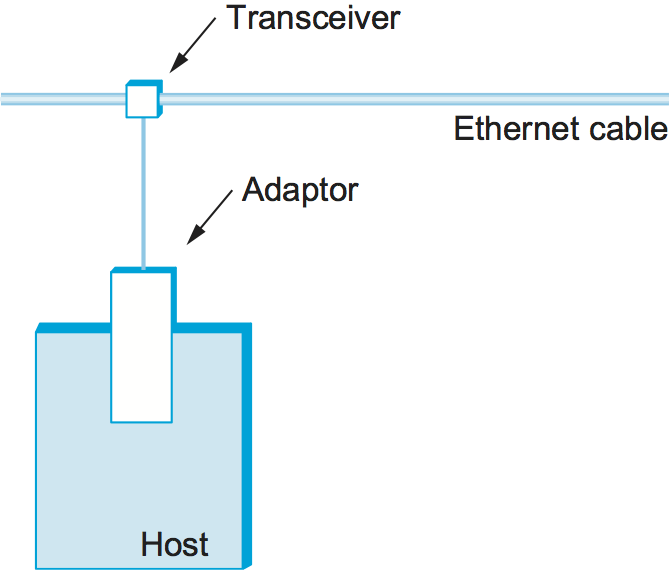

**Figure 2.19. Ethernet transceiver and adaptor.**

Multiple Ethernet segments can be joined together by *repeaters* (or a multi-port variant of a repeater, called a *hub*). A repeater is a device that forwards digital signals, much like an amplifier forwards analog signals; repeaters do not understand bits or frames. No more than four repeaters could be positioned between any pair of hosts, meaning that a classical Ethernet had a total reach of only 2500 m. For example, using just two repeaters between any pair of hosts supports a configuration similar to the one illustrated in Figure 2.20; that is, a segment running down the spine of a building with a segment on each floor.

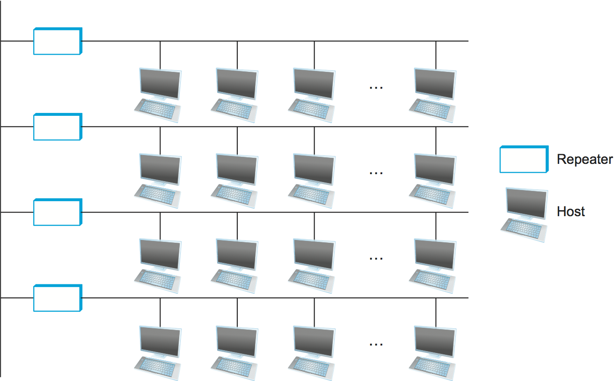

**Figure 2.20. Ethernet repeater, interconnecting segments to form a larger collision domain.**

Any signal placed on the Ethernet by a host is broadcast over the entire network; that is, the signal is propagated in both directions, and repeaters and hubs forward the signal on all outgoing segments. Terminators attached to the end of each segment absorb the signal and keep it from bouncing back and interfering with trailing signals. The original Ethernet specifications used the Manchester encoding scheme described in an earlier section, while 4B/5B encoding (or the similar 8B/10B) scheme is used today on higher speed Ethernets.

It is important to understand that whether a given Ethernet spans a single segment, a linear sequence of segments connected by repeaters, or multiple segments connected in a star configuration, data transmitted by any one host on that Ethernet reaches all the other hosts. This is the good news. The bad news is that all these hosts are competing for access to the same link, and, as a consequence, they are said to be in the same *collision domain*. The multi-access part of the Ethernet is all about dealing with the competition for the link that arises in a collision domain.

#### 2.6.2 Access Protocol

We now turn our attention to the algorithm that controls access to a shared Ethernet link. This algorithm is commonly called the Ethernet’s *media access control* (MAC). It is typically implemented in hardware on the network adaptor. We will not describe the hardware *per se*, but instead focus on the algorithm it implements. First, however, we describe the Ethernet’s frame format and addresses.

##### Frame Format

Each Ethernet frame is defined by the format given in Figure 2.21. The 64-bit preamble allows the receiver to synchronize with the signal; it is a sequence of alternating 0s and 1s. Both the source and destination hosts are identified with a 48-bit address. The packet type field serves as the demultiplexing key; it identifies to which of possibly many higher-level protocols this frame should be delivered. Each frame contains up to 1500 bytes of data. Minimally, a frame must contain at least 46 bytes of data, even if this means the host has to pad the frame before transmitting it. The reason for this minimum frame size is that the frame must be long enough to detect a collision; we discuss this more below. Finally, each frame includes a 32-bit CRC. Like the HDLC protocol described in an earlier section, the Ethernet is a bit-oriented framing protocol. Note that from the host’s perspective, an Ethernet frame has a 14-byte header: two 6-byte addresses and a 2-byte type field. The sending adaptor attaches the preamble and CRC before transmitting, and the receiving adaptor removes them.

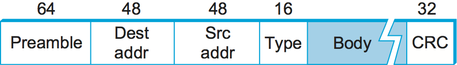

**Figure 2.21. Ethernet frame format.**

##### Addresses

Each host on an Ethernet—in fact, every Ethernet host in the world—has a unique Ethernet address. Technically, the address belongs to the adaptor, not the host; it is usually burned into ROM. Ethernet addresses are typically printed in a form humans can read as a sequence of six numbers separated by colons. Each number corresponds to 1 byte of the 6-byte address and is given by a pair of hexadecimal digits, one for each of the 4-bit nibbles in the byte; leading 0s are dropped. For example, 8:0:2b:e4:b1:2 is the human-readable representation of Ethernet address

```text
00001000  00000000  00101011  11100100  10110001  00000010
```

To ensure that every adaptor gets a unique address, each manufacturer of Ethernet devices is allocated a different prefix that must be prepended to the address on every adaptor they build. For example, Advanced Micro Devices has been assigned the 24-bit prefix 080020 (or 8:0:20). A given manufacturer then makes sure the address suffixes it produces are unique.

Each frame transmitted on an Ethernet is received by every adaptor connected to that Ethernet. Each adaptor recognizes those frames addressed to its address and passes only those frames on to the host. (An adaptor can also be programmed to run in *promiscuous* mode, in which case it delivers all received frames to the host, but this is not the normal mode.) In addition to these *unicast* addresses, an Ethernet address consisting of all 1s is treated as a *broadcast* address; all adaptors pass frames addressed to the broadcast address up to the host. Similarly, an address that has the first bit set to 1 but is not the broadcast address is called a *multicast* address. A given host can program its adaptor to accept some set of multicast addresses. Multicast addresses are used to send messages to some subset of the hosts on an Ethernet (e.g., all file servers). To summarize, an Ethernet adaptor receives all frames and accepts

- Frames addressed to its own address
- Frames addressed to the broadcast address
- Frames addressed to a multicast address, if it has been instructed to listen to that address
- All frames, if it has been placed in promiscuous mode

It passes to the host only the frames that it accepts.

##### Transmitter Algorithm

As we have just seen, the receiver side of the Ethernet protocol is simple; the real smarts are implemented at the sender’s side. The transmitter algorithm is defined as follows.

When the adaptor has a frame to send and the line is idle, it transmits the frame immediately; there is no negotiation with the other adaptors. The upper bound of 1500 bytes in the message means that the adaptor can occupy the line for only a fixed length of time.

When an adaptor has a frame to send and the line is busy, it waits for the line to go idle and then transmits immediately. (To be more precise, all adaptors wait 9.6 μs after the end of one frame before beginning to transmit the next frame. This is true for both the sender of the first frame as well as those nodes listening for the line to become idle.) The Ethernet is said to be a *1-persistent* protocol because an adaptor with a frame to send transmits with probability 1 whenever a busy line goes idle. In general, a *p-persistent* algorithm transmits with probability 0 ≤ p ≤ 1 after a line becomes idle and defers with probability *q = 1 - p*. The reasoning behind choosing a *p<1* is that there might be multiple adaptors waiting for the busy line to become idle, and we don’t want all of them to begin transmitting at the same time. If each adaptor transmits immediately with a probability of, say, 33%, then up to three adaptors can be waiting to transmit and the odds are that only one will begin transmitting when the line becomes idle. Despite this reasoning, an Ethernet adaptor always transmits immediately after noticing that the network has become idle and has been very effective in doing so.

To complete the story about *p*-persistent protocols for the case when *p<1*, you might wonder how long a sender that loses the coin flip (i.e., decides to defer) has to wait before it can transmit. The answer for the Aloha network, which originally developed this style of protocol, was to divide time into discrete slots, with each slot corresponding to the length of time it takes to transmit a full frame. Whenever a node has a frame to send and it senses an empty (idle) slot, it transmits with probability *p* and defers until the next slot with probability *q = 1 - p*. If that next slot is also empty, the node again decides to transmit or defer, with probabilities *p* and *q*, respectively. If that next slot is not empty—that is, some other station has decided to transmit—then the node simply waits for the next idle slot and the algorithm repeats.

Returning to our discussion of the Ethernet, because there is no centralized control it is possible for two (or more) adaptors to begin transmitting at the same time, either because both found the line to be idle or because both had been waiting for a busy line to become idle. When this happens, the two (or more) frames are said to *collide* on the network. Each sender, because the Ethernet supports collision detection, is able to determine that a collision is in progress. At the moment an adaptor detects that its frame is colliding with another, it first makes sure to transmit a 32-bit jamming sequence and then stops the transmission. Thus, a transmitter will minimally send 96 bits in the case of a collision: 64-bit preamble plus 32-bit jamming sequence.

One way that an adaptor will send only 96 bits—which is sometimes called a *runt frame*—is if the two hosts are close to each other. Had the two hosts been farther apart, they would have had to transmit longer, and thus send more bits, before detecting the collision. In fact, the worst-case scenario happens when the two hosts are at opposite ends of the Ethernet. To know for sure that the frame it just sent did not collide with another frame, the transmitter may need to send as many as 512 bits. Not coincidentally, every Ethernet frame must be at least 512 bits (64 bytes) long: 14 bytes of header plus 46 bytes of data plus 4 bytes of CRC.

Why 512 bits? The answer is related to another question you might ask about an Ethernet: Why is its length limited to only 2500 m? Why not 10 or 1000 km? The answer to both questions has to do with the fact that the farther apart two nodes are, the longer it takes for a frame sent by one to reach the other, and the network is vulnerable to a collision during this time.

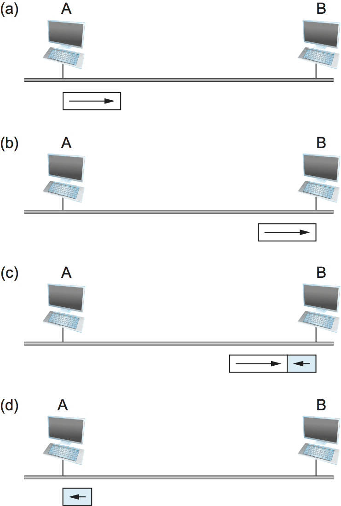

**Figure 2.22. Worst-case scenario: (a) A sends a frame at time t; (b) A's frame arrives at B at time t+d; (c) B begins transmitting at time t+d and collides with A's frame; (d) B's runt (32-bit) frame arrives at A at time t+2×d.**

Figure 2.22 illustrates the worst-case scenario, where hosts A and B are at opposite ends of the network. Suppose host A begins transmitting a frame at time t, as shown in (a). It takes it one link latency (let’s denote the latency as d) for the frame to reach host B. Thus, the first bit of A’s frame arrives at B at time t+d, as shown in (b). Suppose an instant before host A’s frame arrives (i.e., B still sees an idle line), host B begins to transmit its own frame. B’s frame will immediately collide with A’s frame, and this collision will be detected by host B (c). Host B will send the 32-bit jamming sequence, as described above. (B’s frame will be a runt.) Unfortunately, host A will not know that the collision occurred until B’s frame reaches it, which will happen one link latency later, at time *t+2×d*, as shown in (d). Host A must continue to transmit until this time in order to detect the collision. In other words, host A must transmit for *2×d* to be sure that it detects all possible collisions. Considering that a maximally configured Ethernet is 2500 m long, and that there may be up to four repeaters between any two hosts, the round-trip delay has been determined to be 51.2 μs, which on a 10-Mbps Ethernet corresponds to 512 bits. The other way to look at this situation is that we need to limit the Ethernet’s maximum latency to a fairly small value (e.g., 51.2 μs) for the access algorithm to work; hence, an Ethernet’s maximum length must be something on the order of 2500 m.

Once an adaptor has detected a collision and stopped its transmission, it waits a certain amount of time and tries again. Each time it tries to transmit but fails, the adaptor doubles the amount of time it waits before trying again. This strategy of doubling the delay interval between each retransmission attempt is a general technique known as *exponential backoff*. More precisely, the adaptor first delays either 0 or 51.2 μs, selected at random. If this effort fails, it then waits 0, 51.2, 102.4, or 153.6 μs (selected randomly) before trying again; this is k × 51.2 for k=0..3. After the third collision, it waits *k × 51.2* for k = 0..2 ³ - 1, again selected at random. In general, the algorithm randomly selects a *k* between 0 and 2 ⁿ - 1 and waits k × 51.2 μs, where *n* is the number of collisions experienced so far. The adaptor gives up after a given number of tries and reports a transmit error to the host. Adaptors typically retry up to 16 times, although the backoff algorithm caps *n* in the above formula at 10.

#### 2.6.3 Longevity of Ethernet

Ethernet has been the dominant local area network technology for over 30 years. Today it is typically deployed point-to-point rather than tapping into a coax cable, it often runs at speeds of 1 or 10 Gbps rather than 10 Mbps, and it allows jumbo packets with up to 9000 bytes of data rather than 1500 bytes. But, it remains backwards compatible with the original standard. This makes it worth saying a few words about why Ethernets have been so successful, so that we can understand the properties we should emulate with any technology that tries to replace it.

First, an Ethernet is extremely easy to administer and maintain: There is no routing or configuration tables to be kept up-to-date, and it is easy to add a new host to the network. It is hard to imagine a simpler network to administer. Second, it is inexpensive: cable/fiber is relatively cheap, and the only other cost is the network adaptor on each host. Ethernet became deeply entrenched for these reasons, and any switch-based approach that aspired to displace it required additional investment in infrastructure (the switches), on top of the cost of each adaptor. The switch-based variant of Ethernet did eventually succeed in replacing multi-access Ethernet, but this is primarily because it could be *deployed incrementally*—with some hosts connected by point-to-point links to switches while others remained tapped into coax and connected to repeaters or hubs—all the while retaining the simplicity of network administration.

### 2.7 Wireless Networks

Wireless technologies differ from wired links in some important ways, while at the same time sharing many common properties. Like wired links, issues of bit errors are of great concern—typically even more so due to the unpredictable noise environment of most wireless links. Framing and reliability also have to be addressed. Unlike wired links, power is a big issue for wireless, especially because wireless links are often used by small mobile devices (like phones and sensors) that have limited access to power (e.g., a small battery). Furthermore, you can’t go blasting away at arbitrarily high power with a radio transmitter—there are concerns about interference with other devices and usually regulations about how much power a device may emit at any given frequency.

Wireless media are also inherently multi-access; it’s difficult to direct your radio transmission to just a single receiver or to avoid receiving radio signals from any transmitter with enough power in your neighborhood. Hence, media access control is a central issue for wireless links. And, because it’s hard to control who receives your signal when you transmit over the air, issues of eavesdropping may also have to be addressed.

There is a baffling assortment of different wireless technologies, each of which makes different tradeoffs in various dimensions. One simple way to categorize the different technologies is by the data rates they provide and how far apart communicating nodes can be. Other important differences include which part of the electromagnetic spectrum they use (including whether it requires a license) and how much power they consume. In this section, we discuss two prominent wireless technologies: Wi-Fi (more formally known as 802.11), and Bluetooth. The next section discusses cellular networks in the context of ISP access services. Table 2.3 gives an overview of these technologies and how they compare to each other.

**Table 2.3. Overview of Leading Wireless Technologies.**

|  | Bluetooth (802.15.1) | Wi-Fi (802.11) | 4G Cellular |
| --- | --- | --- | --- |
| Typical | 10 m | 100 m | Tens of |
| link length |  |  | kilometers |
| Typical | 2 Mbps (shared) | 150-450 Mbps | 1-5 Mbps |
| data rate |  |  |  |
| Typical use | Link a peripheral to | Link a computer | Link mobile |
|  | a computer | to a wired base | phone to a |
|  |  |  | wired tower |
| Wired | USB | Ethernet | PON |
| technology |  |  |  |
| analogy |  |  |  |

You may recall that bandwidth sometimes means the width of a frequency band in hertz and sometimes the data rate of a link. Because both these concepts come up in discussions of wireless networks, we’re going to use *bandwidth* here in its stricter sense—width of a frequency band—and use the term *data rate* to describe the number of bits per second that can be sent over the link, as in Table 2.3.

#### 2.7.1 Basic Issues

Because wireless links all share the same medium, the challenge is to share that medium efficiently, without unduly interfering with each other. Most of this sharing is accomplished by dividing it up along the dimensions of frequency and space. Exclusive use of a particular frequency in a particular geographic area may be allocated to an individual entity such as a corporation. It is feasible to limit the area covered by an electromagnetic signal because such signals weaken, or *attenuate*, with the distance from their origin. To reduce the area covered by your signal, reduce the power of your transmitter.

These allocations are typically determined by government agencies, such as the Federal Communications Commission (FCC) in the United States. Specific bands (frequency ranges) are allocated to certain uses. Some bands are reserved for government use. Other bands are reserved for uses such as AM radio, FM radio, television, satellite communication, and cellular phones. Specific frequencies within these bands are then licensed to individual organizations for use within certain geographical areas. Finally, several frequency bands are set aside for license-exempt usage—bands in which a license is not needed.

Devices that use license-exempt frequencies are still subject to certain restrictions to make that otherwise unconstrained sharing work. Most important of these is a limit on transmission power. This limits the range of a signal, making it less likely to interfere with another signal. For example, a cordless phone (a common unlicensed device) might have a range of about 100 feet.

One idea that shows up a lot when spectrum is shared among many devices and applications is *spread spectrum*. The idea behind spread spectrum is to spread the signal over a wider frequency band, so as to minimize the impact of interference from other devices. (Spread spectrum was originally designed for military use, so these “other devices” were often attempting to jam the signal.) For example, *frequency hopping* is a spread spectrum technique that involves transmitting the signal over a random sequence of frequencies; that is, first transmitting at one frequency, then a second, then a third, and so on. The sequence of frequencies is not truly random but is instead computed algorithmically by a pseudorandom number generator. The receiver uses the same algorithm as the sender and initializes it with the same seed; hence, it is able to hop frequencies in sync with the transmitter to correctly receive the frame. This scheme reduces interference by making it unlikely that two signals would be using the same frequency for more than the infrequent isolated bit.

A second spread spectrum technique, called *direct sequence*, adds redundancy for greater tolerance of interference. Each bit of data is represented by multiple bits in the transmitted signal so that, if some of the transmitted bits are damaged by interference, there is usually enough redundancy to recover the original bit. For each bit the sender wants to transmit, it actually sends the exclusive-OR of that bit and n random bits. As with frequency hopping, the sequence of random bits is generated by a pseudorandom number generator known to both the sender and the receiver. The transmitted values, known as an n-bit *chipping code*, spread the signal across a frequency band that is n times wider than the frame would have otherwise required. Figure 2.23 gives an example of a 4-bit chipping sequence.

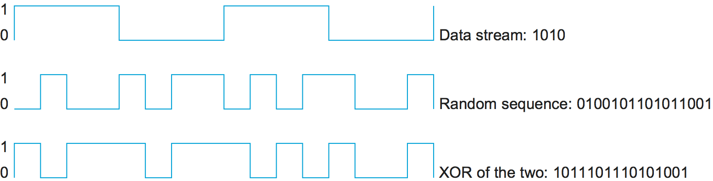

**Figure 2.23. Example 4-bit chipping sequence.**

Different parts of the electromagnetic spectrum have different properties, making some better suited to communication, and some less so. For example, some can penetrate buildings and some cannot. Governments regulate only the prime communication portion: the radio and microwave ranges. As demand for prime spectrum increases, there is great interest in the spectrum that is becoming available as analog television is phased out in favor of digital.

In many wireless networks today we observe that there are two different classes of endpoints. One endpoint, sometimes described as the *base station*, usually has no mobility but has a wired (or at least high-bandwidth) connection to the Internet or other networks, as shown in Figure 2.24. The node at the other end of the link—shown here as a client node—is often mobile and relies on its link to the base station for all of its communication with other nodes.

Observe that in Figure 2.24 we have used a wavy pair of lines to represent the wireless “link” abstraction provided between two devices (e.g., between a base station and one of its client nodes). One of the interesting aspects of wireless communication is that it naturally supports point-to-multipoint communication, because radio waves sent by one device can be simultaneously received by many devices. However, it is often useful to create a point-to-point link abstraction for higher layer protocols, and we will see examples of how this works later in this section.

Note that in Figure 2.24 communication between non-base (client) nodes is routed via the base station. This is in spite of the fact that radio waves emitted by one client node may well be received by other client nodes—the common base station model does not permit direct communication between the client nodes.

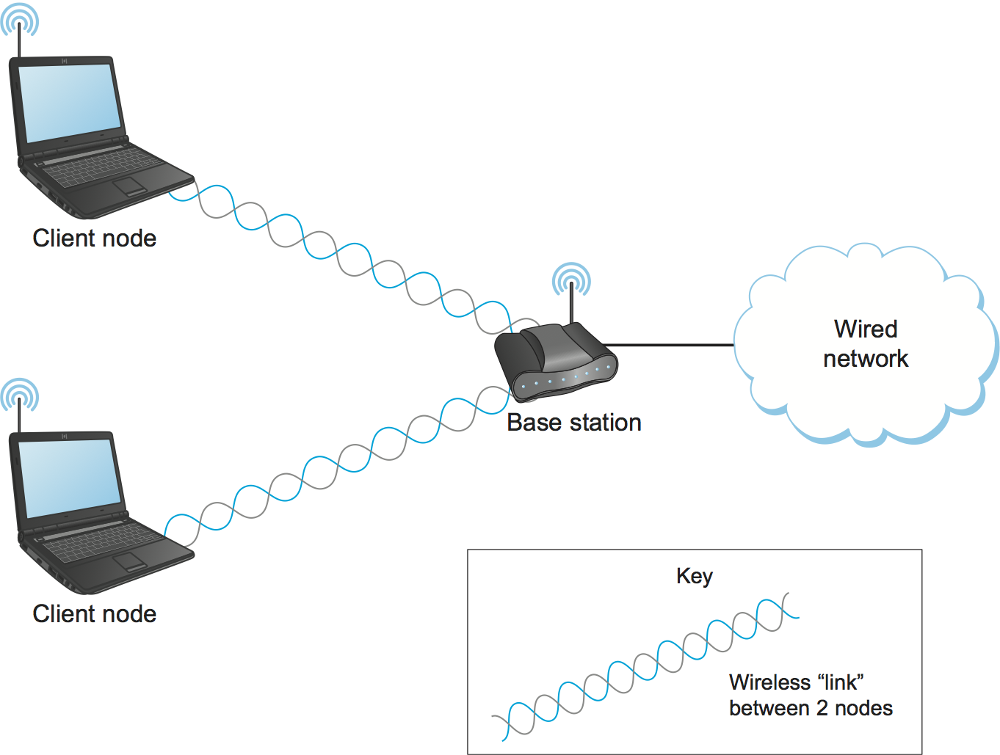

**Figure 2.24. A wireless network using a base station.**

This topology implies three qualitatively different levels of mobility. The first level is no mobility, such as when a receiver must be in a fixed location to receive a directional transmission from the base station. The second level is mobility within the range of a base, as is the case with Bluetooth. The third level is mobility between bases, as is the case with cell phones and Wi-Fi.

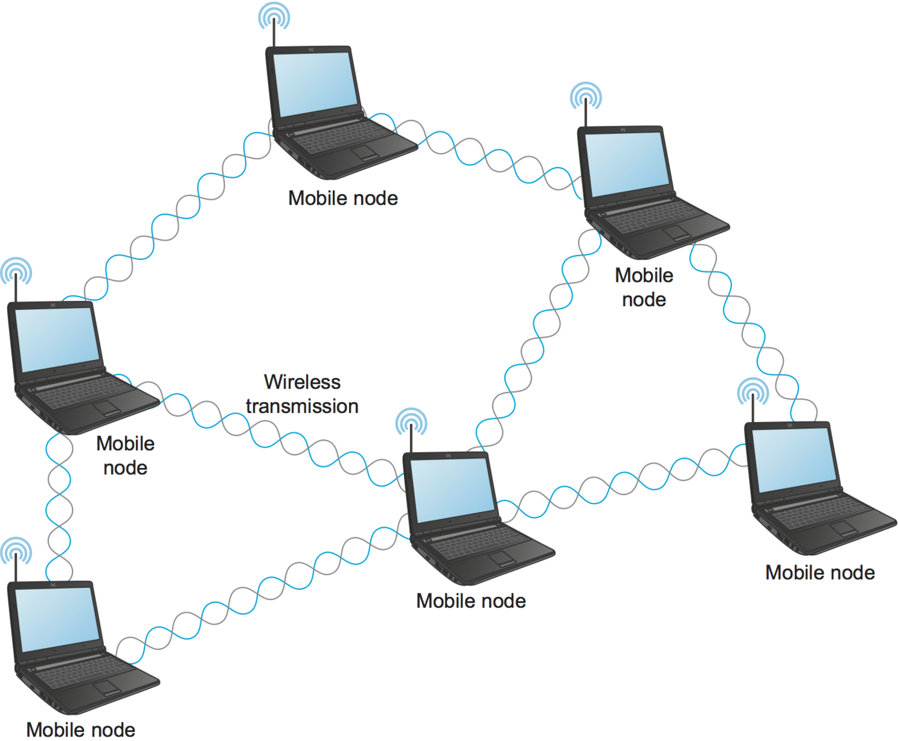

**Figure 2.25. A wireless ad hoc or mesh network.**

An alternative topology that is seeing increasing interest is the *mesh* or *ad hoc* network. In a wireless mesh, nodes are peers; that is, there is no special base station node. Messages may be forwarded via a chain of peer nodes as long as each node is within range of the preceding node. This is illustrated in Figure 2.25. This allows the wireless portion of a network to extend beyond the limited range of a single radio. From the point of view of competition between technologies, this allows a shorter-range technology to extend its range and potentially compete with a longer-range technology. Meshes also offer fault tolerance by providing multiple routes for a message to get from point A to point B. A mesh network can be extended incrementally, with incremental costs. On the other hand, a mesh network requires non-base nodes to have a certain level of sophistication in their hardware and software, potentially increasing per-unit costs and power consumption, a critical consideration for battery-powered devices. Wireless mesh networks are of considerable research interest, but they are still in their relative infancy compared to networks with base stations. Wireless sensor networks, another hot emerging technology, often form wireless meshes.

Now that we have covered some of the common wireless issues, let’s take a look at the details of two common wireless technologies.

#### 2.7.2 Wi-Fi (802.11)

Most readers will have used a wireless network based on the IEEE 802.11 standards, often referred to as *Wi-Fi*. Wi-Fi is technically a trademark, owned by a trade group called the Wi-Fi Alliance, which certifies product compliance with 802.11. Like Ethernet, 802.11 is designed for use in a limited geographical area (homes, office buildings, campuses), and its primary challenge is to mediate access to a shared communication medium—in this case, signals propagating through space.

##### Physical Properties

802.11 defines a number of different physical layers that operate in various frequency bands and provide a range of different data rates.

The original 802.11 standard defined two radio-based physical layers standards, one using frequency hopping (over 79 1-MHz-wide frequency bandwidths) and the other using direct sequence spread spectrum (with an 11-bit chipping sequence). Both provided data rates in the 2 Mbps range. Subsequently, the physical layer standard 802.11b was added, and using a variant of direct sequence, supported up to 11 Mbps. These three standards all operated in the license-exempt 2.4-GHz frequency band of the electromagnetic spectrum. Then came 802.11a, which delivered up to 54 Mbps using a variant of frequency division multiplexing called *orthogonal frequency division multiplexing (OFDM)*. 802.11a runs in the license-exempt 5-GHz band. 802.11g followed, and also using OFDM, delivered up to 54 Mbps. 802.11g is backward compatible with 802.11b (and returns to the 2.4-GHz band).

At the time of writing, many devices support 802.11n or 802.11ac, which typically achieve per-device data rates of 150 Mbps to 450 Mbps, respectively. This improvement is partly due to the use of multiple antennas and allowing greater wireless channel bandwidths. The use of multiple antennas is often called *MIMO* for multiple-input, multiple-output. The latest emerging standard, 802.11ax, promises another substantial improvement in throughput, in part by adopting many of the coding and modulation techniques used in the 4G/5G cellular network, which we describe in the next section.

It is common for commercial products to support more than one flavor of 802.11; many base stations support all five variants (a,b, g, n, and ac). This not only ensures compatibility with any device that supports any one of the standards but also makes it possible for two such products to choose the highest bandwidth option for a particular environment.

It is worth noting that while all the 802.11 standards define a *maximum* bit rate that can be supported, they mostly support lower bit rates as well (e.g., 802.11a allows for bit rates of 6, 9, 12, 18, 24, 36, 48, and 54 Mbps). At lower bit rates, it is easier to decode transmitted signals in the presence of noise. Different modulation schemes are used to achieve the various bit rates. In addition, the amount of redundant information in the form of error-correcting codes is varied. More redundant information means higher resilience to bit errors at the cost of lowering the effective data rate (since more of the transmitted bits are redundant).

The systems try to pick an optimal bit rate based on the noise environment in which they find themselves; the algorithms for bit rate selection can be quite complex. Interestingly, the 802.11 standards do not specify a particular approach but leave the algorithms to the various vendors. The basic approach to picking a bit rate is to estimate the bit error rate either by directly measuring the signal-to-noise ratio (SNR) at the physical layer or by estimating the SNR by measuring how often packets are successfully transmitted and acknowledged. In some approaches, a sender will occasionally probe a higher bit rate by sending one or more packets at that rate to see if it succeeds.

##### Collision Avoidance

At first glance, it might seem that a wireless protocol would follow the same algorithm as the Ethernet—wait until the link becomes idle before transmitting and back off should a collision occur—and, to a first approximation, this is what 802.11 does. The additional complication for wireless is that, while a node on an Ethernet receives every other node’s transmissions and can transmit and receive at the same time, neither of these conditions holds for wireless nodes. This makes detection of collisions rather more complex. The reason why wireless nodes cannot usually transmit and receive at the same time (on the same frequency) is that the power generated by the transmitter is much higher than any received is likely to be and so swamps the receiving circuitry. The reason why a node may not receive transmissions from another node is because that node may be too far away or blocked by an obstacle. This situation is a bit more complex than it first appears, as the following discussion will illustrate.

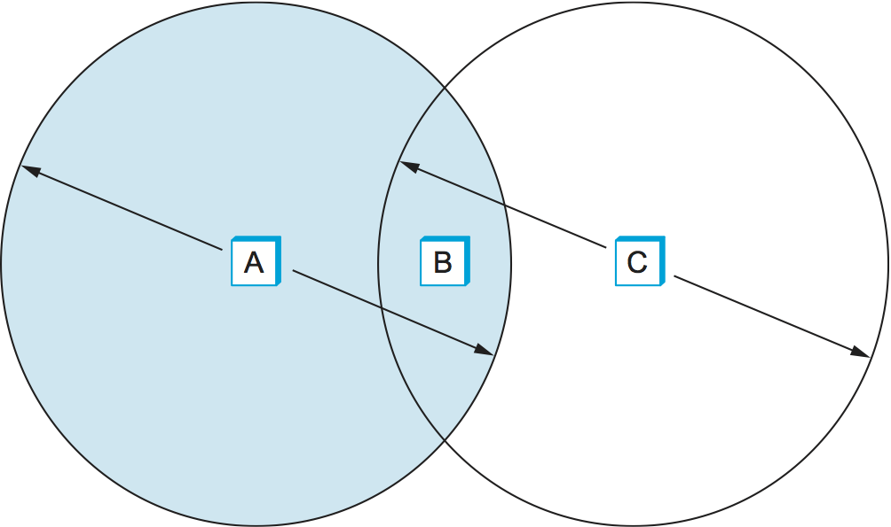

**Figure 2.26. The hidden node problem. Although A and C are hidden from each other, their signals can collide at B. (B's reach is not shown.)**

Consider the situation depicted in Figure 2.26, where A and C are both within range of B but not each other. Suppose both A and C want to communicate with B and so they each send it a frame. A and C are unaware of each other since their signals do not carry that far. These two frames collide with each other at B, but unlike an Ethernet, neither A nor C is aware of this collision. A and C are said to be *hidden nodes* with respect to each other.

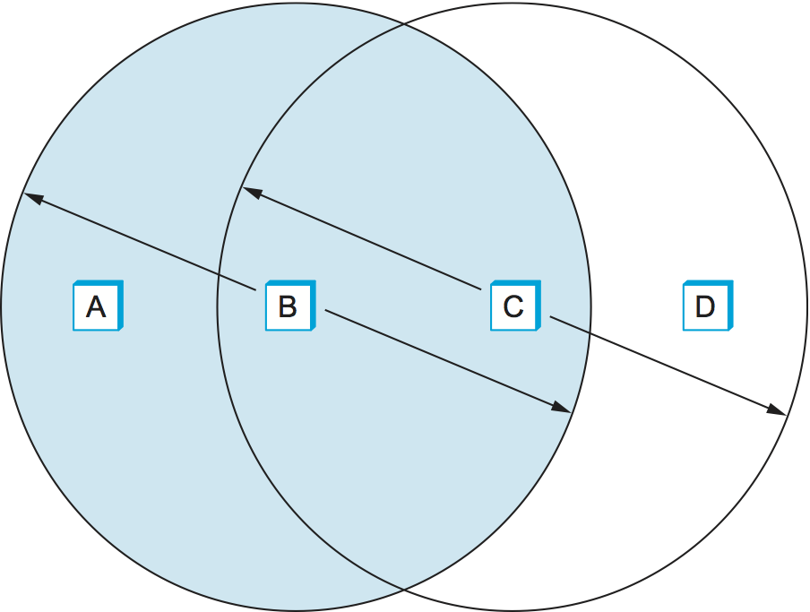

**Figure 2.27. The exposed node problem. Although B and C are exposed to each other's signals, there is no interference if B transmits to A while C transmits to D. (A and D's reaches are not shown.)**

A related problem, called the *exposed node problem*, occurs under the circumstances illustrated in Figure 2.27, where each of the four nodes is able to send and receive signals that reach just the nodes to its immediate left and right. For example, B can exchange frames with A and C but it cannot reach D, while C can reach B and D but not A. Suppose B is sending to A. Node C is aware of this communication because it hears B’s transmission. It would be a mistake, however, for C to conclude that it cannot transmit to anyone just because it can hear B’s transmission. For example, suppose C wants to transmit to node D. This is not a problem since C’s transmission to D will not interfere with A’s ability to receive from B. (It would interfere with A sending to B, but B is transmitting in our example.)

802.11 addresses these problems by using CSMA/CA, where the CA stands for collision *avoidance*, in contrast to the collision *detection* of CSMA/CD used on Ethernets. There are a few pieces to make this work.

The Carrier Sense part seems simple enough: Before sending a packet, the transmitter checks if it can hear any other transmissions; if not, it sends. However, because of the hidden node problem, just waiting for the absence of signals from other transmitters does not guarantee that a collision will not occur from the perspective of the receiver. For this reason, one part of CSMA/CA is an explicit ACK from the receiver to the sender. If the packet was successfully decoded and passed its CRC at the receiver, the receiver sends an ACK back to the sender.

Note that if a collision does occur, it will render the entire packet useless. For this reason, 802.11 adds an optional mechanism called RTS-CTS (Ready to Send-Clear to Send). This goes some way toward addressing the hidden node problem. The sender sends an RTS—a short packet—to the intended receiver, and if that packet is received successfully the receiver responds with another short packet, the CTS. Even though the RTS may not have been heard by a hidden node, the CTS probably will be. This effectively tells the nodes within range of the receiver that they should not send anything for a while—the amount of time of the intended transmission is included in the RTS and CTS packets. After that time plus a small interval has passed, the carrier can be assumed to be available again, and another node is free to try to send.

Of course, two nodes might detect an idle link and try to transmit an RTS frame at the same time, causing their RTS frames to collide with each other. The senders realize the collision has happened when they do not receive the CTS frame after a period of time, in which case they each wait a random amount of time before trying again. The amount of time a given node delays is defined by an exponential backoff algorithm very much like that used on the Ethernet.

After a successful RTS-CTS exchange, the sender sends its data packet and, if all goes well, receives an ACK for that packet. In the absence of a timely ACK, the sender will try again to request usage of the channel again, using the same process described above. By this time, of course, other nodes may again be trying to get access to the channel as well.

##### Distribution System

As described so far, 802.11 would be suitable for a network with a mesh (*ad hoc*) topology, and development of an 802.11s standard for mesh networks is nearing completion. At the current time, however, nearly all 802.11 networks use a base-station-oriented topology.

Instead of all nodes being created equal, some nodes are allowed to roam (e.g., your laptop) and some are connected to a wired network infrastructure. 802.11 calls these base stations *access points* (APs), and they are connected to each other by a so-called *distribution system*. Figure 2.28 illustrates a distribution system that connects three access points, each of which services the nodes in some region. Each access point operates on some channel in the appropriate frequency range, and each AP will typically be on a different channel than its neighbors.

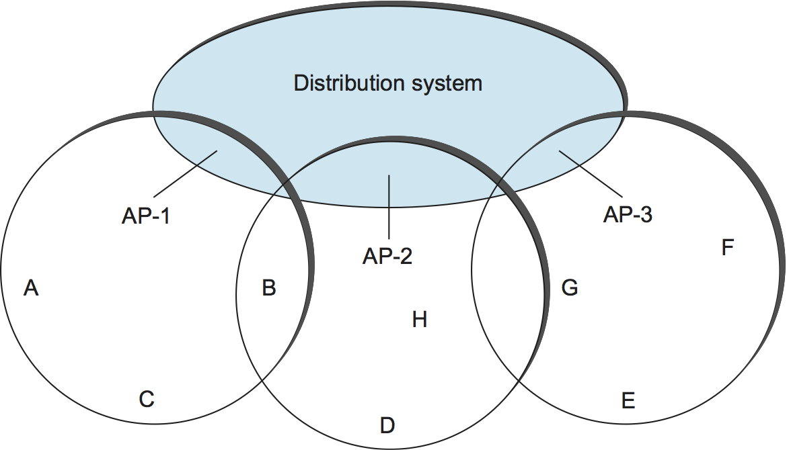

**Figure 2.28. Access points connected to a distribution system.**

The details of the distribution system are not important to this discussion—it could be an Ethernet, for example. The only important point is that the distribution network operates at the link layer, the same protocol layer as the wireless links. In other words, it does not depend on any higher-level protocols (such as the network layer).

Although two nodes can communicate directly with each other if they are within reach of each other, the idea behind this configuration is that each node associates itself with one access point. For node A to communicate with node E, for example, A first sends a frame to its access point (AP-1), which forwards the frame across the distribution system to AP-3, which finally transmits the frame to E. How AP-1 knew to forward the message to AP-3 is beyond the scope of 802.11; it may have used a bridging protocol. What 802.11 does specify is how nodes select their access points and, more interestingly, how this algorithm works in light of nodes moving from one cell to another.

The technique for selecting an AP is called *scanning* and involves the following four steps:

1. The node sends a Probe frame.
2. All APs within reach reply with a Probe Response frame.
3. The node selects one of the access points and sends that AP an Association Request frame.
4. The AP replies with an Association Response frame.

A node engages this protocol whenever it joins the network, as well as when it becomes unhappy with its current AP. This might happen, for example, because the signal from its current AP has weakened due to the node moving away from it. Whenever a node acquires a new AP, the new AP notifies the old AP of the change (this happens in step 4) via the distribution system.

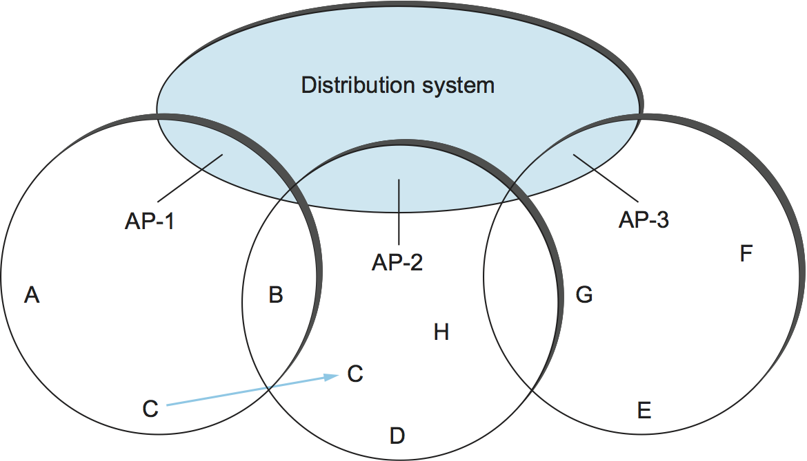

**Figure 2.29. Node mobility.**

Consider the situation shown in Figure 2.29, where node C moves from the cell serviced by AP-1 to the cell serviced by AP-2. As it moves, it sends Probe frames, which eventually result in Probe Response frames from AP-2. At some point, C prefers AP-2 over AP-1, and so it associates itself with that access point.

The mechanism just described is called *active scanning* since the node is actively searching for an access point. APs also periodically send a Beacon frame that advertises the capabilities of the access point; these include the transmission rates supported by the AP. This is called *passive scanning*, and a node can change to this AP based on the Beacon frame simply by sending an Association Request frame back to the access point.

##### Frame Format

Most of the 802.11 frame format, which is depicted in Figure 2.30, is exactly what we would expect. The frame contains the source and destination node addresses, each of which is 48 bits long; up to 2312 bytes of data; and a 32-bit CRC. The Control field contains three subfields of interest (not shown): a 6-bit Type field that indicates whether the frame carries data, is an RTS or CTS frame, or is being used by the scanning algorithm, and a pair of 1-bit fields—called ToDS and FromDS—that are described below.

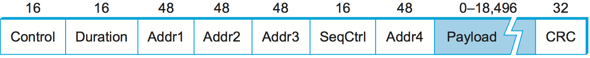

**Figure 2.30. 802.11 frame format.**

The peculiar thing about the 802.11 frame format is that it contains four, rather than two, addresses. How these addresses are interpreted depends on the settings of the ToDS and FromDS bits in the frame’s Control field. This is to account for the possibility that the frame had to be forwarded across the distribution system, which would mean that the original sender is not necessarily the same as the most recent transmitting node. Similar reasoning applies to the destination address. In the simplest case, when one node is sending directly to another, both the DS bits are 0, Addr1 identifies the target node, and Addr2 identifies the source node. In the most complex case, both DS bits are set to 1, indicating that the message went from a wireless node onto the distribution system, and then from the distribution system to another wireless node. With both bits set, Addr1 identifies the ultimate destination, Addr2 identifies the immediate sender (the one that forwarded the frame from the distribution system to the ultimate destination), Addr3 identifies the intermediate destination (the one that accepted the frame from a wireless node and forwarded it across the distribution system), and Addr4 identifies the original source. In terms of the example given in Figure 2.28, Addr1 corresponds to E, Addr2 identifies AP-3, Addr3 corresponds to AP-1, and Addr4 identifies A.

##### Security of Wireless Links

One of the fairly obvious problems of wireless links compared to wires or fibers is that you can’t be too sure where your data has gone. You can probably figure out if it was received by the intended receiver, but there is no telling how many other receivers might have also picked up your transmission. So, if you are concerned about the privacy of your data, wireless networks present a challenge.

Even if you are not concerned about data privacy—or perhaps have taken care of it in some other way—you may be concerned about an unauthorized user injecting data into your network. If nothing else, such a user might be able to consume resources that you would prefer to consume yourself, such as the finite bandwidth between your house and your ISP.

For these reasons, wireless networks typically come with some sort of mechanism to control access to both the link itself and the transmitted data. These mechanisms are often categorized as *wireless security.* The widely adopted WPA2 is described in Chapter 8.

#### 2.7.3 Bluetooth (802.15.1)

Bluetooth fills the niche of very short range communication between mobile phones, PDAs, notebook computers, and other personal or peripheral devices. For example, Bluetooth can be used to connect a mobile phone to a headset or a notebook computer to a keyboard. Roughly speaking, Bluetooth is a more convenient alternative to connecting two devices with a wire. In such applications, it is not necessary to provide much range or bandwidth. This means that Bluetooth radios can use quite low power transmission, since transmission power is one of the main factors affecting bandwidth and range of wireless links. This matches the target applications for Bluetooth-enabled devices—most of them are battery powered (such as the ubiquitous phone headset) and hence it is important that they not consume much power.

Bluetooth operates in the license-exempt band at 2.45 GHz. Bluetooth links have typical bandwidths around 1 to 3 Mbps and a range of about 10 m. For this reason, and because the communicating devices typically belong to one individual or group, Bluetooth is sometimes categorized as a Personal Area Network (PAN).

Bluetooth is specified by an industry consortium called the *Bluetooth Special Interest Group*. It specifies an entire suite of protocols, going beyond the link layer to define application protocols, which it calls *profiles*, for a range of applications. For example, there is a profile for synchronizing a PDA with a personal computer. Another profile gives a mobile computer access to a wired LAN in the manner of 802.11, although this was not Bluetooth’s original goal. The IEEE 802.15.1 standard is based on Bluetooth but excludes the application protocols.

The basic Bluetooth network configuration, called a *piconet*, consists of a master device and up to seven slave devices, as shown in Figure 2.31. Any communication is between the master and a slave; the slaves do not communicate directly with each other. Because slaves have a simpler role, their Bluetooth hardware and software can be simpler and cheaper.

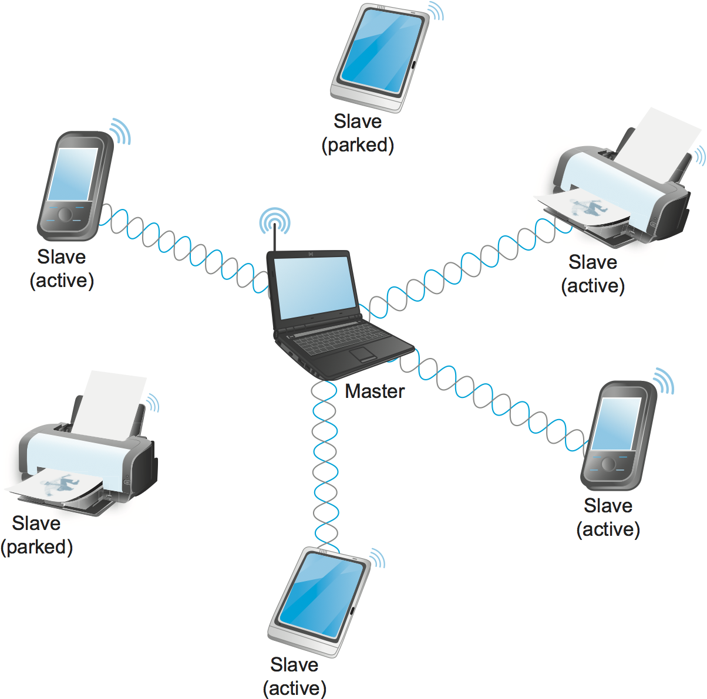

**Figure 2.31. A Bluetooth piconet.**

Since Bluetooth operates in an license-exempt band, it is required to use a spread spectrum technique to deal with possible interference in the band. It uses frequency-hopping with 79 *channels* (frequencies), using each for 625 μs at a time. This provides a natural time slot for Bluetooth to use for synchronous time division multiplexing. A frame takes up 1, 3, or 5 consecutive time slots. Only the master can start to transmit in odd-numbered slots. A slave can start to transmit in an even-numbered slot—but only in response to a request from the master during the previous slot, thereby preventing any contention between the slave devices.

A slave device can be *parked*; that is, it is set to an inactive, low-power state. A parked device cannot communicate on the piconet; it can only be reactivated by the master. A piconet can have up to 255 parked devices in addition to its active slave devices.

In the realm of very low-power, short-range communication there are a few other technologies besides Bluetooth. One of these is ZigBee, devised by the ZigBee alliance and standardized as IEEE 802.15.4. It is designed for situations where the bandwidth requirements are low and power consumption must be very low to give very long battery life. It is also intended to be simpler and cheaper than Bluetooth, making it feasible to incorporate in cheaper devices such as *sensors*. Sensors are becoming an increasingly important class of networked device, as technology advances to the point where very cheap small devices can be deployed in large quantities to monitor things like temperature, humidity, and energy consumption in a building.

### 2.8 Access Networks

In addition to the Ethernet and Wi-Fi connections we typically use to connect to the Internet at home, at work, at school, and in many public spaces, most of us connect to the Internet over an *access* or *broadband* service that we buy from an ISP. This section describes two such technologies: *Passive Optical Networks* (PON), commonly referred to as fiber-to-the-home, and *Cellular Networks* that connect our mobile devices. In both cases, the networks are multi-access (like Ethernet and Wi-Fi), but as we will see, their approach to mediating access is quite different.

To set a little more context, ISPs (e.g., Telco or Cable companies) often operate a national backbone, and connected to the periphery of that backbone are hundreds or thousands of edge sites, each of which serves a city or neighborhood. These edge sites are commonly called *Central Offices* in the Telco world and *Head Ends* in the cable world, but despite their names implying “centralized” and “root of the hierarchy” these sites are at the very edge of the ISP’s network; the ISP-side of the last-mile that directly connects to customers. PON and Cellular access networks are anchored in these facilities.

#### 2.8.1 Passive Optical Network

PON is the technology most commonly used to deliver fiber-based broadband to homes and businesses. PON adopts a point-to-multipoint design, which means the network is structured as a tree, with a single point starting in the ISP’s network and then fanning out to reach up to 1024 homes. PON gets its name from the fact that the splitters are passive: they forward optical signals downstream and upstream without actively storing-and-forwarding frames. In this way, they are the optical variant of repeaters used in the classic Ethernet. Framing then happens at the source in the ISP’s premises, in a device called an *Optical Line Terminal* (OLT), and at the end-points in individual homes, in a device called an *Optical Network Unit* (ONU).

Figure 2.32 shows an example PON, simplified to depict just one ONU and one OLT. In practice, a Central Office would include multiple OLTs connecting to thousands of customer homes. For completeness, Figure 2.32 also includes two other details about how the PON is connected to the ISP’s backbone (and hence, to the rest of the Internet). The *Agg Switch* aggregates traffic from a set of OLTs, and the *BNG* (Broadband Network Gateway) is a piece of Telco equipment that, among many other things, meters Internet traffic for the sake of billing. As its name implies, the BNG is effectively the gateway between the access network (everything to the left of the BNG) and the Internet (everything to the right of the BNG).

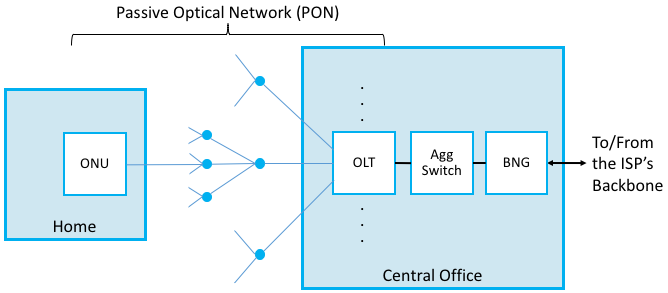

**Figure 2.32. An example PON that connects OLTs in the Central Office to ONUs in homes and businesses.**

Because the splitters are passive, PON has to implement some form of multi-access protocol. The approach it adopts can be summarized as follows. First, upstream and downstream traffic are transmitted on two different optical wavelengths, so they are completely independent of each other. Downstream traffic starts at the OLT and the signal is propagated down every link in the PON. As a consequence, every frame reaches every ONU. This device then looks at a unique identifier in the individual frames sent over the wavelength, and either keeps the frame (if the identifier is for it) or drops it (if not). Encryption is used to keep ONUs from eavesdropping on their neighbors’ traffic.

Upstream traffic is then time-division multiplexed on the upstream wavelength, with each ONU periodically getting a turn to transmit. Because the ONUs are distributed over a fairly wide area (measured in kilometers) and at different distances from the OLT, it is not practical for them to transmit based on synchronized clocks, as in SONET. Instead, the OLT transmits *grants* to the individual ONUs, giving them a time interval during which they can transmit. In other words, the single OLT is responsible for centrally implementing the round-robin sharing of the shared PON. This includes the possibility that the OLT can grant each ONU a different share of time, effectively implementing different levels of service.

PON is similar to Ethernet in the sense that it defines a sharing algorithm that has evolved over time to accommodate higher and higher bandwidths. G-PON (Gigabit-PON) is the most widely deployed today, supporting a bandwidth of 2.25-Gbps. XGS-PON (10 Gigabit-PON) is just now starting to be deployed.

#### 2.8.2 Cellular Network

While cellular telephone technology had its roots in analog voice communication, data services based on cellular standards are now the norm. Like Wi-Fi, cellular networks transmit data at certain bandwidths in the radio spectrum. Unlike Wi-Fi, which permits anyone to use a channel at either 2.4 or 5 GHz (all you have to do is set up a base station, as many of us do in our homes), exclusive use of various frequency bands have been auctioned off and licensed to service providers, who in turn sell mobile access service to their subscribers.

The frequency bands that are used for cellular networks vary around the world, and are complicated by the fact that ISPs often simultaneously support both old/legacy technologies and new/next-generation technologies, each of which occupies a different frequency band. The high-level summary is that traditional cellular technologies range from 700-MHz to 2400-MHz, with new mid-spectrum allocations now happening at 6-GHz and millimeter-wave (mmWave) allocations opening above 24-GHz.

> **Citizens Broadband Radio Service (CBRS)**
>
> In addition to the licensed bands, there is also an unlicensed band at 3.5-GHz set aside in North America, called *Citizens Broadband Radio Service* (CBRS), that anyone with a cellular radio can use. Similar unlicensed bands are being set up in other countries, as well. This opens the door for setting up private cellular networks, for example, within a University campus, an enterprise, or a manufacturing plant.
>
> To be more precise, the CBRS band allows three tiers of users to share the spectrum: first right of use goes to the original owners of this spectrum, naval radars and satellite ground stations; followed by priority users who receive this right over 10MHz bands for three years via regional auctions; and finally the rest of the population, who can access and utilize a portion of this band as long as they first check with a central database of registered users.

Like 802.11, cellular technology relies on the use of base stations that are connected to a wired network. In the case of the cellular network, the base stations are often called *Broadband Base Units* (BBU), the mobile devices that connect to them are usually referred to as *User Equipment* (UE), and the set of BBUs are anchored at an *Evolved Packet Core* (EPC) hosted in a Central Office. The wireless network served by the EPC is often called a *Radio Access Network* (RAN).

BBUs officially go by another name—Evolved NodeB, often abbreviated eNodeB or eNB—where NodeB is what the radio unit was called in an early incarnation of cellular networks (and has since evolved). Given that the cellular world continues to evolve at a rapid pace and eNB’s are soon to be upgraded to gNB’s, we have decided to use the more generic and less cryptic BBU.

Figure 2.33 depicts one possible configuration of the end-to-end scenario, with a few additional bits of detail. The EPC has multiple subcomponents, including an MME (Mobility Management Entity), an HSS (Home Subscriber Server), and an S/PGW (Session/Packet Gateway) pair; the first tracks and manages the movement of UEs throughout the RAN, the second is a database that contains subscriber-related information, and the Gateway pair processes and forwards packets between the RAN and the Internet (it forms the EPC’s *user plane*). We say “one possible configuration” because the cellular standards allow wide variability in how many S/PGWs a given MME is responsible for, making it possible for a single MME to manage mobility across a wide geographic area that is served by multiple Central Offices. Finally, while not explicitly spelled out in Figure 2.33, it is sometimes the case that the ISP’s PON network is used to connect the remote BBUs back to the Central Office.

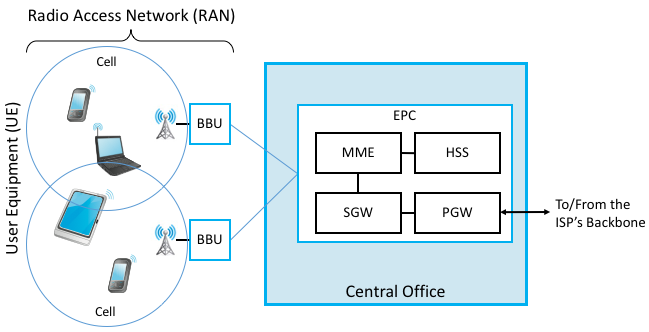

**Figure 2.33. A Radio Access Network (RAN) connecting a set of cellular devices (UEs) to an Evolved Packet Core (EPC) hosted in a Central Office.**

The geographic area served by a BBU’s antenna is called a *cell*. A BBU could serve a single cell or use multiple directional antennas to serve multiple cells. Cells don’t have crisp boundaries, and they overlap. Where they overlap, an UE could potentially communicate with multiple BBUs. At any time, however, the UE is in communication with, and under the control of, just one BBU. As the device begins to leave a cell, it moves into an area of overlap with one or more other cells. The current BBU senses the weakening signal from the phone and gives control of the device to whichever base station is receiving the strongest signal from it. If the device is involved in a call or other network session at the time, the session must be transferred to the new base station in what is called a *handoff*. The decision making process for handoffs is under the purview of the MME, which has historically been a proprietary aspect of the cellular equipment vendors (although open source MME implementations are now starting to be available).

There have been multiple generations of protocols implementing the cellular network, colloquially known as 1G, 2G, 3G, and so on. The first two generations supported only voice, with 3G defining the transition to broadband access, supporting data rates measured in hundreds of kilobits per second. Today, the industry is at 4G (supporting data rates typically measured in the few megabits per second) and is in the process of transitioning to 5G (with the promise of a tenfold increase in data rates).

As of 3G, the generational designation actually corresponds to a standard defined by the 3GPP (3rd Generation Partnership Project). Even though its name has “3G” in it, the 3GPP continues to define the standard for 4G and 5G, each of which corresponds to a release of the standard. Release 15, which is now published, is considered the demarcation point between 4G and 5G. By another name, this sequence of releases and generations is called LTE, which stands for *Long-Term Evolution*. The main takeaway is that while standards are published as a sequence of discrete releases, the industry as a whole has been on a fairly well-defined evolutionary path known as LTE. This section uses LTE terminology, but highlights the changes coming with 5G when appropriate.

The main innovation of LTE’s air interface is how it allocates the available radio spectrum to UEs. Unlike Wi-Fi, which is contention-based, LTE uses a reservation-based strategy. This difference is rooted in each system’s fundamental assumption about utilization: Wi-Fi assumes a lightly loaded network (and hence optimistically transmits when the wireless link is idle and backs off if contention is detected), while cellular networks assume (and strive for) high utilization (and hence explicitly assign different users to different “shares” of the available radio spectrum).

The state-of-the-art media access mechanism for LTE is called *Orthogonal Frequency-Division Multiple Access (OFDMA)*. The idea is to multiplex data over a set of 12 orthogonal subcarrier frequencies, each of which is modulated independently. The “Multiple Access” in OFDMA implies that data can simultaneously be sent on behalf of multiple users, each on a different subcarrier frequency and for a different duration of time. The subbands are narrow (e.g., 15kHz), but the coding of user data into OFDMA symbols is designed to minimize the risk of data loss due to interference between adjacent bands.

The use of OFDMA naturally leads to conceptualizing the radio spectrum as a two-dimensional resource, as shown in Figure 2.34. The minimal schedulable unit, called a *Resource Element (RE)*, corresponds to a 15kHz-wide band around one subcarrier frequency and the time it takes to transmit one OFDMA symbol. The number of bits that can be encoded in each symbol depends on the modulation rate, so for example using Quadrature Amplitude Modulation (QAM), 16-QAM yields 4 bits per symbol and 64-QAM yields 6 bits per symbol.

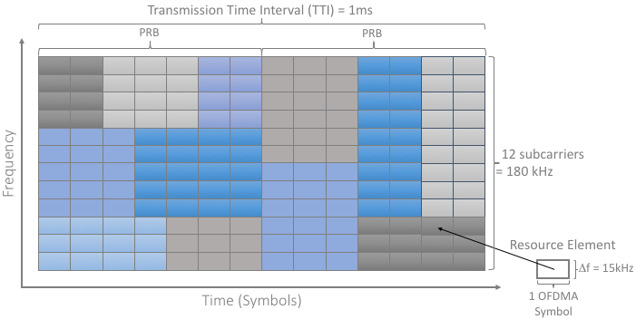

**Figure 2.34. The available radio spectrum abstractly represented by a 2-D grid of schedulable Resource Elements.**

A scheduler makes allocation decisions at the granularity of blocks of 7x12=84 resource elements, called a *Physical Resource Block (PRB)*. Figure 2.34 shows two back-to-back PRBs, where UEs are depicted by different colored blocks. Of course time continues to flow along one axis, and depending on the size of the licensed frequency band, there may be many more subcarrier slots (and hence PRBs) available along the other axis, so the scheduler is essentially scheduling a sequence of PRBs for transmission.

The 1ms *Transmission Time Interval (TTI)* shown in Figure 2.34 corresponds to the time frame in which the BBU receives feedback from UEs about the quality of the signal they are experiencing. This feedback, called a *Channel Quality Indicator (CQI)*, essentially reports the observed signal-to-noise ratio, which impacts the UE’s ability to recover the data bits. The base station then uses this information to adapt how it allocates the available radio spectrum to the UEs it is serving.

Up to this point, the description of how we schedule the radio spectrum is specific to 4G. The transition from 4G to 5G introduces additional degrees-of-freedom in how the radio spectrum is scheduled, making it possible to adapt the cellular network to a more diverse set of devices and applications domains.

Fundamentally, 5G defines a family of waveforms—unlike 4G, which specified only one waveform—each optimized for a different band in the radio spectrum.  The bands with carrier frequencies below 1GHz are designed to deliver mobile broadband and massive IoT services with a primary focus on range. Carrier frequencies between 1GHz-6GHz are designed to offer wider bandwidths, focusing on mobile broadband and mission-critical applications. Carrier frequencies above 24GHz (mmWaves) are designed to provide super wide bandwidths over short, line-of-sight coverage.

These different waveforms affect the scheduling and subcarrier intervals (i.e., the “size” of the Resource Elements just described).

- For sub-1GHz bands, 5G allows maximum 50MHz bandwidths. In this case, there are two waveforms: one with subcarrier spacing of 15kHz and another of 30kHz. (We used 15kHz in the example shown in Figure 2.34. The corresponding scheduling intervals are 0.5ms and 0.25ms, respectively. (We used 0.5ms in the example shown in Figure 2.34.)
- For 1GHz-6GHz bands, maximum bandwidths go up to 100MHz. Correspondingly, there are three waveforms with subcarrier spacings of 15kHz, 30kHz and 60kHz, corresponding to scheduling intervals of 0.5ms, 0.25ms and 0.125ms, respectively.
- For millimeter bands, bandwidths may go up to 400MHz. There are two waveforms, with subcarrier spacings of 60kHz and 120kHz. Both have scheduling intervals of 0.125ms.

This range of options is important because it adds another degree of freedom to the scheduler. In addition to allocating resource blocks to users, it has the ability to dynamically adjust the size of the resource blocks by changing the wave form being used in the band it is responsible for scheduling.

Whether 4G or 5G, the scheduling algorithm is a challenging optimization problem, with the objective of simultaneously (a) maximizing utilization of the available frequency band, and (b) ensuring that every UE receives the level of service it requires. This algorithm is not specified by 3GPP, but rather, is the proprietary intellectual property of the BBU vendors.

### Perspective: Race to the Edge

As we start to explore how softwarization is transforming the network, we should recognize that it is the access network that connects homes, businesses, and mobile users to the Internet that is undergoing the most radical change. The fiber-to-the-home and cellular networks described in Section 2.8 are currently constructed from complex hardware appliances (e.g., OLTs, BNGs, BBUs, EPCs). Not only have these devices historically been closed and proprietary, but the vendors that sell them have typically bundled a broad and diverse collection of functionality in each. As a consequence, they have become expensive to build, complicated to operate, and slow to change.

In response, network operators are actively transitioning from these purpose-built appliances to open software running on commodity servers, switches, and access devices. This initiative is often called *CORD*, which is an acronym for **C** entral **O** ffice **R** e-architected as a **D** atacenter, and as the name suggests, the idea is to build the Telco Central Office (or the Cable Head End, resulting in the acronym *HERD*) using exactly the same technologies as in the large datacenters that make up the cloud.

The motivation for operators to do this is in part to benefit from the cost savings that come from replacing purpose-built appliances with commodity hardware, but it is mostly driven by the need to accelerate the pace of innovation. Their goal is to enable new classes of edge services—e.g., Public Safety, Autonomous Vehicles, Automated Factories, Internet-of-Things (IoT), Immersive User Interfaces—that benefit from low latency connectivity to end users, and more importantly, to the increasing number of devices those users surround themselves with. This results in a multi-tier cloud similar to the one shown in Figure 2.35.


**Figure 2.35. Emerging multi-tier cloud includes datacenter-based public clouds, IXP-hosted distributed clouds, and access-based edge clouds, such as CORD. While there are on the order of 150 IXP-hosted clouds worldwide, we can expect there to be thousands or even tens of thousands of edge clouds.**

This is all part of the growing trend to move functionality out of the datacenter and closer to the network edge, a trend that puts cloud providers and network operators on a collision course. Cloud providers, in pursuit of low-latency/high-bandwidth applications, are moving out of the datacenter and towards the edge at the same time network operators are adopting the best practices and technologies of the cloud to the edge that already exists and implements the access network. It’s impossible to say how this will all play out over time; both industries have their particular advantages.

On the one hand, cloud providers believe that by saturating metro areas with edge clusters and abstracting away the access network, they can build an edge presence with low enough latency and high enough bandwidth to serve the next generation of edge applications. In this scenario, the access network remains a dumb bit-pipe, allowing cloud providers to excel at what they do best: run scalable cloud services on commodity hardware.

On the other hand, network operators believe that by building the next generation access network using cloud technology, they will be able to co-locate edge applications in the access network. This scenario comes with built-in advantages: an existing and widely distributed physical footprint, existing operational support, and native support for both mobility and guaranteed service.

While acknowledging both of these possibilities, there is a third outcome that is not only worth considering, but also worth working towards: the *democratization of the network edge.* The idea is to make the access-edge cloud accessible to anyone, and not strictly the domain of incumbent cloud providers or network operators. There are three reasons to be optimistic about this possibility:

1. Hardware and software for the access network is becoming commoditized and open. This is a key enabler that we were just talking about. If it helps Telcos and CableCos be agile, then it can provide the same value to anyone.
2. There is demand. Enterprises in the automotive, factory, and warehouse space increasingly want to deploy private 5G networks for a variety of physical automation use cases (e.g., a garage where a remote valet parks your car or a factory floor making use of automation robots).
3. Spectrum is becoming available. 5G is opening up for use in an unlicensed or lightly licensed model in the US and Germany as two prime examples, with other countries soon to follow. This means 5G should have around 100-200 MHz of spectrum available for private use.

In short, the access network has historically been the purview of the Telcos, CableCos, and the vendors that sell them proprietary boxes, but the softwarization and virtualization of the access network opens the door for anyone (from smart cities to underserved rural areas to apartment complexes to manufacturing plants) to establish an access-edge cloud and connect it to the public Internet. We expect it to become as easy to do this as it is today to deploy a WiFi router. Doing so not only brings the access-edge into new (edgier) environments, but also has the potential to open the access network to developers that instinctively go where there are opportunities to innovate.

> **Broader Perspective**
>
> To continue reading about the cloudification of the Internet, see Perspective: Virtual Networks All the Way Down.
>
> To learn more about the transformation taking place in access networks, we recommend: [CORD: Central Office Re-architected as a Datacenter, IEEE Communications, October 2016](https://wiki.opencord.org/display/CORD/Documentation?preview=/1278027/1966399/PETERSON_CORD.pdf) and [Democratizing the Network Edge SIGCOMM CCR, April 2019](https://ccronline.sigcomm.org/2019/democratizing-the-network-edge/).

[^1]: STS stands for *Synchronous Transport Signal*, which is how SONET talks about frames. There is a parallel term— *Optical Carrier* (OC)—that is used to talk about the underlying optical signal that carries SONET frames. We say these two terms are parallel because STS-3 and OC-3, to use a concrete example, both imply a transmission rate of 155.52 Mbps. Since we’re focused on framing here, we will stick with STS, but it is more likely that you will hear someone refer to an optical link by its “OC” name.

[^2]: While it’s unlikely that a packet could be delayed or arrive out-of-order on a point-to-point link, this same algorithm is used on multi-hop connections where such delays are possible.

[^3]: DSL is the legacy, copper-based counterpart to PON. DSL links are also terminated in Telco Central Offices, but we do not describe this technology since it is being phased out.

[^4]: A waveform is the frequency, amplitude, and phase-shift independent property (shape) of a signal. A sine wave is an example waveform.
