## Chapter 4: Advanced Internetworking

> Every seeming equality conceals a hierarchy. *—Mason Cooley*

### Problem: Scaling to Billions

We have now seen how to build an internetwork that consists of a number of networks of different types. That is, we have dealt with the problem of *heterogeneity*. The second critical problem in internetworking—arguably the fundamental problem for all networking—is *scale*. To understand the problem of scaling a network, it is worth considering the growth of the Internet, which has roughly doubled in size each year for 30 years. This sort of growth forces us to face a number of challenges.

Chief among these is how do you build a routing system that can handle hundreds of thousands of networks and billions of end nodes? As we will see in this chapter, most approaches to tackling the scalability of routing depend on the introduction of hierarchy. We can introduce hierarchy in the form of areas within a domain; we also use hierarchy to scale the routing system among domains. The interdomain routing protocol that has enabled the Internet to scale to its current size is BGP. We will take a look at how BGP operates, and consider the challenges faced by BGP as the Internet continues to grow.

Closely related to the scalability of routing is the problem of addressing. Even two decades ago it had become apparent that the 32-bit addressing scheme of IP version 4 would not last forever. That led to the definition of a new version of IP—version 6, since version 5 had been used in an earlier experiment. IPv6 primarily expands the address space but also adds a number of new features, some of which have been retrofitted to IPv4.

While the Internet continues to grow in size, it also needs to evolve its functionality. The final sections of this chapter cover some significant enhancements to the Internet’s capabilities. The first, multicast, is an enhancement of the basic service model. We show how multicast—the ability to deliver the same packets to a group of receivers efficiently—can be incorporated into an internet, and we describe several of the routing protocols that have been developed to support multicast. The second enhancement, Multiprotocol Label Switching (MPLS), modifies the forwarding mechanism of IP networks. This modification has enabled some changes in the way IP routing is performed and in the services offered by IP networks. Finally, we look at the effects of mobility on routing and describe some enhancements to IP to support mobile hosts and routers. For each of these enhancements, issues of scalability continue to be important.

### 4.1 Global Internet

At this point, we have seen how to connect a heterogeneous collection of networks to create an internetwork and how to use the simple hierarchy of the IP address to make routing in an internet somewhat scalable. We say “somewhat” scalable because, even though each router does not need to know about all the hosts connected to the internet, it does, in the model described so far, need to know about all the networks connected to the internet. Today’s Internet has hundreds of thousands of networks connected to it (or more, depending on how you count). Routing protocols such as those we have just discussed do not scale to those kinds of numbers. This section looks at a variety of techniques that greatly improve scalability and that have enabled the Internet to grow as far as it has.

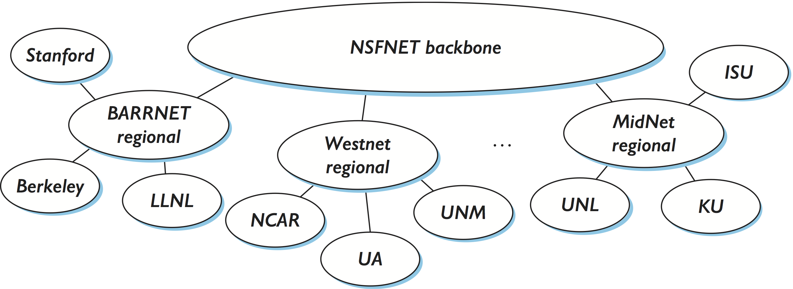

**Figure 4.1. The tree structure of the Internet in 1990.**

Before getting to these techniques, we need to have a general picture in our heads of what the global Internet looks like. It is not just a random interconnection of Ethernets, but instead it takes on a shape that reflects the fact that it interconnects many different organizations. Figure 4.1 gives a simple depiction of the state of the Internet in 1990. Since that time, the Internet’s topology has grown much more complex than this figure suggests—we present a slightly more accurate picture of the current Internet in a later section—but this picture will do for now.

One of the salient features of this topology is that it consists of end-user sites (e.g., Stanford University) that connect to service provider networks (e.g., BARRNET was a provider network that served sites in the San Francisco Bay Area). In 1990, many providers served a limited geographic region and were thus known as *regional networks*. The regional networks were, in turn, connected by a nationwide backbone. In 1990, this backbone was funded by the National Science Foundation (NSF) and was therefore called the *NSFNET backbone*.

NSFNET gave way to Internet2, which still runs a backbone on behalf of Research and Education institutions in the US (there are similar R&E networks in other countries), but of course most people get their Internet connectivity from commercial providers. Although the detail is not shown in the figure, today the largest provider networks (they are called tier-1) are typically built from dozens of high-end routers located in major metropolitan areas (colloquially referred to as “NFL cities”) connected by point-to-point links (often with 100 Gbps capacity). Similarly, each end-user site is typically not a single network but instead consists of multiple physical networks connected by switches and routers.

Notice that each provider and end-user is likely to be an administratively independent entity. This has some significant consequences on routing. For example, it is quite likely that different providers will have different ideas about the best routing protocol to use within their networks and on how metrics should be assigned to links in their network. Because of this independence, each provider’s network is usually a single *autonomous system* (AS). We will define this term more precisely in a later section, but for now it is adequate to think of an AS as a network that is administered independently of other ASes.

The fact that the Internet has a discernible structure can be used to our advantage as we tackle the problem of scalability. In fact, we need to deal with two related scaling issues. The first is the scalability of routing. We need to find ways to minimize the number of network numbers that get carried around in routing protocols and stored in the routing tables of routers. The second is address utilization—that is, making sure that the IP address space does not get consumed too quickly.

Throughout this book, we see the principle of hierarchy used again and again to improve scalability. We saw in the previous chapter how the hierarchical structure of IP addresses, especially with the flexibility provided by Classless Interdomain Routing (CIDR) and subnetting, can improve the scalability of routing. In the next two sections, we’ll see further uses of hierarchy (and its partner, aggregation) to provide greater scalability, first in a single domain and then between domains. Our final subsection looks at IP version 6, the invention of which was largely the result of scalability concerns.

#### 4.1.1 Routing Areas

As a first example of using hierarchy to scale up the routing system, we’ll examine how link-state routing protocols (such as OSPF and IS-IS) can be used to partition a routing domain into subdomains called *areas*. (The terminology varies somewhat among protocols—we use the OSPF terminology here.) By adding this extra level of hierarchy, we enable single domains to grow larger without overburdening the routing protocols or resorting to the more complex interdomain routing protocols described later.

An area is a set of routers that are administratively configured to exchange link-state information with each other. There is one special area—the backbone area, also known as area 0. An example of a routing domain divided into areas is shown in Figure 4.2 . Routers R1, R2, and R3 are members of the backbone area. They are also members of at least one nonbackbone area; R1 is actually a member of both area 1 and area 2. A router that is a member of both the backbone area and a nonbackbone area is an area border router (ABR). Note that these are distinct from the routers that are at the edge of an AS, which are referred to as AS border routers for clarity.

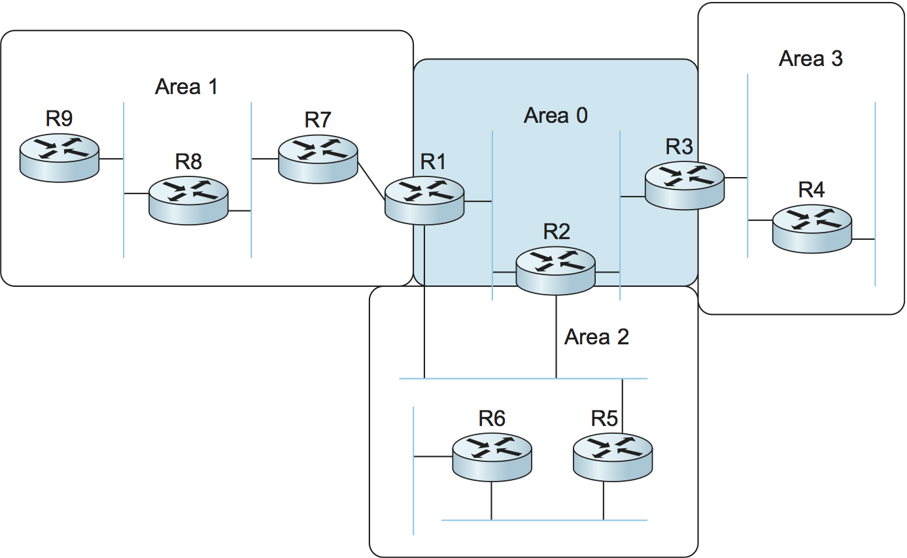

**Figure 4.2. A domain divided into areas.**

Routing within a single area is exactly as described in the previous chapter. All the routers in the area send link-state advertisements to each other and thus develop a complete, consistent map of the area. However, the link-state advertisements of routers that are not area border routers do not leave the area in which they originated. This has the effect of making the flooding and route calculation processes considerably more scalable. For example, router R4 in area 3 will never see a link-state advertisement from router R8 in area 1. As a consequence, it will know nothing about the detailed topology of areas other than its own.

How, then, does a router in one area determine the right next hop for a packet destined to a network in another area? The answer to this becomes clear if we imagine the path of a packet that has to travel from one nonbackbone area to another as being split into three parts. First, it travels from its source network to the backbone area, then it crosses the backbone, then it travels from the backbone to the destination network. To make this work, the area border routers summarize routing information that they have learned from one area and make it available in their advertisements to other areas. For example, R1 receives link-state advertisements from all the routers in area 1 and can thus determine the cost of reaching any network in area 1. When R1 sends link-state advertisements into area 0, it advertises the costs of reaching the networks in area 1 much as if all those networks were directly connected to R1. This enables all the area 0 routers to learn the cost to reach all networks in area 1. The area border routers then summarize this information and advertise it into the nonbackbone areas. Thus, all routers learn how to reach all networks in the domain.

Note that, in the case of area 2, there are two ABRs and that routers in area 2 will thus have to make a choice as to which one they use to reach the backbone. This is easy enough, since both R1 and R2 will be advertising costs to various networks, so it will become clear which is the better choice as the routers in area 2 run their shortest-path algorithm. For example, it is pretty clear that R1 is going to be a better choice than R2 for destinations in area 1.

When dividing a domain into areas, the network administrator makes a tradeoff between scalability and optimality of routing. The use of areas forces all packets traveling from one area to another to go via the backbone area, even if a shorter path might have been available. For example, even if R4 and R5 were directly connected, packets would not flow between them because they are in different nonbackbone areas. It turns out that the need for scalability is often more important than the need to use the absolute shortest path.

> **Key Takeaway**
>
> This illustrates an important principle in network design. There is frequently a trade-off between scalability and some sort of optimality. When hierarchy is introduced, information is hidden from some nodes in the network, hindering their ability to make perfect decisions. However, information hiding is essential to scaling a solution, since it saves all nodes from having global knowledge. It is invariably true in large networks that scalability is a more pressing design goal than selecting the optimal route. [Next]

Finally, we note that there is a trick by which network administrators can more flexibly decide which routers go in area 0. This trick uses the idea of a *virtual link* between routers. Such a virtual link is obtained by configuring a router that is not directly connected to area 0 to exchange backbone routing information with a router that is. For example, a virtual link could be configured from R8 to R1, thus making R8 part of the backbone. R8 would now participate in link-state advertisement flooding with the other routers in area 0. The cost of the virtual link from R8 to R1 is determined by the exchange of routing information that takes place in area 1. This technique can help to improve the optimality of routing.

#### 4.1.2 Interdomain Routing (BGP)

At the beginning of this chapter, we introduced the notion that the Internet is organized as autonomous systems, each of which is under the control of a single administrative entity. A corporation’s complex internal network might be a single AS, as may the national network of any single Internet Service Provider (ISP). Figure 4.3 shows a simple network with two autonomous systems.

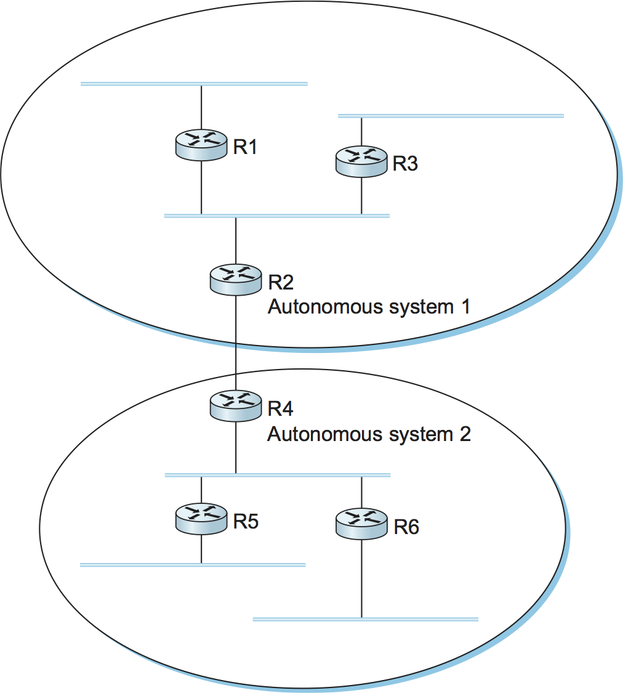

**Figure 4.3. A network with two autonomous systems.**

The basic idea behind autonomous systems is to provide an additional way to hierarchically aggregate routing information in a large internet, thus improving scalability. We now divide the routing problem into two parts: routing within a single autonomous system and routing between autonomous systems. Since another name for autonomous systems in the Internet is routing *domains*, we refer to the two parts of the routing problem as interdomain routing and intradomain routing. In addition to improving scalability, the AS model decouples the intradomain routing that takes place in one AS from that taking place in another. Thus, each AS can run whatever intradomain routing protocols it chooses. It can even use static routes or multiple protocols, if desired. The interdomain routing problem is then one of having different ASes share reachability information—descriptions of the set of IP addresses that can be reached via a given AS—with each other.

##### Challenges in Interdomain Routing

Perhaps the most important challenge of interdomain routing today is the need for each AS to determine its own routing *policies*. A simple example routing policy implemented at a particular AS might look like this: “Whenever possible, I prefer to send traffic via AS X than via AS Y, but I’ll use AS Y if it is the only path, and I never want to carry traffic from AS X to AS Y or *vice versa*.” Such a policy would be typical when I have paid money to both AS X and AS Y to connect my AS to the rest of the Internet, and AS X is my preferred provider of connectivity, with AS Y being the fallback. Because I view both AS X and AS Y as providers (and presumably I paid them to play this role), I don’t expect to help them out by carrying traffic between them across my network (this is called *transit* traffic). The more autonomous systems I connect to, the more complex policies I might have, especially when you consider backbone providers, who may interconnect with dozens of other providers and hundreds of customers and have different economic arrangements (which affect routing policies) with each one.

A key design goal of interdomain routing is that policies like the example above, and much more complex ones, should be supported by the interdomain routing system. To make the problem harder, I need to be able to implement such a policy without any help from other autonomous systems, and in the face of possible misconfiguration or malicious behavior by other autonomous systems. Furthermore, there is often a desire to keep the policies *private*, because the entities that run the autonomous systems—mostly ISPs—are often in competition with each other and don’t want their economic arrangements made public.

There have been two major interdomain routing protocols in the history of the Internet. The first was the Exterior Gateway Protocol (EGP), which had a number of limitations, perhaps the most severe of which was that it constrained the topology of the Internet rather significantly. EGP was designed when the Internet had a treelike topology, such as that illustrated in Figure 4.1, and did not allow for the topology to become more general. Note that in this simple treelike structure there is a single backbone, and autonomous systems are connected only as parents and children and not as peers.

The replacement for EGP was the Border Gateway Protocol (BGP), which has iterated through four versions (BGP-4). BGP is often regarded as one of the more complex parts of the Internet. We’ll cover some of its high points here.

Unlike its predecessor EGP, BGP makes virtually no assumptions about how autonomous systems are interconnected—they form an arbitrary graph. This model is clearly general enough to accommodate non-tree-structured internetworks, like the simplified picture of a multi-provider Internet shown in Figure 4.4. (It turns out there is still some sort of structure to the Internet, as we’ll see below, but it’s nothing like as simple as a tree, and BGP makes no assumptions about such structure.)

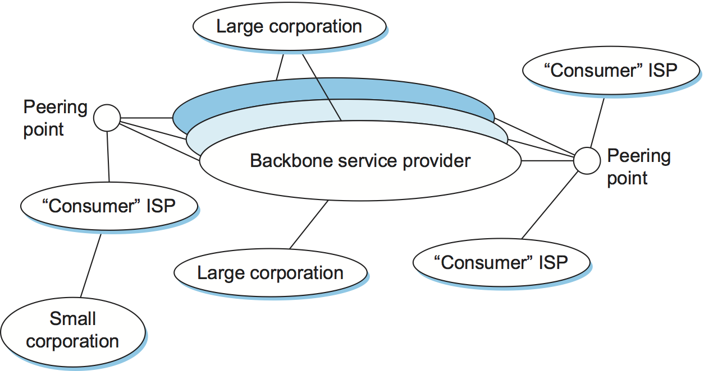

**Figure 4.4. A simple multi-provider Internet.**

Unlike the simple tree-structured Internet shown in Figure 4.1, or even the fairly simple picture in Figure 4.4, today’s Internet consists of a richly interconnected set of networks, mostly operated by private companies (ISPs) rather than governments. Many Internet Service Providers (ISPs) exist mainly to provide service to “consumers” (i.e., individuals with computers in their homes), while others offer something more like the old backbone service, interconnecting other providers and sometimes larger corporations. Often, many providers arrange to interconnect with each other at a single *peering point*.

To get a better sense of how we might manage routing among this complex interconnection of autonomous systems, we can start by defining a few terms. We define *local traffic* as traffic that originates at or terminates on nodes within an AS, and *transit traffic* as traffic that passes through an AS. We can classify autonomous systems into three broad types:

- Stub AS—an AS that only carries local traffic. The small corporation in Figure 4.4 is an example of a stub AS.
- Multihomed Stub AS—an AS that has connections to more than one other AS but that refuses to carry transit traffic, such as the large corporation at the top of Figure 4.4.
- Transit AS—an AS that has connections to more than one other AS and that is designed to carry both transit and local traffic, such as the backbone providers in Figure 4.4.

Whereas the discussion of routing in the previous chapter focused on finding optimal paths based on minimizing some sort of link metric, the goals of interdomain routing are rather more complex. First, it is necessary to find *some* path to the intended destination that is loop free. Second, paths must be compliant with the policies of the various autonomous systems along the path—and, as we have already seen, those policies might be almost arbitrarily complex. Thus, while intradomain focuses on a well-defined problem of optimizing the scalar cost of the path, interdomain focuses on finding a non-looping, *policy-compliant* path—a much more complex optimization problem.

There are additional factors that make interdomain routing hard. The first is simply a matter of scale. An Internet backbone router must be able to forward any packet destined anywhere in the Internet. That means having a routing table that will provide a match for any valid IP address. While CIDR has helped to control the number of distinct prefixes that are carried in the Internet’s backbone routing, there is inevitably a lot of routing information to pass around—the number of prefixes has exceeded one million by 2025.

A further challenge in interdomain routing arises from the autonomous nature of the domains. Note that each domain may run its own interior routing protocols and use any scheme it chooses to assign metrics to paths. This means that it is impossible to calculate meaningful path costs for a path that crosses multiple autonomous systems. A cost of 1000 across one provider might imply a great path, but it might mean an unacceptably bad one from another provider. As a result, interdomain routing advertises only *reachability*. The concept of reachability is basically a statement that “you can reach this network through this AS.” This means that for interdomain routing to pick an optimal path is essentially impossible.

The autonomous nature of interdomain raises issue of trust. Provider A might be unwilling to believe certain advertisements from provider B for fear that provider B will advertise erroneous routing information. For example, trusting provider B when he advertises a great route to anywhere in the Internet can be a disastrous choice if provider B turns out to have made a mistake configuring his routers or to have insufficient capacity to carry the traffic.

The issue of trust is also related to the need to support complex policies as noted above. For example, I might be willing to trust a particular provider only when he advertises reachability to certain prefixes, and thus I would have a policy that says, “Use AS X to reach only prefixes p and q, if and only if AS X advertises reachability to those prefixes.”

##### Basics of BGP

Each AS has one or more *border routers* through which packets enter and leave the AS. In our simple example in Figure 4.3, routers R2 and R4 would be border routers. (Over the years, routers have sometimes also been known as *gateways*, hence the names of the protocols BGP and EGP). A border router is simply an IP router that is charged with the task of forwarding packets between autonomous systems.

Each AS that participates in BGP must also have at least one *BGP* speaker, a router that “speaks” BGP to other BGP speakers in other autonomous systems. It is common to find that border routers are also BGP speakers, but that does not have to be the case.

BGP does not belong to either of the two main classes of routing protocols, distance-vector or link-state. Unlike these protocols, BGP advertises *complete paths* as an enumerated list of autonomous systems to reach a particular network. It is sometimes called a *path-vector* protocol for this reason. The advertisement of complete paths is necessary to enable the sorts of policy decisions described above to be made in accordance with the wishes of a particular AS. It also enables routing loops to be readily detected.

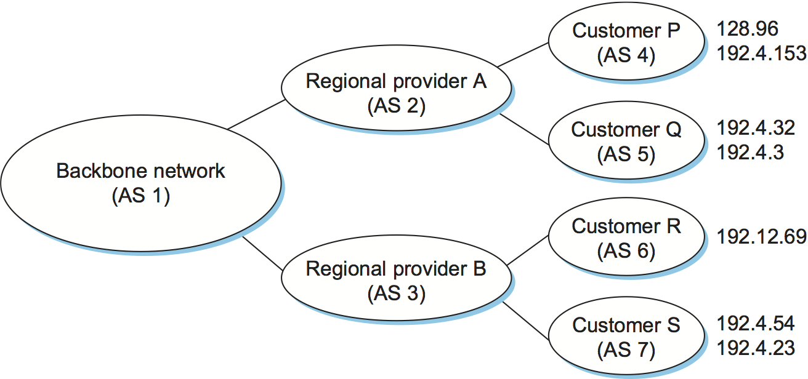

**Figure 4.5. Example of a network running BGP.**

To see how this works, consider the very simple example network in Figure 4.5. Assume that the providers are transit networks, while the customer networks are stubs. A BGP speaker for the AS of provider A (AS 2) would be able to advertise reachability information for each of the network numbers assigned to customers P and Q. Thus, it would say, in effect, “The networks 128.96, 192.4.153, 192.4.32, and 192.4.3 can be reached directly from AS 2.” The backbone network, on receiving this advertisement, can advertise, “The networks 128.96, 192.4.153, 192.4.32, and 192.4.3 can be reached along the path (AS 1, AS 2).” Similarly, it could advertise, “The networks 192.12.69, 192.4.54, and 192.4.23 can be reached along the path (AS 1, AS 3).”

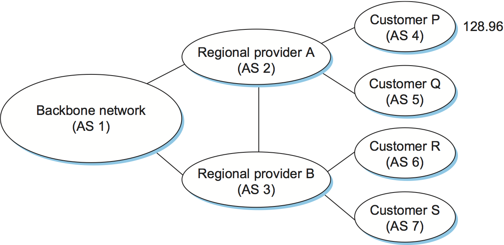

**Figure 4.6. Example of loop among autonomous systems.**

An important job of BGP is to prevent the establishment of looping paths. For example, consider the network illustrated in Figure 4.6. It differs from Figure 4.5 only in the addition of an extra link between AS 2 and AS 3, but the effect now is that the graph of autonomous systems has a loop in it. Suppose AS 1 learns that it can reach network 128.96 through AS 2, so it advertises this fact to AS 3, who in turn advertises it back to AS 2. In the absence of any loop prevention mechanism, AS 2 could now decide that AS 3 was the preferred route for packets destined for 128.96. If AS 2 starts sending packets addressed to 128.96 to AS 3, AS 3 would send them to AS 1; AS 1 would send them back to AS 2; and they would loop forever. This is prevented by carrying the complete AS path in the routing messages. In this case, the advertisement for a path to 128.96 received by AS 2 from AS 3 would contain an AS path of (AS 3, AS 1, AS 2, AS 4). AS 2 sees itself in this path, and thus concludes that this is not a useful path for it to use.

In order for this loop prevention technique to work, the AS numbers carried in BGP clearly need to be unique. For example, AS 2 can only recognize itself in the AS path in the above example if no other AS identifies itself in the same way. AS numbers are now 32-bits long, and they are assigned by a central authority to assure uniqueness.

A given AS will only advertise routes that it considers good enough for itself. That is, if a BGP speaker has a choice of several different routes to a destination, it will choose the best one according to its own local policies, and then that will be the route it advertises. Furthermore, a BGP speaker is under no obligation to advertise any route to a destination, even if it has one. This is how an AS can implement a policy of not providing transit—by refusing to advertise routes to prefixes that are not contained within that AS, even if it knows how to reach them.

Given that links fail and policies change, BGP speakers need to be able to cancel previously advertised paths. This is done with a form of negative advertisement known as a *withdrawn route*. Both positive and negative reachability information are carried in a BGP update message, the format of which is shown in Figure 4.7. (Note that the fields in this figure are multiples of 16 bits, unlike other packet formats in this chapter.)

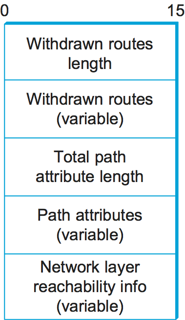

**Figure 4.7. BGP-4 update packet format.**

Unlike the routing protocols described in the previous chapter, BGP is defined to run on top of TCP, the reliable transport protocol. Because BGP speakers can count on TCP to be reliable, this means that any information that has been sent from one speaker to another does not need to be sent again. Thus, as long as nothing has changed, a BGP speaker can simply send an occasional *keepalive* message that says, in effect, “I’m still here and nothing has changed.” If that router were to crash or become disconnected from its peer, it would stop sending the keepalives, and the other routers that had learned routes from it would assume that those routes were no longer valid.

##### Common AS Relationships and Policies

Having said that policies may be arbitrarily complex, there turn out to be a few common ones, reflecting common relationships between autonomous systems. The most common relationships are illustrated in Figure 4.8. The three common relationships and the policies that go with them are as follows:

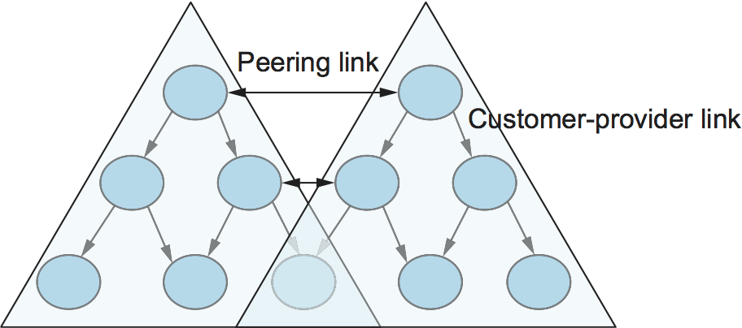

**Figure 4.8. Common AS relationships.**

- *Provider-Customer—* Providers are in the business of connecting their customers to the rest of the Internet. A customer might be a corporation, or it might be a smaller ISP (which may have customers of its own). So the common policy is to advertise all the routes I know about to my customer, and advertise routes I learn from my customer to everyone.
- *Customer-Provider—* In the other direction, the customer wants to get traffic directed to him (and his customers, if he has them) by his provider, and he wants to be able to send traffic to the rest of the Internet through his provider. So the common policy in this case is to advertise my own prefixes and routes learned from my customers to my provider, advertise routes learned from my provider to my customers, but don’t advertise routes learned from one provider to another provider. That last part is to make sure the customer doesn’t find himself in the business of carrying traffic from one provider to another, which isn’t in his interests if he is paying the providers to carry traffic for him.
- *Peer—* The third option is a symmetrical peering between autonomous systems. Two providers who view themselves as equals usually peer so that they can get access to each other’s customers without having to pay another provider. The typical policy here is to advertise routes learned from my customers to my peer, advertise routes learned from my peer to my customers, but don’t advertise routes from my peer to any provider or *vice versa*.

One thing to note about this figure is the way it has brought back some structure to the apparently unstructured Internet. At the bottom of the hierarchy we have the stub networks that are customers of one or more providers, and as we move up the hierarchy we see providers who have other providers as their customers. At the top, we have providers who have customers and peers but are not customers of anyone. These providers are known as the *Tier-1* providers.

> **Key Takeaway**
>
> Let’s return to the real question: How does all this help us to build scalable networks? First, the number of nodes participating in BGP is on the order of the number of autonomous systems, which is much smaller than the number of networks. Second, finding a good interdomain route is only a matter of finding a path to the right border router, of which there are only a few per AS. Thus, we have neatly subdivided the routing problem into manageable parts, once again using a new level of hierarchy to increase scalability. The complexity of interdomain routing is now on the order of the number of autonomous systems, and the complexity of intradomain routing is on the order of the number of networks in a single AS. [Next]

##### Integrating Interdomain and Intradomain Routing

While the preceding discussion illustrates how a BGP speaker learns interdomain routing information, the question still remains as to how all the other routers in a domain get this information. There are several ways this problem can be addressed.

Let’s start with a very simple situation, which is also very common. In the case of a stub AS that only connects to other autonomous systems at a single point, the border router is clearly the only choice for all routes that are outside the AS. Such a router can inject a *default route* into the intradomain routing protocol. In effect, this is a statement that any network that has not been explicitly advertised in the intradomain protocol is reachable through the border router. Recall from the discussion of IP forwarding in the previous chapter that the default entry in the forwarding table comes after all the more specific entries, and it matches anything that failed to match a specific entry.

The next step up in complexity is to have the border routers inject specific routes they have learned from outside the AS. Consider, for example, the border router of a provider AS that connects to a customer AS. That router could learn that the network prefix 192.4.54/24 is located inside the customer AS, either through BGP or because the information is configured into the border router. It could inject a route to that prefix into the routing protocol running inside the provider AS. This would be an advertisement of the sort, “I have a link to 192.4.54/24 of cost X.” This would cause other routers in the provider AS to learn that this border router is the place to send packets destined for that prefix.

The final level of complexity comes in backbone networks, which learn so much routing information from BGP that it becomes too costly to inject it into the intradomain protocol. For example, if a border router wants to inject 10,000 prefixes that it learned about from another AS, it will have to send very big link-state packets to the other routers in that AS, and their shortest-path calculations are going to become very complex. For this reason, the routers in a backbone network use a variant of BGP called *interior BGP* (iBGP) to effectively redistribute the information that is learned by the BGP speakers at the edges of the AS to all the other routers in the AS. (The other variant of BGP, discussed above, runs between autonomous systems and is called *exterior BGP*, or eBGP). iBGP enables any router in the AS to learn the best border router to use when sending a packet to any address. At the same time, each router in the AS keeps track of how to get to each border router using a conventional intradomain protocol with no injected information. By combining these two sets of information, each router in the AS is able to determine the appropriate next hop for all prefixes.

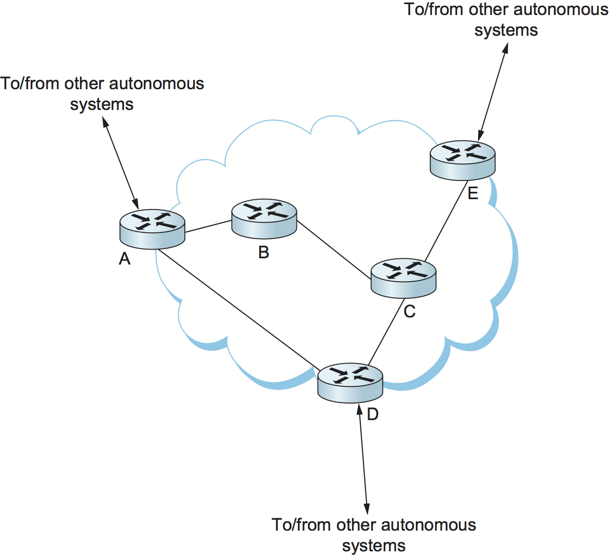

**Figure 4.9. Example of interdomain and intradomain routing. All routers run iBGP and an intradomain routing protocol. Border routers A, D, and E also run eBGP to other autonomous systems.**

To see how this all works, consider the simple example network, representing a single AS, in Figure 4.9. The three border routers, A, D, and E, speak eBGP to other autonomous systems and learn how to reach various prefixes. These three border routers communicate with each other and with the interior routers B and C by building a mesh of iBGP sessions among all the routers in the AS. Let’s now focus in on how router B builds up its complete view of how to forward packets to any prefix. Look at the top left of Figure 4.10, which shows the information that router B learns from its iBGP sessions. It learns that some prefixes are best reached via router A, some via D, and some via E. At the same time, all the routers in the AS are also running some intradomain routing protocol such as Routing Information Protocol (RIP) or Open Shortest Path First (OSPF). (A generic term for intradomain protocols is an interior gateway protocol, or IGP.) From this completely separate protocol, B learns how to reach other nodes *inside* the domain, as shown in the top right table. For example, to reach router E, B needs to send packets toward router C. Finally, in the bottom table, B puts the whole picture together, combining the information about external prefixes learned from iBGP with the information about interior routes to the border routers learned from the IGP. Thus, if a prefix like 18.0/16 is reachable via border router E, and the best interior path to E is via C, then it follows that any packet destined for 18.0/16 should be forwarded toward C. In this way, any router in the AS can build up a complete routing table for any prefix that is reachable via some border router of the AS.

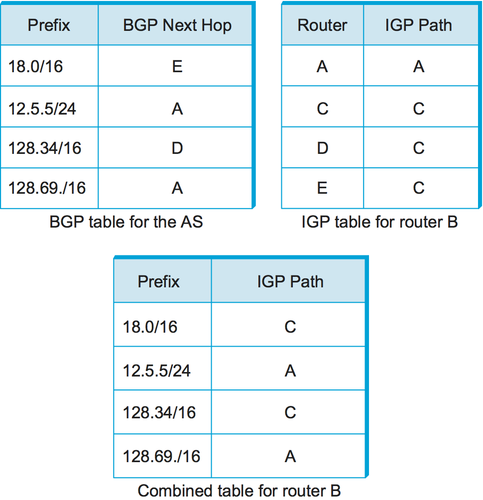

**Figure 4.10. BGP routing table, IGP routing table, and combined table at router B.**

### 4.2 IP Version 6

The motivation for defining a new version of IP is simple: to deal with exhaustion of the IP address space. CIDR helped considerably to contain the rate at which the Internet address space was being consumed and also helped to control the growth of routing table information needed in the Internet’s routers. However, these techniques are no longer adequate. In particular, it is virtually impossible to achieve 100% address utilization efficiency, so the address space was consumed well before the 4 billionth host was connected to the Internet. Even if we were able to use all 4 billion addresses, it is now clear that IP addresses need to be assigned to more than traditional computers, including smart phones, televisions, household appliances, and drones. With the clarity of 20/20 hindsight, a 32-bit address space is quite small.

#### 4.2.1 Historical Perspective

The IETF began looking at the problem of expanding the IP address space in 1991, and several alternatives were proposed. Since the IP address is carried in the header of every IP packet, increasing the size of the address dictates a change in the packet header. This means a new version of the Internet Protocol and, as a consequence, a need for new software for every host and router in the Internet. This is clearly not a trivial matter—it is a major change that needs to be thought about very carefully.

The effort to define a new version of IP was originally known as IP Next Generation, or IPng. As the work progressed, an official IP version number was assigned, so IPng became IPv6. Note that the version of IP discussed so far in this chapter is version 4 (IPv4). The apparent discontinuity in numbering is the result of version number 5 being used for an experimental protocol many years ago.

The significance of changing to a new version of IP caused a snowball effect. The general feeling among network designers was that if you are going to make a change of this magnitude you might as well fix as many other things in IP as possible at the same time. Consequently, the IETF solicited white papers from anyone who cared to write one, asking for input on the features that might be desired in a new version of IP. In addition to the need to accommodate scalable routing and addressing, some of the other wish list items for IPng included:

- Support for real-time services
- Security support
- Autoconfiguration (i.e., the ability of hosts to automatically configure themselves with such information as their own IP address and domain name)
- Enhanced routing functionality, including support for mobile hosts

It is interesting to note that, while many of these features were absent from IPv4 at the time IPv6 was being designed, support for all of them has made its way into IPv4 in recent years, often using similar techniques in both protocols. It can be argued that the freedom to think of IPv6 as a clean slate facilitated the design of new capabilities for IP that were then retrofitted into IPv4.

In addition to the wish list, one absolutely non-negotiable feature for IPv6 was that there must be a transition plan to move from the current version of IP (version 4) to the new version. With the Internet being so large and having no centralized control, it would be completely impossible to have a “flag day” on which everyone shut down their hosts and routers and installed a new version of IP. The architects expected a long transition period in which some hosts and routers would run IPv4 only, some will run IPv4 and IPv6, and some will run IPv6 only. It is doubtful they anticipated that transition period would be approaching its 30th anniversary.

#### 4.2.2 Addresses and Routing

First and foremost, IPv6 provides a 128-bit address space, as opposed to the 32 bits of version 4. Thus, while version 4 can potentially address 4 billion nodes if address assignment efficiency reaches 100%, IPv6 can address 3.4 × 10 ³⁸ nodes, again assuming 100% efficiency. As we have seen, though, 100% efficiency in address assignment is not likely. Some analysis of other addressing schemes, such as those of the French and U.S. telephone networks, as well as that of IPv4, have turned up some empirical numbers for address assignment efficiency. Based on the most pessimistic estimates of efficiency drawn from this study, the IPv6 address space is predicted to provide over 1500 addresses per square foot of the Earth’s surface, which certainly seems like it should serve us well even when toasters on Venus have IP addresses.

##### Address Space Allocation

Drawing on the effectiveness of CIDR in IPv4, IPv6 addresses are also classless, but the address space is still subdivided in various ways based on the leading bits. Rather than specifying different address classes, the leading bits specify different uses of the IPv6 address. The current assignment of prefixes is listed in Table 4.1.

**Table 4.1. Address Prefix Assignments for IPv6.**

| Prefix | Use |
| --- | --- |
| 00…0 (128 bits) | Unspecified |
| 00…1 (128 bits) | Loopback |
| 1111 1111 | Multicast addresses |
| 1111 1110 10 | Link-local unicast |
| Everything else | Global Unicast |

This allocation of the address space warrants a little discussion. First, the entire functionality of IPv4’s three main address classes (A, B, and C) is contained inside the “everything else” range. Global Unicast Addresses, as we will see shortly, are a lot like classless IPv4 addresses, only much longer. These are the main ones of interest at this point, with over 99% of the total IPv6 address space available to this important form of address. (At the time of writing, IPv6 unicast addresses are being allocated from the block that begins 001, with the remaining address space—about 87%—being reserved for future use.)

The multicast address space is (obviously) for multicast, thereby serving the same role as class D addresses in IPv4. Note that multicast addresses are easy to distinguish—they start with a byte of all 1s. We will see how these addresses are used in a later section.

The idea behind link-local use addresses is to enable a host to construct an address that will work on the network to which it is connected without being concerned about the global uniqueness of the address. This may be useful for autoconfiguration, as we will see below. Similarly, the site-local use addresses are intended to allow valid addresses to be constructed on a site (e.g., a private corporate network) that is not connected to the larger Internet; again, global uniqueness need not be an issue.

Within the global unicast address space are some important special types of addresses. A node may be assigned an IPv4-compatible IPv6 address by zero-extending a 32-bit IPv4 address to 128 bits. A node that is only capable of understanding IPv4 can be assigned an IPv4-mapped IPv6 address by prefixing the 32-bit IPv4 address with 2 bytes of all 1s and then zero-extending the result to 128 bits. These two special address types have uses in the IPv4-to-IPv6 transition (see the sidebar on this topic).

##### Address Notation

Just as with IPv4, there is some special notation for writing down IPv6 addresses. The standard representation is x:x:x:x:x:x:x:x, where each x is a hexadecimal representation of a 16-bit piece of the address. An example would be

```text
47CD:1234:4422:AC02:0022:1234:A456:0124
```

Any IPv6 address can be written using this notation. Since there are a few special types of IPv6 addresses, there are some special notations that may be helpful in certain circumstances. For example, an address with a large number of contiguous 0s can be written more compactly by omitting all the 0 fields. Thus,

```text
47CD:0000:0000:0000:0000:0000:A456:0124
```

could be written

```text
47CD::A456:0124
```

Clearly, this form of shorthand can only be used for one set of contiguous 0s in an address to avoid ambiguity.

The two types of IPv6 addresses that contain an embedded IPv4 address have their own special notation that makes extraction of the IPv4 address easier. For example, the IPv4-mapped IPv6 address of a host whose IPv4 address was 128.96.33.81 could be written as

```text
::FFFF:128.96.33.81
```

That is, the last 32 bits are written in IPv4 notation, rather than as a pair of hexadecimal numbers separated by a colon. Note that the double colon at the front indicates the leading 0s.

##### Global Unicast Addresses

By far the most important sort of addressing that IPv6 must provide is plain old unicast addressing. It must do this in a way that supports the rapid rate of addition of new hosts to the Internet and that allows routing to be done in a scalable way as the number of physical networks in the Internet grows. Thus, at the heart of IPv6 is the unicast address allocation plan that determines how unicast addresses will be assigned to service providers, autonomous systems, networks, hosts, and routers.

In fact, the address allocation plan that is proposed for IPv6 unicast addresses is extremely similar to that being deployed with CIDR in IPv4. To understand how it works and how it provides scalability, it is helpful to define some new terms. We may think of a nontransit AS (i.e., a stub or multihomed AS) as a *subscriber*, and we may think of a transit AS as a *provider*. Furthermore, we may subdivide providers into *direct* and *indirect*. The former are directly connected to subscribers. The latter primarily connect other providers, are not connected directly to subscribers, and are often known as *backbone* *networks*.

With this set of definitions, we can see that the Internet is not just an arbitrarily interconnected set of autonomous systems; it has some intrinsic hierarchy. The difficulty lies in making use of this hierarchy without inventing mechanisms that fail when the hierarchy is not strictly observed, as happened with EGP. For example, the distinction between direct and indirect providers becomes blurred when a subscriber connects to a backbone or when a direct provider starts connecting to many other providers.

As with CIDR, the goal of the IPv6 address allocation plan is to provide aggregation of routing information to reduce the burden on intradomain routers. Again, the key idea is to use an address prefix—a set of contiguous bits at the most significant end of the address—to aggregate reachability information to a large number of networks and even to a large number of autonomous systems. The main way to achieve this is to assign an address prefix to a direct provider and then for that direct provider to assign longer prefixes that begin with that prefix to its subscribers. Thus, a provider can advertise a single prefix for all of its subscribers.

Of course, the drawback is that if a site decides to change providers, it will need to obtain a new address prefix and renumber all the nodes in the site. This could be a colossal undertaking, enough to dissuade most people from ever changing providers. For this reason, there is ongoing research on other addressing schemes, such as geographic addressing, in which a site’s address is a function of its location rather than the provider to which it attaches. At present, however, provider-based addressing is necessary to make routing work efficiently.

Note that while IPv6 address assignment is essentially equivalent to the way address assignment has happened in IPv4 since the introduction of CIDR, IPv6 has the significant advantage of not having a large installed base of assigned addresses to fit into its plans.

One question is whether it makes sense for hierarchical aggregation to take place at other levels in the hierarchy. For example, should all providers obtain their address prefixes from within a prefix allocated to the backbone to which they connect? Given that most providers connect to multiple backbones, this probably doesn’t make sense. Also, since the number of providers is much smaller than the number of sites, the benefits of aggregating at this level are much fewer.

One place where aggregation may make sense is at the national or continental level. Continental boundaries form natural divisions in the Internet topology. If all addresses in Europe, for example, had a common prefix, then a great deal of aggregation could be done, and most routers in other continents would only need one routing table entry for all networks with the Europe prefix. Providers in Europe would all select their prefixes such that they began with the European prefix. Using this scheme, an IPv6 address might look like Figure 4.11. The RegistryID might be an identifier assigned to a European address registry, with different IDs assigned to other continents or countries. Note that prefixes would be of different lengths under this scenario. For example, a provider with few customers could have a longer prefix (and thus less total address space available) than one with many customers.

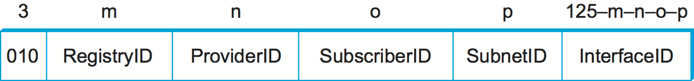

**Figure 4.11. An IPv6 provider-based unicast address.**

One tricky situation could occur when a subscriber is connected to more than one provider. Which prefix should the subscriber use for his or her site? There is no perfect solution to the problem. For example, suppose a subscriber is connected to two providers, X and Y. If the subscriber takes his prefix from X, then Y has to advertise a prefix that has no relationship to its other subscribers and that as a consequence cannot be aggregated. If the subscriber numbers part of his AS with the prefix of X and part with the prefix of Y, he runs the risk of having half his site become unreachable if the connection to one provider goes down. One solution that works fairly well if X and Y have a lot of subscribers in common is for them to have three prefixes between them: one for subscribers of X only, one for subscribers of Y only, and one for the sites that are subscribers of both X and Y.

#### 4.2.3 Packet Format

Despite the fact that IPv6 extends IPv4 in several ways, its header format is actually simpler. This simplicity is due to a concerted effort to remove unnecessary functionality from the protocol. Figure 4.12 shows the result.

As with many headers, this one starts with a Version field, which is set to 6 for IPv6. The Version field is in the same place relative to the start of the header as IPv4’s Version field so that header-processing software can immediately decide which header format to look for. The TrafficClass and FlowLabel fields both relate to quality of service issues.

The PayloadLen field gives the length of the packet, excluding the IPv6 header, measured in bytes. The NextHeader field cleverly replaces both the IP options and the Protocol field of IPv4. If options are required, then they are carried in one or more special headers following the IP header, and this is indicated by the value of the NextHeader field. If there are no special headers, the NextHeader field is the demux key identifying the higher-level protocol running over IP (e.g., TCP or UDP); that is, it serves the same purpose as the IPv4 Protocol field. Also, fragmentation is now handled as an optional header, which means that the fragmentation-related fields of IPv4 are not included in the IPv6 header. The HopLimit field is simply the TTL of IPv4, renamed to reflect the way it is actually used.

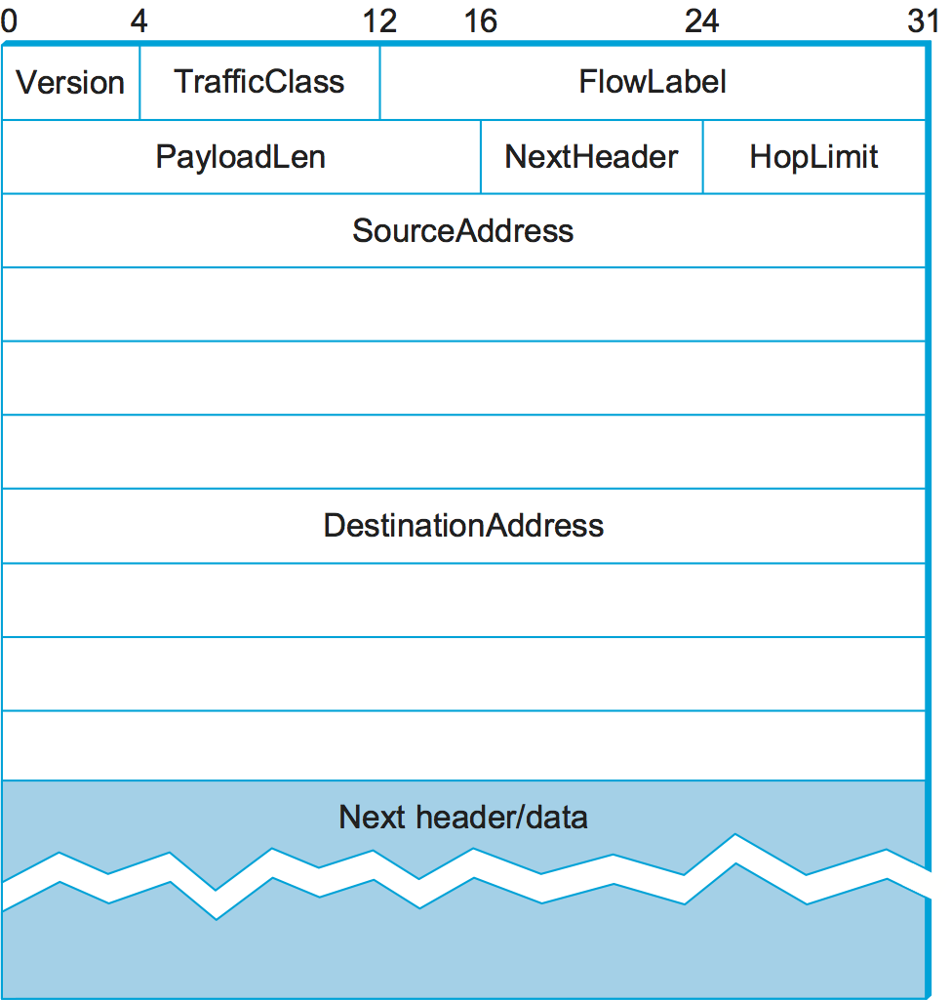

**Figure 4.12. IPv6 packet header.**

Finally, the bulk of the header is taken up with the source and destination addresses, each of which is 16 bytes (128 bits) long. Thus, the IPv6 header is always 40 bytes long. Considering that IPv6 addresses are four times longer than those of IPv4, this compares quite well with the IPv4 header, which is 20 bytes long in the absence of options.

The way that IPv6 handles options is quite an improvement over IPv4. In IPv4, if any options were present, every router had to parse the entire options field to see if any of the options were relevant. This is because the options were all buried at the end of the IP header, as an unordered collection of ‘(type, length, value)’ tuples. In contrast, IPv6 treats options as *extension headers* that must, if present, appear in a specific order. This means that each router can quickly determine if any of the options are relevant to it; in most cases, they will not be. Usually this can be determined by just looking at the NextHeader field. The end result is that option processing is much more efficient in IPv6, which is an important factor in router performance. In addition, the new formatting of options as extension headers means that they can be of arbitrary length, whereas in IPv4 they were limited to 44 bytes at most. We will see how some of the options are used below.

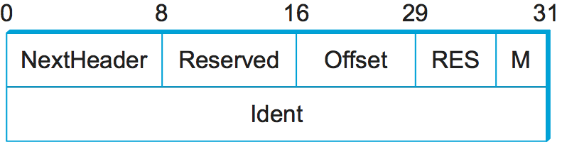

**Figure 4.13. IPv6 fragmentation extension header.**

Each option has its own type of extension header. The type of each extension header is identified by the value of the NextHeader field in the header that precedes it, and each extension header contains a NextHeader field to identify the header following it. The last extension header will be followed by a transport-layer header (e.g., TCP) and in this case the value of the NextHeader field is the same as the value of the Protocol field would be in an IPv4 header. Thus, the NextHeader field does double duty; it may either identify the type of extension header to follow, or, in the last extension header, it serves as a demux key to identify the higher-layer protocol running over IPv6.

Consider the example of the fragmentation header, shown in Figure 4.13. This header provides functionality similar to the fragmentation fields in the IPv4 header, but it is only present if fragmentation is necessary. Assuming it is the only extension header present, then the NextHeader field of the IPv6 header would contain the value 44, which is the value assigned to indicate the fragmentation header. The NextHeader field of the fragmentation header itself contains a value describing the header that follows it. Again, assuming no other extension headers are present, then the next header might be the TCP header, which results in NextHeader containing the value 6, just as the Protocol field would in IPv4. If the fragmentation header were followed by, say, an authentication header, then the fragmentation header’s NextHeader field would contain the value 51.

#### 4.2.4 Advanced Capabilities

As mentioned at the beginning of this section, the primary motivation behind the development of IPv6 was to support the continued growth of the Internet. Once the IP header had to be changed for the sake of the addresses, however, the door was open for a wide variety of other changes, two of which we describe below. But IPv6 includes several additional features, most of which are covered elsewhere in this book; e.g., mobility, security, quality-of-service. It is interesting to note that, in most of these areas, the IPv4 and IPv6 capabilities have become virtually indistinguishable, so that the main driver for IPv6 remains the need for larger addresses.

##### Autoconfiguration

While the Internet’s growth has been impressive, one factor that has inhibited faster acceptance of the technology is the fact that getting connected to the Internet has typically required a fair amount of system administration expertise. In particular, every host that is connected to the Internet needs to be configured with a certain minimum amount of information, such as a valid IP address, a subnet mask for the link to which it attaches, and the address of a name server. Thus, it has not been possible to unpack a new computer and connect it to the Internet without some preconfiguration. One goal of IPv6, therefore, is to provide support for autoconfiguration, sometimes referred to as *plug-and-play* operation.

As we saw in the previous chapter, autoconfiguration is possible for IPv4, but it depends on the existence of a server that is configured to hand out addresses and other configuration information to Dynamic Host Configuration Protocol (DHCP) clients. The longer address format in IPv6 helps provide a useful, new form of autoconfiguration called *stateless* autoconfiguration, which does not require a server.

Recall that IPv6 unicast addresses are hierarchical, and that the least significant portion is the interface ID. Thus, we can subdivide the autoconfiguration problem into two parts:

1. Obtain an interface ID that is unique on the link to which the host is attached.
2. Obtain the correct address prefix for this subnet.

The first part turns out to be rather easy, since every host on a link must have a unique link-level address. For example, all hosts on an Ethernet have a unique 48-bit Ethernet address. This can be turned into a valid link-local use address by adding the appropriate prefix from Table 4.1 (1111 1110 10) followed by enough 0s to make up 128 bits. For some devices—for example, printers or hosts on a small routerless network that do not connect to any other networks—this address may be perfectly adequate. Those devices that need a globally valid address depend on a router on the same link to periodically advertise the appropriate prefix for the link. Clearly, this requires that the router be configured with the correct address prefix, and that this prefix be chosen in such a way that there is enough space at the end (e.g., 48 bits) to attach an appropriate link-level address.

The ability to embed link-level addresses as long as 48 bits into IPv6 addresses was one of the reasons for choosing such a large address size. Not only does 128 bits allow the embedding, but it leaves plenty of space for the multilevel hierarchy of addressing that we discussed above.

##### Source-Directed Routing

Another of IPv6’s extension headers is the routing header. In the absence of this header, routing for IPv6 differs very little from that of IPv4 under CIDR. The routing header contains a list of IPv6 addresses that represent nodes or topological areas that the packet should visit en route to its destination. A topological area may be, for example, a backbone provider’s network. Specifying that packets must visit this network would be a way of implementing provider selection on a packet-by-packet basis. Thus, a host could say that it wants some packets to go through a provider that is cheap, others through a provider that provides high reliability, and still others through a provider that the host trusts to provide security.

To provide the ability to specify topological entities rather than individual nodes, IPv6 defines an *anycast* address. An anycast address is assigned to a set of interfaces, and packets sent to that address will go to the “nearest” of those interfaces, with nearest being determined by the routing protocols. For example, all the routers of a backbone provider could be assigned a single anycast address, which would be used in the routing header.

### 4.3 Multicast

Multi-access networks like Ethernet implement multicast in hardware. There are, however, applications that need a broader multicasting capability that is effective at the scale of the Internet. For example, when a radio station is broadcast over the Internet, the same data must be sent to all the hosts where a user has tuned in to that station. In that example, the communication is one-to-many. Other examples of one-to-many applications include transmitting the same news, current stock prices, software updates, or TV channels to multiple hosts. The latter example is commonly called IPTV.

There are also applications whose communication is many-to-many, such as multimedia teleconferencing, online multiplayer gaming, or distributed simulations. In such cases, members of a group receive data from multiple senders, typically each other. From any particular sender, they all receive the same data.

Normal IP communication, in which each packet must be addressed and sent to a single host, is not well suited to such applications. If an application has data to send to a group, it would have to send a separate packet with the identical data to each member of the group. This redundancy consumes more bandwidth than necessary. Furthermore, the redundant traffic is not distributed evenly but rather is focused around the sending host, and may easily exceed the capacity of the sending host and the nearby networks and routers.

To better support many-to-many and one-to-many communication, IP provides an IP-level multicast analogous to the link-level multicast provided by multi-access networks like Ethernet. Now that we are introducing the concept of multicast for IP, we also need a term for the traditional one-to-one service of IP that has been described so far: That service is referred to as *unicast*.

The basic IP multicast model is a many-to-many model based on multicast *groups*, where each group has its own IP *multicast address*. The hosts that are members of a group receive copies of any packets sent to that group’s multicast address. A host can be in multiple groups, and it can join and leave groups freely by telling its local router using a protocol that we will discuss shortly. Thus, while we think of unicast addresses as being associated with a node or an interface, multicast addresses are associated with an abstract group, the membership of which changes dynamically over time. Further, the original IP multicast service model allows *any* host to send multicast traffic to a group; it doesn’t have to be a member of the group, and there may be any number of such senders to a given group.

Using IP multicast to send the identical packet to each member of the group, a host sends a single copy of the packet addressed to the group’s multicast address. The sending host doesn’t need to know the individual unicast IP address of each member of the group because, as we will see, that knowledge is distributed among the routers in the internetwork. Similarly, the sending host doesn’t need to send multiple copies of the packet because the routers will make copies whenever they have to forward the packet over more than one link. Compared to using unicast IP to deliver the same packets to many receivers, IP multicast is more scalable because it eliminates the redundant traffic (packets) that would have been sent many times over the same links, especially those near to the sending host.

IP’s original many-to-many multicast has been supplemented with support for a form of one-to-many multicast. In this model of one-to-many multicast, called *Source-Specific Multicast* (SSM), a receiving host specifies both a multicast group and a specific sending host. The receiving host would then receive multicasts addressed to the specified group, but only if they are from the specified sender. Many Internet multicast applications (e.g., radio broadcasts) fit the SSM model. To contrast it with SSM, IP’s original many-to-many model is sometimes referred to as *Any Source Multicast* (ASM).

A host signals its desire to join or leave a multicast group by communicating with its local router using a special protocol for just that purpose. In IPv4, that protocol is the *Internet Group Management Protocol* (IGMP); in IPv6, it is *Multicast Listener Discovery* (MLD). The router then has the responsibility for making multicast behave correctly with regard to that host. Because a host may fail to leave a multicast group when it should (after a crash or other failure, for example), the router periodically polls the network to determine which groups are still of interest to the attached hosts.

#### 4.3.1 Multicast Addresses

IP has a subrange of its address space reserved for multicast addresses. In IPv4, these addresses are assigned in the class D address space, and IPv6 also has a portion of its address space reserved for multicast group addresses. Some subranges of the multicast ranges are reserved for intradomain multicast, so they can be reused independently by different domains.

There are thus 28 bits of possible multicast address in IPv4 when we ignore the prefix shared by all multicast addresses. This presents a problem when attempting to take advantage of hardware multicasting on a local area network (LAN). Let’s take the case of Ethernet. Ethernet multicast addresses have only 23 bits when we ignore their shared prefix. In other words, to take advantage of Ethernet multicasting, IP has to map 28-bit IP multicast addresses into 23-bit Ethernet multicast addresses. This is implemented by taking the low-order 23 bits of any IP multicast address to use as its Ethernet multicast address and ignoring the high-order 5 bits. Thus, 32 (2 ⁵) IP addresses map into each one of the Ethernet addresses.

> In this section we use Ethernet as a canonical example of a networking technology that supports multicast in hardware, but the same is also true of PON (Passive Optical Networks), which is the access network technology often used to deliver fiber-to-the-home. In fact, IP Multicast over PON is now a common way to deliver IPTV to homes.

When a host on an Ethernet joins an IP multicast group, it configures its Ethernet interface to receive any packets with the corresponding Ethernet multicast address. Unfortunately, this causes the receiving host to receive not only the multicast traffic it desired but also traffic sent to any of the other 31 IP multicast groups that map to the same Ethernet address, if they are routed to that Ethernet. Therefore, IP at the receiving host must examine the IP header of any multicast packet to determine whether the packet really belongs to the desired group. In summary, the mismatch of multicast address sizes means that multicast traffic may place a burden on hosts that are not even interested in the group to which the traffic was sent. Fortunately, in some switched networks (such as switched Ethernet) this problem can be mitigated by schemes wherein the switches recognize unwanted packets and discard them.

One perplexing question is how senders and receivers learn which multicast addresses to use in the first place. This is normally handled by out-of-band means, and there are some quite sophisticated tools to enable group addresses to be advertised on the Internet.

#### 4.3.2 Multicast Routing (DVMRP, PIM, MSDP)

A router’s unicast forwarding tables indicate, for any IP address, which link to use to forward the unicast packet. To support multicast, a router must additionally have multicast forwarding tables that indicate, based on multicast address, which links—possibly more than one—to use to forward the multicast packet (the router duplicates the packet if it is to be forwarded over multiple links). Thus, where unicast forwarding tables collectively specify a set of paths, multicast forwarding tables collectively specify a set of trees: *multicast distribution trees*. Furthermore, to support Source-Specific Multicast (and, it turns out, for some types of Any Source Multicast), the multicast forwarding tables must indicate which links to use based on the combination of multicast address and the (unicast) IP address of the source, again specifying a set of trees.

Multicast routing is the process by which the multicast distribution trees are determined or, more concretely, the process by which the multicast forwarding tables are built. As with unicast routing, it is not enough that a multicast routing protocol “work”; it must also scale reasonably well as the network grows, and it must accommodate the autonomy of different routing domains.

##### DVMRP

Distance-vector routing used in unicast can be extended to support multicast. The resulting protocol is called *Distance Vector Multicast Routing Protocol*, or DVMRP. DVMRP was the first multicast routing protocol to see widespread use.

Recall that, in the distance-vector algorithm, each router maintains a table of Destination, Cost, NextHop tuples, and exchanges a list of (Destination, Cost) pairs with its directly connected neighbors. Extending this algorithm to support multicast is a two-stage process. First, we create a broadcast mechanism that allows a packet to be forwarded to all the networks on the internet. Second, we need to refine this mechanism so that it prunes back networks that do not have hosts that belong to the multicast group. Consequently, DVMRP is one of several multicast routing protocols described as *flood-and-prune* protocols.

Given a unicast routing table, each router knows that the current shortest path to a given destination goes through NextHop. Thus, whenever it receives a multicast packet from source S, the router forwards the packet on all outgoing links (except the one on which the packet arrived) if and only if the packet arrived over the link that is on the shortest path to S (i.e., the packet came *from* the NextHop associated with S in the routing table). This strategy effectively floods packets outward from S but does not loop packets back toward S.

There are two major shortcomings to this approach. The first is that it truly floods the network; it has no provision for avoiding LANs that have no members in the multicast group. We address this problem below. The second limitation is that a given packet will be forwarded over a LAN by each of the routers connected to that LAN. This is due to the forwarding strategy of flooding packets on all links other than the one on which the packet arrived, without regard to whether or not those links are part of the shortest-path tree rooted at the source.

The solution to this second limitation is to eliminate the duplicate broadcast packets that are generated when more than one router is connected to a given LAN. One way to do this is to designate one router as the *parent* router for each link, relative to the source, where only the parent router is allowed to forward multicast packets from that source over the LAN. The router that has the shortest path to source S is selected as the parent; a tie between two routers would be broken according to which router has the smallest address. A given router can learn if it is the parent for the LAN (again relative to each possible source) based upon the distance-vector messages it exchanges with its neighbors.

Notice that this refinement requires that each router keep, for each source, a bit for each of its incident links indicating whether or not it is the parent for that source/link pair. Keep in mind that in an internet setting, a source is a network, not a host, since an internet router is only interested in forwarding packets between networks. The resulting mechanism is sometimes called *Reverse Path Broadcast* (RPB) or *Reverse Path Forwarding* (RPF). The path is reverse because we are considering the shortest path toward the *source* when making our forwarding decisions, as compared to unicast routing, which looks for the shortest path to a given *destination*.

The RPB mechanism just described implements shortest-path broadcast. We now want to prune the set of networks that receives each packet addressed to group G to exclude those that have no hosts that are members of G. This can be accomplished in two stages. First, we need to recognize when a *leaf* network has no group members. Determining that a network is a leaf is easy—if the parent router as described above is the only router on the network, then the network is a leaf. Determining if any group members reside on the network is accomplished by having each host that is a member of group G periodically announce this fact over the network, as described in our earlier description of link-state multicast. The router then uses this information to decide whether or not to forward a multicast packet addressed to G over this LAN.

The second stage is to propagate this “no members of G here” information up the shortest-path tree. This is done by having the router augment the (Destination, Cost) pairs it sends to its neighbors with the set of groups for which the leaf network is interested in receiving multicast packets. This information can then be propagated from router to router, so that for each of its links a given router knows for what groups it should forward multicast packets.

Note that including all of this information in the routing update is a fairly expensive thing to do. In practice, therefore, this information is exchanged only when some source starts sending packets to that group. In other words, the strategy is to use RPB, which adds a small amount of overhead to the basic distance-vector algorithm, until a particular multicast address becomes active. At that time, routers that are not interested in receiving packets addressed to that group speak up, and that information is propagated to the other routers.

##### PIM-SM

*Protocol Independent Multicast*, or PIM, was developed in response to the scaling problems of earlier multicast routing protocols. In particular, it was recognized that the existing protocols did not scale well in environments where a relatively small proportion of routers want to receive traffic for a certain group. For example, broadcasting traffic to all routers until they explicitly ask to be removed from the distribution is not a good design choice if most routers don’t want to receive the traffic in the first place. This situation is sufficiently common that PIM divides the problem space into *sparse mode* and *dense mode,* where sparse and dense refer to the proportion of routers that will want the multicast. PIM dense mode (PIM-DM) uses a flood-and-prune algorithm like DVMRP and suffers from the same scalability problem. PIM sparse mode (PIM-SM) has become the dominant multicast routing protocol and is the focus of our discussion here. The “protocol independent” aspect of PIM, by the way, refers to the fact that, unlike earlier protocols such as DVMRP, PIM does not depend on any particular sort of unicast routing—it can be used with any unicast routing protocol, as we will see below.

In PIM-SM, routers explicitly join the multicast distribution tree using PIM protocol messages known as Join messages. Note the contrast to DVMRP’s approach of creating a broadcast tree first and then pruning the uninterested routers. The question that arises is where to send those Join messages because, after all, any host (and any number of hosts) could send to the multicast group. To address this, PIM-SM assigns to each group a special router known as the *rendezvous point* (RP). In general, a number of routers in a domain are configured to be candidate RPs, and PIM-SM defines a set of procedures by which all the routers in a domain can agree on the router to use as the RP for a given group. These procedures are rather complex, as they must deal with a wide variety of scenarios, such as the failure of a candidate RP and the partitioning of a domain into two separate networks due to a number of link or node failures. For the rest of this discussion, we assume that all routers in a domain know the unicast IP address of the RP for a given group.

A multicast forwarding tree is built as a result of routers sending Join messages to the RP. PIM-SM allows two types of trees to be constructed: a *shared* tree, which may be used by all senders, and a *source-specific* tree, which may be used only by a specific sending host. The normal mode of operation creates the shared tree first, followed by one or more source-specific trees if there is enough traffic to warrant it. Because building trees installs state in the routers along the tree, it is important that the default is to have only one tree for a group, not one for every sender to a group.

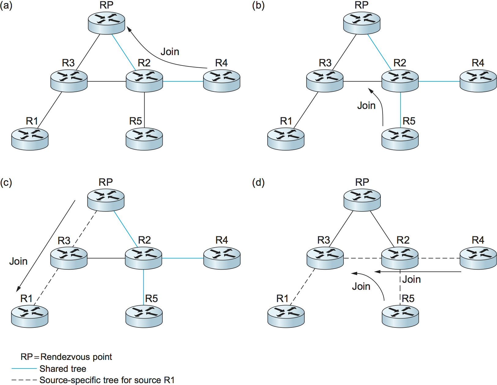

**Figure 4.14. PIM operation: (a) R4 sends a Join message to RP and joins shared tree; (b) R5 joins shared tree; (c) RP builds source-specific tree to R1 by sending a Join message to R1; (d) R4 and R5 build source-specific tree to R1 by sending Join messages to R1.**

When a router sends a Join message toward the RP for a group G, it is sent using normal IP unicast transmission. This is illustrated in Figure 4.14, in which router R4 is sending a Join to the rendezvous point for some group. The initial Join message is “wildcarded”; that is, it applies to all senders. A Join message clearly must pass through some sequence of routers before reaching the RP (e.g., R2). Each router along the path looks at the Join and creates a forwarding table entry for the shared tree, called a (\*, G) entry (where \* means “all senders”). To create the forwarding table entry, it looks at the interface on which the Join arrived and marks that interface as one on which it should forward data packets for this group. It then determines which interface it will use to forward the Join toward the RP. This will be the only acceptable interface for incoming packets sent to this group. It then forwards the Join toward the RP. Eventually, the message arrives at the RP, completing the construction of the tree branch. The shared tree thus constructed is shown as a solid line from the RP to R4 in Figure 4.14.

As more routers send Join s toward the RP, they cause new branches to be added to the tree, as illustrated in Figure 4.14. Note that, in this case, the Join only needs to travel to R2, which can add the new branch to the tree simply by adding a new outgoing interface to the forwarding table entry created for this group. R2 need not forward the Join on to the RP. Note also that the end result of this process is to build a tree whose root is the RP.

At this point, suppose a host wishes to send a message to the group. To do so, it constructs a packet with the appropriate multicast group address as its destination and sends it to a router on its local network known as the *designated router* (DR). Suppose the DR is R1 in Figure 4.14. There is no state for this multicast group between R1 and the RP at this point, so instead of simply forwarding the multicast packet, R1 *tunnels* it to the RP. That is, R1 encapsulates the multicast packet inside a PIM Register message that it sends to the unicast IP address of the RP. Just like an IP tunnel endpoint, the RP receives the packet addressed to it, looks at the payload of the Register message, and finds inside an IP packet addressed to the multicast address of this group. The RP, of course, does know what to do with such a packet—it sends it out onto the shared tree of which the RP is the root. In the example of Figure 4.14, this means that the RP sends the packet on to R2, which is able to forward it on to R4 and R5. The complete delivery of a packet from R1 to R4 and R5 is shown in Figure 4.15. We see the tunneled packet travel from R1 to the RP with an extra IP header containing the unicast address of RP, and then the multicast packet addressed to G making its way along the shared tree to R4 and R5.

At this point, we might be tempted to declare success, since all hosts can send to all receivers this way. However, there is some bandwidth inefficiency and processing cost in the encapsulation and decapsulation of packets on the way to the RP, so the RP forces knowledge about this group into the intervening routers so tunneling can be avoided. It sends a Join message toward the sending host (Figure 4.14). As this Join travels toward the host, it causes the routers along the path (R3) to learn about the group, so that it will be possible for the DR to send the packet to the group as *native* (i.e., not tunneled) multicast packets.

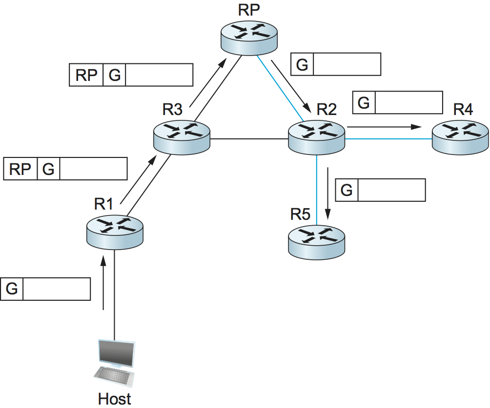

**Figure 4.15. Delivery of a packet along a shared tree. R1 tunnels the packet to the RP, which forwards it along the shared tree to R4 and R5.**

An important detail to note at this stage is that the Join message sent by the RP to the sending host is specific to that sender, whereas the previous ones sent by R4 and R5 applied to all senders. Thus, the effect of the new Join is to create *sender-specific* state in the routers between the identified source and the RP. This is referred to as (S, G) state, since it applies to one sender to one group, and contrasts with the (\*, G) state that was installed between the receivers and the RP that applies to all senders. Thus, in Figure 4.14, we see a source-specific route from R1 to the RP (indicated by the dashed line) and a tree that is valid for all senders from the RP to the receivers (indicated by the solid line).

The next possible optimization is to replace the entire shared tree with a source-specific tree. This is desirable because the path from sender to receiver via the RP might be significantly longer than the shortest possible path. This again is likely to be triggered by a high data rate being observed from some sender. In this case, the router at the downstream end of the tree—say, R4 in our example—sends a source-specific Join toward the source. As it follows the shortest path toward the source, the routers along the way create (S, G) state for this tree, and the result is a tree that has its root at the source, rather than the RP. Assuming both R4 and R5 made the switch to the source-specific tree, we would end up with the tree shown in Figure 4.14. Note that this tree no longer involves the RP at all. We have removed the shared tree from this picture to simplify the diagram, but in reality all routers with receivers for a group must stay on the shared tree in case new senders show up.

We can now see why PIM is protocol independent. All of its mechanisms for building and maintaining trees take advantage of unicast routing without depending on any particular unicast routing protocol. The formation of trees is entirely determined by the paths that Join messages follow, which is determined by the choice of shortest paths made by unicast routing. Thus, to be precise, PIM is “unicast routing protocol independent,” as compared to DVMRP. Note that PIM is very much bound up with the Internet Protocol—it is not protocol independent in terms of network-layer protocols.

The design of PIM-SM again illustrates the challenges in building scalable networks and how scalability is sometimes pitted against some sort of optimality. The shared tree is certainly more scalable than a source-specific tree, in the sense that it reduces the total state in routers to be on the order of the number of groups rather than the number of senders times the number of groups. However, the source-specific tree is likely to be necessary to achieve efficient routing and effective use of link bandwidth.

##### Interdomain Multicast (MSDP)

PIM-SM has some significant shortcomings when it comes to interdomain multicast. In particular, the existence of a single RP for a group goes against the principle that domains are autonomous. For a given multicast group, all the participating domains would be dependent on the domain where the RP is located. Furthermore, if there is a particular multicast group for which a sender and some receivers shared a single domain, the multicast traffic would still have to be routed initially from the sender to those receivers via whatever domain has the RP for that multicast group. Consequently, the PIM-SM protocol is typically not used across domains, only within a domain.

To extend multicast across domains using PIM-SM, the Multicast Source Discovery Protocol (MSDP) was devised. MSDP is used to connect different domains—each running PIM-SM internally, with its own RPs—by connecting the RPs of the different domains. Each RP has one or more MSDP peer RPs in other domains. Each pair of MSDP peers is connected by a TCP connection over which the MSDP protocol runs. Together, all the MSDP peers for a given multicast group form a loose mesh that is used as a broadcast network. MSDP messages are broadcast through the mesh of peer RPs using the Reverse Path Broadcast algorithm that we discussed in the context of DVMRP.

What information does MSDP broadcast through the mesh of RPs? Not group membership information; when a host joins a group, the furthest that information will flow is its own domain’s RP. Instead, it is source—multicast sender—information. Each RP knows the sources in its own domain because it receives a Register message whenever a new source arises. Each RP periodically uses MSDP to broadcast Source Active messages to its peers, giving the IP address of the source, the multicast group address, and the IP address of the originating RP.


**Figure 4.16. MSDP operation: (a) The source SR sends a Register message to its domain's RP, RP1; then RP1 sends a source-specific Join message to SR and an MSDP Source Active message to its MSDP peer in Domain B, RP2; then RP2 sends a source-specific Join message to SR. (b) As a result, RP1 and RP2 are in the source-specific tree for source SR.**

If an MSDP peer RP that receives one of these broadcasts has active receivers for that multicast group, it sends a source-specific Join, on that RP’s own behalf, to the source host, as shown in Figure 4.16. The Join message builds a branch of the source-specific tree to this RP, as shown in Figure 4.16. The result is that every RP that is part of the MSDP network and has active receivers for a particular multicast group is added to the source-specific tree of the new source. When an RP receives a multicast from the source, the RP uses its shared tree to forward the multicast to the receivers in its domain.

##### Source-Specific Multicast (PIM-SSM)

The original service model of PIM was, like earlier multicast protocols, a many-to-many model. Receivers joined a group, and any host could send to the group. However, it was recognized in the late 1990s that it might be useful to add a one-to-many model. Lots of multicast applications, after all, have only one legitimate sender, such as the speaker at a conference being sent over the Internet. We already saw that PIM-SM can create source-specific shortest path trees as an optimization after using the shared tree initially. In the original PIM design, this optimization was invisible to hosts—only routers joined source-specific trees. However, once the need for a one-to-many service model was recognized, it was decided to make the source-specific routing capability of PIM-SM explicitly available to hosts. It turns out that this mainly required changes to IGMP and its IPv6 analog, MLD, rather than PIM itself. The newly exposed capability is now known as PIM-SSM (PIM Source-Specific Multicast).

PIM-SSM introduces a new concept, the *channel*, which is the combination of a source address S and a group address G. The group address G looks just like a normal IP multicast address, and both IPv4 and IPv6 have allocated subranges of the multicast address space for SSM. To use PIM-SSM, a host specifies both the group and the source in an IGMP Membership Report message to its local router. That router then sends a PIM-SM source-specific Join message toward the source, thereby adding a branch to itself in the source-specific tree, just as was described above for “normal” PIM-SM, but bypassing the whole shared-tree stage. Since the tree that results is source specific, only the designated source can send packets on that tree.

The introduction of PIM-SSM has provided some significant benefits, particularly since there is relatively high demand for one-to-many multicasting:

- Multicasts travel more directly to receivers.
- The address of a channel is effectively a multicast group address plus a source address. Therefore, given that a certain range of multicast group addresses will be used for SSM exclusively, multiple domains can use the same multicast group address independently and without conflict, as long as they use it only with sources in their own domains.
- Because only the specified source can send to an SSM group, there is less risk of attacks based on malicious hosts overwhelming the routers or receivers with bogus multicast traffic.
- PIM-SSM can be used across domains exactly as it is used within a domain, without reliance on anything like MSDP.

SSM, therefore, is quite a useful addition to the multicast service model.

##### Bidirectional Trees (BIDIR-PIM)

We round off our discussion of multicast with another enhancement to PIM known as *Bidirectional PIM*. BIDIR-PIM is a recent variant of PIM-SM that is well suited to many-to-many multicasting within a domain, especially when senders and receivers to a group may be the same, as in a multiparty videoconference, for example. As in PIM-SM, would-be receivers join groups by sending IGMP Membership Report messages (which must not be source specific), and a shared tree rooted at an RP is used to forward multicast packets to receivers. Unlike PIM-SM, however, the shared tree also has branches to the *sources*. That wouldn’t make any sense with PIM-SM’s unidirectional tree, but BIDIR-PIM’s trees are bidirectional—a router that receives a multicast packet from a downstream branch can forward it both up the tree and down other branches. The route followed to deliver a packet to any particular receiver goes only as far up the tree as necessary before going down the branch to that receiver. See the multicast route from R1 to R2 in Figure 4.17 for an example. R4 forwards a multicast packet downstream to R2 at the same time that it forwards a copy of the same packet upstream to R5.

A surprising aspect of BIDIR-PIM is that there need not actually be an RP. All that is needed is a routable address, which is known as an RP address even though it need not be the address of an RP or anything at all. How can this be? A Join from a receiver is forwarded toward the RP address until it reaches a router with an interface on the link where the RP address would reside, where the Join terminates. Figure 4.17 shows a Join from R2 terminating at R5, and a Join from R3 terminating at R6. The upstream forwarding of a multicast packet similarly flows toward the RP address until it reaches a router with an interface on the link where the RP address would reside, but then the router forwards the multicast packet onto that link as the final step of upstream forwarding, ensuring that all other routers on that link receive the packet. Figure 4.17 illustrates the flow of multicast traffic originating at R1.


**Figure 4.17. BIDIR-PIM operation: (a) R2 and R3 send Join messages toward the RP address that terminate when they reach a router on the RP address's link. (b) A multicast packet from R1 is forwarded upstream to the RP address's link and downstream wherever it intersects a group member branch.**

BIDIR-PIM cannot thus far be used across domains. On the other hand, it has several advantages over PIM-SM for many-to-many multicast within a domain:

- There is no source registration process because the routers already know how to route a multicast packet toward the RP address.
- The routes are more direct than those that use PIM-SM’s shared tree because they go only as far up the tree as necessary, not all the way to the RP.
- Bidirectional trees use much less state than the source-specific trees of PIM-SM because there is never any source-specific state. (On the other hand, the routes will be longer than those of source-specific trees.)
- The RP cannot be a bottleneck, and indeed no actual RP is needed.

One conclusion to draw from the fact that there are so many different approaches to multicast just within PIM is that multicast is a difficult problem space in which to find optimal solutions. You need to decide which criteria you want to optimize (bandwidth usage, router state, path length, etc.) and what sort of application you are trying to support (one-to-many, many-to-many, etc.) before you can make a choice of the “best” multicast mode for the task.

### 4.4 Multiprotocol Label Switching

We continue our discussion of enhancements to IP by describing an addition to the Internet architecture that is very widely used but largely hidden from end users. The enhancement, called *Multiprotocol Label Switching* (MPLS), combines some of the properties of virtual circuits with the flexibility and robustness of datagrams. On the one hand, MPLS is very much associated with the Internet Protocol’s datagram-based architecture—it relies on IP addresses and IP routing protocols to do its job. On the other hand, MPLS-enabled routers also forward packets by examining relatively short, fixed-length labels, and these labels have local scope, just like in a virtual circuit network. It is perhaps this marriage of two seemingly opposed technologies that has caused MPLS to have a somewhat mixed reception in the Internet engineering community.

Before looking at how MPLS works, it is reasonable to ask “what is it good for?” Many claims have been made for MPLS, but there are three main things that it is used for today:

- To enable IP capabilities on devices that do not have the capability to forward IP datagrams in the normal manner
- To forward IP packets along explicit routes—precalculated routes that don’t necessarily match those that normal IP routing protocols would select
- To support certain types of virtual private network services

It is worth noting that one of the original goals—improving performance—is not on the list. This has a lot to do with the advances that have been made in forwarding algorithms for IP routers in recent years and with the complex set of factors beyond header processing that determine performance.

The best way to understand how MPLS works is to look at some examples of its use. In the next three sections, we will look at examples to illustrate the three applications of MPLS mentioned above.

#### 4.4.1 Destination-Based Forwarding

One of the earliest publications to introduce the idea of attaching labels to IP packets was a paper by Chandranmenon and Varghese that described an idea called *threaded indices*. A very similar idea is now implemented in MPLS-enabled routers. The following example shows how this idea works.

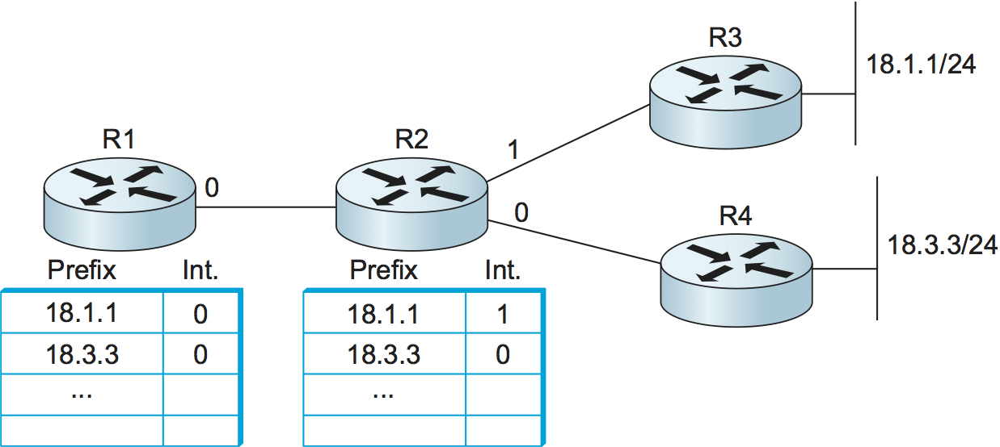

**Figure 4.18. Routing tables in example network.**

Consider the network in Figure 4.18. Each of the two routers on the far right (R3 and R4) has one connected network, with prefixes 18.1.1/24 and 18.3.3/24. The remaining routers (R1 and R2) have routing tables that indicate which outgoing interface each router would use when forwarding packets to one of those two networks.

When MPLS is enabled on a router, the router allocates a label for each prefix in its routing table and advertises both the label and the prefix that it represents to its neighboring routers. This advertisement is carried in the Label Distribution Protocol. This is illustrated in Figure 4.19. Router R2 has allocated the label value 15 for the prefix 18.1.1 and the label value 16 for the prefix 18.3.3. These labels can be chosen at the convenience of the allocating router and can be thought of as indices into the routing table. After allocating the labels, R2 advertises the label bindings to its neighbors; in this case, we see R2 advertising a binding between the label 15 and the prefix 18.1.1 to R1. The meaning of such an advertisement is that R2 has said, in effect, “Please attach the label 15 to all packets sent to me that are destined to prefix 18.1.1.” R1 stores the label in a table alongside the prefix that it represents as the remote or outgoing label for any packets that it sends to that prefix.

In Figure 4.19, we see another label advertisement from router R3 to R2 for the prefix 18.1.1, and R2 places the remote label that it learned from R3 in the appropriate place in its table.

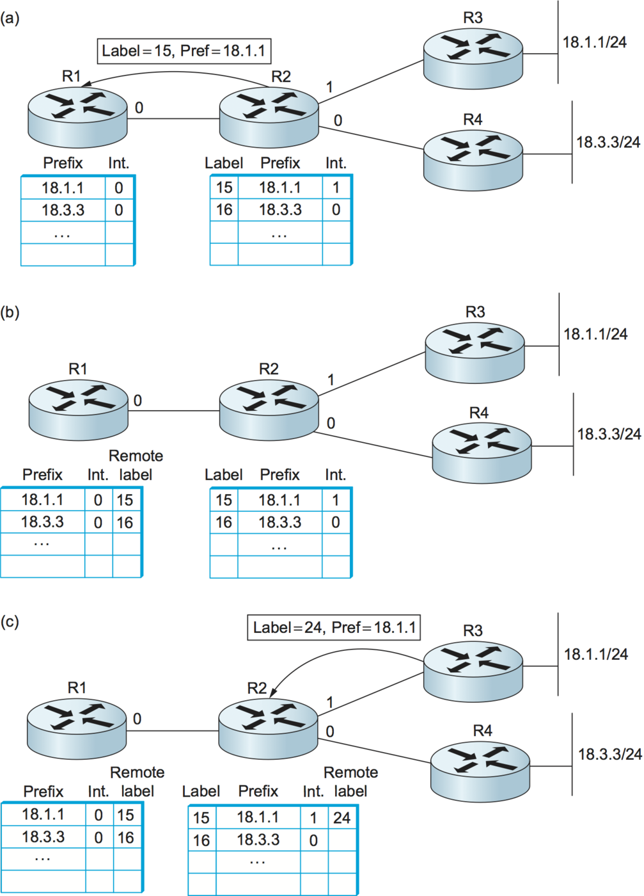

**Figure 4.19. (a) R2 allocates labels and advertises bindings to R1. (b) R1 stores the received labels in a table. (c) R3 advertises another binding, and R2 stores the received label in a table.**

At this point, we can look at what happens when a packet is forwarded in this network. Suppose a packet destined to the IP address 18.1.1.5 arrives from the left to router R1. R1 in this case is referred to as a *Label Edge Router* (LER); an LER performs a complete IP lookup on arriving IP packets and then applies labels to them as a result of the lookup. In this case, R1 would see that 18.1.1.5 matches the prefix 18.1.1 in its forwarding table and that this entry contains both an outgoing interface and a remote label value. R1 therefore attaches the remote label 15 to the packet before sending it.

When the packet arrives at R2, R2 looks only at the label in the packet, not the IP address. The forwarding table at R2 indicates that packets arriving with a label value of 15 should be sent out interface 1 and that they should carry the label value 24, as advertised by router R3. R2 therefore rewrites, or swaps, the label and forwards it on to R3.

What has been accomplished by all this application and swapping of labels? Observe that when R2 forwarded the packet in this example it never actually needed to examine the IP address. Instead, R2 looked only at the incoming label. Thus, we have replaced the normal IP destination address lookup with a label lookup. To understand why this is significant, it helps to recall that, although IP addresses are always the same length, IP prefixes are of variable length, and the IP destination address lookup algorithm needs to find the *longest match*—the longest prefix that matches the high order bits in the IP address of the packet being forwarded. By contrast, the label forwarding mechanism just described is an *exact match* algorithm. It is possible to implement a very simple exact match algorithm, for example, by using the label as an index into an array, where each element in the array is one line in the forwarding table.

Note that, while the forwarding algorithm has been changed from longest match to exact match, the routing algorithm can be any standard IP routing algorithm (e.g., OSPF). The path that a packet will follow in this environment is the exact same path that it would have followed if MPLS were not involved: the path chosen by the IP routing algorithms. All that has changed is the forwarding algorithm.

An important fundamental concept of MPLS is illustrated by this example. Every MPLS label is associated with a *forwarding equivalence class* (FEC)—a set of packets that are to receive the same forwarding treatment in a particular router. In this example, each prefix in the routing table is an FEC; that is, all packets that match the prefix 18.1.1—no matter what the low order bits of the IP address are—get forwarded along the same path. Thus, each router can allocate one label that maps to 18.1.1, and any packet that contains an IP address whose high order bits match that prefix can be forwarded using that label.

As we will see in the subsequent examples, FECs are a very powerful and flexible concept. FECs can be formed using almost any criteria; for example, all the packets corresponding to a particular customer could be considered to be in the same FEC.

Returning to the example at hand, we observe that changing the forwarding algorithm from normal IP forwarding to label swapping has an important consequence: Devices that previously didn’t know how to forward IP packets can be used to forward IP traffic in an MPLS network. The most notable early application of this result was to ATM switches, which can support MPLS without any changes to their forwarding hardware. ATM switches support the label-swapping forwarding algorithm just described, and by providing these switches with IP routing protocols and a method to distribute label bindings they could be turned into *Label Switching Routers* (LSRs)—devices that run IP control protocols but use the label switching forwarding algorithm. More recently, the same idea has been applied to optical switches.

Before we consider the purported benefits of turning an ATM switch into an LSR, we should tie up some loose ends. We have said that labels are “attached” to packets, but where exactly are they attached? The answer depends on the type of link on which packets are carried. Two common methods for carrying labels on packets are shown in Figure 4.20. When IP packets are carried as complete frames, as they are on most link types including Ethernet and PPP, the label is inserted as a “shim” between the layer 2 header and the IP (or other layer 3) header, as shown in the lower part of the figure. However, if an ATM switch is to function as an MPLS LSR, then the label needs to be in a place where the switch can use it, and that means it needs to be in the ATM cell header, exactly where one would normally find the virtual circuit identifier (VCI) and virtual path identifier (VPI) fields.

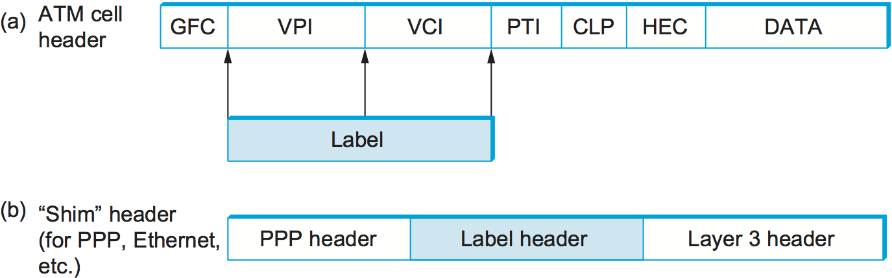

**Figure 4.20. (a) Label on an ATM-encapsulated packet; (b) label on a frame-encapsulated packet.**

Having now devised a scheme by which an ATM switch can function as an LSR, what have we gained? One thing to note is that we could now build a network that uses a mixture of conventional IP routers, label edge routers, and ATM switches functioning as LSRs, and they would all use the same routing protocols. To understand the benefits of using the same protocols, consider the alternative. In Figure 4.21, we see a set of routers interconnected by virtual circuits over an ATM network, a configuration called an *overlay* network. At one point in time, networks of this type were often built because commercially available ATM switches supported higher total throughput than routers. Today, networks like this are less common because routers have caught up with and even surpassed ATM switches. However, these networks still exist because of the significant installed base of ATM switches in network backbones, which in turn is partly a result of ATM’s ability to support a range of capabilities such as circuit emulation and virtual circuit services.

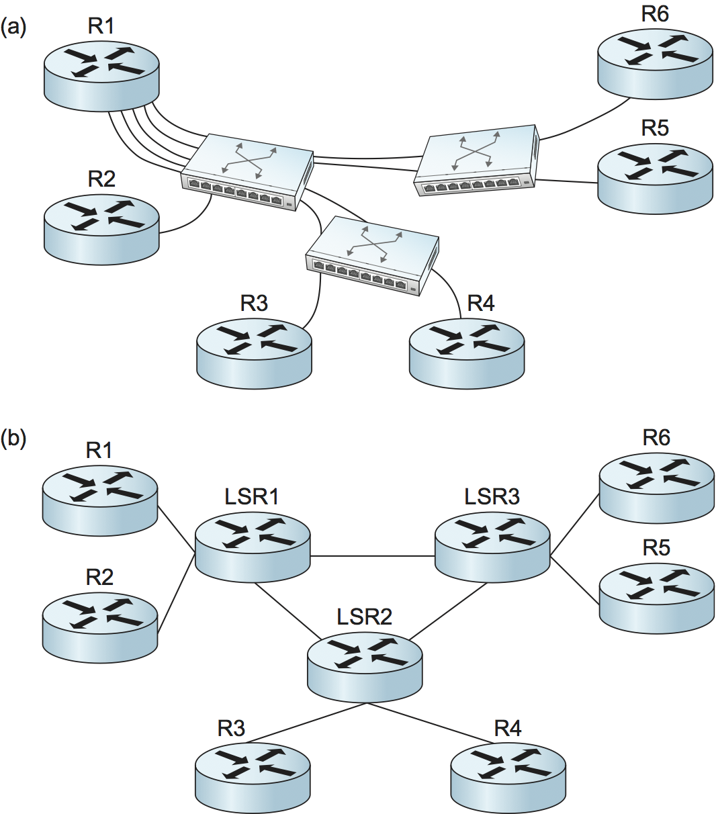

**Figure 4.21. (a) Routers connect to each other using an overlay of virtual circuits. (b) Routers peer directly with LSRs.**

In an overlay network, each router would potentially be connected to each of the other routers by a virtual circuit, but in this case for clarity we have just shown the circuits from R1 to all of its peer routers. R1 has five routing neighbors and needs to exchange routing protocol messages with all of them—we say that R1 has five routing adjacencies. By contrast, in Figure 4.21, the ATM switches have been replaced with LSRs. There are no longer virtual circuits interconnecting the routers. Thus, R1 has only one adjacency, with LSR1. In large networks, running MPLS on the switches leads to a significant reduction in the number of adjacencies that each router must maintain and can greatly reduce the amount of work that the routers have to do to keep each other informed of topology changes.

A second benefit of running the same routing protocols on edge routers and on the LSRs is that the edge routers now have a full view of the topology of the network. This means that if some link or node fails inside the network, the edge routers will have a better chance of picking a good new path than if the ATM switches rerouted the affected VCs without the knowledge of the edge routers.

Note that the step of “replacing” ATM switches with LSRs is actually achieved by changing the protocols running on the switches, but typically no change to the forwarding hardware is needed; that is, an ATM switch can often be converted to an MPLS LSR by upgrading only its software. Furthermore, an MPLS LSR might continue to support standard ATM capabilities at the same time as it runs the MPLS control protocols, in what is referred to as “ships in the night” mode.

The idea of running IP control protocols on devices that are unable to forward IP packets natively has been extended to Wavelength Division Multiplexing (WDM) and Time Division Multiplexing (TDM) networks (e.g., SONET). This is known as *Generalized MPLS* (GMPLS). Part of the motivation for GMPLS was to provide routers with topological knowledge of an optical network, just as in the ATM case. Even more important was the fact that there were no standard protocols for controlling optical devices, so MPLS proved to be a natural fit for that job.

#### 4.4.2 Explicit Routing

IP has a source routing option, but it is not widely used for several reasons, including the fact that only a limited number of hops can be specified and because it is usual processed outside the “fast path” on most routers.

MPLS provides a convenient way to add capabilities similar to source-routing to IP networks, although the capability is more often referred to as *explicit routing* rather than *source routing*. One reason for the distinction is that it usually isn’t the real source of the packet that picks the route. More often it is one of the routers inside a service provider’s network. Figure 4.22 shows an example of how the explicit routing capability of MPLS might be applied. This sort of network is often called a *fish* network because of its shape (the routers R1 and R2 form the tail; R7 is at the head).

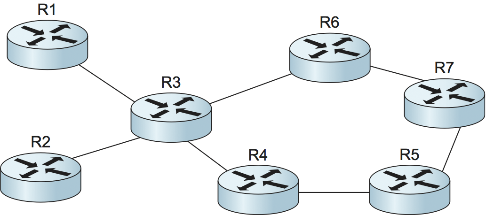

**Figure 4.22. A network requiring explicit routing.**

Suppose that the operator of the network in Figure 4.22 has determined that any traffic flowing from R1 to R7 should follow the path R1-R3-R6-R7 and that any traffic going from R2 to R7 should follow the path R2-R3-R4-R5-R7. One reason for such a choice would be to make good use of the capacity available along the two distinct paths from R3 to R7. We can think of the R1-to-R7 traffic as constituting one forwarding equivalence class, and the R2-to-R7 traffic constitutes a second FEC. Forwarding traffic in these two classes along different paths is difficult with normal IP routing, because R3 doesn’t normally look at where traffic came from in making its forwarding decisions.

Because MPLS uses label swapping to forward packets, it is easy enough to achieve the desired routing if the routers are MPLS enabled. If R1 and R2 attach distinct labels to packets before sending them to R3—thus identifying them as being in different FECs—then R3 can forward packets from R1 and R2 along different paths. The question that then arises is how do all the routers in the network agree on what labels to use and how to forward packets with particular labels? Clearly, we can’t use the same procedures as described in the preceding section to distribute labels, because those procedures establish labels that cause packets to follow the normal paths picked by IP routing, which is exactly what we are trying to avoid. Instead, a new mechanism is needed. It turns out that the protocol used for this task is the Resource Reservation Protocol (RSVP). For now it suffices to say that it is possible to send an RSVP message along an explicitly specified path (e.g., R1-R3-R6-R7) and use it to set up label forwarding table entries all along that path. This is very similar to the process of establishing a virtual circuit.

One of the applications of explicit routing is *traffic engineering*, which refers to the task of ensuring that sufficient resources are available in a network to meet the demands placed on it. Controlling exactly which paths the traffic flows on is an important part of traffic engineering. Explicit routing can also help to make networks more resilient in the face of failure, using a capability called *fast reroute*. For example, it is possible to precalculate a path from router A to router B that explicitly avoids a certain link L. In the event that link L fails, router A could send all traffic destined to B down the precalculated path. The combination of precalculation of the backup path and the explicit routing of packets along the path means that A doesn’t need to wait for routing protocol packets to make their way across the network or for routing algorithms to be executed by various other nodes in the network. In certain circumstances, this can significantly reduce the time taken to reroute packets around a point of failure.

One final point to note about explicit routing is that explicit routes need not be calculated by a network operator as in the above example. Routers can use various algorithms to calculate explicit routes automatically. The most common of these is *constrained shortest path first* (CSPF), which is a link-state algorithm, but which also takes various *constraints* into account. For example, if it was required to find a path from R1 to R7 that could carry an offered load of 100 Mbps, we could say that the constraint is that each link must have at least 100 Mbps of available capacity. CSPF addresses this sort of problem.

#### 4.4.3 Virtual Private Networks and Tunnels

One way to build virtual private networks (VPNs) is to use tunnels. It turns out that MPLS can be thought of as a way to build tunnels, and this makes it suitable for building VPNs of various types.

The simplest form of MPLS VPN to understand is a layer 2 VPN. In this type of VPN, MPLS is used to tunnel layer 2 data (such as Ethernet frames or ATM cells) across a network of MPLS-enabled routers. One reason for tunnels is to provide some sort of network service (such as multicast) that is not supported by some routers in the network. The same logic applies here: IP routers are not ATM switches, so you cannot provide an ATM virtual circuit service across a network of conventional routers. However, if you had a pair of routers interconnected by a tunnel, they could send ATM cells across the tunnel and emulate an ATM circuit. The term for this technique within the IETF is *pseudowire emulation*. Figure 4.23 illustrates the idea.

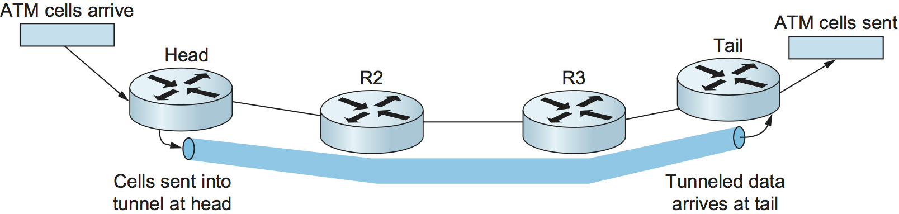

**Figure 4.23. An ATM circuit is emulated by a tunnel.**

We have already seen how IP tunnels are built: The router at the entrance of the tunnel wraps the data to be tunneled in an IP header (the *tunnel header*), which represents the address of the router at the far end of the tunnel and sends the data like any other IP packet. The receiving router receives the packet with its own address in the header, strips the tunnel header, and finds the data that was tunneled, which it then processes. Exactly what it does with that data depends on what it is. For example, if it were another IP packet, it would then be forwarded on like a normal IP packet. However, it need not be an IP packet, as long as the receiving router knows what to do with non-IP packets. We’ll return to the issue of how to handle non-IP data in a moment.

An MPLS tunnel is not too different from an IP tunnel, except that the tunnel header consists of an MPLS header rather than an IP header. Looking back to our first example, in Figure 4.19, we saw that router R1 attached a label (15) to every packet that it sent towards prefix 18.1.1. Such a packet would then follow the path R1-R2-R3, with each router in the path examining only the MPLS label. Thus, we observe that there was no requirement that R1 only send IP packets along this path—any data could be wrapped up in the MPLS header and it would follow the same path, because the intervening routers never look beyond the MPLS header. In this regard, an MPLS header is just like an IP tunnel header (except only 4 bytes long instead of 20 bytes). The only issue with sending non-IP traffic along a tunnel, MPLS or otherwise, is what to do with non-IP traffic when it reaches the end of the tunnel. The general solution is to carry some sort of demultiplexing identifier in the tunnel payload that tells the router at the end of the tunnel what to do. It turns out that an MPLS label is a perfect fit for such an identifier. An example will make this clear.

Let’s assume we want to tunnel ATM cells from one router to another across a network of MPLS-enabled routers, as in Figure 4.23. Further, we assume that the goal is to emulate an ATM virtual circuit; that is, cells arrive at the entrance, or head, of the tunnel on a certain input port with a certain VCI and should leave the tail end of the tunnel on a certain output port and potentially different VCI. This can be accomplished by configuring the head and tail routers as follows:

- The head router needs to be configured with the incoming port, the incoming VCI, the demultiplexing label for this emulated circuit, and the address of the tunnel end router.
- The tail router needs to be configured with the outgoing port, the outgoing VCI, and the demultiplexing label.

Once the routers are provided with this information, we can see how an ATM cell would be forwarded. Figure 4.24 illustrates the steps.

1. An ATM cell arrives on the designated input port with the appropriate VCI value (101 in this example).
2. The head router attaches the demultiplexing label that identifies the emulated circuit.
3. The head router then attaches a second label, which is the tunnel label that will get the packet to the tail router. This label is learned by mechanisms just like those described elsewhere in this section.
4. Routers between the head and tail forward the packet using only the tunnel label.
5. The tail router removes the tunnel label, finds the demultiplexing label, and recognizes the emulated circuit.
6. The tail router modifies the ATM VCI to the correct value (202 in this case) and sends it out the correct port.

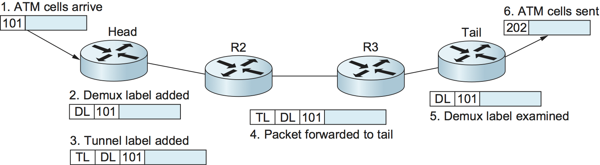

**Figure 4.24. Forward ATM cells along a tunnel.**

One item in this example that might be surprising is that the packet has two labels attached to it. This is one of the interesting features of MPLS—labels may be stacked on a packet to any depth. This provides some useful scaling capabilities. In this example, it allows a single tunnel to carry a potentially large number of emulated circuits.

The same techniques described here can be applied to emulate many other layer 2 services, including Frame Relay and Ethernet. It is worth noting that virtually identical capabilities can be provided using IP tunnels; the main advantage of MPLS here is the shorter tunnel header.

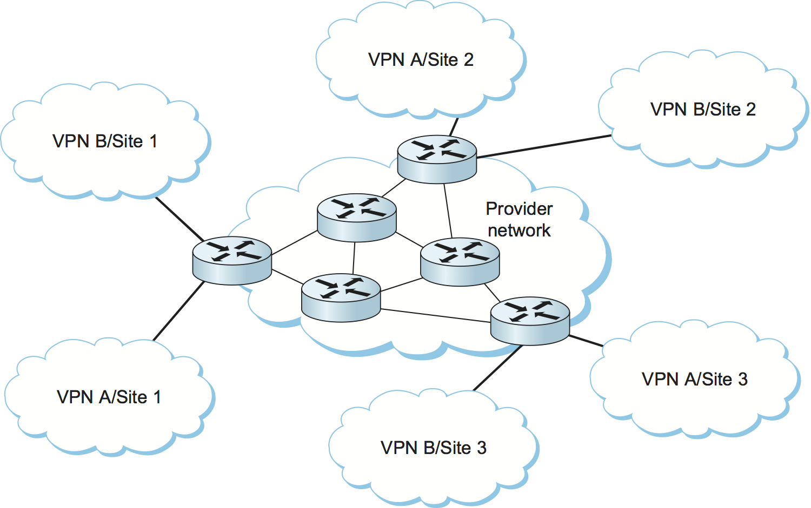

**Figure 4.25. Example of a layer 3 VPN. Customers A and B each obtain a virtually private IP service from a single provider.**

Before MPLS was used to tunnel layer 2 services, it was also being used to support layer 3 VPNs. We won’t go into the details of layer 3 VPNs, which are quite complex, but we will note that they represent one of the most popular uses of MPLS today. Layer 3 VPNs also use stacks of MPLS labels to tunnel packets across an IP network. However, the packets that are tunneled are themselves IP packets—hence, the name *layer 3* VPNs. In a layer 3 VPN, a single service provider operates a network of MPLS-enabled routers and provides a “virtually private” IP network service to any number of distinct customers. That is, each customer of the provider has some number of sites, and the service provider creates the illusion for each customer that there are no other customers on the network. The customer sees an IP network interconnecting his own sites and no other sites. This means that each customer is isolated from all other customers in terms of both routing and addressing. Customer A can’t sent packets directly to customer B, and *vice versa*. Customer A can even use IP addresses that have also been used by customer B. The basic idea is illustrated in Figure 4.25. As in layer 2 VPNs, MPLS is used to tunnel packets from one site to another; however, the configuration of the tunnels is performed automatically by some fairly elaborate use of BGP, which is beyond the scope of this book.

Customer A in fact usually *can* send data to customer B in some restricted way. Most likely, both customer A and customer B have some connection to the global Internet, and thus it is probably possible for customer A to send email messages, for example, to the mail server inside customer B’s network. The “privacy” offered by a VPN prevents customer A from having unrestricted access to all the machines and subnets inside customer B’s network.

In summary, MPLS is a rather versatile tool that has been applied to a wide range of different networking problems. It combines the label-swapping forwarding mechanism that is normally associated with virtual circuit networks with the routing and control protocols of IP datagram networks to produce a class of network that is somewhere between the two conventional extremes. This extends the capabilities of IP networks to enable, among other things, more precise control of routing and the support of a range of VPN services.

### 4.5 Routing Among Mobile Devices

It probably should not be a great surprise to learn that mobile devices present some challenges for the Internet architecture. The Internet was designed in an era when computers were large, immobile devices, and, while the Internet’s designers probably had some notion that mobile devices might appear in the future, it’s fair to assume it was not a top priority to accommodate them. Today, of course, mobile computers are everywhere, notably in the form of laptops and smartphones, and increasingly in other forms, such as drones. In this section, we will look at some of the challenges posed by the appearance of mobile devices and some of the current approaches to accommodating them.

#### 4.5.1 Challenges for Mobile Networking

It is easy enough today to turn up in a wireless hotspot, connect to the Internet using 802.11 or some other wireless networking protocol, and obtain pretty good Internet service. One key enabling technology that made the hotspot feasible is DHCP. You can settle in at a coffee shop, open your laptop, obtain an IP address for your laptop, and get your laptop talking to a default router and a Domain Name System (DNS) server, and for a broad class of applications you have everything you need.

If we look a little more closely, however, it’s clear that for some application scenarios, just getting a new IP address every time you move—which is what DHCP does for you—isn’t always enough. Suppose you are using your laptop or smartphone for a Voice over IP telephone call, and while talking on the phone you move from one hotspot to another, or even switch from Wi-Fi to the cellular network for your Internet connection.

Clearly, when you move from one access network to another, you need to get a new IP address—one that corresponds to the new network. But, the computer or telephone at the other end of your conversation doesn’t immediately know where you have moved or what your new IP address is. Consequently, in the absence of some other mechanism, packets would continue to be sent to the address where you *used* to be, not where you are now. This problem is illustrated in Figure 4.26; as the mobile node moves from the 802.11 network in Figure 4.26 to the cellular network in Figure 4.26, somehow packets from the *correspondent node* need to find their way to the new network and then on to the mobile node.

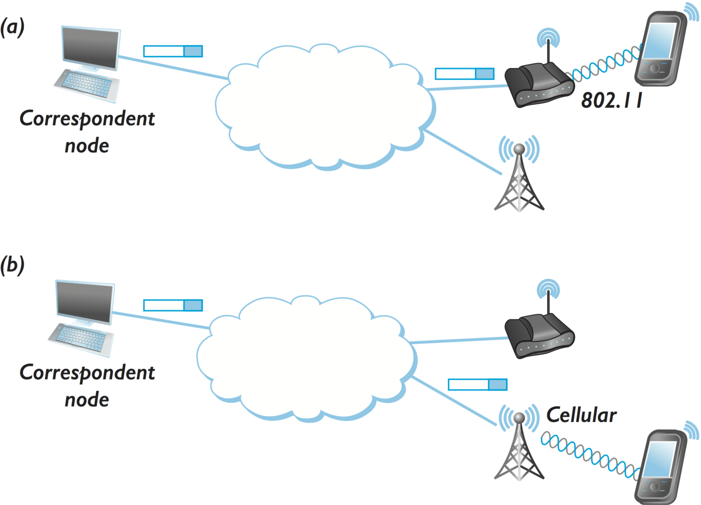

**Figure 4.26. Forwarding packets from a correspondent node to a mobile node.**

There are many different ways to tackle the problem just described, and we will look at some of them below. Assuming that there is some way to redirect packets so that they come to your new address rather than your old address, the next immediately apparent problems relate to security. For example, if there is a mechanism by which I can say, “My new IP address is X,” how do I prevent some attacker from making such a statement without my permission, thus enabling him to either receive my packets, or to redirect my packets to some unwitting third party? Thus, we see that security and mobility are quite closely related.

One issue that the above discussion highlights is the fact that IP addresses actually serve two tasks. They are used as an *identifier* of an endpoint, and they are also used to *locate* the endpoint. Think of the identifier as a long-lived name for the endpoint, and the locator as some possibly more temporary information about how to route packets to the endpoint. As long as devices do not move, or do not move often, using a single address for both jobs seem pretty reasonable. But once devices start to move, you would rather like to have an identifier that does not change as you move—this is sometimes called an *Endpoint Identifier* or *Host Identifier*—and a separate *locator*. This idea of separating locators from identifiers has been around for a long time, and most of the approaches to handling mobility described below provide such a separation in some form.

The assumption that IP addresses don’t change shows up in many different places. For example, transport protocols like TCP have historically made assumptions about the IP address staying constant for the life of a connection, so one approach could be to redesign transport protocols so they can operate with changing end-point addresses.

But rather than try to change TCP, a common alternative is for the application to periodically re-establish the TCP connection in case the client’s IP address has changed. As strange as this sounds, if the application is HTTP-based (e.g., a web browser like Chrome or a streaming application like Netflix) then that is exactly what happens. In other words, the strategy is for the application to work around situations where the user’s IP address may have changed, instead of trying to maintain the appearance that it does not change.

While we are all familiar with endpoints that move, it is worth noting that routers can also move. This is certainly less common today than endpoint mobility, but there are plenty of environments where a mobile router might make sense. One example might be an emergency response team trying to deploy a network after some natural disaster has knocked out all the fixed infrastructure. There are additional considerations when *all* the nodes in a network, not just the endpoints, are mobile, a topic we will discuss later in this section.

Before we start to look at some of the approaches to supporting mobile devices, a couple of points of clarification. It is common to find that people confuse wireless networks with mobility. After all, mobility and wireless often are found together for obvious reasons. But wireless communication is really about getting data from A to B without a wire, while mobility is about dealing with what happens when a node moves around as it communicates. Certainly many nodes that use wireless communication channels are not mobile, and sometimes mobile nodes will use wired communication (although this is less common).

Finally, in this chapter we are mostly interested in what we might call *network-layer mobility*. That is, we are interested in how to deal with nodes that move from one network to another. Moving from one access point to another in the same 802.11 network can be handled by mechanisms specific to 802.11, and cellular networks also have ways to handle mobility, of course, but in large heterogeneous systems like the Internet we need to support mobility more broadly across networks.

#### 4.5.2 Routing to Mobile Hosts (Mobile IP)

Mobile IP is the primary mechanism in today’s Internet architecture to tackle the problem of routing packets to mobile hosts. It introduces a few new capabilities but does not require any change from non-mobile hosts or most routers—thus making it incrementally deployable.

The mobile host is assumed to have a permanent IP address, called its *home address*, which has a network prefix equal to that of its *home network*. This is the address that will be used by other hosts when they initially send packets to the mobile host; because it does not change, it can be used by long-lived applications as the host roams. We can think of this as the long-lived identifier of the host.

When the host moves to a new foreign network away from its home network, it typically acquires a new address on that network using some means such as DHCP. This address is going to change every time the host roams to a new network, so we can think of this as being more like the locator for the host, but it is important to note that the host does not lose its permanent home address when it acquires a new address on the foreign network. This home address is critical to its ability to sustain communications as it moves, as we’ll see below.

> Because DHCP was developed around the same time as Mobile IP, the original Mobile IP standards did not require DHCP, but DHCP is ubiquitous today.

While the majority of routers remain unchanged, mobility support does require some new functionality in at least one router, known as the *home agent* of the mobile node. This router is located on the home network of the mobile host. In some cases, a second router with enhanced functionality, the *foreign agent,* is also required. This router is located on a network to which the mobile node attaches itself when it is away from its home network. We will consider first the operation of Mobile IP when a foreign agent is used. An example network with both home and foreign agents is shown in Figure 4.27.

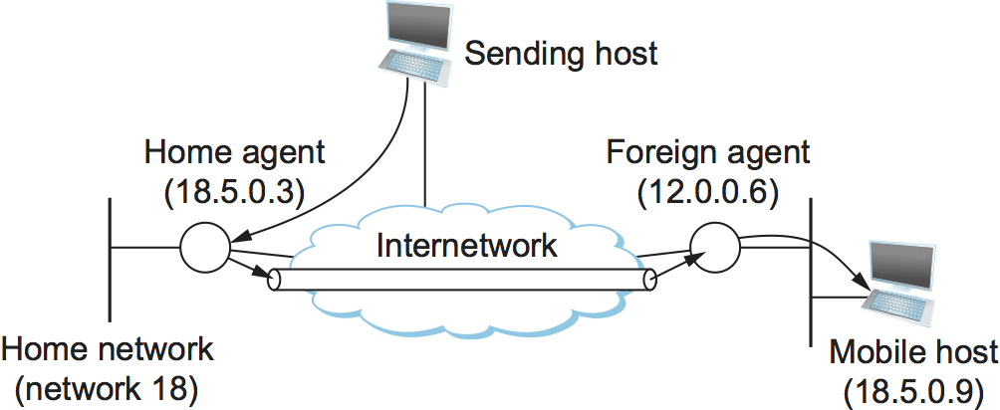

**Figure 4.27. Mobile host and mobility agents.**

Both home and foreign agents periodically announce their presence on the networks to which they are attached using agent advertisement messages. A mobile host may also solicit an advertisement when it attaches to a new network. The advertisement by the home agent enables a mobile host to learn the address of its home agent before it leaves its home network. When the mobile host attaches to a foreign network, it hears an advertisement from a foreign agent and registers with the agent, providing the address of its home agent. The foreign agent then contacts the home agent, providing a *care-of address*. This is usually the IP address of the foreign agent.

At this point, we can see that any host that tries to send a packet to the mobile host will send it with a destination address equal to the home address of that node. Normal IP forwarding will cause that packet to arrive on the home network of the mobile node on which the home agent is sitting. Thus, we can divide the problem of delivering the packet to the mobile node into three parts:

1. How does the home agent intercept a packet that is destined for the mobile node?
2. How does the home agent then deliver the packet to the foreign agent?
3. How does the foreign agent deliver the packet to the mobile node?

The first problem might look easy if you just look at Figure 4.27, in which the home agent is clearly the only path between the sending host and the home network and thus must receive packets that are destined to the mobile node. But what if the sending (correspondent) node were on network 18, or what if there were another router connected to network 18 that tried to deliver the packet without its passing through the home agent? To address this problem, the home agent actually impersonates the mobile node, using a technique called *proxy ARP.* This works just like Address Resolution Protocol (ARP), except that the home agent inserts the IP address of the mobile node, rather than its own, in the ARP messages. It uses its own hardware address, so that all the nodes on the same network learn to associate the hardware address of the home agent with the IP address of the mobile node. One subtle aspect of this process is the fact that ARP information may be cached in other nodes on the network. To make sure that these caches are invalidated in a timely way, the home agent issues an ARP message as soon as the mobile node registers with a foreign agent. Because the ARP message is not a response to a normal ARP request, it is termed a *gratuitous ARP*.

The second problem is the delivery of the intercepted packet to the foreign agent. Here we use the tunneling technique described elsewhere. The home agent simply wraps the packet inside an IP header that is destined for the foreign agent and transmits it into the internetwork. All the intervening routers just see an IP packet destined for the IP address of the foreign agent. Another way of looking at this is that an IP tunnel is established between the home agent and the foreign agent, and the home agent just drops packets destined for the mobile node into that tunnel.

When a packet finally arrives at the foreign agent, it strips the extra IP header and finds inside an IP packet destined for the home address of the mobile node. Clearly the foreign agent cannot treat this like any old IP packet because this would cause it to send it back to the home network. Instead, it has to recognize the address as that of a registered mobile node. It then delivers the packet to the *hardware* address of the mobile node (e.g., its Ethernet address), which was learned as part of the registration process.

One observation that can be made about these procedures is that it is possible for the foreign agent and the mobile node to be in the same box; that is, a mobile node can perform the foreign agent function itself. To make this work, however, the mobile node must be able to dynamically acquire an IP address that is located in the address space of the foreign network (e.g., using DHCP). This address will then be used as the care-of address. In our example, this address would have a network number of 12. This approach has the desirable feature of allowing mobile nodes to attach to networks that don’t have foreign agents; thus, mobility can be achieved with only the addition of a home agent and some new software on the mobile node (assuming DHCP is used on the foreign network).

What about traffic in the other direction (i.e., from mobile node to fixed node)? This turns out to be much easier. The mobile node just puts the IP address of the fixed node in the destination field of its IP packets while putting its permanent address in the source field, and the packets are forwarded to the fixed node using normal means. Of course, if both nodes in a conversation are mobile, then the procedures described above are used in each direction.

##### Route Optimization in Mobile IP

There is one significant drawback to the above approach: The route from the correspondent node to the mobile node can be significantly suboptimal. One of the most extreme examples is when a mobile node and the correspondent node are on the same network, but the home network for the mobile node is on the far side of the Internet. The sending correspondent node addresses all packets to the home network; they traverse the Internet to reach the home agent, which then tunnels them back across the Internet to reach the foreign agent. Clearly, it would be nice if the correspondent node could find out that the mobile node is actually on the same network and deliver the packet directly. In the more general case, the goal is to deliver packets as directly as possible from correspondent node to mobile node without passing through a home agent. This is sometimes referred to as the *triangle routing problem* since the path from correspondent to mobile node via home agent takes two sides of a triangle, rather than the third side that is the direct path.

The basic idea behind the solution to triangle routing is to let the correspondent node know the care-of address of the mobile node. The correspondent node can then create its own tunnel to the foreign agent. This is treated as an optimization of the process just described. If the sender has been equipped with the necessary software to learn the care-of address and create its own tunnel, then the route can be optimized; if not, packets just follow the suboptimal route.

When a home agent sees a packet destined for one of the mobile nodes that it supports, it can deduce that the sender is not using the optimal route. Therefore, it sends a “binding update” message back to the source, in addition to forwarding the data packet to the foreign agent. The source, if capable, uses this binding update to create an entry in a *binding cache,* which consists of a list of mappings from mobile node addresses to care-of addresses. The next time this source has a data packet to send to that mobile node, it will find the binding in the cache and can tunnel the packet directly to the foreign agent.

There is an obvious problem with this scheme, which is that the binding cache may become out-of-date if the mobile host moves to a new network. If an out-of-date cache entry is used, the foreign agent will receive tunneled packets for a mobile node that is no longer registered on its network. In this case, it sends a *binding warning* message back to the sender to tell it to stop using this cache entry. This scheme works only in the case where the foreign agent is not the mobile node itself, however. For this reason, cache entries need to be deleted after some period of time; the exact amount is specified in the binding update message.

As noted above, mobile routing provides some interesting security challenges, which are clearer now that we have seen how Mobile IP works. For example, an attacker wishing to intercept the packets destined to some other node in an internetwork could contact the home agent for that node and announce itself as the new foreign agent for the node. Thus, it is clear that some authentication mechanisms are required.

##### Mobility in IPv6

There are a handful of significant differences between mobility support in IPv4 and IPv6. Most importantly, it was possible to build mobility support into the standards for IPv6 pretty much from the beginning, thus alleviating a number of incremental deployment problems. (It may be more correct to say that IPv6 is one big incremental deployment problem, which, once solved, will deliver mobility support as part of the package.)

Since all IPv6-capable hosts can acquire an address whenever they are attached to a foreign network (using several mechanisms defined as part of the core v6 specifications), Mobile IPv6 does away with the foreign agent and includes the necessary capabilities to act as a foreign agent in every host.

One other interesting aspect of IPv6 that comes into play with Mobile IP is its inclusion of a flexible set of extension headers, as described elsewhere in this chapter. This is used in the optimized routing scenario described above. Rather than *tunneling* a packet to the mobile node at its care-of address, an IPv6 node can send an IP packet to the care-of address with the home address contained in a *routing header*. This header is ignored by all the intermediate nodes, but it enables the mobile node to treat the packet as if it were sent to the home address, thus enabling it to continue presenting higher layer protocols with the illusion that its IP address is fixed. Using an extension header rather than a tunnel is more efficient from the perspective of both bandwidth consumption and processing.

Finally, we note that many open issues remain in mobile networking. Managing the power consumption of mobile devices is increasingly important, so that smaller devices with limited battery power can be built. There is also the problem of *ad hoc* mobile networks—enabling a group of mobile nodes to form a network in the absence of any fixed nodes—which has some special challenges. A particularly challenging class of mobile networks is *sensor networks*. Sensors typically are small, inexpensive, and often battery powered, meaning that issues of very low power consumption and limited processing capability must also be considered. Furthermore, since wireless communications and mobility typically go hand in hand, the continual advances in wireless technologies keep on producing new challenges and opportunities for mobile networking.

### Perspective: The Cloud is Eating the Internet

The Cloud and the Internet are symbiotic systems. They were historically distinct, but today the line between them is increasingly fuzzy. If you start with the textbook definition, the Internet provides end-to-end connectivity between any two hosts (e.g., a client laptop and a remote server machine), and the cloud supports several warehouse-sized datacenters, each of which provides a cost-effective way to power, cool, and operate a large number of server machines. End-users connect to the nearest datacenter over the Internet in exactly the same way they connect to a server in a remote machine room.

That’s an accurate description of the relationship between the Internet and the Cloud in the early days of commercial cloud providers like Amazon, Microsoft, and Google. For example, Amazon’s cloud circa 2009 had two datacenters, one on the east coast of the US and one on the west coast. Today, however, each of the major cloud providers operates several dozen datacenters spread across the globe, and it should be no surprise that they are strategically located in close proximity to Internet Exchange Points (IXP), each of which provides rich connectivity to the rest of the Internet. There are over 150 IXPs worldwide, and while not every cloud provider replicates a full datacenter near each one (many of these sites are co-location facilities), it is fair to say the cloud’s most frequently accessed content (e.g., the most popular Netflix movies, YouTube videos, and Facebook photos) is potentially distributed to that many locations.

There are two consequences to this wide dispersion of the cloud. One is that the end-to-end path from client to server doesn’t necessarily traverse the entire Internet. A user is likely to find the content he or she wants to access has been replicated at a nearby IXP—which is usually just one AS hop away—as opposed to being on the far side of the globe. The second consequence is that the major cloud providers do not use the public Internet to interconnect their distributed datacenters. It is common for cloud providers to keep their content synchronized across distributed datacenters, but they typically do this over a private backbone. This allows them to take advantage of whatever optimizations they want without needing to fully inter-operate with anyone else.

In other words, while the figures in Section 4.1 fairly represents the Internet’s overall shape, and BGP makes it *possible* to connect any pair of hosts, in practice most users interact with applications running in the Cloud, which looks more like Figure 4.28. (One important detail that the figure does not convey is that Cloud providers do not typically build a WAN by laying their own fiber, but they instead lease fiber from service providers, meaning that the private cloud backbone and the service provider backbones often share the same physical infrastructure.)

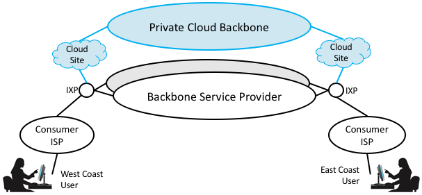

**Figure 4.28. Cloud is widely distributed throughout the Internet with private backbones.**

Note that while it is possible to replicate *content* across the cloud’s many locations, we do not yet have the technology to replicate *people*. This means that when widely dispersed users want to talk with each other—for example, as part of a video conference call—it’s the multicast tree that gets distributed across the cloud. In other words, multicast isn’t typically running in the routers of the service provider backbones (as Section 4.3 suggests), but it is instead running in server processes distributed across some subset of the 150+ locations that serve as the Internet’s major interconnection points. A multicast tree constructed in this way is called an overlay, which is a topic that we return to in Section 9.4.

> **Broader Perspective**
>
> To continue reading about the cloudification of the Internet, see Perspective: HTTP is the New Narrow Waist.
>
> To learn more about the Cloud’s distributed footprint, we recommend [How the Internet Travels Across the Ocean](https://www.nytimes.com/interactive/2019/03/10/technology/internet-cables-oceans.html), New York Times, March 2019.
