## Chapter 6: Congestion Control

> The hand that hath made you fair hath made you good. *—William Shakespeare*

### Problem: Allocating Resources

By now we have seen enough layers of the network protocol hierarchy to understand how data can be transferred among processes across heterogeneous networks. We now turn to a problem that spans the entire protocol stack—how to effectively and fairly allocate resources among a collection of competing users. The resources being shared include the bandwidth of the links and the buffers on the routers or switches where packets are queued awaiting transmission. Packets *contend* at a router for the use of a link, with each contending packet placed in a queue waiting its turn to be transmitted over the link. When too many packets are contending for the same link, the queue fills and two undesirable things happen: packets experience increased end-to-end delay, and in the worst case, the queue overflows and packets have to be dropped. When long queues persist and drops become common, the network is said to be *congested*. Most networks provide a *congestion-control* mechanism to deal with just such a situation.

Congestion control and resource allocation are two sides of the same coin. On the one hand, if the network takes an active role in allocating resources—for example, scheduling which virtual circuit gets to use a given physical link during a certain period of time—then congestion may be avoided, thereby making congestion control unnecessary. Allocating network resources with any precision is difficult, however, because the resources in question are distributed throughout the network; multiple links connecting a series of routers need to be scheduled. On the other hand, you can always let packet sources send as much data as they want and then recover from congestion should it occur. This is the easier approach, but it can be disruptive because many packets may be discarded by the network before congestion can be controlled. Furthermore, it is precisely at those times when the network is congested—that is, resources have become scarce relative to demand—that the need for resource allocation among competing users is most keenly felt. There are also solutions in the middle, whereby inexact allocation decisions are made, but congestion can still occur and hence some mechanism is still needed to recover from it. Whether you call such a mixed solution congestion control or resource allocation does not really matter. In some sense, it is both.

Congestion control and resource allocation involve both hosts and network elements such as routers. In network elements, various queuing disciplines can be used to control the order in which packets get transmitted and which packets get dropped. The queuing discipline can also segregate traffic to keep one user’s packets from unduly affecting another user’s packets. At the end hosts, the congestion-control mechanism paces how fast sources are allowed to send packets. This is done in an effort to keep congestion from occurring in the first place and, should it occur, to help eliminate the congestion.

This chapter starts with an overview of congestion control and resource allocation. We then discuss different queuing disciplines that can be implemented on the routers inside the network, followed by a description of the congestion-control algorithm provided by TCP on the hosts. The fourth section explores various techniques involving both routers and hosts that aim to avoid congestion before it becomes a problem. Finally, we examine the broad area of *quality of service*. We consider the needs of applications to receive different levels of resource allocation in the network and describe a number of ways in which they can request these resources and the network can meet the requests.

### 6.1 Issues in Resource Allocation

Resource allocation and congestion control are complex issues that have been the subject of much study ever since the first network was designed. They are still active areas of research. One factor that makes these issues complex is that they are not isolated to one single level of a protocol hierarchy. Resource allocation is partially implemented in the routers, switches, and links inside the network and partially in the transport protocol running on the end hosts. End systems may use signalling protocols to convey their resource requirements to network nodes, which respond with information about resource availability. One of the main goals of this chapter is to define a framework in which these mechanisms can be understood, as well as to give the relevant details about a representative sample of mechanisms.

We should clarify our terminology before going any further. By *resource allocation*, we mean the process by which network elements try to meet the competing demands that applications have for network resources—primarily link bandwidth and buffer space in routers or switches. Of course, it will often not be possible to meet all the demands, meaning that some users or applications may receive fewer network resources than they want. Part of the resource allocation problem is deciding when to say no and to whom.

We use the term *congestion control* to describe the efforts made by network nodes to prevent or respond to overload conditions. Since congestion is generally bad for everyone, the first order of business is making congestion subside, or preventing it in the first place. This might be achieved simply by persuading a few hosts to stop sending, thus improving the situation for everyone else. However, it is more common for congestion-control mechanisms to have some aspect of fairness—that is, they try to share the pain among all users, rather than causing great pain to a few. Thus, we see that many congestion-control mechanisms have some sort of resource allocation built into them.

It is also important to understand the difference between flow control and congestion control. Flow control involves keeping a fast sender from overrunning a slow receiver. Congestion control, by contrast, is intended to keep a set of senders from sending too much data *into the network* because of lack of resources at some point. These two concepts are often confused; as we will see, they also share some mechanisms.

#### 6.1.1 Network Model

We begin by defining three salient features of the network architecture. For the most part, this is a summary of material presented in the previous chapters that is relevant to the problem of resource allocation.

##### Packet-Switched Network

We consider resource allocation in a packet-switched network (or internet) consisting of multiple links and switches (or routers). Since most of the mechanisms described in this chapter were designed for use on the Internet, and therefore were originally defined in terms of routers rather than switches, we use the term *router* throughout our discussion. The problem is essentially the same, whether on a network or an internetwork.

In such an environment, a given source may have more than enough capacity on the immediate outgoing link to send a packet, but somewhere in the middle of a network its packets encounter a link that is being used by many different traffic sources. Figure 6.1 illustrates this situation—two high-speed links are feeding a low-speed link. This is in contrast to shared-access networks like Ethernet and wireless networks, where the source can directly observe the traffic on the network and decide accordingly whether or not to send a packet. We have already seen the algorithms used to allocate bandwidth on shared-access networks (e.g., Ethernet and Wi-Fi). These access-control algorithms are, in some sense, analogous to congestion-control algorithms in a switched network.

> **Key Takeaway**
>
> Note that congestion control is a different problem than routing. While it is true that a congested link could be assigned a large edge weight by the routing protocol, and, as a consequence, routers would route around it, “routing around” a congested link does not generally solve the congestion problem. To see this, we need look no further than the simple network depicted in Figure 6.1, where all traffic has to flow through the same router to reach the destination. Although this is an extreme example, it is common to have a certain router that it is not possible to route around. This router can become congested, and there is nothing the routing mechanism can do about it. This congested router is sometimes called the *bottleneck* router. [Next]

##### Connectionless Flows

For much of our discussion, we assume that the network is essentially connectionless, with any connection-oriented service implemented in the transport protocol that is running on the end hosts. (We explain the qualification “essentially” in a moment.) This is precisely the model of the Internet, where IP provides a connectionless datagram delivery service and TCP implements an end-to-end connection abstraction. Note that this assumption does not hold in virtual circuit networks such as ATM and X.25. In such networks, a connection setup message traverses the network when a circuit is established. This setup message reserves a set of buffers for the connection at each router, thereby providing a form of congestion control—a connection is established only if enough buffers can be allocated to it at each router. The major shortcoming of this approach is that it leads to an underutilization of resources—buffers reserved for a particular circuit are not available for use by other traffic even if they were not currently being used by that circuit. The focus of this chapter is on resource allocation approaches that apply in an internetwork, and thus we focus mainly on connectionless networks.

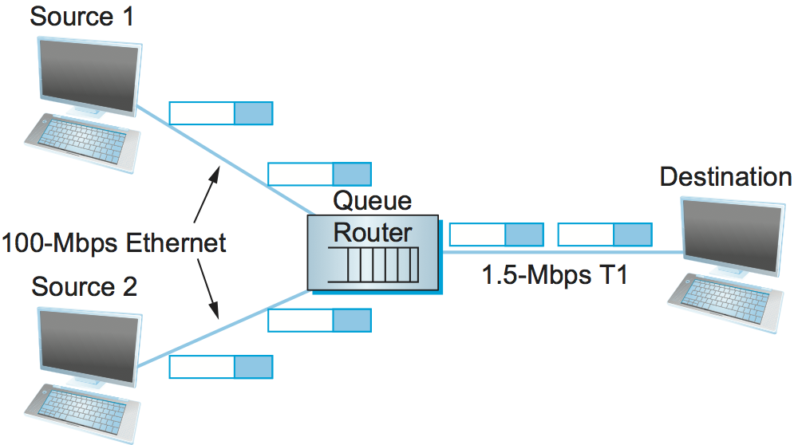

**Figure 6.1. A potential bottleneck router.**

We need to qualify the term *connectionless* because our classification of networks as being either connectionless or connection oriented is a bit too restrictive; there is a gray area in between. In particular, the assumption that all datagrams are completely independent in a connectionless network is too strong. The datagrams are certainly switched independently, but it is usually the case that a stream of datagrams between a particular pair of hosts flows through a particular set of routers. This idea of a *flow*—a sequence of packets sent between a source/destination pair and following the same route through the network—is an important abstraction in the context of resource allocation; it is one that we will use in this chapter.

One of the powers of the flow abstraction is that flows can be defined at different granularities. For example, a flow can be host-to-host (i.e., have the same source/destination host addresses) or process-to-process (i.e., have the same source/destination host/port pairs). In the latter case, a flow is essentially the same as a channel, as we have been using that term throughout this book. The reason we introduce a new term is that a flow is visible to the routers inside the network, whereas a channel is an end-to-end abstraction. Figure 6.2 illustrates several flows passing through a series of routers.

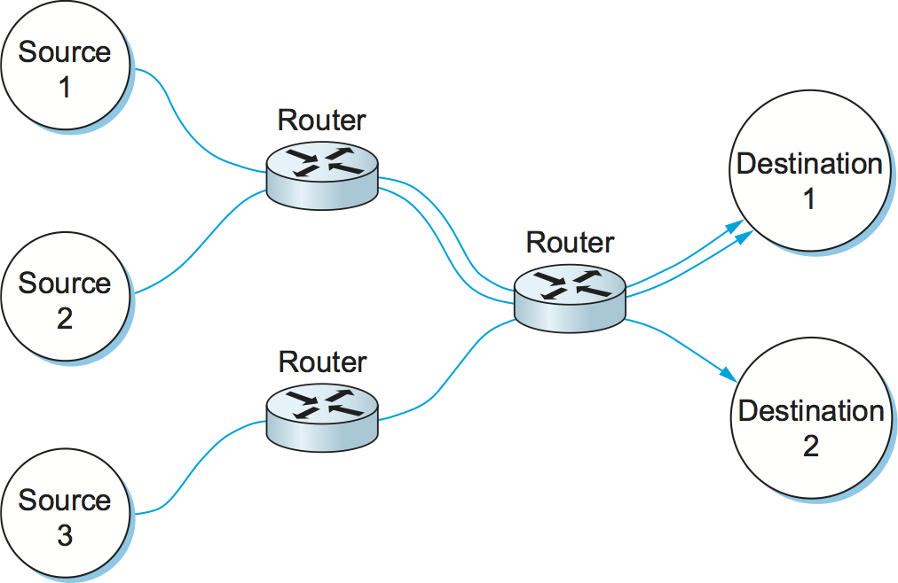

**Figure 6.2. Multiple flows passing through a set of routers.**

Because multiple related packets flow through each router, it sometimes makes sense to maintain some state information for each flow, information that can be used to make resource allocation decisions about the packets that belong to the flow. This state is sometimes called *soft state*. The main difference between soft state and hard state is that soft state need not always be explicitly created and removed by signalling. Soft state represents a middle ground between a purely connectionless network that maintains *no* state at the routers and a purely connection-oriented network that maintains hard state at the routers. In general, the correct operation of the network does not depend on soft state being present (each packet is still routed correctly without regard to this state), but when a packet happens to belong to a flow for which the router is currently maintaining soft state, then the router is better able to handle the packet.

Note that a flow can be either implicitly defined or explicitly established. In the former case, each router watches for packets that happen to be traveling between the same source/destination pair—the router does this by inspecting the addresses in the header—and treats these packets as belonging to the same flow for the purpose of congestion control. In the latter case, the source sends a flow setup message across the network, declaring that a flow of packets is about to start. While explicit flows are arguably no different than a connection across a connection-oriented network, we call attention to this case because, even when explicitly established, a flow does not imply any end-to-end semantics and, in particular, does not imply the reliable and ordered delivery of a virtual circuit. It simply exists for the purpose of resource allocation. We will see examples of both implicit and explicit flows in this chapter.

##### Service Model

In the early part of this chapter, we will focus on mechanisms that assume the best-effort service model of the Internet. With best-effort service, all packets are given essentially equal treatment, with end hosts given no opportunity to ask the network that some packets or flows be given certain guarantees or preferential service. Defining a service model that supports some kind of preferred service or guarantee—for example, guaranteeing the bandwidth needed for a video stream—is the subject of a later section. Such a service model is said to provide multiple *qualities of service* (QoS). As we will see, there is actually a spectrum of possibilities, ranging from a purely best-effort service model to one in which individual flows receive quantitative guarantees of QoS. One of the greatest challenges is to define a service model that meets the needs of a wide range of applications and even allows for the applications that will be invented in the future.

#### 6.1.2 Taxonomy

There are countless ways in which resource allocation mechanisms differ, so creating a thorough taxonomy is a difficult proposition. For now, we describe three dimensions along which resource allocation mechanisms can be characterized; more subtle distinctions will be called out during the course of this chapter.

##### Router-Centric versus Host-Centric

Resource allocation mechanisms can be classified into two broad groups: those that address the problem from inside the network (i.e., at the routers or switches) and those that address it from the edges of the network (i.e., in the hosts, perhaps inside the transport protocol). Since it is the case that both the routers inside the network and the hosts at the edges of the network participate in resource allocation, the real issue is where the majority of the burden falls.

In a router-centric design, each router takes responsibility for deciding when packets are forwarded and selecting which packets are to be dropped, as well as for informing the hosts that are generating the network traffic how many packets they are allowed to send. In a host-centric design, the end hosts observe the network conditions (e.g., how many packets they are successfully getting through the network) and adjust their behavior accordingly. Note that these two groups are not mutually exclusive. For example, a network that places the primary burden for managing congestion on routers still expects the end hosts to adhere to any advisory messages the routers send, while the routers in networks that use end-to-end congestion control still have some policy, no matter how simple, for deciding which packets to drop when their queues do overflow.

##### Reservation-Based versus Feedback-Based

A second way that resource allocation mechanisms are sometimes classified is according to whether they use *reservations* or *feedback*. In a reservation-based system, some entity (e.g., the end host) asks the network for a certain amount of capacity to be allocated for a flow. Each router then allocates enough resources (buffers and/or percentage of the link’s bandwidth) to satisfy this request. If the request cannot be satisfied at some router, because doing so would overcommit its resources, then the router rejects the reservation. This is analogous to getting a busy signal when trying to make a phone call. In a feedback-based approach, the end hosts begin sending data without first reserving any capacity and then adjust their sending rate according to the feedback they receive. This feedback can be either *explicit* (i.e., a congested router sends a “please slow down” message to the host) or *implicit* (i.e., the end host adjusts its sending rate according to the externally observable behavior of the network, such as packet losses).

Note that a reservation-based system always implies a router-centric resource allocation mechanism. This is because each router is responsible for keeping track of how much of its capacity is currently available and deciding whether new reservations can be admitted. Routers may also have to make sure each host lives within the reservation it made. If a host sends data faster than it claimed it would when it made the reservation, then that host’s packets are good candidates for discarding, should the router become congested. On the other hand, a feedback-based system can imply either a router- or host-centric mechanism. Typically, if the feedback is explicit, then the router is involved, to at least some degree, in the resource allocation scheme. If the feedback is implicit, then almost all of the burden falls to the end host; the routers silently drop packets when they become congested.

Reservations do not have to be made by end hosts. It is possible for a network administrator to allocate resources to flows or to larger aggregates of traffic, as we will see in a later section.

##### Window Based versus Rate Based

A third way to characterize resource allocation mechanisms is according to whether they are *window based* or *rate based*. This is one of the areas, noted above, where similar mechanisms and terminology are used for both flow control and congestion control. Both flow-control and resource allocation mechanisms need a way to express, to the sender, how much data it is allowed to transmit. There are two general ways of doing this: with a *window* or with a *rate*. We have already seen window-based transport protocols, such as TCP, in which the receiver advertises a window to the sender. This window corresponds to how much buffer space the receiver has, and it limits how much data the sender can transmit; that is, it supports flow control. A similar mechanism—window advertisement—can be used within the network to reserve buffer space (i.e., to support resource allocation). TCP’s congestion-control mechanisms are window based.

It is also possible to control a sender’s behavior using a rate—that is, how many bits per second the receiver or network is able to absorb. Rate-based control makes sense for many multimedia applications, which tend to generate data at some average rate and which need at least some minimum throughput to be useful. For example, a video codec might generate video at an average rate of 1 Mbps with a peak rate of 2 Mbps. As we will see later in this chapter, rate-based characterization of flows is a logical choice in a reservation-based system that supports different qualities of service—the sender makes a reservation for so many bits per second, and each router along the path determines if it can support that rate, given the other flows it has made commitments to.

##### Summary of Resource Allocation Taxonomy

Classifying resource allocation approaches at two different points along each of three dimensions, as we have just done, would seem to suggest up to eight unique strategies. While eight different approaches are certainly possible, we note that in practice two general strategies seem to be most prevalent; these two strategies are tied to the underlying service model of the network.

On the one hand, a best-effort service model usually implies that feedback is being used, since such a model does not allow users to reserve network capacity. This, in turn, means that most of the responsibility for congestion control falls to the end hosts, perhaps with some assistance from the routers. In practice, such networks use window-based information. This is the general strategy adopted in the Internet.

On the other hand, a QoS-based service model probably implies some form of reservation. Support for these reservations is likely to require significant router involvement, such as queuing packets differently depending on the level of reserved resources they require. Moreover, it is natural to express such reservations in terms of rate, since windows are only indirectly related to how much bandwidth a user needs from the network. We discuss this topic in a later section.

#### 6.1.3 Evaluation Criteria

The final issue is one of knowing whether a resource allocation mechanism is good or not. Recall that in the problem statement at the start of this chapter we posed the question of how a network *effectively* and *fairly* allocates its resources. This suggests at least two broad measures by which a resource allocation scheme can be evaluated. We consider each in turn.

##### Effective Resource Allocation

A good starting point for evaluating the effectiveness of a resource allocation scheme is to consider the two principal metrics of networking: throughput and delay. Clearly, we want as much throughput and as little delay as possible. Unfortunately, these goals are often somewhat at odds with each other. One sure way for a resource allocation algorithm to increase throughput is to allow as many packets into the network as possible, so as to drive the utilization of all the links up to 100%. We would do this to avoid the possibility of a link becoming idle because an idle link necessarily hurts throughput. The problem with this strategy is that increasing the number of packets in the network also increases the length of the queues at each router. Longer queues, in turn, mean packets are delayed longer in the network.

To describe this relationship, some network designers have proposed using the ratio of throughput to delay as a metric for evaluating the effectiveness of a resource allocation scheme. This ratio is sometimes referred to as the *power* of the network:

```text
Power = Throughput / Delay
```

Note that it is not obvious that power is the right metric for judging resource allocation effectiveness. For one thing, the theory behind power is based on an M/M/1 queuing network that assumes infinite queues;  real networks have finite buffers and sometimes have to drop packets. For another, power is typically defined relative to a single connection (flow); it is not clear how it extends to multiple, competing connections. Despite these rather severe limitations, however, no alternatives have gained wide acceptance, and so power continues to be used.

The objective is to maximize this ratio, which is a function of how much load you place on the network. The load, in turn, is set by the resource allocation mechanism. Figure 6.3 gives a representative power curve, where, ideally, the resource allocation mechanism would operate at the peak of this curve. To the left of the peak, the mechanism is being too conservative; that is, it is not allowing enough packets to be sent to keep the links busy. To the right of the peak, so many packets are being allowed into the network that increases in delay due to queuing are starting to dominate any small gains in throughput.

Interestingly, this power curve looks very much like the system throughput curve in a timesharing computer system. System throughput improves as more jobs are admitted into the system, until it reaches a point when there are so many jobs running that the system begins to thrash (spends all of its time swapping memory pages) and the throughput begins to drop.

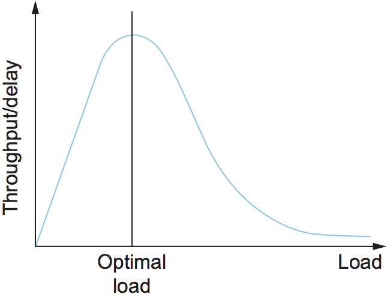

**Figure 6.3. Ratio of throughput to delay as a function of load.**

As we will see in later sections of this chapter, many congestion-control schemes are able to control load in only very crude ways; that is, it is simply not possible to turn the “knob” a little and allow only a small number of additional packets into the network. As a consequence, network designers need to be concerned about what happens even when the system is operating under extremely heavy load—that is, at the rightmost end of the curve in Figure 6.3. Ideally, we would like to avoid the situation in which the system throughput goes to zero because the system is thrashing. In networking terminology, we want a system that is *stable*—where packets continue to get through the network even when the network is operating under heavy load. If a mechanism is not stable, the network may experience *congestion collapse*.

##### Fair Resource Allocation

The effective utilization of network resources is not the only criterion for judging a resource allocation scheme. We must also consider the issue of fairness. However, we quickly get into murky waters when we try to define what exactly constitutes fair resource allocation. For example, a reservation-based resource allocation scheme provides an explicit way to create controlled unfairness. With such a scheme, we might use reservations to enable a video stream to receive 1 Mbps across some link while a file transfer receives only 10 kbps over the same link.

In the absence of explicit information to the contrary, when several flows share a particular link, we would like for each flow to receive an equal share of the bandwidth. This definition presumes that a *fair* share of bandwidth means an *equal* share of bandwidth. But, even in the absence of reservations, equal shares may not equate to fair shares. Should we also consider the length of the paths being compared? For example, as illustrated in Figure 6.4, what is fair when one four-hop flow is competing with three one-hop flows?

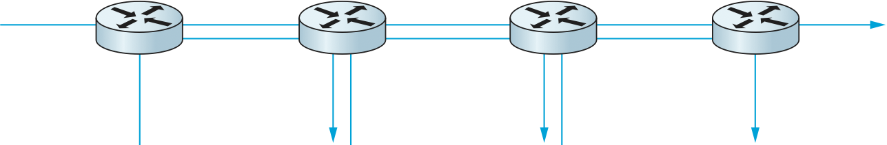

**Figure 6.4. One four-hop flow competing with three one-hop flows.**

Assuming that fair implies equal and that all paths are of equal length, networking researcher Raj Jain proposed a metric that can be used to quantify the fairness of a congestion-control mechanism. Jain’s fairness index is defined as follows. Given a set of flow throughputs

(x₁, x₂, … , xₙ)

(measured in consistent units such as bits/second), the following function assigns a fairness index to the flows:

f(x₁, x₂, … ,xₙ) = ( Σ_{i=1}ⁿ xᵢ )²/n Σ_{i=1}ⁿ xᵢ²

The fairness index always results in a number between 0 and 1, with 1 representing greatest fairness. To understand the intuition behind this metric, consider the case where all *n* flows receive a throughput of 1 unit of data per second. We can see that the fairness index in this case is

n²/n × n = 1

Now, suppose one flow receives a throughput of 1 + Δ. Now the fairness index is

((n - 1) + 1 + Δ)²/n(n - 1 + (1 + Δ)²) = n² + 2nΔ + Δ²/n² + 2nΔ + nΔ²

Note that the denominator exceeds the numerator by (n-1)Δ². Thus, whether the odd flow out was getting more or less than all the other flows (positive or negative Δ), the fairness index has now dropped below one. Another simple case to consider is where only *k* of the *n* flows receive equal throughput, and the remaining *n-k* users receive zero throughput, in which case the fairness index drops to *k/n*.

### 6.2 Queuing Disciplines

Regardless of how simple or how sophisticated the rest of the resource allocation mechanism is, each router must implement some queuing discipline that governs how packets are buffered while waiting to be transmitted. The queuing algorithm can be thought of as allocating both bandwidth (which packets get transmitted) and buffer space (which packets get discarded). It also directly affects the latency experienced by a packet by determining how long a packet waits to be transmitted. This section introduces two common queuing algorithms—first-in, first-out (FIFO) and fair queuing (FQ)—and identifies several variations that have been proposed.

#### 6.2.1 FIFO

The idea of FIFO queuing, also called first-come, first-served (FCFS) queuing, is simple: The first packet that arrives at a router is the first packet to be transmitted. This is illustrated in Figure 6.5, which shows a FIFO with “slots” to hold up to eight packets. Given that the amount of buffer space at each router is finite, if a packet arrives and the queue (buffer space) is full, then the router discards that packet, as shown in Figure 6.5. This is done without regard to which flow the packet belongs to or how important the packet is. This is sometimes called *tail drop*, since packets that arrive at the tail end of the FIFO are dropped.

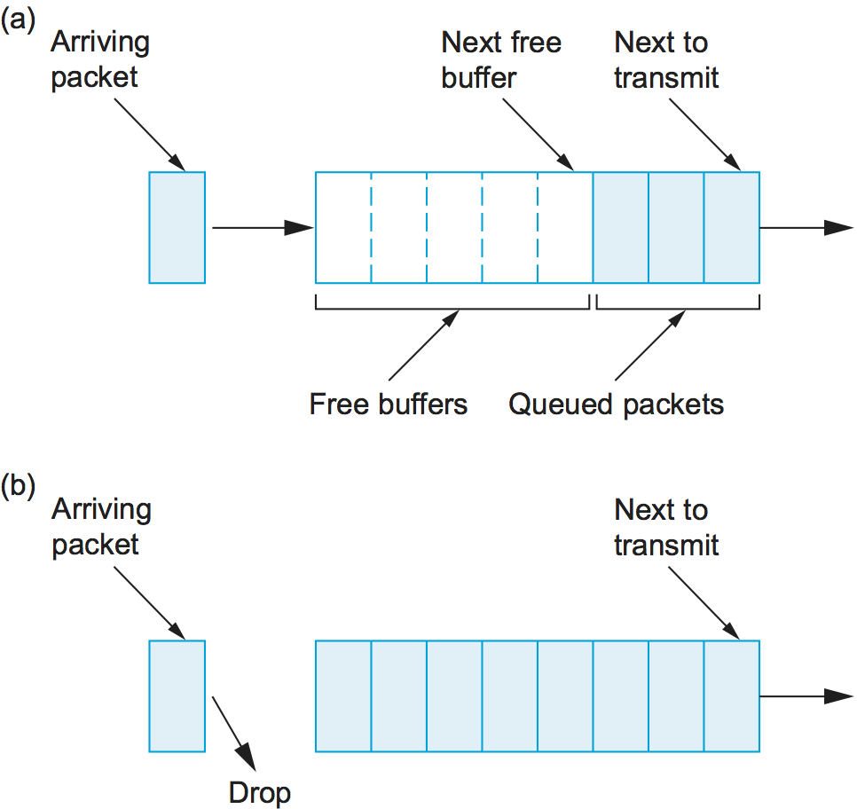

**Figure 6.5. FIFO queuing (a), and tail drop at a FIFO queue (b).**

Note that tail drop and FIFO are two separable ideas. FIFO is a *scheduling discipline*—it determines the order in which packets are transmitted. Tail drop is a *drop policy*—it determines which packets get dropped. Because FIFO and tail drop are the simplest instances of scheduling discipline and drop policy, respectively, they are sometimes viewed as a bundle—the vanilla queuing implementation. Unfortunately, the bundle is often referred to simply as *FIFO queuing*, when it should more precisely be called *FIFO with tail drop*. A later section provides an example of another drop policy, which uses a more complex algorithm than “Is there a free buffer?” to decide when to drop packets. Such a drop policy may be used with FIFO, or with more complex scheduling disciplines.

FIFO with tail drop, as the simplest of all queuing algorithms, is the most widely used in Internet routers at the time of writing. This simple approach to queuing pushes all responsibility for congestion control and resource allocation out to the edges of the network. Thus, the prevalent form of congestion control in the Internet currently assumes no help from the routers: TCP takes responsibility for detecting and responding to congestion. We will see how this works in the next section.

A simple variation on basic FIFO queuing is priority queuing. The idea is to mark each packet with a priority; the mark could be carried, for example, in the IP header, as we’ll discuss in a later section. The routers then implement multiple FIFO queues, one for each priority class. The router always transmits packets out of the highest-priority queue if that queue is nonempty before moving on to the next priority queue. Within each priority, packets are still managed in a FIFO manner. This idea is a small departure from the best-effort delivery model, but it does not go so far as to make guarantees to any particular priority class. It just allows high-priority packets to cut to the front of the line.

The problem with priority queuing, of course, is that the high-priority queue can starve out all the other queues; that is, as long as there is at least one high-priority packet in the high-priority queue, lower-priority queues do not get served. For this to be viable, there needs to be hard limits on how much high-priority traffic is inserted in the queue. It should be immediately clear that we can’t allow users to set their own packets to high priority in an uncontrolled way; we must either prevent them from doing this altogether or provide some form of “pushback” on users. One obvious way to do this is to use economics—the network could charge more to deliver high-priority packets than low-priority packets. However, there are significant challenges to implementing such a scheme in a decentralized environment such as the Internet.

One situation in which priority queuing is used in the Internet is to protect the most important packets—typically, the routing updates that are necessary to stabilize the routing tables after a topology change. Often there is a special queue for such packets, which can be identified by the Differentiated Services Code Point (formerly the TOS field) in the IP header. This is in fact a simple case of the idea of “Differentiated Services.”

#### 6.2.2 Fair Queuing

The main problem with FIFO queuing is that it does not discriminate between different traffic sources, or, in the language introduced in the previous section, it does not separate packets according to the flow to which they belong. This is a problem at two different levels. At one level, it is not clear that any congestion-control algorithm implemented entirely at the source will be able to adequately control congestion with so little help from the routers. We will suspend judgment on this point until the next section when we discuss TCP congestion control. At another level, because the entire congestion-control mechanism is implemented at the sources and FIFO queuing does not provide a means to police how well the sources adhere to this mechanism, it is possible for an ill-behaved source (flow) to capture an arbitrarily large fraction of the network capacity. Considering the Internet again, it is certainly possible for a given application not to use TCP and, as a consequence, to bypass its end-to-end congestion-control mechanism. (Applications such as Internet telephony do this today.) Such an application is able to flood the Internet’s routers with its own packets, thereby causing other applications’ packets to be discarded.

Fair queuing (FQ) is an algorithm that has been designed to address this problem. The idea of FQ is to maintain a separate queue for each flow currently being handled by the router. The router then services these queues in a sort of round-robin, as illustrated in Figure 6.6. When a flow sends packets too quickly, then its queue fills up. When a queue reaches a particular length, additional packets belonging to that flow’s queue are discarded. In this way, a given source cannot arbitrarily increase its share of the network’s capacity at the expense of other flows.

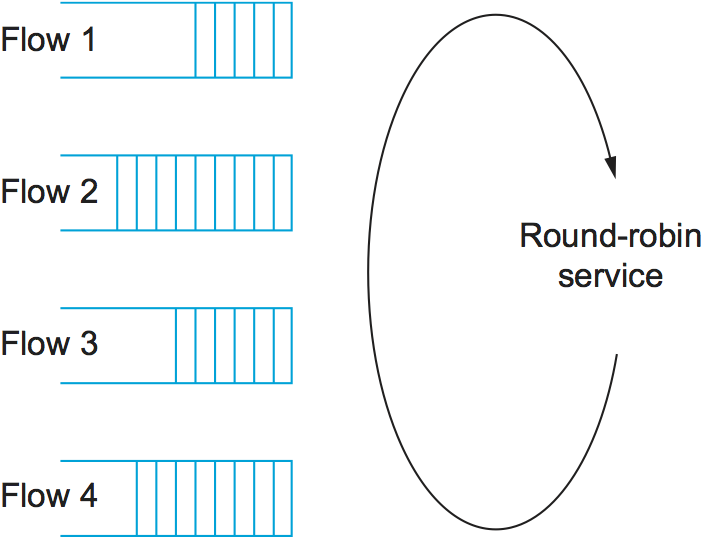

**Figure 6.6. Round-robin service of four flows at a router.**

Note that FQ does not involve the router telling the traffic sources anything about the state of the router or in any way limiting how quickly a given source sends packets. In other words, FQ is still designed to be used in conjunction with an end-to-end congestion-control mechanism. It simply segregates traffic so that ill-behaved traffic sources do not interfere with those that are faithfully implementing the end-to-end algorithm. FQ also enforces fairness among a collection of flows managed by a well-behaved congestion-control algorithm.

As simple as the basic idea is, there are still a modest number of details that you have to get right. The main complication is that the packets being processed at a router are not necessarily the same length. To truly allocate the bandwidth of the outgoing link in a fair manner, it is necessary to take packet length into consideration. For example, if a router is managing two flows, one with 1000-byte packets and the other with 500-byte packets (perhaps because of fragmentation upstream from this router), then a simple round-robin servicing of packets from each flow’s queue will give the first flow two-thirds of the link’s bandwidth and the second flow only one-third of its bandwidth.

What we really want is bit-by-bit round-robin, where the router transmits a bit from flow 1, then a bit from flow 2, and so on. Clearly, it is not feasible to interleave the bits from different packets. The FQ mechanism therefore simulates this behavior by first determining when a given packet would finish being transmitted if it were being sent using bit-by-bit round-robin and then using this finishing time to sequence the packets for transmission.

To understand the algorithm for approximating bit-by-bit round-robin, consider the behavior of a single flow and imagine a clock that ticks once each time one bit is transmitted from all of the active flows. (A flow is active when it has data in the queue.) For this flow, let Pᵢ denote the length of packet *i*, let Sᵢ denote the time when the router starts to transmit packet *i*, and let Fᵢ denote the time when the router finishes transmitting packet *i*. If Pᵢ is expressed in terms of how many clock ticks it takes to transmit packet *i* (keeping in mind that time advances 1 tick each time this flow gets 1 bit’s worth of service), then it is easy to see that Fᵢ = Sᵢ + Pᵢ.

When do we start transmitting packet *i*? The answer to this question depends on whether packet *i* arrived before or after the router finished transmitting packet *i-1* from this flow. If it was before, then logically the first bit of packet *i* is transmitted immediately after the last bit of packet *i-1*. On the other hand, it is possible that the router finished transmitting packet *i-1* long before *i* arrived, meaning that there was a period of time during which the queue for this flow was empty, so the round-robin mechanism could not transmit any packets from this flow. If we let Aᵢ denote the time that packet *i* arrives at the router, then Sᵢ = max(Fᵢ₋₁, Aᵢ). Thus, we can compute

Fᵢ = max(Fᵢ₋₁, Aᵢ) + Pᵢ

Now we move on to the situation in which there is more than one flow, and we find that there is a catch to determining Aᵢ. We can’t just read the wall clock when the packet arrives. As noted above, we want time to advance by one tick each time all the active flows get one bit of service under bit-by-bit round-robin, so we need a clock that advances more slowly when there are more flows. Specifically, the clock must advance by one tick when *n* bits are transmitted if there are *n* active flows. This clock will be used to calculate Aᵢ.

Now, for every flow, we calculate Fᵢ for each packet that arrives using the above formula. We then treat all the Fᵢ as timestamps, and the next packet to transmit is always the packet that has the lowest timestamp—the packet that, based on the above reasoning, should finish transmission before all others.

Note that this means that a packet can arrive on a flow, and, because it is shorter than a packet from some other flow that is already in the queue waiting to be transmitted, it can be inserted into the queue in front of that longer packet. However, this does not mean that a newly arriving packet can preempt a packet that is currently being transmitted. It is this lack of preemption that keeps the implementation of FQ just described from exactly simulating the bit-by-bit round-robin scheme that we are attempting to approximate.

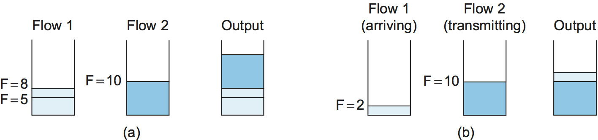

**Figure 6.7. Example of fair queuing in action: (a) Packets with earlier finishing times are sent first; (b) sending of a packet already in progress is completed.**

To better see how this implementation of fair queuing works, consider the example given in Figure 6.7. Part (a) shows the queues for two flows; the algorithm selects both packets from flow 1 to be transmitted before the packet in the flow 2 queue, because of their earlier finishing times. In (b), the router has already begun to send a packet from flow 2 when the packet from flow 1 arrives. Though the packet arriving on flow 1 would have finished before flow 2 if we had been using perfect bit-by-bit fair queuing, the implementation does not preempt the flow 2 packet.

There are two things to notice about fair queuing. First, the link is never left idle as long as there is at least one packet in the queue. Any queuing scheme with this characteristic is said to be *work conserving*. One effect of being work conserving is that if I am sharing a link with a lot of flows that are not sending any data then; I can use the full link capacity for my flow. As soon as the other flows start sending, however, they will start to use their share and the capacity available to my flow will drop.

The second thing to notice is that if the link is fully loaded and there are *n* flows sending data, I cannot use more than 1/n ^{th} of the link bandwidth. If I try to send more than that, my packets will be assigned increasingly large timestamps, causing them to sit in the queue longer awaiting transmission. Eventually, the queue will overflow—although whether it is my packets or someone else’s that are dropped is a decision that is not determined by the fact that we are using fair queuing. This is determined by the drop policy; FQ is a scheduling algorithm, which, like FIFO, may be combined with various drop policies.

Because FQ is work conserving, any bandwidth that is not used by one flow is automatically available to other flows. For example, if we have four flows passing through a router, and all of them are sending packets, then each one will receive one-quarter of the bandwidth. But, if one of them is idle long enough that all its packets drain out of the router’s queue, then the available bandwidth will be shared among the remaining three flows, which will each now receive one-third of the bandwidth. Thus, we can think of FQ as providing a guaranteed minimum share of bandwidth to each flow, with the possibility that it can get more than its guarantee if other flows are not using their shares.

It is possible to implement a variation of FQ, called *weighted fair queuing* (WFQ), that allows a weight to be assigned to each flow (queue). This weight logically specifies how many bits to transmit each time the router services that queue, which effectively controls the percentage of the link’s bandwidth that flow will get. Simple FQ gives each queue a weight of 1, which means that logically only 1 bit is transmitted from each queue each time around. This results in each flow getting 1/n^{th} of the bandwidth when there are *n* flows. With WFQ, however, one queue might have a weight of 2, a second queue might have a weight of 1, and a third queue might have a weight of 3. Assuming that each queue always contains a packet waiting to be transmitted, the first flow will get one-third of the available bandwidth, the second will get one-sixth of the available bandwidth, and the third will get one-half of the available bandwidth.

While we have described WFQ in terms of flows, note that it could be implemented on *classes* of traffic, where classes are defined in some other way than the simple flows introduced at the start of this chapter. For example, we could use some bits in the IP header to identify classes and allocate a queue and a weight to each class. This is exactly what is proposed as part of the Differentiated Services architecture described in a later section.

Note that a router performing WFQ must learn what weights to assign to each queue from somewhere, either by manual configuration or by some sort of signalling from the sources. In the latter case, we are moving toward a reservation-based model. Just assigning a weight to a queue provides a rather weak form of reservation because these weights are only indirectly related to the bandwidth the flow receives. (The bandwidth available to a flow also depends, for example, on how many other flows are sharing the link.) We will see in a later section how WFQ can be used as a component of a reservation-based resource allocation mechanism.

> **Key Takeaway**
>
> Finally, we observe that this whole discussion of queue management illustrates an important system design principle known as *separating policy and mechanism*. The idea is to view each mechanism as an opaque box that provides a multifaceted service that can be controlled by a set of knobs. A policy specifies a particular setting of those knobs but does not know (or care) about how the policy is implemented. In this case, the mechanism in question is the queuing discipline, and the policy is a particular setting of which flow gets what level of service (e.g., priority or weight). We discuss some policies that can be used with the WFQ mechanism in a later section. [Next]

### 6.3 TCP Congestion Control

This section describes the predominant example of end-to-end congestion control in use today, which is implemented by TCP. The essential strategy of TCP is to send packets into the network without a reservation and then to react to observable events that occur. TCP assumes only FIFO queuing in the network’s routers, but also works with other queuing strategies.

TCP congestion control was introduced into the Internet in the late 1980s by Van Jacobson, roughly eight years after the TCP/IP protocol stack had become operational. Immediately preceding this time, the Internet was suffering from congestion collapse—hosts would send their packets into the Internet as fast as the advertised window would allow, congestion would occur at some router (causing packets to be dropped), and the hosts would time out and retransmit their packets, resulting in even more congestion.

Broadly speaking, the idea of TCP congestion control is for each source to determine how much capacity is available in the network, so that it knows how many packets it can safely have in transit. Once a given source has this many packets in transit, it uses the arrival of an ACK as a signal that one of its packets has left the network and that it is therefore safe to insert a new packet into the network without adding to the level of congestion. By using ACKs to pace the transmission of packets, TCP is said to be *self-clocking*. Of course, determining the available capacity in the first place is no easy task. To make matters worse, because other connections come and go, the available bandwidth changes over time, meaning that any given source must be able to adjust the number of packets it has in transit. This section describes the algorithms used by TCP to address these and other problems.

Note that, although we describe the TCP congestion-control mechanisms one at a time, thereby giving the impression that we are talking about three independent mechanisms, it is only when they are taken as a whole that we have TCP congestion control. Also, while we are going to begin here with the variant of TCP congestion control most often referred to as *standard TCP*, we will see that there are actually quite a few variants of TCP congestion control in use today, and researchers continue to explore new approaches to addressing this problem. Some of these new approaches are discussed below.

#### 6.3.1 Additive Increase/Multiplicative Decrease

TCP maintains a new state variable for each connection, called CongestionWindow, which is used by the source to limit how much data it is allowed to have in transit at a given time. The congestion window is congestion control’s counterpart to flow control’s advertised window. TCP is modified such that the maximum number of bytes of unacknowledged data allowed is now the minimum of the congestion window and the advertised window. Thus, using the variables defined in the previous chapter, TCP’s effective window is revised as follows:

```text
MaxWindow = MIN(CongestionWindow, AdvertisedWindow)
EffectiveWindow = MaxWindow -  (LastByteSent - LastByteAcked)
```

That is, MaxWindow replaces AdvertisedWindow in the calculation of EffectiveWindow. Thus, a TCP source is allowed to send no faster than the slowest component—the network or the destination host—can accommodate.

The problem, of course, is how TCP comes to learn an appropriate value for CongestionWindow. Unlike the AdvertisedWindow, which is sent by the receiving side of the connection, there is no one to send a suitable CongestionWindow to the sending side of TCP. The answer is that the TCP source sets the CongestionWindow based on the level of congestion it perceives to exist in the network. This involves decreasing the congestion window when the level of congestion goes up and increasing the congestion window when the level of congestion goes down. Taken together, the mechanism is commonly called *additive increase/multiplicative decrease* (AIMD); the reason for this mouthful of a name will become apparent below.

The key question, then, is how does the source determine that the network is congested and that it should decrease the congestion window? The answer is based on the observation that the main reason packets are not delivered, and a timeout results, is that a packet was dropped due to congestion. It is rare that a packet is dropped because of an error during transmission. Therefore, TCP interprets timeouts as a sign of congestion and reduces the rate at which it is transmitting. Specifically, each time a timeout occurs, the source sets CongestionWindow to half of its previous value. This halving of the CongestionWindow for each timeout corresponds to the “multiplicative decrease” part of AIMD.

Although CongestionWindow is defined in terms of bytes, it is easiest to understand multiplicative decrease if we think in terms of whole packets. For example, suppose the CongestionWindow is currently set to 16 packets. If a loss is detected, CongestionWindow is set to 8. (Normally, a loss is detected when a timeout occurs, but as we see below, TCP has another mechanism to detect dropped packets.) Additional losses cause CongestionWindow to be reduced to 4, then 2, and finally to 1 packet. CongestionWindow is not allowed to fall below the size of a single packet, or in TCP terminology, the *maximum segment size* .

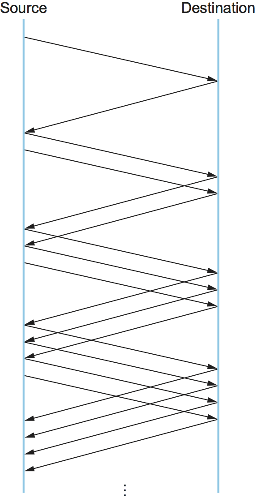

**Figure 6.8. Packets in transit during additive increase, with one packet being added each RTT.**

A congestion-control strategy that only decreases the window size is obviously too conservative. We also need to be able to increase the congestion window to take advantage of newly available capacity in the network. This is the “additive increase” part of AIMD, and it works as follows. Every time the source successfully sends a CongestionWindow ’s worth of packets—that is, each packet sent out during the last round-trip time (RTT) has been ACKed—it adds the equivalent of 1 packet to CongestionWindow. This linear increase is illustrated in Figure 6.8. Note that, in practice, TCP does not wait for an entire window’s worth of ACKs to add 1 packet’s worth to the congestion window, but instead increments CongestionWindow by a little for each ACK that arrives. Specifically, the congestion window is incremented as follows each time an ACK arrives:

```text
Increment = MSS x (MSS/CongestionWindow)
CongestionWindow += Increment
```

That is, rather than incrementing CongestionWindow by an entire MSS bytes each RTT, we increment it by a fraction of MSS every time an ACK is received. Assuming that each ACK acknowledges the receipt of MSS bytes, then that fraction is MSS/CongestionWindow.

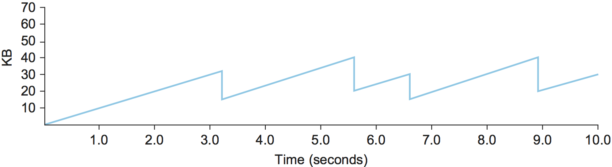

**Figure 6.9. Typical TCP sawtooth pattern.**

This pattern of continually increasing and decreasing the congestion window continues throughout the lifetime of the connection. In fact, if you plot the current value of CongestionWindow as a function of time, you get a sawtooth pattern, as illustrated in Figure 6.9. The important concept to understand about AIMD is that the source is willing to reduce its congestion window at a much faster rate than it is willing to increase its congestion window. This is in contrast to an additive increase/additive decrease strategy in which the window would be increased by 1 packet when an ACK arrives and decreased by 1 when a timeout occurs. It has been shown that AIMD is a necessary condition for a congestion-control mechanism to be stable.

An intuitive explanation for why TCP decreases the window aggressively and increases it conservatively is that the consequences of having too large a window are compounding. This is because when the window is too large, packets that are dropped will be retransmitted, making congestion even worse. It is important to get out of this state quickly.

Finally, since a timeout is an indication of congestion that triggers multiplicative decrease, TCP needs the most accurate timeout mechanism it can afford. We already covered TCP’s timeout mechanism in an earlier chapter, so we do not repeat it here. The two main things to remember about that mechanism are that (1) timeouts are set as a function of both the average RTT and the standard deviation in that average, and (2) due to the cost of measuring each transmission with an accurate clock, TCP only samples the round-trip time once per RTT (rather than once per packet) using a coarse-grained (500-ms) clock.

#### 6.3.2 Slow Start

The additive increase mechanism just described is the right approach to use when the source is operating close to the available capacity of the network, but it takes too long to ramp up a connection when it is starting from scratch. TCP therefore provides a second mechanism, ironically called *slow start*, which is used to increase the congestion window rapidly from a cold start. Slow start effectively increases the congestion window exponentially, rather than linearly.

Specifically, the source starts out by setting CongestionWindow to one packet. When the ACK for this packet arrives, TCP adds 1 to CongestionWindow and then sends two packets. Upon receiving the corresponding two ACKs, TCP increments CongestionWindow by 2—one for each ACK—and next sends four packets. The end result is that TCP effectively doubles the number of packets it has in transit every RTT. Figure 6.10 shows the growth in the number of packets in transit during slow start. Compare this to the linear growth of additive increase illustrated in Figure 6.8.

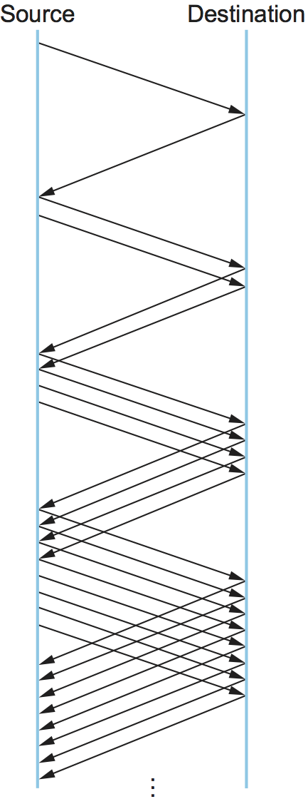

**Figure 6.10. Packets in transit during slow start.**

Why any exponential mechanism would be called “slow” is puzzling at first, but it can be explained if put in the proper historical context. We need to compare slow start not against the linear mechanism of the previous subsection, but against the original behavior of TCP. Consider what happens when a connection is established and the source first starts to send packets—that is, when it currently has no packets in transit. If the source sends as many packets as the advertised window allows—which is exactly what TCP did before slow start was developed—then even if there is a fairly large amount of bandwidth available in the network, the routers may not be able to consume this burst of packets. It all depends on how much buffer space is available at the routers. Slow start was therefore designed to space packets out so that this burst does not occur. In other words, even though its exponential growth is faster than linear growth, slow start is much “slower” than sending an entire advertised window’s worth of data all at once.

There are actually two different situations in which slow start runs. The first is at the very beginning of a connection, at which time the source has no idea how many packets it is going to be able to have in transit at a given time. (Keep in mind that today TCP runs over everything from 1-Mbps links to 40-Gbps links, so there is no way for the source to know the network’s capacity.) In this situation, slow start continues to double CongestionWindow each RTT until there is a loss, at which time a timeout causes multiplicative decrease to divide CongestionWindow by 2.

The second situation in which slow start is used is a bit more subtle; it occurs when the connection goes dead while waiting for a timeout to occur. Recall how TCP’s sliding window algorithm works—when a packet is lost, the source eventually reaches a point where it has sent as much data as the advertised window allows, and so it blocks while waiting for an ACK that will not arrive. Eventually, a timeout happens, but by this time there are no packets in transit, meaning that the source will receive no ACKs to “clock” the transmission of new packets. The source will instead receive a single cumulative ACK that reopens the entire advertised window, but, as explained above, the source then uses slow start to restart the flow of data rather than dumping a whole window’s worth of data on the network all at once.

Although the source is using slow start again, it now knows more information than it did at the beginning of a connection. Specifically, the source has a current (and useful) value of CongestionWindow; this is the value of CongestionWindow that existed prior to the last packet loss, divided by 2 as a result of the loss. We can think of this as the *target* congestion window. Slow start is used to rapidly increase the sending rate up to this value, and then additive increase is used beyond this point. Notice that we have a small bookkeeping problem to take care of, in that we want to remember the target congestion window resulting from multiplicative decrease as well as the *actual* congestion window being used by slow start. To address this problem, TCP introduces a temporary variable to store the target window, typically called CongestionThreshold, that is set equal to the CongestionWindow value that results from multiplicative decrease. The variable CongestionWindow is then reset to one packet, and it is incremented by one packet for every ACK that is received until it reaches CongestionThreshold, at which point it is incremented by one packet per RTT.

In other words, TCP increases the congestion window as defined by the following code fragment:

```c
{
   u_int    cw = state->CongestionWindow;
   u_int    incr = state->maxseg;

   if (cw > state->CongestionThreshold)
       incr = incr * incr / cw;
   state->CongestionWindow = MIN(cw + incr, TCP_MAXWIN);
}
```

where state represents the state of a particular TCP connection and TCP_MAXWIN defines an upper bound on how large the congestion window is allowed to grow.

Figure 6.11 traces how TCP’s CongestionWindow increases and decreases over time and serves to illustrate the interplay of slow start and additive increase/multiplicative decrease. This trace was taken from an actual TCP connection and shows the current value of CongestionWindow—the colored line—over time.


**Figure 6.11. Behavior of TCP congestion control. Colored line = value of CongestionWindow over time; solid bullets at top of graph = timeouts; hash marks at top of graph = time when each packet is transmitted; vertical bars = time when a packet that was eventually retransmitted was first transmitted.**

There are several things to notice about this trace. The first is the rapid increase in the congestion window at the beginning of the connection. This corresponds to the initial slow start phase. The slow start phase continues until several packets are lost at about 0.4 seconds into the connection, at which time CongestionWindow flattens out at about 34 KB. (Why so many packets are lost during slow start is discussed below.) The reason why the congestion window flattens is that there are no ACKs arriving, due to the fact that several packets were lost. In fact, no new packets are sent during this time, as denoted by the lack of hash marks at the top of the graph. A timeout eventually happens at approximately 2 seconds, at which time the congestion window is divided by 2 (i.e., cut from approximately 34 KB to around 17 KB) and CongestionThreshold is set to this value. Slow start then causes CongestionWindow to be reset to one packet and to start ramping up from there.

There is not enough detail in the trace to see exactly what happens when a couple of packets are lost just after 2 seconds, so we jump ahead to the linear increase in the congestion window that occurs between 2 and 4 seconds. This corresponds to additive increase. At about 4 seconds, CongestionWindow flattens out, again due to a lost packet. Now, at about 5.5 seconds:

1. A timeout happens, causing the congestion window to be divided by 2, dropping it from approximately 22 KB to 11 KB, and CongestionThreshold is set to this amount.
2. CongestionWindow is reset to one packet, as the sender enters slow start.
3. Slow start causes CongestionWindow to grow exponentially until it reaches CongestionThreshold.
4. CongestionWindow then grows linearly.

The same pattern is repeated at around 8 seconds when another timeout occurs.

We now return to the question of why so many packets are lost during the initial slow start period. At this point, TCP is attempting to learn how much bandwidth is available on the network. This is a difficult task. If the source is not aggressive at this stage—for example, if it only increases the congestion window linearly—then it takes a long time for it to discover how much bandwidth is available. This can have a dramatic impact on the throughput achieved for this connection. On the other hand, if the source is aggressive at this stage, as TCP is during exponential growth, then the source runs the risk of having half a window’s worth of packets dropped by the network.

To see what can happen during exponential growth, consider the situation in which the source was just able to successfully send 16 packets through the network, causing it to double its congestion window to 32. Suppose, however, that the network happens to have just enough capacity to support 16 packets from this source. The likely result is that 16 of the 32 packets sent under the new congestion window will be dropped by the network; actually, this is the worst-case outcome, since some of the packets will be buffered in some router. This problem will become increasingly severe as the delay × bandwidth product of networks increases. For example, a delay × bandwidth product of 500 KB means that each connection has the potential to lose up to 500 KB of data at the beginning of each connection. Of course, this assumes that both the source and the destination implement the “big windows” extension.

Alternatives to slow start, whereby the source tries to estimate the available bandwidth by more sophisticated means, have also been explored. One example is called *quick-start*. The basic idea is that a TCP sender can ask for an initial sending rate greater than slow start would allow by putting a requested rate in its SYN packet as an IP option. Routers along the path can examine the option, evaluate the current level of congestion on the outgoing link for this flow, and decide if that rate is acceptable, if a lower rate would be acceptable, or if standard slow start should be used. By the time the SYN reaches the receiver, it will contain either a rate that was acceptable to all routers on the path or an indication that one or more routers on the path could not support the quick-start request. In the former case, the TCP sender uses that rate to begin transmission; in the latter case, it falls back to standard slow start. If TCP is allowed to start off sending at a higher rate, a session could more quickly reach the point of filling the pipe, rather than taking many round-trip times to do so.

Clearly one of the challenges to this sort of enhancement to TCP is that it requires substantially more cooperation from the routers than standard TCP does. If a single router in the path does not support quick-start, then the system reverts to standard slow start. Thus, it could be a long time before these types of enhancements could make it into the Internet; for now, they are more likely to be used in controlled network environments (e.g., research networks).

#### 6.3.3 Fast Retransmit and Fast Recovery

The mechanisms described so far were part of the original proposal to add congestion control to TCP. It was soon discovered, however, that the coarse-grained implementation of TCP timeouts led to long periods of time during which the connection went dead while waiting for a timer to expire. Because of this, a new mechanism called *fast retransmit* was added to TCP. Fast retransmit is a heuristic that sometimes triggers the retransmission of a dropped packet sooner than the regular timeout mechanism. The fast retransmit mechanism does not replace regular timeouts; it just enhances that facility.

The idea of fast retransmit is straightforward. Every time a data packet arrives at the receiving side, the receiver responds with an acknowledgment, even if this sequence number has already been acknowledged. Thus, when a packet arrives out of order—when TCP cannot yet acknowledge the data the packet contains because earlier data has not yet arrived—TCP resends the same acknowledgment it sent the last time. This second transmission of the same acknowledgment is called a *duplicate ACK*. When the sending side sees a duplicate ACK, it knows that the other side must have received a packet out of order, which suggests that an earlier packet might have been lost. Since it is also possible that the earlier packet has only been delayed rather than lost, the sender waits until it sees some number of duplicate ACKs and then retransmits the missing packet. In practice, TCP waits until it has seen three duplicate ACKs before retransmitting the packet.

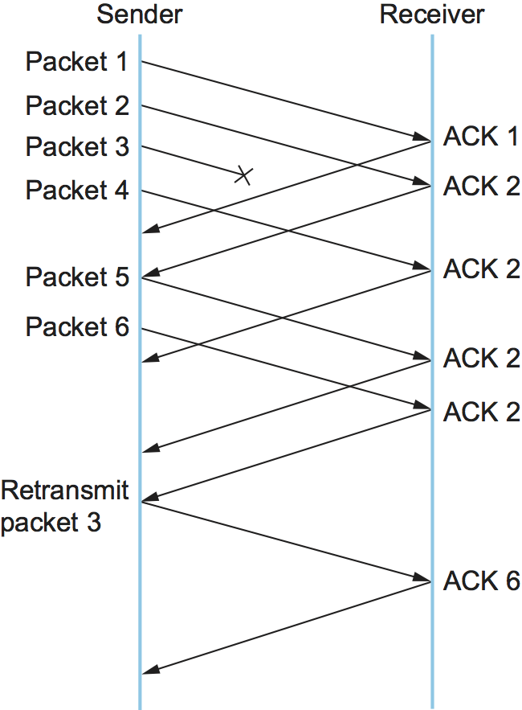

**Figure 6.12. Fast retransmit based on duplicate ACKs.**

Figure 6.12 illustrates how duplicate ACKs lead to a fast retransmit. In this example, the destination receives packets 1 and 2, but packet 3 is lost in the network. Thus, the destination will send a duplicate ACK for packet 2 when packet 4 arrives, again when packet 5 arrives, and so on. (To simplify this example, we think in terms of packets 1, 2, 3, and so on, rather than worrying about the sequence numbers for each byte.) When the sender sees the third duplicate ACK for packet 2—the one sent because the receiver had gotten packet 6—it retransmits packet 3. Note that when the retransmitted copy of packet 3 arrives at the destination, the receiver then sends a cumulative ACK for everything up to and including packet 6 back to the source.

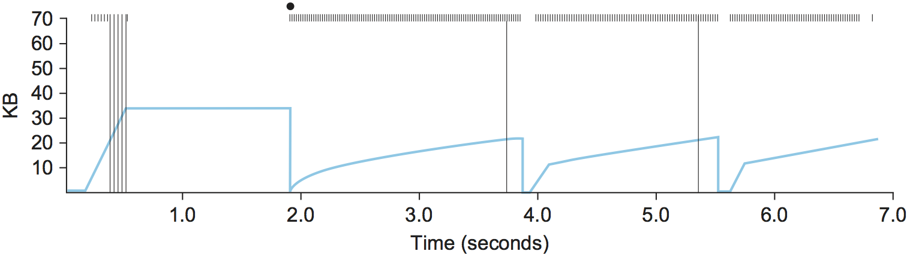

**Figure 6.13. Trace of TCP with fast retransmit. Colored line = CongestionWindow; solid bullet = timeout; hash marks = time when each packet is transmitted; vertical bars = time when a packet that was eventually retransmitted was first transmitted.**

Figure 6.13 illustrates the behavior of a version of TCP with the fast retransmit mechanism. It is interesting to compare this trace with that given in Figure 6.11, where fast retransmit was not implemented—the long periods during which the congestion window stays flat and no packets are sent has been eliminated. In general, this technique is able to eliminate about half of the coarse-grained timeouts on a typical TCP connection, resulting in roughly a 20% improvement in the throughput over what could otherwise have been achieved. Notice, however, that the fast retransmit strategy does not eliminate all coarse-grained timeouts. This is because for a small window size there will not be enough packets in transit to cause enough duplicate ACKs to be delivered. Given enough lost packets—for example, as happens during the initial slow start phase—the sliding window algorithm eventually blocks the sender until a timeout occurs. In practice, TCP’s fast retransmit mechanism can detect up to three dropped packets per window.

Finally, there is one last improvement we can make. When the fast retransmit mechanism signals congestion, rather than drop the congestion window all the way back to one packet and run slow start, it is possible to use the ACKs that are still in the pipe to clock the sending of packets. This mechanism, which is called *fast recovery*, effectively removes the slow start phase that happens between when fast retransmit detects a lost packet and additive increase begins. For example, fast recovery avoids the slow start period between 3.8 and 4 seconds in Figure 6.13 and instead simply cuts the congestion window in half (from 22 KB to 11 KB) and resumes additive increase. In other words, slow start is only used at the beginning of a connection and whenever a coarse-grained timeout occurs. At all other times, the congestion window is following a pure additive increase/multiplicative decrease pattern.

#### 6.3.4 TCP CUBIC

A variant of the standard TCP algorithm just described, called CUBIC, is the default congestion control algorithm distributed with Linux. CUBIC’s primary goal is to support networks with large delay × bandwidth products, which are sometimes called *long-fat networks*. Such networks suffer from the original TCP algorithm requiring too many round-trips to reach the available capacity of the end-to-end path. CUBIC does this by being more aggressive in how it increases the window size, but of course the trick is to be more aggressive without being so aggressive as to adversely affect other flows.

One important aspect of CUBIC’s approach is to adjust its congestion window at regular intervals, based on the amount of time that has elapsed since the last congestion event (e.g., the arrival of a duplicate ACK), rather than only when ACKs arrive (the latter being a function of RTT). This allows CUBIC to behave fairly when competing with short-RTT flows, which will have ACKs arriving more frequently.

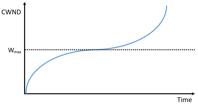

**Figure 6.14. Generic cubic function illustrating the change in the congestion window as a function of time.**

The second important aspect of CUBIC is its use of a cubic function to adjust the congestion window. The basic idea is easiest to understand by looking at the general shape of a cubic function, which has three phases: slowing growth, flatten plateau, increasing growth. A generic example is shown in Figure 6.14, which we have annotated with one extra piece of information: the maximum congestion window size achieved just before the last congestion event as a target (denoted W_{max}). The idea is to start fast but slow the growth rate as you get close to W_{max}, be cautious and have near-zero growth when close to W_{max}, and then increase the growth rate as you move away from W_{max}. The latter phase is essentially probing for a new achievable W_{max}.

Specifically, CUBIC computes the congestion window as a function of time (t) since the last congestion event

CWND(t) = C × (t-K)³ + W_{max}

where

K = ³√(W_{max} × (1 - β)/C)

C is a scaling constant and β is the multiplicative decrease factor. CUBIC sets the latter to 0.7 rather than the 0.5 that standard TCP uses. Looking back at Figure 6.14, CUBIC is often described as shifting between a concave function to being convex (whereas standard TCP’s additive function is only convex).

### 6.4 Advanced Congestion Control

This section explores congestion control more deeply. In doing so, it is important to understand that the standard TCP’s strategy is to control congestion once it happens, as opposed to trying to avoid congestion in the first place. In fact, TCP repeatedly increases the load it imposes on the network in an effort to find the point at which congestion occurs, and then it backs off from this point. Said another way, TCP *needs* to create losses to find the available bandwidth of the connection. An appealing alternative is to predict when congestion is about to happen and then to reduce the rate at which hosts send data just before packets start being discarded. We call such a strategy *congestion avoidance* to distinguish it from *congestion control*, but it’s probably most accurate to think of “avoidance” as a subset of “control.”

We describe two different approaches to congestion-avoidance. The first puts a small amount of additional functionality into the router to assist the end node in the anticipation of congestion. This approach is often referred to as *Active Queue Management* (AQM). The second approach attempts to avoid congestion purely from the end hosts. This approach is implemented in TCP, making it variant of the congestion control mechanisms described in the previous section.

#### 6.4.1 Active Queue Management (DECbit, RED, ECN)

The first approach requires changes to routers, which has never been the Internet’s preferred way of introducing new features, but nonetheless, has been a constant source of consternation over the last 20 years. The problem is that while it’s generally agreed that routers are in an ideal position to detect the onset of congestion—i.e., their queues start to fill up—there has not been a consensus on exactly what the best algorithm is. The following describes two of the classic mechanisms, and concludes with a brief discussion of where things stand today.

##### DECbit

The first mechanism was developed for use on the Digital Network Architecture (DNA), a connectionless network with a connection-oriented transport protocol. This mechanism could, therefore, also be applied to TCP and IP. As noted above, the idea here is to more evenly split the responsibility for congestion control between the routers and the end nodes. Each router monitors the load it is experiencing and explicitly notifies the end nodes when congestion is about to occur. This notification is implemented by setting a binary congestion bit in the packets that flow through the router, hence the name *DECbit*. The destination host then copies this congestion bit into the ACK it sends back to the source. Finally, the source adjusts its sending rate so as to avoid congestion. The following discussion describes the algorithm in more detail, starting with what happens in the router.

A single congestion bit is added to the packet header. A router sets this bit in a packet if its average queue length is greater than or equal to 1 at the time the packet arrives. This average queue length is measured over a time interval that spans the last busy+idle cycle, plus the current busy cycle. (The router is *busy* when it is transmitting and *idle* when it is not.) Figure 6.15 shows the queue length at a router as a function of time. Essentially, the router calculates the area under the curve and divides this value by the time interval to compute the average queue length. Using a queue length of 1 as the trigger for setting the congestion bit is a trade-off between significant queuing (and hence higher throughput) and increased idle time (and hence lower delay). In other words, a queue length of 1 seems to optimize the power function.

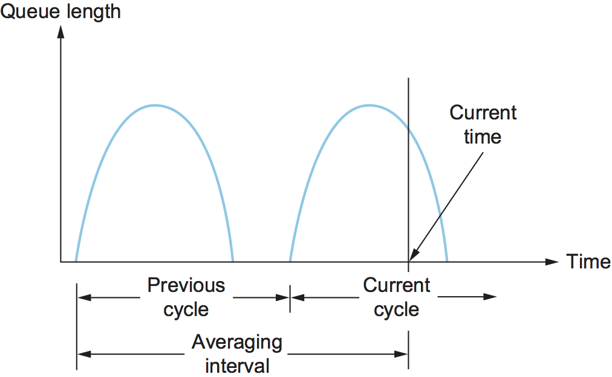

**Figure 6.15. Computing average queue length at a router.**

Now turning our attention to the host half of the mechanism, the source records how many of its packets resulted in some router setting the congestion bit. In particular, the source maintains a congestion window, just as in TCP, and watches to see what fraction of the last window’s worth of packets resulted in the bit being set. If less than 50% of the packets had the bit set, then the source increases its congestion window by one packet. If 50% or more of the last window’s worth of packets had the congestion bit set, then the source decreases its congestion window to 0.875 times the previous value. The value 50% was chosen as the threshold based on analysis that showed it to correspond to the peak of the power curve. The “increase by 1, decrease by 0.875” rule was selected because additive increase/multiplicative decrease makes the mechanism stable.

##### Random Early Detection

A second mechanism, called *random early detection* (RED), is similar to the DECbit scheme in that each router is programmed to monitor its own queue length and, when it detects that congestion is imminent, to notify the source to adjust its congestion window. RED, invented by Sally Floyd and Van Jacobson in the early 1990s, differs from the DECbit scheme in two major ways.

The first is that rather than explicitly sending a congestion notification message to the source, RED is most commonly implemented such that it *implicitly* notifies the source of congestion by dropping one of its packets. The source is, therefore, effectively notified by the subsequent timeout or duplicate ACK. In case you haven’t already guessed, RED is designed to be used in conjunction with TCP, which currently detects congestion by means of timeouts (or some other means of detecting packet loss such as duplicate ACKs). As the “early” part of the RED acronym suggests, the gateway drops the packet earlier than it would have to, so as to notify the source that it should decrease its congestion window sooner than it would normally have. In other words, the router drops a few packets before it has exhausted its buffer space completely, so as to cause the source to slow down, with the hope that this will mean it does not have to drop lots of packets later on.

The second difference between RED and DECbit is in the details of how RED decides when to drop a packet and what packet it decides to drop. To understand the basic idea, consider a simple FIFO queue. Rather than wait for the queue to become completely full and then be forced to drop each arriving packet (the tail drop policy of the previous section), we could decide to drop each arriving packet with some *drop probability* whenever the queue length exceeds some *drop level*. This idea is called *early random drop*. The RED algorithm defines the details of how to monitor the queue length and when to drop a packet.

In the following paragraphs, we describe the RED algorithm as originally proposed by Floyd and Jacobson. We note that several modifications have since been proposed both by the inventors and by other researchers. However, the key ideas are the same as those presented below, and most current implementations are close to the algorithm that follows.

First, RED computes an average queue length using a weighted running average similar to the one used in the original TCP timeout computation. That is, AvgLen is computed as

```text
AvgLen = (1 - Weight) x AvgLen + Weight x SampleLen
```

where 0 < Weight < 1 and SampleLen is the length of the queue when a sample measurement is made. In most software implementations, the queue length is measured every time a new packet arrives at the gateway. In hardware, it might be calculated at some fixed sampling interval.

The reason for using an average queue length rather than an instantaneous one is that it more accurately captures the notion of congestion. Because of the bursty nature of Internet traffic, queues can become full very quickly and then become empty again. If a queue is spending most of its time empty, then it’s probably not appropriate to conclude that the router is congested and to tell the hosts to slow down. Thus, the weighted running average calculation tries to detect long-lived congestion, as indicated in the right-hand portion of Figure 6.16, by filtering out short-term changes in the queue length. You can think of the running average as a low-pass filter, where Weight determines the time constant of the filter. The question of how we pick this time constant is discussed below.

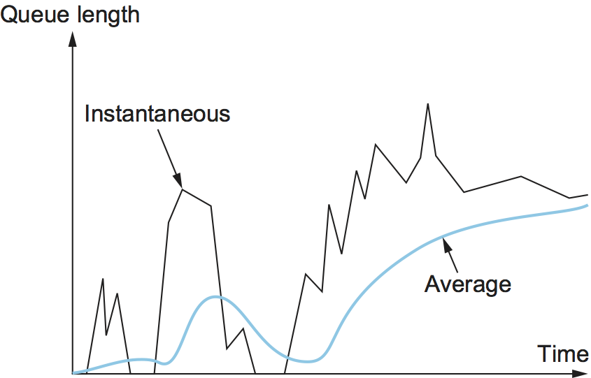

**Figure 6.16. Weighted running average queue length.**

Second, RED has two queue length thresholds that trigger certain activity: MinThreshold and MaxThreshold. When a packet arrives at the gateway, RED compares the current AvgLen with these two thresholds, according to the following rules:

```text
if AvgLen <= MinThreshold
queue the packet
if MinThreshold < AvgLen < MaxThreshold
calculate probability P
drop the arriving packet with probability P
if MaxThreshold <= AvgLen
drop the arriving packet
```

If the average queue length is smaller than the lower threshold, no action is taken, and if the average queue length is larger than the upper threshold, then the packet is always dropped. If the average queue length is between the two thresholds, then the newly arriving packet is dropped with some probability P. This situation is depicted in Figure 6.17. The approximate relationship between P and AvgLen is shown in Figure 6.18. Note that the probability of drop increases slowly when AvgLen is between the two thresholds, reaching MaxP at the upper threshold, at which point it jumps to unity. The rationale behind this is that, if AvgLen reaches the upper threshold, then the gentle approach (dropping a few packets) is not working and drastic measures are called for: dropping all arriving packets. Some research has suggested that a smoother transition from random dropping to complete dropping, rather than the discontinuous approach shown here, may be appropriate.

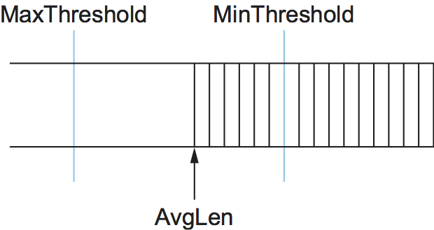

**Figure 6.17. RED thresholds on a FIFO queue.**

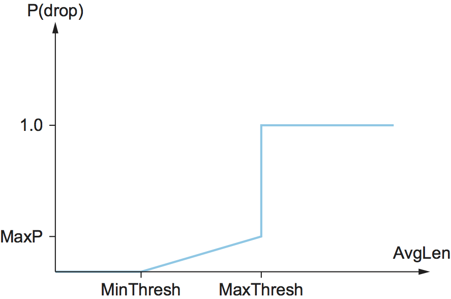

**Figure 6.18. Drop probability function for RED.**

Although Figure 6.18 shows the probability of drop as a function only of AvgLen, the situation is actually a little more complicated. In fact, P is a function of both AvgLen and how long it has been since the last packet was dropped. Specifically, it is computed as follows:

```text
TempP = MaxP x (AvgLen - MinThreshold) / (MaxThreshold - MinThreshold)
P = TempP/(1 - count x TempP)
```

TempP is the variable that is plotted on the y-axis in Figure 6.18, count keeps track of how many newly arriving packets have been queued (not dropped), and AvgLen has been between the two thresholds. P increases slowly as count increases, thereby making a drop increasingly likely as the time since the last drop increases. This makes closely spaced drops relatively less likely than widely spaced drops. This extra step in calculating P was introduced by the inventors of RED when they observed that, without it, the packet drops were not well distributed in time but instead tended to occur in clusters. Because packet arrivals from a certain connection are likely to arrive in bursts, this clustering of drops is likely to cause multiple drops in a single connection. This is not desirable, since only one drop per round-trip time is enough to cause a connection to reduce its window size, whereas multiple drops might send it back into slow start.

As an example, suppose that we set MaxP to 0.02 and count is initialized to zero. If the average queue length were halfway between the two thresholds, then TempP, and the initial value of P, would be half of MaxP, or 0.01. An arriving packet, of course, has a 99 in 100 chance of getting into the queue at this point. With each successive packet that is not dropped, P slowly increases, and by the time 50 packets have arrived without a drop, P would have doubled to 0.02. In the unlikely event that 99 packets arrived without loss, P reaches 1, guaranteeing that the next packet is dropped. The important thing about this part of the algorithm is that it ensures a roughly even distribution of drops over time.

The intent is that, if RED drops a small percentage of packets when AvgLen exceeds MinThreshold, this will cause a few TCP connections to reduce their window sizes, which in turn will reduce the rate at which packets arrive at the router. All going well, AvgLen will then decrease and congestion is avoided. The queue length can be kept short, while throughput remains high since few packets are dropped.

Note that, because RED is operating on a queue length averaged over time, it is possible for the instantaneous queue length to be much longer than AvgLen. In this case, if a packet arrives and there is nowhere to put it, then it will have to be dropped. When this happens, RED is operating in tail drop mode. One of the goals of RED is to prevent tail drop behavior if possible.

The random nature of RED confers an interesting property on the algorithm. Because RED drops packets randomly, the probability that RED decides to drop a particular flow’s packet(s) is roughly proportional to the share of the bandwidth that flow is currently getting at that router. This is because a flow that is sending a relatively large number of packets is providing more candidates for random dropping. Thus, there is some sense of fair resource allocation built into RED, although it is by no means precise. While arguably fair, because RED punishes high-bandwidth flows more than low-bandwidth flows, it increases the probability of a TCP restart, which is doubly painful for those high-bandwidth flows.

> **Key Takeaway**
>
> Note that a fair amount of analysis has gone into setting the various RED parameters—for example, MaxThreshold, MinThreshold, MaxP and Weight—all in the name of optimizing the power function (throughput-to-delay ratio). The performance of these parameters has also been confirmed through simulation, and the algorithm has been shown not to be overly sensitive to them. It is important to keep in mind, however, that all of this analysis and simulation hinges on a particular characterization of the network workload. The real contribution of RED is a mechanism by which the router can more accurately manage its queue length. Defining precisely what constitutes an optimal queue length depends on the traffic mix and is still a subject of research, with real information now being gathered from operational deployment of RED in the Internet. [Next]

Consider the setting of the two thresholds, MinThreshold and MaxThreshold. If the traffic is fairly bursty, then MinThreshold should be sufficiently large to allow the link utilization to be maintained at an acceptably high level. Also, the difference between the two thresholds should be larger than the typical increase in the calculated average queue length in one RTT. Setting MaxThreshold to twice MinThreshold seems to be a reasonable rule of thumb given the traffic mix on today’s Internet. In addition, since we expect the average queue length to hover between the two thresholds during periods of high load, there should be enough free buffer space *above* MaxThreshold to absorb the natural bursts that occur in Internet traffic without forcing the router to enter tail drop mode.

We noted above that Weight determines the time constant for the running average low-pass filter, and this gives us a clue as to how we might pick a suitable value for it. Recall that RED is trying to send signals to TCP flows by dropping packets during times of congestion. Suppose that a router drops a packet from some TCP connection and then immediately forwards some more packets from the same connection. When those packets arrive at the receiver, it starts sending duplicate ACKs to the sender. When the sender sees enough duplicate ACKs, it will reduce its window size. So, from the time the router drops a packet until the time when the same router starts to see some relief from the affected connection in terms of a reduced window size, at least one round-trip time must elapse for that connection. There is probably not much point in having the router respond to congestion on time scales much less than the round-trip time of the connections passing through it. As noted previously, 100 ms is not a bad estimate of average round-trip times in the Internet. Thus, Weight should be chosen such that changes in queue length over time scales much less than 100 ms are filtered out.

Since RED works by sending signals to TCP flows to tell them to slow down, you might wonder what would happen if those signals are ignored. This is often called the *unresponsive flow* problem. Unresponsive flows use more than their fair share of network resources and could cause congestive collapse if there were enough of them, just as in the days before TCP congestion control. Some of the techniques described in the next section can help with this problem by isolating certain classes of traffic from others. There is also the possibility that a variant of RED could drop more heavily from flows that are unresponsive to the initial hints that it sends.

##### Explicit Congestion Notification

RED is the most extensively studied AQM mechanism, but it has not been widely deployed, due in part to the fact that it does not result in ideal behavior in all circumstances. It is, however, the benchmark for understanding AQM behavior. The other thing that came out of RED is the recognition that TCP could do a better job if routers were to send a more explicit congestion signal.

That is, instead of *dropping* a packet and assuming TCP will eventually notice (e.g., due to the arrival of a duplicate ACK), RED (or any AQM algorithm for that matter) can do a better job if it instead *marks* the packet and continues to send it along its way to the destination. This idea was codified in changes to the IP and TCP headers known as *Explicit Congestion Notification* (ECN).

Specifically, this feedback is implemented by treating two bits in the IP TOS field as ECN bits. One bit is set by the source to indicate that it is ECN-capable, that is, able to react to a congestion notification. This is called the ECT bit (ECN-Capable Transport). The other bit is set by routers along the end-to-end path when congestion is encountered, as computed by whatever AQM algorithm it is running. This is called the CE bit (Congestion Encountered).

In addition to these two bits in the IP header (which are transport-agnostic), ECN also includes the addition of two optional flags to the TCP header. The first, ECE (ECN-Echo), communicates from the receiver to the sender that it has received a packet with the CE bit set. The second, CWR (Congestion Window Reduced) communicates from the sender to the receiver that it has reduced the congestion window.

While ECN is now the standard interpretation of two of the eight bits in the TOS field of the IP header and support for ECN is highly recommended, it is not required. Moreover, there is no single recommended AQM algorithm, but instead, there is a list of requirements a good AQM algorithm should meet. Like TCP congestion control algorithms, every AQM algorithm has its advantages and disadvantages, and so we need a lot of them. There is one particular scenario, however, where the TCP congestion control algorithm and AQM algorithm are designed to work in concert: the datacenter. We return to this use case at the end of this section.

#### 6.4.2 Source-Based Approaches (Vegas, BBR, DCTCP)

Unlike the previous congestion-avoidance schemes, which depended on cooperation from routers, we now describe a strategy for detecting the incipient stages of congestion—before losses occur—from the end hosts. We first give a brief overview of a collection of related mechanisms that use different information to detect the early stages of congestion, and then we describe two specific mechanisms in more detail.

The general idea of these techniques is to watch for a sign from the network that some router’s queue is building up and that congestion will happen soon if nothing is done about it. For example, the source might notice that as packet queues build up in the network’s routers, there is a measurable increase in the RTT for each successive packet it sends. One particular algorithm exploits this observation as follows: The congestion window normally increases as in TCP, but every two round-trip delays the algorithm checks to see if the current RTT is greater than the average of the minimum and maximum RTTs seen so far. If it is, then the algorithm decreases the congestion window by one-eighth.

A second algorithm does something similar. The decision as to whether or not to change the current window size is based on changes to both the RTT and the window size. The window is adjusted once every two round-trip delays based on the product

```text
(CurrentWindow - OldWindow) x (CurrentRTT - OldRTT)
```

If the result is positive, the source decreases the window size by one-eighth; if the result is negative or 0, the source increases the window by one maximum packet size. Note that the window changes during every adjustment; that is, it oscillates around its optimal point.

Another change seen as the network approaches congestion is the flattening of the sending rate. A third scheme takes advantage of this fact. Every RTT, it increases the window size by one packet and compares the throughput achieved to the throughput when the window was one packet smaller. If the difference is less than one-half the throughput achieved when only one packet was in transit—as was the case at the beginning of the connection—the algorithm decreases the window by one packet. This scheme calculates the throughput by dividing the number of bytes outstanding in the network by the RTT.

##### TCP Vegas

The mechanism we are going to describe in more detail is similar to the last algorithm in that it looks at changes in the throughput rate or, more specifically, changes in the sending rate. However, it differs from the previous algorithm in the way it calculates throughput, and instead of looking for a change in the slope of the throughput it compares the measured throughput rate with an expected throughput rate. The algorithm, TCP Vegas, is not widely deployed in the Internet today, but the strategy it uses has been adopted by other implementations that are now being deployed.

The intuition behind the Vegas algorithm can be seen in the trace of standard TCP given in Figure 6.19. The top graph shown in Figure 6.19 traces the connection’s congestion window; it shows the same information as the traces given earlier in this section. The middle and bottom graphs depict new information: The middle graph shows the average sending rate as measured at the source, and the bottom graph shows the average queue length as measured at the bottleneck router. All three graphs are synchronized in time. In the period between 4.5 and 6.0 seconds (shaded region), the congestion window increases (top graph). We expect the observed throughput to also increase, but instead it stays flat (middle graph). This is because the throughput cannot increase beyond the available bandwidth. Beyond this point, any increase in the window size only results in packets taking up buffer space at the bottleneck router (bottom graph).


**Figure 6.19. Congestion window versus observed throughput rate (the three graphs are synchronized). Top, congestion window; middle, observed throughput; bottom, buffer space taken up at the router. Colored line = CongestionWindow; solid bullet = timeout; hash marks = time when each packet is transmitted; vertical bars = time when a packet that was eventually retransmitted was first transmitted.**

A useful metaphor that describes the phenomenon illustrated in Figure 6.19 is driving on ice. The speedometer (congestion window) may say that you are going 30 miles an hour, but by looking out the car window and seeing people pass you on foot (measured sending rate) you know that you are going no more than 5 miles an hour. The extra energy is being absorbed by the car’s tires (router buffers).

TCP Vegas uses this idea to measure and control the amount of extra data this connection has in transit, where by “extra data” we mean data that the source would not have transmitted had it been trying to match exactly the available bandwidth of the network. The goal of TCP Vegas is to maintain the “right” amount of extra data in the network. Obviously, if a source is sending too much extra data, it will cause long delays and possibly lead to congestion. Less obviously, if a connection is sending too little extra data, it cannot respond rapidly enough to transient increases in the available network bandwidth. TCP Vegas’s congestion-avoidance actions are based on changes in the estimated amount of extra data in the network, not only on dropped packets. We now describe the algorithm in detail.

First, define a given flow’s BaseRTT to be the RTT of a packet when the flow is not congested. In practice, TCP Vegas sets BaseRTT to the minimum of all measured round-trip times; it is commonly the RTT of the first packet sent by the connection, before the router queues increase due to traffic generated by this flow. If we assume that we are not overflowing the connection, then the expected throughput is given by

```text
ExpectedRate = CongestionWindow / BaseRTT
```

where CongestionWindow is the TCP congestion window, which we assume (for the purpose of this discussion) to be equal to the number of bytes in transit.

Second, TCP Vegas calculates the current sending rate, ActualRate. This is done by recording the sending time for a distinguished packet, recording how many bytes are transmitted between the time that packet is sent and when its acknowledgment is received, computing the sample RTT for the distinguished packet when its acknowledgment arrives, and dividing the number of bytes transmitted by the sample RTT. This calculation is done once per round-trip time.

Third, TCP Vegas compares ActualRate to ExpectedRate and adjusts the window accordingly. We let Diff = ExpectedRate - ActualRate. Note that Diff is positive or 0 by definition, since ActualRate >ExpectedRate implies that we need to change BaseRTT to the latest sampled RTT. We also define two thresholds, *α < β*, roughly corresponding to having too little and too much extra data in the network, respectively. When Diff < *α*, TCP Vegas increases the congestion window linearly during the next RTT, and when Diff > *β*, TCP Vegas decreases the congestion window linearly during the next RTT. TCP Vegas leaves the congestion window unchanged when *α* < Diff < *β*.

Intuitively, we can see that the farther away the actual throughput gets from the expected throughput, the more congestion there is in the network, which implies that the sending rate should be reduced. The *β* threshold triggers this decrease. On the other hand, when the actual throughput rate gets too close to the expected throughput, the connection is in danger of not utilizing the available bandwidth. The *α* threshold triggers this increase. The overall goal is to keep between *α* and *β* extra bytes in the network.

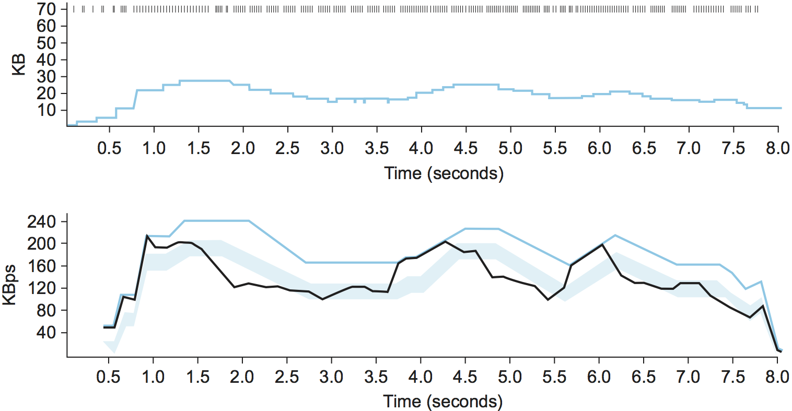

**Figure 6.20. Trace of TCP Vegas congestion-avoidance mechanism. Top, congestion window; bottom, expected (colored line) and actual (black line) throughput. The shaded area is the region between the *α* and *β* thresholds.**

Figure 6.20 traces the TCP Vegas congestion-avoidance algorithm. The top graph traces the congestion window, showing the same information as the other traces given throughout this chapter. The bottom graph traces the expected and actual throughput rates that govern how the congestion window is set. It is this bottom graph that best illustrates how the algorithm works. The colored line tracks the ExpectedRate, while the black line tracks the ActualRate. The wide shaded strip gives the region between the *α* and *β* thresholds; the top of the shaded strip is *α* KBps away from ExpectedRate, and the bottom of the shaded strip is *β* KBps away from ExpectedRate. The goal is to keep the ActualRate between these two thresholds, within the shaded region. Whenever ActualRate falls below the shaded region (i.e., gets too far from ExpectedRate), TCP Vegas decreases the congestion window because it fears that too many packets are being buffered in the network. Likewise, whenever ActualRate goes above the shaded region (i.e., gets too close to the ExpectedRate), TCP Vegas increases the congestion window because it fears that it is underutilizing the network.

Because the algorithm, as just presented, compares the difference between the actual and expected throughput rates to the *α* and *β* thresholds, these two thresholds are defined in terms of KBps. However, it is perhaps more accurate to think in terms of how many extra *buffers* the connection is occupying in the network. For example, on a connection with a BaseRTT of 100 ms and a packet size of 1 KB, if *α* = 30 KBps and *β* = 60 KBps, then we can think of *α* as specifying that the connection needs to be occupying at least 3 extra buffers in the network and *β* as specifying that the connection should occupy no more than 6 extra buffers in the network. In practice, a setting of *α* to 1 buffer and *β* to 3 buffers works well.

Finally, you will notice that TCP Vegas decreases the congestion window linearly, seemingly in conflict with the rule that multiplicative decrease is needed to ensure stability. The explanation is that TCP Vegas does use multiplicative decrease when a timeout occurs; the linear decrease just described is an *early* decrease in the congestion window that should happen before congestion occurs and packets start being dropped.

##### TCP BBR

BBR (Bottleneck Bandwidth and RTT) is a new TCP congestion control algorithm developed by researchers at Google. Like Vegas, BBR is delay based, which means it tries to detect buffer growth so as to avoid congestion and packet loss. Both BBR and Vegas use the minimum RTT and maximum RTT, as calculated over some time interval, as their main control signals.

BBR also introduces new mechanisms to improve performance, including packet pacing, bandwidth probing, and RTT probing. Packet pacing spaces the packets based on the estimate of the available bandwidth. This eliminates bursts and unnecessary queuing, which results in a better feedback signal. BBR also periodically increases its rate, thereby probing the available bandwidth. Similarly, BBR periodically decreases its rate, thereby probing for a new minimum RTT. The RTT probing mechanism attempts to be self-synchronizing, which is to say, when there are multiple BBR flows, their respective RTT probes happen at the same time. This gives a more accurate view of the actual uncongested path RTT, which solves one of the major issues with delay-based congestion control mechanisms: having accurate knowledge of the uncongested path RTT.

BBR is actively being worked on and rapidly evolving. One major focus is fairness. For example, some experiments show CUBIC flows get 100× less bandwidth when competing with BBR flows, and other experiments show that unfairness among BBR flows is even possible. Another major focus is avoiding high retransmission rates, where in some cases as many as 10% of packets are retransmitted.

##### DCTCP

We conclude with an example of a situation where a variant of the TCP congestion control algorithm has been designed to work in concert with ECN: in cloud datacenters. The combination is called DCTCP, which stands for *Data Center TCP*. The situation is unique in that a datacenter is self-contained, and so it is possible to deploy a tailor-made version of TCP that does not need to worry about treating other TCP flows fairly. Datacenters are also unique in that they are built using commodity switches, and because there is no need to worry about long-fat pipes spanning a continent, the switches are typically provisioned without an excess of buffers.

The idea is straightforward. DCTCP adapts ECN by estimating the fraction of bytes that encounter congestion rather than simply detecting that some congestion is about to occur. At the end hosts, DCTCP then scales the congestion window based on this estimate. The standard TCP algorithm still kicks in should a packet actually be lost. The approach is designed to achieve high-burst tolerance, low latency, and high throughput with shallow-buffered switches.

The key challenge DCTCP faces is to estimate the fraction of bytes encountering congestion. Each switch is simple. If a packet arrives and the switch sees the queue length (K) is above some threshold; e.g.,

K > (RTT × C)/7

where C is the link rate in packets per second, then the switch sets the CE bit in the IP header. The complexity of RED is not required.

The receiver then maintains a boolean variable for every flow, which we’ll denote SeenCE, and implements the following state machine in response to every received packet:

- If the CE bit is set and SeenCE=False, set SeenCE to True and send an immediate ACK.
- If the CE bit is not set and SeenCE=True, set SeenCE to False and send an immediate ACK.
- Otherwise, ignore the CE bit.

The non-obvious consequence of the “otherwise” case is that the receiver continues to send delayed ACKs once every *n* packets, whether or not the CE bit is set. This has proven important to maintaining high performance.

Finally, the sender computes the fraction of bytes that encountered congestion during the previous observation window (usually chosen to be approximately the RTT), as the ratio of the total bytes transmitted and the bytes acknowledged with the ECE flag set. DCTCP grows the congestion window in exactly the same way as the standard algorithm, but it reduces the window in proportion to how many bytes encountered congestion during the last observation window.

### 6.5 Quality of Service

The promise of general-purpose packet-switched networks is that they support all kinds of applications and data, including multimedia applications that transmit digitized audio and video streams. In the early days, one obstacle to the fulfillment of this promise was the need for higher-bandwidth links. That is no longer an issue, but there is more to transmitting audio and video over a network than just providing sufficient bandwidth.

Participants in a telephone conversation, for example, expect to be able to converse in such a way that one person can respond to something said by the other and be heard almost immediately. Thus, the timeliness of delivery can be very important. We refer to applications that are sensitive to the timeliness of data as *real-time applications*. Voice and video applications tend to be the canonical examples, but there are others such as industrial control—you would like a command sent to a robot arm to reach it before the arm crashes into something. Even file transfer applications can have timeliness constraints, such as a requirement that a database update complete overnight before the business that needs the data resumes on the next day.

The distinguishing characteristic of real-time applications is that they need some sort of assurance *from the network* that data is likely to arrive on time (for some definition of “on time”). Whereas a non-real-time application can use an end-to-end retransmission strategy to make sure that data arrives *correctly*, such a strategy cannot provide timeliness: Retransmission only adds to total latency if data arrives late. Timely arrival must be provided by the network itself (the routers), not just at the network edges (the hosts). We therefore conclude that the best-effort model, in which the network tries to deliver your data but makes no promises and leaves the cleanup operation to the edges, is not sufficient for real-time applications. What we need is a new service model, in which applications that need higher assurances can ask the network for them. The network may then respond by providing an assurance that it will do better or perhaps by saying that it cannot promise anything better at the moment. Note that such a service model is a superset of the original model: Applications that are happy with best-effort service should be able to use the new service model; their requirements are just less stringent. This implies that the network will treat some packets differently from others—something that is not done in the best-effort model. A network that can provide these different levels of service is often said to support quality of service (QoS).

#### 6.5.1 Application Requirements

Before looking at the various protocols and mechanisms that may be used to provide quality of service to applications, we should try to understand what the needs of those applications are. To begin, we can divide applications into two types: real-time and non-real-time. The latter are sometimes called *traditional data* applications, since they have traditionally been the major applications found on data networks. They include most popular applications like SSH, file transfer, email, web browsing, and so on. All of these applications can work without guarantees of timely delivery of data. Another term for this non-real-time class of applications is *elastic*, since they are able to stretch gracefully in the face of increased delay. Note that these applications can benefit from shorter-length delays, but they do not become unusable as delays increase. Also note that their delay requirements vary from the interactive applications like SSH to more asynchronous ones like email, with interactive bulk transfers like file transfer in the middle.

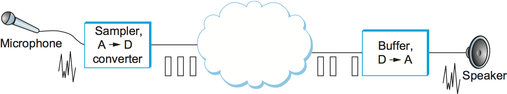

**Figure 6.21. An audio application.**

##### Real-Time Audio Example

As a concrete example of a real-time application, consider an audio application similar to the one illustrated in Figure 6.21. Data is generated by collecting samples from a microphone and digitizing them using an analog-to-digital (A-to-D) converter. The digital samples are placed in packets, which are transmitted across the network and received at the other end. At the receiving host, the data must be *played back* at some appropriate rate. For example, if the voice samples were collected at a rate of one per 125 μs, they should be played back at the same rate. Thus, we can think of each sample as having a particular *playback time*: the point in time at which it is needed in the receiving host. In the voice example, each sample has a playback time that is 125 μs later than the preceding sample. If data arrives after its appropriate playback time, either because it was delayed in the network or because it was dropped and subsequently retransmitted, it is essentially useless. It is the complete worthlessness of late data that characterizes real-time applications. In elastic applications, it might be nice if data turns up on time, but we can still use it when it does not.

One way to make our voice application work would be to make sure all samples take exactly the same amount of time to traverse the network. Then, since samples are injected at a rate of one per 125 μs, they will appear at the receiver at the same rate, ready to be played back. However, it is generally difficult to guarantee that all data traversing a packet-switched network will experience exactly the same delay. Packets encounter queues in switches or routers, and the lengths of these queues vary with time, meaning that the delays tend to vary with time and, as a consequence, are potentially different for each packet in the audio stream. The way to deal with this at the receiver end is to buffer up some amount of data in reserve, thereby always providing a store of packets waiting to be played back at the right time. If a packet is delayed a short time, it goes in the buffer until its playback time arrives. If it gets delayed a long time, then it will not need to be stored for very long in the receiver’s buffer before being played back. Thus, we have effectively added a constant offset to the playback time of all packets as a form of insurance. We call this offset the *playback point.* The only time we run into trouble is if packets get delayed in the network for such a long time that they arrive after their playback time, causing the playback buffer to be drained.

The operation of a playback buffer is illustrated in Figure 6.22. The left-hand diagonal line shows packets being generated at a steady rate. The wavy line shows when the packets arrive, some variable amount of time after they were sent, depending on what they encountered in the network. The right-hand diagonal line shows the packets being played back at a steady rate, after sitting in the playback buffer for some period of time. As long as the playback line is far enough to the right in time, the variation in network delay is never noticed by the application. However, if we move the playback line a little to the left, then some packets will begin to arrive too late to be useful.

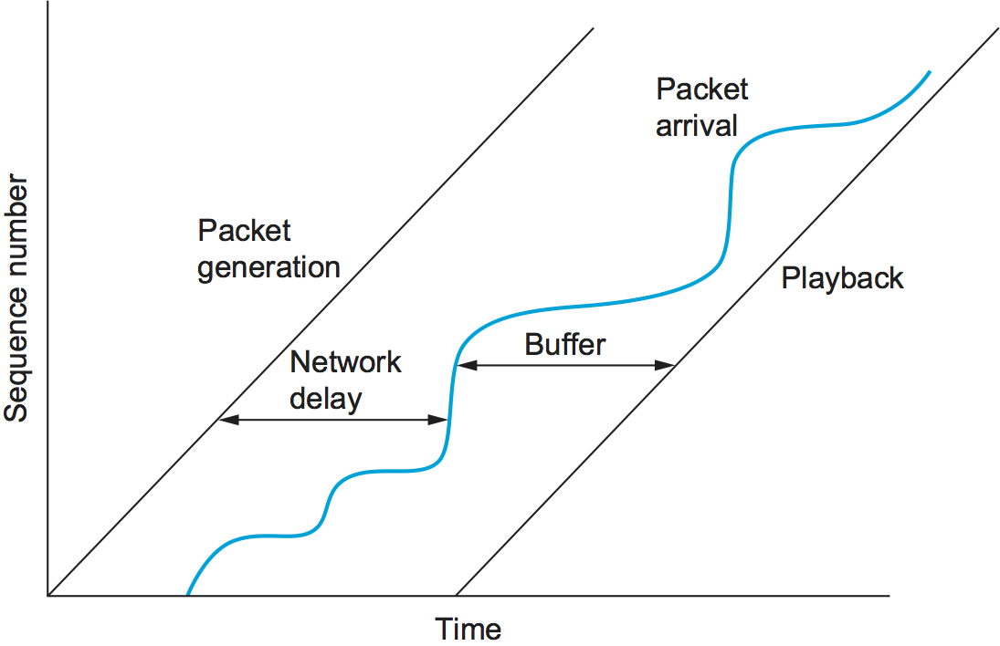

**Figure 6.22. A playback buffer.**

For our audio application, there are limits to how far we can delay playing back data. It is hard to carry on a conversation if the time between when you speak and when your listener hears you is more than 300 ms. Thus, what we want from the network in this case is a guarantee that all our data will arrive within 300 ms. If data arrives early, we buffer it until its correct playback time. If it arrives late, we have no use for it and must discard it.

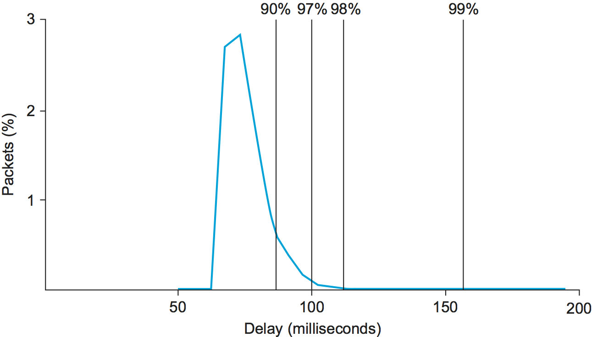

**Figure 6.23. Example distribution of delays for an Internet connection.**

To get a better appreciation of how variable network delay can be, Figure 6.23 shows the one-way delay measured over a certain path across the Internet over the course of one particular day. While the exact numbers would vary depending on the path and the date, the key factor here is the *variability* of the delay, which is consistently found on almost any path at any time. As denoted by the cumulative percentages given across the top of the graph, 97% of the packets in this case had a latency of 100 ms or less. This means that if our example audio application were to set the playback point at 100 ms, then, on average, 3 out of every 100 packets would arrive too late to be of any use. One important thing to notice about this graph is that the tail of the curve—how far it extends to the right—is very long. We would have to set the playback point at over 200 ms to ensure that all packets arrived in time.

##### Taxonomy of Real-Time Applications

Now that we have a concrete idea of how real-time applications work, we can look at some different classes of applications that serve to motivate our service model. The following taxonomy owes much to the work of Clark, Braden, Shenker, and Zhang, whose papers on this subject can be found in the Further Reading section for this chapter. The taxonomy of applications is summarized in Figure 6.24.

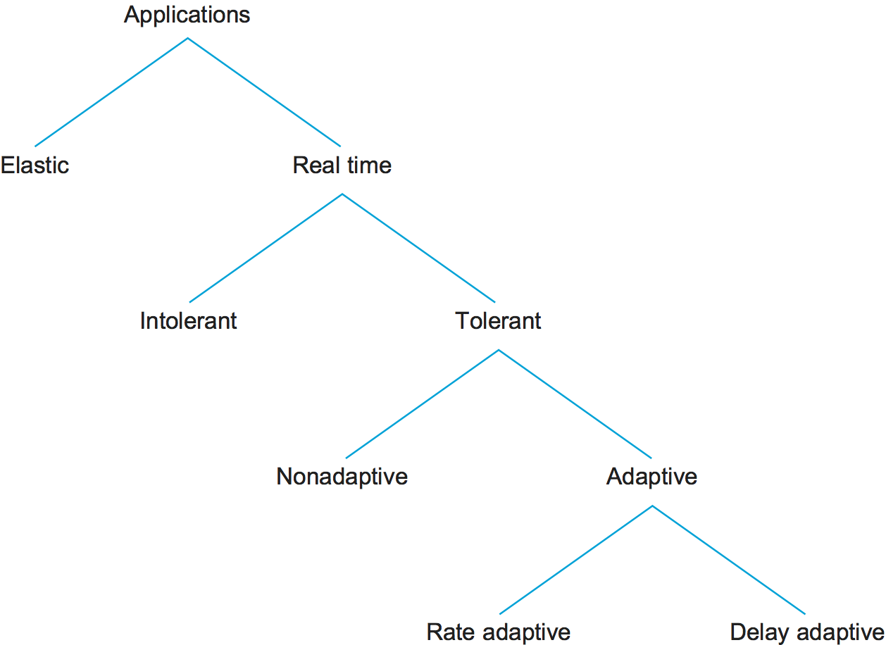

**Figure 6.24. Taxonomy of applications.**

The first characteristic by which we can categorize applications is their tolerance of loss of data, where “loss” might occur because a packet arrived too late to be played back as well as arising from the usual causes in the network. On the one hand, one lost audio sample can be interpolated from the surrounding samples with relatively little effect on the perceived audio quality. It is only as more and more samples are lost that quality declines to the point that the speech becomes incomprehensible. On the other hand, a robot control program is likely to be an example of a real-time application that cannot tolerate loss—losing the packet that contains the command instructing the robot arm to stop is unacceptable. Thus, we can categorize real-time applications as *tolerant* or *intolerant* depending on whether they can tolerate occasional loss. (As an aside, note that many real-time applications are more tolerant of occasional loss than non-real-time applications; for example, compare our audio application to file transfer, where the uncorrected loss of one bit might render a file completely useless.)

A second way to characterize real-time applications is by their adaptability. For example, an audio application might be able to adapt to the amount of delay that packets experience as they traverse the network. If we notice that packets are almost always arriving within 300 ms of being sent, then we can set our playback point accordingly, buffering any packets that arrive in less than 300 ms. Suppose that we subsequently observe that all packets are arriving within 100 ms of being sent. If we moved up our playback point to 100 ms, then the users of the application would probably perceive an improvement. The process of shifting the playback point would actually require us to play out samples at an increased rate for some period of time. With a voice application, this can be done in a way that is barely perceptible, simply by shortening the silences between words. Thus, playback point adjustment is fairly easy in this case, and it has been effectively implemented for several voice applications such as the audio teleconferencing program known as vat. Note that playback point adjustment can happen in either direction, but that doing so actually involves distorting the played-back signal during the period of adjustment, and that the effects of this distortion will very much depend on how the end user uses the data.

Observe that if we set our playback point on the assumption that all packets will arrive within 100 ms and then find that some packets are arriving slightly late, we will have to drop them, whereas we would not have had to drop them if we had left the playback point at 300 ms. Thus, we should advance the playback point only when it provides a perceptible advantage and only when we have some evidence that the number of late packets will be acceptably small. We may do this because of observed recent history or because of some assurance from the network.

We call applications that can adjust their playback point *delay-adaptive* applications. Another class of adaptive applications is *rate adaptive*. For example, many video coding algorithms can trade off bit rate versus quality. Thus, if we find that the network can support a certain bandwidth, we can set our coding parameters accordingly. If more bandwidth becomes available later, we can change parameters to increase the quality.

##### Approaches to QoS Support

Considering this rich space of application requirements, what we need is a richer service model that meets the needs of any application. This leads us to a service model with not just one class (best effort), but with several classes, each available to meet the needs of some set of applications. Towards this end, we are now ready to look at some of the approaches that have been developed to provide a range of qualities of service. These can be divided into two broad categories:

- *Fine-grained* approaches, which provide QoS to individual applications or flows
- *Coarse-grained* approaches, which provide QoS to large classes of data or aggregated traffic

In the first category, we find *Integrated Services*, a QoS architecture developed in the IETF and often associated with the Resource Reservation Protocol (RSVP). In the second category lies *Differentiated Services*, which is probably the most widely deployed QoS mechanism today. We discuss these in turn in the next two subsections.

Finally, as we suggested at the start of this section, adding QoS support to the network isn’t necessarily the entire story about supporting real-time applications. We conclude our discussion by revisiting what the end-host might do to better support real-time streams, independent of how widely deployed QoS mechanisms like Integrated or Differentiated Services become.

#### 6.5.2 Integrated Services (RSVP)

The term *Integrated Services* (often called IntServ for short) refers to a body of work that was produced by the IETF around 1995-97. The IntServ working group developed specifications of a number of *service classes* designed to meet the needs of some of the application types described above. It also defined how RSVP could be used to make reservations using these service classes. The following paragraphs provide an overview of these specifications and the mechanisms that are used to implement them.

##### Service Classes

One of the service classes is designed for intolerant applications. These applications require that a packet never arrive late. The network should guarantee that the maximum delay that any packet will experience has some specified value; the application can then set its playback point so that no packet will ever arrive after its playback time. We assume that early arrival of packets can always be handled by buffering. This service is referred to as the *guaranteed* service.

In addition to the guaranteed service, the IETF considered several other services, but eventually settled on one to meet the needs of tolerant, adaptive applications. The service is known as *controlled load* and was motivated by the observation that existing applications of this type run quite well on networks that are not heavily loaded. Audio applications, for example, adjust their playback point as network delay varies and produces reasonable audio quality as long as loss rates remain on the order of 10% or less.

The aim of the controlled load service is to emulate a lightly loaded network for those applications that request the service, even though the network as a whole may in fact be heavily loaded. The trick to this is to use a queuing mechanism such as WFQ to isolate the controlled load traffic from the other traffic and some form of admission control to limit the total amount of controlled load traffic on a link such that the load is kept reasonably low. We discuss admission control in more detail below.

Clearly, these two service classes are a subset of all the classes that might be provided. In fact, other services were specified but never standardized as part of the IETF’s work. So far, the two services described above (along with traditional best effort) have proven flexible enough to meet the needs of a wide range of applications.

##### Overview of Mechanisms

Now that we have augmented our best-effort service model with some new service classes, the next question is how we implement a network that provides these services to applications. This section outlines the key mechanisms. Keep in mind while reading this section that the mechanisms being described are still being hammered out by the Internet design community. The main thing to take away from the discussion is a general understanding of the pieces involved in supporting the service model outlined above.

First, whereas with a best-effort service we can just tell the network where we want our packets to go and leave it at that, a real-time service involves telling the network something more about the type of service we require. We may give it qualitative information such as “use a controlled load service” or quantitative information such as “I need a maximum delay of 100 ms.” In addition to describing what we want, we need to tell the network something about what we are going to inject into it, since a low-bandwidth application is going to require fewer network resources than a high-bandwidth application. The set of information that we provide to the network is referred to as a *flowspec*. This name comes from the idea that a set of packets associated with a single application and that share common requirements is called a *flow*, consistent with our use of the term in the earlier section outlining the relevant issues.

Second, when we ask the network to provide us with a particular service, the network needs to decide if it can in fact provide that service. For example, if 10 users ask for a service in which each will consistently use 2 Mbps of link capacity, and they all share a link with 10-Mbps capacity, the network will have to say no to some of them. The process of deciding when to say no is called *admission control*.

Third, we need a mechanism by which the users of the network and the components of the network itself exchange information such as requests for service, flowspecs, and admission control decisions. This is sometimes called *signalling*, but since that word has several meanings, we refer to this process as *resource reservation*, and it is achieved using a resource reservation protocol.

Finally, when flows and their requirements have been described, and admission control decisions have been made, the network switches and routers need to meet the requirements of the flows. A key part of meeting these requirements is managing the way packets are queued and scheduled for transmission in the switches and routers. This last mechanism is *packet scheduling*.

##### Flowspecs

There are two separable parts to the flowspec: the part that describes the flow’s traffic characteristics (called the *TSpec*) and the part that describes the service requested from the network (the *RSpec*). The RSpec is very service specific and relatively easy to describe. For example, with a controlled load service, the RSpec is trivial: The application just requests controlled load service with no additional parameters. With a guaranteed service, you could specify a delay target or bound. (In the IETF’s guaranteed service specification, you specify not a delay but another quantity from which delay can be calculated.)

The TSpec is a little more complicated. As our example above showed, we need to give the network enough information about the bandwidth used by the flow to allow intelligent admission control decisions to be made. For most applications, however, the bandwidth is not a single number; it is something that varies constantly. A video application, for example, will generally generate more bits per second when the scene is changing rapidly than when it is still. Just knowing the long-term average bandwidth is not enough, as the following example illustrates. Suppose that we have 10 flows that arrive at a switch on separate input ports and that all leave on the same 10-Mbps link. Assume that over some suitably long interval each flow can be expected to send no more than 1 Mbps. You might think that this presents no problem. However, if these are variable bit rate applications, such as compressed video, then they will occasionally send more than their average rates. If enough sources send at above their average rates, then the total rate at which data arrives at the switch will be greater than 10 Mbps. This excess data will be queued before it can be sent on the link. The longer this condition persists, the longer the queue will get. Packets might have to be dropped and, even if it doesn’t come to that, data sitting in the queue is being delayed. If packets are delayed long enough, the service that was requested will not be provided.

Exactly how we manage our queues to control delay and avoid dropping packets is something we discuss below. However, note here that we need to know something about how the bandwidth of our sources varies with time. One way to describe the bandwidth characteristics of sources is called a *token bucket* filter. Such a filter is described by two parameters: a token rate *r*, and a bucket depth *B*. It works as follows. To be able to send a byte, I must have a token. To send a packet of length *n*, I need *n* tokens. I start with no tokens and I accumulate them at a rate of *r* per second. I can accumulate no more than *B* tokens. What this means is that I can send a burst of as many as *B* bytes into the network as fast as I want, but over a sufficiently long interval I can’t send more than *r* bytes per second. It turns out that this information is very helpful to the admission control algorithm when it tries to figure out whether it can accommodate a new request for service.

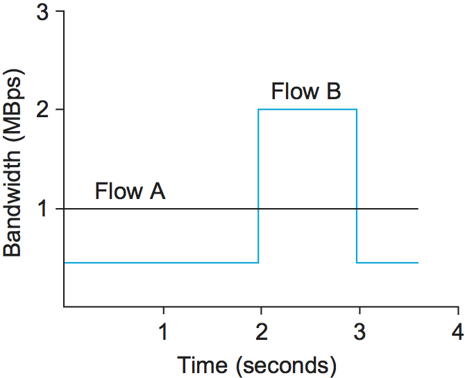

**Figure 6.25. Two flows with equal average rates but different token bucket descriptions.**

Figure 6.25 illustrates how a token bucket can be used to characterize a flow’s bandwidth requirements. For simplicity, assume that each flow can send data as individual bytes rather than as packets. Flow A generates data at a steady rate of 1 MBps, so it can be described by a token bucket filter with a rate *r = 1* MBps and a bucket depth of 1 byte. This means that it receives tokens at a rate of 1 MBps but that it cannot store more than 1 token—it spends them immediately. Flow B also sends at a rate that averages out to 1 MBps over the long term, but does so by sending at 0.5 MBps for 2 seconds and then at 2 MBps for 1 second. Since the token bucket rate *r* is, in a sense, a long-term average rate, flow B can be described by a token bucket with a rate of 1 MBps. Unlike flow A, however, flow B needs a bucket depth *B* of at least 1 MB, so that it can store up tokens while it sends at less than 1 MBps to be used when it sends at 2 MBps. For the first 2 seconds in this example, it receives tokens at a rate of 1 MBps but spends them at only 0.5 MBps, so it can save up 2 × 0.5 = 1 MB of tokens, which it then spends in the third second (along with the new tokens that continue to accrue in that second) to send data at 2 MBps. At the end of the third second, having spent the excess tokens, it starts to save them up again by sending at 0.5 MBps again.

It is interesting to note that a single flow can be described by many different token buckets. As a trivial example, flow A could be described by the same token bucket as flow B, with a rate of 1 MBps and a bucket depth of 1 MB. The fact that it never actually needs to accumulate tokens does not make that an inaccurate description, but it does mean that we have failed to convey some useful information to the network—the fact that flow A is actually very consistent in its bandwidth needs. In general, it is good to be as explicit about the bandwidth needs of an application as possible to avoid over-allocation of resources in the network.

##### Admission Control

The idea behind admission control is simple: When some new flow wants to receive a particular level of service, admission control looks at the TSpec and RSpec of the flow and tries to decide if the desired service can be provided to that amount of traffic, given the currently available resources, without causing any previously admitted flow to receive worse service than it had requested. If it can provide the service, the flow is admitted; if not, then it is denied. The hard part is figuring out when to say yes and when to say no.

Admission control is very dependent on the type of requested service and on the queuing discipline employed in the routers; we discuss the latter topic later in this section. For a guaranteed service, you need to have a good algorithm to make a definitive yes/no decision. The decision is fairly straightforward if weighted fair queuing is used at each router. For a controlled load service, the decision may be based on heuristics, such as “The last time I allowed a flow with this TSpec into this class, the delays for the class exceeded the acceptable bound, so I’d better say no” or “My current delays are so far inside the bounds that I should be able to admit another flow without difficulty.”

Admission control should not be confused with *policing*. The former is a per-flow decision to admit a new flow or not. The latter is a function applied on a per-packet basis to make sure that a flow conforms to the TSpec that was used to make the reservation. If a flow does not conform to its TSpec—for example, because it is sending twice as many bytes per second as it said it would—then it is likely to interfere with the service provided to other flows, and some corrective action must be taken. There are several options, the obvious one being to drop offending packets. However, another option would be to check if the packets really are interfering with the service of other flows. If they are not interfering, the packets could be sent on after being marked with a tag that says, in effect, “This is a nonconforming packet. Drop it first if you need to drop any packets.”

Admission control is closely related to the important issue of *policy*. For example, a network administrator might wish to allow reservations made by his company’s CEO to be admitted while rejecting reservations made by more lowly employees. Of course, the CEO’s reservation request might still fail if the requested resources aren’t available, so we see that issues of policy and resource availability may both be addressed when admission control decisions are made. The application of policy to networking is an area receiving much attention at the time of writing.

##### Reservation Protocol

While connection-oriented networks have always needed some sort of setup protocol to establish the necessary virtual circuit state in the switches, connectionless networks like the Internet have had no such protocols. As this section has indicated, however, we need to provide a lot more information to our network when we want a real-time service from it. While there have been a number of setup protocols proposed for the Internet, the one on which most current attention is focused is the RSVP. It is particularly interesting because it differs so substantially from conventional signalling protocols for connection-oriented networks.

One of the key assumptions underlying RSVP is that it should not detract from the robustness that we find in today’s connectionless networks. Because connectionless networks rely on little or no state being stored in the network itself, it is possible for routers to crash and reboot and for links to go up and down while end-to-end connectivity is still maintained. RSVP tries to maintain this robustness by using the idea of *soft state* in the routers. Soft state—in contrast to the hard state found in connection-oriented networks—does not need to be explicitly deleted when it is no longer needed. Instead, it times out after some fairly short period (say, a minute) if it is not periodically refreshed. We will see later how this helps robustness.

Another important characteristic of RSVP is that it aims to support multicast flows just as effectively as unicast flows. This is not surprising, since many of the first applications that could benefit from improved quality of service were also multicast applications—video conferencing tools, for example. One of the insights of RSVP’s designers is that most multicast applications have many more receivers than senders, as typified by the large audience and one speaker for a lecture. Also, receivers may have different requirements. For example, one receiver might want to receive data from only one sender, while others might wish to receive data from all senders. Rather than having the senders keep track of a potentially large number of receivers, it makes more sense to let the receivers keep track of their own needs. This suggests the *receiver-oriented* approach adopted by RSVP. In contrast, connection-oriented networks usually leave resource reservation to the sender, just as it is normally the originator of a phone call who causes resources to be allocated in the phone network.

The soft state and receiver-oriented nature of RSVP give it a number of good properties. One such property is that it is very straightforward to increase or decrease the level of resource allocation provided to a receiver. Since each receiver periodically sends refresh messages to keep the soft state in place, it is easy to send a new reservation that asks for a new level of resources. Further, soft state deals gracefully with the possibility of network or node failures. In the event of a host crash, resources allocated by that host to a flow will naturally time out and be released. To see what happens in the event of a router or link failure, we need to look a little more closely at the mechanics of making a reservation.

Initially, consider the case of one sender and one receiver trying to get a reservation for traffic flowing between them. There are two things that need to happen before a receiver can make the reservation. First, the receiver needs to know what traffic the sender is likely to send so that it can make an appropriate reservation. That is, it needs to know the sender’s TSpec. Second, it needs to know what path the packets will follow from sender to receiver, so that it can establish a resource reservation at each router on the path. Both of these requirements can be met by sending a message from the sender to the receiver that contains the TSpec. Obviously, this gets the TSpec to the receiver. The other thing that happens is that each router looks at this message (called a PATH message) as it goes past, and it figures out the *reverse path* that will be used to send reservations from the receiver back to the sender in an effort to get the reservation to each router on the path. Building the multicast tree in the first place is done by mechanisms such as those described in another chapter.

Having received a PATH message, the receiver sends a reservation back up the multicast tree in a RESV message. This message contains the sender’s TSpec and an RSpec describing the requirements of this receiver. Each router on the path looks at the reservation request and tries to allocate the necessary resources to satisfy it. If the reservation can be made, the RESV request is passed on to the next router. If not, an error message is returned to the receiver who made the request. If all goes well, the correct reservation is installed at every router between the sender and the receiver. As long as the receiver wants to retain the reservation, it sends the same RESV message about once every 30 seconds.

Now we can see what happens when a router or link fails. Routing protocols will adapt to the failure and create a new path from sender to receiver. PATH messages are sent about every 30 seconds, and may be sent sooner if a router detects a change in its forwarding table, so the first one after the new route stabilizes will reach the receiver over the new path. The receiver’s next RESV message will follow the new path and, if all goes well, establish a new reservation on the new path. Meanwhile, the routers that are no longer on the path will stop getting RESV messages, and these reservations will time out and be released. Thus, RSVP deals quite well with changes in topology, as long as routing changes are not excessively frequent.

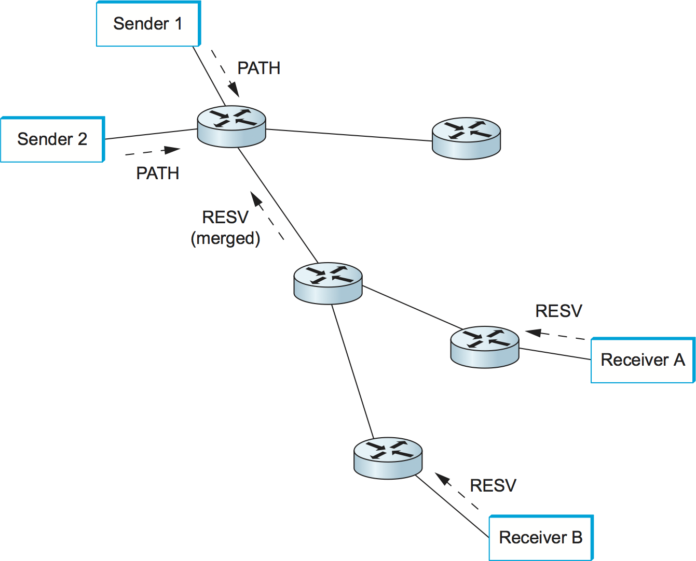

**Figure 6.26. Making reservations on a multicast tree.**

The next thing we need to consider is how to cope with multicast, where there may be multiple senders to a group and multiple receivers. This situation is illustrated in Figure 6.26. First, let’s deal with multiple receivers for a single sender. As a RESV message travels up the multicast tree, it is likely to hit a piece of the tree where some other receiver’s reservation has already been established. It may be the case that the resources reserved upstream of this point are adequate to serve both receivers. For example, if receiver A has already made a reservation that provides for a guaranteed delay of less than 100 ms, and the new request from receiver B is for a delay of less than 200 ms, then no new reservation is required. On the other hand, if the new request were for a delay of less than 50 ms, then the router would first need to see if it could accept the request; if so, it would send the request on upstream. The next time receiver A asked for a minimum of a 100-ms delay, the router would not need to pass this request on. In general, reservations can be merged in this way to meet the needs of all receivers downstream of the merge point.

If there are also multiple senders in the tree, receivers need to collect the TSpecs from all senders and make a reservation that is large enough to accommodate the traffic from all senders. However, this may not mean that the TSpecs need to be added up. For example, in an audioconference with 10 speakers, there is not much point in allocating enough resources to carry 10 audio streams, since the result of 10 people speaking at once would be incomprehensible. Thus, we could imagine a reservation that is large enough to accommodate two speakers and no more. Calculating the correct overall TSpec from all of the sender TSpecs is clearly application specific. Also, we may only be interested in hearing from a subset of all possible speakers; RSVP has different reservation styles to deal with such options as “Reserve resources for all speakers,” “Reserve resources for any n speakers,” and “Reserve resources for speakers A and B only.”

##### Packet Classifying and Scheduling

Once we have described our traffic and our desired network service and have installed a suitable reservation at all the routers on the path, the only thing that remains is for the routers to actually deliver the requested service to the data packets. There are two things that need to be done:

- Associate each packet with the appropriate reservation so that it can be handled correctly, a process known as *classifying* packets.
- Manage the packets in the queues so that they receive the service that has been requested, a process known as packet *scheduling*.

The first part is done by examining up to five fields in the packet: the source address, destination address, protocol number, source port, and destination port. (In IPv6, it is possible that the FlowLabel field in the header could be used to enable the lookup to be done based on a single, shorter key.) Based on this information, the packet can be placed in the appropriate class. For example, it may be classified into the controlled load classes, or it may be part of a guaranteed flow that needs to be handled separately from all other guaranteed flows. In short, there is a mapping from the flow-specific information in the packet header to a single class identifier that determines how the packet is handled in the queue. For guaranteed flows this might be a one-to-one mapping, while for other services it might be many to one. The details of classification are closely related to the details of queue management.

It should be clear that something as simple as a FIFO queue in a router will be inadequate to provide many different services and to provide different levels of delay within each service. Several more sophisticated queue management disciplines were discussed in an earlier section, and some combination of these is likely to be used in a router.

The details of packet scheduling ideally should not be specified in the service model. Instead, this is an area where implementors can try to do creative things to realize the service model efficiently. In the case of guaranteed service, it has been established that a weighted fair queuing discipline, in which each flow gets its own individual queue with a certain share of the link, will provide a guaranteed end-to-end delay bound that can readily be calculated. For controlled load, simpler schemes may be used. One possibility includes treating all the controlled load traffic as a single, aggregated flow (as far as the scheduling mechanism is concerned), with the weight for that flow being set based on the total amount of traffic admitted in the controlled load class. The problem is made harder when you consider that, in a single router, many different services are likely to be provided concurrently and that each of these services may require a different scheduling algorithm. Thus, some overall queue management algorithm is needed to manage the resources between the different services.

##### Scalability Issues

Although the Integrated Services architecture and RSVP represented a significant enhancement of the best-effort service model of IP, many Internet service providers felt that it was not the right model for them to deploy. The reason for this reticence relates to one of the fundamental design goals of IP: scalability. In the best-effort service model, routers in the Internet store little or no state about the individual flows passing through them. Thus, as the Internet grows, the only thing routers have to do to keep up with that growth is to move more bits per second and to deal with larger routing tables, but RSVP raises the possibility that every flow passing through a router might have a corresponding reservation. To understand the severity of this problem, suppose that every flow on an OC-48 (2.5-Gbps) link represents a 64-kbps audio stream. The number of such flows is

2.5 × 10 ⁹ / 64 × 10 ³ = 39,000

Each of those reservations needs some amount of state that needs to be stored in memory and refreshed periodically. The router needs to classify, police, and queue each of those flows. Admission control decisions need to be made every time such a flow requests a reservation, and some mechanism is needed to “push back” on users (e.g., charge their credit cards) so that they don’t make arbitrarily large reservations for long periods of time.

These scalability concerns have limited widespread deployment of IntServ. Because of these concerns, other approaches that do not require so much “per-flow” state have been developed. The next section discusses a number of such approaches.

#### 6.5.3 Differentiated Services (EF, AF)

Whereas the Integrated Services architecture allocates resources to individual flows, the Differentiated Services model (often called DiffServ for short) allocates resources to a small number of classes of traffic. In fact, some proposed approaches to DiffServ simply divide traffic into two classes. This is an eminently sensible approach to take: If you consider the difficulty that network operators experience just trying to keep a best-effort internet running smoothly, it makes sense to add to the service model in small increments.

Suppose that we have decided to enhance the best-effort service model by adding just one new class, which we’ll call “premium.” Clearly, we will need some way to figure out which packets are premium and which are regular old best effort. Rather than using a protocol like RSVP to tell all the routers that some flow is sending premium packets, it would be much easier if the packets could just identify themselves to the router when they arrive. This could obviously be done by using a bit in the packet header—if that bit is a 1, the packet is a premium packet; if it’s a 0, the packet is best effort. With this in mind, there are two questions we need to address:

- Who sets the premium bit and under what circumstances?
- What does a router do differently when it sees a packet with the bit set?

There are many possible answers to the first question, but a common approach is to set the bit at an administrative boundary. For example, the router at the edge of an Internet service provider’s network might set the bit for packets arriving on an interface that connects to a particular company’s network. The Internet service provider might do this because that company has paid for a higher level of service than best effort. It is also possible that not all packets would be marked as premium; for example, the router might be configured to mark packets as premium up to some maximum rate and to leave all excess packets as best effort.

Assuming that packets have been marked in some way, what do the routers that encounter marked packets do with them? Here again there are many answers. In fact, the IETF standardized a set of router behaviors to be applied to marked packets. These are called *per-hop behaviors* (PHBs), a term that indicates that they define the behavior of individual routers rather than end-to-end services. Because there is more than one new behavior, there is also a need for more than 1 bit in the packet header to tell the routers which behavior to apply. The IETF decided to take the old TOS byte from the IP header, which had not been widely used, and redefine it. Six bits of this byte have been allocated for DiffServ code points (DSCPs), where each DSCP is a 6-bit value that identifies a particular PHB to be applied to a packet. (The remaining two bits are used by ECN.)

##### The Expedited Forwarding (EF) PHB

One of the simplest PHBs to explain is known as *expedited forwarding* (EF). Packets marked for EF treatment should be forwarded by the router with minimal delay and loss. The only way that a router can guarantee this to all EF packets is if the arrival rate of EF packets at the router is strictly limited to be less than the rate at which the router can forward EF packets. For example, a router with a 100-Mbps interface needs to be sure that the arrival rate of EF packets destined for that interface never exceeds 100 Mbps. It might also want to be sure that the rate will be somewhat below 100 Mbps, so that it occasionally has time to send other packets such as routing updates.

The rate limiting of EF packets is achieved by configuring the routers at the edge of an administrative domain to allow a certain maximum rate of EF packet arrivals into the domain. A simple, albeit conservative, approach would be to ensure that the sum of the rates of all EF packets entering the domain is less than the bandwidth of the slowest link in the domain. This would ensure that, even in the worst case where all EF packets converge on the slowest link, it is not overloaded and can provide the correct behavior.

There are several possible implementation strategies for the EF behavior. One is to give EF packets strict priority over all other packets. Another is to perform weighted fair queuing between EF packets and other packets, with the weight of EF set sufficiently high that all EF packets can be delivered quickly. This has an advantage over strict priority: The non-EF packets can be assured of getting some access to the link, even if the amount of EF traffic is excessive. This might mean that the EF packets fail to get exactly the specified behavior, but it could also prevent essential routing traffic from being locked out of the network in the event of an excessive load of EF traffic.

##### The Assured Forwarding (AF) PHB

The *assured forwarding* (AF) PHB has its roots in an approach known as *RED* with In and Out (RIO) or Weighted RED, both of which are enhancements to the basic RED algorithm described in an earlier section. Figure 6.27 shows how RIO works; as with RED, we see drop probability on the y -axis increasing as average queue length increases along the x -axis. But now, for our two classes of traffic, we have two separate drop probability curves. RIO calls the two classes “in” and “out” for reasons that will become clear shortly. Because the “out” curve has a lower MinThreshold than the “in” curve, it is clear that, under low levels of congestion, only packets marked “out” will be discarded by the RED algorithm. If the congestion becomes more serious, a higher percentage of “out” packets are dropped, and then if the average queue length exceeds Min ᵢₙ, RED starts to drop “in” packets as well.

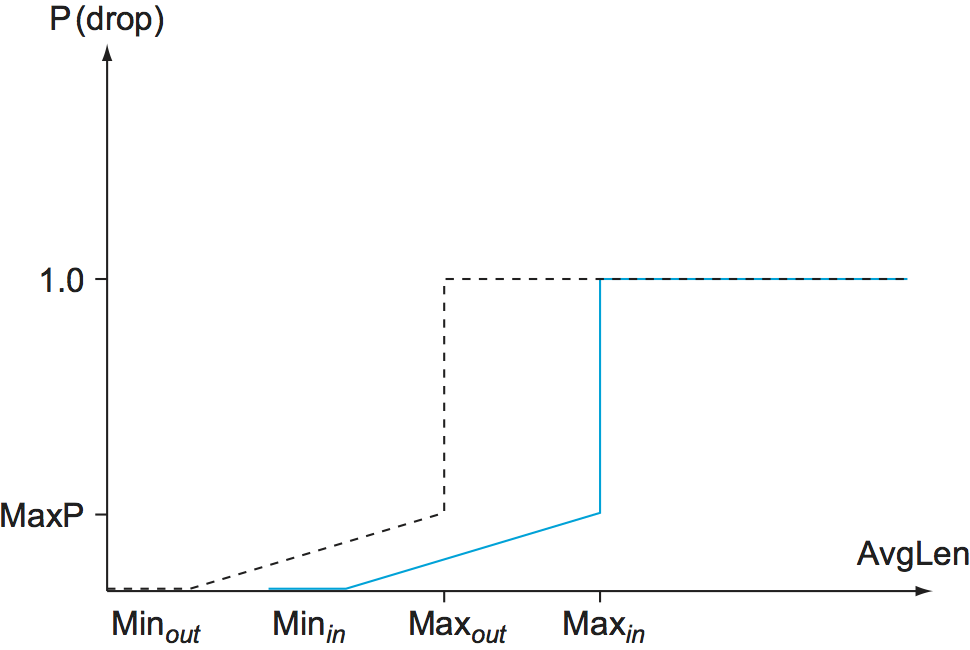

**Figure 6.27. RED with In and Out drop probabilities.**

The reason for calling the two classes of packets “in” and “out” stems from the way the packets are marked. We already noted that packet marking can be performed by a router at the edge of an administrative domain. We can think of this router as being at the boundary between a network service provider and some customer of that network. The customer might be any other network—for example, the network of a corporation or of another network service provider. The customer and the network service provider agree on some sort of profile for the assured service (and perhaps the customer pays the network service provider for this profile). The profile might be something like “Customer X is allowed to send up to y Mbps of assured traffic,” or it could be significantly more complex. Whatever the profile is, the edge router can clearly mark the packets that arrive from this customer as being either in or out of profile. In the example just mentioned, as long as the customer sends less than y Mbps, all his packets will be marked “in,” but once he exceeds that rate the excess packets will be marked “out.”

The combination of a profile meter at the edge and RIO in all the routers of the service provider’s network should provide the customer with a high assurance (but not a guarantee) that packets within his profile can be delivered. In particular, if the majority of packets, including those sent by customers who have not paid extra to establish a profile, are “out” packets, then it should usually be the case that the RIO mechanism will act to keep congestion low enough that “in” packets are rarely dropped. Clearly, there must be enough bandwidth in the network so that the “in” packets alone are rarely able to congest a link to the point where RIO starts dropping “in” packets.

Just like RED, the effectiveness of a mechanism like RIO depends to some extent on correct parameter choices, and there are considerably more parameters to set for RIO. Exactly how well the scheme will work in production networks is not known at the time of writing.

One interesting property of RIO is that it does not change the order of “in” and “out” packets. For example, if a TCP connection is sending packets through a profile meter, and some packets are being marked “in” while others are marked “out,” those packets will receive different drop probabilities in the router queues, but they will be delivered to the receiver in the same order in which they were sent. This is important for most TCP implementations, which perform much better when packets arrive in order, even if they are designed to cope with misordering. Note also that mechanisms such as fast retransmit can be falsely triggered when misordering happens.

The idea of RIO can be generalized to provide more than two drop probability curves, and this is the idea behind the approach known as *weighted RED* (WRED). In this case, the value of the DSCP field is used to pick one of several drop probability curves, so that several different classes of service can be provided.

A third way to provide Differentiated Services is to use the DSCP value to determine which queue to put a packet into in a weighted fair queuing scheduler. As a very simple case, we might use one code point to indicate the *best-effort* queue and a second code point to select the *premium* queue. We then need to choose a weight for the premium queue that makes the premium packets get better service than the best-effort packets. This depends on the offered load of premium packets. For example, if we give the premium queue a weight of 1 and the best-effort queue a weight of 4, that ensures that the bandwidth available to premium packets is

B _{premium} = W _{premium} / (W _{premium} + W _{best-effort} ) = 1/(1 + 4) = 0.2

That is, we have effectively reserved 20% of the link for premium packets, so if the offered load of premium traffic is only 10% of the link on average, then the premium traffic will behave as if it is running on a very underloaded network and the service will be very good. In particular, the delay experienced by the premium class can be kept low, since WFQ will try to transmit premium packets as soon as they arrive in this scenario. On the other hand, if the premium traffic load were 30%, it would behave like a highly loaded network, and delay could be very high for the premium packets—even worse than for the so-called best-effort packets. Thus, knowledge of the offered load and careful setting of weights is important for this type of service. However, note that the safe approach is to be very conservative in setting the weight for the premium queue. If this weight is made very high relative to the expected load, it provides a margin of error and yet does not prevent the best-effort traffic from using any bandwidth that has been reserved for premium but is not used by premium packets.

Just as in WRED, we can generalize this WFQ-based approach to allow more than two classes represented by different code points. Furthermore, we can combine the idea of a queue selector with a drop preference. For example, with 12 code points we can have four queues with different weights, each of which has three drop preferences. This is exactly what the IETF has done in the definition of “assured service.”

#### 6.5.4 Equation-Based Congestion Control

We conclude our discussion of QoS by returning full circle to TCP congestion control, but this time in the context of real-time applications. Recall that TCP adjusts the sender’s congestion window (and, hence, the rate at which it can transmit) in response to ACK and timeout events. One of the strengths of this approach is that it does not require cooperation from the network’s routers; it is a purely host-based strategy. Such a strategy complements the QoS mechanisms we’ve been considering, because (1) applications can use host-based solutions without depending on router support, and (2) even with DiffServ fully deployed, it is still possible for a router queue to be oversubscribed, and we would like real-time applications to react in a reasonable way should this happen.

While we would like to take advantage of TCP’s congestion control algorithm, TCP itself is not appropriate for real-time applications. One reason is that TCP is a reliable protocol, and real-time applications often cannot afford the delays introduced by retransmission. However, what if we were to decouple TCP from its congestion control mechanism, to add TCP-like congestion control to an unreliable protocol like UDP? Could real-time applications make use of such a protocol?

On the one hand, this is an appealing idea because it would cause real-time streams to compete fairly with TCP streams. The alternative (which happens today) is that video applications use UDP without any form of congestion control and, as a consequence, steal bandwidth away from TCP flows that back off in the presence of congestion. On the other hand, the sawtooth behavior of TCP’s congestion-control algorithm is not appropriate for real-time applications; it means that the rate at which the application transmits is constantly going up and down. In contrast, real-time applications work best when they are able to sustain a smooth transmission rate over a relatively long period of time.

Is it possible to achieve the best of both worlds: compatibility with TCP congestion control for the sake of fairness, while sustaining a smooth transmission rate for the sake of the application? Recent work suggests that the answer is yes. Specifically, several so called TCP-friendly congestion-control algorithms have been proposed. These algorithms have two main goals. One is to slowly adapt the congestion window. This is done by adapting over relatively longer time periods (e.g., an RTT) rather than on a per-packet basis. This smooths out the transmission rate. The second is to be TCP friendly in the sense of being fair to competing TCP flows. This property is often enforced by ensuring that the flow’s behavior adheres to an equation that models TCP’s behavior. Hence, this approach is sometimes called *equation-based congestion control*.

We saw a simplified form of the TCP rate equation in an earlier section. For our purposes, it is sufficient to note that the equation takes this general form:

Rate ∝ (1/RTT × √(ρ))

which says that to be TCP-friendly, the transmission rate must be inversely proportional to the round-trip time (RTT) and the square root of the loss rate (ρ). In other words, to build a congestion control mechanism out of this relationship, the receiver must periodically report the loss rate it is experiencing back to the sender (e.g., it might report that it failed to receive 10% of the last 100 packets), and the sender then adjusts its sending rate up or down, such that this relationship continues to hold. Of course, it is still up to the application to adapt to these changes in the available rate, but as we will see in the next chapter, many real-time applications are quite adaptable.

### Perspective: Software-Defined Traffic Engineering

The overarching problem this chapter addresses is how to allocate the available network bandwidth to a set of end-to-end flows. Whether it’s TCP congestion control, integrated services, or differentiated services, there is an assumption that the underlying network bandwidth being allocated is fixed: a 1-Gbps link between site A and site B is always a 1-Gbps link, and the algorithms focus on how to best share that 1-Gbps among competing users. But what if that’s not the case? What if you could “instantly” acquire additional capacity, so the 1-Gbps link is upgraded to a 10-Gbps link, or perhaps you could add a new link between two sites that had not previously been connected?

This possibility is real, and it’s a topic that’s usually referred to as *traffic engineering*, a term that dates back to the early days of networking when operators would analyze the traffic workloads on their network, and periodically re-engineer their networks to add capacity when the existing links became chronically overloaded. In those early days, the decision to add capacity was not taken lightly; you needed to be sure the usage trend you observed was not just a passing blip since it would take a significant amount of time and money to change the network. In the worse case, it might involve laying cable across an ocean or launching a satellite into space.

But with the advent of technologies like DWDM (Section 3.1) and MPLS (Section 4.4), we don’t always have to lay more fiber, but can instead turn on additional wavelengths or establish new circuits between any pair of sites. (These sites need not be directly connected by fiber. For example, a wavelength between Boston and San Francisco might run through ROADMs in Chicago and Denver, but from the perspective of the L2/L3 network topology, Boston and San Francisco are connected by a direct link.) This dramatically lowers the time-to-availability, but reconfiguring hardware still requires manual intervention, and so our definition of “instantly” is still measured in days, if not weeks. After all, there are requisition forms to be filled out, in triplicate!

But as we have seen again and again, once you provide the right programmatic interfaces, software can be brought to bear on the problem, and “instantly” can, for all practical purposes, be truly instantaneous. This is effectively what cloud providers do with the private backbones they build to interconnect their datacenters. For example, Google has publicly described their private WAN, called B4, which is built entirely using bare-metal switches and SDN. B4 does not add/drop wavelengths to adjust inter-node bandwidth—it dynamically builds end-to-end tunnels using a technique called *Equal-Cost Multipath* (ECMP), an alternative to CSPF introduced in Section 4.4 —but the flexibility it affords is similar.

A Traffic Engineering (TE) control program then provisions the network according to the needs of various classes of applications. B4 identifies three such classes: (1) copying user data (e.g., email, documents, audio/video) to remote datacenters for availability; (2) accessing remote storage by computations that run over distributed data sources; and (3) pushing large-scale data to synchronize state across multiple datacenters. These classes are ordered in increasing volume, decreasing latency sensitivity, and decreasing overall priority. For example, user-data represents the lowest volume on B4, is the most latency sensitive, and is of the highest priority.

By centralizing the decision-making process, which is one of the claimed advantages of SDN, Google has been able to drive their link utilizations to near 100%. This is two to three times better than the 30-40% average utilization that WAN links are typically provisioned for, which is necessary to allow those networks to deal with both traffic bursts and link/switch failures. If you can centrally decide how to allocate resources across the entire network, it is possible to run the network much closer to maximum utilization. Keep in mind that provisioning links in the network is done for coarse-grain application classes. TCP congestion control still operates on a connection-by-connection basis, and routing decisions are still made on top of the B4 topology. (As an aside, it is worth noting that because B4 is a private WAN, Google is free to run their own congestion control algorithm, such as BBR, without fear that it will unfairly disadvantage other algorithms.)

One lesson to take away from systems like B4 is that the line between traffic engineering and congestion control (as well as between traffic engineering and routing) is fuzzy. There are different mechanisms working to address the same general problem, and so there is no fixed-and-hard line that says where one mechanism stops and another begins. In short, layer boundaries become soft (and easy to move) when the layers are implemented in software rather than hardware. This is increasingly becoming the norm.

> **Broader Perspective**
>
> To continue reading about the cloudification of the Internet, see Perspective: Big Data and Analytics.
>
> To learn more about the B4, we recommend: [B4: Experience with a Globally Deployed Software Defined WAN](https://cseweb.ucsd.edu/~vahdat/papers/b4-sigcomm13.pdf), August 2013.
>
> For a more comprehensive view of congestion control, including some of the newer developments related to TCP, see our companion book: [TCP Congestion Control: A Systems Approach](https://tcpcc.systemsapproach.org).

[^1]: Since this is not a queuing theory book, we provide only this brief description of an M/M/1 queue. The 1 means it has a single server, and the Ms mean that the distribution of both packet arrival and service times is *Markovian,* that is, exponential.
