## Chapter 7: End-to-End Data

> It is a capital mistake to theorize before one has data. *—Sir Arthur Conan Doyle*

### Problem: What Do We Do with the Data?

From the network’s perspective, application programs send messages to each other. Each of these messages is just an uninterpreted string of bytes. From the application’s perspective, however, these messages contain various kinds of *data* —arrays of integers, video frames, lines of text, digital images, and so on. In other words, these bytes have meaning. We now consider the problem of how best to encode the different kinds of data that application programs want to exchange into byte strings. In many respects, this is similar to the problem of encoding byte strings into electromagnetic signals that we saw in an earlier chapter.

Thinking back to our discussion of encoding, there are essentially two concerns. The first is that the receiver be able to extract the same message from the signal as the transmitter sent; this is the framing problem. The second is making the encoding as efficient as possible. Both of these concerns are also present when encoding application data into network messages.

In order for the receiver to extract the message sent by the transmitter, the two sides need to agree to a message format, often called the *presentation format*. If the sender wants to send the receiver an array of integers, for example, then the two sides have to agree what each integer looks like (how many bits long it is, what order the bytes are arranged in, and whether the most significant bit comes first or last, for example) and how many elements are in the array. The first section describes various encodings of traditional computer data, such as integers, floating-point numbers, character strings, arrays, and structures. Well-established formats also exist for multimedia data: Video, for example, is typically transmitted in one of the formats created by the Moving Picture Experts Group (MPEG), and still images are usually transmitted in Joint Photographic Experts Group (JPEG) format. The particular issues that arise in the encoding of multimedia data are discussed in the next section.

Multimedia data types require us to think about both presentation and *compression*. The well-known formats for the transmission and storage of audio and video deal with both these issues: making sure that what was recorded, photographed, or heard at the sender can be interpreted correctly by the receiver, and doing so in a way that does not overwhelm the network with massive amounts of multimedia data.

Compression and, more generally, the efficiency of encoding have a rich history, dating back to Shannon’s pioneering work on information theory in the 1940s. In effect, there are two opposing forces at work here. In one direction, you would like as much redundancy in the data as possible so that the receiver is able to extract the right data even if errors are introduced into the message. The error detection and correcting codes we saw in an earlier chapter add redundant information to messages for exactly this purpose. In the other direction, we would like to remove as much redundancy from the data as possible so that we may encode it in as few bits as possible. It turns out the multimedia data offers a wealth of opportunities for compression because of the way our senses and brains process visual and auditory signals. We don’t hear high frequencies as well as lower ones, and we don’t notice fine detail as much as the bigger picture in an image, especially if the image is moving.

Compression is important to the designers of networks for many reasons, not just because we rarely find ourselves with an abundance of bandwidth everywhere in the network. For example, the way we design a compression algorithm affects our sensitivity to lost or delayed data and thus may influence the design of resource allocation mechanisms and end-to-end protocols. Conversely, if the underlying network is unable to guarantee a fixed amount of bandwidth for the duration of a videoconference, we may choose to design compression algorithms that can adapt to changing network conditions.

Finally, an important aspect of both presentation formatting and data compression is that they require the sending and receiving hosts to process every byte of data in the message. It is for this reason that presentation formatting and compression are sometimes called *data manipulation* functions. This is in contrast to most of the protocols we have seen up to this point, which process a message without ever looking at its contents. Because of this need to read, compute on, and write every byte of data in a message, data manipulations affect end-to-end throughput over the network. In some cases, these manipulations can be the limiting factor.

### 7.1 Presentation Formatting

One of the most common transformations of network data is from the representation used by the application program into a form that is suitable for transmission over a network and *vice versa*. This transformation is typically called *presentation formatting*. As illustrated in Figure 7.1, the sending program translates the data it wants to transmit from the representation it uses internally into a message that can be transmitted over the network; that is, the data is *encoded* in a message. On the receiving side, the application translates this arriving message into a representation that it can then process; that is, the message is *decoded*. This process is sometimes called *argument marshalling* or *serialization*. This terminology comes from the Remote Procedure Call (RPC) world, where the client thinks it is invoking a procedure with a set of arguments, but these arguments are then “brought together and ordered in an appropriate and effective way” to form a network message.

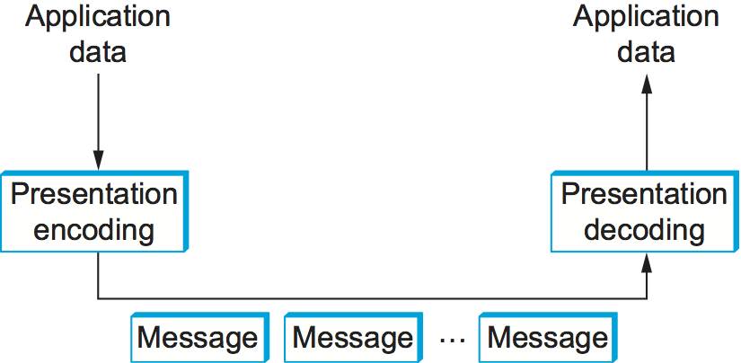

**Figure 7.1. Presentation formatting involves encoding and decoding application data.**

You might ask what makes this problem challenging. One reason is that computers represent data in different ways. For example, some computers represent floating-point numbers in IEEE standard 754 format, while some older machines still use their own nonstandard format. Even for something as simple as integers, different architectures use different sizes (e.g., 16-bit, 32-bit, 64-bit). To make matters worse, on some machines integers are represented in *big-endian* form (the most significant bit of a word—the "big end"—is in the byte with the lowest address), while on other machines integers are represented in *little-endian* form (the least significant bit—the "little end"—is in the byte with the lowest address). For example, PowerPC processors are big-endian machines, and the Intel x86 family is a little-endian architecture. Today, many architectures (e.g., ARM) support both representations (and so are called *bi-endian*), but the point is that you can never be sure how the host you are communicating with stores integers. The big-endian and little-endian representations of the integer 34,677,374 are given in Figure 7.2.

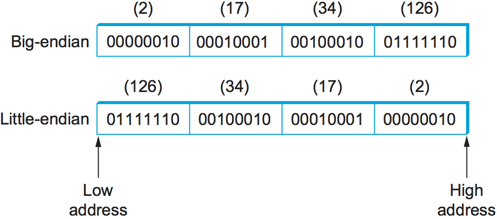

**Figure 7.2. Big-endian and little-endian byte order for the integer 34,677,374**

Another reason that marshalling is difficult is that application programs are written in different languages, and even when you are using a single language there may be more than one compiler. For example, compilers have a fair amount of latitude in how they lay out structures (records) in memory, such as how much padding they put between the fields that make up the structure. Thus, you could not simply transmit a structure from one machine to another, even if both machines were of the same architecture and the program was written in the same language, because the compiler on the destination machine might align the fields in the structure differently.

#### 7.1.1 Taxonomy

Although argument marshalling is not rocket science—it is a small matter of bit twiddling—there are a surprising number of design choices that you must address. We begin by giving a simple taxonomy for argument marshalling systems. The following is by no means the only viable taxonomy, but it is sufficient to cover most of the interesting alternatives.

##### Data Types

The first question is what data types the system is going to support. In general, we can classify the types supported by an argument marshalling mechanism at three levels. Each level complicates the task faced by the marshalling system.

At the lowest level, a marshalling system operates on some set of *base types*. Typically, the base types include integers, floating-point numbers, and characters. The system might also support ordinal types and Booleans. As described above, the implication of the set of base types is that the encoding process must be able to convert each base type from one representation to another—for example, convert an integer from big-endian to little-endian.

At the next level are *flat types*—structures and arrays. While flat types might at first not appear to complicate argument marshalling, the reality is that they do. The problem is that the compilers used to compile application programs sometimes insert padding between the fields that make up the structure so as to align these fields on word boundaries. The marshalling system typically *packs* structures so that they contain no padding.

At the highest level, the marshalling system might have to deal with *complex types*—those types that are built using pointers. That is, the data structure that one program wants to send to another might not be contained in a single structure, but might instead involve pointers from one structure to another. A tree is a good example of a complex type that involves pointers. Clearly, the data encoder must prepare the data structure for transmission over the network because pointers are implemented by memory addresses, and just because a structure lives at a certain memory address on one machine does not mean it will live at the same address on another machine. In other words, the marshalling system must *serialize* (flatten) complex data structures.

In summary, depending on how complicated the type system is, the task of argument marshalling usually involves converting the base types, packing the structures, and linearizing the complex data structures, all to form a contiguous message that can be transmitted over the network. Figure 7.3 illustrates this task.

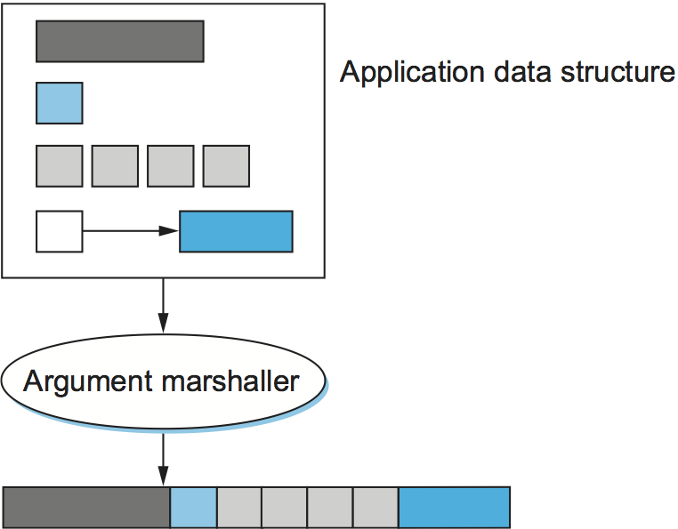

**Figure 7.3. Argument marshalling: converting, packing, and linearizing**

##### Conversion Strategy

Once the type system is established, the next issue is what conversion strategy the argument marshaller will use. There are two general options: *canonical intermediate form* and *receiver-makes-right*. We consider each, in turn.

The idea of canonical intermediate form is to settle on an external representation for each type; the sending host translates from its internal representation to this external representation before sending data, and the receiver translates from this external representation into its local representation when receiving data. To illustrate the idea, consider integer data; other types are treated in a similar manner. You might declare that the big-endian format will be used as the external representation for integers. The sending host must translate each integer it sends into big-endian form, and the receiving host must translate big-endian integers into whatever representation it uses. (This is what is done in the Internet for protocol headers.) Of course, a given host might already use big-endian form, in which case no conversion is necessary.

The alternative, receiver-makes-right, has the sender transmit data in its own internal format; the sender does not convert the base types, but usually has to pack and flatten more complex data structures. The receiver is then responsible for translating the data from the sender’s format into its own local format. The problem with this strategy is that every host must be prepared to convert data from all other machine architectures. In networking, this is known as an *N-by-N solution*: Each of N machine architectures must be able to handle all N architectures. In contrast, in a system that uses a canonical intermediate form, each host needs to know only how to convert between its own representation and a single other representation—the external one.

Using a common external format is clearly the correct thing to do, right? This has certainly been the conventional wisdom in the networking community for over 30 years. The answer is not cut and dried, however. It turns out that there are not that many different representations for the various base classes, or, said another way, N is not that large. In addition, the most common case is for two machines of the same type to be communicating with each other. In this situation, it seems silly to translate data from that architecture’s representation into some foreign external representation, only to have to translate the data back into the same architecture’s representation on the receiver.

A third option, although we know of no existing system that exploits it, is to use receiver-makes-right if the sender knows that the destination has the same architecture; the sender would use some canonical intermediate form if the two machines use different architectures. How would a sender learn the receiver’s architecture? It could learn this information either from a name server or by first using a simple test case to see if the appropriate result occurs.

##### Tags

The third issue in argument marshalling is how the receiver knows what kind of data is contained in the message it receives. There are two common approaches: *tagged* and *untagged* data. The tagged approach is more intuitive, so we describe it first.

A tag is any additional information included in a message—beyond the concrete representation of the base types—that helps the receiver decode the message. There are several possible tags that might be included in a message. For example, each data item might be augmented with a *type* tag. A type tag indicates that the value that follows is an integer, a floating-point number, or whatever. Another example is a *length* tag. Such a tag is used to indicate the number of elements in an array or the size of an integer. A third example is an *architecture* tag, which might be used in conjunction with the receiver-makes-right strategy to specify the architecture on which the data contained in the message was generated. Figure 7.4 depicts how a simple 32-bit integer might be encoded in a tagged message.

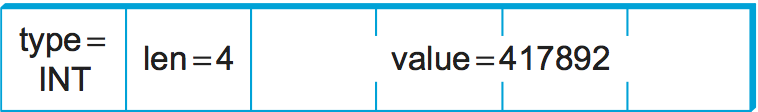

**Figure 7.4. A 32-bit integer encoded in a tagged message.**

The alternative, of course, is not to use tags. How does the receiver know how to decode the data in this case? It knows because it was programmed to know. In other words, if you call a remote procedure that takes two integers and a floating-point number as arguments, then there is no reason for the remote procedure to inspect tags to know what it has just received. It simply assumes that the message contains two integers and a float and decodes it accordingly. Note that, while this works for most cases, the one place it breaks down is when sending variable-length arrays. In such a case, a length tag is commonly used to indicate how long the array is.

It is also worth noting that the untagged approach means that the presentation formatting is truly end to end. It is not possible for some intermediate agent to interpret the message unless the data is tagged. Why would an intermediate agent need to interpret a message, you might ask? Stranger things have happened, mostly resulting from *ad hoc* solutions to unexpected problems that the system was not engineered to handle. Poor network design is beyond the scope of this book.

##### Stubs

A stub is the piece of code that implements argument marshalling. Stubs are typically used to support RPC. On the client side, the stub marshals the procedure arguments into a message that can be transmitted by means of the RPC protocol. On the server side, the stub converts the message back into a set of variables that can be used as arguments to call the remote procedure. Stubs can either be interpreted or compiled.

In a compilation-based approach, each procedure has a customized client and server stub. While it is possible to write stubs by hand, they are typically generated by a stub compiler, based on a description of the procedure’s interface. This situation is illustrated in Figure 7.5. Since the stub is compiled, it is usually very efficient. In an interpretation-based approach, the system provides generic client and server stubs that have their parameters set by a description of the procedure’s interface. Because it is easy to change this description, interpreted stubs have the advantage of being flexible. Compiled stubs are more common in practice.

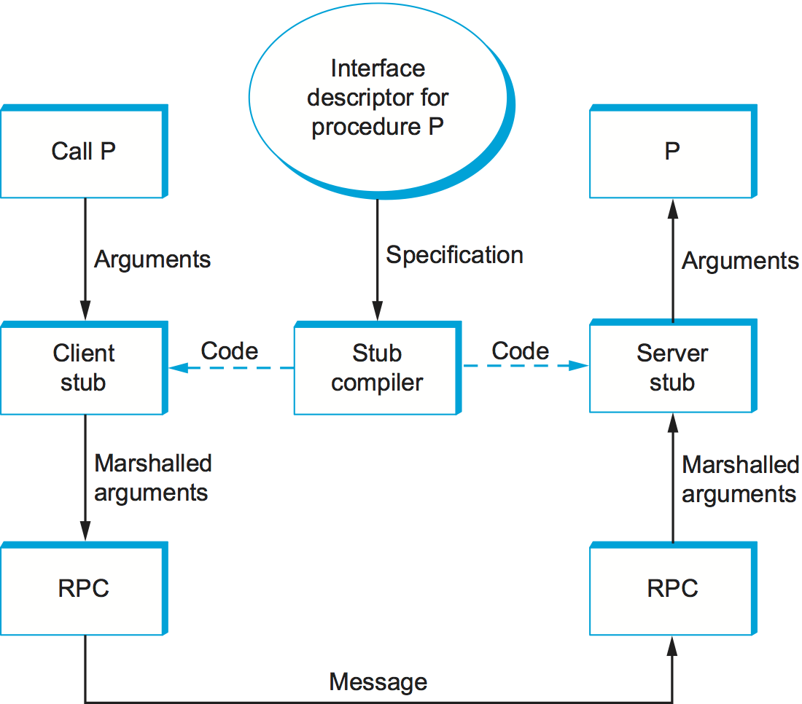

**Figure 7.5. Stub compiler takes interface description as input and outputs client and server stubs.**

#### 7.1.2 Examples (XDR, ASN.1, NDR, ProtoBufs)

We now briefly describe four popular network data representations in terms of this taxonomy. We use the integer base type to illustrate how each system works.

##### XDR

External Data Representation (XDR) is the network format used with SunRPC. In the taxonomy just introduced, XDR

- Supports the entire C-type system with the exception of function pointers
- Defines a canonical intermediate form
- Does not use tags (except to indicate array lengths)
- Uses compiled stubs

An XDR integer is a 32-bit data item that encodes a C integer. It is represented in twos’ complement notation, with the most significant byte of the C integer in the first byte of the XDR integer and the least significant byte of the C integer in the fourth byte of the XDR integer. That is, XDR uses big-endian format for integers. XDR supports both signed and unsigned integers, just as C does.

XDR represents variable-length arrays by first specifying an unsigned integer (4 bytes) that gives the number of elements in the array, followed by that many elements of the appropriate type. XDR encodes the components of a structure in the order of their declaration in the structure. For both arrays and structures, the size of each element/component is represented in a multiple of 4 bytes. Smaller data types are padded out to 4 bytes with 0s. The exception to this “pad to 4 bytes” rule is made for characters, which are encoded one per byte.

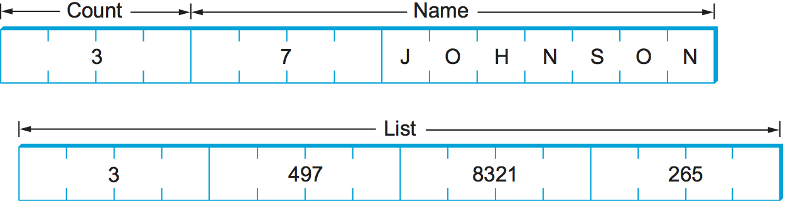

**Figure 7.6. Example encoding of a structure in XDR.**

The following code fragment gives an example C structure (item) and the XDR routine that encodes/decodes this structure (xdr_item). Figure 7.6 schematically depicts XDR’s on-the-wire representation of this structure when the field name is seven characters long and the array list has three values in it.

In this example, xdr_array, xdr_int, and xdr_string are three primitive functions provided by XDR to encode and decode arrays, integers, and character strings, respectively. Argument xdrs is a context variable that XDR uses to keep track of where it is in the message being processed; it includes a flag that indicates whether this routine is being used to encode or decode the message. In other words, routines like xdr_item are used on both the client and the server. Note that the application programmer can either write the routine xdr_item by hand or use a stub compiler called rpcgen (not shown) to generate this encoding/decoding routine. In the latter case, rpcgen takes the remote procedure that defines the data structure item as input and outputs the corresponding stub.

```c
#define MAXNAME 256;
#define MAXLIST 100;

struct item {
  int     count;
  char    name[MAXNAME];
  int     list[MAXLIST];
};

bool_t
xdr_item(XDR *xdrs, struct item *ptr)
{
   return(xdr_int(xdrs, &ptr->count) &&
      xdr_string(xdrs, &ptr->name, MAXNAME) &&
      xdr_array(xdrs, &ptr->list, &ptr->count, MAXLIST,
                sizeof(int), xdr_int));
}
```

Exactly how XDR performs depends, of course, on the complexity of the data. In a simple case of an array of integers, where each integer has to be converted from one byte order to another, an average of three instructions are required for each byte, meaning that converting the whole array is likely to be limited by the memory bandwidth of the machine. More complex conversions that require significantly more instructions per byte will be CPU limited and thus perform at a data rate less than the memory bandwidth.

##### ASN.1

Abstract Syntax Notation One (ASN.1) is an ISO standard that defines, among other things, a representation for data sent over a network. The representation-specific part of ASN.1 is called the *Basic Encoding Rules* (BER). ASN.1 supports the C-type system without function pointers, defines a canonical intermediate form, and uses type tags. Its stubs can be either interpreted or compiled. One of the claims to fame of ASN.1 BER is that it is used by the Internet standard Simple Network Management Protocol (SNMP).

ASN.1 represents each data item with a triple of the form

```text
(tag, length, value)
```

The tag is typically an 8-bit field, although ASN.1 allows for the definition of multibyte tags. The length field specifies how many bytes make up the value; we discuss length more below. Compound data types, such as structures, can be constructed by nesting primitive types, as illustrated in Figure 7.7.

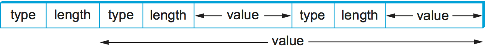

**Figure 7.7. Compound types created by means of nesting in ASN.1 BER.**

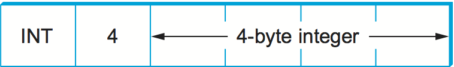

**Figure 7.8. ASN.1 BER representation for a 4-byte integer.**

If the value is 127 or fewer bytes long, then the length is specified in a single byte. Thus, for example, a 32-bit integer is encoded as a 1-byte type, a 1-byte length, and the 4 bytes that encode the integer, as illustrated in Figure 7.8. The value itself, in the case of an integer, is represented in twos’ complement notation and big-endian form, just as in XDR. Keep in mind that, even though the value of the integer is represented in exactly the same way in both XDR and ASN.1, the XDR representation has neither the type nor the length tags associated with that integer. These two tags both take up space in the message and, more importantly, require processing during marshalling and unmarshalling. This is one reason why ASN.1 is not as efficient as XDR. Another is that the very fact that each data value is preceded by a length field means that the data value is unlikely to fall on a natural byte boundary (e.g., an integer beginning on a word boundary). This complicates the encoding/decoding process.

If the value is 128 or more bytes long, then multiple bytes are used to specify its length. At this point you may be asking why a byte can specify a length of up to 127 bytes rather than 256. The reason is that 1 bit of the length field is used to denote how long the length field is. A 0 in the eighth bit indicates a 1-byte length field. To specify a longer length, the eighth bit is set to 1, and the other 7 bits indicate how many additional bytes make up the length. Figure 7.9 illustrates a simple 1-byte length and a multibyte length.

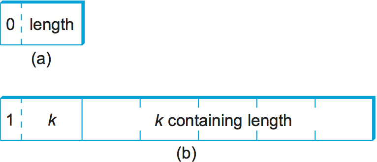

**Figure 7.9. ASN.1 BER representation for length: (a) 1 byte; (b) multibyte.**

##### NDR

Network Data Representation (NDR) is the data-encoding standard used in the Distributed Computing Environment (DCE). Unlike XDR and ASN.1, NDR uses receiver-makes-right. It does this by inserting an architecture tag at the front of each message; individual data items are untagged. NDR uses a compiler to generate stubs. This compiler takes a description of a program written in the Interface Definition Language (IDL) and generates the necessary stubs. IDL looks pretty much like C, and so essentially supports the C-type system.

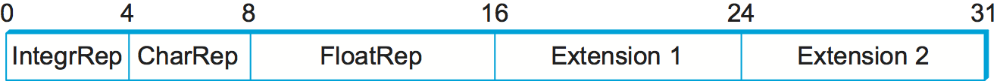

**Figure 7.10. NDR’s architecture tag.**

Figure 7.10 illustrates the 4-byte architecture definition tag that is included at the front of each NDR-encoded message. The first byte contains two 4-bit fields. The first field, IntegrRep, defines the format for all integers contained in the message. A 0 in this field indicates big-endian integers, and a 1 indicates little-endian integers. The CharRep field indicates what character format is used: 0 means ASCII (American Standard Code for Information Interchange) and 1 means EBCDIC (an older, IBM-defined alternative to ASCII). Next, the FloatRep byte defines which floating-point representation is being used: 0 means IEEE 754, 1 means VAX, 2 means Cray, and 3 means IBM. The final 2 bytes are reserved for future use. Note that, in simple cases such as arrays of integers, NDR does the same amount of work as XDR, and so it is able to achieve the same performance.

##### ProtoBufs

Protocol Buffers (Protobufs, for short) provide a language-neutral and platform-neutral way of serializing structured data, commonly used with gRPC. They use a tagged strategy with a canonical intermediate form, where the stub on both sides is generated from a shared .proto file. This specification uses a simple C-like syntax, as the following example illustrates:

```c
message Person {
   required string name = 1;
   required int32 id = 2;
   optional string email = 3;

   enum PhoneType {
       MOBILE = 0;
       HOME = 1;
       WORK = 2;
   }

   message PhoneNumber {
       required string number = 1;
       optional PhoneType type = 2 [default = HOME];
   }

   required PhoneNumber phone = 4;
}
```

where message could roughly be interpreted as equivalent to typedef struct in C. The rest of the example is fairly intuitive, except that every field is given a numeric identifier to ensure uniqueness should the specification change over time, and each field can be annotated as being either required or optional.

The way Protobufs encode integers is novel. They use a technique called *varints* (variable length integers) in which each 8-bit byte uses the most significant bit to indicate whether there are more bytes in the integer, and the lower seven bits to encode the two’s complement representation of the next group of seven bits in the value. The least significant group is first in the serialization.

This means a small integer (less than 128) can be encoded in a single byte (e.g., the integer 2 is encoded as 0000 0010), while for an integer bigger than 128, more bytes are needed. For example, 365 would be encoded as

```text
1110 1101 0000 0010
```

To see this, first drop the most significant bit from each byte, as it is there to tell us whether we’ve reached the end of the integer. In this example, the 1 in the most significant bit of the first byte indicates there is more than one byte in the varint:

```text
1110 1101 0000 0010
→ 110 1101  000 0010
```

Since varints store numbers with the least significant group first, you next reverse the two groups of seven bits. Then you concatenate them to get your final value:

```text
000 0010  110 1101
→  000 0010 || 110 1101
→  101101101
→  256 + 64 + 32 + 8 + 4 + 1 = 365
```

For the larger message specification, you can think of the serialized byte stream as a collection of key/value pairs, where the key (i.e., tag) has two sub-parts: the unique identifier for the field (i.e., those extra numbers in the example .proto file) and the *wire type* of the value (e.g., Varint is the one example wire type we have seen so far). Other supported wire types include 32-bit and 64-bit (for fixed-length integers), and length-delimited (for strings and embedded messages). The latter tells you how many bytes long the embedded message (structure) is, but it’s another message specification in the .proto file that tells you how to interpret those bytes.

#### 7.1.3 Markup Languages (XML)

Although we have been discussing the presentation formatting problem from the perspective of RPC—that is, how does one encode primitive data types and compound data structures so they can be sent from a client program to a server program—the same basic problem occurs in other settings. For example, how does a web server describe a Web page so that any number of different browsers know what to display on the screen? In this specific case, the answer is the HyperText Markup Language (HTML), which indicates that certain character strings should be displayed in bold or italics, what font type and size should be used, and where images should be positioned.

The availability of all sorts of Web applications and data have also created a situation in which different Web applications need to communicate with each other and understand each other’s data. For example, an e-commerce website might need to talk to a shipping company’s website to allow a customer to track a package without ever leaving the e-commerce website. This quickly starts to look a lot like RPC, and the approach taken in the Web today to enable such communication among web servers is based on the *Extensible Markup Language* (XML)—a way to describe the data being exchanged between Web apps.

Markup languages, of which HTML and XML are both examples, take the tagged data approach to the extreme. Data is represented as text, and text tags known as *markup* are intermingled with the data text to express information about the data. In the case of HTML, markup indicates how the text should be displayed; other markup languages like XML can express the type and structure of the data.

XML is actually a framework for defining different markup languages for different kinds of data. For example, XML has been used to define a markup language that is roughly equivalent to HTML called *Extensible HyperText Markup Language* (XHTML). XML defines a basic syntax for mixing markup with data text, but the designer of a specific markup language has to name and define its markup. It is common practice to refer to individual XML-based languages simply as XML, but we will emphasize the distinction in this introductory material.

XML syntax looks much like HTML. For example, an employee record in a hypothetical XML-based language might look like the following XML *document*, which might be stored in a file named employee.xml. The first line indicates the version of XML being used, and the remaining lines represent four fields that make up the employee record, the last of which (hiredate) contains three subfields. In other words, XML syntax provides for a nested structure of tag/value pairs, which is equivalent to a tree structure for the represented data (with employee as the root). This is similar to XDR, ASN.1, and NDR’s ability to represent compound types, but in a format that can be both processed by programs and read by humans. More importantly, programs such as parsers can be used across different XML-based languages, because the definitions of those languages are themselves expressed as machine-readable data that can be input to the programs.

```xml
<?xml version="1.0"?>
<employee>
  <name>John Doe</name>
  <title>Head Bottle Washer</title>
  <id>123456789</id>
  <hiredate>
     <day>5</day>
     <month>June</month>
     <year>1986</year>
  </hiredate>
</employee>
```

Although the markup and the data in this document are highly suggestive to the human reader, it is the definition of the employee record language that actually determines what tags are legal, what they mean, and what data types they imply. Without some formal definition of the tags, a human reader (or a computer) can’t tell whether 1986 in the year field, for example, is a string, an integer, an unsigned integer, or a floating point number.

The definition of a specific XML-based language is given by a *schema*, which is a database term for a specification of how to interpret a collection of data. Several schema languages have been defined for XML; we will focus here on the leading standard, known by the none-too-surprising name *XML Schema*. An individual schema defined using XML Schema is known as an *XML Schema Document* (XSD). The following is an XSD specification for the example; in other words, it defines the language to which the example document conforms. It might be stored in a file named employee.xsd.

```xml
<?xml version="1.0"?>
<schema xmlns="http://www.w3.org/2001/XMLSchema">
 <element name="employee">
   <complexType>
     <sequence>
       <element name="name" type="string"/>
       <element name="title" type="string"/>
       <element name="id" type="string"/>
       <element name="hiredate">
         <complexType>
           <sequence>
             <element name="day" type="integer"/>
             <element name="month" type="string"/>
             <element name="year" type="integer"/>
           </sequence>
         </complexType>
       </element>
     </sequence>
   </complexType>
 </element>
</schema>
```

This XSD looks superficially similar to our example document employee.xml, and for good reason: XML Schema is itself an XML-based language. There is an obvious relationship between this XSD and the document defined above. For example,

```xml
<element name="title" type="string"/>
```

indicates that the value bracketed by the markup title is to be interpreted as a string. The sequence and nesting of that line in the XSD indicate that a title field must be the second item in an employee record.

Unlike some schema languages, XML Schema provides datatypes such as string, integer, decimal, and Boolean. It allows the datatypes to be combined in sequences or nested, as in employee.xsd, to create compound data types. So an XSD defines more than a syntax; it defines its own abstract data model. A document that conforms to the XSD represents a collection of data that conforms to the data model.

The significance of an XSD defining an abstract data model and not just a syntax is that there can be other ways besides XML of representing data that conforms to the model. And XML does, after all, have some shortcomings as an on-the-wire representation: it is not as compact as other data representations, and it is relatively slow to parse. A number of alternative representations described as binary are in use. The International Standards Organization (ISO) has published one called *Fast Infoset*, while the World Wide Web Consortium (W3C) has produced the *Efficient XML Interchange* (EXI) proposal. Binary representations sacrifice human readability for greater compactness and faster parsing.

##### XML Namespaces

XML has to solve a common problem, that of name clashes. The problem arises because schema languages such as XML Schema support modularity in the sense that a schema can be reused as part of another schema. Suppose two XSDs are defined independently, and both happen to define the markup name *idNumber*. Perhaps one XSD uses that name to identify employees of a company, and the other XSD uses it to identify laptop computers owned by the company. We might like to reuse those two XSDs in a third XSD for describing which assets are associated with which employees, but to do that we need some mechanism for distinguishing employees’ idNumbers from laptop idNumbers.

XML’s solution to this problem is *XML namespaces*. A namespace is a collection of names. Each XML namespace is identified by a Uniform Resource Identifier (URI). URIs will be described in some detail in a later chapter; for now, all you really need to know is that URIs are a form of globally unique identifier. (An HTTP URL is a particular type of UNI.) A simple markup name like *idNumber* can be added to a namespace as long as it is unique within that namespace. Since the namespace is globally unique and the simple name is unique within the namespace, the combination of the two is a globally unique *qualified name* that cannot clash.

An XSD usually specifies a *target namespace* with a line like the following:

```xml
targetNamespace="http://www.example.com/employee"
```

is a Uniform Resource Identifier, identifying a made-up namespace. All the new markup defined in that XSD will belong to that namespace.

Now, if an XSD wants to reference names that have been defined in other XSDs, it can do so by qualifying those names with a namespace prefix. This prefix is a short abbreviation for the full URI that actually identifies the namespace. For example, the following line assigns emp as the namespace prefix for the employee namespace:

```xml
xmlns:emp="http://www.example.com/employee"
```

Any markup from that namespace would be qualified by prefixing it with emp: , as is title in the following line:

```xml
<emp:title>Head Bottle Washer</emp:title>
```

In other words, emp:title is a qualified name, which will not clash with the name title from some other namespace.

It is remarkable how widely XML is now used in applications that range from RPC-style communication among Web-based services to office productivity tools to instant messaging. It is certainly one of the core protocols on which the upper layers of the Internet now depend.

### 7.2 Multimedia Data

Multimedia data, comprised of audio, video, and still images, now makes up the majority of traffic on the Internet. Part of what has made the widespread transmission of multimedia across networks possible is advances in compression technology. Because multimedia data is consumed mostly by humans using their senses—vision and hearing—and processed by the human brain, there are unique challenges to compressing it. You want to try to keep the information that is most important to a human, while getting rid of anything that doesn’t improve the human’s perception of the visual or auditory experience. Hence, both computer science and the study of human perception come into play. In this section, we’ll look at some of the major efforts in representing and compressing multimedia data.

The uses of compression are not limited to multimedia data of course—for example, you may well have used a utility like zip or compress to compress files before sending them over a network, or to uncompress a data file after downloading. It turns out that the techniques used for compressing data—which are typically *lossless*, because most people don’t like to lose data from a file—also show up as part of the solution for multimedia compression. In contrast, *lossy compression*, commonly used for multimedia data, does not promise that the data received is exactly the same as the data sent. As noted above, this is because multimedia data often contains information that is of little utility to the human who receives it. Our senses and brains can only perceive so much detail. They are also very good at filling in missing pieces and even correcting some errors in what we see or hear. And, lossy algorithms typically achieve much better compression ratios than do their lossless counterparts; they can be an order of magnitude better or more.

To get a sense of how important compression has been to the spread of networked multimedia, consider the following example. A high-definition TV screen has something like 1080 × 1920 pixels, each of which has 24 bits of color information, so each frame is

1080 × 1920 × 24 = 50 *Mb*

so if you want to send 24 frames per second, that would be over 1 Gbps. That’s more than most Internet users have access to. By contrast, modern compression techniques can get a reasonably high-quality HDTV signal down to the range of 10 Mbps, a two order of magnitude reduction and well within the reach of most broadband users. Similar compression gains apply to lower quality video such as YouTube clips—Web video could never have reached its current popularity without compression to make all those entertaining videos fit within the bandwidth of today’s networks.

Compression techniques as applied to multimedia have been an area of great innovation, particularly lossy compression. Lossless techniques also have an important role to play, however. Indeed, most of the lossy techniques include some steps that are lossless, so we begin our discussion with an overview of lossless compression.

#### 7.2.1 Lossless Compression Techniques

In many ways, compression is inseparable from data encoding. When thinking about how to encode a piece of data in a set of bits, we might just as well think about how to encode the data in the smallest set of bits possible. For example, if you have a block of data that is made up of the 26 symbols A through Z, and if all of these symbols have an equal chance of occurring in the data block you are encoding, then encoding each symbol in 5 bits is the best you can do (since 2 ⁵ = 32 is the lowest power of 2 above 26). If, however, the symbol R occurs 50% of the time, then it would be a good idea to use fewer bits to encode the R than any of the other symbols. In general, if you know the relative probability that each symbol will occur in the data, then you can assign a different number of bits to each possible symbol in a way that minimizes the number of bits it takes to encode a given block of data. This is the essential idea of *Huffman codes*, one of the important early developments in data compression.

##### Run Length Encoding

Run length encoding (RLE) is a compression technique with a brute-force simplicity. The idea is to replace consecutive occurrences of a given symbol with only one copy of the symbol, plus a count of how many times that symbol occurs—hence, the name *run length*. For example, the string AAABBCDDDD would be encoded as 3A2B1C4D.

RLE turns out to be useful for compressing some classes of images. It can be used in this context by comparing adjacent pixel values and then encoding only the changes. For images that have large homogeneous regions, this technique is quite effective. For example, it is not uncommon that RLE can achieve compression ratios on the order of 8-to-1 for scanned text images. RLE works well on such files because they often contain a large amount of white space that can be removed. For those old enough to remember the technology, RLE was the key compression algorithm used to transmit faxes. However, for images with even a small degree of local variation, it is not uncommon for compression to actually increase the image byte size, since it takes 2 bytes to represent a single symbol when that symbol is not repeated.

##### Differential Pulse Code Modulation

Another simple lossless compression algorithm is Differential Pulse Code Modulation (DPCM). The idea here is to first output a reference symbol and then, for each symbol in the data, to output the difference between that symbol and the reference symbol. For example, using symbol A as the reference symbol, the string AAABBCDDDD would be encoded as A0001123333 because A is the same as the reference symbol, B has a difference of 1 from the reference symbol, and so on. Note that this simple example does not illustrate the real benefit of DPCM, which is that when the differences are small they can be encoded with fewer bits than the symbol itself. In this example, the range of differences, 0-3, can be represented with 2 bits each, rather than the 7 or 8 bits required by the full character. As soon as the difference becomes too large, a new reference symbol is selected.

DPCM works better than RLE for most digital imagery, since it takes advantage of the fact that adjacent pixels are usually similar. Due to this correlation, the dynamic range of the differences between the adjacent pixel values can be significantly less than the dynamic range of the original image, and this range can therefore be represented using fewer bits. Using DPCM, we have measured compression ratios of 1.5-to-1 on digital images. DPCM also works on audio, because adjacent samples of an audio waveform are likely to be close in value.

A slightly different approach, called *delta encoding*, simply encodes a symbol as the difference from the previous one. Thus, for example, AAABBCDDDD would be represented as A001011000. Note that delta encoding is likely to work well for encoding images where adjacent pixels are similar. It is also possible to perform RLE after delta encoding, since we might find long strings of 0s if there are many similar symbols next to each other.

##### Dictionary-Based Methods

The final lossless compression method we consider is the dictionary-based approach, of which the Lempel-Ziv (LZ) compression algorithm is the best known. The Unix compress and gzip commands use variants of the LZ algorithm.

The idea of a dictionary-based compression algorithm is to build a dictionary (table) of variable-length strings (think of them as common phrases) that you expect to find in the data and then to replace each of these strings when it appears in the data with the corresponding index to the dictionary. For example, instead of working with individual characters in text data, you could treat each word as a string and output the index in the dictionary for that word. To further elaborate on this example, the word *compression* has the index 4978 in one particular dictionary; it is the 4978th word in /usr/share/dict/words. To compress a body of text, each time the string “compression” appears, it would be replaced by 4978. Since this particular dictionary has just over 25,000 words in it, it would take 15 bits to encode the index, meaning that the string “compression” could be represented in 15 bits rather than the 77 bits required by 7-bit ASCII. This is a compression ratio of 5-to-1! At another data point, we were able to get a 2-to-1 compression ratio when we applied the compress command to the source code for the protocols described in this book.

Of course, this leaves the question of where the dictionary comes from. One option is to define a static dictionary, preferably one that is tailored for the data being compressed. A more general solution, and the one used by LZ compression, is to adaptively define the dictionary based on the contents of the data being compressed. In this case, however, the dictionary constructed during compression has to be sent along with the data so that the decompression half of the algorithm can do its job. Exactly how you build an adaptive dictionary has been a subject of extensive research.

#### 7.2.2 Image Representation and Compression (GIF, JPEG)

Given the ubiquitous use of digital imagery—this use was spawned by the invention of graphical displays, not high-speed networks—the need for standard representation formats and compression algorithms for digital imagery data has become essential. In response to this need, the ISO defined a digital image format known as *JPEG*, named after the Joint Photographic Experts Group that designed it. (The “Joint” in JPEG stands for a joint ISO/ITU effort.) JPEG is the most widely used format for still images in use today. At the heart of the definition of the format is a compression algorithm, which we describe below. Many techniques used in JPEG also appear in MPEG, the set of standards for video compression and transmission created by the Moving Picture Experts Group.

Before delving into the details of JPEG, we observe that there are quite a few steps to get from a digital image to a compressed representation of that image that can be transmitted, decompressed, and displayed correctly by a receiver. You probably know that digital images are made up of pixels (hence, the megapixels quoted in smartphone camera advertisements). Each pixel represents one location in the two-dimensional grid that makes up the image, and for color images each pixel has some numerical value representing a color. There are lots of ways to represent colors, referred to as *color spaces*; the one most people are familiar with is RGB (red, green, blue). You can think of color as being a three dimensional quantity—you can make any color out of red, green, and blue light in different amounts. In a three-dimensional space, there are lots of different, valid ways to describe a given point (consider Cartesian and polar coordinates, for example). Similarly, there are various ways to describe a color using three quantities, and the most common alternative to RGB is YUV. The Y is luminance, roughly the overall brightness of the pixel, and U and V contain chrominance, or color information. Confoundingly, there are a few different variants of the YUV color space as well. More on this in a moment.

The significance of this discussion is that the encoding and transmission of color images (either still or moving) requires agreement between the two ends on the color space. Otherwise, of course, you’d end up with different colors being displayed by the receiver than were captured by the sender. Hence, agreeing on a color space definition (and perhaps a way to communicate which particular space is in use) is part of the definition of any image or video format.

Let’s look at the example of the Graphical Interchange Format (GIF). GIF uses the RGB color space and starts out with 8 bits to represent each of the three dimensions of color for a total of 24 bits. Rather than sending those 24 bits per pixel, however, GIF first reduces 24-bit color images to 8-bit color images. This is done by identifying the colors used in the picture, of which there will typically be considerably fewer than 2 ²⁴, and then picking the 256 colors that most closely approximate the colors used in the picture. There might be more than 256 colors, however, so the trick is to try not to distort the color too much by picking 256 colors such that no pixel has its color changed too much.

The 256 colors are stored in a table, which can be indexed with an 8-bit number, and the value for each pixel is replaced by the appropriate index. Note that this is an example of lossy compression for any picture with more than 256 colors. GIF then runs an LZ variant over the result, treating common sequences of pixels as the strings that make up the dictionary—a lossless operation. Using this approach, GIF is sometimes able to achieve compression ratios on the order of 10:1, but only when the image consists of a relatively small number of discrete colors. Graphical logos, for example, are handled well by GIF. Images of natural scenes, which often include a more continuous spectrum of colors, cannot be compressed at this ratio using GIF. It is also not too hard for a human eye to detect the distortion caused by the lossy color reduction of GIF in some cases.

The JPEG format is considerably more well suited to photographic images, as you would hope given the name of the group that created it. JPEG does not reduce the number of colors like GIF. Instead, JPEG starts off by transforming the RGB colors (which are what you usually get out of a digital camera) to the YUV space. The reason for this has to do with the way the eye perceives images. There are receptors in the eye for brightness, and separate receptors for color. Because we’re very good at perceiving variations in brightness, it makes sense to spend more bits on transmitting brightness information. Since the Y component of YUV is, roughly, the brightness of the pixel, we can compress that component separately, and less aggressively, from the other two (chrominance) components.

As noted above, YUV and RGB are alternative ways to describe a point in a 3-dimensional space, and it’s possible to convert from one color space to another using linear equations. For one YUV space that is commonly used to represent digital images, the equations are:

```text
Y = 0.299R + 0.587G + 0.114B
U = (B-Y) x 0.565
V =  (R-Y) x 0.713
```

The exact values of the constants here are not important, as long as the encoder and decoder agree on what they are. (The decoder will have to apply the inverse transformations to recover the RGB components needed to drive a display.) The constants are, however, carefully chosen based on the human perception of color. You can see that Y, the luminance, is a sum of the red, green, and blue components, while U and V are color difference components. U represents the difference between the luminance and blue, and V the difference between luminance and red. You may notice that setting R, G, and B to their maximum values (which would be 255 for 8-bit representations) will also produce a value of Y=255 while U and V in this case would be zero. That is, a fully white pixel is (255,255,255) in RGB space and (255,0,0) in YUV space.

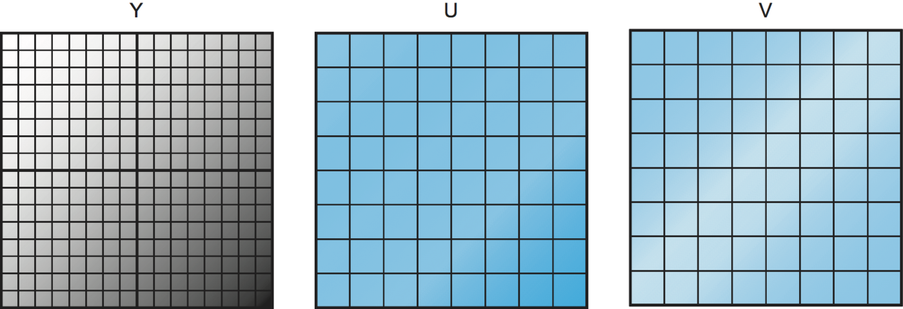

**Figure 7.11. Subsampling the U and V components of an image.**

Once the image has been transformed into YUV space, we can now think about compressing each of the three components separately. We want to be more aggressive in compressing the U and V components, to which human eyes are less sensitive. One way to compress the U and V components is to *subsample* them. The basic idea of subsampling is to take a number of adjacent pixels, calculate the average U or V value for that group of pixels, and transmit that, rather than sending the value for every pixel. Figure 7.11 illustrates the point. The luminance (Y) component is not subsampled, so the Y value of all the pixels will be transmitted, as indicated by the 16 × 16 grid of pixels on the left. In the case of U and V, we treat each group of four adjacent pixels as a group, calculate the average of the U or V value for that group, and transmit that. Hence, we end up with an 8 × 8 grid of U and V values to transmit. Thus, in this example, for every four pixels, we transmit six values (four Y and one each of U and V) rather than the original 12 values (four each for all three components), for a 50% reduction in information.

It’s worth noting that you could be either more or less aggressive in the subsampling, with corresponding increases in compression and decreases in quality. The subsampling approach shown here, in which chrominance is subsampled by a factor of two in both horizontal and vertical directions (and which goes by the identification 4:2:0), happens to match the most common approach used for both JPEG and MPEG.

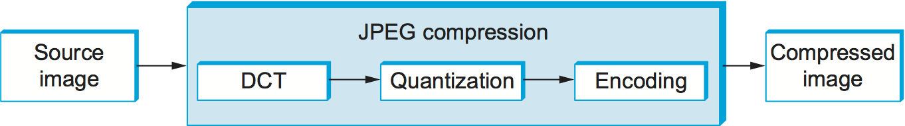

**Figure 7.12. Block diagram of JPEG compression.**

Once subsampling is done, we now have three grids of pixels to deal with, and each one is dealt with separately. JPEG compression of each component takes place in three phases, as illustrated in Figure 7.12. On the compression side, the image is fed through these three phases one 8 × 8 block at a time. The first phase applies the discrete cosine transform (DCT) to the block. If you think of the image as a signal in the spatial domain, then DCT transforms this signal into an equivalent signal in the *spatial frequency* domain. This is a lossless operation but a necessary precursor to the next, lossy step. After the DCT, the second phase applies a quantization to the resulting signal and, in so doing, loses the least significant information contained in that signal. The third phase encodes the final result, but in so doing also adds an element of lossless compression to the lossy compression achieved by the first two phases. Decompression follows these same three phases, but in reverse order.

##### DCT Phase

DCT is a transformation closely related to the fast Fourier transform (FFT). It takes an 8 × 8 matrix of pixel values as input and outputs an 8 × 8 matrix of frequency coefficients. You can think of the input matrix as a 64-point signal that is defined in two spatial dimensions (*x* and *y*); DCT breaks this signal into 64 spatial frequencies. To get an intuitive feel for spatial frequency, imagine yourself moving across a picture in, say, the *x* direction. You would see the value of each pixel varying as some function of *x*. If this value changes slowly with increasing *x*, then it has a low spatial frequency; if it changes rapidly, it has a high spatial frequency. So the low frequencies correspond to the gross features of the picture, while the high frequencies correspond to fine detail. The idea behind the DCT is to separate the gross features, which are essential to viewing the image, from the fine detail, which is less essential and, in some cases, might be barely perceived by the eye.

DCT, along with its inverse, which recovers the original pixels and during decompression, are defined by the following formulas:

beginaligned DCT(i,j) &=& 1/√(2N) C(i) C(j) Σ_{x=0}^{N-1} Σ_{y=0}^{N-1} pixel(x, y) cos [ (2x+1)i π/2N] cos [ (2y+1)j π/2N]\ mathitpixel(x,y) &=& 1/√(2N) Σ_{i=0}^{N-1} Σ_{j=0}^{N-1} C(i) C(j) DCT(i, j) cos [ (2x+1)i π/2N] cos [ (2y+1)j π/2N] endaligned

where C(x) = 1/√(2) when x=0 and 1 when x>0, and pixel(x,y) is the grayscale value of the pixel at position *(x,y)* in the 8 × 8 block being compressed; N = 8 in this case.

The first frequency coefficient, at location (0,0) in the output matrix, is called the *DC coefficient*. Intuitively, we can see that the DC coefficient is a measure of the average value of the 64 input pixels. The other 63 elements of the output matrix are called the *AC coefficients*. They add the higher-spatial-frequency information to this average value. Thus, as you go from the first frequency coefficient toward the 64th frequency coefficient, you are moving from low-frequency information to high-frequency information, from the broad strokes of the image to finer and finer detail. These higher-frequency coefficients are increasingly unimportant to the perceived quality of the image. It is the second phase of JPEG that decides which portion of which coefficients to throw away.

##### Quantization Phase

The second phase of JPEG is where the compression becomes lossy. DCT does not itself lose information; it just transforms the image into a form that makes it easier to know what information to remove. (Although not lossy, *per se*, there is of course some loss of precision during the DCT phase because of the use of fixed-point arithmetic.) Quantization is easy to understand—it’s simply a matter of dropping the insignificant bits of the frequency coefficients.

To see how the quantization phase works, imagine that you want to compress some whole numbers less than 100, such as 45, 98, 23, 66, and

1. If you decided that knowing these numbers truncated to the nearest

multiple of 10 is sufficient for your purposes, then you could divide each number by the quantum 10 using integer arithmetic, yielding 4, 9, 2, 6, and 0. These numbers can each be encoded in 4 bits rather than the 7 bits needed to encode the original numbers.

**Table 7.1. Example JPEG Quantization Table.**

| Quantum |  |  |  |  |  |  |  |
| --- | --- | --- | --- | --- | --- | --- | --- |
| 3 | 5 | 7 | 9 | 11 | 13 | 15 | 17 |
| 5 | 7 | 9 | 11 | 13 | 15 | 17 | 19 |
| 7 | 9 | 11 | 13 | 15 | 17 | 19 | 21 |
| 9 | 11 | 13 | 15 | 17 | 19 | 21 | 23 |
| 11 | 13 | 15 | 17 | 19 | 21 | 23 | 25 |
| 13 | 15 | 17 | 19 | 21 | 23 | 25 | 27 |
| 15 | 17 | 19 | 21 | 23 | 25 | 27 | 29 |
| 17 | 19 | 21 | 23 | 25 | 27 | 29 | 31 |

Rather than using the same quantum for all 64 coefficients, JPEG uses a quantization table that gives the quantum to use for each of the coefficients, as specified in the formula given below. You can think of this table (Quantum) as a parameter that can be set to control how much information is lost and, correspondingly, how much compression is achieved. In practice, the JPEG standard specifies a set of quantization tables that have proven effective in compressing digital images; an example quantization table is given in Table 7.1. In tables like this one, the low coefficients have a quantum close to 1 (meaning that little low-frequency information is lost) and the high coefficients have larger values (meaning that more high-frequency information is lost). Notice that as a result of such quantization tables many of the high-frequency coefficients end up being set to 0 after quantization, making them ripe for further compression in the third phase.

The basic quantization equation is

```text
QuantizedValue(i,j) = IntegerRound(DCT(i,j)/Quantum(i,j))
```

where

```text
IntegerRound(x) =
Floor(x + 0.5) if x >= 0
Floor(x - 0.5) if x < 0
```

Decompression is then simply defined as

```text
DCT(i,j) = QuantizedValue(i,j) x Quantum(i,j)
```

For example, if the DC coefficient (i.e., DCT(0,0)) for a particular block was equal to 25, then the quantization of this value using Table 7.1 would result in

```text
Floor(25/3+0.5) = 8
```

During decompression, this coefficient would then be restored as 8 × 3 = 24.

##### Encoding Phase

The final phase of JPEG encodes the quantized frequency coefficients in a compact form. This results in additional compression, but this compression is lossless. Starting with the DC coefficient in position (0,0), the coefficients are processed in the zigzag sequence shown in Figure 7.13. Along this zigzag, a form of run length encoding is used—RLE is applied to only the 0 coefficients, which is significant because many of the later coefficients are 0. The individual coefficient values are then encoded using a Huffman code. (The JPEG standard allows the implementer to use an arithmetic coding instead of the Huffman code.)

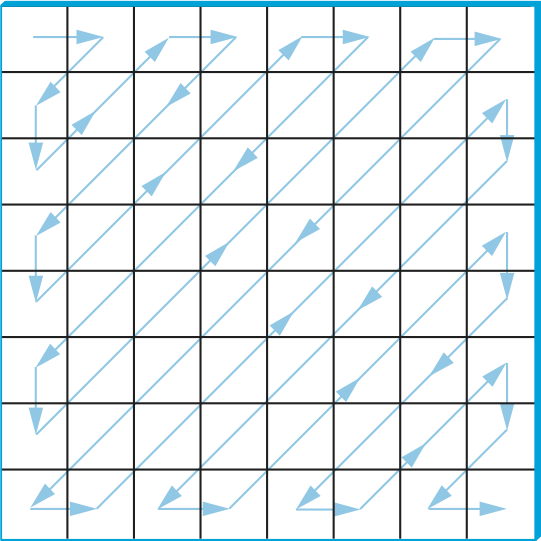

**Figure 7.13. Zigzag traversal of quantized frequency coefficients.**

In addition, because the DC coefficient contains a large percentage of the information about the 8 × 8 block from the source image, and images typically change slowly from block to block, each DC coefficient is encoded as the difference from the previous DC coefficient. This is the delta encoding approach described in a later section.

JPEG includes a number of variations that control how much compression you achieve versus the fidelity of the image. This can be done, for example, by using different quantization tables. These variations, plus the fact that different images have different characteristics, make it impossible to say with any precision the compression ratios that can be achieved with JPEG. Ratios of 30:1 are common, and higher ratios are certainly possible, but *artifacts* (noticeable distortion due to compression) become more severe at higher ratios.

#### 7.2.3 Video Compression (MPEG)

We now turn our attention to the MPEG format, named after the Moving Picture Experts Group that defined it. To a first approximation, a moving picture (i.e., video) is simply a succession of still images—also called *frames* or *pictures*—displayed at some video rate. Each of these frames can be compressed using the same DCT-based technique used in JPEG. Stopping at this point would be a mistake, however, because it fails to remove the interframe redundancy present in a video sequence. For example, two successive frames of video will contain almost identical information if there is not much motion in the scene, so it would be unnecessary to send the same information twice. Even when there is motion, there may be plenty of redundancy since a moving object may not change from one frame to the next; in some cases, only its position changes. MPEG takes this interframe redundancy into consideration. MPEG also defines a mechanism for encoding an audio signal with the video, but we consider only the video aspect of MPEG in this section.

##### Frame Types

MPEG takes a sequence of video frames as input and compresses them into three types of frames, called *I frames* (intrapicture), *P frames* (predicted picture), and *B frames* (bidirectional predicted picture). Each frame of input is compressed into one of these three frame types. I frames can be thought of as reference frames; they are self-contained, depending on neither earlier frames nor later frames. To a first approximation, an I frame is simply the JPEG compressed version of the corresponding frame in the video source. P and B frames are not self-contained; they specify relative differences from some reference frame. More specifically, a P frame specifies the differences from the previous I frame, while a B frame gives an interpolation between the previous and subsequent I or P frames.

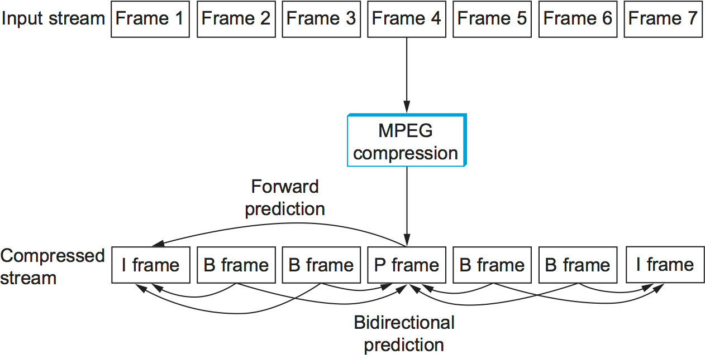

**Figure 7.14. Sequence of I, P, and B frames generated by MPEG.**

Figure 7.14 illustrates a sequence of seven video frames that, after being compressed by MPEG, result in a sequence of I, P, and B frames. The two I frames stand alone; each can be decompressed at the receiver independently of any other frames. The P frame depends on the preceding I frame; it can be decompressed at the receiver only if the preceding I frame also arrives. Each of the B frames depends on both the preceding I or P frame and the subsequent I or P frame. Both of these reference frames must arrive at the receiver before MPEG can decompress the B frame to reproduce the original video frame.

Note that, because each B frame depends on a later frame in the sequence, the compressed frames are not transmitted in sequential order. Instead, the sequence I B B P B B I shown in Figure 7.14 is transmitted as I P B B I B B. Also, MPEG does not define the ratio of I frames to P and B frames; this ratio may vary depending on the required compression and picture quality. For example, it is permissible to transmit only I frames. This would be similar to using JPEG to compress the video.

In contrast to the preceding discussion of JPEG, the following focuses on the *decoding* of an MPEG stream. It is a little easier to describe, and it is the operation that is more often implemented in networking systems today, since MPEG coding is so expensive that it is frequently done offline (i.e., not in real time). For example, in a video-on-demand system, the video would be encoded and stored on disk ahead of time. When a viewer wanted to watch the video, the MPEG stream would then be transmitted to the viewer’s machine, which would decode and display the stream in real time.

Let’s look more closely at the three frame types. As mentioned above, I frames are approximately equal to the JPEG compressed version of the source frame. The main difference is that MPEG works in units of 16 × 16 macroblocks. For a color video represented in YUV, the U and V components in each macroblock are subsampled into an 8 × 8 block, as we discussed above in the context of JPEG. Each 2 × 2 subblock in the macroblock is given by one U value and one V value—the average of the four pixel values. The subblock still has four Y values. The relationship between a frame and the corresponding macroblocks is given in Figure 7.15.

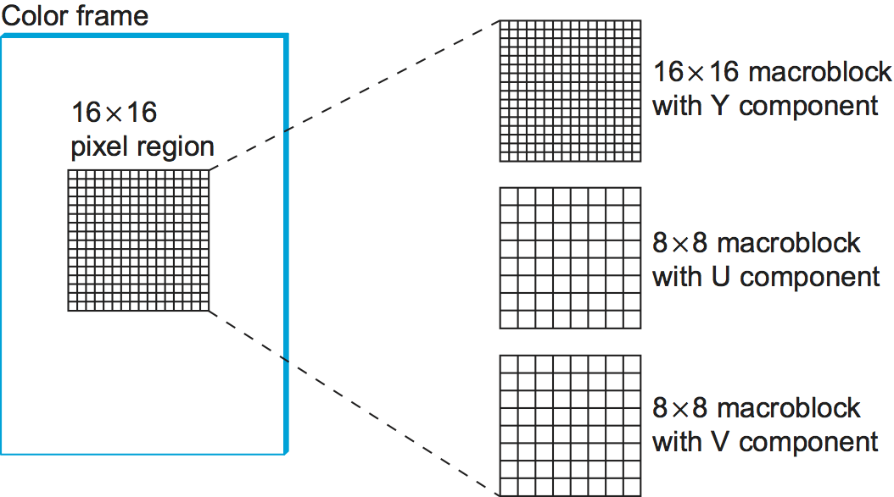

**Figure 7.15. Each frame as a collection of macroblocks.**

The P and B frames are also processed in units of macroblocks. Intuitively, we can see that the information they carry for each macroblock captures the motion in the video; that is, it shows in what direction and how far the macroblock moved relative to the reference frame(s). The following describes how a B frame is used to reconstruct a frame during decompression; P frames are handled in a similar manner, except that they depend on only one reference frame instead of two.

Before getting to the details of how a B frame is decompressed, we first note that each macroblock in a B frame is not necessarily defined relative to both an earlier and a later frame, as suggested above, but may instead simply be specified relative to just one or the other. In fact, a given macroblock in a B frame can use the same intracoding as is used in an I frame. This flexibility exists because if the motion picture is changing too rapidly then it sometimes makes sense to give the intrapicture encoding rather than a forward- or backward-predicted encoding. Thus, each macroblock in a B frame includes a type field that indicates which encoding is used for that macroblock. In the following discussion, however, we consider only the general case in which the macroblock uses bidirectional predictive encoding.

In such a case, each macroblock in a B frame is represented with a 4-tuple: (1) a coordinate for the macroblock in the frame, (2) a motion vector relative to the previous reference frame, (3) a motion vector relative to the subsequent reference frame, and (4) a delta (δ) for each pixel in the macroblock (i.e., how much each pixel has changed relative to the two reference pixels). For each pixel in the macroblock, the first task is to find the corresponding reference pixel in the past and future reference frames. This is done using the two motion vectors associated with the macroblock. Then, the delta for the pixel is added to the average of these two reference pixels. Stated more precisely, if we let F _{p} and F _{f} denote the past and future reference frames, respectively, and the past/future motion vectors are given by (x _{p}, y _{p}) and (x _{f}, y _{f}), then the pixel at coordinate *(x,y)* in the current frame (denoted F _{c}) is computed as

F_{c}(x,y) = (F_{p}(x+x_{p},y+y_{p}) + F_{f}(x+x_{f},y+y_{f}))/2 + δ(x,y)

where δ is the delta for the pixel as specified in the B frame. These deltas are encoded in the same way as pixels in I frames; that is, they are run through DCT and then quantized. Since the deltas are typically small, most of the DCT coefficients are 0 after quantization; hence, they can be effectively compressed.

It should be fairly clear from the preceding discussion how encoding would be performed, with one exception. When generating a B or P frame during compression, MPEG must decide where to place the macroblocks. Recall that each macroblock in a P frame, for example, is defined relative to a macroblock in an I frame, but that the macroblock in the P frame need not be in the same part of the frame as the corresponding macroblock in the I frame—the difference in position is given by the motion vector. You would like to pick a motion vector that makes the macroblock in the P frame as similar as possible to the corresponding macroblock in the I frame, so that the deltas for that macroblock can be as small as possible. This means that you need to figure out where objects in the picture moved from one frame to the next. This is the problem of *motion estimation*, and several techniques (heuristics) for solving this problem are known. (We discuss papers that consider this problem at the end of this chapter.) The difficulty of this problem is one of the reasons why MPEG encoding takes longer than decoding on equivalent hardware. MPEG does not specify any particular technique; it only defines the format for encoding this information in B and P frames and the algorithm for reconstructing the pixel during decompression, as given above.

##### Effectiveness and Performance

MPEG typically achieves a compression ratio of 90:1, although ratios as high as 150:1 are not unheard of. In terms of the individual frame types, we can expect a compression ratio of approximately 30:1 for the I frames (this is consistent with the ratios achieved using JPEG when 24-bit color is first reduced to 8-bit color), while P and B frame compression ratios are typically three to five times smaller than the rates for the I frame. Without first reducing the 24 bits of color to 8 bits, the achievable compression with MPEG is typically between 30:1 and 50:1.

MPEG involves an expensive computation. On the compression side, it is typically done offline, which is not a problem for preparing movies for a video-on-demand service. Video can be compressed in real time using hardware today, but software implementations are quickly closing the gap. On the decompression side, low-cost MPEG video boards are available, but they do little more than YUV color lookup, which fortunately is the most expensive step. Most of the actual MPEG decoding is done in software. In recent years, processors have become fast enough to keep pace with 30-frames-per-second video rates when decoding MPEG streams purely in software—modern processors can even decode MPEG streams of high definition video (HDTV).

##### Video Encoding Standards

We conclude by noting that MPEG is an evolving standard of significant complexity. This complexity comes from a desire to give the encoding algorithm every possible degree of freedom in how it encodes a given video stream, resulting in different video transmission rates. It also comes from the evolution of the standard over time, with the Moving Picture Experts Group working hard to retain backwards compatibility (e.g., MPEG-1, MPEG-2, MPEG-4). What we describe in this book is the essential ideas underlying MPEG-based compression, but certainly not all the intricacies involved in an international standard.

What’s more, MPEG is not the only standard available for encoding video. For example, the ITU-T has also defined the *H series* for encoding real-time multimedia data. Generally, the H series includes standards for video, audio, control, and multiplexing (e.g., mixing audio, video, and data onto a single bit stream). Within the series, H.261 and H.263 were the first- and second-generation video encoding standards. In principle, both H.261 and H.263 look a lot like MPEG: They use DCT, quantization, and interframe compression. The differences between H.261/H.263 and MPEG are in the details.

Today, a partnership between the ITU-T and the MPEG group has lead to the joint H.264/MPEG-4 standard, which is used for both Blu-ray Discs and by many popular streaming sources (e.g., YouTube, Vimeo).

#### 7.2.4 Transmitting MPEG over a Network

As we’ve noted, MPEG and JPEG are not just compression standards but also definitions of the format of video and images, respectively. Focusing on MPEG, the first thing to keep in mind is that it defines the format of a video *stream*; it does not specify how this stream is broken into network packets. Thus, MPEG can be used for videos stored on disk, as well as videos transmitted over a stream-oriented network connection, like that provided by TCP.

What we describe below is called the *main profile* of an MPEG video stream that is being sent over a network. You can think of an MPEG profile as being analogous to a “version,” except the profile is not explicitly specified in an MPEG header; the receiver has to deduce the profile from the combination of header fields it sees.

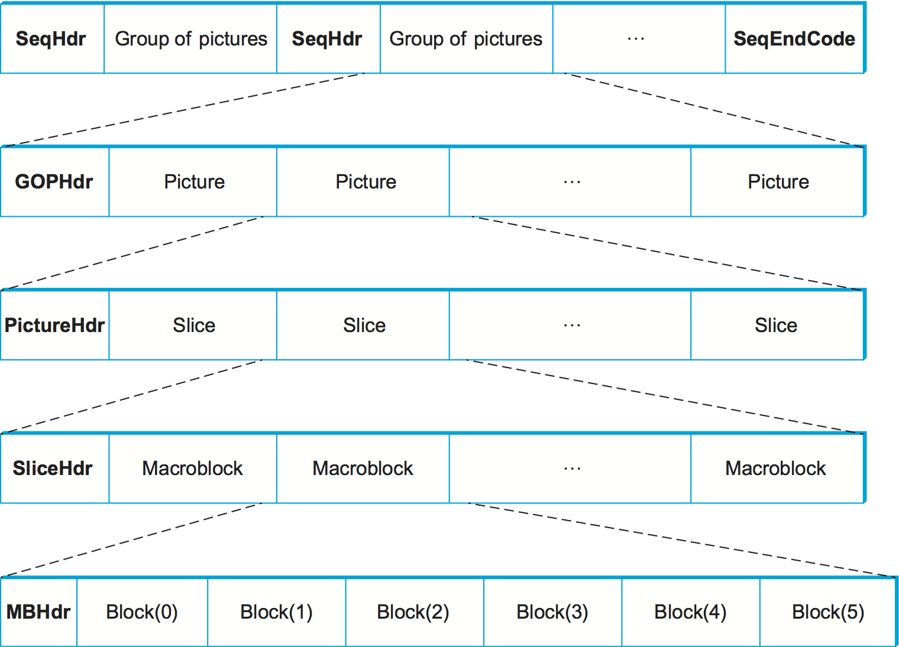

**Figure 7.16. Format of an MPEG-compressed video stream.**

A main profile MPEG stream has a nested structure, as illustrated in Figure 7.16. (Keep in mind that this figure hides a *lot* of messy details.) At the outermost level, the video contains a sequence of groups of pictures (GOP) separated by a SeqHdr. The sequence is terminated by a SeqEndCode (0xb7). The SeqHdr that precedes every GOP specifies—among other things—the size of each picture (frame) in the GOP (measured in both pixels and macroblocks), the interpicture period (measured in μs), and two quantization matrices for the macroblocks within this GOP: one for intracoded macroblocks (I blocks) and one for intercoded macroblocks (B and P blocks). Since this information is given for each GOP—rather than once for the entire video stream, as you might expect—it is possible to change the quantization table and frame rate at GOP boundaries throughout the video. This makes it possible to adapt the video stream over time, as we discuss below.

Each GOP is given by a GOPHdr, followed by the set of pictures that make up the GOP. The GOPHdr specifies the number of pictures in the GOP, as well as synchronization information for the GOP (i.e., when the GOP should play, relative to the beginning of the video). Each picture, in turn, is given by a PictureHdr and a set of *slices* that make up the picture. (A slice is a region of the picture, such as one horizontal line.) The PictureHdr identifies the type of the picture (I, B, or P) and defines a picture-specific quantization table. The SliceHdr gives the vertical position of the slice, plus another opportunity to change the quantization table—this time by a constant scaling factor rather than by giving a whole new table. Next, the SliceHdr is followed by a sequence of macroblocks. Finally, each macroblock includes a header that specifies the block address within the picture, along with data for the six blocks within the macroblock: one for the U component, one for the V component, and four for the Y component. (Recall that the Y component is 16 × 16, while the U and V components are 8 × 8.)

It should be clear that one of the powers of the MPEG format is that it gives the encoder an opportunity to change the encoding over time. It can change the frame rate, the resolution, the mix of frame types that define a GOP, the quantization table, and the encoding used for individual macroblocks. As a consequence, it is possible to adapt the rate at which a video is transmitted over a network by trading picture quality for network bandwidth. Exactly how a network protocol might exploit this adaptability is currently a subject of research (see sidebar).

Another interesting aspect of sending an MPEG stream over the network is exactly how the stream is broken into packets. If sent over a TCP connection, packetization is not an issue; TCP decides when it has enough bytes to send the next IP datagram. When using video interactively, however, it is rare to transmit it over TCP, since TCP has several features that are ill suited to highly latency-sensitive applications (such as abrupt rate changes after a packet loss and retransmission of lost packets). If we are transmitting video using UDP, say, then it makes sense to break the stream at carefully selected points, such as at macroblock boundaries. This is because we would like to confine the effects of a lost packet to a single macroblock, rather than damaging several macroblocks with a single loss. This is an example of Application Level Framing, which was discussed in an earlier chapter.

Packetizing the stream is only the first problem in sending MPEG-compressed video over a network. The next complication is dealing with packet loss. On the one hand, if a B frame is dropped by the network, then it is possible to simply replay the previous frame without seriously compromising the video; 1 frame out of 30 is no big deal. On the other hand, a lost I frame has serious consequences—none of the subsequent B and P frames can be processed without it. Thus, losing an I frame would result in losing multiple frames of the video. While you could retransmit the missing I frame, the resulting delay would probably not be acceptable in a real-time videoconference. One solution to this problem would be to use the Differentiated Services techniques described in the previous chapter to mark the packets containing I frames with a lower drop probability than other packets.

One final observation is that how you choose to encode video depends on more than just the available network bandwidth. It also depends on the application’s latency constraints. Once again, an interactive application like videoconferencing needs small latencies. The critical factor is the combination of I, P, and B frames in the GOP. Consider the following GOP:

I B B B B P B B B B I

The problem this GOP causes a videoconferencing application is that the sender has to delay the transmission of the four B frames until the P or I that follows them is available. This is because each B frame depends on the subsequent P or I frame. If the video is playing at 15 frames per second (i.e., one frame every 67 ms), this means the first B frame is delayed 4 × 67 ms, which is more than a quarter of a second. This delay is in addition to any propagation delay imposed by the network. A quarter of a second is far greater than the 100-ms threshold that humans are able to perceive. It is for this reason that many videoconference applications encode video using JPEG, which is often called motion-JPEG. (Motion-JPEG also addresses the problem of dropping a reference frame since all frames are able to stand alone.) Notice, however, that an interframe encoding that depends upon only prior frames rather than later frames is not a problem. Thus, a GOP of

I P P P P I

would work just fine for interactive videoconferencing.

##### Adaptive Streaming

Because encoding schemes like MPEG allow for a trade-off between the bandwidth consumed and the quality of the image, there is an opportunity to adapt a video stream to match the available network bandwidth. This is effectively what video streaming services like Netflix do today.

For starters, let’s assume that we have some way to measure the amount of free capacity and level of congestion along a path, for example, by observing the rate at which packets are successfully arriving at the destination. As the available bandwidth fluctuates, we can feed that information back to the codec so that it adjusts its coding parameters to back off during congestion and to send more aggressively (with a higher picture quality) when the network is idle. This is analogous to the behavior of TCP, except in the video case we are actually modifying the total amount of data sent rather than how long we take to send a fixed amount of data, since we don’t want to introduce delay into a video application.

In the case of video-on-demand services like Netflix, we don’t adapt the encoding on the fly, but instead we encode a handful of video quality levels ahead of time, and save them to files named accordingly. The receiver simply changes the file name it requests to match the quality its measurements indicate the network will be able to deliver. The receiver watches its playback queue, and asks for a higher quality encoding when the queue becomes too full and a lower quality encoding when the queue becomes too empty.

How does this approach know where in the movie to jump to should the requested quality change? In effect, the receiver never asks the sender to stream the whole movie, but instead it requests a sequence of short movie segments, typically a few seconds long (and always on GOP boundary). Each segment is an opportunity to change the quality level to match what the network is able to deliver. (It turns out that requesting movie chunks also makes it easier to implement *trick play*, jumping around from one place to another in the movie.) In other words, a movie is typically stored as a set of N × M chunks (files): N quality levels for each of M segments.

There’s one last detail. Since the receiver is effectively requesting a sequence of discrete video chunks by name, the most common approach for issuing these requests is to use HTTP. Each chuck is a separate HTTP GET request with the URL identifying the specific chunk the receiver wants next. When you start downloading a movie, your video player first downloads a *manifest* file that contains nothing more than the URLs for the N × M chunks in the movie, and then it issues a sequence of HTTP requests using the appropriate URL for the situation. This general approach is called *HTTP adaptive streaming*, although it has been standardized in slightly different ways by various organizations, most notably MPEG’s DASH (*Dynamic Adaptive Streaming over HTTP*) and Apple’s HLS (*HTTP Live Streaming*).

#### 7.2.5 Audio Compression (MP3)

Not only does MPEG define how video is compressed, but it also defines a standard for compressing audio. This standard can be used to compress the audio portion of a movie (in which case the MPEG standard defines how the compressed audio is interleaved with the compressed video in a single MPEG stream) or it can be used to compress stand-alone audio (for example, an audio CD). The MPEG audio compression standard is just one of many for audio compression, but the pivotal role it played means that MP3 (which stands for MPEG Layer III—see below) has become almost synonymous with audio compression.

To understand audio compression, we need to begin with the data. CD-quality audio, which is the *de facto* digital representation for high-quality audio, is sampled at a rate of 44.1 KHz (i.e., a sample is collected approximately once every 23 μs). Each sample is 16 bits, which means that a stereo (2-channel) audio stream results in a bit rate of

2 × 44.1 × 1000 × 16 = 1.41 *Mbps*

By comparison, traditional telephone-quality voice is sampled at a rate of 8 KHz, with 8-bit samples, resulting in a bit rate of 64 kbps.

Clearly, some amount of compression is going to be required to transmit CD-quality audio over a network of limited bandwidth. (Consider the fact that MP3 audio streaming became popular in an era when 1.5Mbps home Internet connections were a novelty). To make matters worse, synchronization and error correction overheads inflated the number of bits stored on a CD by a factor of three, so if you just read the data from the CD and sent it over the network, you would need 4.32 Mbps.

Just like video, there is lots of redundancy in audio, and compression takes advantage of this. The MPEG standards define three levels of compression, as enumerated in Table 7.2. Of these, Layer III, which is more widely known as MP3, was for many years the most commonly used. In recent years, higher bandwidth codecs have proliferated as streaming audio has become the dominant way many people consume music.

**Table 7.2. MP3 Compression Rates.**

| Coding | Bit Rates | Compression Factor |
| --- | --- | --- |
| Layer I | 384 kbps | 14 |
| Layer II | 192 kbps | 18 |
| Layer III | 128 kbps | 12 |

To achieve these compression ratios, MP3 uses techniques that are similar to those used by MPEG to compress video. First, it splits the audio stream into some number of frequency subbands, loosely analogous to the way MPEG processes the Y, U, and V components of a video stream separately. Second, each subband is broken into a sequence of blocks, which are similar to MPEG’s macroblocks except they can vary in length from 64 to 1024 samples. (The encoding algorithm can vary the block size depending on certain distortion effects that are beyond our discussion.) Finally, each block is transformed using a modified DCT algorithm, quantized, and Huffman encoded, just as for MPEG video.

The trick to MP3 is how many subbands it elects to use and how many bits it allocates to each subband, keeping in mind that it is trying to produce the highest-quality audio possible for the target bit rate. Exactly how this allocation is made is governed by psychoacoustic models that are beyond the scope of this book, but to illustrate the idea consider that it makes sense to allocate more bits to low-frequency subbands when compressing a male voice and more bits to high-frequency subbands when compressing a female voice. Operationally, MP3 dynamically changes the quantization tables used for each subband to achieve the desired effect.

Once compressed, the subbands are packaged into fixed-size frames, and a header is attached. This header includes synchronization information, as well as the bit allocation information needed by the decoder to determine how many bits are used to encode each subband. As mentioned above, these audio frames can then be interleaved with video frames to form a complete MPEG stream. One interesting side note is that, while it might work to drop B frames in the network should congestion occur, experience teaches us that it is not a good idea to drop audio frames since users are better able to tolerate bad video than bad audio.

### Perspective: Big Data and Analytics

This chapter is about data, and since no topic in Computer Science is receiving more attention than *big data* (or alternatively, *data analytics*), a natural question is what relationship there might be between big data and computer networks. Although the term is often used informally by the popular press, a working definition is quite simple: sensor data is collected by monitoring some physical or man-made system and then analyzed for insights using the statistical methods of Machine Learning. Because the amount of raw data that’s collected is often voluminous, the “big” qualifier is applied. So are there any implications to networking?

At first blush, networks are purposely designed to be data-agnostic. If you collect it and want to ship to somewhere for analysis, the network is happy to do that for you. You might compress the data to reduce the bandwidth required to transmit it, but otherwise big data is no different than plain old regular data. But this ignores two important factors.

The first is that while the network doesn’t care about the meaning of the data (i.e., what the bits represent), it does concern itself with the volume of data. This impacts the access network in particular, which has been engineered to favor download speeds over upload speeds. That bias makes sense when the dominant use case is video that flows out to end-users, but in a world where your car, every appliance in your house, and the drones flying over your city are all reporting data back into the network (uploaded into the cloud), the situation is reversed. In fact, the amount of data being generated by *Autonomous Vehicles* and the *Internet-of-Things (IoT)* is potentially overwhelming.

While one could imagine dealing with this problem by using one of the compression algorithms described in Section 7.2, people are instead thinking outside the box, and pursuing new applications that reside at the edge of the network. These *edge-native applications* both provide better sub-millisecond response time and they dramatically reduce the volume of data that ultimately needs to be uploaded into the cloud. You can think of this data reduction as application-specific compression, but it’s more accurate to say that the edge application needs only write summaries of the data, not the raw data, back to the cloud.

We introduced the access-edge cloud technology needed to support edge-native applications at the end of Chapter 2, but what is perhaps more interesting is to look at some examples of edge-native applications. One such example is enterprises in the automotive, factory, and warehouse space increasingly want to deploy private 5G networks for a variety of *physical automation* use cases. These include a garage where a remote valet parks your car or a factory floor making use of automation robots. The common theme is high bandwidth, low latency connectivity from the robot to intelligence sitting nearby in an edge cloud. This drives lower robot costs (you don’t need to place heavy compute on each one) and enables robot swarms and coordination more scalably.

Another illustrative example is *Wearable Cognitive Assistance*. The idea is to generalize what navigation software does for us: it uses one sensor (GPS), gives us step-by-step guidance on a complex task (getting around an unknown city), catches our errors promptly, and helps us recover. Can we generalize this metaphor? Could a person wearing a device (e.g., Google Glass, Microsoft Hololens) be guided step-by-step on a complex task, perhaps for the first time? The system would effectively act as “an angel on your shoulder.” All the sensors on the device (e.g., video, audio, accelerometer, gyroscope) are streamed over wireless (possibly after some device preprocessing) to a nearby edge-cloud that performs the heavy lifting. This is a human-in-the-loop metaphor, with the “look and feel of augmented reality” but implemented by AI algorithms (e.g., computer vision, natural language recognition.)

The second factor is that because a network is like many other man-made systems, it is possible to collect data about its behavior (e.g., performance, failures, traffic patterns), apply analytics programs to that data, and use the insights gained to improve the network. It should not come as a surprise that this is an active area of research, with the goal of building a closed control loop. Setting aside the analytics itself, which are well outside the scope of this book, the interesting questions are (1) what useful data can we collect, and (2) what aspects of the network are most promising to control? Let’s look at two promising answers.

One is 5G cellular networks, which are inherently complex. They include multiple layers of virtual functions, virtual and physical RAN assets, spectrum usage, and as we have just discussed, edge computing nodes. It is widely expected that network analytics will be essential to building a flexible 5G network. This will include network planning, which will need to decide where to scale specific network functions and application services based on machine learning algorithms that analyze network utilization and traffic data patterns.

A second is *In-band Network Telemetry* (INT), a framework to collect and report network state, directly in the data plane. This is in contrast to the conventional reporting done by the network control plane, as typified by the example systems described in Section 9.3. In the INT architecture, packets contain header fields that are interpreted as “telemetry instructions” by network devices. These instructions tell an INT-capable device what state to collect and write into the packet as it transits the network. INT *traffic sources* (e.g., applications, end-host networking stacks, VM hypervisors) can embed the instructions either in normal data packets or in special probe packets. Similarly, INT *traffic sinks* retrieve (and optionally report) the collected results of these instructions, allowing the traffic sinks to monitor the exact data plane state that the packets “observed” while being forwarded. INT is still early-stage, and takes advantage of the programmable pipelines described in Section 3.5, but it has the potential to provide a qualitatively deeper insights into traffic patterns and the root causes of network failures.

> **Broader Perspective**
>
> To learn more about promising edge-native applications, we recommend: [Open Edge Computing Initiative](http://openedgecomputing.org), 2019.
>
> To learn more about In-band Network Telemetry, we recommend: [In-band Network Telemetry via Programmable Dataplanes](https://pdfs.semanticscholar.org/a3f1/9dc8520e2f42673be7cbd8d80cd96e3ec0c1.pdf), August 2015.
