## Chapter 8: Network Security

> It is true greatness to have in one the frailty of a man and the security of a god. *—Seneca*

### Problem: Security Attacks

Computer networks are typically a shared resource used by many applications representing different interests. The Internet is particularly widely shared, being used by competing businesses, mutually antagonistic governments, and opportunistic criminals. Unless security measures are taken, a network conversation or a distributed application may be compromised by an adversary.

Consider, for example, some threats to secure use of the web. Suppose you are a customer using a credit card to order an item from a website. An obvious threat is that an adversary would eavesdrop on your network communication, reading your messages to obtain your credit card information. How might that eavesdropping be accomplished? It is trivial on a broadcast network such as an Ethernet or Wi-Fi, where any node can be configured to receive all the message traffic on that network. More elaborate approaches include wiretapping and planting spy software on any of the chain of nodes involved. Only in the most extreme cases (e.g.,national security) are serious measures taken to prevent such monitoring, and the Internet is not one of those cases. It is possible and practical, however, to encrypt messages so as to prevent an adversary from understanding the message contents. A protocol that does so is said to provide *confidentiality*. Taking the concept a step farther, concealing the quantity or destination of communication is called *traffic confidentiality*—because merely knowing how much communication is going where can be useful to an adversary in some situations.

Even with confidentiality there still remains threats for the website customer. An adversary who can’t read the contents of your encrypted message might still be able to change a few bits in it, resulting in a valid order for, say, a completely different item or perhaps 1000 units of the item. There are techniques to detect, if not prevent, such tampering. A protocol that detects such message tampering is said to provide *integrity*.

Another threat to the customer is unknowingly being directed to a false website. This can result from a Domain Name System (DNS) attack, in which false information is entered in a DNS server or the name service cache of the customer’s computer. This leads to translating a correct URL into an incorrect IP address—the address of a false website. A protocol that ensures that you really are talking to whom you think you’re talking is said to provide *authentication*. Authentication entails integrity, since it is meaningless to say that a message came from a certain participant if it is no longer the same message.

The owner of the website can be attacked as well. Some websites have been defaced; the files that make up the website content have been remotely accessed and modified without authorization. That is an issue of *access control*: enforcing the rules regarding who is allowed to do what. Websites have also been subject to denial of service (DoS) attacks, during which would-be customers are unable to access the website because it is being overwhelmed by bogus requests. Ensuring a degree of access is called *availability*.

In addition to these issues, the Internet has notably been used as a means for deploying malicious code, generally called *malware*, that exploits vulnerabilities in end systems. *Worms*, pieces of self-replicating code that spread over networks, have been known for several decades and continue to cause problems, as do their relatives, *viruses*, which are spread by the transmission of infected files. Infected machines can then be arranged into *botnets*, which can be used to inflict further harm, such as launching DoS attacks.

### 8.1 Trust and Threats

Before we address the how’s and why’s of building secure networks, it is important to establish one simple truth: We will inevitably fail. This is because security is ultimately an exercise in making assumptions about trust, evaluating threats, and mitigating risk. There is no such thing as perfect security.

Trust and threats are two sides of the same coin. A threat is a potential failure scenario that you design your system to avoid, and trust is an assumption you make about how external actors and internal components you build upon will behave. For example, if you are transmitting a message over WiFi on an open campus, you would likely identify an eavesdropper that can intercept the message as a threat (and adopt some of the methods discussed in this chapter as a countermeasure), but if you are transmitting a message over a fiber link between two machines in a locked datacenter, you might trust that channel is secure, and so take no additional steps.

You could argue that since you already have a way to protect WiFi-based communication you just as well use it to protect the fiber-based channel, but that presumes the outcome of a cost/benefit analysis. Suppose protecting any message, whether sent over WiFi or fiber, slows the communication down by 10% due to the overhead of encryption. If you need to squeeze every last ounce of performance out of a scientific computation (e.g., you are trying to model a hurricane) and the odds of someone breaking into the datacenter are one in a million (and even if they did, the data being transmitted has little value), then you would be well-justified in not securing the fiber communication channel.

These sorts of calculations happen all the time, although they are often implicit and unstated. For example, you may run the world’s most secure encryption algorithm on a message before transmitting it, but you’ve implicitly trusted that the server you’re running on is both faithfully executing that algorithm and not leaking a copy of your unencrypted message to an adversary. Do you treat this as a threat or do you trust that the server does not misbehave? At the end of the day, the best you can do is mitigate risk: identify those threats that you can eliminate in a cost effective way, and be explicit about what trust assumptions you are making so you aren’t caught off-guard by changing circumstances, such as an ever more determined or sophisticated adversary.

In this particular example, the threat of an adversary compromising a server has become quite real as more of our computations move from local servers into the cloud, and so research is now going into building a *Trusted Computing Base* (TCB), an interesting topic, but one that is in the realm of computer architecture rather than computer networks. For the purpose of this chapter, our recommendation is to pay attention to the words *trust* and *threat* (or adversary), as they are key to understanding the context in which security claims are made.

There is one final historical note that helps set the table for this chapter. The Internet (and the ARPANET before it) where funded by the U.S. Department of Defense, an organization that certainly understands threat analysis. The original assessment was dominated by concerns about the network surviving in the face of routers and networks failing (or being destroyed), which explains why the routing algorithms are decentralized, with no central point of failure. On the other hand, the original design assumed all actors *inside* the network were trusted, and so little or no attention was paid to what today we would call cybersecurity (attacks from bad actors that are able to connect to the network). What this means is that many of the tools described in this chapter could be considered patches. They are strongly-grounded in cryptography, but “add-ons” nonetheless. If a comprehensive redesign of the Internet were to take place, integrating security would likely be the foremost driving factor.

### 8.2 Cryptographic Building Blocks

We introduce the concepts of cryptography-based security step by step. The first step is the cryptographic algorithms—ciphers and cryptographic hashes—that are introduced in this section. They are not a solution in themselves, but rather building blocks from which a solution can be built. Cryptographic algorithms are parameterized by *keys*, and a later section then addresses the problem of distributing the keys. In the next step, we describe how to incorporate the cryptographic building blocks into protocols that provide secure communication between participants who possess the correct keys. A final section then examines several complete security protocols and systems in current use.

#### 8.2.1 Principles of Ciphers

Encryption transforms a message in such a way that it becomes unintelligible to any party that does not have the secret of how to reverse the transformation. The sender applies an *encryption* function to the original *plaintext* message, resulting in a *ciphertext* message that is sent over the network, as shown in Figure 8.1. The receiver applies a secret *decryption* function—the inverse of the encryption function—to recover the original plaintext. The ciphertext transmitted across the network is unintelligible to any eavesdropper, assuming the eavesdropper doesn’t know the decryption function. The transformation represented by an encryption function and its corresponding decryption function is called a *cipher*.

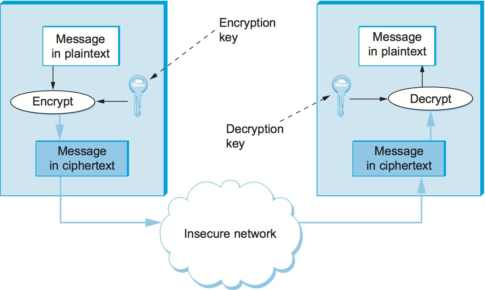

**Figure 8.1. Secret-key encryption and decryption.**

Cryptographers have been led to the principle, first stated in 1883, that encryption and decryption functions should be parameterized by a *key*, and furthermore that the functions should be considered public knowledge—only the key need be secret. Thus, the ciphertext produced for a given plaintext message depends on both the encryption function and the key. One reason for this principle is that if you depend on the cipher being kept secret, then you have to retire the cipher (not just the keys) when you believe it is no longer secret. This means potentially frequent changes of cipher, which is problematic since it takes a lot of work to develop a new cipher. Also, one of the best ways to know that a cipher is secure is to use it for a long time—if no one breaks it, it’s probably secure. (Fortunately, there are plenty of people who will try to break ciphers and who will let it be widely known when they have succeeded, so no news is generally good news.) Thus, there is considerable cost and risk in deploying a new cipher. Finally, parameterizing a cipher with keys provides us with what is in effect a very large family of ciphers; by switching keys, we essentially switch ciphers, thereby limiting the amount of data that a *cryptanalyst* (code-breaker) can use to try to break our key/cipher and the amount she can read if she succeeds.

The basic requirement for an encryption algorithm is that it turn plaintext into ciphertext in such a way that only the intended recipient—the holder of the decryption key—can recover the plaintext. What this means is that encrypted messages cannot be read by people who do not hold the key.

It is important to realize that when a potential attacker receives a piece of ciphertext, he may have more information at his disposal than just the ciphertext itself. For example, he may know that the plaintext was written in English, which means that the letter *e* occurs more often in the plaintext that any other letter; the frequency of many other letters and common letter combinations can also be predicted. This information can greatly simplify the task of finding the key. Similarly, he may know something about the likely contents of the message; for example, the word “login” is likely to occur at the start of a remote login session. This may enable a *known plaintext* attack, which has a much higher chance of success than a *ciphertext only* attack. Even better is a *chosen plaintext* attack, which may be enabled by feeding some information to the sender that you know the sender is likely to transmit—such things have happened in wartime, for example.

The best cryptographic algorithms, therefore, can prevent the attacker from deducing the key even when the individual knows both the plaintext and the ciphertext. This leaves the attacker with no choice but to try all the possible keys—exhaustive, “brute force” search. If keys have *n* bits, then there are 2 ⁿ possible values for a key (each of the *n* bits could be either a zero or a one). An attacker could be so lucky as to try the correct value immediately, or so unlucky as to try every incorrect value before finally trying the correct value of the key, having tried all 2 ⁿ possible values; the average number of guesses to discover the correct value is halfway between those extremes, 2 ⁿ⁻¹. This can be made computationally impractical by choosing a sufficiently large key space and by making the operation of checking a key reasonably costly. What makes this difficult is that computing speeds keep increasing, making formerly infeasible computations feasible. Furthermore, although we are concentrating on the security of data as it moves through the network—that is, the data is sometimes vulnerable for only a short period of time—in general, security people have to consider the vulnerability of data that needs to be stored in archives for tens of years. This argues for a generously large key size. On the other hand, larger keys make encryption and decryption slower.

Most ciphers are *block ciphers*; they are defined to take as input a plaintext block of a certain fixed size, typically 64 to 128 bits. Using a block cipher to encrypt each block independently—known as *electronic codebook (ECB) mode* encryption—has the weakness that a given plaintext block value will always result in the same ciphertext block. Hence, recurring block values in the plaintext are recognizable as such in the ciphertext, making it much easier for a cryptanalyst to break the cipher.

To prevent this, block ciphers are always augmented to make the ciphertext for a block vary depending on context. Ways in which a block cipher may be augmented are called *modes of operation*. A common mode of operation is *cipher block chaining* (CBC), in which each plaintext block is XORed with the previous block’s ciphertext before being encrypted. The result is that each block’s ciphertext depends in part on the preceding blocks (i.e., on its context). Since the first plaintext block has no preceding block, it is XORed with a random number. That random number, called an *initialization vector* (IV), is included with the series of ciphertext blocks so that the first ciphertext block can be decrypted. This mode is illustrated in Figure 8.2. Another mode of operation is *counter mode*, in which successive values of a counter (e.g., 1, 2, 3, …) are incorporated into the encryption of successive blocks of plaintext.

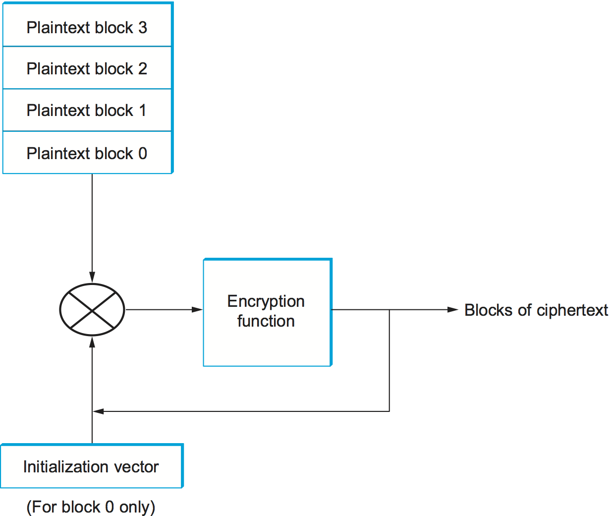

**Figure 8.2. Cipher Block Chaining.**

#### 8.2.2 Secret-Key Ciphers

In a secret-key cipher, both participants in a communication share the same key.  In other words, if a message is encrypted using a particular key, the same key is required for decrypting the message. If the cipher illustrated in Figure 8.1 were a secret-key cipher, then the encryption and decryption keys would be identical. Secret-key ciphers are also known as symmetric-key ciphers since the secret is shared with both participants. We’ll take a look at the alternative, public-key ciphers, shortly. (Public-key ciphers are known as also asymmetric-key ciphers, since as we’ll soon see, the two participants use different keys.)

The U.S. National Institute of Standards and Technology (NIST) has issued standards for a series of secret-key ciphers. *Data Encryption Standard* (DES) was the first, and it has stood the test of time in that no cryptanalytic attack better than brute force search has been discovered. Brute force search, however, has gotten faster. DES’s keys (56 independent bits) are now too small given current processor speeds. DES keys have 56 independent bits (although they have 64 bits in total; the last bit of every byte is a parity bit). As noted above, you would, on average, have to search half of the space of 2 ⁵⁶ possible keys to find the right one, giving 2 ⁵⁵ = 3.6 × 10 ¹⁶ keys. That may sound like a lot, but such a search is highly parallelizable, so it’s possible to throw as many computers at the task as you can get your hands on—and these days it’s easy to lay your hands on thousands of computers. (Amazon will rent them to you for a few cents an hour.) By the late 1990s, it was already possible to recover a DES key after a few hours. Consequently, NIST updated the DES standard in 1999 to indicate that DES should only be used for legacy systems.

NIST also standardized the cipher *Triple DES* (3DES), which leverages the cryptanalysis resistance of DES while in effect increasing the key size. A 3DES key has 168 (= 3 × 56) independent bits, and is used as three DES keys; let’s call them DES-key1, DES-key2, and DES-key3. 3DES encryption of a block is performed by first DES encrypting the block using DES-key1, then DES *de* crypting the result using DES-key2, and finally DES encrypting that result using DES-key3. Decryption involves decrypting using DES-key3, then encrypting using DES-key2, then decrypting using DES-key1.

The reason 3DES encryption uses DES *de* cryption with DES-key2 is to interoperate with legacy DES systems. If a legacy DES system uses a single key, then a 3DES system can perform the same encryption function by using that key for each of DES-key1, DES-key2, and DES-key3; in the first two steps, we encrypt and then decrypt with the same key, producing the original plaintext, which we then encrypt again.

Although 3DES solves DES’s key-length problem, it inherits some other shortcomings. Software implementations of DES/3DES are slow because it was originally designed by IBM for implementation in hardware. Also, DES/3DES uses a 64-bit block size; a larger block size is more efficient and more secure.

3DES is now being superseded by the *Advanced Encryption Standard* (AES) standard issued by NIST. The cipher underlying AES (with a few minor modifications) was originally named Rijndael (pronounced roughly like “Rhine dahl”) based on the names of its inventors, Daemen and Rijmen. AES supports key lengths of 128, 192, or 256 bits, and the block length is 128 bits. AES permits fast implementations in both software and hardware. It doesn’t require much memory, which makes it suitable for small mobile devices. AES has some mathematically proven security properties and, as of the time of writing, has not suffered from any significant successful attacks.

#### 8.2.3 Public-Key Ciphers

An alternative to secret-key ciphers is public-key ciphers. Instead of a single key shared by two participants, a public-key cipher uses a pair of related keys, one for encryption and a different one for decryption. The pair of keys is “owned” by just one participant. The owner keeps the decryption key secret so that only the owner can decrypt messages; that key is called the *private key*. The owner makes the encryption key public, so that anyone can encrypt messages for the owner; that key is called the *public key*. Obviously, for such a scheme to work, it must not be possible to deduce the private key from the public key. Consequently, any participant can get the public key and send an encrypted message to the owner of the keys, and only the owner has the private key necessary to decrypt it. This scenario is depicted in Figure 8.3.

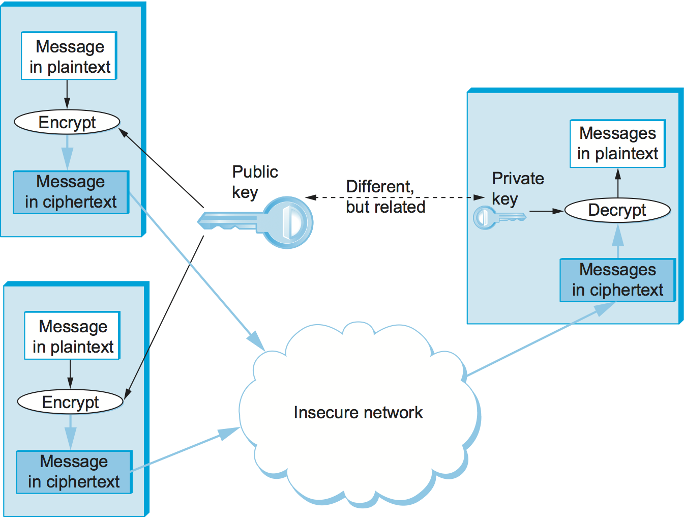

**Figure 8.3. Public-key encryption.**

Because it is somewhat unintuitive, we emphasize that the public encryption key is useless for decrypting a message—you couldn’t even decrypt a message that you yourself had just encrypted unless you had the private decryption key. If we think of keys as defining a communication channel between participants, then another difference between public-key and secret-key ciphers is the topology of the channels. A key for a secret-key cipher provides a channel that is two-way between two participants—each participant holds the same (symmetric) key that either one can use to encrypt or decrypt messages in either direction. A public/private key pair, in contrast, provides a channel that is one way and many-to-one: from everyone who has the public key to the unique owner of the private key, as illustrated in Figure 8.3.

An important additional property of public-key ciphers is that the private “decryption” key can be used with the encryption algorithm to encrypt messages so that they can only be decrypted using the public “encryption” key. This property clearly wouldn’t be useful for confidentiality since anyone with the public key could decrypt such a message. (Indeed, for two-way confidentiality between two participants, each participant needs its own pair of keys, and each encrypts messages using the other’s public key.) This property is, however, useful for authentication since it tells the receiver of such a message that it could only have been created by the owner of the keys (subject to certain assumptions that we will get into later). This is illustrated in Figure 8.4. It should be clear from the figure that anyone with the public key can decrypt the encrypted message, and, assuming that the result of the decryption matches the expected result, it can be concluded that the private key must have been used to perform the encryption. Exactly how this operation is used to provide authentication is the topic of a later section. As we will see, public-key ciphers are used primarily for authentication and to confidentially distribute secret (symmetric) keys, leaving the rest of confidentiality to secret-key ciphers.

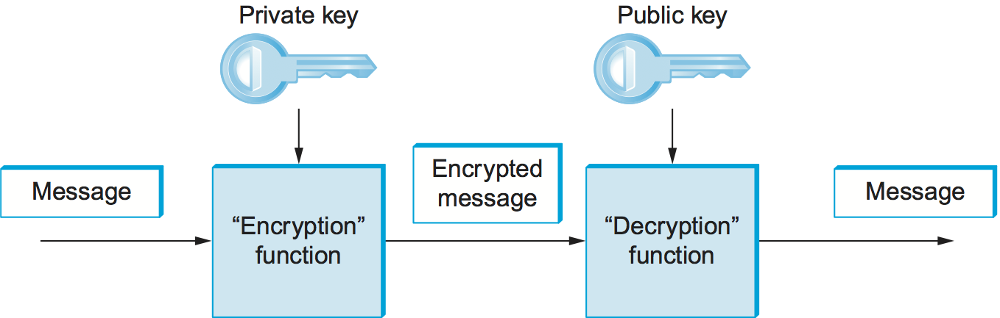

**Figure 8.4. Authentication using public keys.**

A bit of interesting history: The concept of public-key ciphers was first published in 1976 by Diffie and Hellman. Subsequently, however, documents have come to light proving that Britain’s Communications-Electronics Security Group had discovered public-key ciphers by 1970, and the U.S. National Security Agency (NSA) claims to have discovered them in the mid-1960s.

The best-known public-key cipher is RSA, named after its inventors: Rivest, Shamir, and Adleman. RSA relies on the high computational cost of factoring large numbers. The problem of finding an efficient way to factor numbers is one that mathematicians have worked on unsuccessfully since long before RSA appeared in 1978, and RSA’s subsequent resistance to cryptanalysis has further bolstered confidence in its security. Unfortunately, RSA needs relatively large keys, at least 1024 bits, to be secure. This is larger than keys for secret-key ciphers because it is faster to break an RSA private key by factoring the large number on which the pair of keys is based than by exhaustively searching the key space.

Another public-key cipher is ElGamal. Like RSA, it relies on a mathematical problem, the discrete logarithm problem, for which no efficient solution has been found, and requires keys of at least 1024 bits. There is a variation of the discrete logarithm problem, arising when the input is an elliptic curve, that is thought to be even more difficult to compute; cryptographic schemes based on this problem are referred to as *elliptic curve cryptography*.

Public-key ciphers are, unfortunately, several orders of magnitude slower than secret-key ciphers. Consequently, secret-key ciphers are used for the vast majority of encryption, while public-key ciphers are reserved for use in authentication and session key establishment.

#### 8.2.4 Authenticators

Encryption alone does not provide data integrity. For example, just randomly modifying a ciphertext message could turn it into something that decrypts into valid-looking plaintext, in which case the tampering would be undetectable by the receiver. Nor does encryption alone provide authentication. It is not much use to say that a message came from a certain participant if the contents of the message have been modified after that participant created it. In a sense, integrity and authentication are fundamentally inseparable.

An *authenticator* is a value, to be included in a transmitted message, that can be used to verify simultaneously the authenticity and the data integrity of a message. We will see how authenticators can be used in protocols. For now, we focus on the algorithms that produce authenticators.

You may recall that checksums and cyclic redundancy checks (CRCs) are pieces of information added to a message so the receiver detect when the message has been inadvertently modified by bit errors. A similar concept applies to authenticators, with the added challenge that the corruption of the message is likely to be deliberately performed by someone who wants the corruption to go undetected. To support authentication, an authenticator includes some proof that whoever created the authenticator knows a secret that is known only to the alleged sender of the message; for example, the secret could be a key, and the proof could be some value encrypted using the key. There is a mutual dependency between the form of the redundant information and the form of the proof of secret knowledge. We discuss several workable combinations.

We initially assume that the original message need not be confidential—that a transmitted message will consist of the plaintext of the original message plus an authenticator. Later we will consider the case where confidentiality is desired.

One kind of authenticator combines encryption and a *cryptographic hash function*. Cryptographic hash algorithms are treated as public knowledge, as with cipher algorithms. A cryptographic hash function (also known as a *cryptographic checksum*) is a function that outputs sufficient redundant information about a message to expose any tampering. Just as a checksum or CRC exposes bit errors introduced by noisy links, a cryptographic checksum is designed to expose deliberate corruption of messages by an adversary. The value it outputs is called a *message digest* and, like an ordinary checksum, is appended to the message. All the message digests produced by a given hash have the same number of bits regardless of the length of the original message. Since the space of possible input messages is larger than the space of possible message digests, there will be different input messages that produce the same message digest, like collisions in a hash table.

An authenticator can be created by encrypting the message digest. The receiver computes a digest of the plaintext part of the message and compares that to the decrypted message digest. If they are equal, then the receiver would conclude that the message is indeed from its alleged sender (since it would have to have been encrypted with the right key) and has not been tampered with. No adversary could get away with sending a bogus message with a matching bogus digest because she would not have the key to encrypt the bogus digest correctly. An adversary could, however, obtain the plaintext original message and its encrypted digest by eavesdropping. The adversary could then (since the hash function is public knowledge) compute the digest of the original message and generate alternative messages looking for one with the same message digest. If she finds one, she could undetectably send the new message with the old authenticator. Therefore, security requires that the hash function have the *one-way* property: It must be computationally infeasible for an adversary to find any plaintext message that has the same digest as the original.

For a hash function to meet this requirement, its outputs must be fairly randomly distributed. For example, if digests are 128 bits long and randomly distributed, then you would need to try 2 ¹²⁷ messages, on average, before finding a second message whose digest matches that of a given message. If the outputs are not randomly distributed—that is, if some outputs are much more likely than others—then for some messages you could find another message with the same digest much more easily than this, which would reduce the security of the algorithm. If you were instead just trying to find any *collision*—any two messages that produce the same digest—then you would need to compute the digests of only 2 ⁶⁴ messages, on average. This surprising fact is the basis of the “birthday attack”—see the exercises for more details.

There have been several common cryptographic hash algorithms over the years, including Message Digest 5 (MD5) and the Secure Hash Algorithm (SHA) family. Weaknesses of MD5 and earlier versions of SHA have been known for some time, which led NIST to develop and recommend a family of algorithms known as SHA-3 in 2015.

When generating an encrypted message digest, the digest encryption could use either a secret-key cipher or a public-key cipher. If a public-key cipher is used, the digest would be encrypted using the sender’s private key (the one we normally think of as being used for decryption), and the receiver—or anyone else—could decrypt the digest using the sender’s public key.

A digest encrypted with a public key algorithm but using the private key is called a *digital signature* because it provides nonrepudiation like a written signature. The receiver of a message with a digital signature can prove to any third party that the sender really sent that message, because the third party can use the sender’s public key to check for herself. (secret-key encryption of a digest does not have this property because only the two participants know the key; furthermore, since both participants know the key, the alleged receiver could have created the message herself.) Any public-key cipher can be used for digital signatures. *Digital Signature Standard* (DSS) is a digital signature format that has been standardized by NIST. DSS signatures may use any one of three public-key ciphers, one based on RSA, another on ElGamal, and a third called the *Elliptic Curve Digital Signature Algorithm*.

An widely used alternative approach to encrypting a hash is to use a hash function that takes a secret value (a key known only to the sender and the receiver) as an input parameter in addition to the message text. Such a function outputs a message authentication code that is a function of both the secret key and the message contents. The sender appends the calculated message authentication code to the plaintext message. The receiver recomputes the authentication code using the plaintext and the secret value and compares that recomputed code to the code received in the message. The most common approaches to generating these codes are called HMACs or keyed-hash message authentication codes.

HMACs can use any hash function of the sort described above, but they also include the key as part of the material to be hashed, so that a HMAC is a function of both the key and the input text. An approach to calculating HMACs has been standardized by NIST and takes the following form:

HMAC = H((K⊕opad) || H((K⊕ipad) || text))

H is the hash function, K is the key, and opad (output pad) and ipad (input pad) are well-known strings that are XORed (⊕) with the key. || represents concatenation.

A deep explanation of this HMAC function is beyond the scope of this book. However, this approach has been proved to be secure as long as the underlying hash function H has the appropriate collision-resistance properties outlined above. Note that the HMAC takes a hash function *H* that is not keyed, and turns it into a keyed hash by using the key (XORed with another string, *ipad*) as the first block to be fed into the hash function. The output of the keyed hash is then itself subjected to another keyed hash (again by XORing the key with a string and using that as the first block fed to the hash). The two passes of the keyed-hash function are important to the proof of security for this HMAC construction.

Up to this point, we have been assuming that the message wasn’t confidential, so the original message could be transmitted as plaintext. To add confidentiality to a message with an authentication code, it suffices to encrypt the concatenation of the entire message including its authentication code. Remember that, in practice, confidentiality is implemented using secret-key ciphers because they are so much faster than public-key ciphers. Furthermore, it costs little to include the authenticator in the encryption, and it increases security.

In recent years, the idea of using a single algorithm to support both authentication and encryption has gained support for reasons of performance and simplicity of implementation. This is referred to as *authenticated encryption* or *authenticated encryption with associated data*. The latter term allows for some data fields (e.g., packet headers) to be transmitted as plaintext—these are the associated data—while the rest of the message is encrypted, and the whole thing, headers included, is authenticated. We won't go into details here, but there is now a set of integrated algorithms that produce both ciphertext and authentication codes using a combination of ciphers and hash functions.

Although authenticators may seem to solve the authentication problem, we will see in a later section that they are only the foundation of a solution. First, however, we address the issue of how participants obtain keys in the first place.

### 8.3 Key Predistribution

To use ciphers and authenticators, the communicating participants need to know what keys to use. In the case of a secret-key cipher, how does a pair of participants obtain the key they share? In the case of a public-key cipher, how do participants know what public key belongs to a certain participant? The answer differs depending on whether the keys are short-lived *session keys* or longer-lived *predistributed keys*.

A session key is a key used to secure a single, relatively short episode of communication: a session. Each distinct session between a pair of participants uses a new session key, which is always a secret key for speed. The participants determine what session key to use by means of a protocol—a session key establishment protocol. A session key establishment protocol needs its own security (so that, for example, an adversary cannot learn the new session key); that security is based on the longer-lived predistributed keys.

There are two primary motivations for this division of labor between session keys and predistributed keys:

- Limiting the amount of time a key is used results in less time for computationally intensive attacks, less ciphertext for cryptanalysis, and less information exposed should the key be broken.
- Public key ciphers are generally superior for authentication and session key establishment but too slow to use for encrypting entire messages for confidentiality.

This section explains how predistributed keys are distributed, and the next section will explain how session keys are then established. We henceforth use “Alice” and “Bob” to designate participants, as is common in the cryptography literature. Bear in mind that although we tend to refer to participants in anthropomorphic terms, we are more frequently concerned with the communication between software or hardware entities such as clients and servers that often have no direct relationship with any particular person.

#### 8.3.1 Predistribution of Public Keys

The algorithms to generate a matched pair of public and private keys are publicly known, and software that does it is widely available. So, if Alice wanted to use a public-key cipher, she could generate her own pair of public and private keys, keep the private key hidden, and publicize the public key. But, how can she publicize her public key—assert that it belongs to her—in such a way that other participants can be sure it really belongs to her? Not via email or Web, because an adversary could forge an equally plausible claim that key *x* belongs to Alice when *x* really belongs to the adversary.

A complete scheme for certifying bindings between public keys and identities—what key belongs to whom—is called a *Public Key Infrastructure* (PKI). A PKI starts with the ability to verify identities and bind them to keys out of band. By “out of band,” we mean something outside the network and the computers that comprise it, such as in the following If Alice and Bob are individuals who know each other, then they could get together in the same room and Alice could give her public key to Bob directly, perhaps on a business card. If Bob is an organization, Alice the individual could present conventional identification, perhaps involving a photograph or fingerprints. If Alice and Bob are computers owned by the same company, then a system administrator could configure Bob with Alice’s public key.

Establishing keys out of band doesn’t sound like it would scale well, but it suffices to bootstrap a PKI. Bob’s knowledge that Alice’s key is *x* can be widely, scalably disseminated using a combination of digital signatures and a concept of trust. For example, suppose that you have received Bob’s public key out of band and that you know enough about Bob to trust him on matters of keys and identities. Then Bob could send you a message asserting that Alice’s key is *x* and—since you already know Bob’s public key—you could authenticate the message as having come from Bob. (Remember that to digitally sign the statement Bob would append a cryptographic hash of it that has been encrypted using his private key.) Since you trust Bob to tell the truth, you would now know that Alice’s key is *x*, even though you had never met her or exchanged a single message with her. Using digital signatures, Bob wouldn’t even have to send you a message; he could simply create and publish a digitally signed statement that Alice’s key is *x*. Such a digitally signed statement of a public key binding is called a *public key certificate*, or simply a certificate. Bob could send Alice a copy of the certificate, or post it on a website. If and when someone needs to verify Alice’s public key, they could do so by getting a copy of the certificate, perhaps directly from Alice—as long as they trust Bob and know his public key. You can see how starting from a very small number of keys (in this case, just Bob’s) you could build up a large set of trusted keys over time. Bob in this case is playing the role often referred to as a *certification authority* (CA), and much of today’s Internet security depends on CAs. VeriSign is one well-known commercial CA. We return to this topic below.

One of the major standards for certificates is known as X.509. This standard leaves a lot of details open, but specifies a basic structure. A certificate clearly must include:

- The identity of the entity being certified
- The public key of the entity being certified
- The identity of the signer
- The digital signature
- A digital signature algorithm identifier (which cryptographic hash and which cipher)

An optional component is an expiration time for the certificate. We will see a particular use of this feature below.

Since a certificate creates a binding between an identity and a public key, we should look more closely at what we mean by “identity.” For example, a certificate that says, “This public key belongs to John Smith,” may not be terribly useful if you can’t tell which of the thousands of John Smiths is being identified. Thus, certificates must use a well-defined name space for the identities being certified; for example, certificates are often issued for email addresses and DNS domains.

There are different ways a PKI could formalize the notion of trust. We discuss the two main approaches.

##### Certification Authorities

In this model of trust, trust is binary; you either trust someone completely or not at all. Together with certificates, this allows the building of *chains of trust*. If X certifies that a certain public key belongs to Y, and then Y goes on to certify that another public key belongs to Z, then there exists a chain of certificates from X to Z, even though X and Z may have never met. If you know X’s key—and you trust X and Y—then you can believe the certificate that gives Z’s key. In other words, all you need is a chain of certificates, all signed by entities you trust, as long as it leads back to an entity whose key you already know.

A *certification authority* or *certificate authority* (CA) is an entity claimed (by someone) to be trustworthy for verifying identities and issuing public key certificates. There are commercial CAs, governmental CAs, and even free CAs. To use a CA, you must know its own key. You can learn that CA’s key, however, if you can obtain a chain of CA-signed certificates that starts with a CA whose key you already know. Then you can believe any certificate signed by that new CA.

A common way to build such chains is to arrange them in a tree-structured hierarchy, as shown in Figure 8.5. If everyone has the public key of the root CA, then any participant can provide a chain of certificates to another participant and know that it will be sufficient to build a chain of trust for that participant.

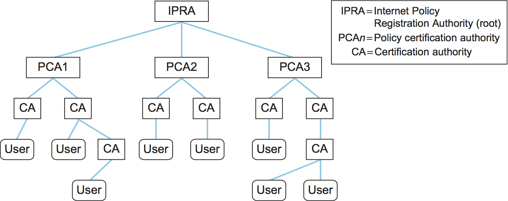

**Figure 8.5. Tree-structured certification authority hierarchy.**

There are some significant issues with building chains of trust. Most importantly, even if you are certain that you have the public key of the root CA, you need to be sure that every CA from the root on down is doing its job properly. If just one CA in the chain is willing to issue certificates to entities without verifying their identities, then what looks like a valid chain of certificates becomes meaningless. For example, a root CA might issue a certificate to a second-tier CA and thoroughly verify that the name on the certificate matches the business name of the CA, but that second-tier CA might be willing to sell certificates to anyone who asks, without verifying their identity. This problem gets worse the longer the chain of trust. X.509 certificates provide the option of restricting the set of entities that the subject of a certificate is, in turn, trusted to certify.

There can be more than one root to a certification tree, and this is common in securing Web transactions today, for example. Web browsers such as Firefox and Internet Explorer come pre-equipped with certificates for a set of CAs; in effect, the browser’s producer has decided these CAs and their keys can be trusted. A user can also add CAs to those that their browser recognizes as trusted. These certificates are accepted by Secure Socket Layer (SSL)/Transport Layer Security (TLS), the protocol most often used to secure Web transactions, which we discuss in a later section. (If you are curious, you can poke around in the preferences settings for your browser and find the “view certificates” option to see how many CAs your browser is configured to trust.)

##### Web of Trust

An alternative model of trust is the *web of trust* exemplified by Pretty Good Privacy (PGP), which is further discussed in a later section. PGP is a security system for email, so email addresses are the identities to which keys are bound and by which certificates are signed. In keeping with PGP’s roots as protection against government intrusion, there are no CAs. Instead, every individual decides whom they trust and how much they trust them—in this model, trust is a matter of degree. In addition, a public key certificate can include a confidence level indicating how confident the signer is of the key binding claimed in the certificate, so a given user may have to have several certificates attesting to the same key binding before he is willing to trust it.

For example, suppose you have a certificate for Bob provided by Alice; you can assign a moderate level of trust to that certificate. However, if you have additional certificates for Bob that were provided by C and D, each of whom is also moderately trustworthy, that might considerably increase your level of confidence that the public key you have for Bob is valid. In short, PGP recognizes that the problem of establishing trust is quite a personal matter and gives users the raw material to make their own decisions, rather than assuming that they are all willing to trust in a single hierarchical structure of CAs. To quote Phil Zimmerman, the developer of PGP, “PGP is for people who prefer to pack their own parachutes.”

PGP has become quite popular in the networking community, and PGP key-signing parties are a regular feature of various networking events, such as IETF meetings. At these gatherings, an individual can

- Collect public keys from others whose identity he knows.
- Provide his public key to others.
- Get his public key signed by others, thus collecting certificates that will be persuasive to an increasingly large set of people.
- Sign the public key of other individuals, thus helping them build up their set of certificates that they can use to distribute their public keys.
- Collect certificates from other individuals whom he trusts enough to sign keys.

Thus, over time, a user will collect a set of certificates with varying degrees of trust.

##### Certificate Revocation

One issue that arises with certificates is how to revoke, or undo, a certificate. Why is this important? Suppose that you suspect that someone has discovered your private key. There may be any number of certificates in the universe that assert that you are the owner of the public key corresponding to that private key. The person who discovered your private key thus has everything he needs to impersonate you: valid certificates and your private key. To solve this problem, it would be nice to be able to revoke the certificates that bind your old, compromised key to your identity, so that the impersonator will no longer be able to persuade other people that he is you.

The basic solution to the problem is simple enough. Each CA can issue a *certificate revocation list* (CRL), which is a digitally signed list of certificates that have been revoked. The CRL is periodically updated and made publicly available. Because it is digitally signed, it can just be posted on a website. Now, when Alice receives a certificate for Bob that she wants to verify, she will first consult the latest CRL issued by the CA. As long as the certificate has not been revoked, it is valid. Note that, if all certificates have unlimited life spans, the CRL would always be getting longer, since you could never take a certificate off the CRL for fear that some copy of the revoked certificate might be used. For this reason, it is common to attach an expiration date to a certificate when it is issued. Thus, we can limit the length of time that a revoked certificate needs to stay on a CRL. As soon as its original expiration date is passed, it can be removed from the CRL.

#### 8.3.2 Predistribution of Secret Keys

If Alice wants to use a secret-key cipher to communicate with Bob, she can’t just pick a key and send it to him because, without already having a key, they can’t encrypt this key to keep it confidential and they can’t authenticate each other. As with public keys, some predistribution scheme is needed. Predistribution is harder for secret keys than for public keys for two obvious reasons:

- While only one public key per entity is sufficient for authentication and confidentiality, there must be a secret key for each pair of entities who wish to communicate. If there are N entities, that means N(N-1)/2 keys.
- Unlike public keys, secret keys must be kept secret.

In summary, there are a lot more keys to distribute, and you can’t use certificates that everyone can read.

The most common solution is to use a *Key Distribution Center* (KDC). A KDC is a trusted entity that shares a secret key with each other entity. This brings the number of keys down to a more manageable N-1, few enough to establish out of band for some applications. When Alice wishes to communicate with Bob, that communication does not travel via the KDC. Rather, the KDC participates in a protocol that authenticates Alice and Bob—using the keys that the KDC already shares with each of them—and generates a new session key for them to use. Then Alice and Bob communicate directly using their session key. Kerberos is a widely used system based on this approach. We describe Kerberos (which also provides authentication) in the next section. The following subsection describes a powerful alternative.

#### 8.3.3 Diffie-Hellman Key Exchange

Another approach to establishing a shared secret key is to use the Diffie-Hellman key exchange protocol, which works without using any predistributed keys. The messages exchanged between Alice and Bob can be read by anyone able to eavesdrop, and yet the eavesdropper won’t know the secret key that Alice and Bob end up with.

Diffie-Hellman doesn’t authenticate the participants. Since it is rarely useful to communicate securely without being sure whom you’re communicating with, Diffie-Hellman is usually augmented in some way to provide authentication. One of the main uses of Diffie-Hellman is in the Internet Key Exchange (IKE) protocol, a central part of the IP Security (IPsec) architecture.

The Diffie-Hellman protocol has two parameters, *p* and *g*, both of which are public and may be used by all the users in a particular system. Parameter *p* must be a prime number. The integers mod p (short for modulo *p*) are 0 through *p-1*, since x mod p is the remainder after *x* is divided by *p*, and form what mathematicians call a *group* under multiplication. Parameter *g* (usually called a generator) must be a *primitive root* of *p*: For every number *n* from 1 through *p-1* there must be some value *k* such that n = gᵏ mod p. For example, if *p* were the prime number 5 (a real system would use a much larger number), then we might choose 2 to be the generator *g* since:

1 = 2⁰ mod p

2 = 2¹ mod p

3 = 2³ mod p

4 = 2² mod p

Suppose Alice and Bob want to agree on a shared secret key. Alice and Bob, and everyone else, already know the values of *p* and *g*. Alice generates a random private value *a* and Bob generates a random private value *b*. Both *a* and *b* are drawn from the set of integers {1,…, p-1}. Alice and Bob derive their corresponding public values—the values they will send to each other unencrypted—as follows. Alice’s public value is

g^{a} mod p

and Bob’s public value is

g^{b} mod p

They then exchange their public values. Finally, Alice computes

g^{ab} mod p = (g^{b} mod p)^{a} mod p

and Bob computes

g^{ba} mod p = (g^{a} mod p)^{b} mod p.

Alice and Bob now have g^{ab} mod p (which is equal to g^{ba} mod p) as their shared secret key.

Any eavesdropper would know *p, g*, and the two public values g^{a} mod p and g^{b} mod p. If only the eavesdropper could determine *a* or *b*, she could easily compute the resulting key. Determining *a* or *b* from that information is, however, computationally infeasible for suitably large *p,a,* and *b*; it is known as the *discrete logarithm problem*.

For example, using *p = 5* and *g = 2* from above, suppose Alice picks the random number *a = 3* and Bob picks the random number *b = 4*. Then Alice sends Bob the public value

2³ mod 5 = 3

and Bob sends Alice the public value

2⁴ mod 5 = 1

Alice is then able to compute

g^{ab} mod p = (2^{b} mod 5)³ mod 5 = (1)³ mod 5 = 1

by substituting Bob’s public value for (2^{b} mod 5). Similarly, Bob is able to compute

g^{ba} mod p = (g^{a} mod 5)⁴ mod 5 = (3)⁴ mod 5 = 1.

by substituting Alice’s public value for (2^{a} mod 5). Both Alice and Bob now agree that the secret key is 1.

There is the problem of Diffie-Hellman’s lack of authentication. One attack that can take advantage of this is the *man-in-the-middle attack*. Suppose Mallory is an adversary with the ability to intercept messages. Mallory already knows *p* and *g* since they are public, and she generates random private values c and d to use with Alice and Bob, respectively. When Alice and Bob send their public values to each other, Mallory intercepts them and sends her own public values, as in Figure ?. The result is that Alice and Bob each end up unknowingly sharing a key with Mallory instead of each other.

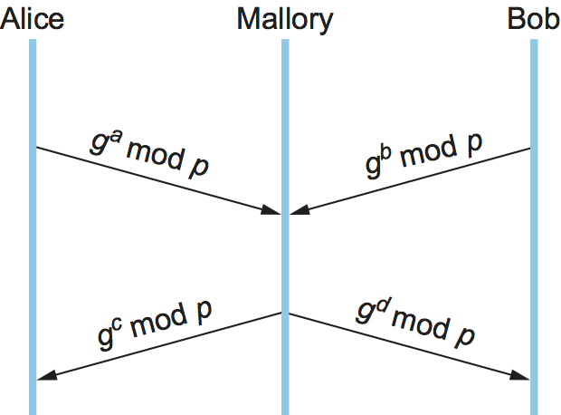

**Figure 8.6. A man-in-the-middle attack.**

A variant of Diffie-Hellman sometimes called *fixed Diffie-Hellman* supports authentication of one or both participants. It relies on certificates that are similar to public key certificates but instead certify the Diffie-Hellman public parameters of an entity. For example, such a certificate would state that Alice’s Diffie-Hellman parameters are *p, g*, and g^{a} mod p (note that the value of *a* would still be known only to Alice). Such a certificate would assure Bob that the other participant in Diffie-Hellman is Alice—or else the other participant won’t be able to compute the secret key, because she won’t know *a*. If both participants have certificates for their Diffie-Hellman parameters, they can authenticate each other. If just one has a certificate, then just that one can be authenticated. This is useful in some situations; for example, when one participant is a web server and the other is an arbitrary client, the client can authenticate the web server and establish a secret key for confidentiality before sending a credit card number to the web server.

### 8.4 Authentication Protocols

So far we described how to encrypt messages, build authenticators, predistribute the necessary keys. It might seem as if all we have to do to make a protocol secure is append an authenticator to every message and, if we want confidentiality, encrypt the message.

There are two main reasons why it’s not that simple. First, there is the problem of a *replay attack*: an adversary retransmitting a copy of a message that was previously sent. If the message was an order you had placed on a website, for example, then the replayed message would appear to the website as though you had ordered more of the same. Even though it wasn’t the original incarnation of the message, its authenticator would still be valid; after all, the message was created by you, and it wasn’t modified. Clearly, we need a solution that ensures *originality*.

In a variation of this attack called a *suppress-replay attack*, an adversary might merely delay your message (by intercepting and later replaying it), so that it is received at a time when it is no longer appropriate. For example, an adversary could delay your order to buy stock from an auspicious time to a time when you would not have wanted to buy. Although this message would in a sense be the original, it wouldn’t be timely. So we also need to ensure *timeliness*. Originality and timeliness may be considered aspects of integrity. Ensuring them will in most cases require a nontrivial, back-and-forth protocol.

The second problem we have not yet solved is how to establish a session key. A session key is a secret-key cipher key generated on the fly and used for just one session. This too involves a nontrivial protocol.

What these two issues have in common is authentication. If a message is not original and timely, then from a practical standpoint we want to consider it as not being authentic, not being from whom it claims to be. And, obviously, when you are arranging to share a new session key with someone, you want to know you are sharing it with the right person. Usually, authentication protocols establish a session key at the same time, so that at the end of the protocol Alice and Bob have authenticated each other and they have a new secret key to use. Without a new session key, the protocol would just authenticate Alice and Bob at one point in time; a session key allows them to efficiently authenticate subsequent messages. Generally, session key establishment protocols perform authentication. A notable exception is Diffie-Hellman, as described below, so the terms *authentication protocol* and *session key establishment protocol* are almost synonymous.

There is a core set of techniques used to ensure originality and timeliness in authentication protocols. We describe those techniques before moving on to particular protocols.

#### 8.4.1 Originality and Timeliness Techniques

We have seen that authenticators alone do not enable us to detect messages that are not original or timely. One approach is to include a timestamp in the message. Obviously the timestamp itself must be tamperproof, so it must be covered by the authenticator. The primary drawback to timestamps is that they require distributed clock synchronization. Since our system would then depend on synchronization, the clock synchronization itself would need to be defended against security threats, in addition to the usual challenges of clock synchronization. Another issue is that distributed clocks are synchronized to only a certain degree—a certain margin of error. Thus, the timing integrity provided by timestamps is only as good as the degree of synchronization.

Another approach is to include a *nonce*—a random number used only once—in the message. Participants can then detect replay attacks by checking whether a nonce has been used previously. Unfortunately, this requires keeping track of past nonces, of which a great many could accumulate. One solution is to combine the use of timestamps and nonces, so that nonces are required to be unique only within a certain span of time. That makes ensuring uniqueness of nonces manageable while requiring only loose synchronization of clocks.

Another solution to the shortcomings of timestamps and nonces is to use one or both of them in a *challenge-response* protocol. Suppose we use a timestamp. In a challenge-response protocol, Alice sends Bob a timestamp, challenging Bob to encrypt it in a response message (if they share a secret key) or digitally sign it in a response message (if Bob has a public key, as in Figure 8.7). The encrypted timestamp is like an authenticator that additionally proves timeliness. Alice can easily check the timeliness of the timestamp in a response from Bob since that timestamp comes from Alice’s own clock—no distributed clock synchronization needed. Suppose instead that the protocol uses nonces. Then Alice need only keep track of those nonces for which responses are currently outstanding and haven’t been outstanding too long; any purported response with an unrecognized nonce must be bogus.

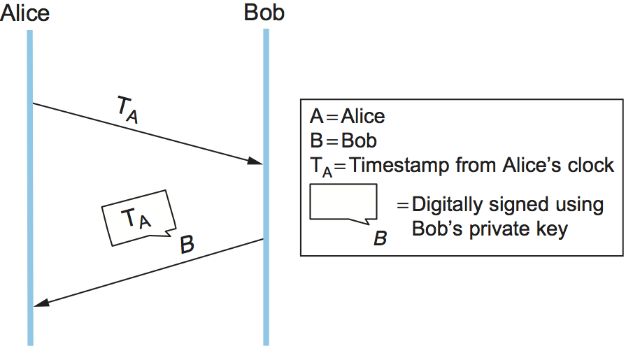

**Figure 8.7. A challenge-response protocol.**

The beauty of challenge-response, which might otherwise seem excessively complex, is that it combines timeliness and authentication; after all, only Bob (and possibly Alice, if it’s a secret-key cipher) knows the key necessary to encrypt the never before seen timestamp or nonce. Timestamps or nonces are used in most of the authentication protocols that follow.

#### 8.4.2 Public-Key Authentication Protocols

In the following discussion, we assume that Alice and Bob’s public keys have been predistributed to each other via some means such as a PKI. We mean this to include the case where Alice includes her certificate in her first message to Bob, and the case where Bob searches for a certificate about Alice when he receives her first message.

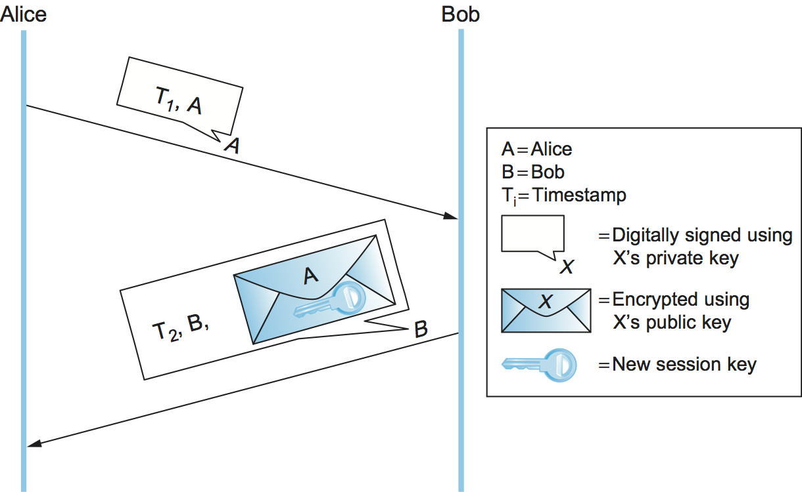

**Figure 8.8. A public-key authentication protocol that depends on synchronization.**

This first protocol (Figure 8.8) relies on Alice and Bob’s clocks being synchronized. Alice sends Bob a message with a timestamp and her identity in plaintext plus her digital signature. Bob uses the digital signature to authenticate the message and the timestamp to verify its freshness. Bob sends back a message with a timestamp and his identity in plaintext, as well as a new session key encrypted (for confidentiality) using Alice’s public key, all digitally signed. Alice can verify the authenticity and freshness of the message, so she knows she can trust the new session key. To deal with imperfect clock synchronization, the timestamps could be augmented with nonces.

The second protocol (Figure 8.9) is similar but does not rely on clock synchronization. In this protocol, Alice again sends Bob a digitally signed message with a timestamp and her identity. Because their clocks aren’t synchronized, Bob cannot be sure that the message is fresh. Bob sends back a digitally signed message with Alice’s original timestamp, his own new timestamp, and his identity. Alice can verify the freshness of Bob’s reply by comparing her current time against the timestamp that originated with her. She then sends Bob a digitally signed message with his original timestamp and a new session key encrypted using Bob’s public key. Bob can verify the freshness of the message because the timestamp came from his clock, so he knows he can trust the new session key. The timestamps essentially serve as convenient nonces, and indeed this protocol could use nonces instead.

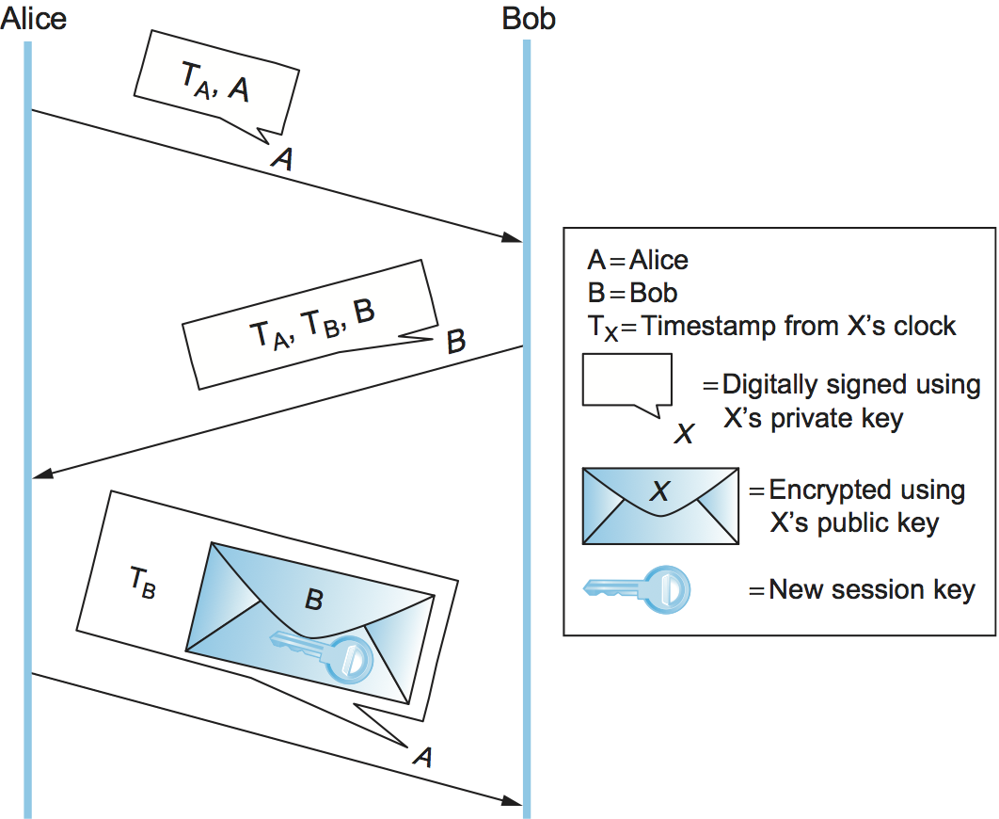

**Figure 8.9. A public-key authentication protocol that does not depend on synchronization. Alice checks her own timestamp against her own clock, and likewise for Bob.**

#### 8.4.3 Secret-Key Authentication Protocols

Only in fairly small systems is it practical to predistribute secret keys to every pair of entities. We focus here on larger systems, where each entity would have its own *master key* shared only with a Key Distribution Center (KDC). In this case, secret-key-based authentication protocols involve three parties: Alice, Bob, and a KDC. The end product of the authentication protocol is a session key shared between Alice and Bob that they will use to communicate directly, without involving the KDC.

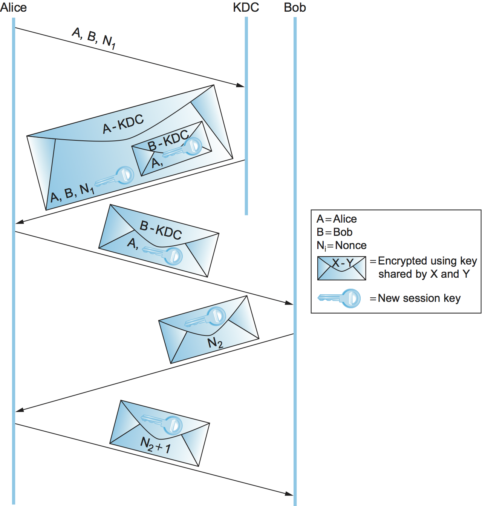

**Figure 8.10. The Needham-Schroeder authentication protocol.**

The Needham-Schroeder authentication protocol is illustrated in Figure 8.10. Note that the KDC doesn’t actually authenticate Alice’s initial message and doesn’t communicate with Bob at all. Instead, the KDC uses its knowledge of Alice’s and Bob’s master keys to construct a reply that would be useless to anyone other than Alice (because only Alice can decrypt it) and contains the necessary ingredients for Alice and Bob to perform the rest of the authentication protocol themselves.

The nonce in the first two messages is to assure Alice that the KDC’s reply is fresh. The second and third messages include the new session key and Alice’s identifier, encrypted together using Bob’s master key. It is a sort of secret-key version of a public-key certificate; it is in effect a signed statement by the KDC (because the KDC is the only entity besides Bob who knows Bob’s master key) that the enclosed session key is owned by Alice and Bob. Although the nonce in the last two messages is intended to assure Bob that the third message was fresh, there is a flaw in this reasoning.

##### Kerberos

Kerberos is an authentication system based on the Needham-Schroeder protocol and specialized for client/server environments. Originally developed at MIT, it has been standardized by the IETF and is available as both open source and commercial products. We will focus here on some of Kerberos’s interesting innovations.

Kerberos clients are generally human users, and users authenticate themselves using passwords. Alice’s master key, shared with the KDC, is derived from her password—if you know the password, you can compute the key. Kerberos assumes anyone can physically access any client machine; therefore, it is important to minimize the exposure of Alice’s password or master key not just in the network but also on any machine where she logs in. Kerberos takes advantage of Needham-Schroeder to accomplish this. In Needham-Schroeder, the only time Alice needs to use her password is when decrypting the reply from the KDC. Kerberos client-side software waits until the KDC’s reply arrives, prompts Alice to enter her password, computes the master key and decrypts the KDC’s reply, and then erases all information about the password and master key to minimize its exposure. Also note that the only sign a user sees of Kerberos is when the user is prompted for a password.

In Needham-Schroeder, the KDC’s reply to Alice plays two roles: It gives her the means to prove her identity (only Alice can decrypt the reply), and it gives her a sort of secret-key certificate or “ticket” to present to Bob—the session key and Alice’s identifier, encrypted with Bob’s master key. In Kerberos, those two functions—and the KDC itself, in effect—are split up (Figure 8.11). A trusted server called an Authentication Server (AS) plays the first KDC role of providing Alice with something she can use to prove her identity—not to Bob this time, but to a second trusted server called a Ticket Granting Server (TGS). The TGS plays the second KDC role, replying to Alice with a ticket she can present to Bob. The attraction of this scheme is that if Alice needs to communicate with several servers, not just Bob, then she can get tickets for each of them from the TGS without going back to the AS.

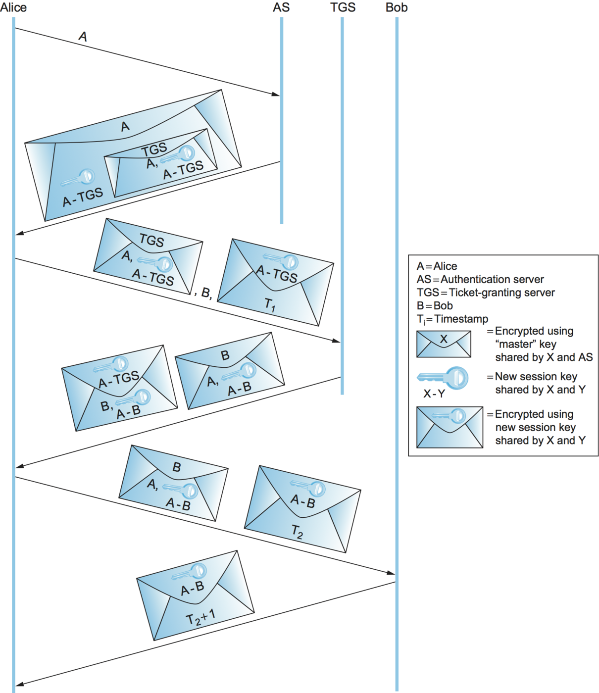

**Figure 8.11. Kerberos authentication.**

In the client/server application domain for which Kerberos is intended, it is reasonable to assume a degree of clock synchronization. This allows Kerberos to use timestamps and lifespans instead of Needham-Shroeder’s nonces, and thereby eliminate the Needham-Schroeder security weakness. Kerberos supports a choice of hash functions and secret-key ciphers, allowing it to keep pace with the state-of-the-art in cryptographic algorithms.

### 8.5 Example Systems

We have now seen many of the components required to provide one or two aspects of security. These components include cryptographic algorithms, key predistribution mechanisms, and authentication protocols. In this section, we examine some complete systems that use these components.

These systems can be roughly categorized by the protocol layer at which they operate. Systems that operate at the application layer include Pretty Good Privacy (PGP), which provides electronic mail security, and Secure Shell (SSH), a secure remote login facility. At the transport layer, there is the IETF’s Transport Layer Security (TLS) standard and the older protocol from which it derives, Secure Socket Layer (SSL). The IPsec (IP Security) protocols, as their name implies, operate at the IP (network) layer. 802.11i provides security at the link layer of wireless networks. This section describes the salient features of each of these approaches.

You might reasonably wonder why security has to be provided at so many different layers. One reason is that different threats require different defensive measures, and this often translates into securing a different protocol layer. For example, if your main concern is with a person in the building next door snooping on your traffic as it flows between your laptop and your 802.11 access point, then you probably want security at the link layer. However, if you want to be really sure you are connected to your bank’s website and preventing all the data that you send to the bank from being read by curious employees of some Internet service provider, then something that extends all the way from your machine to the bank’s server—like the transport layer—may be the right place to secure the traffic. As is often the case, there is no one-size-fits-all solution.

The security systems described below have the ability to vary which cryptographic algorithms they use. The idea of making a security system algorithm independent is a very good one, because you never know when your favorite cryptographic algorithm might be proved to be insufficiently strong for your purposes. It would be nice if you could quickly change to a new algorithm without having to change the protocol specification or implementation. Note the analogy to being able to change keys without changing the algorithm; if one of your cryptographic algorithms turns out to be flawed, it would be great if your entire security architecture didn’t need an immediate redesign.

#### 8.5.1 Pretty Good Privacy (PGP)

Pretty Good Privacy (PGP) is a widely used approach to providing security for electronic mail. It provides authentication, confidentiality, data integrity, and nonrepudiation. Originally devised by Phil Zimmerman, it has evolved into an IETF standard known as OpenPGP. As we saw in a previous section, PGP is notable for using a “web of trust” model for distribution of keys rather than a tree-like hierarchy.

PGP’s confidentiality and receiver authentication depend on the receiver of an email message having a public key that is known to the sender. To provide sender authentication and nonrepudiation, the sender must have a public key that is known by the receiver. These public keys are predistributed using certificates and a web-of-trust PKI. PGP supports RSA and DSS for public key certificates. These certificates may additionally specify which cryptographic algorithms are supported or preferred by the key’s owner. The certificates provide bindings between email addresses and public keys.

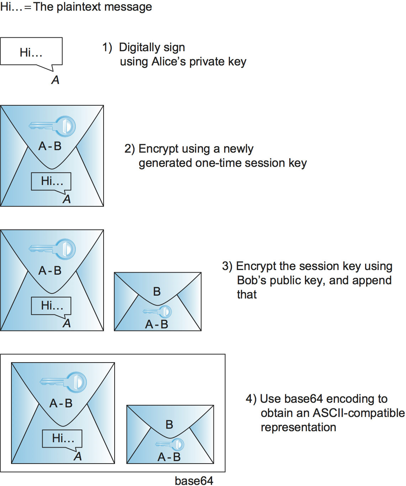

**Figure 8.12. PGP’s steps to prepare a message for emailing from Alice to Bob.**

Consider the following example of PGP being used to provide both sender authentication and confidentiality. Suppose Alice has a message to email to Bob. Alice’s PGP application goes through the steps illustrated in Figure 8.12. First, the message is digitally signed by Alice; MD5, SHA-1, and the SHA-2 family are among the hashes that may be used in the digital signature. Her PGP application then generates a new session key for just this one message; AES and 3DES are among the supported secret-key ciphers. The digitally signed message is encrypted using the session key, then the session key itself is encrypted using Bob’s public key and appended to the message. Alice’s PGP application reminds her of the level of trust she had previously assigned to Bob’s public key, based on the number of certificates she has for Bob and the trustworthiness of the individuals who signed the certificates. Finally, not for security but because email messages have to be sent in ASCII, a base64 encoding is applied to the message to convert it to an ASCII-compatible representation. Upon receiving the PGP message in an email, Bob’s PGP application reverses this process step-by-step to obtain the original plaintext message and confirm Alice’s digital signature—and reminds Bob of the level of trust he has in Alice’s public key.

Email has particular characteristics that allow PGP to embed an adequate authentication protocol in this one-message data transmission protocol, avoiding the need for any prior message exchange (and sidestepping some of the complexities described in the previous section). Alice’s digital signature suffices to authenticate her. Although there is no proof that the message is timely, legitimate email isn’t guaranteed to be timely either. There is also no proof that the message is original, but Bob is an email user and probably a fault-tolerant human who can recover from duplicate emails (which, again, are not out of the question under normal operation anyway). Alice can be sure that only Bob could read the message because the session key was encrypted with his public key. Although this protocol doesn’t prove to Alice that Bob is actually there and received the email, an authenticated email from Bob back to Alice could do this.

The preceding discussion gives a good example of why application-layer security mechanisms can be helpful. Only with a full knowledge of how the application works can you make the right choices about which attacks to defend against (like forged email) versus which to ignore (like delayed or replayed email).

#### 8.5.2 Secure Shell (SSH)

The Secure Shell (SSH) protocol is used to provide a remote login service, replacing the less secure Telnet used in the early days of the Internet. (SSH can also be used to remotely execute commands and transfer files, but we will focus first on how SSH supports remote login.) SSH is most often used to provide strong client/server authentication/message integrity—where the SSH client runs on the user’s desktop machine and the SSH server runs on some remote machine that the user wants to log into—but it also supports confidentiality. Telnet provides none of these capabilities. Note that “SSH” is often used to refer to both the SSH protocol and applications that use it; you need to figure out which from the context.

To better appreciate the importance of SSH on today’s Internet, consider a couple of the scenarios where it is used. Telecommuters, for example, often subscribe to ISPs that offer high-speed fiber-to-the-home, and they use these ISPs (plus some chain of other ISPs) to reach machines operated by their employer. This means that when a telecommuter logs into a machine inside his employer’s data center, both the passwords and all the data sent or received potentially passes through any number of untrusted networks. SSH provides a way to encrypt the data sent over these connections and to improve the strength of the authentication mechanism used to log in. (A similar situation occurs when said employee connects to work using the public Wi-Fi at Starbucks.) Another usage of SSH is remote login to a router, perhaps to change its configuration or read its log files; clearly, a network administrator wants to be sure that he can log into a router securely and that unauthorized parties can neither log in nor intercept the commands sent to the router or output sent back to the administrator.

The latest version of SSH, version 2, consists of three protocols:

- SSH-TRANS, a transport layer protocol
- SSH-AUTH, an authentication protocol
- SSH-CONN, a connection protocol

We focus on the first two, which are involved in remote login. We briefly discuss the purpose of SSH-CONN at the end of the section.

SSH-TRANS provides an encrypted channel between the client and server machines. It runs on top of a TCP connection. Any time a user uses an SSH application to log into a remote machine, the first step is to set up an SSH-TRANS channel between those two machines. The two machines establish this secure channel by first having the client authenticate the server using RSA. Once authenticated, the client and server establish a session key that they will use to encrypt any data sent over the channel. This high-level description skims over several details, including the fact that the SSH-TRANS protocol includes a negotiation of the encryption algorithm the two sides are going to use. For example, AES is commonly selected. Also, SSH-TRANS includes a message integrity check of all data exchanged over the channel.

The one issue we can’t skim over is how the client came to possess the server’s public key that it needs to authenticate the server. Strange as it may sound, the server tells the client its public key at connection time. The first time a client connects to a particular server, the SSH application warns the user that it has never talked to this machine before and asks if the user wants to continue. Although it is a risky thing to do, because SSH is effectively not able to authenticate the server, users often say “yes” to this question. The SSH application then remembers the server’s public key, and the next time the user connects to that same machine it compares this saved key with the one the server responds with. If they are the same, SSH authenticates the server. If they are different, however, the SSH application again warns the user that something is amiss, and the user is then given an opportunity to abort the connection. Alternatively, the prudent user can learn the server’s public key through some out-of-band mechanism, save it on the client machine, and thus never take the “first time” risk.

Once the SSH-TRANS channel exists, the next step is for the user to actually log into the machine, or more specifically, authenticate himself or herself to the server. SSH allows three different mechanisms for doing this. First, since the two machines are communicating over a secure channel, it is OK for the user to simply send his or her password to the server. This is not a safe thing to do when using Telnet since the password would be sent in the clear, but in the case of SSH the password is encrypted in the SSH-TRANS channel. The second mechanism uses public-key encryption. This requires that the user has already placed his or her public key on the server. The third mechanism, called *host-based authentication*, basically says that any user claiming to be so-and-so from a certain set of trusted hosts is automatically believed to be that same user on the server. Host-based authentication requires that the client *host* authenticate itself to the server when they first connect; standard SSH-TRANS only authenticates the server by default.

The main thing you should take away from this discussion is that SSH is a fairly straightforward application of the protocols and algorithms we have seen throughout this chapter. However, what sometimes makes SSH a challenge to understand is all the keys a user has to create and manage, where the exact interface is operating system dependent. For example, the OpenSSH package that runs on most Unix machines supports a command that can be used to create public/private key pairs. These keys are then stored in various files in directory in the user’s home directory. For example, file ~/.ssh/known_hosts records the keys for all the hosts the user has logged into, file ~/.ssh/authorized_keys contains the public keys needed to authenticate the user when he or she logs into this machine (i.e., they are used on the server side), and file ~/.ssh/id_rsa contains the private keys needed to authenticate the user on remote machines (i.e., they are used on the client side).

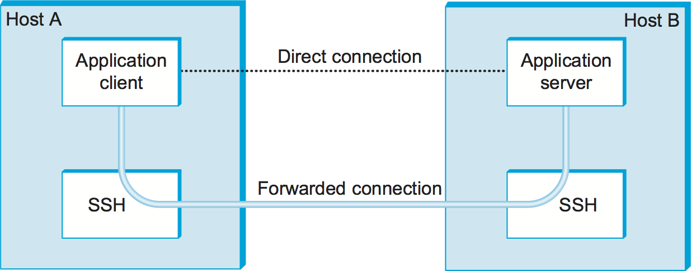

**Figure 8.13. Using SSH port forwarding to secure other TCP-based applications.**

Finally, SSH has proven so useful as a system for securing remote login, it has been extended to also support other applications, such as sending and receiving email. The idea is to run these applications over a secure “SSH tunnel.” This capability is called *port forwarding*, and it uses the SSH-CONN protocol. The idea is illustrated in Figure 8.13, where we see a client on host A indirectly communicating with a server on host B by forwarding its traffic through an SSH connection. The mechanism is called *port forwarding* because when messages arrive at the well-known SSH port on the server, SSH first decrypts the contents and then “forwards” the data to the actual port at which the server is listening. This is just another sort of tunnel, which in this case happens to provide confidentiality and authentication. It’s possible to provide a form of virtual private network (VPN) using SSH tunnels in this way.

#### 8.5.3 Transport Layer Security (TLS, SSL, HTTPS)

To understand the design goals and requirements for the Transport Layer Security (TLS) standard and the Secure Socket Layer (SSL) on which TLS is based, it is helpful to consider one of the main problems that they are intended to solve. As the World Wide Web became popular and commercial enterprises began to take an interest in it, it became clear that some level of security would be necessary for transactions on the Web. The canonical example of this is making purchases by credit card. There are several issues of concern when sending your credit card information to a computer on the Web. First, you might worry that the information would be intercepted in transit and subsequently used to make unauthorized purchases. You might also worry about the details of a transaction being modified, such as changing the purchase amount. And you would certainly like to know that the computer to which you are sending your credit card information is in fact one belonging to the vendor in question and not some other party. Thus, we immediately see a need for confidentiality, integrity, and authentication in Web transactions. The first widely used solution to this problem was SSL, originally developed by Netscape and subsequently the basis for the IETF’s TLS standard.

The designers of SSL and TLS recognized that these problems were not specific to Web transactions (i.e., those using HTTP) and instead built a general-purpose protocol that sits between an application protocol such as HTTP and a transport protocol such as TCP. The reason for calling this “transport layer security” is that, from the application’s perspective, this protocol layer looks just like a normal transport protocol except for the fact that it is secure. That is, the sender can open connections and deliver bytes for transmission, and the secure transport layer will get them to the receiver with the necessary confidentiality, integrity, and authentication. By running the secure transport layer on top of TCP, all of the normal features of TCP (reliability, flow control, congestion control, etc.) are also provided to the application. This arrangement of protocol layers is depicted in Figure 8.14.

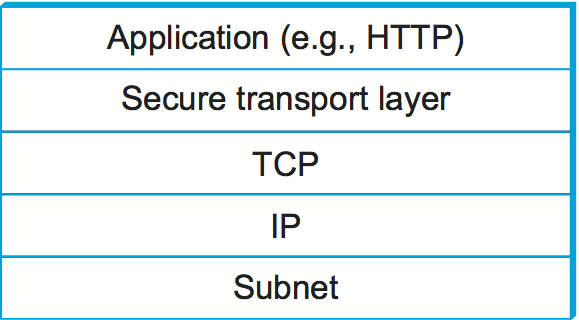

**Figure 8.14. Secure transport layer inserted between application and TCP layers.**

When HTTP is used in this way, it is known as HTTPS (Secure HTTP). In fact, HTTP itself is unchanged. It simply delivers data to and accepts data from the SSL/TLS layer rather than TCP. For convenience, a default TCP port has been assigned to HTTPS (443). That is, if you try to connect to a server on TCP port 443, you will likely find yourself talking to the SSL/TLS protocol, which will pass your data through to HTTP provided all goes well with authentication and decryption. Although standalone implementations of SSL/TLS are available, it is more common for an implementation to be bundled with applications that need it, primarily web browsers.

In the remainder of our discussion of transport layer security, we focus on TLS. Although SSL and TLS are unfortunately not interoperable, they differ in only minor ways, so nearly all of this description of TLS applies to SSL.

##### Handshake Protocol

A pair of TLS participants negotiate at runtime which cryptography to use. The participants negotiate a choice of:

- Data integrity hash (MD5, SHA-1, etc.), used to implement HMACs
- secret-key cipher for confidentiality (among the possibilities are DES, 3DES, and AES)
- Session key establishment approach (among the possibilities are Diffie-Hellman, and public-key authentication protocols using DSS)

Interestingly, the participants may also negotiate the use of a compression algorithm, not because this offers any security benefits, but because it’s easy to do when you’re negotiating all this other stuff and you’ve already decided to do some expensive per-byte operations on the data.

In TLS, the confidentiality cipher uses two keys, one for each direction, and similarly two initialization vectors. The HMACs are likewise keyed with different keys for the two participants. Thus, regardless of the choice of cipher and hash, a TLS session requires effectively six keys. TLS derives all of them from a single shared *master secret*. The master secret is a 384-bit (48-byte) value that in turn is derived in part from the “session key” that results from TLS’s session key establishment protocol.

The part of TLS that negotiates the choices and establishes the shared master secret is called the *handshake protocol*. (Actual data transfer is performed by TLS’s *record protocol*.) The handshake protocol is at heart a session key establishment protocol, with a master secret instead of a session key. Since TLS supports a choice of approaches to session key establishment, these call for correspondingly different protocol variants. Furthermore, the handshake protocol supports a choice between mutual authentication of both participants, authentication of just one participant (this is the most common case, such as authenticating a website but not a user), or no authentication at all (anonymous Diffie-Hellman). Thus, the handshake protocol knits together several session key establishment protocols into a single protocol.

Figure 8.15 shows the handshake protocol at a high level. The client initially sends a list of the combinations of cryptographic algorithms that it supports, in decreasing order of preference. The server responds, giving the single combination of cryptographic algorithms it selected from those listed by the client. These messages also contain a *client nonce* and a *server nonce*, respectively, that will be incorporated in generating the master secret later.

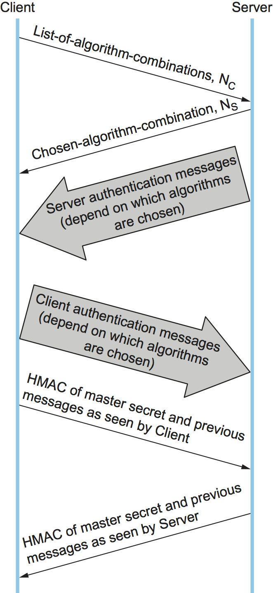

**Figure 8.15. Handshake protocol to establish TLS session.**

At this point, the negotiation phase is complete. The server now sends additional messages based on the negotiated session key establishment protocol. That could involve sending a public-key certificate or a set of Diffie-Hellman parameters. If the server requires authentication of the client, it sends a separate message indicating that. The client then responds with its part of the negotiated key exchange protocol.

Now the client and server each have the information necessary to generate the master secret. The “session key” that they exchanged is not in fact a key, but instead what TLS calls a *pre-master secret*. The master secret is computed (using a published algorithm) from this pre-master secret, the client nonce, and the server nonce. Using the keys derived from the master secret, the client then sends a message that includes a hash of all the preceding handshake messages, to which the server responds with a similar message. This enables them to detect any discrepancies between the handshake messages they sent and received, such as would result, for example, if a man in the middle modified the initial unencrypted client message to weaken its choices of cryptographic algorithms.

##### Record Protocol

Within a session established by the handshake protocol, TLS’s record protocol adds confidentiality and integrity to the underlying transport service. Messages handed down from the application layer are:

1. Fragmented or coalesced into blocks of a convenient size for the following steps
2. Optionally compressed
3. Integrity-protected using an HMAC
4. Encrypted using a secret-key cipher
5. Passed to the transport layer (normally TCP) for transmission

The record protocol uses an HMAC as an authenticator. The HMAC uses whichever hash algorithm (MD5, SHA-1, etc.) was negotiated by the participants. The client and server have different keys to use when computing HMACs, making them even harder to break. Furthermore, each record protocol message is assigned a sequence number, which is included when the HMAC is computed—even though the sequence number is never explicit in the message. This implicit sequence number prevents replays or reorderings of messages. This is needed because, although TCP can deliver sequential, unduplicated messages to the layer above it under normal assumptions, those assumptions do not include an adversary that can intercept TCP messages, modify messages, or send bogus ones. On the other hand, it is TCP’s delivery guarantees that make it possible for TLS to rely on a legitimate TLS message having the next implicit sequence number in order.

Another interesting feature of the TLS protocol is the ability to resume a session. To understand the original motivation for this, it is helpful to understand how HTTP originally made use of TCP connections. (The details of HTTP are presented in the next chapter.) Each HTTP operation, such as getting a page from a server, required a new TCP connection to be opened. Retrieving a single page with a number of embedded graphical objects might take many TCP connections. Opening a TCP connection requires a three-way handshake before data transmission can start. Once the TCP connection is ready to accept data, the client would then need to start the TLS handshake protocol, taking at least another two round-trip times (and consuming some amount of processing resources and network bandwidth) before actual application data could be sent. The resumption capability of TLS was designed to alleviate this problem.

The idea of session resumption is to optimize away the handshake in those cases where the client and the server have already established some shared state in the past. The client simply includes the session ID from a previously established session in its initial handshake message. If the server finds that it still has state for that session, and the resumption option was negotiated when that session was originally created, then the server can reply to the client with an indication of success, and data transmission can begin using the algorithms and parameters previously negotiated. If the session ID does not match any session state cached at the server, or if resumption was not allowed for the session, then the server will fall back to the normal handshake process.

The reason the preceding discussion emphasized the *original* motivation is that having to do a TCP handshake for every embedded object in a web page led to so much overhead, independent of TLS, that HTTP was eventually optimized to support *persistent connections* (also discussed in the next chapter). Because optimizing HTTP mitigated the value of session resumption in TLS (plus the realization that reusing the same session IDs and master secret key in a series of resumed sessions is a security risk), TLS changed its approach to resumption in the latest version (1.3).

In TLS 1.3, the client sends an opaque, server-encrypted *session ticket* to the server upon resumption. This ticket contains all the information required to resume the session. The same master secret is used across handshakes, but the default behavior is to perform a session key exchange upon resumption.

> **Key Takeaway**
>
> We call attention to this change in TLS because it illustrates the challenge of knowing which layer should solve a given problem. In isolation, session resumption as implemented in the earlier version of TLS seems like a good idea, but it needs to be considered in the context of the dominate use case, which is HTTP. Once the overhead of doing multiple TCP connections was addressed by HTTP, the equation for how resumption should be implemented by TLS changed. The bigger lesson is that we need to avoid rigid thinking about the right layer to implement a given function—the answer changes over time as the network evolves—where a holistic/cross-layer analysis is required to get the design right. [Next]

#### 8.5.4 IP Security (IPsec)

Probably the most ambitious of all the efforts to integrate security into the Internet happens at the IP layer. Support for IPsec, as the architecture is called, is optional in IPv4 but mandatory in IPv6.

IPsec is really a framework (as opposed to a single protocol or system) for providing all the security services discussed throughout this chapter. IPsec provides three degrees of freedom. First, it is highly modular, allowing users (or more likely, system administrators) to select from a variety of cryptographic algorithms and specialized security protocols. Second, IPsec allows users to select from a large menu of security properties, including access control, integrity, authentication, originality, and confidentiality. Third, IPsec can be used to protect narrow streams (e.g., packets belonging to a particular TCP connection being sent between a pair of hosts) or wide streams (e.g., all packets flowing between a pair of routers).

When viewed from a high level, IPsec consists of two parts. The first part is a pair of protocols that implement the available security services. They are the Authentication Header (AH), which provides access control, connectionless message integrity, authentication, and antireplay protection, and the Encapsulating Security Payload (ESP), which supports these same services, plus confidentiality. AH is rarely used so we focus on ESP here. The second part is support for key management, which fits under an umbrella protocol known as the Internet Security Association and Key Management Protocol (ISAKMP).

The abstraction that binds these two pieces together is the *security association* (SA). An SA is a simplex (one-way) connection with one or more of the available security properties. Securing a bidirectional communication between a pair of hosts—corresponding to a TCP connection, for example—requires two SAs, one in each direction. Although IP is a connectionless protocol, security depends on connection state information such as keys and sequence numbers. When created, an SA is assigned an ID number called a *security parameters index* (SPI) by the receiving machine. A combination of this SPI and the destination IP addresses uniquely identifies an SA. An ESP header includes the SPI so the receiving host can determine which SA an incoming packet belongs to and, hence, what algorithms and keys to apply to the packet.

SAs are established, negotiated, modified, and deleted using ISAKMP. It defines packet formats for exchanging key generation and authentication data. These formats aren’t terribly interesting because they provide a framework only—the exact form of the keys and authentication data depends on the key generation technique, the cipher, and the authentication mechanism that is used. Moreover, ISAKMP does not specify a particular key exchange protocol, although it does suggest the Internet Key Exchange (IKE) as one possibility, and IKE v2 is what is used in practice.

ESP is the protocol used to securely transport data over an established SA. In IPv4, the ESP header follows the IP header; in IPv6, it is an extension header. Its format uses both a header and a trailer, as shown in Figure 8.16. The SPI field lets the receiving host identify the security association to which the packet belongs. The SeqNum field protects against replay attacks. The packet’s PayloadData contains the data described by the NextHdr field. If confidentiality is selected, then the data is encrypted using whatever cipher was associated with the SA. The PadLength field records how much padding was added to the data; padding is sometimes necessary because, for example, the cipher requires the plaintext to be a multiple of a certain number of bytes or to ensure that the resulting ciphertext terminates on a 4-byte boundary. Finally, the AuthenticationData carries the authenticator.

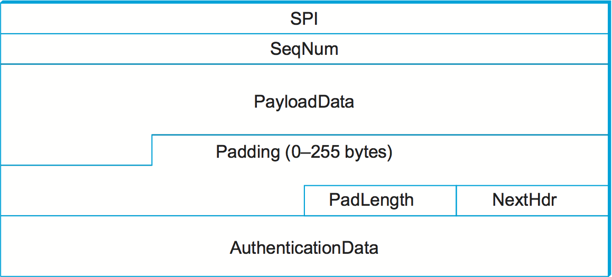

**Figure 8.16. IPSec’s ESP format.**

IPsec supports a *tunnel mode* as well as the more straightforward *transport mode*. Each SA operates in one or the other mode. In a transport mode SA, ESP’s payload data is simply a message for a higher layer such as UDP or TCP. In this mode, IPsec acts as an intermediate protocol layer, much like SSL/TLS does between TCP and a higher layer. When an ESP message is received, its payload is passed to the higher level protocol.

In a tunnel mode SA, however, ESP’s payload data is itself an IP packet, as in Figure 8.17. The source and destination of this inner IP packet may be different from those of the outer IP packet. When an ESP message is received, its payload is forwarded on as a normal IP packet. The most common way to use the ESP is to build an “IPsec tunnel” between two routers, typically firewalls. For example, a corporation wanting to link two sites using the Internet could open a pair of tunnel-mode SAs between a router at one site and a router at the other site. An IP packet outgoing from one site would, at the outgoing router, become the payload of an ESP message sent to the other site’s router. The receiving router would unwrap the payload IP packet and forward it on to its true destination.

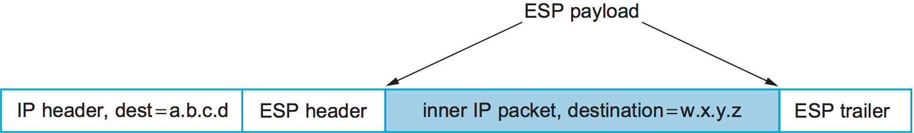

**Figure 8.17. An IP packet with a nested IP packet encapsulated using ESP in tunnel mode. Note that the inner and outer packets have different addresses.**

These tunnels may also be configured to use ESP with confidentiality and authentication, thus preventing unauthorized access to the data that traverses this virtual link and ensuring that no spurious data is received at the far end of the tunnel. Furthermore, tunnels can provide traffic confidentiality, since multiplexing multiple flows through a single tunnel obscures information about how much traffic is flowing between particular endpoints. A network of such tunnels can be used to implement an entire virtual private network. Hosts communicating over a VPN need not even be aware that it exists.

#### 8.5.5 Wireless Security (802.11i)

Wireless links are particularly exposed to security threats due to the lack of any physical security on the medium. While the convenience of 802.11 has prompted widespread acceptance of the technology, lack of security has been a recurring problem. For example, it is all too easy for an employee of a corporation to connect an 802.11 access point to the corporate network. Since radio waves pass through most walls, if the access point lacks the correct security measures, an attacker can now gain access to the corporate network from outside the building. Similarly, a computer with a wireless network adaptor inside the building could connect to an access point outside the building, potentially exposing it to attack, not to mention the rest of the corporate network if that same computer has, say, an Ethernet connection as well.

Consequently, there has been considerable work on securing Wi-Fi links. Somewhat surprisingly, one of the early security techniques developed for 802.11, known as Wired Equivalent Privacy (WEP), turned out to be seriously flawed and quite easily breakable.

The IEEE 802.11i standard provides authentication, message integrity, and confidentiality to 802.11 (Wi-Fi) at the link layer. *WPA3* (Wi-Fi Protected Access 3) is often used as a synonym for 802.11i, although it is technically a trademark of the Wi-Fi Alliance that certifies product compliance with 802.11i.

For backward compatibility, 802.11i includes definitions of first-generation security algorithms—including WEP—that are now known to have major security flaws. We will focus here on 802.11i’s newer, stronger algorithms.

802.11i authentication supports two modes. In either mode, the end result of successful authentication is a shared Pairwise Master Key. *Personal mode*, also known as *Pre-Shared Key (PSK) mode*, provides weaker security but is more convenient and economical for situations like a home 802.11 network. The wireless device and the Access Point (AP) are preconfigured with a shared *passphrase*—essentially a very long password—from which the Pairwise Master Key is cryptographically derived.

802.11i’s stronger authentication mode is based on the IEEE 802.1X framework for controlling access to a LAN, which uses an Authentication Server (AS) as in Figure 8.18. The AS and AP must be connected by a secure channel and could even be implemented as a single box, but they are logically separate. The AP forwards authentication messages between the wireless device and the AS. The protocol used for authentication is called the *Extensible Authentication Protocol* (EAP). EAP is designed to support multiple authentication methods—smart cards, Kerberos, one-time passwords, public key authentication, and so on—as well as both one-sided and mutual authentication. So EAP is better thought of as an authentication framework than a protocol. Specific EAP-compliant protocols, of which there are many, are called *EAP methods*. For example, EAP-TLS is an EAP method based on TLS authentication.

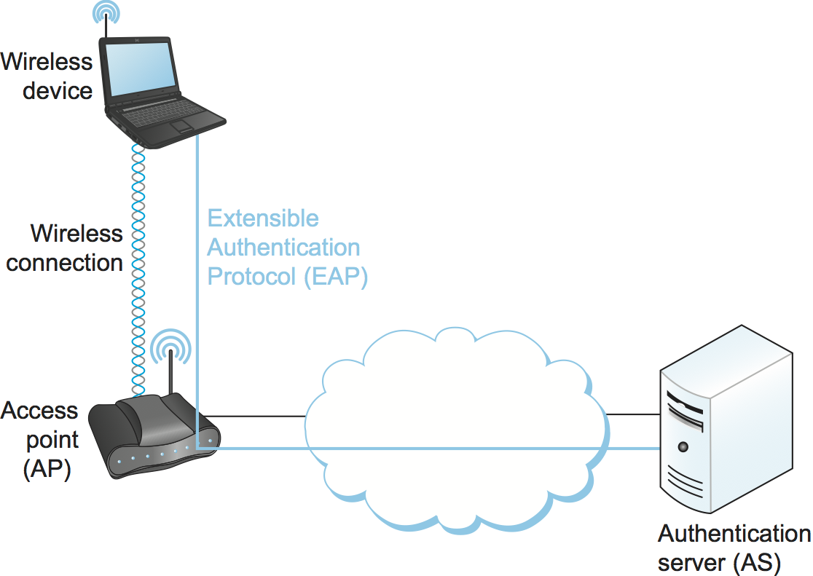

**Figure 8.18. Use of an Authentication Server in 802.11i.**

802.11i does not place any restrictions on what the EAP method can use as a basis for authentication. It does, however, require an EAP method that performs *mutual* authentication, because not only do we want to prevent an adversary from accessing the network via our AP, we also want to prevent an adversary from fooling our wireless devices with a bogus, malicious AP. The end result of a successful authentication is a Pairwise Master Key shared between the wireless device and the AS, which the AS then conveys to the AP.

One of the main differences between the stronger AS-based mode and the weaker personal mode is that the former readily supports a unique key per client. This in turn makes it easier to change the set of clients that can authenticate themselves (e.g., to revoke access to one client) without needing to change the secret stored in every client.

With a Pairwise Master Key in hand, the wireless device and the AP execute a session key establishment protocol called the 4-way handshake to establish a Pairwise Transient Key. This Pairwise Transient Key is really a collection of keys that includes a session key called a *Temporal Key*. This session key is used by the protocol, called *CCMP*, that provides 802.11i’s data confidentiality and integrity.

CCMP stands for CTR (Counter Mode) with CBC-MAC (Cipher-Block Chaining with Message Authentication Code) Protocol. CCMP uses AES in counter mode to encrypt for confidentiality. Recall that in counter mode encryption successive values of a counter are incorporated into the encryption of successive blocks of plaintext.

CCMP uses a Message Authentication Code (MAC) as an authenticator. The MAC algorithm is based on CBC, even though CCMP doesn’t use CBC in the confidentiality encryption. In effect, CBC is performed without transmitting any of the CBC-encrypted blocks, solely so that the last CBC-encrypted block can be used as a MAC (only its first 8 bytes are actually used). The role of initialization vector is played by a specially constructed first block that includes a 48-bit packet number—a sequence number. (The packet number is also incorporated in the confidentiality encryption and serves to expose replay attacks.) The MAC is subsequently encrypted along with the plaintext in order to prevent birthday attacks, which depend on finding different messages with the same authenticator.

#### 8.5.6 Firewalls

Whereas much of this chapter has focused on the uses of cryptography to provide such security features as authentication and confidentiality, there is a whole set of security issues that are not readily addressed by cryptographic means. For example, worms and viruses spread by exploiting bugs in operating systems and application programs (and sometimes human gullibility as well), and no amount of cryptography can help you if your machine has unpatched vulnerabilities. So other approaches are often used to keep out various forms of potentially harmful traffic. Firewalls are one of the most common ways to do this.

A firewall is a system that typically sits at some point of connectivity between a site it protects and the rest of the network, as illustrated in Figure 8.19. It is usually implemented as an “appliance” or part of a router, although a “personal firewall” may be implemented on an end-user machine. Firewall-based security depends on the firewall being the only connectivity to the site from outside; there should be no way to bypass the firewall via other gateways, wireless connections, or dial-up connections. The wall metaphor is somewhat misleading in the context of networks since a great deal of traffic passes through a firewall. One way to think of a firewall is that by default it blocks traffic unless that traffic is specifically allowed to pass through. For example, it might filter out all incoming messages except those addresses to a particular set of IP addresses or to particular TCP port numbers.

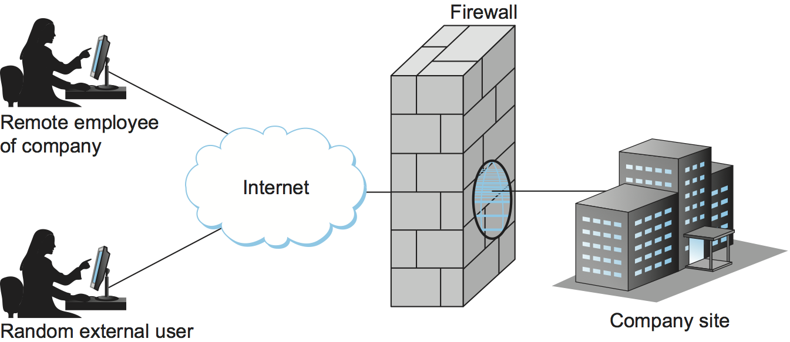

**Figure 8.19. A firewall filters packets flowing between a site and the rest of the Internet.**

In effect, a firewall divides a network into a more-trusted zone internal to the firewall and a less-trusted zone external to the firewall. This is useful if you do not want external users to access a particular host or service within your site. Much of the complexity comes from the fact that you want to allow different kinds of access to different external users, ranging from the general public, to business partners, to remotely located members of your organization. A firewall may also impose restrictions on outgoing traffic to prevent certain attacks and to limit losses if an adversary succeeds in getting access inside the firewall.

The location of a firewall also often happens to be the dividing line between globally addressable regions and those that use local addresses. Hence, Network Address Translation (NAT) functionality and firewall functionality often are found in the same device, even though they are logically separate.

Firewalls may be used to create multiple *zones of trust*, such as a hierarchy of increasingly trusted zones. A common arrangement involves three zones of trust: the internal network, the *DMZ* (“demilitarized zone”); and the rest of the Internet. The DMZ is used to hold services such as DNS and email servers that need to be accessible to the outside. Both the internal network and the outside world can access the DMZ, but hosts in the DMZ cannot access the internal network; therefore, an adversary who succeeds in compromising a host in the exposed DMZ still cannot access the internal network. The DMZ can be periodically restored to a clean state.

Firewalls filter based on IP, TCP, and UDP information, among other things. They are configured with a table of addresses that characterize the packets they will, and will not, forward. By addresses, we mean more than just the destination’s IP address, although that is one possibility. Generally, each entry in the table is a 4-tuple: It gives the IP address and TCP (or UDP) port number for both the source and destination.

For example, a firewall might be configured to filter out (not forward) all packets that match the following description:

```c
(192.12.13.14, 1234, 128.7.6.5, 80)
```

This pattern says to discard all packets from port 1234 on host 192.12.13.14 addressed to port 80 on host 128.7.6.5. (Port 80 is the well-known TCP port for HTTP.) Of course, it’s often not practical to name every source host whose packets you want to filter, so the patterns can include wildcards. For example,

```c
(*,  *, 128.7.6.5, 80)
```

says to filter out all packets addressed to port 80 on 128.7.6.5, regardless of what source host or port sent the packet. Notice that address patterns like these require the firewall to make forwarding/filtering decisions based on level 4 port numbers, in addition to level 3 host addresses. It is for this reason that network layer firewalls are sometimes called *level 4 switches*.

In the preceding discussion, the firewall forwards everything except where specifically instructed to filter out certain kinds of packets. A firewall could also filter out everything unless explicitly instructed to forward it, or use a mix of the two strategies. For example, instead of blocking access to port 80 on host 128.7.6.5, the firewall might be instructed to only allow access to port 25 (the SMTP mail port) on a particular mail server, such as

```c
(*,  *, 128.19.20.21, 25)
```

but to block all other traffic. Experience has shown that firewalls are very frequently configured incorrectly, allowing unsafe access. Part of the problem is that filtering rules can overlap in complex ways, making it hard for a system administrator to correctly express the intended filtering. A design principle that maximizes security is to configure a firewall to discard all packets other than those that are explicitly allowed. Of course, this means that some valid applications might be accidentally disabled; presumably users of those applications eventually notice and ask the system administrator to make the appropriate change.

Many client/server applications dynamically assign a port to the client. If a client inside a firewall initiates access to an external server, the server’s response would be addressed to the dynamically assigned port. This poses a problem: How can a firewall be configured to allow an arbitrary server’s response packet but disallow a similar packet for which there was no client request? This is not possible with a *stateless firewall*, which evaluates each packet in isolation. It requires a *stateful firewall*, which keeps track of the state of each connection. An incoming packet addressed to a dynamically assigned port would then be allowed only if it is a valid response in the current state of a connection on that port.

Modern firewalls also understand and filter based on many specific application-level protocols such as HTTP, Telnet, or FTP. They use information specific to that protocol, such as URLs in the case of HTTP, to decide whether to discard a message.

##### Strengths and Weaknesses of Firewalls

At best, a firewall protects a network from undesired access from the rest of the Internet; it cannot provide security to legitimate communication between the inside and the outside of the firewall. In contrast, the cryptography-based security mechanisms described in this chapter are capable of providing secure communication between any participants anywhere. This being the case, why are firewalls so common? One reason is that firewalls can be deployed unilaterally, using mature commercial products, while cryptography-based security requires support at both endpoints of the communication. A more fundamental reason for the dominance of firewalls is that they encapsulate security in a centralized place, in effect factoring security out of the rest of the network. A system administrator can manage the firewall to provide security, freeing the users and applications inside the firewall from security concerns—at least some kinds of security concerns.

Unfortunately, firewalls have serious limitations. Since a firewall does not restrict communication between hosts that are inside the firewall, the adversary who does manage to run code internal to a site can access all local hosts. How might an adversary get inside the firewall? The adversary could be a disgruntled employee with legitimate access, or the adversary’s software could be hidden in some software installed from a CD or downloaded from the Web. It might be possible to bypass the firewall by using wireless communication or dial-up connections.

Another problem is that any parties granted access through your firewall, such as business partners or externally located employees, become a security vulnerability. If their security is not as good as yours, then an adversary could penetrate your security by penetrating their security.

One of the most serious problems for firewalls is their vulnerability to the exploitation of bugs in machines inside the firewall. Such bugs are discovered regularly, so a system administrator has to constantly monitor announcements of them. Administrators frequently fail to do so, since firewall security breaches routinely exploit security flaws that have been known for some time and have straightforward solutions.

*Malware* (for “malicious software”) is the term for software that is designed to act on a computer in ways concealed from and unwanted by the computer’s user. Viruses, worms, and spyware are common types of malware. (*Virus* is sometimes used synonymously with *malware*, but we will use it in the narrower sense in which it refers to only a particular kind of malware.) Malware code need not be natively executable object code; it could as well be interpreted code such as a script or an executable macro such as those used by Microsoft Word.

*Viruses* and *worms* are characterized by the ability to make and spread copies of themselves; the difference between them is that a worm is a complete program that replicates itself, while a virus is a bit of code that is inserted (and inserts copies of itself) into another piece of software or a file, so that it is executed as part of the execution of that piece of software or as a result of opening the file. Viruses and worms typically cause problems such as consuming network bandwidth as mere side effects of attempting to spread copies of themselves. Even worse, they can also deliberately damage a system or undermine its security in various ways. They could, for example, install a *backdoor*—software that allows remote access to the system without the normal authentication. This could lead to a firewall exposing a service that should be providing its own authentication procedures but has been undermined by a backdoor.

Spyware is software that, without authorization, collects and transmits private information about a computer system or its users. Usually spyware is secretly embedded in an otherwise useful program and is spread by users deliberately installing copies. The problem for firewalls is that the transmission of the private information looks like legitimate communication.

A natural question to ask is whether firewalls (or cryptographic security) could keep malware out of a system in the first place. Most malware is indeed transmitted via networks, although it may also be transmitted via portable storage devices such as CDs and memory sticks. Certainly this is one argument in favor of the “block everything not explicitly allowed” approach taken by many administrators in their firewall configurations.

One approach that is used to detect malware is to search for segments of code from known malware, sometimes called a *signature*. This approach has its own challenges, as cleverly designed malware can tweak its representation in various ways. There is also a potential impact on network performance to perform such detailed inspection of data entering a network. Cryptographic security cannot eliminate the problem either, although it does provide a means to authenticate the originator of a piece of software and detect any tampering, such as when a virus inserts a copy of itself.

Related to firewalls are systems known as *intrusion detection systems* (IDS) and *intrusion prevention systems* (IPS). These systems try to look for anomalous activity, such as an unusually large amount of traffic targeting a given host or port number, for example, and generate alarms for network managers or perhaps even take direct action to limit a possible attack. While there are commercial products in this space today, it is still a developing field.

### Perspective: Is Security Getting Worse or Better?

Security breaches are now a standard risk of connecting any system to the Internet, and it is rare for a week to go by without news of some new attack. Verizon, a large telco, conducts an annual review of the state of cyber-attacks; in 2024 they reached a milestone with over 10,000 incidents, such as ransomware and phishing attacks, covered in the report. Measured by number of attacks then, it seems that things are getting worse. By contrast, an analysis of the economic impact of cyber-attacks performed by *The Economist* argued that the peak days of cyber-attacks might be behind us. The worst era for attacks in their economic analysis was 2003–2004 by a large margin.

There are certainly some respects in which security is improving. This can be attributed both to greater awareness of the need for strong security whenever important information is being handled, and the development of new techniques that enable better security practices.

One example of a technology development that improved security implementations is SDN (software-defined networking). SDN has enabled a relatively new approach to providing isolation among systems known as *microsegmentation*.

Microsegmentation stands in contrast to traditional approaches to segmenting networks, in which large sets of machines connect to a “zone” and firewalls are used to filter traffic passing between zones. While this makes for relatively simple network configuration, it means that lots of machines are in the same zone even if there was no need for them to communicate. Furthermore, the complexity of firewall rules grows over time as more and more rules need to be added to describe the traffic allowed to pass from one zone to another.

By contrast, SDN allows for the creation of precisely defined virtual networks—microsegments—that determine both which machines can communicate with each other and how they can do so. For example, a three-tier application can have its own microsegmentation policy which states: machines in the web-facing tier of the application can talk to the machines in the application tier on some set of specified ports, but web-facing machines may not talk to each other. This is a policy that was difficult to implement in the past;instead all the web-facing machines would sit on the same network segment, free to communicate with each other.

The complexity of configuring segments was the reason that machines from many applications would likely sit on the same segment, creating opportunities for an attack to spread from one application to another. The lateral movement of attacks within datacenters has been well documented as a key strategy of successful cyberattacks over many years.

Consider the arrangement of VMs and the firewall in Figure 8.20. Suppose that we wanted to put VM A and VM B in different segments and apply a firewall rule for traffic going from VM A to VM B. We have to prevent VM A from sending traffic directly to VM B. To do this, we could configure two VLANs in the physical network, connect A to one of them, and B to the other, and then configure the routing such that the path from the first VLAN to the second passes through the firewall. If at some point VM A was moved to another server, we’d then have to make sure the appropriate VLAN reached *that* server, connect VM A to it, and ensure that the routing configuration still forces traffic through the firewall. This situation may seem a little contrived, but it demonstrates why microsegmentation was challenging to implement before the arrival of SDN. By contrast, SDN allows the firewall function to be implemented in each virtual switch (vS in the figure). Thus, traffic from VM A to VM B passes through the firewall without any special routing configuration. It is the job of the SDN controller to create the appropriate firewall rule to enforce the desired isolation between VM A and VM B (and deal with movements of VM A and VM B if they occur). There is no magic, but SDN gives us a new tool to make a finer degree of isolation much easier to manage.

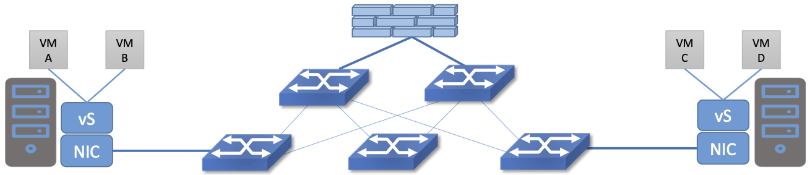

**Figure 8.20. A set of virtual machines communicate through a firewall**

The development of microsegmentation over the last decade was one of the major drivers of SDN adoption in the enterprise. It became the basis for a best practice in security known as “zero-trust” networking. Zero trust means that, as much as possible, every system in the network is assumed to be untrusted, and hence should be isolated from all other systems aside from precisely those systems it needs access to in order to do its assigned job.

The importance of the Internet in the running of critical systems and as the underpinning for much of the world's commerce has made it an attractive target for hackers. At the same time it drives home the need to develop and adopt best practices such as zero-trust networking. When we read of breaches today, it is often the case that some best practice has not been followed. The Verizon cybersecurity report, by documenting what has gone wrong in thousands of attacks, provides useful information about how many of those attacks could be prevented through using established cyber-hygiene techniques.

> **Broader Perspective**
>
> Verizon's data breach report can be obtained from [Data Breach Investigations Report](https://www.verizon.com/business/resources/reports/dbir/).
>
> The economic impact of cyber-attacks is analyzed by *The Economist* in this article: [Unexpectedly, the cost of big cyber-attacks is falling](https://www.economist.com/graphic-detail/2024/05/17/unexpectedly-the-cost-of-big-cyber-attacks-is-falling), May 2024.
>
> A deeper discussion on the use of SDN techniques to improve security is provided in Chapter 8 of our book [Software-Defined Networking: A Systems Approach](https://sdn.systemsapproach.org/).

[^1]: We use the term *participant* for the parties involved in a secure communication since that is the term we have been using throughout the book to identify the two endpoints of a channel. In the security world, they are typically called *principals*.
