## Chapter 9: Applications

> Now this is not the end. It is not even the beginning of the end. But it is, perhaps, the end of the beginning. *—Winston Churchill*

### Problem: Applications Need Their Own Protocols

We started this book by talking about application programs—everything from web browsers to videoconferencing tools—that people want to run over computer networks. In the intervening chapters, we have developed, one building block at a time, the networking infrastructure needed to make such applications possible. We have now come full circle, back to network applications. These applications are part network protocol (in the sense that they exchange messages with their peers on other machines) and part traditional application program (in the sense that they interact with the windowing system, the file system, and ultimately the user). This chapter explores some popular network applications available today.

Looking at applications drives home the *systems approach* that we have emphasized throughout this book. That is, the best way to build effective networked applications is to understand the building blocks that a network can provide and how those blocks can interact with each other. Thus, for example, a particular networked application might need to make use of a reliable transport protocol, authentication and privacy mechanisms, and resource allocation capabilities of the underlying network. Applications often work best when the application developer knows how to make the best use of these facilities (and there are also plenty of counter-examples of applications making poor use of available networking capabilities). Applications typically need their own protocols, too, in many cases using the same principles that we have seen in our prior examination of lower layer protocols. Thus, our focus in this chapter is on how to put together the ideas and techniques already described to build effective networked applications. Said another way, if you ever imagine yourself writing a network application, then you will by definition also become a protocol designer (and implementer).

We proceed by examining a variety of familiar, and not so familiar, network applications. These range from exchanging email and surfing the Web, to integrating applications across businesses, to multimedia applications like videoconferencing, to managing a set of network elements, to emerging peer-to-peer and content distribution networks. This list is by no means exhaustive, but it does serve to illustrate many of the key principles of designing and building applications. Applications need to pick and choose the appropriate building blocks that are available at other layers either inside the network or in the host protocol stacks and then augment those underlying services to provide the precise communication service required by the application.

### 9.1 Traditional Applications

We begin our discussion of applications by focusing on two of the most popular—the World Wide Web and email. Broadly speaking, both of these applications use the request/reply paradigm—users send requests to servers, which then respond accordingly. We refer to these as “traditional” applications because they typify the sort of applications that have existed since the early days of computer networks (although the Web is a lot newer than email but has its roots in file transfers that predated it). By contrast, later sections will look at a class of applications that have become popular more recently: streaming applications (e.g., multimedia applications like video and audio) and various overlay-based applications. (Note that there is a bit of a blurring between these classes, as we increasingly access streaming multimedia data over the Web, but for now we’ll focus on the general usage of the Web to request pages, images, etc.)

Before taking a close look at each of these applications, there are three general points that we need to make. The first is that it is important to distinguish between application *programs* and application *protocols*. For example, the HyperText Transport Protocol (HTTP) is an application protocol that is used to retrieve Web pages from remote servers. Many different application programs—that is, web clients like Internet Explorer, Chrome, Firefox, and Safari—provide users with a different look and feel, but all of them use the same HTTP protocol to communicate with web servers over the Internet. Indeed, it is the fact that the protocol is published and standardized that enables application programs developed by many different companies and individuals to interoperate. That is how so many browsers are able to interoperate with all the web servers (of which there are also many varieties).

This section looks at two very widely used, standardized application protocols:

- Simple Mail Transfer Protocol (SMTP) is used to exchange electronic mail.
- HyperText Transport Protocol (HTTP) is used to communicate between web browsers and web servers.

Second, we observe that many application layer protocols, including HTTP and SMTP, have a companion protocol that specifies the format of the data that can be exchanged. This is one reason WHY these protocols are relatively simple: much of the complexity is managed in this companion standard. For example, SMTP is a protocol for exchanging electronic mail messages, but RFC 822 and Multipurpose Internet Mail Extensions (MIME) define the format of email messages. Similarly, HTTP is a protocol for fetching Web pages, but HyperText Markup Language (HTML) is a companion specification that defines the basic form of those pages.

Finally, since the application protocols described in this section follow the same request/reply communication pattern, you might expect that they would be built on top of a Remote Procedure Call (RPC) transport protocol. This is not the case, however, as they are instead implemented on top of TCP . In effect, each protocol reinvents a simple RPC-like mechanism on top of a reliable transport protocol (TCP). We say “simple” because each protocol is not designed to support arbitrary remote procedure calls of the sort discussed in an earlier chapter, but is instead designed to send and respond to a specific set of request messages. Interestingly, the approach taken by HTTP has proven quite powerful, which has led to it being adopted widely by the *Web Services* architecture, with general RPC mechanisms built *on top of HTTP* rather than the other way around. More on this topic at the end of this section.

#### 9.1.1 Electronic Mail (SMTP, MIME, IMAP)

Email is one of the oldest network applications. After all, what could be more natural than wanting to send a message to the user at the other end of a cross-country link you just managed to get running? It’s the 20th century’s version of “*Mr. Watson, come here… I want to see you.*” Surprisingly, the pioneers of the ARPANET had not really envisioned email as a key application when the network was created—remote access to computing resources was the main design goal—but it turned out to be the Internet’s original killer app.

As noted above, it is important (1) to distinguish the user interface (i.e., your mail reader) from the underlying message transfer protocols (such as SMTP or IMAP), and (2) to distinguish between this transfer protocol and a companion standard (RFC 822 and MIME) that defines the format of the messages being exchanged. We start by looking at the message format.

##### Message Format

RFC 822 defines messages to have two parts: a *header* and a *body*. Both parts are represented in ASCII text. Originally, the body was assumed to be simple text. This is still the case, although RFC 822 has been augmented by MIME to allow the message body to carry all sorts of data. This data is still represented as ASCII text, but because it may be an encoded version of, say, a JPEG image, it’s not necessarily readable by human users. More on MIME in a moment.

The message header is a series of <CRLF>-terminated lines. (<CRLF> stands for carriage-return plus line-feed, which are a pair of ASCII control characters often used to indicate the end of a line of text.) The header is separated from the message body by a blank line. Each header line contains a type and value separated by a colon. Many of these header lines are familiar to users, since they are asked to fill them out when they compose an email message; for example, the To: header identifies the message recipient, and the Subject: header says something about the purpose of the message. Other headers are filled in by the underlying mail delivery system. Examples include Date: (when the message was transmitted), From: (what user sent the message), and Received: (each mail server that handled this message). There are, of course, many other header lines; the interested reader is referred to RFC 822.

RFC 822 was extended in 1993 (and updated quite a few times since then) to allow email messages to carry many different types of data: audio, video, images, PDF documents, and so on. MIME consists of three basic pieces. The first piece is a collection of header lines that augment the original set defined by RFC 822. These header lines describe, in various ways, the data being carried in the message body. They include MIME-Version: (the version of MIME being used), Content-Description: (a human-readable description of what’s in the message, analogous to the Subject: line), Content-Type: (the type of data contained in the message), and Content-Transfer-Encoding: (how the data in the message body is encoded).

The second piece is definitions for a set of content types (and subtypes). For example, MIME defines several different image types, including image/gif and image/jpeg, each with the obvious meaning. As another example, text/plain refers to simple text you might find in a vanilla 822-style message, while text/richtext denotes a message that contains “marked up” text (text using special fonts, italics, etc.). As a third example, MIME defines an application type, where the subtypes correspond to the output of different application programs (e.g., application/postscript and application/msword).

MIME also defines a multipart type that says how a message carrying more than one data type is structured. This is like a programming language that defines both base types (e.g., integers and floats) and compound types (e.g., structures and arrays). One possible multipart subtype is mixed, which says that the message contains a set of independent data pieces in a specified order. Each piece then has its own header line that describes the type of that piece.

The third piece is a way to encode the various data types so they can be shipped in an ASCII email message. The problem is that, for some data types (a JPEG image, for example), any given 8-bit byte in the image might contain one of 256 different values. Only a subset of these values are valid ASCII characters. It is important that email messages contain only ASCII, because they might pass through a number of intermediate systems (gateways, as described below) that assume all email is ASCII and would corrupt the message if it contained non-ASCII characters. To address this issue, MIME uses a straightforward encoding of binary data into the ASCII character set. The encoding is called base64. The idea is to map every three bytes of the original binary data into four ASCII characters. This is done by grouping the binary data into 24-bit units and breaking each such unit into four 6-bit pieces. Each 6-bit piece maps onto one of 64 valid ASCII characters; for example, 0 maps onto A, 1 maps onto B, and so on. If you look at a message that has been encoded using the base64 encoding scheme, you’ll notice only the 52 upper- and lowercase letters, the 10 digits 0 through 9, and the special characters + and /. These are the first 64 values in the ASCII character set.

As one aside, so as to make reading mail as painless as possible for those who still insist on using text-only mail readers, a MIME message that consists of regular text only can be encoded using 7-bit ASCII. There’s also a readable encoding for mostly ASCII data.

Putting this all together, a message that contains some plain text, a JPEG image, and a PostScript file would look something like this:

```text
MIME-Version: 1.0
Content-Type: multipart/mixed;
boundary="-------417CA6E2DE4ABCAFBC5"
From: Alice Smith <Alice@systemsapproach.org>
To: Bob@cs.Princeton.edu
Subject: promised material
Date: Mon, 07 Sep 1998 19:45:19 -0400
---------417CA6E2DE4ABCAFBC5
Content-Type: text/plain; charset=us-ascii
Content-Transfer-Encoding: 7bit
Bob,
Here are the jpeg image and draft report I promised.
--Alice
---------417CA6E2DE4ABCAFBC5
Content-Type: image/jpeg
Content-Transfer-Encoding: base64
... unreadable encoding of a jpeg figure
---------417CA6E2DE4ABCAFBC5
Content-Type: application/postscript; name="draft.ps"
Content-Transfer-Encoding: 7bit
... readable encoding of a PostScript document
```

In this example, the line in the message header says that this message contains various pieces, each denoted by a character string that does not appear in the data itself. Each piece then has its own Content-Type and Content-Transfer-Encoding lines.

##### Message Transfer

For many years, the majority of email was moved from host to host using only SMTP. While SMTP continues to play a central role, it is now just one email protocol of several, Internet Message Access Protocol (IMAP) and Post Office Protocol (POP) being two other important protocols for retrieving mail messages. We’ll begin our discussion by looking at SMTP, and move on to IMAP below.

To place SMTP in the right context, we need to identify the key players. First, users interact with a *mail reader* when they compose, file, search, and read their email. Countless mail readers are available, just like there are many web browsers to choose from. In the early days of the Internet, users typically logged into the machine on which their *mailbox* resided, and the mail reader they invoked was a local application program that extracted messages from the file system. Today, of course, users remotely access their mailbox from their laptop or smartphone; they do not first log into the host that stores their mail (a mail server). A second mail transfer protocol, such as POP or IMAP, is used to remotely download email from a mail server to the user’s device.

Second, there is a *mail daemon* (or process) running on each host that holds a mailbox. You can think of this process, also called a *message transfer agent* (MTA), as playing the role of a post office: Users (or their mail readers) give the daemon messages they want to send to other users, the daemon uses SMTP running over TCP to transmit the message to a daemon running on another machine, and the daemon puts incoming messages into the user’s mailbox (where that user’s mail reader can later find them). Since SMTP is a protocol that anyone could implement, in theory there could be many different implementations of the mail daemon. It turns out, though, that there are only a few popular implementations, with the old sendmail program from Berkeley Unix and postfix being the most widespread.

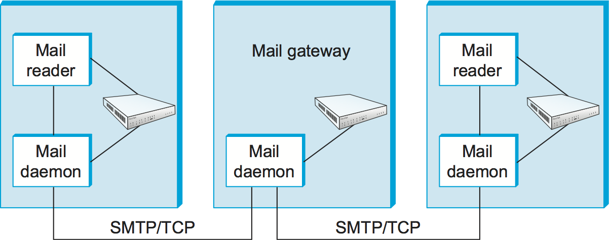

**Figure 9.1. Sequence of mail gateways store and forward email messages.**

While it is certainly possible that the MTA on a sender’s machine establishes an SMTP/TCP connection to the MTA on the recipient’s mail server, in many cases the mail traverses one or more *mail gateways* on its route from the sender’s host to the receiver’s host. Like the end hosts, these gateways also run a message transfer agent process. It’s not an accident that these intermediate nodes are called *gateways* since their job is to store and forward email messages, much like an “IP gateway” (which we have referred to as a *router*) stores and forwards IP datagrams. The only difference is that a mail gateway typically buffers messages on disk and is willing to try retransmitting them to the next machine for several days, while an IP router buffers datagrams in memory and is only willing to retry transmitting them for a fraction of a second. Figure 9.1 illustrates a two-hop path from the sender to the receiver.

Why, you might ask, are mail gateways necessary? Why can’t the sender’s host send the message to the receiver’s host? One reason is that the recipient does not want to include the specific host on which he or she reads email in his or her address. Another is scale: In large organizations, it’s often the case that a number of different machines hold the *mailboxes* for the organization. For example, mail delivered to bob@cs.princeton.edu is first sent to a mail gateway in the CS Department at Princeton (that is, to the host named cs.princeton.edu), and then forwarded—involving a second connection—to the specific machine on which Bob has a mailbox. The forwarding gateway maintains a database that maps users into the machine on which their mailbox resides; the sender need not be aware of this specific name. (The list of header lines in the message will help you trace the mail gateways that a given message traversed.) Yet another reason, particularly true in the early days of email, is that the machine that hosts any given user’s mailbox may not always be up or reachable, in which case the mail gateway holds the message until it can be delivered.

Independent of how many mail gateways are in the path, an independent SMTP connection is used between each host to move the message closer to the recipient. Each SMTP session involves a dialog between the two mail daemons, with one acting as the client and the other acting as the server. Multiple messages might be transferred between the two hosts during a single session. Since RFC 822 defines messages using ASCII as the base representation, it should come as no surprise to learn that SMTP is also ASCII based. This means it is possible for a human at a keyboard to pretend to be an SMTP client program.

SMTP is best understood by a simple example. The following is an exchange between sending host cs.princeton.edu and receiving host systemsapproach.org . In this case, user Bob at Princeton is trying to send mail to users Alice and Tom at Systems Approach. Extra blank lines have been added to make the dialog more readable.

```shell
HELO cs.princeton.edu
250 Hello daemon@mail.cs.princeton.edu [128.12.169.24]

MAIL FROM:<Bob@cs.princeton.edu>
250 OK

RCPT TO:<Alice@systemsapproach.org>
250 OK

RCPT TO:<Tom@systemsapproach.org>
550 No such user here

DATA
354 Start mail input; end with <CRLF>.<CRLF>
Blah blah blah...
...etc. etc. etc.
<CRLF>.<CRLF>
250 OK

QUIT
221 Closing connection
```

As you can see, SMTP involves a sequence of exchanges between the client and the server. In each exchange, the client posts a command (e.g., QUIT) and the server responds with a code (e.g., 250, 550, 354, 221). The server also returns a human-readable explanation for the code (e.g., No such user here). In this particular example, the client first identifies itself to the server with the HELO command. It gives its domain name as an argument. The server verifies that this name corresponds to the IP address being used by the TCP connection; you’ll notice the server states this IP address back to the client. The client then asks the server if it is willing to accept mail for two different users; the server responds by saying “yes” to one and “no” to the other. Then the client sends the message, which is terminated by a line with a single period (“.”) on it. Finally, the client terminates the connection.

There are, of course, many other commands and return codes. For example, the server can respond to a client’s RCPT command with a 251 code, which indicates that the user does not have a mailbox on this host, but that the server promises to forward the message onto another mail daemon. In other words, the host is functioning as a mail gateway. As another example, the client can issue a VRFY operation to verify a user’s email address, but without actually sending a message to the user.

The only other point of interest is the arguments to the MAIL and RCPT operations; for example, FROM:<Bob@cs.princeton.edu> and TO:<Alice@systemsapproach.org>, respectively. These look a lot like 822 header fields, and in some sense they are. What actually happens is that the mail daemon parses the message to extract the information it needs to run SMTP. The information it extracts is said to form an *envelope* for the message. The SMTP client uses this envelope to parameterize its exchange with the SMTP server. One historical note: The reason sendmail became so popular is that no one wanted to reimplement this message parsing function. While today’s email addresses look pretty tame (e.g., Bob@cs.princeton.edu), this was not always the case. In the days before everyone was connected to the Internet, it was not uncommon to see email addresses of the form user%host@site!neighbor.

##### Mail Reader

The final step is for the user to actually retrieve his or her messages from the mailbox, read them, reply to them, and possibly save a copy for future reference. The user performs all these actions by interacting with a mail reader. As pointed out earlier, this reader was originally just a program running on the same machine as the user’s mailbox, in which case it could simply read and write the file that implements the mailbox. This was the common case in the pre-laptop era. Today, most often the user accesses his or her mailbox from a remote machine using yet another protocol, such as POP or IMAP. It is beyond the scope of this book to discuss the user interface aspects of the mail reader, but it is definitely within our scope to talk about the access protocol. We consider IMAP, in particular.

IMAP is similar to SMTP in many ways. It is a client/server protocol running over TCP, where the client (running on the user’s desktop machine) issues commands in the form of <CRLF>-terminated ASCII text lines and the mail server (running on the machine that maintains the user’s mailbox) responds in kind. The exchange begins with the client authenticating him- or herself and identifying the mailbox he or she wants to access. This can be represented by the simple state transition diagram shown in Figure 9.2. In this diagram, LOGIN and LOGOUT are example commands that the client can issue, while OK is one possible server response. Other common commands include FETCH and EXPUNGE, with the obvious meanings. Additional server responses include NO (client does not have permission to perform that operation) and BAD (command is ill formed).

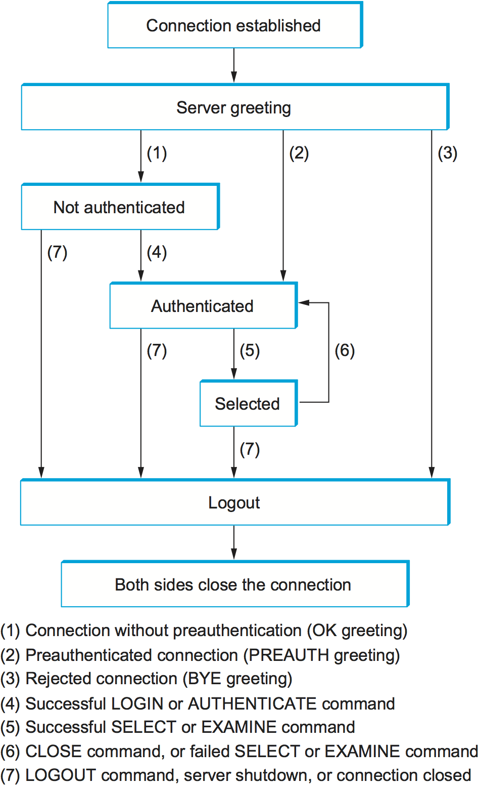

**Figure 9.2. IMAP state transition diagram.**

When the user asks to FETCH a message, the server returns it in MIME format and the mail reader decodes it. In addition to the message itself, IMAP also defines a set of message *attributes* that are exchanged as part of other commands, independent of transferring the message itself. Message attributes include information like the size of the message and, more interestingly, various *flags* associated with the message (e.g., Seen, Answered, Deleted, and Recent). These flags are used to keep the client and server synchronized; that is, when the user deletes a message in the mail reader, the client needs to report this fact to the mail server. Later, should the user decide to expunge all deleted messages, the client issues an EXPUNGE command to the server, which knows to actually remove all earlier deleted messages from the mailbox.

Finally, note that when the user replies to a message, or sends a new message, the mail reader does not forward the message from the client to the mail server using IMAP, but it instead uses SMTP. This means that the user’s mail server is effectively the first mail gateway traversed along the path from the desktop to the recipient’s mailbox.

#### 9.1.2 World Wide Web (HTTP)

The World Wide Web has been so successful and has made the Internet accessible to so many people that sometimes it seems to be synonymous with the Internet. In fact, the design of the system that became the Web started around 1989, long after the Internet had become a widely deployed system. The original goal of the Web was to find a way to organize and retrieve information, drawing on ideas about hypertext—interlinked documents—that had been around since at least the 1960s.  The core idea of hypertext is that one document can link to another document, and the protocol (HTTP) and document language (HTML) were designed to meet that goal.

One helpful way to think of the Web is as a set of cooperating clients and servers, all of whom speak the same language: HTTP. Most people are exposed to the Web through a graphical client program or web browser such as Safari, Chrome, Firefox, or Internet Explorer. Figure 9.3 shows the Safari browser in use, displaying a page of information from Princeton University.


**Figure 9.3. The Safari web browser.**

If you want to organize information into a system of linked documents or objects, there needs to be a way to identify documents so you can link to them. Uniform Resource Locators (URLs) are so familiar to most of us by now that it’s easy to forget that they haven’t been around forever. They provide information that allows objects on the Web to be located, and they look like the following:

```html
http://www.cs.princeton.edu/index.html
```

If you opened that particular URL, your web browser would open a TCP connection to the web server at a machine called www.cs.princeton.edu and immediately retrieve and display the file called index.html. Most files on the Web contain images and text, and many have other objects such as audio and video clips, pieces of code, etc. They also frequently include URLs that point to other files that may be located on other machines, which is the core of the “hypertext” part of HTTP and HTML. A web browser has some way in which you can recognize URLs (often by highlighting or underlining some text) and then you can ask the browser to open them. These embedded URLs are an example of *hypertext links*. When you ask your web browser to open one of these embedded URLs (e.g., by pointing and clicking on it with a mouse), it will retrieve and display the named file. It thus becomes very easy to hop from one machine to another around the network, following links to all sorts of information. Once you have a means to embed a link in a document and allow a user to follow that link to get another document, you have the basis of a hypertext system.

When you ask your browser to view a page, your browser (the client) fetches the page from the server using HTTP, which traditionally runs over TCP. Like SMTP, HTTP is a text-oriented protocol. At its core, HTTP is a request/response protocol, where every message has the general form

```text
START_LINE <CRLF>
MESSAGE_HEADER <CRLF>
<CRLF>
MESSAGE_BODY <CRLF>
```

where, as before, <CRLF> stands for carriage-return+line-feed. The first line (START_LINE) indicates whether this is a request message or a response message. In effect, it identifies the “remote procedure” to be executed (in the case of a request message), or the *status* of the request (in the case of a response message). The next set of lines specifies a collection of options and parameters that qualify the request or response. There are zero or more of these MESSAGE_HEADER lines—the set is terminated by a blank line—each of which looks like a header line in an email message. HTTP defines many possible header types, some of which pertain to request messages, some to response messages, and some to the data carried in the message body. Instead of giving the full set of possible header types, though, we just give a handful of representative examples. Finally, after the blank line comes the contents of the requested message (MESSAGE_BODY); this part of the message is where a server would place the requested page when responding to a request, and it is typically empty for request messages.

Why was HTTP designed to run over TCP? The designers didn’t have to do it that way, but TCP provides numerous services that HTTP needs: reliable delivery (who wants a Web page with missing data?), flow control, and congestion control. However, as we’ll see below, there are a few issues that arose from building a request/response protocol on top of TCP, that become more apparent as you consider the details of the interactions between the application and transport layer protocols. This has led to new versions of HTTP and a new underlying transport, QUIC, discussed below.

##### Request Messages

The first line of an HTTP request message specifies three things: the operation to be performed, the Web page the operation should be performed on, and the version of HTTP being used. Although HTTP defines a wide assortment of possible request operations—including *write* operations that allow a Web page to be posted on a server—the two most common operations are GET (fetch the specified Web page) and HEAD (fetch status information about the specified Web page). The former is obviously used when your browser wants to retrieve and display a Web page. The latter is used to test the validity of a hypertext link or to see if a particular page has been modified since the browser last fetched it. The full set of operations is summarized in Table 9.1. As innocent as it sounds, the POST command enables much mischief (including spam) on the Internet.

**Table 9.1. HTTP Request Operations.**

| Operation | Description |
| --- | --- |
| OPTIONS | Request information about available options |
| GET | Retrieve document identified in URL |
| HEAD | Retrieve metainformation about document identified in URL |
| POST | Give information (e.g., annotation) to server |
| PUT | Store document under specified URL |
| DELETE | Delete specified URL |
| TRACE | Loopback request message |
| CONNECT | For use by proxies |

For example, the START_LINE

```text
GET http://www.cs.princeton.edu/index.html HTTP/1.1
```

says that the client wants the server on host www.cs.princeton.edu to return the page named index.html. This particular example uses an absolute URL. It is also possible to request a path in the START_LINE and specify the host name in one of the MESSAGE_HEADER lines; for example,

```http
GET /index.html HTTP/1.1
Host: www.cs.princeton.edu
```

Here, Host is one of the possible MESSAGE_HEADER fields. One of the more interesting of these is If-Modified-Since, which gives the client a way to conditionally request a Web page—the server returns the page only if it has been modified since the time specified in that header line.

##### Response Messages

Like request messages, response messages begin with a single START_LINE. In this case, the line specifies the version of HTTP being used, a three-digit code indicating whether or not the request was successful, and a text string giving the reason for the response. For example, the START_LINE

```http
HTTP/1.1 202 Accepted
```

indicates that the server was able to satisfy the request, while

```http
HTTP/1.1 404 Not Found
```

indicates that it was not able to satisfy the request because the page was not found. There are five general types of response codes, with the first digit of the code indicating its type. Table 9.2 summarizes the five types of codes.

**Table 9.2. Five Types of HTTP Result Codes.**

| Code | Type | Example Reasons |
| --- | --- | --- |
| 1xx | Informational | request received, continuing process |
| 2xx | Success | action successfully received, understood, and accepted |
| 3xx | Redirection | further action must be taken to complete the request |
| 4xx | Client Error | request contains bad syntax or cannot be fulfilled |
| 5xx | Server Error | server failed to fulfill an apparently valid request |

As with the unexpected consequences of the POST request message, it is sometimes surprising how various response messages are used in practice. For example, request redirection (specifically code 302) turns out to be a powerful mechanism that plays a big role in Content Distribution Networks (CDNs) by redirecting requests to a nearby cache.

Also similar to request messages, response messages can contain one or more MESSAGE_HEADER lines. These lines relay additional information back to the client. For example, the Location header line specifies that the requested URL is available at another location. Thus, if the Princeton CS Department Web page had moved from http://www.cs.princeton.edu/index.html to http://www.princeton.edu/cs/index.html, for example, then the server at the original address might respond with

```http
HTTP/1.1 301 Moved Permanently
Location: http://www.princeton.edu/cs/index.html
```

In the common case, the response message will also carry the requested page. This page is an HTML document, but since it may carry nontextual data (e.g., a GIF image), it is encoded using MIME (see the previous section). Certain of the MESSAGE_HEADER lines give attributes of the page contents, including (number of bytes in the contents), Expires (time at which the contents are considered stale), and (time at which the contents were last modified at the server).

##### Uniform Resource Identifiers

The URLs that HTTP uses as addresses are one type of *Uniform Resource Identifier* (URI). A URI is a character string that identifies a resource, where a resource can be anything that has identity, such as a document, an image, or a service.

The format of URIs allows various more specialized kinds of resource identifiers to be incorporated into the URI space of identifiers. The first part of a URI is a *scheme* that names a particular way of identifying a certain kind of resource, such as mailto for email addresses or file for file names. The second part of a URI, separated from the first part by a colon, is the *scheme-specific part*. It is a resource identifier consistent with the scheme in the first part, as in the URIs mailto:santa@northpole.org and file:///C:/foo.html.

A resource doesn’t have to be retrievable or accessible. We saw an example of this in an earlier chapter—extensible markup language (XML) namespaces are identified by URIs that look an awful lot like URLs, but strictly speaking they are not *locators* because they don’t tell you how to locate something; they just provide a globally unique identifier for the namespace. There is no requirement that you can retrieve anything at the URI given as the target namespace of an XML document. We’ll see another example of a URI that is not a URL in a later section.

##### TCP Connections

The original version of HTTP (1.0) established a separate TCP connection for each data item retrieved from the server. It’s not too hard to see how this was a very inefficient mechanism: connection setup and teardown messages had to be exchanged between the client and server even if all the client wanted to do was verify that it had the most recent copy of a page. Thus, retrieving a page that included some text and a dozen icons or other small graphics would result in 13 separate TCP connections being established and closed. Figure 9.4 shows the sequence of events for fetching a page that has just a single embedded object. Colored lines indicate TCP messages, while black lines indicate the HTTP requests and responses. (Some of the TCP ACKs are not shown to avoid cluttering the picture.) You can see two round trip times are spent setting up TCP connections while another two (at least) are spent getting the page and image. As well as the latency impact, there is also processing cost on the server to handle the extra TCP connection establishment and termination.

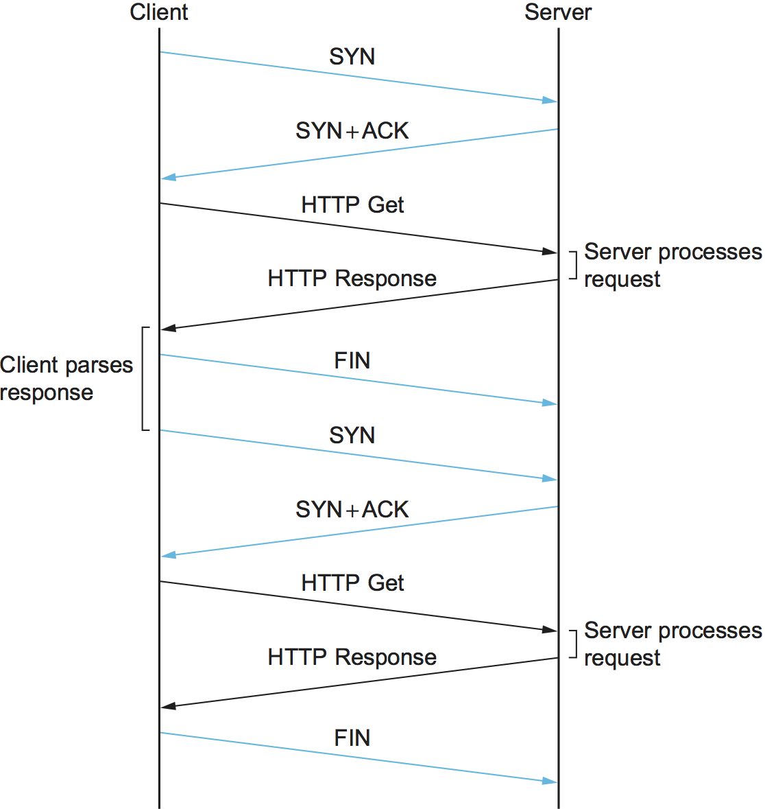

**Figure 9.4. HTTP 1.0 behavior.**

To overcome this situation, HTTP version 1.1 introduced *persistent connections*—the client and server can exchange multiple request/response messages over the same TCP connection. Persistent connections have many advantages. First, they eliminate the connection setup overhead, thereby reducing the load on the server, the load on the network caused by the additional TCP packets, and the delay perceived by the user. Second, because a client can send multiple request messages down a single TCP connection, TCP’s congestion window mechanism is able to operate more efficiently. This is because it’s not necessary to go through the slow start phase for each page. Figure 9.5 shows the transaction from Figure 9.4 using a persistent connection in the case where the connection is already open (presumably due to some prior access of the same server).

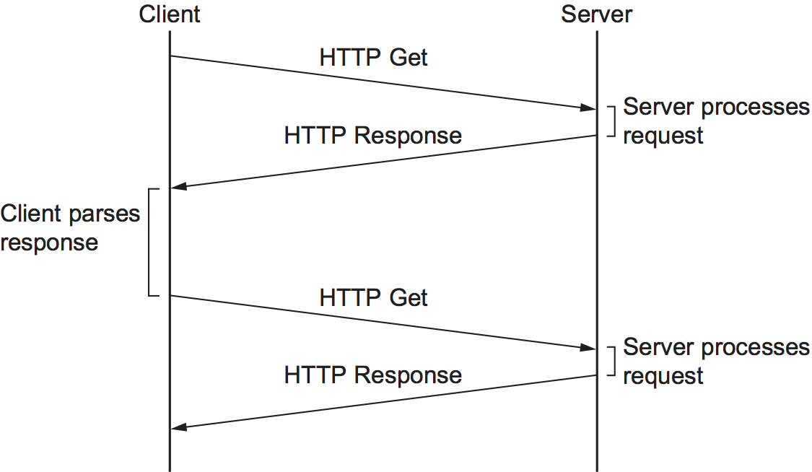

**Figure 9.5. HTTP 1.1 behavior with persistent connections.**

Persistent connections do not come without a price, however. The problem is that neither the client nor server necessarily knows how long to keep a particular TCP connection open. This is especially critical on the server, which might be asked to keep connections opened on behalf of thousands of clients. The solution is that the server must time out and close a connection if it has received no requests on the connection for a period of time. Also, both the client and server must watch to see if the other side has elected to close the connection, and they must use that information as a signal that they should close their side of the connection as well. (Recall that both sides must close a TCP connection before it is fully terminated.) Concerns about this added complexity may be one reason why persistent connections were not used from the outset, but today it is widely accepted that the benefits of persistent connections more than offset the drawbacks.

While 1.1 is still widely supported, version 2.0 was formally approved by the IETF in 2015. Known as HTTP/2, the new version is backwards compatible with 1.1 (i.e,. it adopts the same syntax for header fields, status codes, and URIs), but it adds two new features.

The first is to make it easier for web servers to *minify* the information they send back to web browsers. If you look closely at the makeup of the HTML in a typical web page, you will find a plethora of references to other bits-and-pieces (e.g., images, scripts, style files) that the browser needs to render the page. Rather than force the client to request these bits-and-pieces (technically known as *resources*) in subsequent requests, HTTP/2 provides a means for the server to bundle the required resources and proactively *push* them to the client without incurring the round-trip delay of forcing the client to request them. This feature is coupled with a compression mechanism that reduces the number of bytes that need to be pushed. The whole goal is to minimize the latency an end-user experiences from the moment they click on a hyperlink until the selected page is fully rendered.

The second big advance of HTTP/2 is to multiplex several requests on a single TCP connection. This goes beyond what version 1.1 supports—allowing a *sequence* of requests to reuse a TCP connection—by permitting these requests to overlap with each other. The way HTTP/2 does this should sound familiar: it defines a *channel* abstraction (technically, the channels are called *streams*), permits multiple concurrent streams to be active at a given time (each labeled with a unique *stream id*), and limits each stream to one active request/reply exchange at a time.

##### HTTP/3 and QUIC

As the preceding discussion illustrates, the history of HTTP has included a series of incremental changes to make better use of TCP as the underlying transport. But there is a fundamental issue that can't be fully resolved: TCP provides a byte-stream abstraction, while HTTP is a request/response protocol. The natural solution would be to adopt a more suitable transport, but as we saw in Chapter 5, there is no standard RPC protocol that enjoys the widespread acceptance of TCP.

Ultimately, the solution to this mismatch was to create a new transport protocol in QUIC. QUIC was explicitly designed to provide a good match to the requirements of HTTP, and HTTP/3 takes advantage of the improved underlying transport. For example, QUIC explicitly supports stream multiplexing at the transport layer. Thus, a single packet loss only impacts the delivery of the stream that suffered the loss, rather than causing a stall in the entire TCP connection while waiting for that lost packet to be retransmitted. At the same time, that lost packet provides a congestion signal that is applied to all streams in the QUIC connection. We cover QUIC in more detail in Section 5.2.

Another significant advantage of QUIC compared to TCP is the way it handles the steps required to secure an HTTP connection. Whereas the exchange of certificates and encryption keys follows the establishment of a TCP session, QUIC handles these steps as part of session establishment, leading to a considerable reduction in the number of round-trips needed to establish a secure connection before the first content is delivered.

HTTP/3 is implemented in the majority of browsers and is incrementally being deployed on servers across the Internet. There remain plenty of servers running HTTP/2 and even some HTTP/1.1 as well, so version negotiation is likely to be part of HTTP implementations for the foreseeable future.

##### Caching

An important implementation strategy that makes the web more usable is to cache Web pages. Caching has many benefits. From the client’s perspective, a page that can be retrieved from a nearby cache can be displayed much more quickly than if it has to be fetched from across the world. From the server’s perspective, having a cache intercept and satisfy a request reduces the load on the server.

Caching can be implemented in many different places. For example, a user’s browser can cache recently accessed pages and simply display the cached copy if the user visits the same page again. As another example, a site can support a single site-wide cache. This allows users to take advantage of pages previously downloaded by other users. Closer to the middle of the Internet, Internet Service Providers (ISPs) can cache pages.  Note that, in the second case, the users within the site most likely know what machine is caching pages on behalf of the site, and they configure their browsers to connect directly to the caching host. This node is sometimes called a *proxy*. In contrast, the sites that connect to the ISP are probably not aware that the ISP is caching pages. It simply happens to be the case that HTTP requests coming out of the various sites pass through a common ISP router. This router can peek inside the request message and look at the URL for the requested page. If it has the page in its cache, it returns it. If not, it forwards the request to the server and watches for the response to fly by in the other direction. When it does, the router saves a copy in the hope that it can use it to satisfy a future request.

No matter where pages are cached, the ability to cache Web pages is important enough that HTTP has been designed to make the job easier. The trick is that the cache needs to make sure it is not responding with an out-of-date version of the page. For example, the server assigns an expiration date (the Expires header field) to each page it sends back to the client (or to a cache between the server and client). The cache remembers this date and knows that it need not reverify the page each time it is requested until after that expiration date has passed. After that time (or if that header field is not set) the cache can use the HEAD or conditional GET operation (GET with header line) to verify that it has the most recent copy of the page. More generally, there are a set of *cache directives* that must be obeyed by all caching mechanisms along the request/response chain. These directives specify whether or not a document can be cached, how long it can be cached, how fresh a document must be, and so on. We’ll look at the related issue of CDNs—which are effectively distributed caches—in a later section.

#### 9.1.3 Web Services

So far we have focused on interactions between a human and a web server. For example, a human uses a web browser to interact with a server, and the interaction proceeds in response to input from the user (e.g., by clicking on links). However, there is increasing demand for direct computer-to-computer interaction. And, just as the applications described above need protocols, so too do the applications that communicate directly with each other. We conclude this section by looking at the challenges of building large numbers of application-to-application protocols and some of the proposed solutions.

Much of the motivation for enabling direct application-to-application communication comes from the business world. Historically, interactions between enterprises—businesses or other organizations—have involved some manual steps such as filling out an order form or making a phone call to determine whether some product is in stock. Even within a single enterprise it is common to have manual steps between software systems that cannot interact directly because they were developed independently. Increasingly, such manual interactions are being replaced with direct application-to-application interaction. An ordering application at enterprise A would send a message to an order fulfillment application at enterprise B, which would respond immediately indicating whether the order can be filled. Perhaps, if the order cannot be filled by B, the application at A would immediately order from another supplier or solicit bids from a collection of suppliers.

Here is a simple example of what we are talking about. Suppose you buy a book at an online retailer like Amazon. Once your book has been shipped, Amazon could send you the tracking number in an email, and then you could head over to the website for the shipping company— http://www.fedex.com, perhaps—and track the package. However, you can also track your package directly from the Amazon.com website. In order to make this happen, Amazon has to be able to send a query to FedEx, in a format that FedEx understands, interpret the result, and display it in a Web page that perhaps contains other information about your order. Underlying the user experience of getting all the information about the order served up at once on the Amazon.com Web page is the fact that Amazon and FedEx had to have a protocol for exchanging the information needed to track packages—call it the Package Tracking Protocol. It should be clear that there are so many potential protocols of this type that we’d better have some tools to simplify the task of specifying them and building them.

Network applications, even those that cross organization boundaries, are not new—email and web browsing cross such boundaries. What is new about this problem is the scale. Not scale in the size of the network, but scale in the number of different kinds of network applications. Both the protocol specifications and the implementations of those protocols for traditional applications like electronic mail and file transfer have typically been developed by a small group of networking experts. To enable the vast number of potential network applications to be developed quickly, it was necessary to come up with some technologies that simplify and automate the task of application protocol design and implementation.

Two architectures have been advocated as solutions to this problem. Both architectures are called *Web Services*, taking their name from the term for the individual applications that offer a remotely accessible service to client applications to form network applications. The terms used as informal shorthand to distinguish the two Web Services architectures are *SOAP* and *REST*. We will discuss the technical meanings of those terms shortly.

The SOAP architecture’s approach to the problem is to make it feasible, at least in theory, to generate protocols that are customized to each network application. The key elements of the approach are a framework for protocol specification, software toolkits for automatically generating protocol implementations from the specifications, and modular partial specifications that can be reused across protocols.

The REST architecture’s approach to the problem is to regard individual Web Services as World Wide Web resources—identified by URIs and accessed via HTTP. Essentially, the REST architecture is just the Web architecture. The Web architecture’s strengths include stability and a demonstrated scalability (in the network-size sense). It could be considered a weakness that HTTP is not well suited to the usual procedural or operation-oriented style of invoking a remote service. REST advocates argue, however, that rich services can nonetheless be exposed using a more data-oriented or document-passing style for which HTTP is well suited.

##### Custom Application Protocols (WSDL, SOAP)

The architecture informally referred to as SOAP is based on *Web Services Description Language* (WSDL) and *SOAP*.  Both of these standards are issued by the World Wide Web Consortium (W3C). This is the architecture that people usually mean when they use the term Web Services without any preceding qualifier. As these standards are still evolving, our discussion here is effectively a snapshot.

WSDL and SOAP are frameworks for specifying and implementing application protocols and transport protocols, respectively. They are generally used together, although that is not strictly required. WSDL is used to specify application-specific details such as what operations are supported, the formats of the application data to invoke or respond to those operations, and whether an operation involves a response. SOAP’s role is to make it easy to define a transport protocol with exactly the desired semantics regarding protocol features such as reliability and security.

Both WSDL and SOAP consist primarily of a protocol specification language. Both languages are based on XML with an eye toward making specifications accessible to software tools such as stub compilers and directory services. In a world of many custom protocols, support for automating generation of implementations is crucial to avoid the effort of manually implementing each protocol. Support software generally takes the form of toolkits and application servers developed by third-party vendors, which allows developers of individual Web Services to focus more on the business problem they need to solve (such as tracking the package purchased by a customer).

##### Defining Application Protocols

WSDL has chosen a procedural *operation* model of application protocols. An abstract Web Service interface consists of a set of named operations, each representing a simple interaction between a client and the Web Service. An operation is analogous to a remotely callable procedure in an RPC system. An example from W3C’s WSDL Primer is a hotel reservation Web Service with two operations, CheckAvailability and MakeReservation.

Each operation specifies a *Message Exchange Pattern* (MEP) that gives the sequence in which the messages are to be transmitted, including the fault messages to be sent when an error disrupts the message flow. Several MEPs are predefined, and new custom MEPs can be defined, but it appears that in practice only two MEPs are being used: **In-Only** (a single message from client to service) and **In-Out** (a request from client and a corresponding reply from service). These patterns should be very familiar, and suggest that the costs of supporting MEP flexibility perhaps outweigh the benefits.

MEPs are templates that have placeholders instead of specific message types or formats, so part of the definition of an operation involves specifying which message formats to map into the placeholders in the pattern. Message formats are not defined at the bit level that is typical of protocols we have discussed. They are instead defined as an abstract data model using XML. XML Schema provides a set of primitive data types and ways to define compound data types. Data that conforms to an XML Schema-defined format—its abstract data model—can be concretely represented using XML, or it can use another representation, such as the “binary” representation Fast Infoset.

WSDL nicely separates the parts of a protocol that can be specified abstractly—operations, MEPs, abstract message formats—from the parts that must be concrete. WSDL’s concrete part specifies an underlying protocol, how MEPs are mapped onto it, and what bit-level representation is used for messages on the wire. This part of a specification is known as a *binding*, although it is better described as an implementation, or a mapping onto an implementation. WSDL has predefined bindings for HTTP and SOAP-based protocols, with parameters that allow the protocol designer to fine-tune the mapping onto those protocols. There is a framework for defining new bindings, but SOAP protocols dominate.

A crucial aspect of how WSDL mitigates the problem of specifying large numbers of protocols is through reuse of what are essentially specification modules. The WSDL specification of a Web Service may be composed of multiple WSDL documents, and individual WSDL documents may also be used in other Web Service specifications. This modularity makes it easier to develop a specification and easier to ensure that, if two specifications are supposed to have some elements that are identical (for example, so that they can be supported by the same tool), then those elements are indeed identical. This modularity, together with WSDL’s defaulting rules, also helps keep specifications from becoming overwhelmingly verbose for human protocol designers.

WSDL modularity should be familiar to anyone who has developed moderately large pieces of software. A WSDL document need not be a complete specification; it could, for example, define a single message format. The partial specifications are uniquely identified using XML Namespaces; each WSDL document specifies the URI of a *target namespace*, and any new definitions in the document are named in the context of that namespace. One WSDL document can incorporate components of another by *including* the second document if both share the same target namespace or *importing* it if the target namespaces differ.

##### Defining Transport Protocols

Although SOAP is sometimes called a protocol, it is better thought of as a framework for defining protocols. As the SOAP 1.2 specification explains, “SOAP provides a simple messaging framework whose core functionality is concerned with providing extensibility.” SOAP uses many of the same strategies as WSDL, including message formats defined using XML Schema, bindings to underlying protocols, Message Exchange Patterns, and reusable specification elements identified using XML namespaces.

SOAP is used to define transport protocols with exactly the features needed to support a particular application protocol. SOAP aims to make it feasible to define many such protocols by using reusable components. Each component captures the header information and logic that go into implementing a particular feature. To define a protocol with a certain set of features, just compose the corresponding components. Let’s look more closely at this aspect of SOAP.

SOAP 1.2 introduced a *feature* abstraction, which the specification describes thus:

> *A SOAP feature is an extension of the SOAP messaging framework. Although SOAP poses no constraints on the potential scope of such features, example features may include “reliability,” “security,” “correlation,” “routing,” and message exchange patterns (MEPs) such as request/response, one-way, and peer-to-peer conversations.*

A SOAP feature specification must include:

- A URI that identifies the feature
- The state information and processing, abstractly described, that is required at each SOAP node to implement the feature
- The information to be relayed to the next node
- (If the feature is a MEP) the life cycle and temporal/causal relationships of the messages exchanged—for example, responses follow requests and are sent to the originator of the request

Note that this formalization of the concept of a protocol feature is rather low level; it is almost a design.

Given a set of features, there are two strategies for defining a SOAP protocol that will implement them. One is by layering: binding SOAP to an underlying protocol in such a way as to derive the features. For example, we could obtain a request/response protocol by binding SOAP to HTTP, with a SOAP request in an HTTP request and a SOAP reply in an HTTP response. Because this is such a common example, it happens that SOAP has a predefined binding to HTTP; new bindings may be defined using the SOAP Protocol Binding Framework.

The second and more flexible way to implement features involves *header blocks*. A SOAP message consists of an Envelope, which contains a Header that contains header blocks, and a Body, which contains the payload destined for the ultimate receiver. This message structure is illustrated in Figure 9.6.

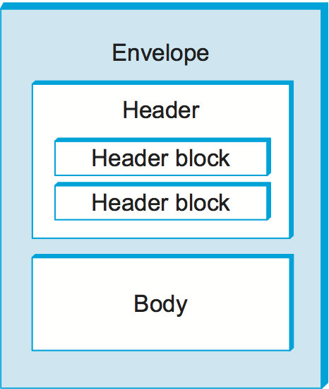

**Figure 9.6. SOAP message structure.**

It should be a familiar notion by now that certain header information corresponds to particular features. A digital signature is used to implement authentication, a sequence number is used for reliability, and a checksum is used to detect message corruption. A SOAP header block is intended to encapsulate the header information that corresponds to a particular feature. The correspondence is not always one-to-one since multiple header blocks could be involved in a single feature, or a single header block could be used in multiple features. A *SOAP module* is a specification of the syntax and the semantics of one or more header blocks. Each module is intended to provide one or more features and must declare the features it implements.

The goal behind SOAP modules is to be able to compose a protocol with a set of features by simply including each of the corresponding module specifications. If your protocol is required to have at-most-once semantics and authentication, include the corresponding modules in your specification. This represents a novel approach to modularizing protocol services, an alternative to the protocol layering we have seen throughout this book. It is a bit like flattening a series of protocol layers into a single protocol, but in a structured way. It remains to be seen how well SOAP features and modules, introduced in version 1.2 of SOAP, will work in practice. The main weakness of this scheme is that modules may well interfere with each other. A module specification is required to specify any *known* interactions with other SOAP modules, but clearly that doesn’t do much to alleviate the problem. On the other hand, a core set of features and modules that provides the most important properties may be small enough to be well known and well understood.

##### Standardizing Web Services Protocols

As we’ve said, WSDL and SOAP aren’t protocols; they are standards for *specifying* protocols. For different enterprises to implement Web Services that interoperate with each other, it is not enough to agree to use WSDL and SOAP to define their protocols; they must agree on—standardize—specific protocols. For example, you could imagine that online retailers and shipping companies might like to standardize a protocol by which they exchange information, along the lines of the simple package tracking example at the start of this section. This standardization is crucial for tool support as well as interoperability. And, yet, different network applications in this architecture must necessarily differ in at least the message formats and operations they use.

This tension between standardization and customization is tackled by establishing partial standards called *profiles*. A profile is a set of guidelines that narrow or constrain choices available in WSDL, SOAP, and other standards that may be referenced in defining a protocol. They may at the same time resolve ambiguities or gaps in those standards. In practice, a profile often formalizes an emerging *de facto* standard.

The broadest and most widely adopted profile is known as the *WS-I Basic Profile*. It was proposed by the Web Services Interoperability Organization (WS-I), an industry consortium, while WSDL and SOAP are specified by the World Wide Web Consortium (W3C). The Basic Profile resolves some of the most basic choices faced in defining a Web Service. Most notably it requires that WSDL be bound exclusively to SOAP and SOAP be bound exclusively to HTTP and use the HTTP POST method. It also specifies which versions of WSDL and SOAP must be used.

The *WS-I Basic Security Profile* adds security constraints to the Basic Profile by specifying how the SSL/TLS layer is to be used and requiring conformance to *WS-Security* (Web Services Security). WS-Security specifies how to use various existing techniques such as X.509 public key certificates and Kerberos to provide security features in SOAP protocols.

WS-Security is just the first of a growing suite of SOAP-level standards established by the industry consortium OASIS (Organization for the Advancement of Structured Information Standards). The standards known collectively as *WS-* \* include WS-Reliability, WS-ReliableMessaging, WS-Coordination, and WS-AtomicTransaction.

##### A Generic Application Protocol (REST)

The WSDL/SOAP Web Services architecture is based on the assumption that the best way to integrate applications across networks is via protocols that are customized to each application. That architecture is designed to make it practical to specify and implement all those protocols. In contrast, the REST Web Services architecture is based on the assumption that the best way to integrate applications across networks is by re-applying the model underlying the World Wide Web architecture. This model, articulated by Web architect Roy Fielding, is known as *REpresentational State Transfer* (REST). There is no need for a new REST architecture for Web Services—the existing Web architecture is sufficient, although a few extensions are probably necessary. In the Web architecture, individual Web Services are regarded as resources identified by URIs and accessed via HTTP—a single generic application protocol with a single generic addressing scheme.

Where WSDL has user-defined operations, REST uses the small set of available HTTP methods, such as GET and POST (see Table 9.1). So how can these simple methods provide an interface to a rich Web Service? By employing the REST model, in which the complexity is shifted from the protocol to the payload. The payload is a representation of the abstract state of a resource. For example, a GET could return a representation of the current state of the resource, and a POST could send a representation of a desired state of the resource.

The representation of a resource state is abstract; it need not resemble how the resource is actually implemented by a particular Web Service instance. It is not necessary to transmit a complete resource state in each message. The size of messages can be reduced by transmitting just the parts of a state that are of interest (e.g., just the parts that are being modified). And, because Web Services share a single protocol and address space with other web resources, parts of states can be passed by reference—by URI—even when they are other Web Services.

This approach is best summarized as a data-oriented or document-passing style, as opposed to a procedural style. Defining an application protocol in this architecture consists of defining the document structure (i.e., the state representation). XML and the lighter-weight JavaScript Object Notation (JSON) are the most frequently used presentation languages for this state. Interoperability depends on agreement, between a Web Service and its clients, on the state representation. Of course, the same is true in the SOAP architecture; a Web Service and its client have to be in agreement on payload format. The difference is that in the SOAP architecture interoperability additionally depends on agreement on the protocol; in the REST architecture, the protocol is always HTTP, so that source of interoperability problems is eliminated.

One of the selling features of REST is that it leverages the infrastructure that has been deployed to support the Web. For example, Web proxies can enforce security or cache information. Existing content distribution networks (CDNs) can be used to support RESTful applications.

In contrast with WSDL/SOAP, the Web has had time for standards to stabilize and to demonstrate that it scales very well. It also comes with some security in the form of Secure Socket Layer (SSL)/Transport Layer Security (TLS). The Web and REST may also have an advantage in evolvability. Although the WSDL and SOAP *frameworks* are highly flexible with regard to what new features and bindings can go into the definition of a protocol, that flexibility is irrelevant once the protocol is defined. Standardized protocols such as HTTP are designed with a provision for being extended in a backward-compatible way. HTTP’s own extensibility takes the form of headers, new methods, and new content types. Protocol designers using WSDL/SOAP need to design such extensibility into each of their custom protocols. Of course, the designers of state representations in a REST architecture also have to design for evolvability.

An area where WSDL/SOAP may have an advantage is in adapting or wrapping previously written, “legacy” applications to conform to Web Services. This is an important point since most Web Services will be based on legacy applications for the near future at least. These applications usually have a procedural interface that maps more easily into WSDL’s operations than REST states. The REST versus WSDL/SOAP competition may very well hinge on how easy or difficult it turns out to be to devise REST-style interfaces for individual Web Services. We may find that some Web Services are better served by WSDL/SOAP and others by REST.

The online retailer Amazon, as it happens, was an early adopter (2002) of Web Services. Interestingly, Amazon made its systems publicly accessible via *both* of the Web Services architectures, and according to some reports a substantial majority of developers use the REST interface. Of course, this is just one data point and may well reflect factors specific to Amazon.

##### From Web Services to Cloud Services

If Web Services is what we call it when the web server that implements my application sends a request to the web server that implements your application, then what do we call it when we both put our applications in the cloud so that they can support scalable workloads? We can call both of them *Cloud Services* if we want to, but is that a distinction without a difference? It depends.

Moving a server process from a physical machine running in my machine room into a virtual machine running in a cloud provider’s datacenter shifts responsibility for keeping the machine running from my system admin to the cloud provider’s operations team, but the application is still designed according to the Web Services architecture. On the other hand, if the application is designed from scratch to run on a scalable cloud platform, for example by adhering to the *micro-services architecture*, then we say the application is *cloud native*. So the important distinction is cloud native versus legacy web services deployed in the cloud.

We briefly saw the micro-services architecture in Chapter 5 when describing gRPC, and although it’s difficult to definitively declare micro-services superior to web services, the current trend in industry almost certainly favors the former. More interesting, perhaps, is the ongoing debate about REST+Json versus gRPC+Protbufs as the preferred RPC mechanism for implementing micro-services. Keeping in mind that both run on top of HTTP, we leave it as an exercise for the reader to pick a side and defend it.

### 9.2 Multimedia Applications

Just like the traditional applications described in the previous section, multimedia applications such as telephony and videoconferencing need their own protocols. Much of the initial experience in designing protocols for multimedia applications came from the MBone tools—applications such as vat and vic that were developed for use on the MBone, an overlay network that supports IP multicast to enable multiparty conferencing. (More on overlay networks including the MBone in the next section.) Initially, each application implemented its own protocol (or protocols), but it became apparent that many multimedia applications have common requirements. This ultimately led to the development of a number of general-purpose protocols for use by multimedia applications.

We have already seen a number of protocols that multimedia applications use. The Real-Time Transport Protocol (RTP) provides many of the functions that are common to multimedia applications such as conveying timing information and identifying the coding schemes and media types of an application.

The Resource Reservation Protocol (RSVP) can be used to request the allocation of resources in the network so that the desired quality of service (QoS) can be provided to an application. We will see how resource allocation interacts with other aspects of multimedia applications later in this section.

In addition to these protocols for multimedia transport and resource allocation, many multimedia applications also need a signalling or *session control* protocol. For example, suppose that we wanted to be able to make telephone calls across the Internet (Voice over IP, or VoIP). We would need some mechanism to notify the intended recipient of such a call that we wanted to talk to her, such as by sending a message to some multimedia device that would cause it to make a ringing sound. We would also like to be able to support features like call forwarding, three-way calling, etc. The Session Initiation Protocol (SIP) and H.323 are examples of protocols that address the issues of session control; we begin our discussion of multimedia applications by examining these protocols.

#### 9.2.1 Session Control and Call Control (SDP, SIP, H.323)

To understand some of the issues of session control, consider the following problem. Suppose you want to hold a videoconference at a certain time and make it available to a wide number of participants. Perhaps you have decided to encode the video stream using the MPEG-2 standard, to use the multicast IP address 224.1.1.1 for transmission of the data, and to send it using RTP over UDP port number 4000. How would you make all that information available to the intended participants? One way would be to put all that information in an email and send it out, but ideally there should be a standard format and protocol for disseminating this sort of information. The IETF has defined protocols for just this purpose. The protocols that have been defined include

- Session Description Protocol (SDP)
- Session Announcement Protocol (SAP)
- Session Initiation Protocol (SIP)
- Simple Conference Control Protocol (SCCP)

You might think that this is a lot of protocols for a seemingly simple task, but there are many aspects of the problem and several different situations in which it must be addressed. For example, there is a difference between announcing the fact that a certain conference session is going to be made available on the MBone (which would be done using SDP and SAP) and trying to make an Internet phone call to a certain user at a particular time (which could be done using SDP and SIP). In the former case, you could consider your job done once you have sent all the session information in a standard format to a well-known multicast address. In the latter, you would need to locate one or more users, get a message to them announcing your desire to talk (analogous to ringing their phone), and perhaps negotiate a suitable audio encoding among all parties. We will look first at SDP, which is common to many applications, then at SIP, which is widely used for a number of interactive applications such as Internet telephony.

##### Session Description Protocol (SDP)

The Session Description Protocol (SDP) is a rather general protocol that can be used in a variety of situations and is typically used in conjunction with one or more other protocols (e.g., SIP). It conveys the following information:

- The name and purpose of the session
- Start and end times for the session
- The media types (e.g., audio, video) that comprise the session
- Detailed information required to receive the session (e.g., the multicast address to which data will be sent, the transport protocol to be used, the port numbers, the encoding scheme)

SDP provides this information formatted in ASCII using a sequence of lines of text, each of the form <type>=<value>. An example of an SDP message will illustrate the main points.

```text
v=0
o=larry 2890844526 2890842807 IN IP4 128.112.136.10
s=Networking 101
i=A class on computer networking
u=http://www.cs.princeton.edu/
e=larry@cs.princeton.edu
c=IN IP4 224.2.17.12/127
t=2873397496 2873404696
m=audio 49170 RTP/AVP 0
m=video 51372 RTP/AVP 31
m=application 32416 udp wb
```

Note that SDP, like HTML, is fairly easy for a human to read but has strict formatting rules that make it possible for machines to interpret the data unambiguously. For example, the SDP specification defines all the possible information types that are allowed to appear, the order in which they must appear, and the format and reserved words for every type that is defined.

The first thing to notice is that each information type is identified by a single character. For example, the line tells us that “version” has the value zero; that is, this message is formatted according to version zero of SDP. The next line provides the “origin” of the session which contains enough information to uniquely identify the session. larry is a username of the session creator, and 128.112.136.10 is the IP address of his computer. The number following larry is a session identifier that is chosen to be unique to that machine. This is followed by a “version” number for the SDP announcement; if the session information was updated by a later message, the version number would be increased.

The next three lines (i, s and u) provide the session name, a session description, and a session Uniform Resource Identifier (URI, as described earlier in this chapter)—information that would be helpful to a user in deciding whether to participate in this session. Such information could be displayed in the user interface of a session directory tool that shows current and upcoming events that have been advertised using SDP. The next line (e=...) contains an email address of a person to contact regarding the session. Figure 9.7 shows a screen shot of a (now archaic) session directory tool called sdr along with the descriptions of several sessions that had been announced at the time the picture was taken.

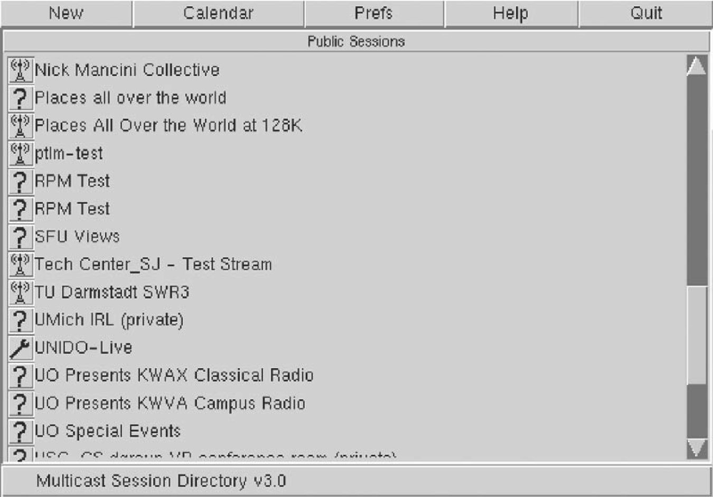

**Figure 9.7. A session directory tool displays information extracted from SDP messages.**

Next we get to the technical details that would enable an application program to participate in the session. The line beginning c=... provides the IP multicast address to which data for this session will be sent; a user would need to join this multicast group to receive the session. Next we see the start and end times for the session (encoded as integers according to the Network Time Protocol). Finally, we get to the information about the media for this session. This session has three media types available—audio, video, and a shared whiteboard application known as wb. For each media type there is one line of information formatted as follows:

```text
m=<media> <port> <transport> <format>
```

The media types are self-explanatory, and the port numbers in each case are UDP ports. When we look at the “transport” field, we can see that the wb application runs directly over UDP, while the audio and video are transported using “RTP/AVP”. This means that they run over RTP and use the *application profile* known as *AVP*. That application profile defines a number of different encoding schemes for audio and video; we can see in this case that the audio is using encoding 0 (which is an encoding using an 8-kHz sampling rate and 8 bits per sample) and the video is using encoding 31, which represents the H.261 encoding scheme. These “magic numbers” for the encoding schemes are defined in the RFC that defines the AVP profile; it is also possible to describe nonstandard coding schemes in SDP.

Finally, we see a description of the “wb” media type. All the encoding information for this data is specific to the wb application, and so it is sufficient just to provide the name of the application in the “format” field. This is analogous to putting application/wb in a MIME message.

Now that we know how to describe sessions, we can look at how they can be initiated. One way in which SDP is used is to announce multimedia conferences, by sending SDP messages to a well-known multicast address. The session directory tool shown in Figure 9.7 would function by joining that multicast group and displaying information that it gleans from received SDP messages. SDP is also used in the delivery of entertainment video of IP (often called IPTV) to provide information about the video content on each TV channel.

SDP also plays an important role in conjunction with the Session Initiation Protocol (SIP). With the widespread adoption of Voice over IP (i.e., the support of telephony-like applications over IP networks) and IP-based video conferencing, SIP is now one of the more important members of the Internet protocol suite.

##### SIP

SIP is an application layer protocol that bears a certain resemblance to HTTP, being based on a similar request/response model. However, it is designed with rather different sorts of applications in mind and thus provides quite different capabilities than HTTP. The capabilities provided by SIP can be grouped into five categories:

- User location—Determining the correct device with which to communicate to reach a particular user
- User availability—Determining if the user is willing or able to take part in a particular communication session
- User capabilities—Determining such items as the choice of media and coding scheme to use
- Session setup—Establishing session parameters such as port numbers to be used by the communicating parties
- Session management—A range of functions including transferring sessions (e.g., to implement “call forwarding”) and modifying session parameters

Most of these functions are easy enough to understand, but the issue of location bears some further discussion. One important difference between SIP and, say, HTTP, is that SIP is primarily used for human-to-human communication. Thus, it is important to be able to locate individual *users*, not just machines. And, unlike email, it’s not good enough just to locate a server that the user will be checking on at some later date and dump the message there—we need to know where the user is right now if we want to be able to communicate with him in real time. This is further complicated by the fact that a user might choose to communicate using a range of different devices, such as using his desktop PC when he’s in the office and using a handheld device when traveling. Multiple devices might be active at the same time and might have widely different capabilities (e.g., an alphanumeric pager and a PC-based video “phone”). Ideally, it should be possible for other users to be able to locate and communicate with the appropriate device at any time. Furthermore, the user must be able to have control over when, where, and from whom he receives calls.

To enable a user to exercise the appropriate level of control over his calls, SIP introduces the notion of a proxy. A SIP proxy can be thought of as a point of contact for a user to which initial requests for communication with him are sent. Proxies also perform functions on behalf of callers. We can see how proxies work best through an example.

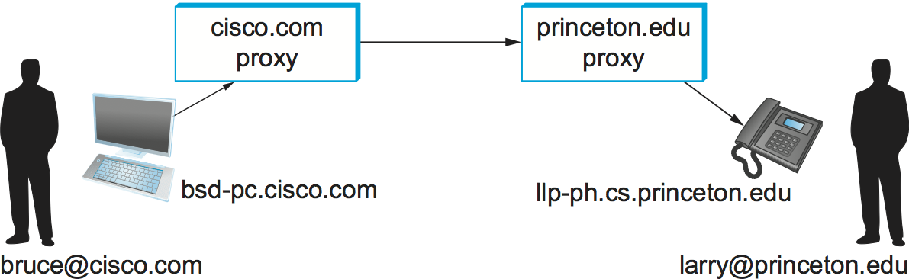

**Figure 9.8. Establishing communication through SIP proxies.**

Consider the two users in Figure 9.8. The first thing to notice is that each user has a name in the format user@domain, very much like an email address. When user Bruce wants to initiate a session with Larry, he sends his initial SIP message to the local proxy for his domain, cisco.com. Among other things, this initial message contains a *SIP URI*—these are a form of uniform resource identifier which look like this:

```text
SIP:larry@princeton.edu
```

A SIP URI provides complete identification of a user, but (unlike a URL) does not provide his location, since that may change over time. We will see shortly how the location of a user can be determined.

Upon receiving the initial message from Bruce, the proxy looks at the SIP URI and deduces that this message should be sent to the proxy. For now, we assume that the proxy has access to some database that enables it to obtain a mapping from the name to the IP address of one or more devices at which Larry currently wishes to receive messages. The proxy can therefore forward the message on to Larry’s chosen device(s). Sending the message to more than one device is called *forking* and may be done either in parallel or in series (e.g., send it to his mobile phone if he doesn’t answer the phone at his desk).

The initial message from Bruce to Larry is likely to be a SIP invite message, which looks something like the following:

```text
INVITE sip:larry@princeton.edu SIP/2.0
Via: SIP/2.0/UDP bsd-pc.cisco.com;branch=z9hG4bK433yte4
To: Larry <sip:larry@princeton.edu>
From: Bruce <sip:bruce@cisco.com>;tag=55123
Call-ID: xy745jj210re3@bsd-pc.cisco.com
CSeq: 271828 INVITE
Contact: <sip:bruce@bsd-pc.cisco.com>
Content-Type: application/sdp
Content-Length: 142
```

The first line identifies the type of function to be performed (invite); the resource on which to perform it, the called party (sip:larry@princeton.edu ); and the protocol version (2.0). The subsequent header lines probably look somewhat familiar because of their resemblance to the header lines in an email message. SIP defines a large number of header fields, only some of which we describe here. Note that the Via: header in this example identifies the device from which this message originated. The Content-Type: and Content-Length: headers describe the contents of the message following the header, just as in a MIME-encoded email message. In this case, the content is an SDP message. That message would describe such things as the type of media (audio, video, etc.) that Bruce would like to exchange with Larry and other properties of the session such as codec types that he supports. Note that the field in SIP provides the capability to use any protocol for this purpose, although SDP is the most common.

Returning to the example, when the invite message arrives at the proxy, not only does the proxy forward the message on toward princeton.edu, but it also responds to the sender of the invite. Just as in HTTP, all responses have a response code, and the organization of codes is similar to that for HTTP. In Figure 9.9 we can see a sequence of SIP messages and responses.

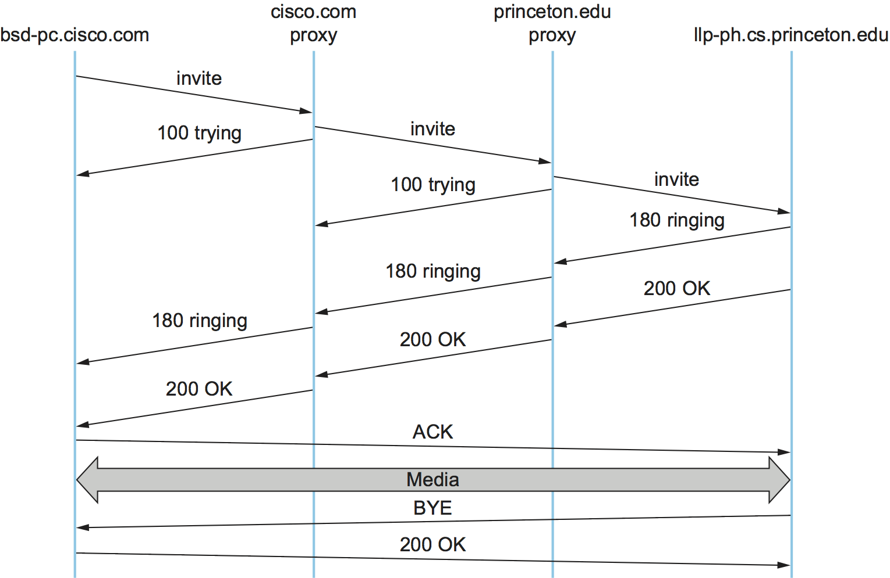

**Figure 9.9. Message flow for a basic SIP session.**

The first response message in this figure is the provisional response 100 trying, which indicates that the message was received without error by the caller’s proxy. Once the invite is delivered to Larry’s phone, it alerts Larry and responds with a 180 ringing message. The arrival of this message at Bruce’s computer is a sign that it can generate a “ringtone”. Assuming Larry is willing and able to communicate with Bruce, he could pick up his phone, causing the message 200 OK to be sent. Bruce’s computer responds with an ACK, and media (e.g., an RTP-encapsulated audio stream) can now begin to flow between the two parties. Note that at this point the parties know each others’ addresses, so the ACK can be sent directly, bypassing the proxies. The proxies are now no longer involved in the call. Note that the media will therefore typically take a different path through the network than the original signalling messages. Furthermore, even if one or both of the proxies were to crash at this point, the call could continue on normally. Finally, when one party wishes to end the session, it sends a BYE message, which elicits a 200 OK response under normal circumstances.

There are a few details that we have glossed over. One is the negotiation of session characteristics. Perhaps Bruce would have liked to communicate using both audio and video but Larry’s phone only supports audio. Thus, Larry’s phone would send an SDP message in its 200 OK describing the properties of the session that will be acceptable to Larry and the device, considering the options that were proposed in Bruce’s invite. In this way, mutually acceptable session parameters are agreed to before the media flow starts.

The other big issue we have glossed over is that of locating the correct device for Larry. First, Bruce’s computer had to send its invite to the cisco.com proxy. This could have been a configured piece of information in the computer, or it could have been learned by DHCP. Then the cisco.com proxy had to find the princeton.edu proxy. This could be done using a special sort of DNS lookup that would return the IP address of the SIP proxy for the domain. (We’ll discuss how DNS can do this in the next section.) Finally, the princeton.edu proxy had to find a device on which Larry could be contacted. Typically, a proxy server has access to a location database that can be populated in several ways. Manual configuration is one option, but a more flexible option is to use the *registration* capabilities of SIP.

A user can register with a location service by sending a SIP register message to the “registrar” for his domain. This message creates a binding between an “address of record” and a “contact address”. An “address of record” is likely to be a SIP URI that is the well-known address for the user (e.g., sip:larry@princeton.edu) and the “contact address” will be the address at which the user can currently be found (e.g., sip:larry@llp-ph.cs.princeton.edu). This is exactly the binding that was needed by the proxy princeton.edu in our example.

Note that a user may register at several locations and that multiple users may register at a single device. For example, one can imagine a group of people walking into a conference room that is equipped with an IP phone and all of them registering on it so that they can receive calls on that phone.

SIP is a very rich and flexible protocol that can support a wide range of complex calling scenarios as well as applications that have little or nothing to do with telephony. For example, SIP supports operations that enable a call to be routed to a “music-on-hold” server or a voicemail server. It is also easy to see how it could be used for applications like instant messaging, and standardization of SIP extensions for such purposes is ongoing.

##### H.323

The International Telecommunication Union (ITU) has also been very active in the call control area, which is not surprising given its relevance to telephony, the traditional realm of that body. Fortunately, there has been considerable coordination between the IETF and the ITU in this instance, so that the various protocols are somewhat interoperable. The major ITU recommendation for multimedia communication over packet networks is known as *H.323*, which ties together many other recommendations, including H.225 for call control. The full set of recommendations covered by H.323 runs to many hundreds of pages, and the protocol is known for its complexity, so it is only possible to give a brief overview of it here.

H.323 is popular as a protocol for Internet telephony, including video calls, and we consider that class of application here. A device that originates or terminates calls is known as an H.323 terminal; this might be a workstation running an Internet telephony application, or it might be a specially designed “appliance”—a telephone-like device with networking software and an Ethernet port, for example. H.323 terminals can talk to each other directly, but the calls are frequently mediated by a device known as a *gatekeeper*. Gatekeepers perform a number of functions such as translating among the various address formats used for phone calls and controlling how many calls can be placed at a given time to limit the bandwidth used by the H.323 applications. H.323 also includes the concept of a *gateway*, which connects the H.323 network to other types of networks. The most common use of a gateway is to connect an H.323 network to the public switched telephone network (PSTN) as illustrated in Figure 9.10. This enables a user running an H.323 application on a computer to talk to a person using a conventional phone on the public telephone network. One useful function performed by the gatekeeper is to help a terminal find a gateway, perhaps choosing among several options to find one that is relatively close to the ultimate destination of the call. This is clearly useful in a world where conventional phones greatly outnumber PC-based phones. When an H.323 terminal makes a call to an endpoint that is a conventional phone, the gateway becomes the effective endpoint for the H.323 call and is responsible for performing the appropriate translation of both signalling information and the media stream that need to be carried over the telephone network.

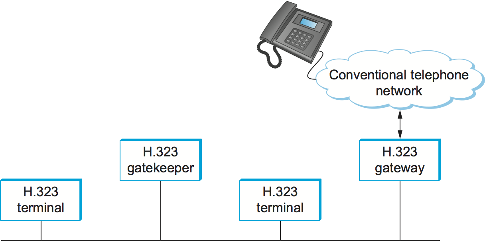

**Figure 9.10. Devices in an H.323 network.**

An important part of H.323 is the H.245 protocol, which is used to negotiate the properties of the call, somewhat analogously to the use of SDP described above. H.245 messages might list a number of different audio codec standards that it can support; the far endpoint of the call would reply with a list of its own supported codecs, and the two ends could pick a coding standard that they can both live with. H.245 can also be used to signal the UDP port numbers that will be used by RTP and Real-Time Control Protocol (RTCP) for the media stream (or streams—a call might include both audio and video, for example) for this call. Once this is accomplished, the call can proceed, with RTP being used to transport the media streams and RTCP carrying the relevant control information.

#### 9.2.2 Resource Allocation for Multimedia Applications

As we have just seen, session control protocols like SIP and H.323 can be used to initiate and control communication in multimedia applications, while RTP provides transport-level functions for the data streams of the applications. A final piece of the puzzle in getting multimedia applications to work is making sure that suitable resources are allocated inside the network to ensure that the quality of service needs of the application are met. We presented a number of methods for resource allocation in an earlier chapter. The motivation for developing these technologies was largely for the support of multimedia applications. So how do applications take advantage of the underlying resource allocation capabilities of the network?

It is worth noting that many multimedia applications run successfully over “best-effort” networks, such as the public Internet. The wide array of commercial VoIP services (such as Skype) are a testimony to the fact that you only have to worry about resource allocation when resources are not abundant—and in many parts of today’s Internet, resource abundance is the norm.

A protocol like RTCP can help applications in best-effort networks, by giving the application detailed information about the quality of service that is being delivered by the network. Recall that RTCP carries information about the loss rate and delay characteristics between participants in a multimedia application. An application can use this information to change its coding scheme—changing to a lower bitrate codec, for example, when bandwidth is scarce. Note that, while it might be tempting to change to a codec that sends additional, redundant information when loss rates are high, this is frowned upon; it is analogous to *increasing* the window size of TCP in the presence of loss, the exact opposite of what is required to avoid congestion collapse.

As discussed in an earlier chapter, Differentiated Services (DiffServ) can be used to provide fairly basic and scalable resource allocation to applications. A multimedia application can set the differentiated services code point (DSCP) in the IP header of the packets that it generates in an effort to ensure that both the media and control packets receive appropriate quality of service. For example, it is common to mark voice media packets as “EF” (expedited forwarding) to cause them to be placed in a low-latency or priority queue in routers along the path, while the call signalling (e.g., SIP) packets are often marked with some sort of “AF” (assured forwarding) to enable them to be queued separately from best-effort traffic and thus reduce their risk of loss.

Of course, it only makes sense to mark the packets inside the sending host or appliance if network devices such as routers pay attention to the DSCP. In general, routers in the public Internet ignore the DSCP, providing best-effort service to all packets. However, enterprise or corporate networks have the ability to use DiffServ for their internal multimedia traffic, and frequently do so. Also, even residential users of the Internet can often improve the quality of VoIP or other multimedia applications just by using DiffServ on the outbound direction of their Internet connections, as illustrated in Figure 9.11. This is effective because of the asymmetry of many broadband Internet connections: If the outbound link is substantially slower (i.e., more resource constrained) than the inbound, then resource allocation using DiffServ on that link may be enough to make all the difference in quality for latency- and loss-sensitive applications.

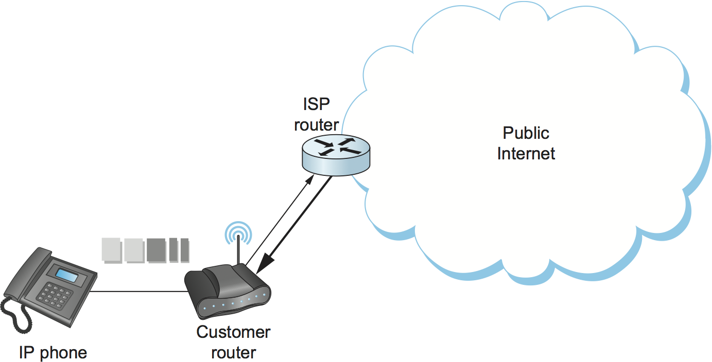

**Figure 9.11. Differentiated Services applied to a VoIP application. DiffServ queuing is applied only on the upstream link from customer router to ISP.**

While DiffServ is appealing for its simplicity, it is clear that it cannot meet the needs of applications under all conditions. For example, suppose the upstream bandwidth in Figure 9.11 is only 100 kbps, and the customer attempts to place two VoIP calls, each with a 64-kbps codec. Clearly the upstream link is now more than 100% loaded, which will lead to large queuing delays and lost packets. No amount of clever queuing in the customer’s router can fix that.

The characteristics of many multimedia applications are such that, rather than try to squeeze too many calls into a too-narrow pipe, it would be better to block one call while allowing another to proceed. That is, it is better to have one person carrying on a conversation successfully while another hears a busy signal than to have both callers experiencing unacceptable audio quality at the same time. We sometimes refer to such applications as having a *steep utility curve*, meaning that the utility (usefulness) of the application drops rapidly as the quality of service provided by the network degrades. Multimedia applications often have this property, whereas many traditional applications do not. Email, for example, continues to work quite well even if delays run into the hours.

Applications with steep utility curves are often well suited to some form of admission control. If you cannot be sure that sufficient resources will always be available to support the offered load of the applications, then admission control provides a way to say “no” to some applications while allowing others to get the resources they need.

We saw one way to do admission control using RSVP in an earlier chapter, and we will return to that shortly, but multimedia applications that use session control protocols provide some other admission control options. The key point to observe here is that session control protocols like SIP or H.323 often involve some sort of message exchange between an endpoint and another entity (SIP proxy or H.323 gatekeeper) at the beginning of a call or session. This can provide a handy means to say “no” to a new call for which sufficient resources are not available.

As an example, consider the network in Figure 9.12. Suppose the wide area link from the branch office to the head office has enough bandwidth to accommodate three VoIP calls simultaneously using 64-kbps codecs. Each phone already needs to communicate with the local SIP proxy or H.323 gatekeeper when it begins to place a call, so it is easy enough for the proxy/gatekeeper to send back a message that tells the IP phone to play a busy signal if that link is already fully loaded. The proxy or gatekeeper can even deal with the possibility that a particular IP phone might be making multiple calls at the same time and that different codec speeds might be used. However, this scheme will work only if no other device can overload the link without first talking to the gatekeeper or proxy. DiffServ queuing can be used to ensure that, for example, a PC engaged in a file transfer doesn’t interfere with the VoIP calls. But, suppose some VoIP application that doesn’t first talk to the gatekeeper or proxy is enabled in the remote office. Such an application, if it can get its packets marked appropriately and in the same queue as the existing VoIP traffic, can clearly drive the link to the point of overload with no feedback from the proxy or gatekeeper.

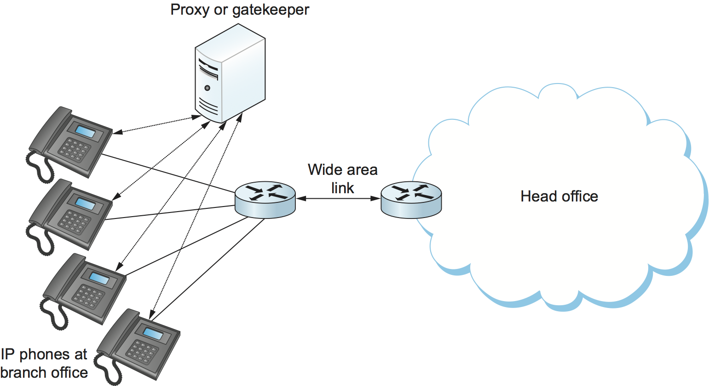

**Figure 9.12. Admission control using session control protocol.**

Another problem with the approach just described is that it depends on the gatekeeper or proxy having knowledge of the path that each application will use. In the simple topology of Figure 9.12 this isn’t a big issue, but in more complex networks it can quickly become unmanageable. We only need to imagine the case where the remote office has two different connections to the outside world to see that we are asking the proxy or gatekeeper to understand not just SIP or H.323 but also routing, link failures, and current network conditions. This can quickly become unmanageable.

We refer to the sort of admission control just described as *off-path*, in the sense that the device making admission control decisions does not sit on the data path where resources need to be allocated. The obvious alternative is *on-path* admission control, and the standard example of a protocol that does on-path admission control in IP networks is the Resource Reservation Protocol (RSVP). We saw in an earlier chapter how RSVP can be used to ensure that sufficient resources are allocated along a path, and it is straightforward to use RSVP in applications like those described in this section. The one detail that still needs to be filled in is how the admission control protocol interacts with the session control protocol.

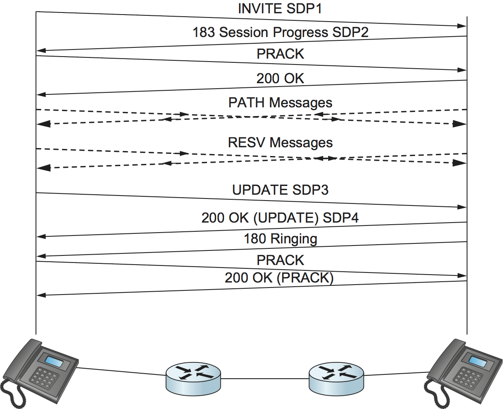

**Figure 9.13. Coordination of SIP signalling and resource reservation.**

Coordinating the actions of an admission control (or resource reservation) protocol and a session control protocol is not rocket science, but it does require some attention to details. As an example, consider a simple telephone call between two parties. Before you can make a reservation, you need to know how much bandwidth the call is going to use, which means you need to know what codecs are to be used. That implies you need to do some of the session control first, to exchange information about the codecs supported by the two phones. However, you can’t do *all* the session control first, because you wouldn’t want the phone to ring before the admission control decision had been made, in case admission control failed. Figure 9.13 illustrates this situation where SIP is used for session control and RSVP is used to make the admission control decision (successfully in this case).

The main thing to notice here is the interleaving of session control and resource allocation tasks. Solid lines represent SIP messages, dashed lines represent RSVP messages. Note that SIP messages are transmitted direction from phone to phone in this example (i.e., we have not shown any SIP proxies), whereas the RSVP messages are also processed by the routers in the middle as the check for sufficient resources to admit the call.

We begin with an initial exchange of codec information in the first two SIP messages (recall that SDP is used to list available codecs, among other things). PRACK is a “provisional acknowledgment”. Once these messages have been exchanged, RSVP PATH messages, which contain a description of the amount of resources that will be required, can be sent as the first step in reserving resources in both directions of the call. Next, RESV messages can be sent back to actually reserve the resources. Once a RESV is received by the initiating phone, it can send an updated SDP message reporting the fact that resources have been reserved in one direction. When the called phone has received both that message and the RESV from the other phone, it can start to ring and tell the other phone that resources are now reserved in both directions (with the SDP message) and also notify the calling phone that it is ringing. From here on, normal SIP signalling and media flow, similar to that shown in Figure 9.9, proceeds.

Again we see how building applications requires us to understand the interaction between different building blocks (SIP and RSVP, in this case). The designers of SIP actually made some changes to the protocol to enable this interleaving of functions between protocols with different jobs, hence our repeated emphasis in this book on focusing on complete systems rather than just looking at one layer or component in isolation from the other parts of the system.

### 9.3 Infrastructure Applications

There are some protocols that are essential to the smooth running of the Internet but that don’t fit neatly into the strictly layered model. One of these is the Domain Name System (DNS)—not an application that users normally invoke directly, but rather a service that almost all other applications depend upon. This is because the name service is used to translate host names into host addresses; the existence of such an application allows the users of other applications to refer to remote hosts by name rather than by address. In other words, a name service is usually used by other applications, rather than by humans.

A second critical function is network management, which although not so familiar to the average user, is performed most often by the people that operate the network on behalf of users. Network management is widely considered one of the hard problems of networking and continues to be the focus of much innovation. We’ll look at some of the issues and approaches to the problem below.

#### 9.3.1 Name Service (DNS)

In most of this book, we have been using addresses to identify hosts. While perfectly suited for processing by routers, addresses are not exactly user friendly. It is for this reason that a unique *name* is also typically assigned to each host in a network. Already in this section we have seen application protocols like HTTP using names such as www.princeton.edu. We now describe how a naming service can be developed to map user-friendly names into router-friendly addresses. Name services are sometimes called *middleware* because they fill a gap between applications and the underlying network.

Host names differ from host addresses in two important ways. First, they are usually of variable length and mnemonic, thereby making them easier for humans to remember. (In contrast, fixed-length numeric addresses are easier for routers to process.) Second, names typically contain no information that helps the network locate (route packets toward) the host. Addresses, in contrast, sometimes have routing information embedded in them; *flat* addresses (those not divisible into component parts) are the exception.

Before getting into the details of how hosts are named in a network, we first introduce some basic terminology. First, a *name space* defines the set of possible names. A name space can be either *flat* (names are not divisible into components) or *hierarchical* (Unix file names are an obvious example). Second, the naming system maintains a collection of *bindings* of names to values. The value can be anything we want the naming system to return when presented with a name; in many cases, it is an address. Finally, a *resolution mechanism* is a procedure that, when invoked with a name, returns the corresponding value. A *name server* is a specific implementation of a resolution mechanism that is available on a network and that can be queried by sending it a message.

Because of its large size, the Internet has a particularly well-developed naming system in place—the Domain Name System (DNS). We therefore use DNS as a framework for discussing the problem of naming hosts. Note that the Internet did not always use DNS. Early in its history, when there were only a few hundred hosts on the Internet, a central authority called the *Network Information Center* (NIC) maintained a flat table of name-to-address bindings; this table was called HOSTS.TXT.  Whenever a site wanted to add a new host to the Internet, the site administrator sent email to the NIC giving the new host’s name/address pair. This information was manually entered into the table, the modified table was mailed out to the various sites every few days, and the system administrator at each site installed the table on every host at the site. Name resolution was then simply implemented by a procedure that looked up a host’s name in the local copy of the table and returned the corresponding address.

It should come as no surprise that the approach to naming did not work well as the number of hosts in the Internet started to grow. Therefore, in the mid-1980s, the Domain Naming System was put into place. DNS employs a hierarchical name space rather than a flat name space, and the “table” of bindings that implements this name space is partitioned into disjoint pieces and distributed throughout the Internet. These subtables are made available in name servers that can be queried over the network.

What happens in the Internet is that a user presents a host name to an application program (possibly embedded in a compound name such as an email address or URL), and this program engages the naming system to translate this name into a host address. The application then opens a connection to this host by presenting some transport protocol (e.g., TCP) with the host’s IP address. This situation is illustrated (in the case of sending email) in Figure 9.14. While this picture makes the name resolution task look simple enough, there is a bit more to it, as we shall see.

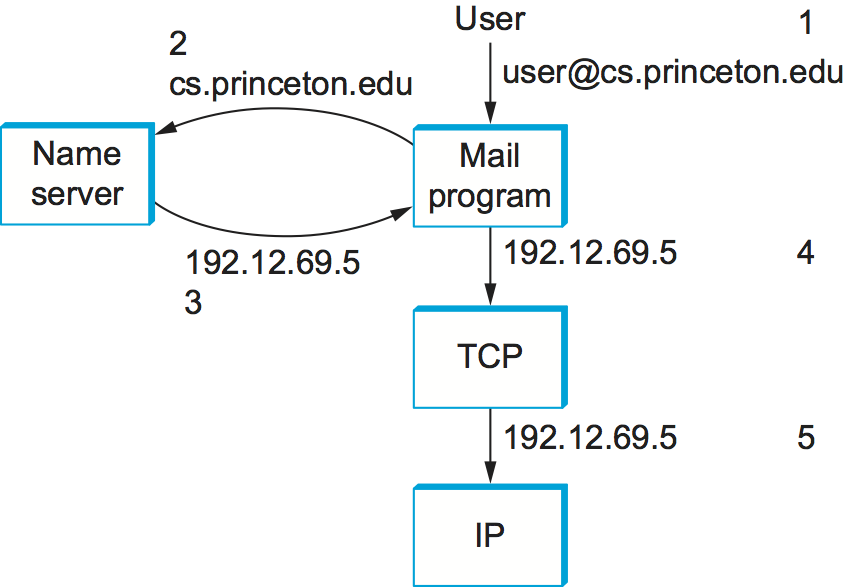

**Figure 9.14. Names translated into addresses, where the numbers 1 to 5 show the sequence of steps in the process.**

##### Domain Hierarchy

DNS implements a hierarchical name space for Internet objects. Unlike Unix file names, which are processed from left to right with the naming components separated with slashes, DNS names are processed from right to left and use periods as the separator. (Although they are processed from right to left, humans still read domain names from left to right.) An example domain name for a host is cicada.cs.princeton.edu. Notice that we said domain names are used to name Internet “objects.” What we mean by this is that DNS is not strictly used to map host names into host addresses. It is more accurate to say that DNS maps domain names into values. For the time being, we assume that these values are IP addresses; we will come back to this issue later in this section.

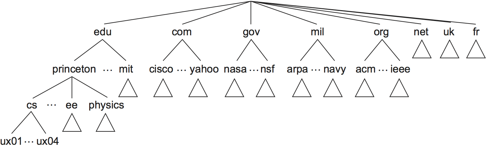

**Figure 9.15. Example of a domain hierarchy.**

Like the Unix file hierarchy, the DNS hierarchy can be visualized as a tree, where each node in the tree corresponds to a domain, and the leaves in the tree correspond to the hosts being named. Figure 9.15 gives an example of a domain hierarchy. Note that we should not assign any semantics to the term *domain* other than that it is simply a context in which additional names can be defined.

There was actually a substantial amount of discussion that took place when the domain name hierarchy was first being developed as to what conventions would govern the names that were to be handed out near the top of the hierarchy. Without going into that discussion in any detail, notice that the hierarchy is not very wide at the first level. There are domains for each country, plus the “big six” domains: .edu, .com, .gov, .mil, .org, and .net. These six domains were all originally based in the United States (where the Internet and DNS were invented); for example, only U.S.-accredited educational institutions can register an .edu domain name. In recent years, the number of top-level domains has been expanded, partly to deal with the high demand for .com domains names. The newer top-level domains include .biz, .coop, and .info. There are now over 1200 top-level domains.

##### Name Servers

The complete domain name hierarchy exists only in the abstract. We now turn our attention to the question of how this hierarchy is actually implemented. The first step is to partition the hierarchy into subtrees called *zones*. Figure 9.16 shows how the hierarchy given in Figure 9.15 might be divided into zones. Each zone can be thought of as corresponding to some administrative authority that is responsible for that portion of the hierarchy. For example, the top level of the hierarchy forms a zone that is managed by the Internet Corporation for Assigned Names and Numbers (ICANN). Below this is a zone that corresponds to Princeton University. Within this zone, some departments do not want the responsibility of managing the hierarchy (and so they remain in the university-level zone), while others, like the Department of Computer Science, manage their own department-level zone.

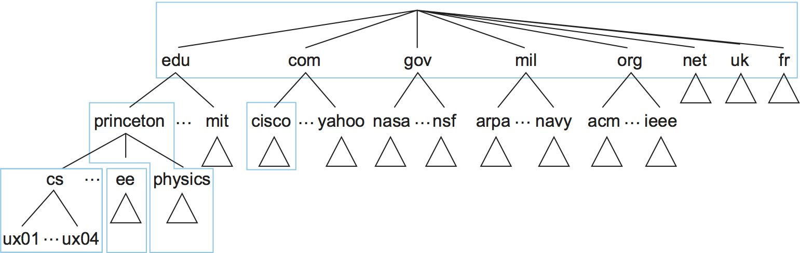

**Figure 9.16. Domain hierarchy partitioned into zones.**

The relevance of a zone is that it corresponds to the fundamental unit of implementation in DNS—the name server. Specifically, the information contained in each zone is implemented in two or more name servers. Each name server, in turn, is a program that can be accessed over the Internet. Clients send queries to name servers, and name servers respond with the requested information. Sometimes the response contains the final answer that the client wants, and sometimes the response contains a pointer to another server that the client should query next. Thus, from an implementation perspective, it is more accurate to think of DNS as being represented by a hierarchy of name servers rather than by a hierarchy of domains, as illustrated in Figure 9.17.

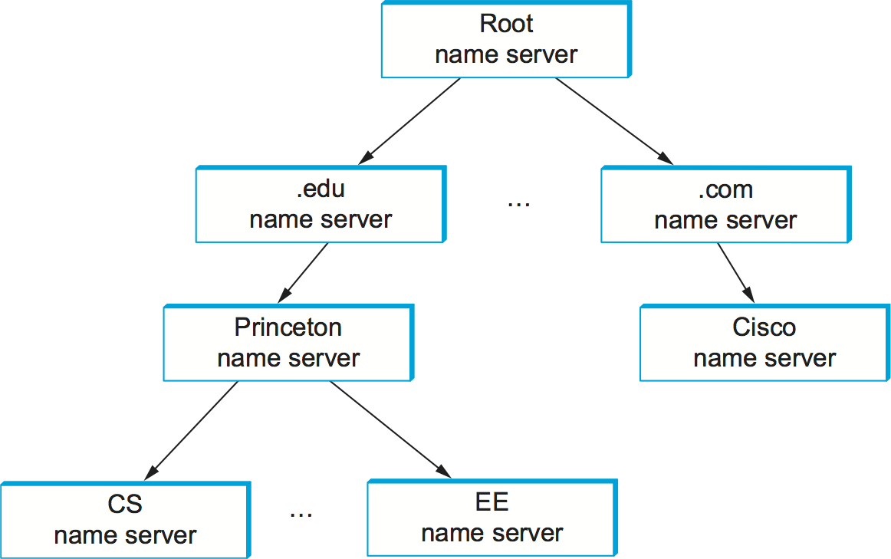

**Figure 9.17. Hierarchy of name servers.**

Note that each zone is implemented in two or more name servers for the sake of redundancy; that is, the information is still available even if one name server fails. On the flip side, a given name server is free to implement more than one zone.

Each name server implements the zone information as a collection of *resource records*. In essence, a resource record is a name-to-value binding or, more specifically, a 5-tuple that contains the following fields:

```text
(Name, TTL, Type, Class, Value)
```

The Name and Value fields are exactly what you would expect, while the Type field specifies how the Value should be interpreted. For example, Type=A indicates that the Value is an IP address. Thus, A records implement the name-to-address mapping we have been assuming. Other record types include:

- NS—The Value field gives the domain name for a host that is running a name server that knows how to resolve names within the specified domain.
- CNAME—The Value field gives the canonical name for a particular host; it is used to define aliases.
- MX—The Value field gives the domain name for a host that is running a mail server that accepts messages for the specified domain.

The time-to-live (TTL) field shows how long this resource record is valid. It is used by servers that cache resource records from other servers; when the TTL expires, the server must evict the record from its cache.

Finally, the Class field was included to allow entities other than the NIC to define useful record types. To date, the only widely used Class is the one used by the Internet; it is denoted IN.

To better understand how resource records represent the information in the domain hierarchy, consider the following examples drawn from the domain hierarchy given in Figure 9.15. To simplify the example, we ignore the TTL and Class fields and we give the relevant information for only one of the name servers that implement each zone.

First, a root name server contains an NS record for each top-level domain (TLD) name server. This identifies a server that can resolve queries for this part of the DNS hierarchy (.edu and .com in this example). It also has A records that translates these names into the corresponding IP addresses. Taken together, these two records effectively implement a pointer from the root name server to one of the TLD servers.

```text
(edu, NS, a3.nstld.com)
(a3.nstld.com, A, 192.5.6.32)
(com, NS, a.gtld-servers.net)
(a.gtld-servers.net, A, 192.5.6.30)
...
```

Moving our way down the hierarchy by one level, the a3.nstld.com server has records for .edu domains like this:

```text
(princeton.edu, NS, dns.princeton.edu)
(dns.princeton.edu, A, 128.112.129.15)
...
```

In this case, we get an NS record and an A record for the name server that is responsible for the princeton.edu part of the hierarchy. That server might be able to directly resolve some queries (e.g., for email.princeton.edu) while it would redirect others to a server at yet another layer in the hierarchy (e.g., for a query about penguins.cs.princeton.edu).

```text
(email.princeton.edu, A, 128.112.198.35)
(penguins.cs.princeton.edu, NS, dns1.cs.princeton.edu)
(dns1.cs.princeton.edu, A, 128.112.136.10)
...
```

Finally, a third-level name server, such as the one managed by domain cs.princeton.edu, contains A records for all of its hosts. It might also define a set of aliases (CNAME records) for each of those hosts. Aliases are sometimes just convenient (e.g., shorter) names for machines, but they can also be used to provide a level of indirection. For example, www.cs.princeton.edu is an alias for the host named coreweb.cs.princeton.edu.This allows the site’s web server to move to another machine without affecting remote users; they simply continue to use the alias without regard for what machine currently runs the domain’s web server. The mail exchange (MX) records serve the same purpose for the email application—they allow an administrator to change which host receives mail on behalf of the domain without having to change everyone’s email address.

```text
(penguins.cs.princeton.edu, A, 128.112.155.166)
(www.cs.princeton.edu, CNAME, coreweb.cs.princeton.edu)
(coreweb.cs.princeton.edu, A, 128.112.136.35)
(cs.princeton.edu, MX, mail.cs.princeton.edu)
(mail.cs.princeton.edu, A, 128.112.136.72)
...
```

Note that, although resource records can be defined for virtually any type of object, DNS is typically used to name hosts (including servers) and sites. It is not used to name individual people or other objects like files or directories; other naming systems are typically used to identify such objects. For example, X.500 is an ISO naming system designed to make it easier to identify people. It allows you to name a person by giving a set of attributes: name, title, phone number, postal address, and so on. X.500 proved too cumbersome—and, in some sense, was usurped by powerful search engines now available on the Web—but it did eventually evolve into the Lightweight Directory Access Protocol (LDAP). LDAP is a subset of X.500 originally designed as a PC front end to X.500. Today, widely used, mostly at the enterprise level, as a system for learning information about users.

##### Name Resolution

Given a hierarchy of name servers, we now consider the issue of how a client engages these servers to resolve a domain name. To illustrate the basic idea, suppose the client wants to resolve the name penguins.cs.princeton.edu relative to the set of servers given in the previous subsection. The client could first send a query containing this name to one of the root servers (as we’ll see below, this rarely happens in practice but will suffice to illustrate the basic operation for now). The root server, unable to match the entire name, returns the best match it has—the NS record for edu which points to the TLD server a3.nstld.com. The server also returns all records that are related to this record, in this case, the A record for a3.nstld.com. The client, having not received the answer it was after, next sends the same query to the name server at IP host 192.5.6.32. This server also cannot match the whole name and so returns the NS and corresponding A records for the princeton.edu domain. Once again, the client sends the same query as before to the server at IP host 128.112.129.15, and this time gets back the NS record and corresponding A record for the cs.princeton.edu domain. This time, the server that can fully resolve the query has been reached. A final query to the server at 128.112.136.10 yields the A record for penguins.cs.princeton.edu, and the client learns that the corresponding IP address is 128.112.155.166.

This example still leaves a couple of questions about the resolution process unanswered. The first question is how did the client locate the root server in the first place, or, put another way, how do you resolve the name of the server that knows how to resolve names? This is a fundamental problem in any naming system, and the answer is that the system has to be bootstrapped in some way. In this case, the name-to-address mapping for one or more root servers is well known; that is, it is published through some means outside the naming system itself.

In practice, however, not all clients know about the root servers. Instead, the client program running on each Internet host is initialized with the address of a *local* name server. For example, all the hosts in the Department of Computer Science at Princeton know about the server on dns1.cs.princeton.edu. This local name server, in turn, has resource records for one or more of the root servers, for example:

```text
('root', NS, a.root-servers.net)
(a.root-servers.net, A, 198.41.0.4, A)
```

Thus, resolving a name actually involves a client querying the local server, which in turn acts as a client that queries the remote servers on the original client’s behalf. This results in the client/server interactions illustrated in Figure 9.18. One advantage of this model is that all the hosts in the Internet do not have to be kept up-to-date on where the current root servers are located; only the servers have to know about the root. A second advantage is that the local server gets to see the answers that come back from queries that are posted by all the local clients. The local server *caches* these responses and is sometimes able to resolve future queries without having to go out over the network. The TTL field in the resource records returned by remote servers indicates how long each record can be safely cached. This caching mechanism can be used further up the hierarchy as well, reducing the load on the root and TLD servers.

The second question is how the system works when a user submits a partial name (e.g., penguins) rather than a complete domain name (e.g., penguins.cs.princeton.edu). The answer is that the client program is configured with the local domain in which the host resides (e.g., cs.princeton.edu), and it appends this string to any simple names before sending out a query.

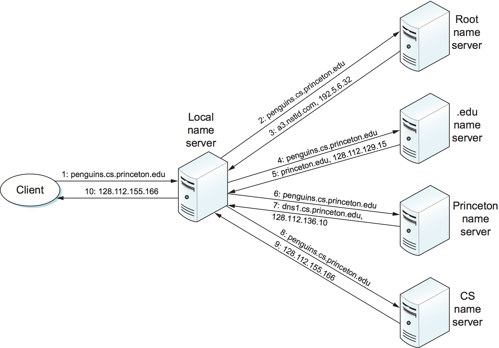

**Figure 9.18. Name resolution in practice, where the numbers 1 to 10 show the sequence of steps in the process.**

If you want to get a hands-on view of how name resolution works, you can use the command-line tool dig to make queries and receive responses in the form

```text
Name TTL Class Type Value
```

If you invoke dig with the +trace option you can see the recursive process happening as the tool starts at the top of the DNS hierarchy and works its way down to resolve the query. Here is a subset of the output when we use the simple form of dig to look up www.cs.princeton.edu

```text
$ dig www.cs.princeton.edu
...
;; QUESTION SECTION:
;www.cs.princeton.edu.		IN	A
;; ANSWER SECTION:
www.cs.princeton.edu.	60	IN	CNAME	coreweb.cs.princeton.edu.
coreweb.cs.princeton.edu. 60	IN	A	128.112.136.35
```

> **Key Takeaway**
>
> Just to make sure we are clear, we have now seen three different levels of identifiers—domain names, IP addresses, and physical network addresses—and the mapping of identifiers at one level into identifiers at another level happens at different points in the network architecture. First, users specify domain names when interacting with the application. Second, the application engages DNS to translate this name into an IP address; it is the IP address that is placed in each datagram, not the domain name. (As an aside, this translation process involves IP datagrams being sent over the Internet, but these datagrams are addressed to a host that runs a name server, not to the ultimate destination.) Third, IP does forwarding at each router, which often means that it maps one IP address into another; that is, it maps the ultimate destination’s address into the address for the next hop router. Finally, IP engages the Address Resolution Protocol (ARP) to translate the next hop IP address into the physical address for that machine; the next hop might be the ultimate destination or it might be an intermediate router. Frames sent over the physical network have these physical addresses in their headers. [Next]

#### 9.3.2 Network Management (SNMP, OpenConfig)

A network is a complex system, both in terms of the number of nodes that are involved and in terms of the suite of protocols that can be running on any one node. Even if you restrict yourself to worrying about the nodes within a single administrative domain, such as a campus, there might be dozens of routers and hundreds—or even thousands—of hosts to keep track of. If you think about all the state that is maintained and manipulated on any one of those nodes—address translation tables, routing tables, TCP connection state, and so on—then it is easy to become overwhelmed by the prospect of having to manage all of this information.

It is easy to imagine wanting to know about the state of various protocols on different nodes. For example, you might want to monitor the number of IP datagram reassemblies that have been aborted, so as to determine if the timeout that garbage collects partially assembled datagrams needs to be adjusted. As another example, you might want to keep track of the load on various nodes (i.e., the number of packets sent or received) so as to determine if new routers or links need to be added to the network. Of course, you also have to be on the watch for evidence of faulty hardware and misbehaving software.

What we have just described is the problem of network management, an issue that pervades the entire network architecture. Since the nodes we want to keep track of are distributed, our only real option is to use the network to manage the network. This means we need a protocol that allows us to read and write various pieces of state information on different network nodes. The following describes two approaches.

##### SNMP

A widely used protocol for network management is SNMP (*Simple Network Management Protocol*). SNMP is essentially a specialized request/reply protocol that supports two kinds of request messages: GET and SET. The former is used to retrieve a piece of state from some node, and the latter is used to store a new piece of state in some node. (SNMP also supports a third operation, GET-NEXT, which we explain below.) The following discussion focuses on the GET operation, since it is the one most frequently used.

SNMP is used in the obvious way. An operator interacts with a client program that displays information about the network. This client program usually has a graphical interface. You can think of this interface as playing the same role as a web browser. Whenever the operator selects a certain piece of information that he or she wants to see, the client program uses SNMP to request that information from the node in question. (SNMP runs on top of UDP.) An SNMP server running on that node receives the request, locates the appropriate piece of information, and returns it to the client program, which then displays it to the user.

There is only one complication to this otherwise simple scenario: Exactly how does the client indicate which piece of information it wants to retrieve, and, likewise, how does the server know which variable in memory to read to satisfy the request? The answer is that SNMP depends on a companion specification called the *management information base* (MIB). The MIB defines the specific pieces of information—the MIB *variables*—that you can retrieve from a network node.

The current version of MIB, called MIB-II, organizes variables into different *groups*. You will recognize that most of the groups correspond to one of the protocols described in this book, and nearly all of the variables defined for each group should look familiar. For example:

- System—General parameters of the system (node) as a whole, including where the node is located, how long it has been up, and the system’s name
- Interfaces—Information about all the network interfaces (adaptors) attached to this node, such as the physical address of each interface and how many packets have been sent and received on each interface
- Address translation—Information about the Address Resolution Protocol, and in particular, the contents of its address translation table
- IP—Variables related to IP, including its routing table, how many datagrams it has successfully forwarded, and statistics about datagram reassembly; includes counts of how many times IP drops a datagram for one reason or another
- TCP—Information about TCP connections, such as the number of passive and active opens, the number of resets, the number of timeouts, default timeout settings, and so on; per-connection information persists only as long as the connection exists
- UDP—Information about UDP traffic, including the total number of UDP datagrams that have been sent and received.

There are also groups for Internet Control Message Protocol (ICMP) and SNMP itself.

Returning to the issue of the client stating exactly what information it wants to retrieve from a node, having a list of MIB variables is only half the battle. Two problems remain. First, we need a precise syntax for the client to use to state which of the MIB variables it wants to fetch. Second, we need a precise representation for the values returned by the server. Both problems are addressed using Abstract Syntax Notation One (ASN.1).

Consider the second problem first. As we already saw in a previous chapter, ASN.1/Basic Encoding Rules (BER) defines a representation for different data types, such as integers. The MIB defines the type of each variable, and then it uses ASN.1/BER to encode the value contained in this variable as it is transmitted over the network. As far as the first problem is concerned, ASN.1 also defines an object identification scheme. The MIB uses this identification system to assign a globally unique identifier to each MIB variable. These identifiers are given in a “dot” notation, not unlike domain names. For example, 1.3.6.1.2.1.4.3 is the unique ASN.1 identifier for the IP-related MIB variable ipInReceives; this variable counts the number of IP datagrams that have been received by this node. In this example, the 1.3.6.1.2.1 prefix identifies the MIB database (remember, ASN.1 object IDs are for all possible objects in the world), the 4 corresponds to the IP group, and the final 3 denotes the third variable in this group.

Thus, network management works as follows. The SNMP client puts the ASN.1 identifier for the MIB variable it wants to get into the request message, and it sends this message to the server. The server then maps this identifier into a local variable (i.e., into a memory location where the value for this variable is stored), retrieves the current value held in this variable, and uses ASN.1/BER to encode the value it sends back to the client.

There is one final detail. Many of the MIB variables are either tables or structures. Such compound variables explain the reason for the SNMP GET-NEXT operation. This operation, when applied to a particular variable ID, returns the value of that variable plus the ID of the next variable, for example, the next item in the table or the next field in the structure. This aids the client in “walking through” the elements of a table or structure.

##### OpenConfig

SNMP is still widely used and has historically been “the” management protocol for switches and routers, but there has recently been growing attention paid to more flexible and powerful ways to manage networks. There isn’t yet complete agreement on an industry-wide standard, but a consensus about the general approach is starting to emerge. We describe one example, called *OpenConfig*, that is both getting a lot of traction and illustrates many of the key ideas that are being pursued.

The general strategy is to automate network management as much as possible, with the goal of getting the error-prone human out of the loop. This is sometimes called *zero-touch* management, and it implies two things have to happen. First, whereas historically operators used tools like SNMP to *monitor* the network, but had to log into any misbehaving network device and use a command line interface (CLI) to fix the problem, zero-touch management implies that we also need to *configure* the network programmatically. In other words, network management is equal parts reading status information and writing configuration information. The goal is to build a closed control loop, although there will always be scenarios where the operator has to be alerted that manual intervention is required.

Second, whereas historically the operator had to configure each network device individually, all the devices have to be configured in a consistent way if they are going to function correctly as a network. As a consequence, zero-touch also implies that the operator should be able to declare their network-wide *intent*, with the management tool being smart enough to issue the necessary per-device configuration directives in a globally consistent way.

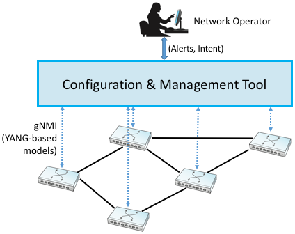

**Figure 9.19. Operator manages a network through a configuration and management tool, which in turn programmatically interacts with the underlying network devices (e.g., using gNMI as the transport protocol and YANG to specify the schema for the data being exchanged).**

Figure 9.19 gives a high-level depiction of this idealized approach to network management. We say “idealized” because achieving true zero-touch management is still more aspirational than reality. But progress is being made. For example, new management tools are starting to leverage standard protocols like HTTP to monitor and configure network devices. This is a positive step because it gets us out of the business of creating yet another request/reply protocol and lets us focus on creating smarter management tools, perhaps by taking advantage of Machine Learning algorithms to determine if something is amiss.

In the same way HTTP is starting to replace SNMP as the protocol for talking to network devices, there is a parallel effort to replace the MIB with a new standard for what status information various types of devices can report, *plus* what configuration information those same devices are able to respond to. Agreeing to a single standard for configuration is inherently challenging because every vendor claims their device is special, unlike any of the devices their competitors sell. (That is to say, the challenge is not entirely technical.)

The general approach is to allow each device manufacturer to publish a *data model* that specifies the configuration knobs (and available monitoring data) for its product, and limit standardization to the modeling language. The leading candidate is YANG, which stands for *Yet Another Next Generation*, a name chosen to poke fun at how often a do-over proves necessary. YANG can be viewed as a restricted version of XSD, which you may recall is a language for defining a schema (model) for XML. That is, YANG defines the structure of the data. But unlike XSD, YANG is not XML-specific. It can instead be used in conjunction with different over-the-wire message formats, including XML, but also Protobufs and JSON.

What’s important about this approach is that the data model defines the semantics of the variables that are available to be read and written in a programmatic form (i.e., it’s not just text in a standards specification). It’s not a free-for-all with each vendor defining a unique model since the network operators that buy network hardware have a strong incentive to drive the models for similar devices towards convergence. YANG makes the process of creating, using, and modifying models more programmable, and hence, adaptable to this process.

This is where OpenConfig comes in. It uses YANG as its modeling language, but has also established a process for driving the industry towards common models. OpenConfig is officially agnostic as to the RPC mechanism used to communicate with network devices, but one approach it is actively pursuing is called gNMI (*gRPC Network Management Interface*). As you might guess from its name, gNMI uses gRPC, which you may recall, runs on top of HTTP. This means gNMI also adopts Protobufs as the way it specifies the data actually communicated over the HTTP connection. Thus, as depicted in Figure 9.19, gNMI is intended as a standard management interface for network devices. What’s not standardized is the richness of the management tool’s ability to automate, or the exact form of the operator-facing interface. Like any application that is trying to serve a need and support more features than the alternatives, there is still much room for innovation in tools for network management.

For completeness, we note that NETCONF is another of the post-SNMP protocols for communicating configuration information to network devices. OpenConfig works with NETCONF, but our reading of the tea leaves points to gNMI as the future.

We conclude by emphasizing that a sea change is underway. While listing SNMP and OpenConfig in the title to this section suggests they are equivalent, it is more accurate to say that each is “what we call” these two approaches, but the approaches are quite different. On the one hand, SNMP is really just a transport protocol, analogous to gNMI in the OpenConfig world. It historically enabled monitoring devices, but had virtually nothing to say about configuring devices. (The latter has historically required manual intervention.) On the other hand, OpenConfig is primarily an effort to define a common set of data models for network devices, roughly similar to the role MIB plays in the SNMP world, except OpenConfig is (1) model-based, using YANG, and (2) equally focused on monitoring and configuration.

### 9.4 Overlay Networks

From its inception, the Internet has adopted a clean model, in which the routers inside the network are responsible for forwarding packets from source to destination, and application programs run on the hosts connected to the edges of the network. The client/server paradigm illustrated by the applications discussed in the first two sections of this chapter certainly adhere to this model.

In the last few years, however, the distinction between *packet forwarding* and *application processing* has become less clear. New applications are being distributed across the Internet, and in many cases these applications make their own forwarding decisions. These new hybrid applications can sometimes be implemented by extending traditional routers and switches to support a modest amount of application-specific processing. For example, so-called *level-7 switches* sit in front of server clusters and forward HTTP requests to a specific server based on the requested URL. However, *overlay networks* are quickly emerging as the mechanism of choice for introducing new functionality into the Internet.

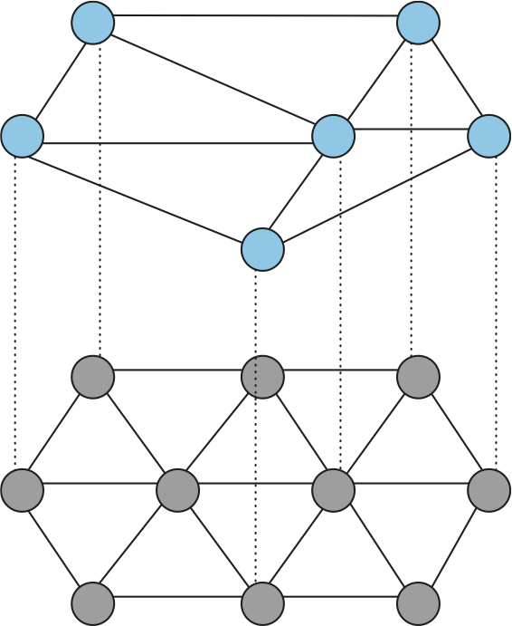

**Figure 9.20. Overlay network layered on top of a physical network.**

You can think of an overlay as a logical network implemented on top of some underlying network. By this definition, the Internet started out as an overlay network on top of the links provided by the old telephone network. Figure 9.20 depicts an overlay implemented on top of an underlying network. Each node in the overlay also exists in the underlying network; it processes and forwards packets in an application-specific way. The links that connect the overlay nodes are implemented as tunnels through the underlying network. Multiple overlay networks can exist on top of the same underlying network—each implementing its own application-specific behavior—and overlays can be nested, one on top of another. For example, all of the example overlay networks discussed in this section treat today’s Internet as the underlying network.

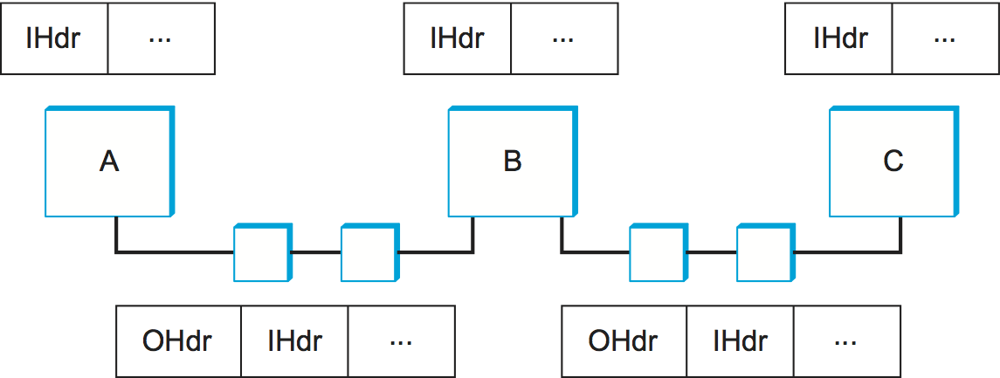

**Figure 9.21. Overlay nodes tunnel through physical nodes.**

We have already seen examples of tunneling, for example, to implement virtual private networks (VPNs). As a brief refresher, the nodes on either end of a tunnel treat the multi-hop path between them as a single logical link, the nodes that are tunneled through forward packets based on the outer header, never aware that the end nodes have attached an inner header. Figure 9.21 shows three overlay nodes (A, B, and C) connected by a pair of tunnels. In this example, overlay node B might make a forwarding decision for packets from A to C based on the inner header (IHdr), and then attach an outer header (OHdr) that identifies C as the destination in the underlying network. Nodes A, B, and C are able to interpret both the inner and outer header, whereas the intermediate routers understand only the outer header. Similarly, A, B, and C have addresses in both the overlay network and the underlying network, but they are not necessarily the same; for example, their underlying address might be a 32-bit IP address, while their overlay address might be an experimental 128-bit address. In fact, the overlay need not use conventional addresses at all but may route based on URLs, domain names, an XML query, or even the content of the packet.

#### 9.4.1 Routing Overlays

The simplest kind of overlay is one that exists purely to support an alternative routing strategy; no additional application-level processing is performed at the overlay nodes. You can view a virtual private network (VPN) as an example of a routing overlay, but one that doesn’t so much define an alternative strategy or algorithm as it does alternative routing table entries to be processed by the standard IP forwarding algorithm. In this particular case, the overlay is said to use “IP tunnels,” and the ability to utilize these VPNs is supported in many commercial routers.

Suppose, however, you wanted to use a routing algorithm that commercial router vendors were not willing to include in their products. How would you go about doing it? You could simply run your algorithm on a collection of end hosts, and tunnel through the Internet routers. These hosts would behave like routers in the overlay network: As hosts they are probably connected to the Internet by only one physical link, but as a node in the overlay they would be connected to multiple neighbors via tunnels.

Since overlays, almost by definition, are a way to introduce new technologies independent of the standardization process, there are no standard overlays we can point to as examples. Instead, we illustrate the general idea of routing overlays by describing several experimental systems that have been built by network researchers.

##### Experimental Versions of IP

Overlays are ideal for deploying experimental versions of IP that you hope will eventually take over the world. For example, IP multicast started off as an extension to IP and even today is not enabled in many Internet routers. The MBone (multicast backbone) was an overlay network that implemented IP multicast on top of the unicast routing provided by the Internet. A number of multimedia conference tools were developed for and deployed on the Mbone. For example, IETF meetings—which are a week long and attract thousands of participants—were for many years broadcast over the MBone. (Today, the wide availability of commercial conferencing tools have replaced the MBone-based approach.)

Like VPNs, the MBone used both IP tunnels and IP addresses, but unlike VPNs, the MBone implemented a different forwarding algorithm—forwarding packets to all downstream neighbors in the shortest path multicast tree. As an overlay, multicast-aware routers tunnel through legacy routers, with the hope that one day there will be no more legacy routers.

The 6-BONE was a similar overlay that was used to incrementally deploy IPv6. Like the MBone, the 6-BONE used tunnels to forward packets through IPv4 routers. Unlike the MBone, however, 6-BONE nodes did not simply provide a new interpretation of IPv4’s 32-bit addresses. Instead, they forwarded packets based on IPv6’s 128-bit address space. The 6-BONE also supported IPv6 multicast. (Today, commercial routers support IPv6, but again, overlays are a valuable approach while a new technology is being evaluated and tuned.)

##### End System Multicast

Although IP multicast is popular with researchers and certain segments of the networking community, its deployment in the global Internet has been limited at best. In response, multicast-based applications like videoconferencing have recently turned to an alternative strategy, called *end system multicast*. The idea of end system multicast is to accept that IP multicast will never become ubiquitous and to instead let the end hosts that are participating in a particular multicast-based application implement their own multicast trees.

Before describing how end system multicast works, it is important to first understand that, unlike VPNs and the MBone, end system multicast assumes that only Internet hosts (as opposed to Internet routers) participate in the overlay. Moreover, these hosts typically exchange messages with each other through UDP tunnels rather than IP tunnels, making it easy to implement as regular application programs. This makes it possible to view the underlying network as a fully connected graph, since every host in the Internet is able to send a message to every other host. Abstractly, then, end system multicast solves the following problem: Starting with a fully connected graph representing the Internet, the goal is to find the embedded multicast tree that spans all the group members.

Note that there is a simpler version of this problem, enabled by the ready availability of cloud-hosted VMs around the world. The multicast-aware “end systems” can be VMs running at multiple sites. As these sites are well-known and relatively fixed, it’s possible to construct a static multicast tree in the cloud, and have the actual end-hosts simply connect to the nearest cloud location. But for the sake of completeness, the following describes the approach in its full glory.

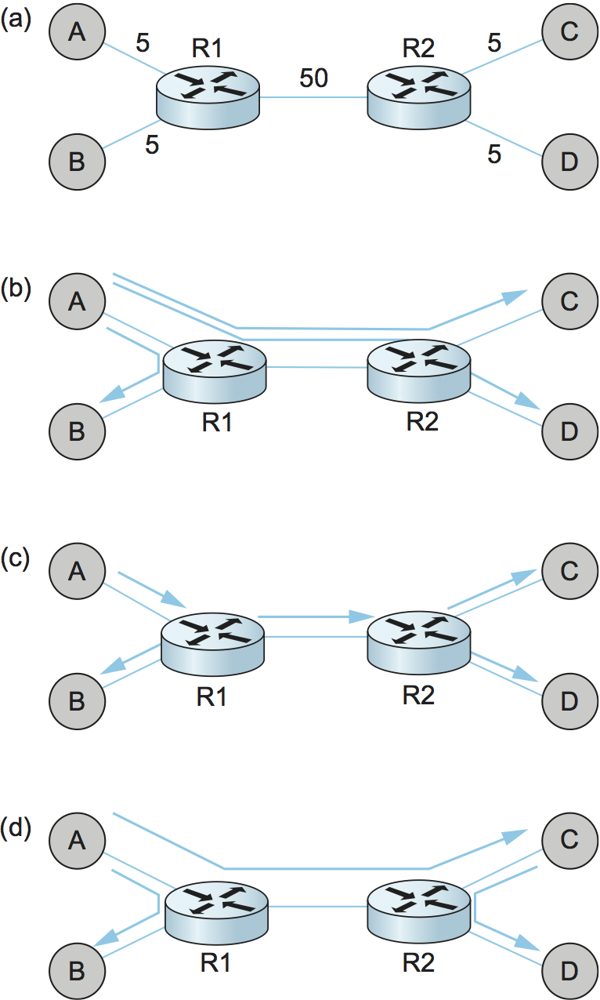

**Figure 9.22. Alternative multicast trees mapped onto a physical topology.**

Since we take the underlying Internet to be fully connected, a naive solution would be to have each source directly connected to each member of the group. In other words, end system multicast could be implemented by having each node send unicast messages to every group member. To see the problem in doing this, especially compared to implementing IP multicast in routers, consider the example topology in Figure 9.22. Figure 9.22 depicts an example physical topology, where R1 and R2 are routers connected by a low-bandwidth transcontinental link; A, B, C, and D are end hosts; and link delays are given as edge weights. Assuming A wants to send a multicast message to the other three hosts, Figure 9.22 shows how naive unicast transmission would work. This is clearly undesirable because the same message must traverse the link A-R1 three times, and two copies of the message traverse R1-R2. Figure 9.22 depicts the IP multicast tree constructed by the Distance Vector Multicast Routing Protocol (DVMRP). Clearly, this approach eliminates the redundant messages. Without support from the routers, however, the best one can hope for with end system multicast is a tree similar to the one shown in Figure 9.22. End system multicast defines an architecture for constructing this tree.

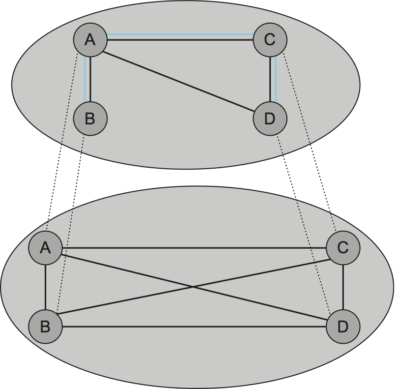

**Figure 9.23. Multicast tree embedded in an overlay network.**

The general approach is to support multiple levels of overlay networks, each of which extracts a subgraph from the overlay below it, until we have selected the subgraph that the application expects. For end system multicast, in particular, this happens in two stages: First we construct a simple *mesh* overlay on top of the fully connected Internet, and then we select a multicast tree within this mesh. The idea is illustrated in Figure 9.23, again assuming the four end hosts A, B, C, and D. The first step is the critical one: Once we have selected a suitable mesh overlay, we simply run a standard multicast routing algorithm (e.g., DVMRP) on top of it to build the multicast tree. We also have the luxury of ignoring the scalability issue that Internet-wide multicast faces since the intermediate mesh can be selected to include only those nodes that want to participate in a particular multicast group.

The key to constructing the intermediate mesh overlay is to select a topology that roughly corresponds to the physical topology of the underlying Internet, but we have to do this without anyone telling us what the underlying Internet actually looks like since we are running only on end hosts and not routers. The general strategy is for the end hosts to measure the roundtrip latency to other nodes and decide to add links to the mesh only when they like what they see. This works as follows.

First, assuming a mesh already exists, each node exchanges the list of all other nodes it believes is part of the mesh with its directly connected neighbors. When a node receives such a membership list from a neighbor, it incorporates that information into its membership list and forwards the resulting list to its neighbors. This information eventually propagates through the mesh, much as in a distance vector routing protocol.

When a host wants to join the multicast overlay, it must know the IP address of at least one other node already in the overlay. It then sends a “join mesh” message to this node. This connects the new node to the mesh by an edge to the known node. In general, the new node might send a join message to multiple current nodes, thereby joining the mesh by multiple links. Once a node is connected to the mesh by a set of links, it periodically sends “keepalive” messages to its neighbors, letting them know that it still wants to be part of the group.

When a node leaves the group, it sends a “leave mesh” message to its directly connected neighbors, and this information is propagated to the other nodes in the mesh via the membership list described above. Alternatively, a node can fail or just silently decide to quit the group, in which case its neighbors detect that it is no longer sending “keep alive” messages. Some node departures have little effect on the mesh, but should a node detect that the mesh has become partitioned due to a departing node, it creates a new edge to a node in the other partition by sending it a “join mesh” message. Note that multiple neighbors can simultaneously decide that a partition has occurred in the mesh, leading to multiple cross-partition edges being added to the mesh.

As described so far, we will end up with a mesh that is a subgraph of the original fully connected Internet, but it may have suboptimal performance because (1) initial neighbor selection adds random links to the topology, (2) partition repair might add edges that are essential at the moment but not useful in the long run, (3) group membership may change due to dynamic joins and departures, and (4) underlying network conditions may change. What needs to happen is that the system must evaluate the value of each edge, resulting in new edges being added to the mesh and existing edges being removed over time.

To add new edges, each node *i* periodically probes some random member *j* that it is not currently connected to in the mesh, measures the round-trip latency of edge *(i,j)*, and then evaluates the utility of adding this edge. If the utility is above a certain threshold, link *(i,j)* is added to the mesh. Evaluating the utility of adding edge *(i,j)* might look something like this:

```text
EvaluateUtility(j)
utility = 0
for each member m not equal to i
CL = current latency to node m along route through mesh
NL = new latency to node m along mesh if edge (i,j) is added}
if (NL < CL) then
utility += (CL - NL)/CL
return utility
```

Deciding to remove an edge is similar, except each node *i* computes the cost of each link to current neighbor *j* as follows:

```text
EvaluateCost(j)
Cost[i,j] = number of members for which i uses j as next hop
Cost[j,i] = number of members for which j uses i as next hop
return max(Cost[i,j], Cost[j,i])
```

It then picks the neighbor with the lowest cost, and drops it if the cost falls below a certain threshold.

Finally, since the mesh is maintained using what is essentially a distance vector protocol, it is trivial to run DVMRP to find an appropriate multicast tree in the mesh. Note that, although it is not possible to prove that the protocol just described results in the optimum mesh network, thereby allowing DVMRP to select the best possible multicast tree, both simulation and extensive practical experience suggests that it does a good job.

##### Resilient Overlay Networks

Another function that can be performed by an overlay is to find alternative routes for traditional unicast applications. Such overlays exploit the observation that the triangle inequality does not hold in the Internet. Figure 9.24 illustrates what we mean by this. It is not uncommon to find three sites in the Internet—call them A, B, and C—such that the latency between A and B is greater than the sum of the latencies from A to C and from C to B. That is, sometimes you would be better off indirectly sending your packets via some intermediate node than sending them directly to the destination.

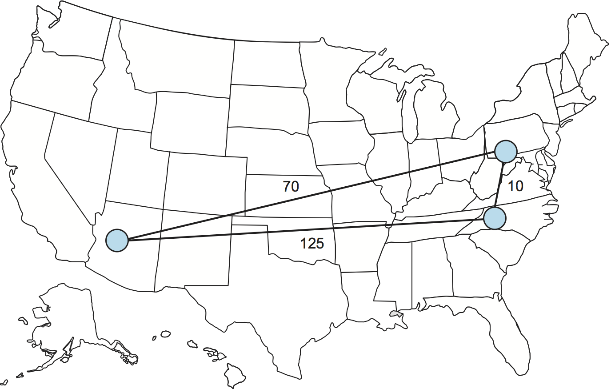

**Figure 9.24. The triangle inequality does not necessarily hold in networks.**

How can this be? Well, the Border Gateway Protocol (BGP) never promised that it would find the *shortest* route between any two sites; it only tries to find *some* route. To make matters more complex, BGP’s routes are heavily influenced by policy issues, such as who is paying whom to carry their traffic. This often happens, for example, at peering points between major backbone ISPs. In short, that the triangle inequality does not hold in the Internet should not come as a surprise.

How do we exploit this observation? The first step is to realize that there is a fundamental tradeoff between the scalability and optimality of a routing algorithm. On the one hand, BGP scales to very large networks, but often does not select the best possible route and is slow to adapt to network outages. On the other hand, if you were only worried about finding the best route among a handful of sites, you could do a much better job of monitoring the quality of every path you might use, thereby allowing you to select the best possible route at any moment in time.

An experimental overlay, called the Resilient Overlay Network (RON), did exactly this. RON scaled to only a few dozen nodes because it used an *N × N* strategy of closely monitoring (via active probes) three aspects of path quality—latency, available bandwidth, and loss probability—between every pair of sites. It was then able to both select the optimal route between any pair of nodes, and rapidly change routes should network conditions change. Experience showed that RON was able to deliver modest performance improvements to applications, but more importantly, it recovered from network failures much more quickly. For example, during one 64-hour period in 2001, an instance of RON running on 12 nodes detected 32 outages lasting over 30 minutes, and it was able to recover from all of them in less than 20 seconds on average. This experiment also suggested that forwarding data through just one intermediate node is usually sufficient to recover from Internet failures.

Since RON was not designed to be a scalable approach, it is not possible to use RON to help random host A communicate with random host B; A and B have to know ahead of time that they are likely to communicate and then join the same RON. However, RON seems like a good idea in certain settings, such as when connecting a few dozen corporate sites spread across the Internet or allowing you and 50 of your friends to establish your own private overlay for the sake of running some application. (Today, this idea is put to practice with the marketing name *Software-Defined WAN*, or *SD-WAN*.) The real question, though, is what happens when everyone starts to run their own RON. Does the overhead of millions of RONs aggressively probing paths swamp the network, and does anyone see improved behavior when many RONs compete for the same paths? These questions are still unanswered.

> **Key Takeaway**
>
> All of these overlays illustrate a concept that is central to computer networks in general: *virtualization*. That is, it is possible to build a virtual network from abstract (logical) resources on top of a physical network constructed from physical resources. Moreover, it is possible to stack these virtualized networks on top of each other and for multiple virtual networks to coexist at the same level. Each virtual network, in turn, provides new capabilities that are of value to some set of users, applications, or higher-level networks. [Next]

#### 9.4.2 Peer-to-Peer Networks

Music-sharing applications like Napster and KaZaA introduced the term “peer-to-peer” into the popular vernacular. But what exactly does it mean for a system to be “peer-to-peer”? Certainly in the context of sharing MP3 files it means not having to download music from a central site, but instead being able to access music files directly from whoever in the Internet happens to have a copy stored on their computer. More generally then, we could say that a peer-to-peer network allows a community of users to pool their resources (content, storage, network bandwidth, disk bandwidth, CPU), thereby providing access to a larger archival store, larger video/audio conferences, more complex searches and computations, and so on than any one user could afford individually.

Quite often, attributes like *decentralized* and *self-organizing* are mentioned when discussing peer-to-peer networks, meaning that individual nodes organize themselves into a network without any centralized coordination. If you think about it, terms like these could be used to describe the Internet itself. Ironically, however, Napster was not a true peer-to-peer system by this definition since it depended on a central registry of known files, and users had to search this directory to find what machine offered a particular file. It was only the last step—actually downloading the file—that took place between machines that belong to two users, but this is little more than a traditional client/server transaction. The only difference is that the server is owned by someone just like you rather than a large corporation.

So we are back to the original question: What’s interesting about peer-to-peer networks? One answer is that both the process of locating an object of interest and the process of downloading that object onto your local machine happen without your having to contact a centralized authority, and at the same time the system is able to scale to millions of nodes. A peer-to-peer system that can accomplish these two tasks in a decentralized manner turns out to be an overlay network, where the nodes are those hosts that are willing to share objects of interest (e.g., music and other assorted files), and the links (tunnels) connecting these nodes represent the sequence of machines that you have to visit to track down the object you want. This description will become clearer after we look at two examples.

##### Gnutella

Gnutella is an early peer-to-peer network that attempted to distinguish between exchanging music (which likely violates somebody’s copyright) and the general sharing of files (which must be good since we’ve been taught to share since the age of two). What’s interesting about Gnutella is that it was one of the first such systems to not depend on a centralized registry of objects. Instead, Gnutella participants arrange themselves into an overlay network similar to the one shown in Figure 9.25. That is, each node that runs the Gnutella software (i.e., implements the Gnutella protocol) knows about some set of other machines that also run the Gnutella software. The relationship “A and B know each other” corresponds to the edges in this graph. (We’ll talk about how this graph is formed in a moment.)

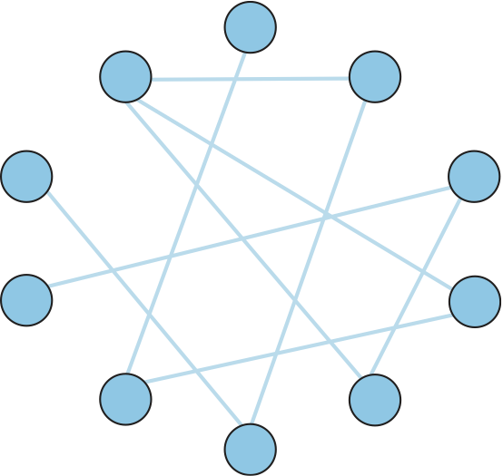

**Figure 9.25. Example topology of a gnutella peer-to-peer network.**

Whenever the user on a given node wants to find an object, Gnutella sends a QUERY message for the object—for example, specifying the file’s name—to its neighbors in the graph. If one of the neighbors has the object, it responds to the node that sent it the query with a QUERY RESPONSE message, specifying where the object can be downloaded (e.g., an IP address and TCP port number). That node can subsequently use GET or PUT messages to access the object. If the node cannot resolve the query, it forwards the QUERY message to each of its neighbors (except the one that sent it the query), and the process repeats. In other words, Gnutella floods the overlay to locate the desired object. Gnutella sets a TTL on each query so this flood does not continue indefinitely.

In addition to the TTL and query string, each QUERY message contains a unique query identifier (QID), but it does not contain the identity of the original message source. Instead, each node maintains a record of the QUERY messages it has seen recently: both the QID and the neighbor that sent it the QUERY. It uses this history in two ways. First, if it ever receives a QUERY with a QID that matches one it has seen recently, the node does not forward the QUERY message. This serves to cut off forwarding loops more quickly than the TTL might have done. Second, whenever the node receives a QUERY RESPONSE from a downstream neighbor, it knows to forward the response to the upstream neighbor that originally sent it the QUERY message. In this way, the response works its way back to the original node without any of the intermediate nodes knowing who wanted to locate this particular object in the first place.

Returning to the question of how the graph evolves, a node certainly has to know about at least one other node when it joins a Gnutella overlay. The new node is attached to the overlay by at least this one link. After that, a given node learns about other nodes as the result of QUERY RESPONSE messages, both for objects it requested and for responses that just happen to pass through it. A node is free to decide which of the nodes it discovers in this way that it wants to keep as a neighbor. The Gnutella protocol provides PING and PONG messages by which a node probes whether or not a given neighbor still exists and that neighbor’s response, respectively.

It should be clear that Gnutella as described here is not a particularly clever protocol, and subsequent systems have tried to improve upon it. One dimension along which improvements are possible is in how queries are propagated. Flooding has the nice property that it is guaranteed to find the desired object in the fewest possible hops, but it does not scale well. It is possible to forward queries randomly, or according to the probability of success based on past results. A second dimension is to proactively replicate the objects, since the more copies of a given object there are, the easier it should be to find a copy. Alternatively, one could develop a completely different strategy, which is the topic we consider next.

##### Structured Overlays

At the same time file sharing systems started fighting to fill the void left by Napster, the research community began to explore an alternative design for peer-to-peer networks. We refer to these networks as *structured*, to contrast them with the essentially random (unstructured) way in which a Gnutella network evolves. Unstructured overlays like Gnutella employ trivial overlay construction and maintenance algorithms, but the best they can offer is unreliable, random search. In contrast, structured overlays are designed to conform to a particular graph structure that allows reliable and efficient (probabilistically bounded delay) object location, in return for additional complexity during overlay construction and maintenance.

If you think about what we are trying to do at a high level, there are two questions to consider: (1) How do we map objects onto nodes, and (2) How do we route a request to the node that is responsible for a given object? We start with the first question, which has a simple statement: How do we map an object with name *x* into the address of some node *n* that is able to serve that object? While traditional peer-to-peer networks have no control over which node hosts object *x*, if we could control how objects get distributed over the network, we might be able to do a better job of finding those objects at a later time.

A well-known technique for mapping names into an address is to use a hash table, so that

*hash(x) → n*

implies object *x* is first placed on node *n*, and at a later time a client trying to locate *x* would only have to perform the hash of *x* to determine that it is on node *n*. A hash-based approach has the nice property that it tends to spread the objects evenly across the set of nodes, but straightforward hashing algorithms suffer from a fatal flaw: How many possible values of *n* should we allow? (In hashing terminology, how many buckets should there be?) Naively, we could decide that there are, say, 101 possible hash values, and we use a modulo hash function; that is,

```text
hash(x)
return x % 101
```

Unfortunately, if there are more than 101 nodes willing to host objects, then we can’t take advantage of all of them. On the other hand, if we select a number larger than the largest possible number of nodes, then there will be some values of *x* that will hash into an address for a node that does not exist. There is also the not-so-small issue of translating the value returned by the hash function into an actual IP address.

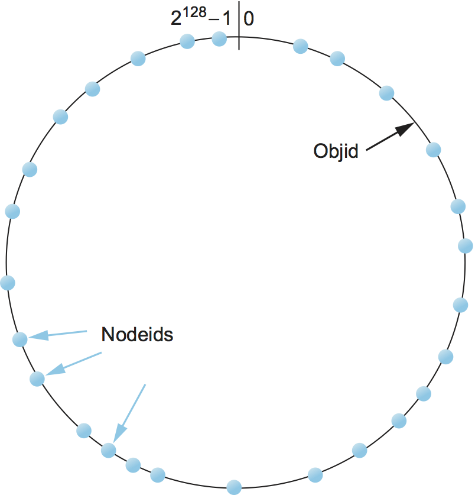

**Figure 9.26. Both nodes and objects map (hash) onto the ID space, where objects are maintained at the nearest node in this space.**

To address these issues, structured peer-to-peer networks use an algorithm known as *consistent hashing*, which hashes a set of objects *x* uniformly across a large ID space. Figure 9.26 visualizes a 128-bit ID space as a circle, where we use the algorithm to place both objects

*hash(ObjectName) → ObjectID*

and nodes

*hash(IPAddr) → NodeID*

onto this circle. Since a 128-bit ID space is enormous, it is unlikely that an object will hash to exactly the same ID as a machine’s IP address hashes to. To account for this unlikelihood, each object is maintained on the node whose ID is *closest*, in this 128-bit space, to the object ID. In other words, the idea is to use a high-quality hash function to map both nodes and objects into the same large, sparse ID space; you then map objects to nodes by numerical proximity of their respective identifiers. Like ordinary hashing, this distributes objects fairly evenly across nodes, but, unlike ordinary hashing, only a small number of objects have to move when a node (hash bucket) joins or leaves.

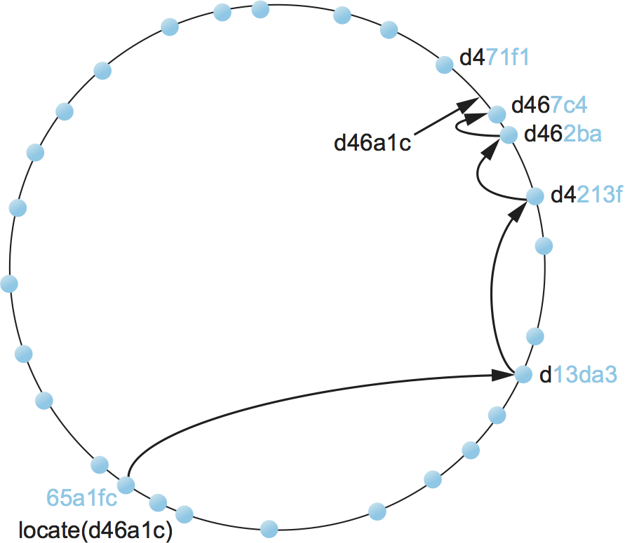

**Figure 9.27. Objects are located by routing through the peer-to-peer overlay network.**

We now turn to the second question—how does a user that wants to access object *x* know which node is closest in *x* ’s ID in this space? One possible answer is that each node keeps a complete table of node IDs and their associated IP addresses, but this would not be practical for a large network. The alternative, which is the approach used by structured peer-to-peer networks, is to *route a message to this node!* In other words, if we construct the overlay in a clever way—which is the same as saying that we need to choose entries for a node’s routing table in a clever way—then we find a node simply by routing toward it. Collectively, this approach is sometimes called a *distributed hash table* (DHT), since conceptually, the hash table is distributed over all the nodes in the network.

Figure 9.27 illustrates what happens for a simple 28-bit ID space. To keep the discussion as concrete as possible, we consider the approach used by a particular peer-to-peer network called *Pastry*. Other systems work in a similar manner.

Suppose you are at the node with id 65a1fc (hex) and you are trying to locate the object with ID d46a1c. You realize that your ID shares nothing with the object’s, but you know of a node that shares at least the prefix d. That node is closer than you in the 128-bit ID space, so you forward the message to it. (We do not give the format of the message being forwarded, but you can think of it as saying “locate object d46a1c”.) Assuming node d13da3 knows of another node that shares an even longer prefix with the object, it forwards the message on. This process of moving closer in ID-space continues until you reach a node that knows of no closer node. This node is, by definition, the one that hosts the object. Keep in mind that as we logically move through “ID space” the message is actually being forwarded, node to node, through the underlying Internet.

Each node maintains a both routing table (more below) and the IP addresses of a small set of numerically larger and smaller node IDs. This is called the node’s *leaf set*. The relevance of the leaf set is that, once a message is routed to any node in the same leaf set as the node that hosts the object, that node can directly forward the message to the ultimate destination. Said another way, the leaf set facilitates correct and efficient delivery of a message to the numerically closest node, even though multiple nodes may exist that share a maximal length prefix with the object ID. Moreover, the leaf set makes routing more robust because any of the nodes in a leaf set can route a message just as well as any other node in the same set. Thus, if one node is unable to make progress routing a message, one of its neighbors in the leaf set may be able to. In summary, the routing procedure is defined as follows:

```text
Route(D)
if D is within range of my leaf set
forward to numerically closest member in leaf set
else
let l = length of shared prefix
let d = value of l-th digit in D's address
if RouteTab[l,d] exists
forward to RouteTab[l,d]
else
forward to known node with at least as long a shared prefix
and numerically closer than this node
```

The routing table, denoted RouteTab, is a two-dimensional array. It has a row for every hex digit in an ID (there such 32 digits in a 128-bit ID) and a column for every hex value (there are obviously 16 such values). Every entry in row *i* shares a prefix of length *i* with this node, and within this row the entry in column *j* has the hex value *j* in the *i+1*-th position. Figure 9.28 shows the first three rows of an example routing table for node 65a1fcx, where *x* denotes an unspecified suffix. This figure shows the ID prefix matched by every entry in the table. It does not show the actual value contained in this entry—the IP address of the next node to route to.

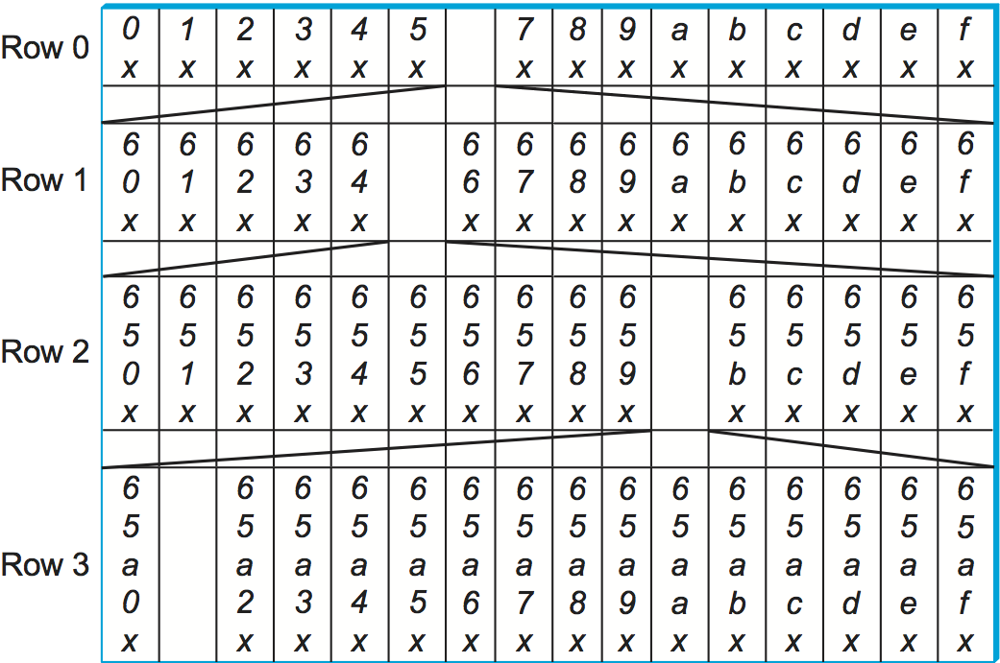

**Figure 9.28. Example routing table at the node with ID 65alcx**

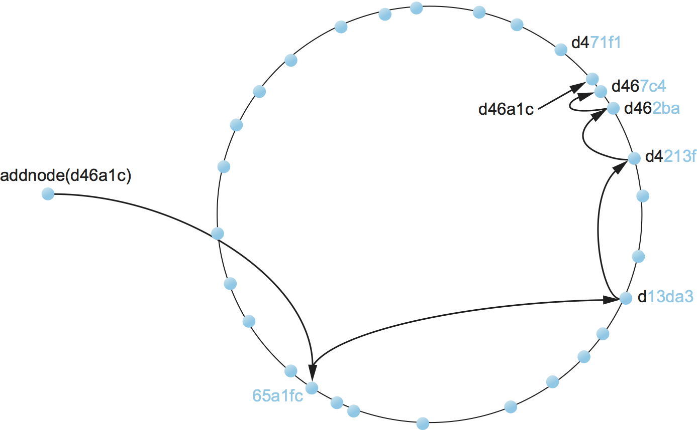

**Figure 9.29. Adding a node to the network.**

Adding a node to the overlay works much like routing a “locate object message” to an object. The new node must know of at least one current member. It asks this member to route an “add node message” to the node numerically closest to the ID of the joining node, as shown in Figure 9.29. It is through this routing process that the new node learns about other nodes with a shared prefix and is able to begin filling out its routing table. Over time, as additional nodes join the overlay, existing nodes also have the option of including information about the newly joined node in their routing tables. They do this when the new node adds a longer prefix than they currently have in their table. Neighbors in the leaf sets also exchange routing tables with each other, which means that over time routing information propagates through the overlay.

The reader may have noticed that although structured overlays provide a probabilistic bound on the number of routing hops required to locate a given object—the number of hops in Pastry is bounded by log₁₆N, where N is the number of nodes in the overlay—each hop may contribute substantial delay. This is because each intermediate node may be at a random location in the Internet. (In the worst case, each node is on a different continent!) In fact, in a world-wide overlay network using the algorithm as described above, the expected delay of each hop is the average delay among all pairs of nodes in the Internet! Fortunately, one can do much better in practice. The idea is to choose each routing table entry such that it refers to a nearby node in the underlying physical network, among all nodes with an ID prefix that is appropriate for the entry. It turns out that doing so achieves end-to-end routing delays that are within a small factor of the delay between source and destination node.

Finally, the discussion up to this point has focused on the general problem of locating objects in a peer-to-peer network. Given such a routing infrastructure, it is possible to build different services. For example, a file sharing service would use file names as object names. To locate a file, you first hash its name into a corresponding object ID and then route a “locate object message” to this ID. The system might also replicate each file across multiple nodes to improve availability. Storing multiple copies on the leaf set of the node to which a given file normally routes would be one way of doing this. Keep in mind that even though these nodes are neighbors in the ID space, they are likely to be physically distributed across the Internet. Thus, while a power outage in an entire city might take down physically close replicas of a file in a traditional file system, one or more replicas would likely survive such a failure in a peer-to-peer network.

Services other than file sharing can also be built on top of distributed hash tables. Consider multicast applications, for example. Instead of constructing a multicast tree from a mesh, one could construct the tree from edges in the structured overlay, thereby amortizing the cost of overlay construction and maintenance across several applications and multicast groups.

##### BitTorrent

BitTorrent is a peer-to-peer file sharing protocol devised by Bram Cohen. It is based on replicating the file or, rather, replicating segments of the file, which are called *pieces*. Any particular piece can usually be downloaded from multiple peers, even if only one peer has the entire file. The primary benefit of BitTorrent’s replication is avoiding the bottleneck of having only one source for a file. This is particularly useful when you consider that any given computer has a limited speed at which it can serve files over its uplink to the Internet, often quite a low limit due to the asymmetric nature of most broadband networks. The beauty of BitTorrent is that replication is a natural side effect of the downloading process: As soon as a peer downloads a particular piece, it becomes another source for that piece. The more peers downloading pieces of the file, the more piece replication occurs, distributing the load proportionately, and the more total bandwidth is available to share the file with others. Pieces are downloaded in random order to avoid a situation where peers find themselves lacking the same set of pieces.

Each file is shared via its own independent BitTorrent network, called a *swarm*. (A swarm could potentially share a set of files, but we describe the single file case for simplicity.) The lifecycle of a typical swarm is as follows. The swarm starts as a singleton peer with a complete copy of the file. A node that wants to download the file joins the swarm, becoming its second member, and begins downloading pieces of the file from the original peer. In doing so, it becomes another source for the pieces it has downloaded, even if it has not yet downloaded the entire file. (In fact, it is common for peers to leave the swarm once they have completed their downloads, although they are encouraged to stay longer.) Other nodes join the swarm and begin downloading pieces from multiple peers, not just the original peer. See Figure 9.30.

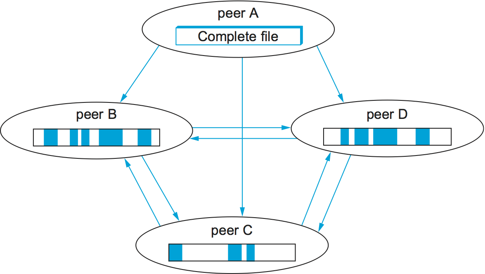

**Figure 9.30. Peers in a BitTorrent swarm download from other peers that may not yet have the complete file.**

If the file remains in high demand, with a stream of new peers replacing those who leave the swarm, the swarm could remain active indefinitely; if not, it could shrink back to include only the original peer until new peers join the swarm.

Now that we have an overview of BitTorrent, we can ask how requests are routed to the peers that have a given piece. To make requests, a would-be downloader must first join the swarm. It starts by downloading a file containing meta-information about the file and swarm. The file, which may be easily replicated, is typically downloaded from a web server and discovered by following links from Web pages. It contains:

- The target file’s size
- The piece size
- SHA-1 hash values precomputed from each piece
- The URL of the swarm’s *tracker*

A tracker is a server that tracks a swarm’s current membership. We’ll see later that BitTorrent can be extended to eliminate this point of centralization, with its attendant potential for bottleneck or failure.

The would-be downloader then joins the swarm, becoming a peer, by sending a message to the tracker giving its network address and a peer ID that it has generated randomly for itself. The message also carries a SHA-1 hash of the main part of the file, which is used as a swarm ID.

Let’s call the new peer P. The tracker replies to P with a partial list of peers giving their IDs and network addresses, and P establishes connections, over TCP, with some of these peers. Note that P is directly connected to just a subset of the swarm, although it may decide to contact additional peers or even request more peers from the tracker. To establish a BitTorrent connection with a particular peer after their TCP connection has been established, P sends P’s own peer ID and swarm ID, and the peer replies with its peer ID and swarm ID. If the swarm IDs don’t match, or the reply peer ID is not what P expects, the connection is aborted.

The resulting BitTorrent connection is symmetric: Each end can download from the other. Each end begins by sending the other a bitmap reporting which pieces it has, so each peer knows the other’s initial state. Whenever a downloader (D) finishes downloading another piece, it sends a message identifying that piece to each of its directly connected peers, so those peers can update their internal representation of D’s state. This, finally, is the answer to the question of how a download request for a piece is routed to a peer that has the piece, because it means that each peer knows which directly connected peers have the piece. If D needs a piece that none of its connections has, it could connect to more or different peers (it can get more from the tracker) or occupy itself with other pieces in hopes that some of its connections will obtain the piece from their connections.

How are objects—in this case, pieces—mapped onto peer nodes? Of course each peer eventually obtains all the pieces, so the question is really about which pieces a peer has at a given time before it has all the pieces or, equivalently, about the order in which a peer downloads pieces. The answer is that they download pieces in random order, to keep them from having a strict subset or superset of the pieces of any of their peers.

The BitTorrent described so far utilizes a central tracker that constitutes a single point of failure for the swarm and could potentially be a performance bottleneck. Also, providing a tracker can be a nuisance for someone who would like to make a file available via BitTorrent. Newer versions of BitTorrent additionally support “trackerless” swarms that use a DHT-based implementation. BitTorrent client software that is trackerless capable implements not just a BitTorrent peer but also what we’ll call a *peer finder* (the BitTorrent terminology is simply *node*), which the peer uses to find peers.

Peer finders form their own overlay network, using their own protocol over UDP to implement a DHT. Furthermore, a peer finder network includes peer finders whose associated peers belong to different swarms. In other words, while each swarm forms a distinct network of BitTorrent peers, a peer finder network instead spans swarms.

Peer finders randomly generate their own finder IDs, which are the same size (160 bits) as swarm IDs. Each finder maintains a modest table containing primarily finders (and their associated peers) whose IDs are close to its own, plus some finders whose IDs are more distant. The following algorithm ensures that finders whose IDs are close to a given swarm ID are likely to know of peers from that swarm; the algorithm simultaneously provides a way to look them up. When a finder F needs to find peers from a particular swarm, it sends a request to the finders in its table whose IDs are close to that swarm’s ID. If a contacted finder knows of any peers for that swarm, it replies with their contact information. Otherwise, it replies with the contact information of the finders in its table that are close to the swarm, so that F can iteratively query those finders.

After the search is exhausted, because there are no finders closer to the swarm, F inserts the contact information for itself and its associated peer into the finders closest to the swarm. The net effect is that peers for a particular swarm get entered in the tables of the finders that are close to that swarm.

The above scheme assumes that F is already part of the finder network, that it already knows how to contact some other finders. This assumption is true for finder installations that have run previously, because they are supposed to save information about other finders, even across executions. If a swarm uses a tracker, its peers are able to tell their finders about other finders (in a reversal of the peer and finder roles) because the BitTorrent peer protocol has been extended to exchange finder contact information. But, how can a newly installed finder discover other finders? The files for trackerless swarms include contact information for one or a few finders, instead of a tracker URL, for just that situation.

An unusual aspect of BitTorrent is that it deals head-on with the issue of fairness, or good “network citizenship.” Protocols often depend on the good behavior of individual peers without being able to enforce it. For example, an unscrupulous Ethernet peer could get better performance by using a backoff algorithm that is more aggressive than exponential backoff, or an unscrupulous TCP peer could get better performance by not cooperating in congestion control.

The good behavior that BitTorrent depends on is peers uploading pieces to other peers. Since the typical BitTorrent user just wants to download the file as quickly as possible, there is a temptation to implement a peer that tries to download all the pieces while doing as little uploading as possible—this is a bad peer. To discourage bad behavior, the BitTorrent protocol includes mechanisms that allow peers to reward or punish each other. If a peer is misbehaving by not nicely uploading to another peer, the second peer can *choke* the bad peer: It can decide to stop uploading to the bad peer, at least temporarily, and send it a message saying so. There is also a message type for telling a peer that it has been unchoked. The choking mechanism is also used by a peer to limit the number of its active BitTorrent connections, to maintain good TCP performance. There are many possible choking algorithms, and devising a good one is an art.

#### 9.4.3 Content Distribution Networks

We have already seen how HTTP running over TCP allows web browsers to retrieve pages from web servers. However, anyone who has waited an eternity for a Web page to return knows that the system is far from perfect. Considering that the backbone of the Internet is now constructed from 40-Gbps links, it’s not obvious why this should happen. It is generally agreed that when it comes to downloading Web pages there are four potential bottlenecks in the system:

- *The first mile.* The Internet may have high-capacity links in it, but that doesn’t help you download a Web page any faster when you’re connected by a 1.5Mbps DSL line or a poorly performing wireless link.
- *The last mile.* The link that connects the server to the Internet can be overloaded by too many requests, even if the aggregate bandwidth of that link is quite high.
- *The server itself.* A server has a finite amount of resources (CPU, memory, disk bandwidth, etc.) and can be overloaded by too many concurrent requests.
- *Peering points.* The handful of ISPs that collectively implement the backbone of the Internet may internally have high-bandwidth pipes, but they have little motivation to provide high-capacity connectivity to their peers. If you are connected to ISP A and the server is connected to ISP B, then the page you request may get dropped at the point where A and B peer with each other.

There’s not a lot anyone except you can do about the first problem, but it is possible to use replication to address the remaining problems. Systems that do this are often called *Content Distribution Networks* (CDNs). Akamai operates what is probably the best-known CDN.

The idea of a CDN is to geographically distribute a collection of *server surrogates* that cache pages normally maintained in some set of *backend servers*. Thus, rather than having millions of users wait forever to contact when a big news story breaks—such a situation is known as a *flash crowd*—it is possible to spread this load across many servers. Moreover, rather than having to traverse multiple ISPs to reach www.cnn.com, if these surrogate servers happen to be spread across all the backbone ISPs, then it should be possible to reach one without having to cross a peering point. Clearly, maintaining thousands of surrogate servers all over the Internet is too expensive for any one site that wants to provide better access to its Web pages. Commercial CDNs provide this service for many sites, thereby amortizing the cost across many customers.

Although we call them surrogate servers, in fact, they can just as correctly be viewed as caches. If they don’t have a page that has been requested by a client, they ask the backend server for it. In practice, however, the backend servers proactively replicate their data across the surrogates rather than wait for surrogates to request it on demand. It’s also the case that only static pages, as opposed to dynamic content, are distributed across the surrogates. Clients have to go to the backend server for any content that either changes frequently (e.g., sports scores and stock quotes) or is produced as the result of some computation (e.g., a database query).

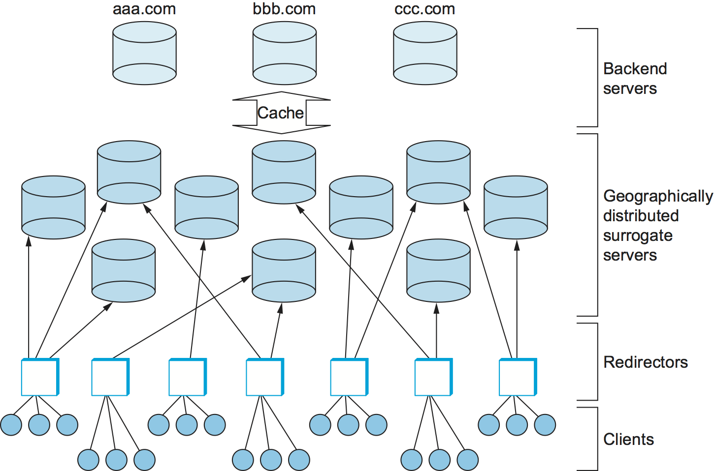

**Figure 9.31. Components in a Content Distribution Network (CDN).**

Having a large set of geographically distributed servers does not fully solve the problem. To complete the picture, CDNs also need to provide a set of *redirectors* that forward client requests to the most appropriate server, as shown in Figure 9.31. The primary objective of the redirectors is to select the server for each request that results in the best *response time* for the client. A secondary objective is for the system as a whole to process as many requests per second as the underlying hardware (network links and web servers) is able to support. The average number of requests that can be satisfied in a given time period—known as the *system throughput*—is primarily an issue when the system is under heavy load, such as when a flash crowd is accessing a small set of pages or a Distributed Denial of Service (DDoS) attacker is targeting a particular site, as happened to CNN, Yahoo, and several other high-profile sites in February 2000.

CDNs use several factors to decide how to distribute client requests. For example, to minimize response time, a redirector might select a server based on its *network proximity*. In contrast, to improve the overall system throughput, it is desirable to evenly *balance* the load across a set of servers. Both throughput and response time are improved if the distribution mechanism takes *locality* into consideration; that is, it selects a server that is likely to already have the page being requested in its cache. The exact combination of factors that should be employed by a CDN is open to debate. This section considers some of the possibilities.

##### Mechanisms

As described so far, a redirector is just an abstract function, although it sounds like what something a router might be asked to do since it logically forwards a request message much like a router forwards packets. In fact, there are several mechanisms that can be used to implement redirection. Note that for the purpose of this discussion we assume that each redirector knows the address of every available server. (From here on, we drop the “surrogate” qualifier and talk simply in terms of a set of servers.) In practice, some form of out-of-band communication takes place to keep this information up-to-date as servers come and go.

First, redirection could be implemented by augmenting DNS to return different server addresses to clients. For example, when a client asks to resolve the name www.cnn.com, the DNS server could return the IP address of a server hosting CNN’s Web pages that is known to have the lightest load. Alternatively, for a given set of servers, it might just return addresses in a round-robin fashion. Note that the granularity of DNS-based redirection is usually at the level of a site (e.g., cnn.com) rather than a specific URL (e.g., https://www.cnn.com/2020/11/12/politics/biden-wins-arizona/index.html). However, when returning an embedded link, the server can rewrite the URL, thereby effectively pointing the client at the most appropriate server for that specific object.

Commercial CDNs essentially use a combination of URL rewriting and DNS-based redirection. For scalability reasons, the high-level DNS server first points to a regional-level DNS server, which replies with the actual server address. In order to respond to changes quickly, the DNS servers tweak the TTL of the resource records they return to a very short period, such as 20 seconds. This is necessary so clients don’t cache results and thus fail to go back to the DNS server for the most recent URL-to-server mapping.

Another possibility is to use the HTTP redirect feature: The client sends a request message to a server, which responds with a new (better) server that the client should contact for the page. Unfortunately, server-based redirection incurs an additional round-trip time across the Internet, and, even worse, servers can be vulnerable to being overloaded by the redirection task itself. Instead, if there is a node close to the client (e.g., a local Web proxy) that is aware of the available servers, then it can intercept the request message and instruct the client to instead request the page from an appropriate server. In this case, either the redirector would need to be on a choke point so that all requests leaving the site pass through it, or the client would have to cooperate by explicitly addressing the proxy (as with a classical, rather than transparent, proxy).

At this point you may be wondering what CDNs have to do with overlay networks, and while viewing a CDN as an overlay is a bit of a stretch, they do share one very important trait in common. Like an overlay node, a proxy-based redirector makes an application-level routing decision. Rather than forward a packet based on an address and its knowledge of the network topology, it forwards HTTP requests based on a URL and its knowledge of the location and load of a set of servers. Today’s Internet architecture does not support redirection directly—where by “directly” we mean the client sends the HTTP request to the redirector, which forwards to the destination—so instead redirection is typically implemented indirectly by having the redirector return the appropriate destination address and the client contacts the server itself.

##### Policies

We now consider some example policies that redirectors might use to forward requests. Actually, we have already suggested one simple policy—round-robin. A similar scheme would be to simply select one of the available servers at random. Both of these approaches do a good job of spreading the load evenly across the CDN, but they do not do a particularly good job of lowering the client-perceived response time.

It’s obvious that neither of these two schemes takes network proximity into consideration, but, just as importantly, they also ignore locality. That is, requests for the same URL are forwarded to different servers, making it less likely that the page will be served from the selected server’s in-memory cache. This forces the server to retrieve the page from its disk, or possibly even from the backend server. How can a distributed set of redirectors cause requests for the same page to go to the same server (or small set of servers) without global coordination? The answer is surprisingly simple: All redirectors use some form of hashing to deterministically map URLs into a small range of values. The primary benefit of this approach is that no inter-redirector communication is required to achieve coordinated operation; no matter which redirector receives a URL, the hashing process produces the same output.

So what makes for a good hashing scheme? The classic *modulo* hashing scheme—which hashes each URL modulo the number of servers—is not suitable for this environment. This is because should the number of servers change, the modulo calculation will result in a diminishing fraction of the pages keeping their same server assignments. While we do not expect frequent changes in the set of servers, the fact that the addition of new servers into the set will cause massive reassignment is undesirable.

An alternative is to use the same *consistent hashing* algorithm discussed in the previous section. Specifically, each redirector first hashes every server into the unit circle. Then, for each URL that arrives, the redirector also hashes the URL to a value on the unit circle, and the URL is assigned to the server that lies closest on the circle to its hash value. If a node fails in this scheme, its load shifts to its neighbors (on the unit circle), so the addition or removal of a server only causes local changes in request assignments. Note that unlike the peer-to-peer case, where a message is routed from one node to another in order to find the server whose ID is closest to the objects, each redirector knows how the set of servers map onto the unit circle, so they can each, independently, select the “nearest” one.

This strategy can easily be extended to take server load into account. Assume the redirector knows the current load of each of the available servers. This information may not be perfectly up-to-date, but we can imagine the redirector simply counting how many times it has forwarded a request to each server in the last few seconds and using this count as an estimate of that server’s current load. Upon receiving a URL, the redirector hashes the URL plus each of the available servers and sorts the resulting values. This sorted list effectively defines the order in which the redirector will consider the available servers. The redirector then walks down this list until it finds a server whose load is below some threshold. The benefit of this approach compared to plain consistent hashing is that server order is different for each URL, so if one server fails, its load is distributed evenly among the other machines. This approach is the basis for the Cache Array Routing Protocol (CARP) and is shown in pseudocode below.

```text
SelectServer(URL, S)
for each server s in server set S
score[s] = hash(URL, address[s])
sort score
for each server s in decreasing order of score
if Load(s) < threshold then
return s
return server with highest score
```

As the load increases, this scheme changes from using only the first server on the sorted list to spreading requests across several servers. Some pages normally handled by busy servers will also start being handled by less busy servers. Since this process is based on aggregate server load rather than the popularity of individual pages, servers hosting some popular pages may find more servers sharing their load than servers hosting collectively unpopular pages. In the process, some unpopular pages will be replicated in the system simply because they happen to be primarily hosted on busy servers. At the same time, if some pages become extremely popular, it is conceivable that all of the servers in the system could be responsible for serving them.

Finally, it is possible to introduce network proximity into the equation in at least two different ways. The first is to blur the distinction between server load and network proximity by monitoring how long a server takes to respond to requests and using this measurement as the “server load” parameter in the preceding algorithm. This strategy tends to prefer nearby/lightly loaded servers over distant/heavily loaded servers. A second approach is to factor proximity into the decision at an earlier stage by limiting the candidate set of servers considered by the above algorithms (*S*) to only those that are nearby. The harder problem is deciding which of the potentially many servers are suitably close. One approach would be to select only those servers that are available on the same ISP as the client. A slightly more sophisticated approach would be to look at the map of autonomous systems produced by BGP and select only those servers within some number of hops from the client as candidate servers. Finding the right balance between network proximity and server cache locality is a subject of ongoing research.

### Perspective: The Cloud is the New Internet

As we saw at the end of Section 9.1, there has been a migration of traditional Internet applications like email and web servers from machines running on-premises to VMs running in commodity clouds. This corresponds to a shift in terminology (from “Web Services” to “Cloud Services”) and in many of the underlying technologies being used (from Virtual Machines to Cloud Native micro-services). But the Cloud’s impact on how network applications are implemented today is even bigger than this migration suggests. It is the combination of commodity clouds and overlay networks (similar to those described in Section 9.4) that may eventually have the most impact.

The biggest thing an overlay-based application needs to be effective is a wide footprint, that is, many points-of-presence around the world. IP routers are widely deployed, so if you have permission to use a set of them as the underlying nodes in your overlay network, then you’re good-to-go. But that’s not going to happen, as there are exactly zero network operators or enterprise administrators that are willing to let random people load overlay software onto their routers.

Your next choice might be to crowdsource hosting sites for your overlay software. Depending on the kindness of strangers works if you all share a common goal, like downloading free music, but it’s difficult for a new overlay application to go viral, and even if it does, making sure there is sufficient capacity at any given time to carry all the traffic your application generates is often problematic. It sometimes works for free services, but not any application you might hope to monetize.

If only there were a way to pay someone for the right to load and run your software on servers spread all over the world. Of course, that’s exactly what commodity clouds like Amazon AWS, Microsoft Azure, and the Google Cloud Platform provide. To many, the cloud offers a seemingly unlimited number of servers, but it’s actually just as important—if not more important—where these servers are located. As we discussed at the end of Chapter 4, they are widely distributed across 150+ well-connected sites.

Suppose, for example, that you want to stream a collection of live video or audio channels to millions of users, or you want to support thousands of video conferencing sessions, each of which connects a dozen widely distributed participants. In both cases, you construct an overlay multicast tree (one per video channel in the first example, and one per conference session in the second example), with the overlay nodes in the tree located at some combination of those 150 cloud sites. Then you allow the end-users, from their general-purpose web browsers or purpose-built smartphone apps, connect to the multicast tree(s) of their choice. If you need to store some of the video/audio content to play at a later time (e.g., to support time shifting) then you might also buy some storage capacity at some or all of those cloud sites, effectively building your own Content Distribution Network.

Taking the long view, while the Internet was originally conceived as a pure communication service, with arbitrary compute-and-storage applications allowed to flourish around the edges, today application software is for all practical purposes embedded within (distributed across) the network, and it is increasingly difficult to tell where the Internet stops and the Cloud starts. This blending will only continue to deepen as the cloud moves closer and closer to the edge (e.g., to thousands of sites where access networks are anchored) and the economies-of-scale drive the hardware devices used to build Internet/Cloud sites increasingly towards commonality.

> **Broader Perspective**
>
> To remind yourself of why the cloudification of the Internet is important, see Perspective: Feature Velocity.

[^1]: This is starting to change for the Web with HTTP/3 as we discuss later in the chapter.

[^2]: A short history of the Web provided by the World Wide Web consortium traces its roots to a 1945 article describing links between microfiche documents.

[^3]: There are quite a few issues with this sort of caching, ranging from the technical to the regulatory. One example of a technical challenge is the effect of *asymmetric paths*, when the request to the server and the response to the client do not follow the same sequence of router hops.

[^4]: Although the name *SOAP* originated as an acronym, it officially no longer stands for anything.

[^5]: Believe it or not, there was also a paper book (like a phone book) published periodically that listed all the machines connected to the Internet and all the people that had an Internet email account.

[^6]: Confusingly, the word *domain* is also used in Internet routing, where it means something different than it does in DNS, being roughly equivalent to the term *autonomous system*.
