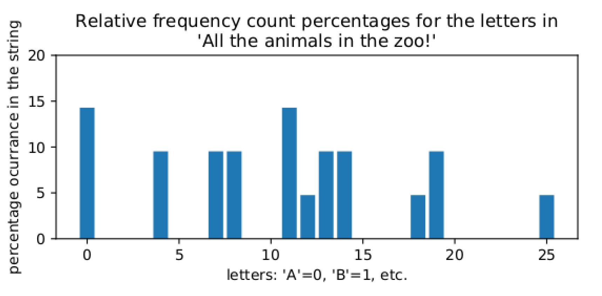
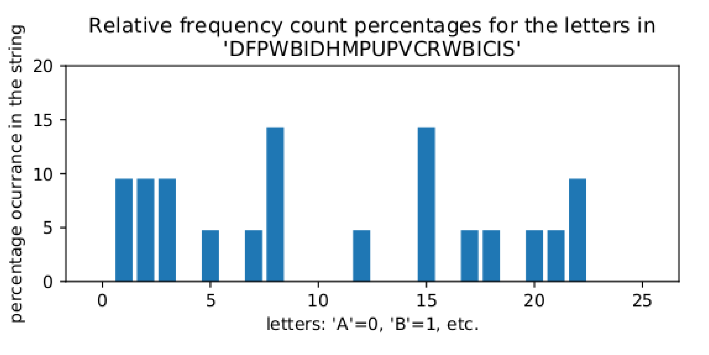
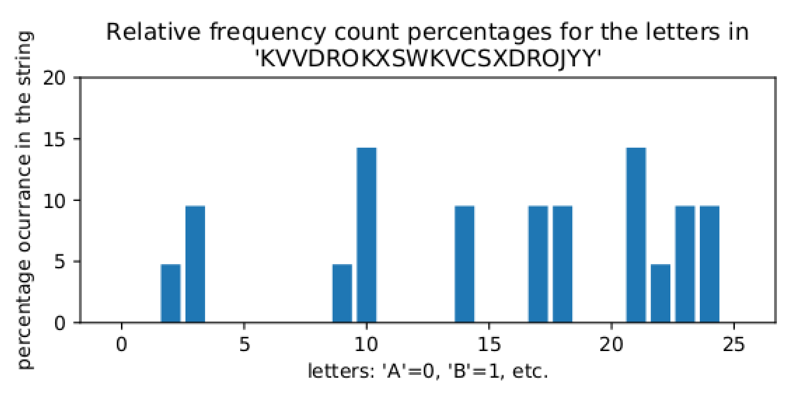

Here are some Greek roots:

- ***kryptos*, κρυπτoς** secret, hidden
- ***logos*, λoγoς** word, study, speech
- ***graph*, γραφω** write, written
- ***analysis*, αναλυη** analysis

From these (and others), modern (technical) English gets the words

- ***cryptosystem*** a set of algorithms for protecting secrets, for hiding information so that only the intended persons have access to it
- ***cryptography*** work done to make cryptosystems
- ***cryptanalysis*** work done to circumvent the protections of cryptosystems – to “crack” a cryptosystem
- ***cryptology*** the combination of cryptography and cryptanalysis, often abbreviated simply to *crypto*.

Beware that *cryptography* is widely (but inappropriately!) used as a synecdoche for *cryptology*. We will use these words more carefully, except when the differences between the words is not so important, in which case we will use the word *crypto* as short for whichever of cryptology, cryptography, or cryptanalysis is most appropriate[^1]

### Some speculative history

Perhaps there was a form of deception that preceded language – certainly many a house pet has feigned innocence despite the clear evidence of involvement in stealing treats. And even apiologists may not know if some lazy bees make up a story about a long excursion to a new flower patch when their Queen demands an accounting.

But among *homo sapiens*, probably as soon as there was language, there was lying. Of course, when two humans are face to face, both parties have some control, such as: the listener can make an attempt to evaluate the trustworthiness of speaker, they can both form their own judgments of the other’s identity and therefore choose what they wish to share with each other, and the words of the speaker pass directly from their lips to the listener’s ears without the possibility of change of meaning in flight (absent considerations of ambient noise and so on).

A great deal changed with the invention of writing more than 5000 years ago. Words frozen in physical form, and the ideas they represent, can be taken and shared with a wide range of parties other than those with whom the original author wanted to communicate. In addition, if an author is not able to hand her work directly to the intended reader and instead the written words are out in the world on their own for a while, then both intended communicants can no longer be sure that the other is who the writing claims them to be nor that the writing remains the unchanged symbols that the other party originally set down.

Let us formalize some of these issues of *information security* (as it is called now), in the context of a message to be sent from someone named *Alice* to someone named *Bob*. The role of the possibly disruptive and overly intrusive environment is played in our little drama by *Eve*. (Traditionally one skips directly to a character whose name starts with *E* to symbolize both the *environment* and also someone who is potentially an *eavesdropper*[^2].) Note that another way to think of what Eve is doing is listening to what is going by on some unfortunately (maybe unintentionally) public *communications channel* that Alice and Bob are using.

Here is some basic terminology:

**Definition 0.1.1.** **Confidentiality** means that only the intended recipient can extract the content of the message – Alice wants only Bob to get her message and not Eve, no matter if she listens on the eavesdrop or intercepts the message as it travels in some form from Alice to Bob.

**Definition 0.1.2.** Message **integrity** means that the recipient can be sure the message was not altered – Bob wants to know that what he gets is what Alice wrote, not what the mischievous Eve intended to change it into.

**Definition 0.1.3.** Sender **authentication** means that the recipient can determine from the message the identity of the sender – Bob wants to be sure this message did in fact originate with Alice.

**Definition 0.1.4.** Sender **non-repudiation** means that the sender should not be able to deny sending that message – Bob wants to be able to hold Alice to her promises.

Note that Alice and Bob may actually be the same person sending a message from a past self to their future self. For example, someone may want to keep records which must be *confidential* and whose *integrity* must be reliable, even if there is a break-in to the site keeping those records.

In fact, information storage can always be thought of, in this way, as an attempted communication from the past to the future via a channel that may unexpectedly become public if, for example, your laptop is stolen or someone breaks into your business and steals the hard drive from your server. Unless you can be absolutely sure that in all possible futures, no bad actor will ever possibly have physical access to your computer, it’s always a good idea to encrypt all of your data on your personal devices!

Before we go on, a few more technical terms:

**Definition 0.1.5.** The message that Alice wishes to send to Bob, in its actual original form is called the **plaintext**.

**Definition 0.1.6.** An algorithm that Alice uses to transform (scramble, obfuscate) the plaintext into a form that will remain confidential even if observed by Eve while in flight is called a **cipher**. We also say that Alice **encrypts** the (plaintext) message.

**Definition 0.1.7.** The encrypted form of a plaintext message is called the **ciphertext**.

**Definition 0.1.8.** When Bob receives the ciphertext, he applies another algorithm to **decrypt** it and recover the plaintext.

**Basic crypto terminology, graphically:**

|  | (where **Eve** is watching) |  |
| --- | --- | --- |
| message m |  |  |
| **encrypts** m to c |  |  |
| transmits c | ↣**ciphertext** c ↣ | receives c |
|  |  | **decrypts** c to |
|  |  | recover plaintext m |

and again, that a cryptosystem which one person dreams up, thinking they have invented a system with wonderfully strong security, may easily fall to cryptanalysis done by someone else. So it has gradually come to be understood that the best way to make sure one is using a really solid cryptosystem is to share the algorithms widely and publicly, so that others in the community can try to break them. As is said in the FLOSS[^3] community: *with enough eyes, all bugs are shallow*. Therefore, we should only trust a cryptosystem if its security remains strong even after everyone has tried their best to break it!

If the algorithm is public, how does it provide any security at all? The answer is that the algorithm may be public, but it is designed to take as input one more piece of information, beyond just the plaintext to encrypt or the ciphertext to decrypt:

**Definition 0.1.9.** Additional information (some of which is) used in encryption and (some of) which is necessary for successful decryption is called a **key**.

Think of a key as something that Alice uses to lock her message in a box, the box being the message as it is transmitted over a public network and even possibly seen by Eve, and then used by Bob to unlock the box and find out what the actual message was that Alice wanted to send. Clearly, the keys must be kept carefully secret for the cryptosystem to do its job of protecting Alice and Bob’s communications from the eavesdropping Eve!

This idea – that the security of a cryptosystem should be based on the secrecy of the key but not of the algorithm – has come to be called **Kerckhoff’s Principle**, after a set of cryptosystem design ideas written down in 1883 by a French military cryptographer. The opposite of a system made with Kerckhoff’s Principle in mind is one whose algorithms are simply kept secret, and in which it is very foolish to place any trust: such weak systems are said to reply upon the ill-advised **security through obscurity** paradigm.

> **Reading Response.**
>
> Does all of this make sense? What was new or interesting, or what was old and uninteresting?

> **Reading Response.**
>
> Can you think of an example not mentioned above where the terms like **confidentiality**, **integrity**, **authentication**, and/or **non-repudiation** could be used to describe something you’ve read about or experienced? Or else, can you think of a situation where these kinds of information security concepts apply to some version of **Alice**, **Bob**, **Eve**, and a **public channel**? – if so, say what that situation was and what corresponded to each of those characters.

### The Caesar cipher and its variants

A cryptosystem which dates to ancient times was supposedly used by Julius Caesar.

**Definition 0.2.1.** Alice takes her message, removes all spaces and punctuation, and puts it all in one case (maybe lower case). Then she moves each letter k places down the alphabet, wrapping around from **z** to **a** if necessary, where k is a fixed whole number known to both Alice and Bob but no one else, called the **key**. (Often the ciphertext is written entirely in upper case, so it is easier to tell plaintext from ciphertext.)

To decrypt, Bob simply moves each letter k places earlier in the alphabet, wrapping past **A** to **Z** if necessary: in other words, Bob *encrypts* the ciphertext with key -k to get the plaintext.

This is called the **Caesar cryptosystem** or **Caesar cipher**.

Apparently Julius Caesar usually used the key value k=3. His nephew Octavian, who later became the emperor Augustus, liked to use k=-1.

When using what is called the Latin alphabet (which is not what was used in ancient Rome, though!), with its 26 letters, there is one particularly nice key value: 13. The nice thing about that value is encryption and decryption are exactly the same transformation. In modern times, this transformation is called **ROT13**, and it has a small role in the modern history of the Internet. In particular, posts on early chat rooms and bulletin boards would sometimes want to have a bit of content that should not be automatically available to anyone who looks at the post, but would be there for the determined reader (such as, for example, a spoiler in a review of some popular new game, book, or film). These were often included in the post, but only after they had been run through ROT13.

A few commercial products used ROT13 for actual security, despite it actually being completely insecure, such as certain parts of some versions of the Windows operating system.

> **Reading Response.**
>
> Have you heard of the Caesar cipher before? Is it clear to you how to use it?

#### Keys only matter “mod 26”

Notice that if Alice uses the Caesar cipher and key k_(rmAlice)=1, her encryption does exactly the same thing as Ann who was using Caesar with key k_(rmAnn)=27, because of that part of the definition of the Caesar cryptosystem which says “wrapping around from **z** to **a**”: Ann will always go all the way around the alphabet once, but then end up at the same place Alice will. The reason for this is that 27=26+1, and encrypting with 27 goes around the alphabet once – from the 26 – and then goes one more step. The same thing would happen if Ann used the key k_(rmAnn)=53=2*26+1, in that Ann’s encryption process would go around the alphabet – twice, in this case, from the 2*26 – and then end up at the same place as Alice’s.

In fact, if difference between Alice’s and Ann’s key is any number of 26s, then their encryptions will look exactly the same! Mathematicians have a bit of terminology and notation for this:

**Definition 0.2.2.** Suppose a, b, and n are three whole numbers. Then we say that **a is equal to b modulo n** if a-b is a multiple of n; that is, if there is some other whole number k such that a-b=k*n. The notation for that is a≅b (mod n)

**Example 0.2.3.** As we just noticed, 1≅27 (mod 26).

**Example 0.2.4.** ROT13 was so convenient because doing it twice has the effect of doing nothing, because 13+13≅0 (mod 26) Or, thought of another way, since -13≅13 (mod 26) ROT3 encryption (Caesar with key 13) is exactly the same thing as ROT13 decryption (Caesar with key -13).

> **Reading Response.**
>
> Does all of this make sense? What was new or interesting, or what was old and uninteresting?
>  If you feel comfortable with this new terminology and notation, try to answer the following question: If you have a whole number x and you know that x≅0 (mod 2), what would be a more common way of talking about that number? *I.e.,* you would say that “x is.”

Computer languages usually have a way to work with numbers mod n. For example, **Python** has a built-in arithmetic operation which is useful here: `a%n` gives the smallest non-negative whole number which is equal to `a` mod `n`.

**Example 0.2.5.** From what we noticed above, in **Python**

```text
    >>> 27
    1

```

and
[2mm]

```text
    >>> -13
    13

```

First, notice that we can’t just add a key to a letter, because the types don’t work:

```text
    >>> 'a'+2
    Traceback (most recent call last):
      File "<stdin>", line 1, in <module>
    TypeError: must be str, not int

```

So we must first convert a character to an `int` and then back to a character:

```text
    >>> chr(ord('a')+3)
    'c'

```

Note that `ord()` takes a single character and converts it to an `int`, while `chr()` takes an `int` and converts it to a single character. It’s not so important what are the details of how that works, except to note that the encoding includes all of the lowercase letters, in alphabetical order, in one numerical block from the value `ord('a')` to the value `ord('z')`, and all of the uppercase letters, in alphabetical order, in another numerical block from `ord('A')` to `ord('Z')`.

Actually, that’s not going to work with a letter too close to the end of the alphabet, *e.g.,*

```text
    >>> chr(ord('y')+3)
    '|'

```

So how about if we take a character in a variable `x` and do the following:

1. make it into a number using `ord()`
2. shift it so that it’s in the range from `0` to `25` by subtracting `ord('a')`
3. do the Caesar by adding the value `k`
4. get it back in the range `0` to `25` by doing `%26`
5. get it in the range `ord('A')` to `ord('Z')` by adding `ord('A')`
6. make it back into a letter using `chr()`

*E.g.,* if `x='y'` and `k=4` then we would get

```text
    >>> chr((ord(x)-ord('a')+k)
    'C'

```

Let’s now implement the Caesar cipher in **Python**, in steps. First, we should clean up the plaintext string.

> **Code Task.**
>
> Write a **Python** function which takes an input string and returns a string which is the same except all the non-letter characters have been removed and all the letters have been made to lower case.

It might help to know that you can loop through the characters of a string `s` by doing

```text
  for x in s:
```

with

```text
  o=''
```

`t` to the end of `o` by doing

```text
  o=o+t
```

Another, more “Pythonic” approach is probably to build up a list by the construction

```text
  [ c for c in s ]
```

the string `s`. Note you can also do something to the characters as you put them in the list, and you can add a condition to the looping part, such as

```text
  [ ord(c) for c in s if c.isalpha()]
```

> **Code Task.**
>
> **Caesar encryption:** write a **Python** function `Caesar_encrypt(s, k)` which takes an input string `s` – the plaintext – and an int `k`and returns the ciphertext from that plaintext under the Caesar cipher with key `k`.

> **Code Task.**
>
> For example, if you do
>  `Caesar_encrypt('All the animals at the zoo!', 3)`
>  the output should be
>  `'DOOWKHDQLPDOVDWWKHCRR'`.

> **Code Task.**
>
> **Caesar decryption:** Write a **Python** function `Caesar_decrypt(s, k)` which takes an input string `s` – the ciphertext – and an int `k` and returns the plaintext from that ciphertext under the Caesar cipher with key `k`.

> **Code Task.**
>
> For example, if you do
>  `Caesar_decrypt('DOOWKHDQLPDOVDWWKHCRR', 3)`
>  the output should be
>  `'alltheanimalsatthezoo'`.

> **Code Task.**
>
> You might want to do a sanity test on your input and return an error or a null string if the input is not a well-formed ciphertext, *i.e.,* a string consisting only of uppercase letters.

#### Modernizing the Caesar cipher

It seems unfortunate that the Caesar cipher, as we have used it, looses the punctuation in the messages and case of the letters of the message. One way to get around this would be to imagine all of the letters of both cases and all punctuation symbols to be part of a much bigger alphabet, and then to use the same old Caesar with this much bigger alphabet, correspondingly using `%N`, where `N` is the new alphabet size, in place of the `%26` we were using before.

Technically, in **Python 3**, strings are made of characters, and characters are encoded using **Unicode**. Unicode is a way of turning numbers, represented by one, two, or four bytes, into many special symbols as well as letters from many writing systems used around the world.

The first 128 symbols in Unicode, which therefore fix into one byte (in fact with the highest-order bit being 0), are just the old ASCII encoding scheme, dating back to 1963, for the English alphabet plus some additional punctuation, symbols, and even non-printing symbols like “EOF.” The name of the encoding scheme for the subset of Unicode which fits in 8 bits is “UTF-8,” which includes all of the old ASCII code.

Full Unicode in two or four bytes includes many non-Latin alphabets (such as Greek, Cyrillic, hangul, *etc.*) and even non-alphabetic writing systems like Chinese and Japanese (actually, part of Japanese is non-alphabetic, called “kanji,” but Japanese also has two different writing systems based on syllable sounds, called “hiragana” and “katakana,”, each with 49 symbols), with thousands of ideograms.

> **Reading Response.**
>
> Have you heard of Unicode?

> **Reading Response.**
>
> If not, you might also read, or at least skim, [the Wikipedia page about Unicode](https://en.wikipedia.org/wiki/Unicode) and say what you think of it.

> **Reading Response.**
>
> Have you ever worked with Unicode in **Python**?

> **Reading Response.**
>
> If so, what did you think of it? If not, you might also read, or at least skim either the **Python** documentation [Unicode HOWTO](https://docs.python.org/3/howto/unicode.html) or the more detailed [Unicode & Character Encodings in Python: A Painless Guide](https://realpython.com/python-encodings-guide/) and say what you think about it.

> **Bonus Task.**
>
> Implement in **Python** a Caesar-style encryption and decryption which works for a different alphabet than English. Maybe do Spanish (one extra letter: n) or German (four extra letters: a, o, u, )....

> **Bonus Task.**
>
> **Or**, maybe implement Caesar with the English alphabet, but figure out some way to keep the punctuation as well. It seems like it might be giving away too much information to leave the spaces and punctuation the same in the ciphertext as it was in the plaintext, but can you do something interesting with it?

> **Bonus Task.**
>
> **Or**, maybe implement a Caesar-style cryptosystem which handles all of ASCII, or UTF-8, or all of Unicode!

### Cryptanalysis of the Caesar cipher

Let’s think about cryptanalysis of the Caesar cipher; that is, let’s figure out how to get a plaintext back from a Caesar ciphertext when we don’t know the key.

The first thing we should notice is that, as we saw in §0.2, the key only matters “up to mod 26.” But every possible whole number k for a key is equal mod 26 to a whole number in the range from 0 to 25: just try running

```text
  for i in range(100):
    print(i
```

So, effectively, there are only 26 possible keys for a Caesar cipher! In fact, it would be pretty silly to use the key k=0, since then the ciphertext would be exactly the same as the plaintext (well, without the non-letter characters, and all in upper case). So there are really only 25 reasonable Caesar cipher keys. It seems like this kind of thing is important enough to have its own name:

**Definition 0.3.1.** The set of possible keys for some cryptosystem is called the **keyspace** of the cryptosystem.

What we have just seen is that the keyspace of the Caesar cipher is just the whole numbers from 1 to 25. In **Python**, it is the elements of the list `range(1,25)`.

An enemy of Caesar’s who intercepted a ciphertext of his and who wanted to know what it said could assemble a team of 25 literate people (maybe those were hard to find at the time?) who could count (also hard?) and use them to make a *Caesar-cracking computer* as follows:

- **•** each person would be assigned one of the numbers from 1 to 25
- **•** each person would write out the Caesar-decryption of the intercepted ciphertext, using their assigned number as key
- **•** if one of them got something which looked like it was written in good Latin, they would shout “Success!” and read out their decryption

This would be a pretty fast and economical way to crack the Caesar cryptosystem only **because the keyspace is so small**. This kind of attack has a name:

**Definition 0.3.2.** An attempt to cryptanalyze a cryptosystem by trying all of the possible values of some parameter of the system (such as all possible keys or all possible messages) is called a **brute-force attack**.

> **Reading Response.**
>
> Does all of this make sense? What was new or interesting, or what was old and uninteresting?

> **Reading Response.**
>
> Can you think of an example of a **brute-force attack** used in some information security context that you know about from other classes or other readings or just from your life?

> **Code Task.**
>
> Write a **Python** function `CaesarBF(s)` implementing a brute-force attack on the Caesar cryptosystem. Given an input ciphertext, it should try all possible keys for decryption and print out the attempted key and the corresponding decryption.

> **Code Task.**
>
> *E.g.,* the output of `CaesarBF('DOOWKHDQLPDOVDWWKHCRR')` should be

> **Code Task.**
>
> ```text
>   1:   cnnvjgcpkocnucvvjgbqq
>   2:   bmmuifbojnbmtbuuifapp
>   3:   alltheanimalsatthezoo
>   4:   zkksgdzmhlzkrzssgdynn
>   5:   yjjrfcylgkyjqyrrfcxmm
>   6:   xiiqebxkfjxipxqqebwll
>   7:   whhpdawjeiwhowppdavkk
>   8:   vggoczvidhvgnvooczujj
>   9:   uffnbyuhcgufmunnbytii
>   10:   teemaxtgbfteltmmaxshh
>   11:   sddlzwsfaesdksllzwrgg
>   12:   rcckyvrezdrcjrkkyvqff
>   13:   qbbjxuqdycqbiqjjxupee
>   14:   paaiwtpcxbpahpiiwtodd
>   15:   ozzhvsobwaozgohhvsncc
>   16:   nyygurnavznyfnggurmbb
>   17:   mxxftqmzuymxemfftqlaa
>   18:   lwwesplytxlwdleespkzz
>   19:   kvvdrokxswkvckddrojyy
>   20:   juucqnjwrvjubjccqnixx
>   21:   ittbpmivquitaibbpmhww
>   22:   hssaolhupthszhaaolgvv
>   23:   grrznkgtosgrygzznkfuu
>   24:   fqqymjfsnrfqxfyymjett
>   25:   eppxliermqepwexxlidss
> ```

That’s all well and good, but we have a huge problem: human intervention is required here, to pick out which possible decryption, in the brute-force attack, is the correct one!

For example, suppose bad actors invaded your organization’s network and encrypted all of your files with the Caesar cipher, but choosing a different key for each one. Your organization probably has hundreds of thousands of files, and while any individual one could be easily decrypted, it would take an insane number of person-hours to decrypt your whole network... you might be willing to pay a fairly large ransom to get all of your files back without all that human life invested in brute-force decryption.

#### Frequency analysis

Let’s think about how to automate the choice of the correct decryption in a brute-force attack on the Caesar cipher.

The key idea here is just the observational fact that *the relative frequencies of different letters in English are relatively stable across almost all pieces of English text*. In particular, in English, the most common letter is usually “e,” the second most common is usually “t,” *etc.*

This suggests an approach to detecting automatically which decryption in the brute-force attack is the correct one: declare victory when the brute-force approach has found a possible decryption where the most common letter is “e.”

> **Code Task.**
>
> Write a **Python** function `freq_table(s)` which makes the *frequency table* for the letters of a string `s`. That is, first clean up `s` by removing all non-letters and making all remaining letters be in the lower case. Then `freq_table()` should returns a list of 26 `int`s where the value at location `i` in this list tells how many times the letter `chr(i+ord('a'))` occurred in the cleaned-up input string.

> **Code Task.**
>
> For example, executing
>  `freq_table('alltheanimalsinthezoo')`
>  should return the list
>  `[3,0,0,0,2,0,0,2,2,0,0,3,1,2,2,0,0,0,1,2,0,0,0,0,0,1]`.

> **Code Task.**
>
> Write a **Python** function `CaesarBF_findE(s)` uses your previous `CaesarBF(s)` but only prints out the possible decryption if the letter “e” is the most frequent in the proposed cleartext. That is, each time your function computes a possible cleartext, you should get the frequency table `freqs` from that string, using your `freq_table()` function. Then do the test `freqs[4]==max(freqs)` to see if the letter at index 4, which is “e,” has the maximum frequency. Only if the test passes will you print out that possible cleartext.

Clearly, this strategy doesn’t seem to work too well, because it would find that the string `'teemaxtgbfteltmmaxshh'` from key `10` and `'eppxliermqepwexxlidss'` from key `25` were both possible decryptions of `'DOOWKHDQLPDOVDWWKHCRR'`, neither of which is correct!

The problem is that the single letter which is most frequent is too coarse a piece of information about a string to be useful to determine whether the string is in good English. However, the entire frequency table does a much better job. Let’s implement that in **Python** now, in several steps.

> **Code Task.**
>
> Modify your **Python** function `freq_table(s)` to make one called `rel_freq_table(s)` which computes the *relative frequency table* for an input string `s`: a table which computes the fraction of the letters in `s` which are each particular letter. If the list computed by `freq_table()` is `f`, then the relative version will have `float`s rather than `int`s, with values that are the values of `f` divided by `sum(f)` (or, what should be the same thing, divided by `len` of the input string).

> **Code Task.**
>
> For example, executing `rel_freq_table('zbazb')` should return the list `[0.2,0.4,0.0,0.0,0.0,0.0,0.0,0.0,0.0,0.0,0.0,0.0,0.0,` ` 0.0,0.0,0.0,0.0,0.0,0.0,0.0,0.0,0.0,0.0,0.0,0.0,0.4]`.

> **Code Task.**
>
> Run your function `rel_freq_table()` on some very long pieces of English text, to get the model relative frequency table of the English language.

> **Code Task.**
>
> You might compare the values you get from what Wikipedia says should be the right table of relative frequencies in [the article Letter Frequency](https://en.wikipedia.org/wiki/Letter_frequency). Did you get a similar answer? If not, do you have a guess of why?

> **Code Task.**
>
> You will need, in a moment, a tool which computes the “distance” between two relative frequency tables. Those tables are lists of numbers of length 26. Well, if you have a list of two numbers, you can think of those numbers as the coordinates in two-dimensional space. If you have a list of three numbers, you can think of them as coordinates in three-dimensional space. So a list of 26 numbers could be thought of as the coordinates in 26-dimensional space. Weird, yes, but go with it....

> **Code Task.**
>
> In two- or three-dimensions, the distance between two points is given by the square root of the sum of the squares of the differences between the coordinates. That is, in two dimensions, the distance between two points with coordinates (x₁,y₁) and (x₂,y₂) is, by the Pythagorean Theorem, given by the formula √((x₁-x₂)²+(y₁-y₂)²). The same thing also works in three... or in 26 dimensions: that’s just the Pythagorean Theorem 25 times!

> **Code Task.**
>
> So write a **Python** function which takes as input two lists of numbers of the same length, say they are `a` and `b`. It should then take the first element of `a` minus the first element of `b` and square that difference. It should add to that square the square of the difference of the second elements, and so on until all the elements are used up. Finally, it should return the square root of that total, which will be the value of `freq_table_dist(a,b)`.

> **Code Task.**
>
> Now implement a **Python** function `CaesarBF_rel_freq(s)` tries all possible Caesar decryptions of the input ciphertext string `(s)`, and picks the one whose relative frequency table is least different from the standard relative frequency table of English which you just found.

> **Code Task.**
>
> Here are the steps: do the `CaesarBF(s)` approach from before, and compute the relative frequency table for each possible decryption. Now compute the “frequency table distance,” in the sense of the previous coding task, between the relative frequency table for this possible decryption and the standard relative frequency table for English.

> **Code Task.**
>
> When you’re done, find the smallest distance of all those possible decryptions and announce that one as the best guess of the real decryption of the input ciphertext.

> **Bonus Task.**
>
> Now let’s stress-test the brute force Caesar cipher cracker which uses frequency analysis.

> **Bonus Task.**
>
> 2mm First, try taking a big piece of text in another language, encrypt it with the Caesar cipher and some random key, and then use your function `CaesarBF_rel_freq(s)` to try to decrypt it automatically. For example, you might take some of [the Spanish text of the famous novel Don Quixote](https://www.gutenberg.org/files/2000/2000-0.txt) or simply cut-and-paste from [the French newspaper *Le Monde*](https://www.lemonde.fr/) or [the German newspaper *Deutsche Tageszeitung*](https://www.deutschetageszeitung.de/). **Note:** for other languages, you may have an issue with the alphabet! Letters with accents may mess up your constructions in **Python** which assume the alphabet will be sequentially ordered from 0 to 25 when you take each letter `c` and do `ord(c)-ord('a')`. Figure out how to handle this situation (probably by turning each special letter like into a letter in the English alphabet (like just make “n” into a plain “n”).

> **Bonus Task.**
>
> 2mm Or you could try decrypting a text which was originally in Latin, like [the original Latin text of Isaac Newton’s famous *Philosophiae Naturalis Principia*](https://www.gutenberg.org/cache/epub/28233/pg28233.txt) [*Mathematica*](https://www.gutenberg.org/cache/epub/28233/pg28233.txt).

> **Bonus Task.**
>
> 2mm Another thing to do would be to try some very unusual text, but in English. For example, a man named Ernest Wright published a book called *Gadsby* in 1939 which did not have the letter “e” anywhere in it. Since “e” is the most common letter in normal English, the relative letter frequencies in this novel must be quite different from those in normal English. Try encrypting and then automatically decrypting some of [the text of *Gadsby*](https://www.gutenberg.org/cache/epub/47342/pg47342.txt) (but make sure you go down far enough in that file to get to the text of the novel: the introductory material does have the letter “e”).

### Defending Caesar against frequency analysis: Vigenere

and the one-time pad}

Sometimes a very short message is very important: “yes” or “no” is a big difference in many situations! But frequency analysis attacks on the Caesar cipher depend upon having a relative frequency table to compare to the relative frequency table of English... and without a long enough enough ciphertext string, there won’t be much of a frequency table at all.

There must be some sort of threshold k such that when a ciphertext string has length k or less, the relative frequency table doesn’t give enough information to do successful cryptanalysis. There should also be another threshold K such that when a ciphertext string has length of K or more, the cryptanalysis of the Caesar cipher using relative frequency tables usually works.

For messages of length between k and K, presumably, sometimes the approach to cryptanalysis based on relative frequency tables is successful, and sometimes not.

> **Bonus Task.**
>
> Let’s try to figure out what those thresholds k and K are.

> **Bonus Task.**
>
> Do a big loop as some number `l` goes from 1 to 150 (or so). For each value of `l`, you are going to figure out how often your relative frequency table-based Caesar cracker `CaesarBF_rel_freq` is successful on strings of length `l`.

> **Bonus Task.**
>
> Make a very long string `big_string` with some text. You probably want to take all of the non-letters out of `big_string` and make all of the letters lower case.

> **Bonus Task.**
>
> Now make a loop to try decrypting maybe 100 randomly chosen strings from `big_string`. Each time through the loop, pick a random substring from `big_string` of length `l` – the way to do this is to do
>  `from random import *`
>  once near the beginning of your program, then in this loop set
>  `rand_start = randint(0,len(big_string)-l)`
>  to be the random starting point for the substring, and
>  `rand_cleartext = big_string[rand_start:rand_start+l]`
>  to be the corresponding substring of length `l`.

> **Bonus Task.**
>
> Now pick a random Caesar key `k=randint(1,26)`, encrypt `rand_cleartext` to `rand_ciphertext` with that key, and try your relative frequency table-based Caesar cracker on `rand_ciphertext`. If its proposed decryption equals `rand_cleartext`, count that as a success. If not, count it as a failure.

> **Bonus Task.**
>
> See how many times out of the 100 (*i.e.*, the percentage) in this inner loop you got success.

> **Bonus Task.**
>
> Finishing the outer loop, you should now have a list of success percentages for each possible string length from 1 to 150, maybe in a list `successes`.

> **Bonus Task.**
>
> Plot that list against the numbers from 1 to 150. This can be done by first getting the plotting package with `import matplotlib.pyplot as plt`, then making the plot with `plt.plot(x,successes)` where `x=[i+1 for i in range(149)]`. You will need also to run `plt.show()` to display the plot.

The way to prevent relative frequency table-based attacks on the Caesar cipher is to only use it to encrypt short messages (less than that threshold k we just mentioned). This is a problem if it is important to encrypt a longer message.

The approach to use with longer messages is simply to change the Caesar cipher key frequently, so that not all that much cleartext is encrypted with each particular key value. For example, to make the string half as long, so that relative frequency table methods are only half as good, we could use two keys a and b, and encrypt the first half of the message with Caesar under the key a and the second half with Caesar under key b.

Historically, this approach was implemented in a slightly different way: rather than using a for the first half of the message and b for the second half, people used a for the letters in the first, third, fifth, *etc.*, positions in the message, and b for the letter in the second, fourth, sixth, *etc.* positions.

To cut the message pieces down even more, one can use even more keys than just two. There is a name for this cryptosystem:

**Definition 0.4.1.** Fix ℓ numbers k₁,k₂,…,kell. The **Vigenere cryptosystem** does encryption as follows: given a cleartext c, encrypt the first letter of c using the Caesar cipher with key k₁, the second letter of c using Caesar with key k₂, *etc.* When all of the ℓ key values have bee n used, start again with k₁ for the next letter, then k₂, *etc.* Vigenere decryption works in the same way, except Caesar decryption is used at each step.

For example, the Vigenere encryption of “All the animals in the zoo” with three keys 3, 20, 4 is “DFPWBIDHMPUPVCRWBICIS,” since

- **•** 3 characters after “a” in the alphabet is “D,”
- **•** 20 characters after “l” in the alphabet, wrapping around to the beginning of the alphabet when falling off the end, is “F,”
- **•** 4 characters after “l” is “P,”
- **•** 3 characters after “t” is “W,”
- **•** 20 characters after “h” in the alphabet, wrapping around to the beginning of the alphabet when falling off the end, is “B,”
- **•** *etc.*

Notice that we have achieved the goal of messing up frequency analysis approaches to breaking our cryptosystem: for example, the repeated letter “l” in the cleartext word “all” has been encrypted into the two different letters “F” and “P” – but the “l” later in the cleartext, in the word “animal,” has also been encrypted to “P”... the frequency tables have been totally scrambled! In fact, we can see that by looking at the relative frequency charts of the cleartext



**Figure 0.4.1.**



**Figure 0.4.2.**

frequency chart for a Caesar encryption (with key 10) of the same cleartext



**Figure 0.4.3.**

cleartext, shifted horizontally.

> **Reading Response.**
>
> Does all of this make sense? What was new or interesting, or what was old and uninteresting? Do you feel like you understand the Vigenere cryptosystem?

> **Reading Response.**
>
> To show you understand Vigenere, can you say what the keyspace is for a the Vigenere cryptosystem when it uses ℓ key values? And how big is that keyspace? (How big it is will give us some information about how hard it is to do a brute-force attack on this cryptosystem.)

> **Code Task.**
>
> Write a **Python** function `Vigenere_encrypt(s, k)` which takes a cleartext `s` and list `k` of key values and does Vigenere encryption.

> **Code Task.**
>
> Likewise implement a **Python** function `Vigenere_decrypt(s, k)` which does the decryption for ciphertext `s` and list `k` of key values.

Using the Vigenere cipher with ℓ keys basically divides the cleartext into ℓ different pieces and uses the Caesar cipher on each of these different pieces, each time with a different key. As long as these pieces are sufficiently long, we can use our automated Caesar cipher cracker based on relative frequency counts on each piece separately, figure out what the separate Caesar keys are, and then do Vigenere decryption with those ℓ keys we’ve figured out.

Notice that the ℓ pieces of the cleartext into which the Vigenere cryptosystem are all the same size, that being `len(s)`/ℓ if the cleartext is `s`. Since an attack on the Vigenere cryptosystem is based on relative frequency-based attacks on the Caesar ciphers of those pieces, and such relative frequency-based attacks only work if there is enough data to make a good relative frequency table, if `len(s)`/ℓ is a small number, then the attack will fail.

In particular, if ℓ=`len(s)` then those ℓ pieces will have only one character in them and relative frequency-based attacks will fail miserably. In other words, if you use a Vigenere cryptosystem with ℓ keys on a cleartext of length ℓ, then it is perfectly secure! This is so important that this cryptosystem is worth giving its own name:

**Definition 0.4.2.** A cryptosystem which is Vigenere where there are as many keys as letters in the cleartext is called a **one-time pad cryptosystem**, and the **pad** in this cryptosystem is the name used for the collection of all of those Vigenere keys.

It is a very important thing when using a one-time pad never to reuse the pad – that’s why it’s called a *one-time* pad – because if Eve guesses that the pad has been reused, she can crack all of the messages which were sent with that pad. We will not discuss here how that attack on encryption with a reused one-time pad works, but suffice it to say that the attack is based, again, on frequency analysis.

One final note about one-time pads: typically, when using a one-time pad, the keys are picked purely randomly. The advantage of doing that is that there is no way Eve can predict what the keys in the pad might be, even if she knows Alice and Bob very well. With a randomly chosen one-time pad, this cryptosystem is called *information theoretically secure*, meaning that is secure no matter how much computation power Eve can throw at the problem.

> **Reading Response.**
>
> Does all of this make sense? What was new or interesting, or what was old and uninteresting? Do you feel like you understand how one-time pads work?

> **Code Task.**
>
> Write a **Python** function `OTP_keygen(n)` which generates a one-time pad of size `n`. As we said above, it’s best if these pads are as random as possible, so you might want to do
>  `from random import *`
>  and then use the command `randint(a,b)` which returns a random integer in the range `a` to `b` (including both endpoints, which is unusual in **Python**!).

> **Code Task.**
>
> As an example of using your new `OTP_keygen(n)`, send your instructor an email with a one-time pad of at least 100 elements.

> **Code Task.**
>
> Write a **Python** function `OTP_encrypt(s,k)` which takes a cleartext `s` and one-time pad `k` and does the encryption.

> **Code Task.**
>
> Also write a **Python** function `OTP_decrypt(s,k)` which takes a ciphertext `s` and one-time pad `k` and does the decryption.

> **Code Task.**
>
> As an example of using your new `OTP_encrypt(s,k)`, send your instructor an email with your first **Reading Response** from the course, but encrypted using that one-time pad you sent for Coding Task. (If that **Reading Response** was longer than 100 characters, you will have to truncate it to the first 100 characters so that you have enough one-time pad to do the encryption.)

> **Bonus Task.**
>
> Since the quality of the randomness in a one-time pad can actually matter if you plan on encrypting very sensitive data, you might consider using a more sophisticated random number generator than the basic `randint(a,b)` from the `random` package... which is fine for many uses, but maybe not good enough if you are trying to keep a large document secret from a powerful adversary.

> **Bonus Task.**
>
> **Python** has a function `urandom` in the package `os` which generates much stronger randomness. Unfortunately, it returns just a string of random bytes, which you need to convert to `int`s by using in the **Python** function `unpack` in the package `struct`. [Here is a web page which shows how to use these two functions](https://pynative.com/cryptographically-secure-random-data-in-python/).

> **Bonus Task.**
>
> Write a **Python** function `OTP_keygenCS(n)` which generates a one-time pad of size `n` with *cryptographically secure randomness*.

> **Code Task.**
>
> Write a **Python** function `OTP_key_finder(s, t)` which takes a string `s` consisting only of lower case letters and string `t` consisting only of upper case letters, where `len(s)` is the same as `len(t)` and computes what must have been the one-time pad which was used to get `t` as the ciphertext from `s` using the one-time pad cryptosystem.

> **Code Task.**
>
> The fact that you can do this means that when Eve sees a ciphertext from a one-time pad cryptosystem, she cannot deduce anything about the original cleartext other than its length. This is why this cryptosystem is information theoretically secure.

> **Code Task.**
>
> *Hint:* If you’re looking at a letter `x` of cleartext and a letter `y` of ciphertext and wondering which number `k` in a one-time pad key could have encrypted `x` to `y`, you’re really asking the question “what value of `k` makes
>  `chr((ord(x)-ord('a')+k)%26+ord('A'))==y`
>  be true?” Solving this for `k` would give one answer as
>  `k=ord(y)-ord('A')-ord(x)+ord('a')`.

> **Bonus Task.**
>
> Suppose we somehow know that the following string is the Vigenere encryption of some English cleartext with a Vigenere cryptosystem having ℓ=2 keys:
>  *WUZHEGJUFPRQJFFXEWIBDHEOVQUPVBFXIHRUJLYDMHTRDHKRSXIBTDVV
>  RUERKWFSIDZVVKZPKKVHMLCWYDKPVQURCLMHJDWWVUKKVPKKVJFRULJR
>  WWZQKHIUWGNLKKKKVLIEFQVVJRCHKLKEVZZWYFRHJDIWYHERSOVEIXKX
>  JKRWYWFOUBFXTDVVRUNDJDDEZWZRLVZIZWNHIHJRZWNDJDXUZHMRLVWD
>  LOKDEGXUZHMRLVCBYDKKTDVVRURQJZVUVGZWYHIHLQUHIOVDMHFISULW
>  LVRQUWYHIHJWWRIEIXKXJLJDEKFQFURECHDDEVFDIHKKVBROCDCOYRER
>  IDSOVPVQTRDHZWFVGHRNZQTDVVRUJILQVUROYHNDJPPIILVQUIRLKKWX
>  CDEGAXJWKRDHSXKEIXKXJVRBJKVZRVRPSLKLFXJDEGSULWLVZVRQYRER
>  IDSOVPRQYHYDKKSUFXXKKPRQPFRSKLMHJKFPVWFUFPVZYRJHIDEVFPJG
>  ZGKKVJVQVUROTRWIVUJIZOCGZGKKZVZQTDVVRUJHVPRPSLKLFXJZYHEW
>  YDKWYHGRFUYDMHTUZHUFRHJDIKRWYZVSKDDEZWZREVYRLOUEVPRGVRWV
>  KHIQVUJWLIWBVWSULWLVJDPVYHNDJDDEZWZRLVRQUEIXKXJLJDEKFQFU
>  RECHDDEBFXROCGZGJHVWYDKREWYHCXGHIFROZWYUZFVSIHJHEWVGYLDD
>  BLEJCBTUFZEZYLTKYHULUWYUZFVUVILVVZRVKKZVRPSLKLFQPHKEIXKX
>  JVRBJKVZRVRPSLKLFXJDEGJXIHYHZVRQYRERIDSOVPRQZVGHRNERKWFG
>  ZVGUFYVZYDKEIXKXJVGRBHSXKKVUVLRPKRJSVDBZYDKLURBQFZPRLDCO
>  ULUOFYVKZPFQTHERKZZWYRLWTDLVVZYDKFRXJHNLKKYRCGJBFXKKVQKR
>  DRLUEIFUYLDRAXUJDHEWKKFXRUKICHUWFEIXKLJKSHRVKVRQUPVQYDMH
>  CRJWKKVLIUVDJREEVDIZZWYPVPPKVDIWZVZQKKVFFIWLEWYHIHNLKKTD
>  VVRURQULDXJWGDLVVWZOCLKFFPVERFBWFPV*

> **Bonus Task.**
>
> Can you figure out what the two Vigenere keys must have been, and what the original cleartext was?

### Preliminary conclusion of preliminaries

We have seen that a very old cryptosystem, the Caesar cipher – which even has lived into the modern age in the form of ROT13 – helps illuminate some basic ideas of the design of cryptosystems and some first steps in attacking them: basics of cryptography and cryptanalysis.

The attack on the Caesar cipher which we discussed was based on *frequency analysis*. There’s actually some interesting history here: As was mentioned above, the Caesar cipher was used by Julius and his nephew in the first century BCE. The approach of frequency analysis was first described nearly a thousand years later, in a book *Manuscript on Deciphering Cryptographic Messages* by the Muslim philosopher, mathematician, physician, and general polymath Al-Kindi. Like the mathematician and astronomer Al-Khwarizmi (whose name came down to modern times in the word *algorithm* and whose book *The Compendious Book on Calculation by Completion and Balancing* gave us the word *algebra*, from it’s title in Arabic), Al-Kindi worked at one of the greatest centers of scholarship in the world in the 8th century CE, the House of Wisdom in Bagdad under the Abbasid Caliphate. Al-Kindi and Al-Khwarizmi seem to have both been involved in bringing an Indian system for writing numbers using positional notation (so: 101 means one 100 plus no tens plus one 1, whereas the Romans would have written that number CI) to the Arab world. This notation later spread to Christian Europe in the early 13^(th) century through a book called *Liber Abaci* (title in Latin; which would be *The Book of Calculation* in English) written by a man Leonardo of Pisa... whom we know today as *Fibonacci*. Some have claimed that Fibonacci’s notation helped bring about the Renaissance in Europe, since without good numerical notation, it would have been very hard to do double-entry bookkeeping, which was used by great trading houses like the Medici, who then had the funds to support the tremendous flowering of the arts which was the Renaissance....

The Vigenere cipher was invented in the mid-15^(th) century (**not** by Vigenere!), used for hundreds of years by European governments and even by the Confederacy during the American Civil War, and was described as recently as the early 20^(th) century as unbreakable (by none other than Charles Dodgson, the mathematician known to us today mostly as Lewis Caroll, the author of *Alice in Wonderland*!).

> **Reading Response.**
>
> Had you heard of any of this history before? Did you know of Al-Kwarizmi and his connection to the words *algorithm* and *algebra*? Had you heard of the House of Wisdom in Bagdad? Or what about the theory that the Renaissance was made possible by the invention of double-entry bookkeeping (and therefore, indirectly, by the importation into Christian Europe of Hindu-Arabic numbers which made calculations so much easier than other systems like the Roman numerals)?

An enormously important thing we have learned in this chapter, however, is that:

**There is a perfectly secure cryptosystem, the one-time pad.**

The next time you are watching a movie or TV show which has some line like “There’s no such thing as an unbreakable code,” you should therefore laugh derisively.

> **Code Task.**
>
> Before leaving this topic, we should implement a full, one-time pad cryptosystem which will work for any kind of data in any language.

> **Code Task.**
>
> The key to doing this is to think of any data, in any language (or not in a language at all), as being simply a string of bits. Bits, of course, are like letters from an alphabet which has only two symbols **0** and **1**. We know from §0.2 that Caesar – and, therefore Vigenere and one-time pads – only care about keys up to mod of the size of the alphabet, which is mod 2 for bits. So shifting the “letters” **0** and **1** by a key of 0 would do 0 1overset+0↦ 0 1 and shifting by a key of 1 would do 0 1overset+1↦ 1 0 Therefore, if the cleartext bit is a and the key bit is b, then the encrypted bit is a ∧b (this is the “exclusive or”, XOR, operation).

> **Code Task.**
>
> Write a **Python** function `OTP_gen_keyfile(f, n)` which takes a string `f` and uses it as a filename into which to deposit `n` random bytes.

> **Code Task.**
>
> Write a **Python** function `OTP_fileencrypt(f,k)` which a string `f` and uses it as a name of a file of cleartext data to be encrypted. The encryption should use the one-time pad kept in the file with name `k` and the output should be put into the file with name `f+'.enc'`.

> **Code Task.**
>
> *Some hints:*

> **Code Task.**
>
> - **•** You can open a file for reading as bytes with the command `file_handle = open(filename,'rb')`.
> - **•** You can get the entire contents of such a file into a byte string with the command `data=file_handle.read()`.
> - **•** If `a` and `b` are `int`s, then `a$\wedge$b` is the bitwise XOR of `a` and `b`.
> - **•] If ‘bs‘ is a byte string, then ‘bs[i‘** }, (where `i` is in `range(len(bs))`) is an `int`.
> - **•** If you open a file with the flag `'wb'`, then you can write a byte string `bs` to that file with `file_handle.write(bs)`.

However, the enormous problem with one-time pads is that:

**To remain secure, a one-time pad must have as many key digits as there are letters in the plaintext to be encrypted, and reuse of pads completely destroys the security of this cryptosystem.**

What this means is that the distribution of very large keys is supremely important in the use of this perfectly secure cryptosystem.

There’s a nice story of how important the management of one-time pads can be from a wonderful book called *Between Silk and Cyanide: A Codebreaker’s War* marks1999between on cryptology during (part of) World War II by the author Leo Marks. Marks ran spies into Nazi-occupied Holland during the war, and when he took over, the spies were given cyanide pills to take so that they could commit suicide if ever captured. That way they would not give away the cryptosystems they used to radio back to England all the secrets they uncovered. Instead, under Marks’s direction, they were given large one-time pads, written on sheets of silk thin enough to be worn underneath their clothes when they were first sent to Holland. That way, if captured later, they could tell everything they new about the codes they used and without having the specific one-time pad used by other spies or the one they intended to use later, the Nazis could get no information from intercepted ciphertexts. Which all meant that captured spies had no particular reason to commit suicide, and instead could cooperate and perhaps live out the rest of the war in a POW camp, if captured.

This story of silk undergarments with cryptosystem keys written on them is the first time we see what will become a recurring theme in this subject: key distribution, management, and security can often be the most important practical consideration in applied cryptography.

[^1]: Note   this use of “crypto” conflicts a little with a silly modern usage of that   word as short for *cryptocurrency*.  We will return to that   topic much later, when we talk about *blockchains*.

[^2]: *Eavesdropper* apparently comes from the Old English *yfesdrype*, meaning literally *one who stands on the eavesdrop* [ground where water drips from the eaves of the roof] *to listen to conversations inside a house.*

[^3]: “FLOSS”=’’Free/Libre/Open-Source Software, ’’ a better term   than just “open source”
