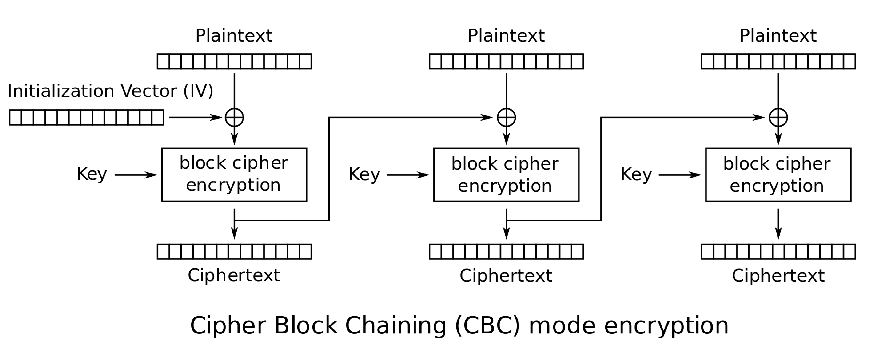
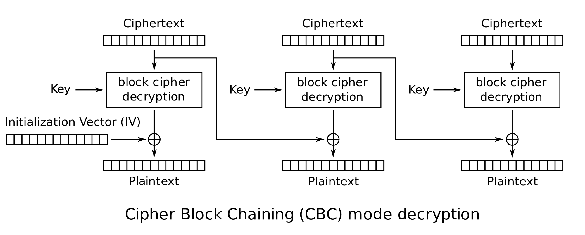
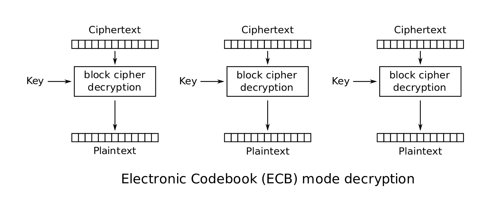

Most of the encryption today on the Internet is probably done with one of the cryptosystems called *block ciphers*, which do not provide as perfect cryptographic security as a one-time pad, but which have a much, much more modest level of difficulty in key management. Block ciphers are also very fast and have some nice security features that cryptosystems structured like the ones we’ve seen so far do no.

Examples of block ciphers you may have encountered might include:

- **•] *Advanced Encryption Standard [AES]*, authorized by the National Institute of Standards and Technology [NIST** } for use by the US federal government in unclassified situations;
- **•] the *Data Encryption Standard [DES*** }}, which was the NIST-authorized block cipher from 1977 to 2001; and
- **•** *3DES* or *triple DES*, a block cipher pretty much consisting of doing DES three times, which was used for a while after it was known that DES was nearly broken but before AES was standardized.

In this chapter, we will very briefly touch upon some of the most basic design principles for block ciphers, do a little **Python** implementation to explore these principles, and use some code libraries to do real encryption with state-of-the art block ciphers.

### Why encrypt blocks of data: Shannon’s

*confusion* and *diffusion*}

Our approach to the cryptanalysis of the Caesar and Vigenere ciphers was based on the frequencies that individual letters appear in the English language and also in a ciphertext we are trying to crack. For some cryptosystems, similar approaches might be used for longer strings of characters:

**Definition 1.1.1.** A single letter (from some alphabet) in a piece of text such as a particular plaintext or ciphertext, or in a large collection of all English texts, is called a **monograph**.

Similarly, a pair of adjacent letters in the same kind of text source is called a **digraph**, and a sequence of three letters is called a **trigraph**.

So one way to describe our attacks on Caesar and Vigenere is to say that they compared the statistics of monographs in (various substrings of) a ciphertext with the same statistics for the English language, which turns out to be a fairly stable distribution of letter (monograph) frequencies.

Similarly, the frequencies of digraphs in English are fairly stable – *e.g.,* *th* is quite common, as is *qu*, while both *tx* and *ql* are very common. Thus the statistics of digraphs (and, eventually, trigraphs) can be useful in attacking some cryptosystems.

> **Bonus Task.**
>
> Ignoring non-alphabetic characters and the difference between upper and lower case, there are 676=26² possible digraphs in English (26 choices for the first letter of the digraph and 26 choices for the second letter).

> **Bonus Task.**
>
> Write a **Python** function `digraph_freq(f, n)` which makes a relative frequency table of the digraphs from the text in the file with name `f`, printing out the most frequent `n` digraphs and their relative frequencies. You will want to read in the whole file but, as we have done before, discard all the non-alphabetic characters and make the remaining letters all lower case, before counting the digraphs.

> **Bonus Task.**
>
> Note also that the digraphs can overlap: that is, the string

> **Bonus Task.**
>
> *humperdink*

> **Bonus Task.**
>
> has these digraphs:

> **Bonus Task.**
>
> *hu, um, mp, pe, er, rd, di, in,* and *nk*

> **Bonus Task.**
>
> and not just the non-overlapping ones *hu, mp, er, di*, and *nk*.

> **Bonus Task.**
>
> Printing out the entire relative frequency table is easier than just the `n` most frequent digraphs. To do that, you will want to sort the relative frequency values, and then loop through them in the order of decreasing frequency. For each value of a frequency, you will then want to find all digraphs with that frequency and print it out, increasing a counter as you do. When the counter gets to `n`, you will stop.

The reason our attack on Caesar using monographs was successful is that Caesar doesn’t hid the statistics of its cleartext letters very well: they’re all in the ciphertext, just shifted over in the alphabet. In fact, so long as the way we scramble the letters in a cleartext to get the letters of the corresponding ciphertext is the same for every letter – maybe not simply shifting, like

-2mm

[diagram:  \mathrm{Plaintext:} & a\ar[dr] & b\ar[dr] & c\ar[dr] & d\ar[dr] & \cdots & \cdots\ar[dr] & y\ar[dr] & z\arrow[rounded corners,to head, to path={ -| ([yshift=-2cm,xshift=.5cm]\tikztostart.east) -| ([x]

-2mm

[diagram:  \mathrm{Plaintext:} & a\arrow[dr] & b\ar[dl] & c\ar[dr, crossing over] & d\ar[dl] & \cdots & \cdots & y\ar[dr, crossing over] & z\ar[dl]\\ \mathrm{Ciphertext:} & A & B & C & D & \cdots & \cdots & Y &]

odd-numbered ones – the statistics of monographs in our ciphertext will be the same as in the cleartext, only in some different order. There’s a name for cryptosystems that do this:

**Definition 1.1.2.** A cryptosystem where a single scrambling transformation of letters in the cleartext to the letters in the ciphertext is called a **monoalphabetic cryptosystem**.

A cryptosystem where, instead, the scrambling transformation of letters in the cleartext to the letters in the ciphertext changes from letter to letter of the cleartext – so that, for example, sometimes *a* in the cleartext is encrypted to *K* in the ciphertext, but other times in the same cleartext, *a* might be encrypted to *B* or *M* or some other letter – depending upon perhaps the other letters in the message or the location of the cleartext letter in the entire cleartext, is called a **polyalphabetic cryptosystem**.

> **Reading Response.**
>
> Does all of this make sense? What was new or interesting, or what was old and uninteresting? Do you feel like you understand which cryptosystems are monoalphabetic and which are polyalphabetic – if so, which of the ones we’ve discussed so far are of which type?

So (monograph) frequency analysis will make good progress in cryptanalysis of monoalphabetic cryptosystems, but the relative frequency tables for ciphertexts from polyalphabetic cryptosystems are smeared out by adding together lots of differently scrambled versions of the frequency table and so cryptanalysis this way will be much harder.

In the end, what we are seeing is that when the ciphertexts produced by some cryptosystem have statistics that somehow reflect the statistics of the cleartext, then there is a possible avenue of attack. The best thing, then, would be if the cleartexts and ciphertexts seemed to be statistically unrelated to each other

The great mathematician, computer scientist, and cryptologist Claude Shannon[^1] in his highly influential (and, initially classified by the US Government) paper *A Mathematical Theory of Cryptography*Shannon 1945

**Definition 1.1.3.** We say that a cryptosystem has the property of **diffusion** if, for a fixed choice of key, every time any single bit in a cleartext is flipped, half of the bits of the ciphertext should change (in general, statistically), and vice-versa. (Here, “statistically” means that this doesn’t have to be precisely true every time, but when we average over many cleartexts and keys, on average half of the ciphertext bits will change every time we change any single cleartext bit.)

The point of diffusion is to minimize the information about the cleartext which is *leaked* by he ciphertext. The very fact that there is some communication between Alice and Bob is, of course, leaked. Looking at the flows of messages between individuals in some group – who speaks to whom and when or, in other words, the **metadata** of the communication – is called **traffic analysis** and can be very important. Seeing which individual is the central point through which all messages flow, and related issues from traffic analysis, can give information about who is the leader of the group, *etc..* As former head of the US National Security Agency General Michael Hayden saidCole 2014, “We kill people based on metadata,” referring to US drone strikes on individuals though to be terrorist leaders based on traffic analysis.

If if we are not trying to understand the organization of some group of communicating individuals on the basis of their pattern of communications, and are just looking at Alice and Bob’s exchange of encrypted messages, some things are hard to conceal. For example, it is nearly impossible to send a very large piece of information (cleartext) through an encrypted channel unless the corresponding ciphertext is quite large.

Although, to be fair, the opposite, that a large ciphertext means the cleartext had a lot of information in it, is not necessarily true. For example, Alice could pad a short message with a very large amount of random extra data and send to Bob the encrypted version of that long cleartext. That would be a large ciphertext which did not correspond to a large amount of (useful) information in the cleartext.

> **Reading Response.**
>
> Does all of this make sense? What was new or interesting, or what was old and uninteresting? Do you feel like you understand how an observer could use traffic analysis to guess who was the leader of a group of communicating individuals? Can you think of another situations where something like traffic analysis comes up in regular life – maybe when friends or romantic partners suddenly are communicating with different people more or less frequently...?

Since it is very hard to prevent the leakage of at least the fact that communication has occurred, as well as, probably, some idea of how much data has be transmitted, a good cryptosystem will try to prevent as much other leakage as possible: Shannon’s diffusion is one way to do that.

> **Code Task.**
>
> On our way to seeing if the cryptosystems we’ve met so far have diffusion:

> **Code Task.**
>
> Write a **Python** function `str_diff_display(s,t)` which takes two string `s` and `t` and shows how much they differ.

> **Code Task.**
>
> Your function should first check if the strings have the same length, printing an error and returning 0 if not.

> **Code Task.**
>
> Next, your function should loop through the strings and print a “*” if they differ at each location and a “_” if they are the same. (You might want to print these symbols in rows of some determined length, like 30 characters. You can do this by printing with commands like `print('*',end='')` and `print('_',end='')` to stay on the same line, and then using `print('')` to get to the next line.)

> **Code Task.**
>
> Your program should then return the number of places where the two strings differ (*i.e.*, the number of “*”s printed).

> **Code Task.**
>
> For example, running
>  `str_diff_display("abc"*30,("abc"*15)+"Abc"+("abc"*13)+"aBc")` should produce the output
>  `______________________________\vphantom{$X^X$}\hskip1mm`
> [-1.5mm] `_______________*______________\vphantom{$X^X$}`
> [-1.5mm] `____________________________*_\vphantom{$X^X$}`
> [-1.5mm] `2\hphantom{\code{__________________________,}}`

> **Code Task.**
>
> Actually, displaying where two strings have different characters, as `str_diff_display` does, is a pretty crude approximation of showing where those strings have different *bits*. So let’s improve the string difference display and calculation code to make a bit difference display and calculation program.

> **Code Task.**
>
> In principle, the easiest way to do this is to convert a string of characters into a string of characters displaying all of the bits in the first string, and then use the `str_diff_display` you built before.

> **Code Task.**
>
> To get a character into its binary expression, you can convert it first to an `int` with `ord`, and then convert that `int` into a string of binary digits with `bin`. The problem with `bin` is that it always puts a `0b` at the front of its binary strings, and it also drops off leading 0s. (That makes sense: when writing the number 17 in base 10, we don’t write it as “017,” to indicate there are no 100s, 1 ten, and 7 ones... we just write “17;” *i.e.,* we drop leading 0s. The same happens in base two.)

> **Code Task.**
>
> Of course, you can skip the first two characters (like that “`0b`”) of a string `s` with `s[2:]`, and if you have a string `b` of 0s and 1s that you want to pad on the left with the right number of 0s to make it eight symbols long (to show all the bits in that byte), you can do `('0'*(8-len(b)))+b`.

> **Code Task.**
>
> Use the above ingredients to make a **Python** function `bits_diff_display(s,t)` which takes two string `s` and `t` and shows how much their bits differ. Since there will be eight times as may bits to show as there were just for `str_diff_display(s,t)`, you might want to make your lines a bit longer, and maybe show if the bits are the same with a “.” and if they differ with an “x.”

> **Code Task.**
>
> For example, running
>  `bits_diff_display("abcdef", "CbcdeF")` should produce the output
>  `..+...+.......................\vphantom{$X^X$}`
> [-1.5mm] `............+.....\hphantom{+...........}\vphantom{$X^X$}`
> [-1.5mm] `3\hphantom{\code{++..........................}}`
>  (Even though running
>  `str_diff_display("abcdef", "CbcdeF")` would produce the output
>  `*____*\vphantom{$X^X$}`
> [-1.5mm] `2\hphantom{XXx}\,\,`
>  The difference is because while the strings `"abcdef"` and `"CbcdeF"` differ only in two characters, the first and the last, the bits for `"a"` are `01100001` though the bits for `"C"` are `01000011` – so there are **two** different bits in this **one** different character – and the bits of `"f"` are `01100110` though the bits for `"F"` are `01000110` – so there is only one different bit in this one different character!)

> **Code Task.**
>
> Which of the cryptosystems that we have studied so far – Caesar, Vigenere, and one-time pads – satisfies Shannon’s idea of diffusion?

> **Code Task.**
>
> Take a fairly long – maybe 100 characters or so – cleartext from some source, and make two versions of it which differ by only one bit.

> **Code Task.**
>
> [Note: think a bit about how to make that one-bit change. Changing one letter may not do it! For example, the letter **a** is represented in Unicode by the number 97, which is has binary expression **01100001**. On the other hand, **b** in Unicode is 98, which is **01100010** in binary – so changing **a** to **b** changes *two* bits!]

> **Code Task.**
>
> Once you’ve got those two strings, make appropriate keys and encrypt both strings, then run your `bits_diff_display` on the encrypted versions to see where and how much they differ. Try this for each of the cryptosystems we’ve done in this class.

> **Code Task.**
>
> You should now be able to answer the question if those cryptosystems satisfy Shannon’s diffusion.

Another thing Shannon worried about was if the ciphertexts leaked some information about the *key* that was used in their encryption. In particular, he made a definition similar to diffusion, but now looking at keys, as follows:

**Definition 1.1.4.** We say that a cryptosystem has the property of **confusion** if, working with a fixed cleartext, every time any single bit in a key is flipped, half of the bits of the ciphertext should change (in general, statistically), and vice-versa. (Here, ‘statistically’’ means that this doesn’t have to be precisely true every time, but when we average over many ciphertexts and keys, on average half of the ciphertext bits will change every time we change any single bit of the key.)

> **Code Task.**
>
> Which of the cryptosystems that we have studied so far – Caesar, Vigenere, and one-time pads – satisfies Shannon’s idea of confusion?

> **Code Task.**
>
> Repeat the previous Code Task with now a fixed cleartext but trying encryptions with only one bit changed in the key, and see how much of the ciphertext changes.

The conclusion of this discussion of information leakage is that we should seek cryptosystems that satisfy confusion and diffusion: they must smoosh up and mix up the bits of the cleartext and the key, so that, in general, (nearly) every bit of the ciphertext depends upon (nearly) every bit of both the cleartext and the key. This means that we must process the whole cleartext at once, we cannot handle the bits (characters) of the cleartext one at a time, as the cryptosystems we’ve seen so far have done.

This is not easy to do with a fixed cryptographic algorithm for a general cleartext, so a common approach has been work with chunks of the cleartext at a time, called blocks, where the blocks all have the same. At least on the level of blocks, we can hope that our new cryptographic algorithm will satisfy confusion and diffusion and therefore reduce information leakage.

This leads us to:

**Definition 1.1.5.** We say that a cryptosystem is a **block cipher** if it only is defined when it’s input cleartexts and ciphertexts are of some fixed size, called the **block size** and if it is deterministic (*i.e.,* it has not built-in randomness) so it’s result depends only upon the input clear- or ciphertext and the key.

> **Reading Response.**
>
> Does all of this make sense? What was new or interesting, or what was old and uninteresting? Does it make intuitive sense to you that confusion and diffusion would be desirable characteristics for a cryptosystem, and how block ciphers might relate to that?

We mentioned at the very beginning of this chapter several well-known block ciphers. Such cryptosystems – or at least the ones that have been widely used – tend to be based on very primitive but very fast mixing operations on the bits in the messages and the key. One particular strategy is to take pieces of the key and do various operations on it and the message block, to make something called the *round function*. Then the full encryption algorithm simply applies the round function some number of times, each time with a new piece of key data, again and again to the slowly transforming message block.

### Encrypting a block at a time

with AES}

Let’s get some practice with using a block cipher by looking at the case of the *Advanced Encryption Standard [AES]*. The key for AES must be of length 16, 24, or 32 bytes [to say it another way: 128, 192, or 256 bits] while its block size is 16 bytes [or 128 bits].

Standard **Python** distributions should come with the `Crypto` package, which includes `AES` among the set of implemented ciphers in `Crypto.Cipher`. Therefore before you can use AES, you must do

```text
  from Crypto.Cipher import AES
```

```text
  cipher=AES.new(key, AES.MODE_ECB)
```

this attempted object creation will throw an error (and we’ll discuss what that `AES.MODE_ECB` is doing later...).

An AES object created this way can be used for encryption or decryption (or both) of a block of 16 bytes of cleartext or ciphertext, always with the key you used to create the object. For instance, if your key was `"asdfghijklmnotuv"` then here is an example of encryption

```text
  >>> cipher.encrypt("16 bytes of fun!")
  b'~\x94\xaa\xf6\xc20\x85\xce\x83\x91\xc9\}\xdf\x96\xb8\xcf'
```

`"asdfghijklmnotuv"`)

```text
  >>> cipher.decrypt(
  ... b'~\x94\xaa\xf6\xc20\x85\xce\x83\x91\xc9}\xdf\x96\xb8\xcf')
  b'16 bytes of fun!'
```

> **Code Task.**
>
> If AES is going to be a useful standard cipher for wide use on the Internet, it should run very fast. Let’s test how fast this by timing how long it takes to encrypt one block....Actually, to be safe – *e.g.,* in case some other process takes some time on your computer while you think it is only doing an encryption, it is best to do something like 1000 encryptions, measuring the total time, and then dividing that by 1000.

> **Code Task.**
>
> A quite direct way to do measure how long something takes is first to run
>  `import time`
>  You can then save into a variable the number of seconds since the so-called “Unix Epoch,” (which was 00:00:00 UTC on 1 January 1970) by
>  `start_time=time.time()`
>  If you then do some processing, you can calculate how long it took with
>  `elapsed_time=time.time()-start_time`.

> **Code Task.**
>
> When using this approach to measuring computational speed, you should be careful only to do the repeated runs of the commands you want to time between the two invocations of `time.time()` – run nothing superfluous! For example, make one AES cipher object before you start the timing, so that the computational cost of building that object doesn’t get counted when you are trying to figure out the cost of encryption (or decryption).

> **Code Task.**
>
> With all that in mind, make some 16 byte AES key and 16 byte cleartext, time how long it takes to do 1000 encryptions and 1000 decryptions, and report on how long it takes, on average, for each encryption or decryption. It would be nice to change the message and/or the key each of the 1000 times – but call some random number generator in the loop, then you’ll be timing *that* as much as encryption/decryption!

> **Code Task.**
>
> Does AES satisfy Shannon’s idea of diffusion?

> **Code Task.**
>
> To see, take some cleartext of length 16 bytes and make two versions of it which differ by only one bit.

> **Code Task.**
>
> Then make a 16 byte key, create an instance of AES, and make ciphertexts for the two different cleartexts (but the same key). Use your program `bits_diff_display` to see where and how much the two ciphertexts differ.

> **Code Task.**
>
> You might also try the above for several different keys, just to make sure that it’s not a fluke which is special for the choice of key you happened to make.

> **Code Task.**
>
> Does AES satisfy Shannon’s idea of confusion?

> **Code Task.**
>
> To see, take some cleartext of length 16 bytes. Make two different keys of length 16 bytes which differ by only one bit. First with one key, make an AES cipher object and encrypt the fixed cleartext, then do the same using the other key. Use your program `bits_diff_display` to see where and how much the two resulting ciphertexts differ.

> **Code Task.**
>
> You might also try the above for several different ciphertexts, just to make sure that it’s not a fluke which is special for the choice of key you happened to make.

> **Reading Response.**
>
> Does all of this make sense? What was new or interesting, or what was old and uninteresting? Was it easy or hard to use **Python**’s AES? What do you find most annoying and/or convenient about this implementation of AES?

### Encrypting more or less than a block with a block cipher

If Alice and Bob know they will always be exchanging messages which are exactly the number of bytes in the block size of the block cipher they are using, they’re in very good shape. What is much more likely, though, is that they will send smaller or (much) larger messages, and we ought to help them do that securely.

#### Very small messages need some *padding*

When a message is smaller than the block size, it seems pretty easy simply to add some extra stuff to fill up an entire block: this extra data is called **padding**. The problem is, if the message can could be arbitrary data, then how do we tell what is message and what is padding?

A common way to do this, when we know that there will have to be some padding (maybe metadata that goes along with the message, like in the subject line of an email or in the packet metadata for an encrypted packet sent on a packet-switched network), is to assume that there is always at least one byte of padding: the last one. That byte can carry information, though, so it can simply tell the number of bytes of padding or, conversely, the number of actual non-padding bytes in the block.

> **Code Task.**
>
> Write a **Python** function `pad_string(s, n)` which takes as input a string `s` and block size `n` and returns a string of length `n`, using padding as described above.

> **Code Task.**
>
> If `len(s)>n-1`, you should print an error and return the empty string, since there will be no room for padding. Otherwise, return a string whose first characters are just a copy of `s` and whose remaining bytes are just some copies of the number `len(s)`.

> **Code Task.**
>
> Also write a function `unpad_string(s)` which takes as input a string `s`, assumed to come from the `pad_string()` function, and returns the original string without padding.

> **Code Task.**
>
> For `unpad_string`, you can assume the block size used in the `pad_string` was simply `len(s)` and the last byte of `s` is a number telling how much of `s` is the original string. Therefore, if `ord(s[-1])>len(s)-1` then there’s some sort of problem and you should print out an error message and return the null string. Otherwise, return the first `ord(s[-1])` character substring of `s`.

> **Code Task.**
>
> *E.g.,* `pad_string('test',16)` should return
>  `'test{\textbackslash}x04{\textbackslash}x04{\textbackslash}x04{\textbackslash}x04{\textbackslash}x04{\textbackslash}x04{\textbackslash}x04{\textbackslash}x04{\textbackslash}x04{\textbackslash}x04{\textbackslash}x04{\textbackslash}x04'`
>  and `unpad_string('fishhead{\textbackslash}x08{\textbackslash}x08{\textbackslash}x08{\textbackslash}x08{\textbackslash}x08{\textbackslash}x08{\textbackslash}x08{\textbackslash}x08')` should return
>  `'fishhead'`.

> **Code Task.**
>
> Write a **Python** function `smallAESencrypt(k, s)` which takes as input an AES key `k` and cleartext string `s`, where `len(s)<16` and returns the AES encryption of the padded version of `s`.

> **Code Task.**
>
> If `len(s)>15` or if `k` is not a valid AES key, you should print an error and return the empty string.

> **Code Task.**
>
> Also write a function `smallAESdecrypt(k, t)` which takes as input an AES key `k` and AES ciphertext `t`, assumed to come from `smallAESencrypt(k, s)` function, and returns the original cleartext string `s` (without padding).

> **Reading Response.**
>
> Does all of this make sense? What was new or interesting, or what was old and uninteresting? Can you think of a different (or better) padding scheme?

#### Larger messages require **block chaining**

What if a cleartext is longer than the block size of the block cipher we are using? The obvious thing would be simply to break the cleartext into some number of full blocks and then one last block which is smaller, and to use regular block encryption on the full blocks and padding-plus-encryption on the last, smaller block.

> **Code Task.**
>
> Implement that scheme for the AES block cipher. That is:

> **Code Task.**
>
> Write a **Python** function `naiveAESencrypt(k, s)` which takes as input an AES key `k` and cleartext string `s`. It should then build up a return value as follows:

> **Code Task.**
>
> 1. for each full block of cleartext (there may be none such, if the `len(s)<16`), append to the return value the regular AES encryption of that block with key `k`
> 2. append to the return value the output of `smallAESencrypt(k, small)`, where `small` is the last piece of the cleartext, whose length is less than 16 bytes.

> **Code Task.**
>
> Also write a **Python** function `naiveAESdecrypt(k, t)` which takes as input an AES key `k` and ciphertext string `t`. It should then build up a return value as follows:

> **Code Task.**
>
> 1. if `t` has more than 16 bytes, for each block of 16 bytes in `t` except the last, append the plain AES decryption of that block with key `k` to the return value
> 2. when done with that, append `smallAESdecrypt(k, last)` to the return value, where the variable `last` contains the last 16 bytes of `t`

But now we’ve got to wonder if this naive approach to AES on large messages still satisfies Shannon’s diffusion condition.

> **Code Task.**
>
> Re-do Code Task but now using two cleartexts of length 80 bytes which differ by one bit near the middle, and using the `naiveAESencrypt` function.

How are we going to get a block cipher that satisfies Shannon’s diffusion condition? A good block cipher will diffuse nicely... within a block. But the block size is fixed, and we have to somehow spread the diffusion – which, remember, basically means that changing on bit in the cleartext changes around half of the bits of the ciphertext – around in each block. One way might be just to design a new block cipher for each new cleartext whose block size is larger than the size of the cleartext and which does nice diffusion across that block. But it’s so hard to verify that ciphers are really secure, this is completely impractical.

Instead, the most common approach is to use a block cipher of some fixed size (like AES) and to make the encryption of each block depend also on what happened with previous blocks: this is called **block chaining**.

There are two things we need to think about for block chaining.

1. **How exactly to chain the blocks:** There are various ways to chain the encryption of blocks and achieve diffusion. Here’s one: Suppose we change one bit in a block of cleartext. If we’re using a well-designed block cipher, about half of the bits of the ciphertext will change as well. We can use these different bits to change the bits of the next block of plaintext, by bitwise XORing (*i.e.*, bitwise addition mod 2) the ciphertext block with that next block of cleartext. That will propagate the change to half of the bits of the corresponding ciphertext, and repeating for each successive block, we will have spread the changed bits all down the sequences of blocks of the ciphertext coming from the long cleartext.
2. **How to start the chaining:** The very first block will not have a predecessor block off of which to chain. It turns out that this can cause security issues, so the way to handle this is to make a block’s worth of random data, called the **initialization vector (IV)**, and to start chaining as if that IV were the ciphertext from the previous block. Alice should then send the random IV that she chose along with the ciphertext so that Bob can decrypt the long message.

**Definition 1.3.1.** The block chaining approach just described is called **Cipher Block Chaining** or **CBC mode** block chaining. Symbolically, it works like this:



**Figure 1.3.1.**



**Figure 1.3.2.**

“⊕” stands for bitwise XOR (*i.e.*.)

Note that the way we discussed before of doing encryption of long messages with a block cipher, which simply treated each block entirely separately and failed Shannon’s diffusion condition is, in the context of block chaining schemes, called **Electronic Codebook mode** or **ECB mode** chaining and has the simple diagram:


**Figure 1.3.3.**



**Figure 1.3.4.**

The way a block chaining mode is chosen in **Python** is in the creation of a `Crypto.Cipher` object. Where, in the past, we have used `AES.MODE_ECB` for Electronic Code Book chaining, we can use instead `AES.MODE_CBC` for cipher block chaining as described above. Since that mode requires an initialization vector, Alice must specify the 16-byte IV they want to use, as follows:

```text
  from Crypto.Cipher import AES
  key=b'randobytes 4 key'  # not a good choice of key
  iv=b'IV of randobytes'   # terrible choice of IV
  cipher=AES.new(key,AES.MODE_CBC,iv)
  ciphertext=cipher.encrypt(b'some cleartext w/ len two blocks')
  message=iv+ciphertext    # put together IV and ciphertext
                           # to be transmitted to Bob
```

```text
  from Crypto.Cipher import AES
  key=b'randobytes 4 key' # Bob must know the same key
  iv=message[:16]         # Bob grabs the IV out of the message
  ciphertext=message[16:] # the rest of the message is ciphertext
  cipher=AES.new(key,AES.MODE_CBC,iv)
  cleartext=cipher.decrypt(ciphertext)
```

Note that the `Crypto.Cipher` object is **stateful** in CBC mode – meaning that it remembers what it has seen before. When it is created, it uses the given IV to start the chaining, but thereafter, every call to `encrypt` chains off of the previous block. That is, the way of encrypting the two-block cleartext `b'some cleartext w/ len two blocks'` described above yields exactly the same result as doing instead

```text
  from Crypto.Cipher import AES
  key=b'randobytes 4 key'  # not a good choice of key
  iv=b'IV of randobytes'   # terrible choice of IV
  cipher=AES.new(key,AES.MODE_CBC,iv)
  ciphertext_part1=cipher.encrypt(b'some cleartext w')
  ciphertext_part2=cipher.encrypt(b'/ len two blocks')
  ciphertext_full=ciphertext1+ciphertext2
  message=iv+ciphertext    # put together IV and ciphertext
                           # to be transmitted to Bob
```

> **Reading Response.**
>
> Does all of this make sense? What was new or interesting, or what was old and uninteresting? Can you think of a different (or better) approach to block chaining? Do you see why chaining is good, and why an initialization vector is a good idea?

Finally, we can see to what extent block chaining makes a version of AES which satisfies Shannon’s diffusion condition... to some extent.

> **Code Task.**
>
> Re-do Code Task but now using AES in CBC mode.

### Some concluding observations for block ciphers

Modern block ciphers like AES can run quite fast (that should have been the conclusion of Coding Task ). Using some, but not all, block chaining modes, they can satisfy Shannon’s diffusion condition, at least a sort of *forward diffusion* in that when two messages differ by one bit, then about half the bits in the corresponding blocks in the two ciphertexts are different, and also for all blocks after (but not before!) that one.

This makes block ciphers quite good to use in practice... assuming they’re secure. Fortunately, at the moment, there is no known, general-purpose attack against the AES cryptosystem better than brute force.

Let’s think through some issues around a brute-force attack on AES. The key size we’ve been using is 16 bytes, or 128 bits. If a random key is chosen, then 2¹²⁷ keys will have to be tried, on average, in a brute-force attack before the correct one is guessed. 2¹27 is about 1.7×10³⁸, which means that if you could check a billion possible keys a second, then it would take roughly 100 billion times the life of universe (which is around 4.3×10¹⁷ seconds) to do one brute-force attack on AES.

> **Code Task.**
>
> We should at least try a brute-force attack against AES... at least in a very special case (we don’t want to wait billions of times the life of the universe!).

> **Code Task.**
>
> Suppose Eve thinks Alice has sent her password to Bob in a message which was encrypted with the AES cipher using Electronic Code Book mode chaining. Eve also knows that Alice and Bob’s favorite number is 17, so she thinks that they will probably use a key which is mostly 17s. In fact, Eve guesses that the key will be 15 bytes all with the value 17 followed by one new, random byte.

> **Code Task.**
>
> Eve can try all possible keys of this form with code like this:

> **Code Task.**
>
> ```text
>   key_ints=[17]*16  # last 17 is probably not right,
>                     # it's just here to make a list of
>                     # the correct length
>   for i in range(256):
>     key_ints[15]=i
>     possible_key=bytes(key_ints)
>     # make an AES object with that possible_key
>     # and use it to try decrypting the ciphertext
> ```

> **Code Task.**
>
> Eve also guesses that the word “password” will appear in the cleartext. **Python** has a nice command to check if a substring is present in a string, the command `in`, which works both with normal strings and substrings and also byte strings and potential byte substrings. Eve can use this as follows:

> **Code Task.**
>
> ```text
>   # inside a loop making attempted decryptions which
>   # are in a variable possible_cleartext
>   if b'password' in possible_cleartext:
>     print('Found the cleartext!  It should be: ',end='')
>     print(possible_cleartext)
> ```

> **Code Task.**
>
> If Eve were to try the above approach to decrypt the stolen ciphertext

> **Code Task.**
>
> ```text
> b"h9\xf2\x12,\x5e.\xab\xf4M\x1e\xf5\xc9\xcea\r"
> ```

> **Code Task.**
>
> what password would she find, and what would be the key that unlocked it? [Show all of Eve’s code as well as answering those questions!]

> **Code Task.**
>
> Repeat the previous Code Task, but suppose now that Eve thinks that only the first 14 bytes of the key are 17s, the last two might be anything.

> **Code Task.**
>
> In this situation, try to use the same general approach (but probably with two nested loops, to try all 256 possible bytes in both of the last two bytes of the key) to decrypt the stolen ciphertext

> **Code Task.**
>
> ```text
> b"\xe0\xb3W\x94/X\xe7.\x93\xda\xe9\xed\xde\xedT\xfe"
> ```

> **Bonus Task.**
>
> Repeat the prior Code Task one more time, but suppose now that Eve thinks that 15 of the bytes of the key are 17s, while the last byte – call it the “wildcard key byte” – might be anything... and that wildcard byte might be at any location of the key.

> **Bonus Task.**
>
> In this situation, try to use the same general approach (but probably with two nested loops, one to loop through the 16 possible locations for the wildcard key byte, the other then to try all 256 possible values for the wildcard byte) to decrypt the stolen ciphertext

> **Bonus Task.**
>
> ```text
> b"0\xbd\x9e*\x9b\xd4\x03\xa58<\xfa\x0e\x86J\xfd@"
> ```

In the Code Tasks and and the Bonus Task above, we imagined that Eve would somehow know that the cleartext behind the ciphertext she had stolen contained the substring `b'password'`. This kind of thing has a name:

**Definition 1.4.1.** If a cryptanalyst is trying to discover the cleartext which generated a particular ciphertext and knows (or at least hopes) some substring of the unknown full cleartext, then that substring is called a **crib**.

Cribs are actually not all that uncommon. Cleartexts often have a standard header which includes the date and time, which the cryptanalyst might know for other reasons, so the correctly formatted time-and-date string can be used as a crib. Famously, the Nazi military communications during WWII always included a well-known phrase signaling fealty to the leader of the Third Reich[^2], which could be used as a crib.

> **Reading Response.**
>
> Does all of this make sense? What was new or interesting, or what was old and uninteresting? Can you think of a “crib” in messages you often send or receive, maybe to or from a family member, or someone (or some organization) with which you regularly communicate on the ’net for work, school, or entertainment?

> **Bonus Task.**
>
> Here’s an entirely non-coding Bonus Task:

> **Bonus Task.**
>
> Cribs were very important in cracking the Enigma cryptosystem which was used by the Nazis during WWII – which shortened the war by years, it has been estimated (see “[Alan Turing: The codebreaker who saved ’millions of lives’](https://www.bbc.com/news/technology-18419691)” from [The BBC](https://www.bbc.com/)).

> **Bonus Task.**
>
> Write a one-page (or so) “mini-paper” on the Enigma, as a cryptosystem, its role in history, and something about how it was cracked. This should include

> **Bonus Task.**
>
> - **•** A short description of how the Enigma cryptosystem worked – use as many of the technical terms from this course that you can (*e.g,*, what was the *keyspace*, was it a *mono-* or *polyalphabetic cryptosystem* or neither, *etc.*); this should be about half of your “mini-paper.”
> - **•** A very short description of the Enigma’s historical role in the war; about one sixth of your “mini-paper.”
> - **•** A short, very high-level description of the effort made by the Allies to crack the Enigma cryptosystem – mention *cribs*; about one third of your “mini-paper.”

> **Bonus Task.**
>
> Sources you might use are:

> **Bonus Task.**
>
> - **•** The BBC story mentioned above.
> - **•** [The Wikipedia page “Enigma machine”](https://en.wikipedia.org/wiki/Enigma\_machine)
> - **•** [The Wikipedia page “Cryptanalysis of the Enigma”](https://en.wikipedia.org/wiki/Cryptanalysis\_of\_the\_Enigma)
> - **•** [The Crypto Museum](https://cryptomuseum.com/index.htm)’s page “[History of the Enigma](https://cryptomuseum.com/crypto/enigma/hist.htm)”

We have seen that block ciphers can be fast, easy to use, and highly secure.

But we did see that the security is based in part on the size of, and lack of structure in, the keys: it was that keyspace of size 2¹28, along with a lack of some foolish structure like “15 of the 16 bytes are just representations of the number 17,” which made AES so secure.

Which means that it is really important for Alice and Bob to be able to share – very accurately, since even a single incorrect bit with scramble their messages catastrophically! – a large, random-seeming key. In the modern, networked, world, where we often want to share valuable information very securely with people whom we may have never met in person, this is a serious defect. You may want to get your credit card number to an online store from your laptop, first through the open WiFi at a coffee shop, then across the (insecure by design) Internet! Cryptography is clearly a vital tool to do a thing like that, but the cryptosystems we have seen so far all require a shared secret, the key, which is hard to achieve in common modern situations like this.

In the next chapter we start to talk a solution to this problem of key sharing: cryptosystems where [part of] the keys can be public,

[^1]: Shannon was an enormously influential figure in the history of computer science – for example, he single-handedly invented the field now known as *Information Theory*.  He was also a very colorful character: see [his Wikipedia page](https://en.wikipedia.org/wiki/Claude_Shannon).

[^2]: Which we will not quote exactly here, because it would be unpleasant to have that odious phrase be a substring of this book!
