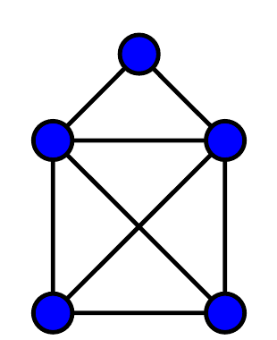
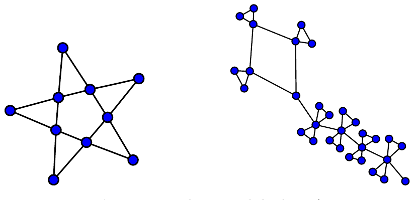
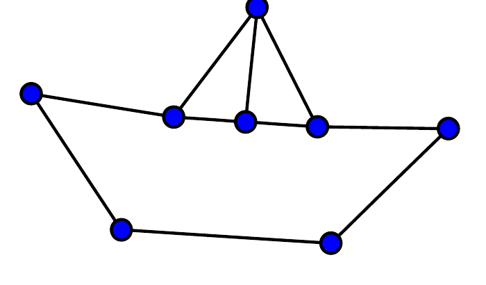
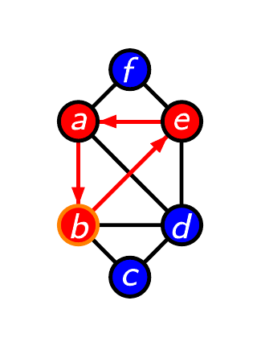
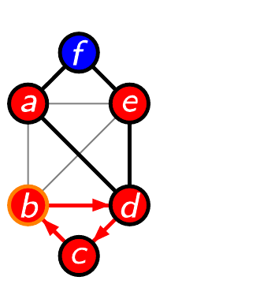
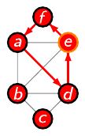
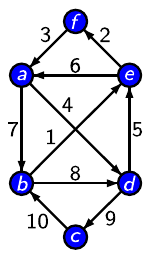
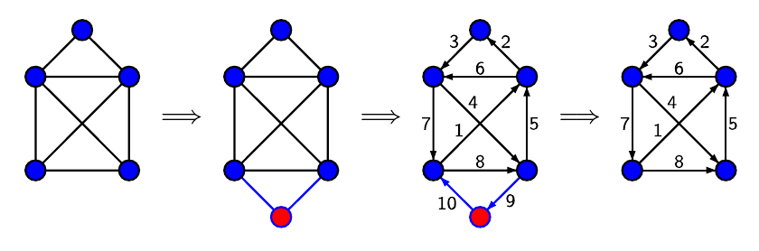

# الفصل 28: الدورات الأويلرية

**Michael Behrisch وAmin Coja-Oghlan وPeter Liske**

جامعة هومبولت في برلين (Humboldt-Universität zu Berlin)، برلين، ألمانيا
جامعة ووريك (University of Warwick)، كوفنتري، المملكة المتحدة
جامعة هومبولت في برلين (Humboldt-Universität zu Berlin)، برلين، ألمانيا

قد يكون إرباك أصدقائك بالألغاز تسليةً ممتعة إلى حدٍّ كبير — بشرط أن تكون تعرف الإجابة مسبقًا! ويقدّم «بيت بابا نويل» (House of Santa Claus) لغزًا صغيرًا لطيفًا:



يتكوّن هذا الشكل من خمس عُقد (النقاط الزرقاء) وثمانية أضلاع (الخطوط التي تصل العُقد). هل تستطيع رسم بيت بابا نويل بخط واحد، من دون رفع القلم ومن دون رسم أي ضلع مرتين؟

بالطبع، لن يمضي وقت طويل حتى يعرف جميع أصدقائك كيف يحلّون هذا اللغز (فثمة في الواقع 44 طريقة مختلفة لرسم بيت بابا نويل). ولكن لحسن الحظ توجد وفرة من الأشكال الأخرى التي يمكن رسمها بخط واحد أيضًا، بشرط أن تعرف كيف. وفي حالات أخرى قد ينتهي بك الأمر إلى المحاولة طويلًا، لتدرك في النهاية أن رسم الشكل دفعة واحدة يكاد يكون مستحيلًا.

في هذا الفصل نعرض خوارزمية (algorithm) تُنتج دائمًا طريقة لرسم شكل معطى دفعة واحدة إن كان ذلك ممكنًا. ولابتكار خوارزمية كهذه، لنحاول أولًا معالجة الأشكال التي يمكن رسمها بخط واحد بحيث ينتهي القلم عند العقدة نفسها التي بدأ منها.



الشكل 28.1. جرّب النجمة والتنّين!



الشكل 28.2. القارب الشراعي يقدّم مثالًا مضادًّا

يُسمّى المسار الذي يجتازه القلم عندئذٍ الدورة الأويلرية (Eulerian circuit). ويعود ذلك إلى أن عالم الرياضيات Leonhard Euler كان أول من اكتشف الأشكال التي يمكن رسمها بهذه الطريقة. (في الواقع، كان Leonhard Euler مهتمًّا في الأغلب بشكل واحد بعينه، هو خريطة الطرق في مدينته Königsberg.) واقتفاءً لأثر Euler، نعالج أولًا مسألة ما إذا كانت الدورة الأويلرية موجودة. وبعد ذلك نبيّن كيف نجد دورة أويلرية بسرعة إن وُجدت.

في ما يأتي سنكتشف لماذا توجد، على سبيل المثال، في الشكل النجمي دورة أويلرية، ولماذا لا توجد دورة أويلرية في بيت بابا نويل ولا في السفينة. والغريب أن بيت بابا نويل يمكن رسمه دفعة واحدة إذا سمحنا للقلم بأن ينتهي عند عقدة مختلفة عن التي بدأ منها، في حين أن ذلك مستحيل حتى في حالة السفينة. ولمعرفة السبب، علينا أن ننظر عن كثب في العُقد، أي المواضع التي يمكن للقلم أن يغيّر فيها اتجاهه. (تذكّر أن العُقد ليست سوى النقاط الزرقاء في أشكالنا.)

## متى توجد دورة أويلرية؟

درجة (degree) العقدة هي عدد الأضلاع التي تمرّ عبر تلك العقدة. فدرجة قمة صاري السفينة مثلًا ثلاث. وإذا رسمنا شكلًا بخط واحد بحيث يعود القلم في النهاية إلى نقطة البداية، فإن القلم يغادر كل رأس بعدد المرات نفسه الذي يدخله فيه. ومن ثمّ تكون درجة كل عقدة زوجية.

لاحظ أن في السفينة أربع عُقد درجتها فردية (وهي جميع العُقد التي تنتمي إلى الشراع). وهذا يُظهر أنه يستحيل رسم السفينة دفعة واحدة بحيث تتطابق نقطة البداية ونقطة النهاية. والأمر نفسه صحيح في بيت بابا نويل، لأن فيه عقدتين درجتهما ثلاث. غير أن ثمة التفافًا صغيرًا (سنكشف عنه لاحقًا) يمكّننا من رسم الشكل بخط واحد، ولكن بنقطة بداية ونقطة نهاية مختلفتين. وعلى النقيض، فإن درجات جميع عُقد الشكل النجمي زوجية. ولكن هل توجد دورة أويلرية في أي شكل تتوافر فيه هذه الخاصية؟ وإن وُجدت، فكيف نجدها في الواقع؟

## إيجاد الدورات الأويلرية

لنفترض أن درجات جميع العُقد زوجية. وفي غياب فكرة أفضل، يمكننا ببساطة أن نبدأ من مكان ما ونمضي في الرسم. أي نبدأ من عقدة اعتباطية ونتّبع ضلعًا اعتباطيًّا إلى عقدة أخرى. وحين نصل إليها، نختار ضلعًا آخر لم نستخدمه من قبل اعتباطيًّا، وهكذا.

في كل مرة ندخل عقدة أو نغادرها، نستهلك ضلعين من أضلاعها (لأنه لا يُسمح لنا باستخدام الضلع أكثر من مرة). ومن ثمّ، إذا كانت درجة العقدة زوجية في البداية، بقي عدد الأضلاع المتاحة عند تلك العقدة زوجيًّا. ونتيجة لذلك، لن نعلق في نهاية مسدودة. بكلمات أخرى، ستعيدنا استراتيجية «المضي قدمًا» في النهاية إلى العقدة التي بدأنا منها.



في الشكل على اليسار نشأت دورة (أي مسار عبر عدة أضلاع يعود إلى نقطة البداية) تتكوّن من ثلاثة أضلاع. وتمرّ الدورة بالرؤوس b وe وa.

غير أن اتباع الاستراتيجية أعلاه («ابدأ من مكان ما وامضِ حتى تعود إلى نقطة البداية») لا يُنتج بالضرورة دورة تغطّي جميع الأضلاع. فقد نكون اتخذنا «طريقًا مختصرًا» عند عقدة ما، وبذلك تجاوزنا جزءًا من الشكل. وإذا حدث ذلك، فسنحتاج إلى تمديد الدورة التي أنشأناها حتى الآن. وقبل أن نفعل، نزيل الأضلاع التي زرناها من قبل (لأنه لا يُسمح لنا باجتياز الأضلاع نفسها مرة أخرى على أي حال).



على سبيل المثال، في الشكل أعلاه، بعد العودة إلى نقطة البداية b، يمكننا تكرار الإجراء نفسه لإنشاء دورة أخرى. وفي المثال أعلاه تكون الدورة الثانية مثلثًا يمرّ بالعُقد b وd وc (الشكل على اليمين).

وبربط الدورتين اللتين حصلنا عليهما حتى الآن، نحصل على دورة أطول (b,e,a,b,d,c,b). لكن هذه الدورة أيضًا لا تشمل جميع الأضلاع. ومن ثمّ ينتظرنا تمديد آخر. وبالطبع، بما أن جميع الأضلاع المارّة بالرأس البدائي b مستهلكة بالفعل، فعلينا اختيار رأس آخر لإنشاء الدورة التالية.



لاحظ أن إزالة جميع الأضلاع التي تمرّ بها دورتنا الحالية (b,e,a,b,d,c,b) تترك لنا شكلًا تكون فيه درجات جميع العُقد زوجية. ومن ثمّ يمكننا أن نجد دورة أخرى بسهولة كما يأتي: اختر عقدة على الدورة «القديمة» لها ضلع لم نزره بعد. واعتبر هذه العقدة الرأس البدائي الجديد، وامضِ في إيجاد دورة أخرى باتباع استراتيجية «الرسم إلى الأمام». وفي المثال أعلاه نحصل على الشكل الرباعي ذي الزوايا a وd وe وf كما هو موضّح في الشكل على اليسار.

وهكذا، إضافةً إلى دورتنا «القديمة»، حصلنا على دورة جديدة تبدأ وتنتهي عند عقدة من عُقد الدورة القديمة. والخطة الآن هي تعليق الدورة الجديدة في الدورة القديمة. ولتحقيق ذلك، نتّبع الدورة القديمة أولًا حتى نصل إلى العقدة التي تبدأ منها الدورة الجديدة. وفي المثال أعلاه هذه العقدة هي e. ثم نمضي عبر الدورة الجديدة حتى نعود إلى نقطة بدايتها (أي e). وأخيرًا، بعد إتمام الدورة الجديدة، نواصل اتباع الدورة القديمة حتى نهايتها. ومن ثمّ يكون المسار الكامل (b,e,f,a,d,e,a,b,d,c,b).

خلاصةً، أنشأنا دورة «كبيرة» بدمج دورتين «صغيرتين». وفي مثالنا تشمل الدورة الكبيرة الشكل كله، على النحو المرغوب. ولكن ماذا نفعل في حالات أخرى لا تمرّ فيها الدورة الكبيرة بجميع الأضلاع؟

حسنًا، الأمر سهل: لماذا لا نكرّر الإجراء كله فحسب؟ أي نبحث عن عقدة على الدورة الكبيرة لها ضلع لم نمرّ به بعد. وبما أن الشكل الأصلي كان شيئًا واحدًا متصلًا، يوجد رأس كهذا ما دمنا لم نمرّ بجميع الأضلاع. وبعد إزالة جميع أضلاع الدورة الكبيرة من الشكل، نبدأ من العقدة المختارة وننشئ دورة جديدة كما في السابق. ثم نربط الدورتين للحصول على دورة أكبر.

نواصل ذلك حتى تُستهلك جميع أضلاع الشكل. وحين تنتهي جميع الأضلاع، تكون لدينا دورة أويلرية.



في المثال أعلاه دمجنا أولًا الدورتين (b,e,a,b) و(b,d,c,b) للحصول على الدورة (b,e,a,b,d,c,b). ثم بدأنا من جديد من العقدة e فحصلنا على (e,f,a,d,e). وبربط هذه بالدورة التي حصلنا عليها من قبل (b,e,a,b,d,c,b)، أنشأنا في النهاية الدورة الأويلرية (b,e,a,d,e,f,a,b,d,c,b)، وهي مرسومة في الشكل على اليمين. وتدلّ الأرقام على الترتيب الذي تجتاز به الجولة الأضلاع.

## الخوارزمية

تعمل الخوارزمية أدناه على نحو مشابه للمثال أعلاه، باستثناء خطوة الربط التي تُنفَّذ في الموضع نفسه. ومن ثمّ، بعد إيجاد دورة فرعية (مثل (b,e,a,b,d,c,b))، تُدرَج الدورة التالية في الحال. فمثلًا، افترض أن الدورة الحالية هي (b,e,a,b,d,c,b) وأن العقدة المختارة في السطر 4 هي u = a. وقد يكون الضلع المختار (a,d)، وهذا سيمدّ الدورة مبدئيًّا إلى (b,e,a,d,b,d,c,b). ومن الواضح أن هذه ليست دورة صحيحة بعد، لكن الخوارزمية ستواصل حتى تصل إلى a مرة أخرى.

تحسب الخوارزمية EulerianCircuit، لشكل درجات عُقده زوجية، الطريقةَ التي يُرسم بها بخط واحد، وتطبع الترتيب الذي يجب أن تُتبع به الأضلاع.

```text
  1   function EulerianCircuit(Figure F)
  2   begin
  3      Circuit := (s), for an arbitrary (start) node s in F
  4      while there is a node u with an outgoing edge in the Circuit
  5         v := u
  6         repeat
  7            take an edge v − w, starting in v
  8            insert the other end node w into the Circuit after v
  9            v := w
 10            remove the edge from F
 11         until v = u       // أُغلقت الدورة
 12      endwhile
 13      return Circuit
 14   end
```

## بيت بابا نويل

حتى الآن اهتممنا فقط بالأشكال التي فيها دورة أويلرية، والتي يمكن بالتالي رسمها بخط واحد بنقطة بداية ونهاية متطابقتين. ونعلم بالفعل أن هذا لا ينجح إلا إذا كانت درجات جميع عُقد الشكل زوجية. ولكن هذا غير صحيح في بيت بابا نويل: فدرجة العقدتين السفليتين فيه ثلاث. ومع ذلك، يمكن رسم الشكل بخط واحد إذا لم نُصرّ على أن تكون نقطة البداية ونقطة النهاية متطابقتين.

كيف نكيّف الخوارزمية لتعمل في بيت بابا نويل أيضًا؟

الحيلة البسيطة هي إدراج عقدة جديدة وربطها بالعقدتين ذواتَي الدرجة 3. ويكون في الشكل الناتج عُقد درجاتها زوجية فقط، ومن ثمّ ستعمل الخوارزمية وتُنتج دورة أويلرية.



وفي النهاية نحذف ببساطة عقدتنا «الاصطناعية» من الدورة الأويلرية: نبدأ الرسم من «العقدة المجاورة» اليسرى وننتهي عند المجاورة اليمنى، فنحصل بذلك على حلّ لبيت بابا نويل! وهذا ينجح نجاحًا خاصًّا في مثالنا لأن الأضلاع المضافة هي الأخيرة في الدورة.

وإذا لم يكن الأمر كذلك، علينا أن «نُزيح» الدورة (أي أن ندير ترتيب الأضلاع بحيث يصير 1، 2، 3، 4، 5، 6، 7، 8، 9، 10 هو 4، 5، 6، 7، 8، 9، 10، 1، 2، 3، على سبيل المثال)، لننقل تلك الأضلاع إلى النهاية.

وإذا كان في شكلنا عقدتان بالضبط درجتهما فردية، فستنجح هذه الحيلة دائمًا. أما الأشكال التي فيها أكثر من عقدتين درجتهما فردية فلا يمكن رسمها بخط واحد إطلاقًا، حتى لو سمحت باختلاف نقطة البداية والنهاية.

## عن سعاة البريد وجامعي القمامة

إضافةً إلى أنك تستطيع أن تُبهر أصدقائك بالخوارزمية الموصوفة (خصوصًا بالحكم «من النظرة الأولى»، أي باختبار درجات العُقد، على ما إذا كان الشكل يمكن رسمه بخط واحد)، فإن لها أيضًا تطبيقات جدّية. افترض أن الأضلاع شوارع والعُقد مفترقات. عندئذٍ يكون المسار الذي يزور كل شارع مرة واحدة بالضبط دورة أويلرية. ومن ثمّ، إذا كانت لديك دورات أويلرية في شبكة طرقك، فإنها توفّر مسارات سريعة وموفّرة للوقود للتوزيع البريدي وجمع القمامة. ويمكن لخوارزميتنا حساب هذه المسارات، لكننا سننفّذها بطبيعة الحال على حاسوب لمعالجة شبكات طرق فيها مئات الشوارع.

وللأسف، توجد في الواقع غالبًا أكثر من مفترقين لهما عدد فردي من الشوارع. ولهذا يجب أن يأخذ حساب مسارات جمع القمامة في الحسبان أنه لا بدّ من استخدام بعض الشوارع عدة مرات. وعند حساب أقصر مسار في هذا السيناريو يدخل طول الشوارع في الحساب أيضًا. ويؤدي هذا إلى ما يُسمّى مسألة ساعي البريد الصيني (Chinese Postman Problem).

وهكذا، فإن التعامل مع الدورات الأويلرية لا يتيح فقط جولة دائرية عبر الأضلاع والعُقد، بل يقود أيضًا من حاملٍ لطيف (بابا نويل) إلى آخر (ساعي البريد).

## قراءات إضافية

1. http://en.wikipedia.org/wiki/Seven_Bridges_of_Koenigsberg
   يشرح هذا المقال من ويكيبيديا كل شيء عن نقطة انطلاق هذه المسألة بوصفها مسألة «سياحية» طرحها Euler قبل أكثر من 270 عامًا.
2. http://en.wikipedia.org/wiki/Leonhard_Euler
   حياة وأعمال الشخص الذي لا تحمل اسمه الدورة الأويلرية فحسب، بل أيضًا عدد أويلر وكثير من الإنجازات الرياضية المهمة الأخرى.
3. على النقيض من الدورة الأويلرية، التي تزور جميع أضلاع شكل معطى، يتناول الفصل 9 اختبار ما إذا كان شكل ما يحتوي رأسًا معطى. والخوارزمية الخاصة بهذه المسألة شديدة الشبه بخوارزمية إيجاد الدورات الأويلرية.
4. الفصل 40 (مسألة البائع المتجول)
   في هذا الفصل رأينا خوارزمية لإيجاد دورة أويلرية، أي دورة تجتاز كل ضلع من أضلاع شكل معطى مرة واحدة بالضبط. ومن المفاجئ أن مسألة إيجاد دورة تزور كل رأس مرة واحدة بالضبط تبدو أصعب بكثير. وإذا كان الهدف في الواقع إيجاد أقصر دورة كهذه، انتهينا إلى مسألة صعبة بالغة الشهرة تُعرف بمسألة البائع المتجول.
5. فكّر أبعد من ذلك: رأينا أن الخوارزمية تعمل في الأشكال التي لكل نقطة فيها عدد زوجي من الخطوط الخارجة، ونعلم أننا نستطيع بسهولة إصلاح «عقدتين فرديتين»، وأنها لا تعمل مع أربع. ولكن ماذا عن عقدة واحدة أو ثلاث «عقد فردية»؟
