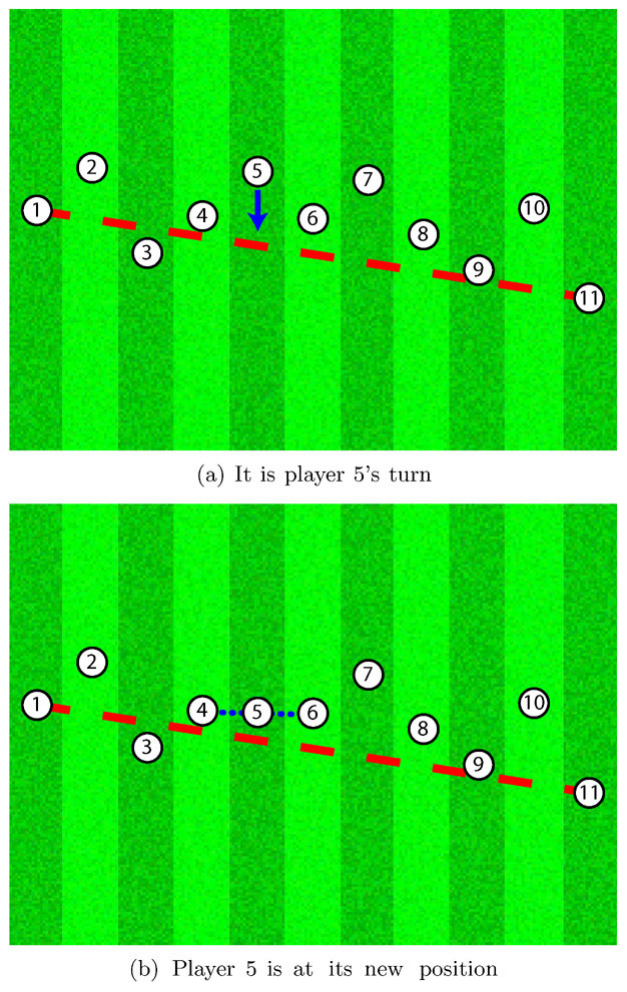
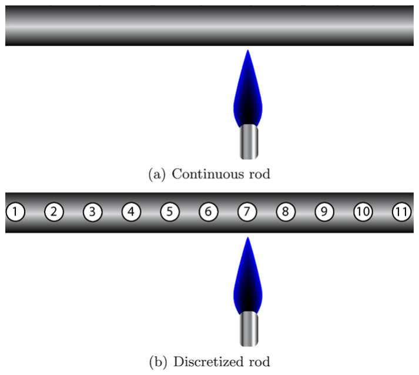
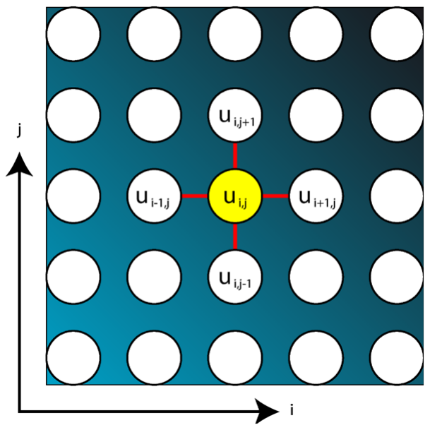
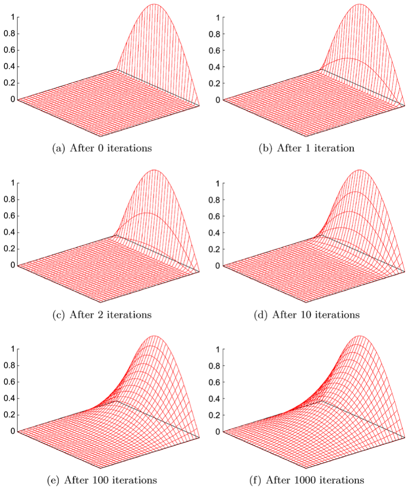
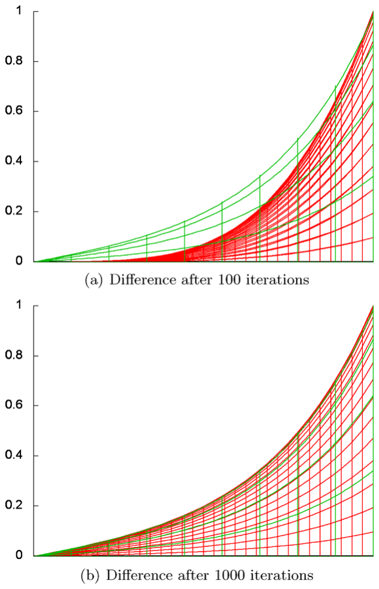

# الفصل 30: طريقة Gauß–Seidel التكرارية لحل المسائل الفيزيائية

**Christoph Freundl and Ulrich Rüde**

جامعة فريدريش ألكسندر في إرلانغن–نورنبرغ (Friedrich-Alexander-Universität Erlangen-Nürnberg)، إرلانغن، ألمانيا

## تمرين تمهيدي: كرة القدم

تتناول الخوارزمية التالية محاكاة التأثيرات الفيزيائية. ويمكن استخدام الحواسيب أيضًا لمحاكاة عمليات في الفيزياء والكيمياء وفي أي موضع من الطبيعة. وهذا يزداد أهمية باستمرار لأنه يساعد على فهم كيف تعمل الطبيعة. فمثلًا، تستند توقعاتنا الجوية إلى محاكاة تحاول تمثيل الطقس الطبيعي بأكبر دقة ممكنة على الحاسوب. كذلك تُحاكى طرازات السيارات والطائرات الجديدة قبل بنائها للمرة الأولى بزمن طويل. بل إن كثيرًا من العلماء يعتمدون اعتمادًا كاملًا على المحاكاة. فالفلكيون الذين يريدون فهم ما يحدث عند تصادم ثقبين أسودين لا بد لهم من محاكاة حاسوبية، لأن إجراء تجارب على ثقوب سوداء حقيقية أمر مستحيل. وألعاب الحاسوب أيضًا كثيرًا ما تشبه المحاكاة، لكن ليس من الضروري في الألعاب أن تتوافق الحسابات مع العالم الحقيقي.

وسنحاكي هنا مسألة مهمة بخوارزميتنا، هي توزّع الحرارة (heat distribution)، وهي مسألة مهمة أيضًا في التوقعات الجوية. غير أننا سنقتصر على الأجسام الصلبة كصفيحة ثنائية الأبعاد، لأن شرح المحاكاة يصبح أسهل إذا لم يكن علينا أن نأخذ تدفّق الهواء في الحساب. لكن لنبدأ أولًا بـ«تمرين تمهيدي» وننظر في مباريات كرة القدم.

بعد أن فاتها التأهل إلى الدور النهائي في كأس العالم الماضية بفارق ضئيل، يبلغ المنتخب الوطني أخيرًا المباراة النهائية بعد أربع سنوات. واللاعبون في غاية التوتّر، حتى إن المدرّب مقتنع بأنهم لن يستطيعوا حتى أن يقفوا في صفّ مرتّبين حسب أرقام قمصانهم، أثناء عزف النشيد الوطني.

ولأن المدرّب لا يُسمح له بدخول الملعب حيث كان يستطيع بسهولة أن يضع كل لاعب في موضعه من الصف، فقد اهتدى يائسًا إلى الطريقة التالية: يُلزم اللاعبَين الحاملَين للرقمين 1 و11، وهما أقصى اللاعبين يسارًا ويمينًا في الصف، بأن يحرصا على أن تكون المسافة بينهما كافية لجميع اللاعبين الآخرين. وبعد ذلك لا يجوز لهما مغادرة موضعيهما.



الشكل 30.1. الحالة أثناء الاصطفاف: المدرّب ينادي اللاعب 5، فينتقل إلى منتصف المسافة بين جاريه، اللاعبَين 4 و6، تمامًا. والخط الأحمر المتقطّع يحدّده اللاعبان الواقفان عند الطرفين، وينبغي أن يقف جميع اللاعبين عليه في النهاية على نحو مثالي.

أما اللاعبون الآخرون، أصحاب الأرقام من 2 إلى 10، فيتلقّون التعليمات التالية: إذا نُودي عليهم فليتحرّكوا إلى منتصف المسافة بين جارَيهم الأيمن والأيسر تمامًا (انظر الشكل 30.1). وينادي المدرّب جميع اللاعبين بالتتابع حسب ترتيب أرقام قمصانهم، وبعد أن يتحرّك اللاعب صاحب أعلى رقم يبدأ المدرّب من البداية من جديد.

ويمكنك أن تجرّب ذلك بنفسك سريعًا، مثلًا بأحجار اللعب. ويحتوي الموقع الإلكتروني الخاص بهذه الخوارزمية على برنامج يُصوّر هذه الطريقة تصويرًا بصريًّا. وسترى: بعد عدة دورات من هذه الطريقة يكون اللاعبون قد تحرّكوا فعلًا حتى يشكّلوا صفًّا تقريبيًّا على الأقل. وهو ليس مثاليًّا تمامًا، لكنه جيد بما يكفي بحيث لا يلاحظه أحد.

ولكي يقف اللاعبون على الخط تمامًا، سيكون على الخوارزمية أن تعمل زمنًا لا نهائيًّا. ولهذا لن تحصل في الممارسة العملية أبدًا على النتيجة الصحيحة تمامًا. لكن ذلك لا يهم، لأن ناتج الخوارزمية يستطيع بعد خطوات كثيرة بما يكفي أن يقترب من الحل الصحيح اقترابًا اعتباطيًّا. وأنت تصادف خوارزميات كهذه كثيرًا في ما يُسمّى المسائل العددية (numerical problems)، أي حين يجب حساب أعداد عشرية حقيقية، كالأعداد التي يحتاج إليها الفيزيائيون أو المهندسون.

وإذا اصطفّ اللاعبون حسب ترتيب أرقام قمصانهم، فسيُنادَى عليهم من اليسار إلى اليمين مرة بعد مرة، لكن يمكننا أن نفعل ذلك بطريقة أخرى أيضًا. فمن الصيغ الشائعة ما يُسمّى الترتيب الأحمر–الأسود (red-black ordering) للاعبين؛ وفيه يشغل نصف اللاعبين، أي أصحاب الأرقام الأدنى، المواضع المتباعدة في الصف أولًا، ثم يشغل اللاعبون أصحاب الأرقام العليا المواضع الباقية. بل حتى لو كان اللاعبون مرتّبين عشوائيًّا تمامًا، فإن الطريقة تظل تعمل، بشرط أن يكون واضحًا لكل لاعب مَن هما جاراه.

وهذه الطريقة هي خوارزمية Gauß وSeidel، وسنطبّقها في ما يلي على مسائل فيزيائية.

## حساب درجة الحرارة في قضيب (بُعد واحد)

ولننظر الآن جديًّا في حساب توزّع درجات الحرارة. أليس مثيرًا للدهشة بعض الشيء أن نستطيع استخدام مبدأ الاصطفاف في صفّ؟ فمثلًا، إذا نظرت إلى توزّع درجة الحرارة في قضيب رفيع، لاحظت أن درجة الحرارة عند كل نقطة على طول القضيب هي متوسط درجات الحرارة في جوار تلك النقطة. وإذا ثبّتت درجة الحرارة عند طرفَي القضيب، فإن درجة الحرارة بين الطرفين تسير «في صفّ»، أي خطيًّا من أحد الطرفين إلى الآخر.

ولكي تحسب هذا التوزّع الخطي للقيم لا تحتاج إلى حاسوب، تمامًا كما لم يحتج مدرّب كرة القدم إلى خوارزمية معقّدة ليضع اللاعبين في صفّ. لكننا نرى الآن أن المسألتين مترابطتان، وربما يمكن حلّهما بالطريقة نفسها. لاحظ أن موضع اللاعب يقابل قيمة درجة حرارة، وفي ما عدا ذلك يمكن أن يسير الحساب بالطريقة نفسها التي سرنا بها في مسألة كرة القدم.

وبعد ذلك نجعل المهمة أكثر تشويقًا قليلًا: كيف يبدو توزّع درجة الحرارة إذا سخّنّا القضيب عند نقطة ما في وسطه؟ عندئذ لم تعد درجة الحرارة عند تلك النقطة، بطبيعة الحال، متوسط درجات الحرارة المجاورة، إذ يجب أن تُؤخذ الحرارة الإضافية في الحساب.

ولم يبقَ الآن سبيل واضح لتحديد توزّع درجة الحرارة الناتج، لذا نفكّر كيف نستفيد من الحاسوب في حلّ هذه المسألة. وتنشأ أول صعوبة من أن عدد النقاط على طول القضيب لا نهائي، في حين أن الحاسوب لا يستطيع معالجة إلا عددًا منتهيًا من الأشياء في زمن منتهٍ. لذلك نختار عددًا منتهيًا من النقاط على طول القضيب (انظر الشكل 30.2) نريد حساب درجة الحرارة عندها. وتُسمّى هذه الطريقة أيضًا التقطيع، لأننا ننقل مسألة متصلة إلى مسألة منفصلة.



الشكل 30.2. تقطيع قضيب متصل بواسطة 11 نقطة.

وإذا كانت النقاط موزّعة بالتساوي على طول القضيب، وكان uᵢ يدلّ على قيمة درجة الحرارة وfᵢ على التسخين عند النقطة i، فإن درجة الحرارة عند نقطة معيّنة تُحدَّث بالصيغة

uᵢ := ½ (uᵢ₋₁ + uᵢ₊₁) + fᵢ.

```text
الخوارزمية GaussSeidel1D
  1   procedure GaussSeidel1D (n, u, f )
  2   begin
  3      for i := 2 to n − 1 do
  4         u[i] := ½ (u[i − 1] + u[i + 1]) + f [i]
  5      endfor
  6   end
```

وكما في مثال لاعبي كرة القدم، لا تُعاد إلا النقاط الواقعة في داخل القضيب حسابيًّا باستمرار، ونفترض أن درجات الحرارة عند طرفَي القضيب معطاة. وقد يحدث، بحسب التجربة الفيزيائية، أن تكون درجات الحرارة عند حدّي القضيب غير مثبّتة. كذلك لم نأخذ في الحساب أن القضيب في الممارسة العملية يفقد بعض الحرارة إلى جواره. وكان يمكننا أن نأخذ ذلك في الحساب باستخدام صيغ وحسابات أكثر تعقيدًا تبعًا لذلك، لكن ذلك يبعدنا أكثر من اللازم الآن. وسندرس بدلًا من ذلك صعوبة أخرى تظهر إذا أردنا ألّا نحسب توزّع درجة الحرارة في قضيب أحادي البُعد، بل في صفيحة ثنائية البُعد.

## حساب درجة الحرارة على صفيحة (بُعدان)

يمكننا أن نعمّم صياغة المهمة بأن نترك القضيب أحادي البُعد وراءنا وننظر الآن في صفيحة طهي ثنائية البُعد، قد تكون مسخّنة هي أيضًا عند بعض المواضع.

ويعمل التقطيع بطريقة مشابهة للحالة السابقة، إلا أننا نحصل الآن على شبكة نقاط ثنائية البُعد. ونريد أن نحسب درجة الحرارة عند هذه النقاط. ويعني حساب متوسط درجات الحرارة المجاورة عند نقطة ما الآن أن نأخذ في الحساب لا الجارَين الأيمن والأيسر فقط، بل الجارَين الأعلى والأدنى أيضًا (انظر الشكل 30.3).



الشكل 30.3. نظرة تخطيطية إلى صفيحة ثنائية الأبعاد مقطَّعة وإلى قالب النقاط الخمس.

ولأن هذا التمثيل يبيّن اعتماد نقطة ما على النقاط المجاورة لها، فإن المرء يحدّد القالب (stencil) الذي يجب تطبيقه على النقطة ومحيطها لإعادة حساب قيمتها. وفي هذه الحالة لدينا قالب من خمس نقاط (لأنه يشمل خمس نقاط متجاورة)، وتُحسب القيمة الجديدة لنقطة في داخل الصفيحة بـ

uᵢ,ⱼ := ¼ (uᵢ₋₁,ⱼ + uᵢ₊₁,ⱼ + uᵢ,ⱼ₋₁ + uᵢ,ⱼ₊₁) + fᵢ,ⱼ.

```text
الخوارزمية GaussSeidel2D
  1   procedure GaussSeidel2D (n, u, f )
  2   begin
  3      for i := 2 to n − 1 do
  4         for j := 2 to n − 1 do
  5            u[i, j] := ¼ (u[i − 1, j] + u[i + 1, j] + u[i, j − 1] + u[i, j + 1])
  6                +f [i, j]
  7         endfor
  8      endfor
  9   end
```

ولننظر في صفيحة مربّعة يقع ركنها السفلي الأيسر عند النقطة (0, 0) وركنها العلوي الأيمن عند النقطة (1, 1). درجات الحرارة عند نقاط حدّ الصفيحة مثبّتة، وتوزّع درجة الحرارة عند الحدّ الأيمن منحنًى تصفه الدالة sin(πy)، أما درجة الحرارة عند بقية الحدود فصفر. ونرسم درجة الحرارة قيمةً في البُعد الثالث بدلالة الموضع على الصفيحة. فنرى في هذه الصورة الثلاثية الأبعاد منظرًا طبيعيًّا يوافق ارتفاعُه درجةَ الحرارة عند تلك النقطة. وتُظهر الصورة الأولى (الشكل 30.4(a)) توزّع درجة الحرارة على شبكة مؤلّفة من 33 × 33 نقطة، حيث تكون درجة الحرارة صفرًا عند جميع النقاط إلا عند الحدّ الأيمن؛ فهناك يقع منحنى درجة الحرارة المذكور.

وهذا ليس توزّع درجة الحرارة الصحيح، إذ يجب أن تحسبه أولًا طريقة Gauß–Seidel. فعليها أن تبلغ توزّعًا سلسًا لدرجة الحرارة لم يعد خطيًّا كما في الحالة أحادية البُعد، حتى إذا لم توجد مصادر حرارة إضافية، وهو ما يُفترض في هذه الحالة.

وإذا نفّذنا الخوارزمية GaussSeidel2D مرة واحدة، سمّينا ذلك تكرارًا (iteration) واحدًا منفَّذًا. وهذا يعني ضمنًا أن علينا تنفيذ الخوارزمية عدة مرات للحصول على حل جيد. وإذا تتبّعنا عدة تكرارات من Gauß–Seidel (من الشكل 30.4(b) إلى الشكل 30.4(f))، رأينا كيف تنتشر درجة الحرارة المعطاة عند الحدّ في داخل الصفيحة، حتى يبدو توزّع درجة الحرارة على الصفيحة كلها سلسًا جميلًا في النهاية. ولا ينبغي التقليل من قدر الحساب، لأن كل تكرار من طريقة Gauß–Seidel عليه أن يحسب متوسط أربعة أعداد عند 31 × 31 = 961 نقطة. فمن أجل ألف تكرار يكون على الحاسوب أن ينفّذ نحو 5 ملايين عملية حسابية.



الشكل 30.4. تقدّم تكرارات Gauß–Seidel.

ومع أن الحل المحسوب يبدو جيدًا إلى حدّ كبير بعد 100 تكرار (الشكل 30.4(e))، فلا يجوز لنا أن نوقف الطريقة عند هذه اللحظة، كما نرى في الشكل 30.5. فالصورة الأولى (الشكل 30.5(a)) تُظهر الحل الدقيق لهذه المسألة والحل المحسوب بعد 100 تكرار من Gauß–Seidel معًا، بحيث نرى أن النتيجة المحسوبة ليست صحيحة تمامًا بعد. (ويمكنك أن تحدّد الحل الدقيق في هذه الحالة الخاصة بصيغة رياضية، هو u(x, y) = (1/sinh π) · sinh(πx) · sin(πy)، وهي الدالة الوحيدة التي تحقق شروط الحدّ المعطاة ويكون فيها مجموع المشتقّتين بالنسبة إلى x وy مساويًا للصفر.)



الشكل 30.5. الفروق بين الحل التقريبي (بالأحمر) والحل الدقيق (بالأخضر).

ولا يُظهر التراكب أي فرق بين الحل الدقيق وحلول الحاسوب إلا بعد نحو 1000 تكرار (الشكل 30.4(f) والشكل 30.5(b)).

وحتى لو بدا أن توزّع درجة الحرارة يُظهر التقدّم الزمني للتسخين أثناء التكرارات، فليس الأمر كذلك هنا. فما نحسبه هنا هو الحالة التي يكون فيها النظام في حالة توازن (equilibrium) مع التسخين المعطى. وهناك طرق أخرى أكثر تعقيدًا قليلًا تتيح لنا حساب التغيّرات الزمنية الصحيحة للتسخين أو التبريد.

ومن المثير للاهتمام بطبيعة الحال أن نعرف كم تكرارًا من طريقة Gauß–Seidel يلزم فعلًا للحصول على تقريب جيد للحل الفيزيائي. ويمكننا أن نقول بالتجربة (أو بالأحرى بتحليل رياضي للطريقة) إنه بالنسبة إلى شبكة مؤلّفة من N نقطة علينا تنفيذ نحو N × N تكرار. ومن جهة أخرى، بما أن درجة الحرارة على الصفيحة يمكن تمثيلها بدقة أكبر كلما كانت نقاط الشبكة أدقّ توزيعًا، فإننا نبلغ سريعًا جهدًا حسابيًّا يتجاوز حتى قدرة الحواسيب الشخصية الحديثة. وهذا يصحّ خصوصًا إذا أردنا أن نحاكي أجسامًا ليست ثنائية البُعد (كالصفيحة) بل ثلاثية الأبعاد، وإذا زادت ظواهر فيزيائية إضافية — كما في التوقعات الجوية — الحسابات تعقيدًا. عندئذ نحتاج لا إلى حواسيب عظمى أكثر تكلفة بكثير فقط (إذ تكلّف ملايين اليوروات)، بل أيضًا إلى خوارزميات محسّنة تحسينًا كبيرًا تستطيع حساب النتيجة نفسها في زمن أقصر.

وللمهتمين، هاتان فكرتان لكيف يمكن تسريع الطريقة: يُرى في الصور أن الحل الدقيق يُقرَّب من جهة واحدة، هي الأسفل. وبعبارة أخرى، كل تكرار من Gauß–Seidel يقرّبنا من الحل الدقيق لكنه لا يذهب بعيدًا بما يكفي. ويمكننا أن نستفيد من هذه الملاحظة بزيادة التغيّر المحسوب في كل تكرار، أي بالضرب في عدد أكبر من واحد (لكن أصغر من اثنين). والطريقة الناتجة هي ما يُسمّى طريقة SOR (من «successive over-relaxation»، أي الإفراط المتتالي في الاسترخاء). أما الفكرة الثانية فهي أعقد، وتقوم على عمل عدة شبكات ذات مسافات نقاط مختلفة معًا بطريقة بارعة. وهذه الطريقة، المسماة الطريقة متعددة الشبكات (multigrid method)، تحتاج إلى عدد صغير جدًا من التكرارات قبل أن تحسب حلولًا جيدة، وتُعدّ أسرع طريقة معروفة لهذه الأنواع من المسائل.

وأخيرًا نريد أن نذكر أن طريقة Gauß–Seidel اخترعها أشهر الرياضيين جميعًا، Carl Friedrich Gauß، عام 1823، ثم طوّرها أحد زملائه، Philipp Ludwig Seidel، مزيدًا من التطوير. وفي زمن Gauß وSeidel كان عليك بالطبع أن تنفّذ الحسابات يدويًّا. وقد كتب Gauß في رسالة: «يمكن تنفيذ الطريقة بعينين نصف معصوبتين، أو يمكن للمرء أن يفكّر في أمور أخرى أثناء تنفيذها». وإذا برمجنا الطريقة اليوم على حاسوب، فيمكننا نحن أيضًا أن نفكّر في أمور أخرى بينما تقوم الحواسيب بالعمل الحسابي.

## قراءات إضافية

1. الفصل 10 (PageRank — ما الأكثر صلة فعلًا في الشبكة العنكبوتية العالمية)
   يوضّح المقال عن خوارزمية ترتيب الصفحات كيف تُحلّ منظومة معادلات خطوة بخطوة: وهذه هي طريقة Gauß–Seidel تمامًا، لكن لمنظومة معادلات أخرى.
2. طريقة Gauß–Seidel بوصفها «خوارزمية الأسبوع»:
   http://www-i1.informatik.rwth-aachen.de/∼algorithmus/algo39.php
   وتحتوي النسخة الإلكترونية من هذا المقال (بالألمانية فقط) على تطبيقات Java تُوضّح تنفيذ الطريقة.
3. http://en.wikipedia.org/wiki/Gauss%E2%80%93Seidel_method
   يحتوي مقال ويكيبيديا هذا على وصف رياضي دقيق لطريقة Gauß–Seidel في منظومات معادلات اعتباطية.
4. «Why Multigrid Methods Are so Efficient» لـ Irad Yavneh:
   http://doi.ieeecomputersociety.org/10.1109/MCSE.2006.125
   يشرح هذا المقال، المنشور في مجلة Computing in Science & Engineering، فكرة الطرق متعددة الشبكات المذكورة أعلاه، لكنه يتطلب أيضًا رياضيات أكثر للفهم.
5. TOP500 — قائمة أسرع 500 حاسوب في العالم:
   http://www.top500.org/
   تُقدَّم هذه القائمة مرتين كل سنة، وتضمّ الحواسيب التي يمكن استخدامها لحساب حلول لمسائل كبيرة حقًّا.
6. http://en.wikipedia.org/wiki/Carl_Friedrich_Gauss
   http://en.wikipedia.org/wiki/Philipp_Ludwig_von_Seidel
   تصف هذان المقالان بإيجاز حياة الرياضيين الألمانيين Carl Friedrich Gauß وPhilipp Ludwig von Seidel، اللذين تُنسب إليهما الطريقة المعروضة.
