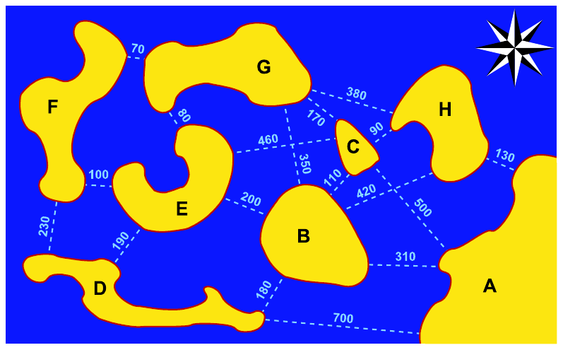
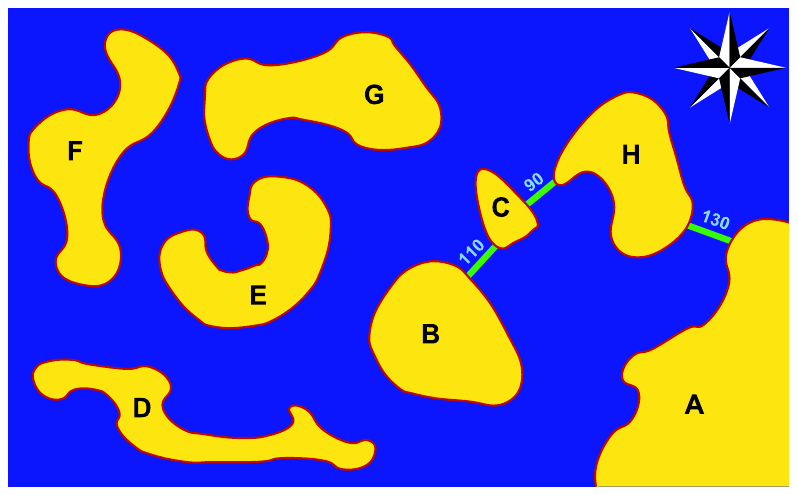

# الفصل 33: أشجار الامتداد الدنيا (أحيانًا يثمر الجشع . . .)

**Katharina Skutella and Martin Skutella**

جامعة برلين التقنية (Technische Universität Berlin)، برلين، ألمانيا

كان يا ما كان، في مملكة جزيرة نائية، عشيرة تُدعى عشيرة Algo. وكان أفراد العشيرة يعيشون متفرّقين في جزر المملكة السبع الظاهرة أدناه.

وكانت الجزر السبع والبرّ الرئيسي تتصل بعدد من العبّارات التي تتيح الزيارات والرحلات إلى البرّ الرئيسي. وتظهر خطوط العبّارات على الخريطة بخطوط متقطعة (الشكل 33.1). وتدلّ الأعداد على طول خط العبّارة بالأمتار.



الشكل 33.1. تألّفت مملكة Algo الجزيرية من الجزر السبع B وC و... وH. وتمثّل الخطوط المتقطعة خطوط العبّارات. وتدلّ الأعداد على أطوال خطوط العبّارات بالأمتار. فمثلًا كانت عبّارة تسير بين البرّ الرئيسي A والجزيرة D، وتقطع مسافة 700 م في اتجاه واحد

## مشروع الجسر لدى عشيرة Algo

كانت العبّارات تنقلب من حين إلى آخر في الطقس العاصف. لذلك قرّر أفراد العشيرة استبدال بعض خطوط العبّارات بجسور.

وفي السنة الأولى، كان من المقرَّر ربط إحدى الجزر السبع بالبرّ الرئيسي بجسر جديد. فبنى أفراد العشيرة جسرًا طوله 130 م بين A وH، لأن جميع الخطوط من A إلى الجزر الأخرى أطول منه.

وفي السنة الثانية، أرادوا ربط جزيرة أخرى بالبرّ الرئيسي. لذلك دُرِس بناء جسر بين A أو H وجزيرة أخرى. فبنى أفراد العشيرة أقصر جسر ممكن، وطوله 90 م، بين H وC.

وفي السنة الثالثة، كان بناء جسر آخر (بدءًا من A أو C أو H) كفيلًا بربط جزيرة ثالثة بالبرّ الرئيسي. وكان الخيار الأقصر ممكنًا هذه المرة هو الجسر الذي طوله 110 م بين B وC.

ويُظهر الشكل 33.2 الوضع الراهن لمشروع البناء الجاري. وكما ترى، لم يكن أفراد العشيرة قد أنجزوا مشروعهم بعد.



الشكل 33.2. الوضع الراهن لمشروع البناء بعد ثلاث سنوات. والجزر B وC وH متصلة بالبرّ الرئيسي بالفعل

وفي السنوات التالية بُني الجسر الذي طوله 170 م بين C وG، ثم الجسر الذي طوله 70 م بين F وG، ثم الجسر الذي طوله 80 م من G إلى E، وأخيرًا الجسر الذي طوله 180 م بين B وD.

وأخيرًا، بعد سبع سنوات، صارت جميع الجزر متصلة بعضها ببعض وبالبرّ الرئيسي بجسور. وبذلك اكتمل مشروع الجسر.

ويُظهر الشكل 33.3 شبكة الجسور النهائية لعشيرة Algo.


الشكل 33.3. شبكة الجسور النهائية لعشيرة Algo

وقد ابتهج أفراد العشيرة. فما استلزمه بناء الجسور من وقت وجهد كان هائلًا، لكنهم كانوا مقتنعين بأنهم تجنّبوا، قدر المستطاع، بناء جسور طويلة إلى حدّ مفرط. أما مجموع أطوال الجسور كلها فقد بلغ، كما يمكنك التحقق بسهولة، 830 م بالضبط.

## بناء الجسور بعد الإعصار

بعد وقت قصير من اكتمال الجسر الأخير، اجتاح إعصار رهيب المملكة ودمّر الجسور الثمينة تدميرًا كاملًا. وبعد أن استعاد أفراد العشيرة تمالُكهم، قرّروا إنشاء شبكة جسور جديدة. وكان المطلوب مرة أخرى أن تربط الجسور جميع الجزر بعضها ببعض وبالبرّ الرئيسي.

وبسبب الإعصار، قلّت مواد البناء. فاتُّفق على بناء أقصر جسر ممكن أولًا. لذلك بُني في السنة الأولى بعد الإعصار الجسر الذي طوله 70 م بين F وG.

وفي السنة الثانية أيضًا كانت مواد البناء شحيحة، فبُني الجسر التالي في الطول، وطوله 80 م من E إلى G.

وعلى هذا المنوال، بُني في السنة الثالثة الجسر الذي طوله 90 م بين C وH. وبعد بناء هذه الجسور الثلاثة صارت الجزر الثلاث E وF وG والجزيرتان C وH متصلة بعضها ببعض (انظر الشكل 33.4).

وفي السنة الرابعة، كان أقصر خط لم يُنفَّذ بعد هو الخط الذي طوله 100 م بين E وF. ولأن الجزيرتين كانتا متصلتين بالفعل إحداهما بالأخرى عبر G، بنوا بدلًا من ذلك الجسر الذي طوله 110 م بين B وC.


الشكل 33.4. الوضع الراهن لمشروع الجسر الثاني بعد ثلاث سنوات من الإعصار. وتتكوّن شبكة الجسور من ثلاثة جسور أطوالها 70 م و80 م و90 م. وأقصر خط لم يُنفَّذ بعد هو الخط بين E وF (المعلَّم بخط متقطع على الخريطة). غير أن أفراد العشيرة قرّروا في السنة الرابعة عدم بناء هذا الجسر، لأن الجزيرتين كانتا متصلتين بالفعل إحداهما بالأخرى عبر G

وفي السنة الخامسة أُضيف الجسر الذي طوله 130 م من A إلى H، ثم الجسر الذي طوله 170 م بين C وG، وأخيرًا في السنة السابعة الجسر الذي طوله 180 م من B إلى D. ويصوّر الشكل 33.5 شبكة الجسور الجديدة لعشيرة Algo.


الشكل 33.5. شبكة الجسور الثانية لعشيرة Algo

وبدهشة بالغة أدرك أفراد العشيرة أنهم، على الرغم من استراتيجيتهم الجديدة في بناء الجسور، انتهوا إلى شبكة الجسور نفسها التي يبلغ مجموع أطوالها 830 م (قارن الشكل 33.3). وقد أكّد ذلك اعتقادهم بأنهم وجدوا شبكة الجسور المثلى لجزرهم. وما لم يُوقعهم إعصار ثانٍ في مشكلات منذ ذلك الحين، فما زال أفراد العشيرة يتنزّهون سعداء فخورين على جسورهم إلى اليوم.

## خوارزميتا Prim وKruskal

ربما تتساءل الآن: هل كان أفراد العشيرة محقّين في فخرهم بشبكة جسورهم؟ فربما وُجدت شبكة جسور أفضل، أي أقصر؟ وبالتجربة والخطأ يمكنك أن تكتشف أن أي شبكة جسور أخرى تربط الجزر السبع والبرّ الرئيسي بعضها ببعض أطول من 830 م.

وتُسمّى شبكة الجسور ذات أصغر مجموع أطوال التي تربط أماكن عدة (هنا البرّ الرئيسي A والجزر من B إلى H) بعضها ببعض «شجرة الامتداد الدنيا». ولمسألة إيجاد شجرة امتداد دنيا تطبيقات عملية كثيرة مختلفة غير بناء الجسور. فهي تُطرَح مثلًا عند تخطيط شبكة الصرف الصحي لتجمّع سكني جديد. والهدف هو ربط جميع الوحدات السكنية بشبكة الصرف بأقل ثمن ممكن. ومن التطبيقات الأخرى تصميم شرائح الحاسوب وتخطيط شبكات المرور أو الاتصالات (الهاتف والتلفاز والإنترنت وغيرها).

وتجسّد كلتا استراتيجيتَي العشيرة خوارزميتين معروفتين لحلّ المسألة. فالاستراتيجية الأولى تُعرف بـ«خوارزمية Prim». وتربط هذه الخوارزمية الأماكن بالبرّ الرئيسي واحدًا بعد الآخر. وفي كل خطوة يُبنى أقصر جسر ممكن.

```text
خوارزمية Prim
  1   Choose a special place (mainland) and call it reachable.
  2   Initially all other places are not reachable.
  3   Repeat the following steps until all places are reachable:
      Build the shortest bridge between two places, of which one is reachable
      and one is not reachable, and call the one that had not been reachable
      yet reachable.
```

أما الاستراتيجية الثانية الموصوفة أعلاه (بعد الإعصار) فتُعرف بـ«خوارزمية Kruskal». تبني هذه الخوارزمية في كل خطوة أقصر جسر يربط مكانين لم يكونا متصلين قبل ذلك. وتختلف عن خوارزمية Prim في أنها لا تنظر في الجسور المؤدّية إلى البرّ الرئيسي فحسب، بل تسمح بأي جسور تربط مكانين لم يكونا متصلين بعد.

```text
خوارزمية Kruskal
Repeat the following step until all places are connected to each other through bridges:
Build the shortest bridge that connects two places that are currently not yet reachable from each other.
```

وتحسب خوارزميتا Prim وKruskal كلتاهما شجرة امتداد دنيا، وبينهما شيء مشترك. تذكّر استراتيجية العشيرة. فقد كان أفراد العشيرة في الاستراتيجيتين يخطّطون سنةً بسنة على نحو قصير النظر إلى حدّ بعيد. ففي كل سنة كانوا يختارون أفضل جسر (أي أقصر جسر) يدخل في الحسبان في ذلك الوقت. ولم يأخذوا في الحسبان أثر قراراتهم في مستقبل مشروع البناء. فقد تصرّفوا «بجشع». والخوارزميات التي لها هذه الخاصية تُسمّى أيضًا «جشعة» (greedy)، لأنها تتّخذ في كل خطوة أفضل خيار ممكن في ظل الظروف الراهنة. وكما ترى، فإن الجشع يثمر أحيانًا.

غير أن هذا النهج الجشع لا ينجح دائمًا. تخيّل مثلًا أنهم طلبوا إليك ربط الجزيرة D وحدها بالبرّ الرئيسي A بشبكة جسور أصغر مجموع أطوال ممكن. فشبكة الجسور التي صمّمها أفراد العشيرة على نحو جشع تربط D بـA عبر الجزر H وC وB. ومجموع أطوال الجسور على هذا المسار 510 م. ومن المؤكد أنك تستطيع إيجاد خط أقصر من البرّ الرئيسي A إلى الجزيرة D! وإذا أردت أن تعرف المزيد عن كيفية إيجاد أقصر خط من البرّ الرئيسي A إلى الجزيرة D، فانتقل إلى الفصل 32.

والواقع أن الخوارزميتين الموصوفتين أعلاه لهما خاصية أخرى مثيرة للاهتمام. فهما تحسبان دائمًا حلًّا يكون فيه طول أطول جسر أصغر ما يمكن. ويمكنك التحقق من ذلك بمثال المملكة الجزيرية.

## قراءات إضافية

1. الفصل 32 (أقصر المسارات)
   لم يكن جميع أفراد عشيرة Algo راضين عن جسورهم. فمثلًا اشتكى الزعيم «العرجاء» (Limping Leg) من الجزيرة D، وهو يراجع الطبيب الروحاني في البرّ الرئيسي بانتظام، من أن الطريق من D إلى A عبر B وC وH طويل بوضوح (510 أمتار جسور). كان الأجدر بهم أن يبنوا جسرًا من A إلى B، فكان ذلك سيخفّض المسافة إلى 490 متر جسور. اكتشف في الفصل 32 كيف تجد أقصر خط من البرّ الرئيسي إلى جميع الجسور!
2. الفصل 40 (مسألة البائع المتجول)
   كذلك ظلّ بائع الحليب «الشرش المتذمّر» (Whining Whey)، الذي كان عليه أن يوصّل كيسًا من جوز الهند إلى كل جزيرة يوميًّا، يشتكي. فكان يرى أنه كان ينبغي بناء الجسور على نحو يتيح جولة دائرية قصيرة تبدأ من البرّ الرئيسي وتمرّ بجميع الجزر. وكيف يُرضى بائع الحليب هو موضوع الفصل 40.
3. الفصل 3 (خوارزميات الترتيب السريعة)
   لتطبيق خوارزمية Kruskal، من المستحسن أولًا ترتيب الخطوط الممكنة حسب أطوالها ثم معالجتها بترتيب تصاعدي. ويمكنك أن تعرف كيف ترتّب بسرعة في الفصل 3.
4. الفصل 9 (الدورات في الرسوم البيانية)
   في السنة الرابعة بعد الإعصار لم يبنِ أفراد العشيرة أقصر جسر يربط E بـF، بل بنوا الجسر من B إلى C. لأن الجسر من E إلى F كان سيربط جزيرتين متصلتين بالفعل بجسور أخرى عدة. بعبارة أخرى: كان بناء جسر من E إلى F سيغلق دورة من E إلى G عبر F ثم عودة إلى E. ويُناقَش المزيد عن الدورات وعن كيفية كشفها في الفصل 9.
5. T.H. Cormen, C.E. Leiserson, R.L. Rivest, C. Stein: Introduction to Algorithms. MIT Press, 2nd edition, 2001.
   أما كيفية تنفيذ خوارزميتَي Prim وKruskal على حاسوب بحيث تجدان الحلّ بأسرع ما يمكن، وأمور كثيرة أخرى، فيمكن العثور عليها في هذا الكتاب الدراسي، الذي يُستخدم كثيرًا في مقرّرات طلاب السنة الأولى في علوم الحاسوب.
