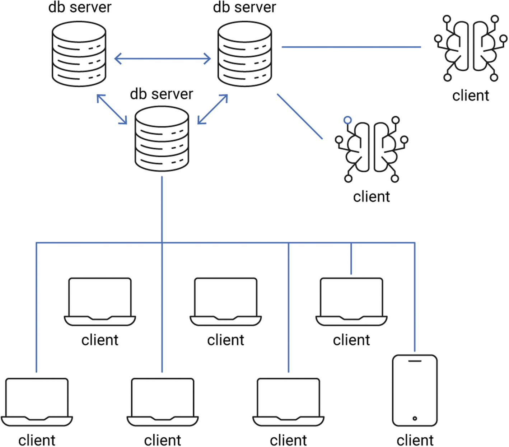
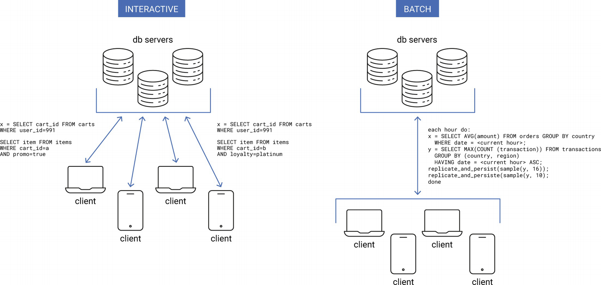
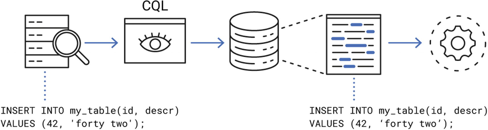
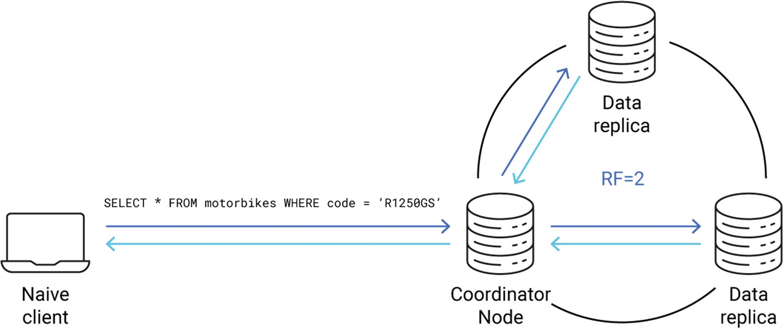
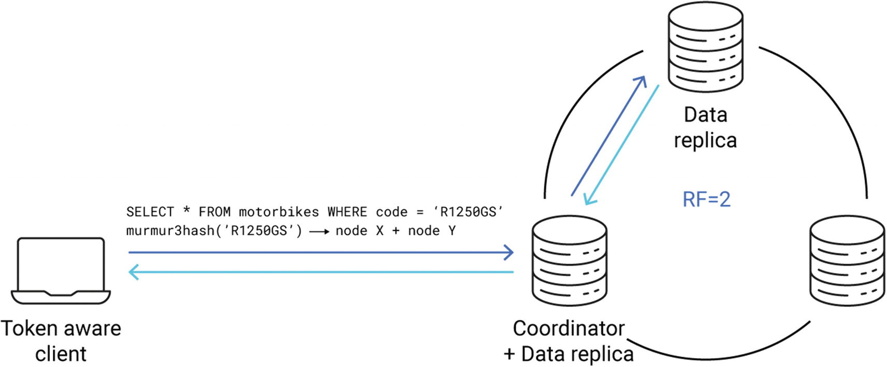
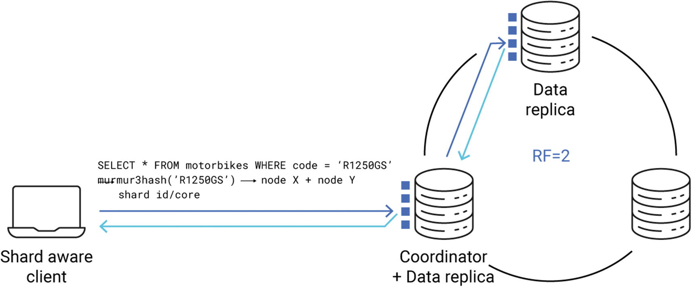
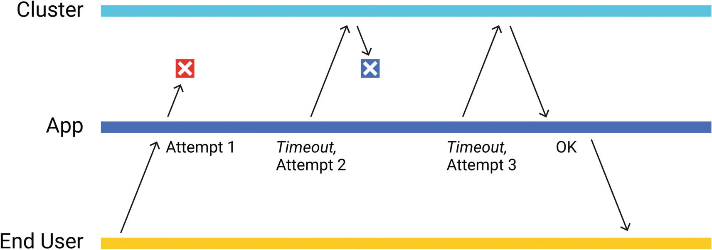
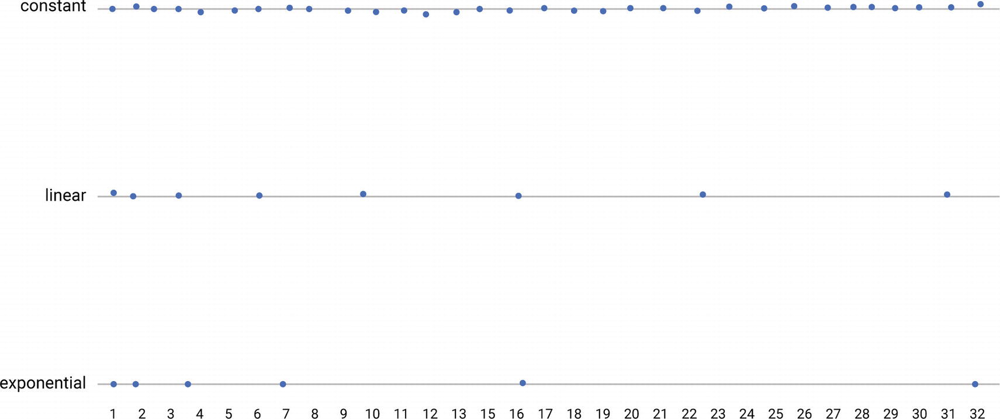
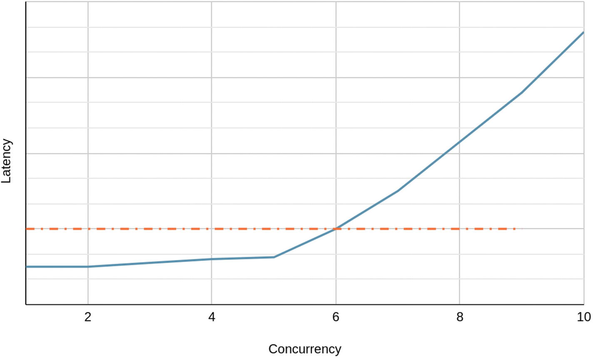

# الفصل 5: مشغّلات قواعد البيانات

**Felipe Cardeneti Mendes, Piotr Sarna, Pavel Emelyanov, Cynthia Dunlop**

تعرّض قواعد البيانات عادةً بروتوكول اتصال محدّدًا لمستخدميها. وهذا البروتوكول هو أساس التواصل بين العملاء والخوادم، ولذلك فهو موثَّق توثيقًا جيدًا في الغالب وله مواصفة رسمية. فبعض قواعد البيانات، مثل PostgreSQL، تنفّذ صيغتها الثنائية الخاصة فوق حزمة TCP/IP.^1 وبعضها الآخر، مثل Amazon DynamoDB،^2 يبني بروتوكوله فوق HTTP، وهو بروتوكول أكثر إسهابًا بعض الشيء، لكنه أيضًا أكثر مرونة وتوافقًا مع متصفحات الويب. وليس من النادر كذلك أن تعرّض قاعدة بيانات بروتوكولًا مبنيًّا على gRPC^3 أو على أي إطار عمل آخر راسخ.

ومهما كانت تفاصيل التنفيذ، فإن المستخدمين نادرًا ما يستخدمون البروتوكول الخام بأنفسهم، لأنه واجهة برمجية منخفضة المستوى إلى حدّ بعيد عادةً. وما يُستخدم بدلًا منه هو المشغّل (driver): واجهة برمجية مكتوبة بلغة معيّنة، تنفّذ تجريدًا أعلى مستوى للتواصل مع قاعدة البيانات. فالمشغّلات تخفي كل التفاصيل الدقيقة المزعجة خلف واجهة مريحة، وهو ما يعفي المستخدمين من معالجة إدارة الاتصالات والتحليل والتحقّق والمصافحة والمصادقة والمهلات وإعادة المحاولة وما إلى ذلك يدويًّا.

وفي بيئة موزّعة (وهي ما تكون عليه عنقود قاعدة بيانات قابل للتوسّع عادةً)، تُعدّ العملاء، وبالتالي المشغّلات، جزءًا بالغ الأهمية من المنظومة. فالعملاء هم عادةً أكبر مجموعة من الفاعلين في النظام، وهم كذلك غير متجانسين في طبيعتهم إلى حدّ كبير، كما يوضّح الشكل 5-1. فبعض العملاء يتصل عبر واجهات شبكة محلية، وبعضهم الآخر يتصل عبر نقطة اتصال Wi-Fi مشكوك فيها في قارة أخرى، ومن ثمّ فإن خصائص زمن الاستجابة ومعدّلات الأخطاء لديهم متباينة تباينًا هائلًا. وبعضهم قد يعمل على متحكّمات دقيقة بذاكرة وصول عشوائي سعتها 1 ميبيبايت، بينما يستخدم غيرهم آلات معدنية عارية بمعالجات من 64 نواة من مزوّد سحابي. ولهذا التنوّع، يصبح من المهم جدًّا أخذ المشغّلات في الحسبان عند التفكير في الأداء وقابلية التوسّع والمرونة أمام الأعطال. فالمشغّلات في النهاية هي التي تولّد حركة المرور وتزامنها، لذا فإن التعاون بينها وبين عقد قواعد البيانات أمر حاسم لبقاء النظام كله سليمًا وفعّالًا.

> **ملاحظة**
>
> تذكيرًا: التزامن في سياق هذا الكتاب هو مقياس لعدد العمليات التي تُنفَّذ في النقطة الزمنية نفسها. وهو يشبه التوازي من حيث المفهوم. ففي التزامن تحدث العمليات فعليًّا في الوقت نفسه (مثلًا على عدة أنوية معالجة أو عدة آلات). أما التوازي فلا يحدّد ذلك؛ إذ يمكن أن تُنفَّذ العمليات على خطوات صغيرة على آلة واحدة. وفي أيامنا هذه، لا بدّ للأنظمة الموزّعة من الاعتماد على توفير تزامن عالٍ كي تبقى منافسة وتلحق بالتقنية المتطوّرة باستمرار.

يُلقي هذا الفصل نظرة على كيفية تأثير المشغّلات في الأداء، من منظور شخص صمّم مشغّلات من أجل الأداء. وهو يقدّم رؤية إلى الطرق المتنوّعة التي يمكن أن تدعم بها المشغّلات تفاعلات فعّالة بين العملاء والخوادم، ويشارك نصائح لاستخلاص أقصى ما يمكن من مشغّل ما، خصوصًا من منظور الأداء. وأخيرًا، يختتم الفصل بعدد من الاعتبارات التي ينبغي وضعها في الحسبان عند اختيار مشغّل.

## العلاقة بين العملاء والخوادم

قابلية التوسّع مقياس لمدى جودة استجابة نظامك لزيادة الحمل. وهذا الحمل يولّده العملاء عادةً باستخدام مشغّلاتهم، لذا فإن الحفاظ على سلامة العلاقة بين عملائك وخوادمك أمر مهم. وكلّما عرفت أكثر عن أحمال عملك وسلوك عملائك وأنماط استخدامهم، كنت أفضل استعدادًا للتعامل مع الارتفاعات المفاجئة في حركة المرور والنمو المستمر طويل الأمد في الاستخدام.

كل عميل مختلف عن غيره وينبغي أن يُعامَل على هذا الأساس. وتأتي الاختلافات من خصائص العملاء، مثل عددهم وحجمهم، ومن متطلباتهم على حدّ سواء. فبعض العملاء لديهم ضمانات صارمة بشأن زمن الاستجابة، حتى على حساب ارتفاع معدّلات الأخطاء. وآخرون لا يبالون كثيرًا بزمن استجابة أي استعلام مفرد من قاعدة البيانات، بل يريدون فقط تقدّمًا مطّردًا في استعلاماتهم الطويلة الأمد. وبعض قواعد البيانات تستهدف أنواعًا معيّنة من العملاء (مثل قواعد البيانات التحليلية التي تتوقّع عملاء يعالجون استعلامات تجميعية كبيرة تعمل على أحجام هائلة من البيانات التاريخية). وغيرها يسعى إلى أن يكون شاملًا، فيتعامل مع كل أنواع العملاء ويوازن الحمل بحيث يرضى الجميع (أو، بدقة أكبر، «يرضى بما يكفي»).



**الشكل 5-1. تصوّر للعملاء والخوادم في نظام موزّع**

### أنواع أحمال العمل

هناك طرق متعدّدة لتصنيف عملاء قواعد البيانات. ومن الطرق المثيرة للاهتمام بشكل خاص التمييز بين العملاء الذين يعالجون أحمالًا تفاعلية وأحمالًا دفعية (تحليلية)، وتُعرف أيضًا باسم OLTP (المعالجة التفاعلية للمعاملات) في مقابل OLAP (المعالجة التحليلية للمعاملات) — انظر الشكل 5-2.



**الشكل 5-2. الفرق بين أحمال العمل التفاعلية والدفعية (التحليلية)**

#### أحمال العمل التفاعلية

العميل الذي يعالج حملًا تفاعليًّا يريد ضمانات معيّنة لزمن الاستجابة عادةً. فتلقّي استجابة بسرعة أهم من التأكّد من نجاح الاستعلام. وبعبارة أخرى، الأفضل إرجاع خطأ في الوقت المناسب من جعل العميل ينتظر إلى ما لا نهاية استجابةً صحيحة. وتتّسم هذه الأحمال في الغالب بتزامن غير محدود، ما يعني أن عدد العمليات الجارية يصعب التنبّؤ به.

ومن الأمثلة البارزة على الحمل التفاعلي خادم يتعامل مع طلبات من متصفحات الويب. تخيّل لعبة عبر الإنترنت يتفاعل فيها اللاعبون مع النظام مباشرةً من متصفحاتهم المفضّلة. فزمن الاستجابة المرتفع لمثل هذا اللاعب يعني تجربة مستخدم سيئة، لأن الناس يميلون إلى كره انتظار المحتوى على الإنترنت أكثر من بضع مئات من الميلي ثانية؛ ومع تأخيرات تبلغ ثوانٍ عدة، سيترك معظمهم اللعبة باعتبارها غير قابلة للاستخدام ويجرّبون شيئًا آخر. لذلك يصبح من المهم بشكل خاص أن تكون تفاعليًّا قدر الإمكان وأن تُرجع النتائج بسرعة، حتى إن كانت النتيجة خطأً مؤقتًا. وفي سيناريو كهذا، يتفاوت تزامن العملاء ويخرج عن سيطرة قاعدة البيانات. فأحيانًا قد يتدفّق عدد كبير من اللاعبين، وقد تحتاج قاعدة البيانات إلى رفض بعضهم تجنّبًا للتحميل الزائد.

#### أحمال العمل الدفعية (التحليلية)

حمل العمل الدفعي (التحليلي) هو النقيض المفهومي للحمل التفاعلي. فمع هذه الأحمال، لا يهمّ إن كانت أي طلب مفرد يُعالَج في بضع ميلي ثانية أو في ساعات. المهم أن يحقّق المعالجة تقدّمًا مطّردًا بمعدّل أخطاء مُرضٍ، وهو صفر مثاليًّا. وتميل الأحمال الدفعية إلى تزامن ثابت، وهو ما يسهّل على قاعدة البيانات إبقاء الحمل تحت السيطرة.

ومن الأمثلة الجيدة على الحمل الدفعي مهمة Apache Spark^4 تُجري تحليلات على مجموعة بيانات كبيرة (فكّر بالتيرابايتات). فلا يوجد سوى عدد قليل من الاتصالات المنشأة مع قاعدة البيانات، وهي ترسل الطلبات باستمرار لجلب البيانات من أجل حسابات طويلة. ولأن التزامن قابل للتنبّؤ به، تستطيع قاعدة البيانات الاستجابة بسهولة لزيادة الحمل بتطبيق ضغط عكسي (مثلًا بتأخير الاستجابات قليلًا). وستتباطأ المعالجة التحليلية ببساطة، وتعدّل سرعتها وفق السرعة التي تستطيع قاعدة البيانات بها استهلاك الاستعلامات.

#### الأحمال المختلطة

بعض الأحمال لا يمكن تصنيفها بسهولة كتفاعلية بالكامل أو دفعية بالكامل. فالعملاء أحرار في مزج متطلباتهم وتزامنهم وحملهم كما يشاؤون، لذا ينبغي أن تكون قواعد البيانات مستعدّة للمفاجآت أيضًا. فمثلًا قد يشهد حمل دفعي فجأةً ارتفاعًا مؤقتًا هائلًا في التزامن. وينبغي لقواعد البيانات، من جهة، أن تحتفظ بقدر من الثقة في الأنماط المعتادة للحمل، وأن تتوقّع من جهة أخرى أن الأحمال قد تتغيّر ببساطة مع الوقت، بسبب العلل أو تغييرات العتاد أو لمجرّد أن حالة الاستخدام انحرفت عن هدفها الأصلي.

### الإنتاجية مقابل الإنتاجية المفيدة

يتميّز عنقود قاعدة بيانات موزّع سليم بإنتاجية مفيدة مستقرة، لا بإنتاجية مستقرة فقط. والإنتاجية المفيدة (goodput) لفظ منحوت طريف من «جيد» و«إنتاجية»، وهي مقياس للبيانات المفيدة المنقولة بين العملاء والخوادم عبر الشبكة، في مقابل أي بيانات كانت. فالإنتاجية المفيدة تتجاهل الأخطاء وإعادة المحاولات الزائدة عن الحاجة، وتُستخدم للحكم على مدى فعّالية التواصل في الحقيقة.

وهذا التمييز مهم.

تخيّل حالة متطرّفة لعقدة محمّلة زيادةً عن الحدّ تُرجع أخطاءً مع كل طلب وارد. فمع أنه يمكن ملاحظة إنتاجية مستقرة ومستدامة، فإن قاعدة البيانات هذه لا تقدّم أي قيمة للمستخدم النهائي. لذلك من الضروري تتبّع مقدار البيانات المفيدة التي يمكن إيصالها في زمن مقبول. ويمكن تحقيق ذلك مثلًا بتتبّع الإنتاجية الكلية والإنتاجية المنفقة على إرجاع رسائل الخطأ معًا، ثم طرح إحداهما من الأخرى لمعرفة مقدار البيانات الصحيحة المنقولة (انظر الشكل 5-3).


**الشكل 5-3. لاحظ كيف تنتهي مهلة جزء من الإنتاجية، ما يتطلّب فعليًّا عملًا أكبر من العملاء لتحقيق الإنتاجية المفيدة**

تعظيم الإنتاجية المفيدة عملية دقيقة وحسّاسة، وتعتمد اعتمادًا كبيرًا على البنية التحتية ونوع الحمل وسلوك العملاء وعوامل أخرى كثيرة. وفي بعض الحالات قد يكون إسقاط الحمل من قبل قاعدة البيانات مفيدًا للنظام كله. والإسقاط (shedding) إجراء جذري إلى حدّ بعيد للتعامل مع التحميل الزائد: فالطلبات المصنّفة «خطرة» يتجاهلها الخادم ببساطة، أو ينهيها فورًا بخطأ. وهذا النوع من الحماية من التحميل الزائد مفيد بشكل خاص أمام المشكلات التي تولّدها الأحمال التفاعلية ذات التزامن غير المحدود (فليس أمام قاعدة البيانات كثير مما تفعله لحماية نفسها سوى إسقاط بعض الطلبات الواردة مبكرًا).

خادم قاعدة البيانات ليس عرّافًا؛ فهو لا يستطيع التنبّؤ بدقّة بما إذا كان طلب ما سيفشل بسبب التحميل الزائد، لذا لا بدّ له من التخمين. ولحسن الحظ، هناك طرق غير قليلة لجعل هذا التخمين مبنيًّا على معرفة:

- إسقاط الحمل إذا كانت X من الطلبات قيد المعالجة بالفعل، حيث X هو الحدّ الأقصى المقدّر الذي تستطيع عقدة قاعدة البيانات التعامل معه.
- رفض طلب إذا كان استخدامه المقدّر للذاكرة أكبر مما تستطيع قاعدة البيانات التعامل معه في اللحظة الراهنة.
- رفض طلب احتماليًّا إذا كانت Y من الطلبات قيد المعالجة بالفعل، حيث Y نسبة مئوية من الحدّ الأقصى الذي تستطيع عقدة قاعدة البيانات التعامل معه، على أن ترتفع الاحتمالية إلى 100 بالمئة متى بلغت عتبة معيّنة.
- رفض طلب إذا كان زمن تنفيذه المقدّر يشير إلى أنه لن ينتهي في الوقت المناسب، وأن الأرجح أن تنتهي مهلته على أي حال.

ومع أن رفض طلبات العملاء يضرّ بتجربة المستخدم، فإنه أحيانًا أهون الشرَّين ببساطة. فإذا كان إسقاط عدد من الطلبات يتيح لعدد أكبر منها أن ينتهي بنجاح في الوقت المناسب، فإنه يزيد الإنتاجية المفيدة للعنقود.

ويستطيع العملاء مساعدة قاعدة البيانات على تعظيم الإنتاجية المفيدة وإبقاء زمن الاستجابة منخفضًا بأن يعلنوا المدة التي يُعتبر الطلب صالحًا خلالها. فمثلًا في التداول عالي التردّد، الطلب الذي يستغرق أكثر من بضعة ميلي ثانية يعادل طلبًا فشل. وبإخبار قاعدة البيانات بأن الأمر كذلك، يمكنك السماح لها بإحالة بعض الطلبات إلى التقاعد مبكرًا، وترك موارد قيّمة لطلبات أخرى لا تزال لديها فرصة للنجاح. وإدارة المهلات إدارة سليمة موضوع واسع ويستحق بخشًا مستقلًّا.

## المهلات الزمنية

في نظام موزّع، هناك نوعان أساسيان من المهلات يؤثر كل منهما في الآخر: المهلات من جهة العميل والمهلات من جهة الخادم. ومع أنهما متشابهان مفهوميًّا، فخصائصهما مختلفة. ومن الحيوي ضبطهما معًا ضبطًا سليمًا لمنع مشكلات مثل تسابقات البيانات ومشكلات الاتساق.

### المهلات من جهة العميل

يُضبط هذا النوع من المهلات في مشغّل قاعدة البيانات عمومًا. وهو يدلّ على المدة التي يستغرقها المشغّل ليقرّر أن استجابة من الخادم ليس مرجَّحًا أن تصل. وفي عالم مثالي مبنيّ على شبكة مثالية، تردّ جميع الأطراف على طلباتها دائمًا. لكن في الواقع العملي، هناك أسباب عديدة لتأخّر استجابة أو فقدانها:

- موت المستقبِل
- انشغال المستقبِل بمهام أخرى
- فشل الشبكة، ربما بسبب عطل في العتاد
- وجود تأخير كبير في الشبكة لأن الحزم تعلق في موجّه وسيط
- علة برمجية تسبّبت في فقدان الحزمة
- وهكذا

ولأنه يستحيل عادةً في بيئة موزّعة تخمين ما حدث، فلا بدّ للعميل أحيانًا من أن يقرّر أن طلبًا ما قد فُقد. والبديل هو الانتظار إلى ما لا نهاية. وقد ينجح ذلك مع مجموعة مختارة من حالات الاستخدام، لكنه غالبًا غير مقبول ببساطة. فإذا احتجز طلب فاشل واحد موردًا لمدة غير محدّدة، فالنظام محكوم عليه بالفشل في النهاية. ولذلك تُستخدم المهلات من جهة العميل آليةً لضمان أن يظلّ النظام قادرًا على العمل حتى في حال وجود مشكلات في التواصل.

ومن الخصائص الفريدة للمهلة من جهة العميل أن قرار التخلّي عن طلب يتّخذه العميل وحده، في غياب أي تغذية راجعة من الخادم. فمن الممكن تمامًا أن الطلب المعني لا يزال قيد المعالجة ويستهلك موارد الخادم. والأسوأ من ذلك أن الخادم غير المطّلع قد يُرجع الاستجابة إلى العميل بكل سرور بعد انتهاء المعالجة، مع أنه لم يعد أحد مهتمًّا بهذه البيانات القديمة! وهذا يمثّل جانبًا آخر من معالجة الأخطاء: فيجب أن تكون المشغّلات مستعدّة للتعامل مع الاستجابات الشاردة المنتهية الصلاحية تعاملًا صحيحًا.

### المهلات من جهة الخادم

تحدّد المهلة من جهة الخادم متى ينبغي لعقدة قاعدة البيانات أن تبدأ في اعتبار طلب معيّن منتهي الصلاحية. فمتى تجاوزنا هذه النقطة الزمنية، لم يعد هناك سبب لمواصلة معالجة الاستعلام. (فالاستمرار في ذلك سيهدر موارد كان يمكن استخدامها في خدمة استعلامات أخرى لا تزال لديها فرصة للنجاح.) وعندما ينقضي الوقت المحدّد، تُرجع قواعد البيانات في الغالب خطأً يشير إلى أن الطلب استغرق وقتًا أطول من اللازم.

ويساعد استخدام قيم معقولة للمهلات من جهة الخادم قاعدة البيانات على إدارة أولوياتها بطريقة أدقّ، بتخصيص المعالج والذاكرة وغيرهما من الموارد الشحيحة للاستعلامات التي يُرجَّح نجاحها في الوقت المناسب. أما المشغّلات التي تتلقّى خطأً يشير إلى حدوث مهلة من جهة الخادم فينبغي أن تتصرّف بدورها بما يقتضي ذلك، ربما بتخفيف الضغط على عقدة معيّنة أو بإعادة المحاولة على عقدة أخرى لم تشهد مهلات مؤخرًا.

#### حكاية تحذيرية

يأتي بروتوكول CQL، الذي يحدّد طبقة التواصل في Apache Cassandra وScyllaDB، بدعم مدمج للتزامن. فكل طلب يُسنَد إليه معرّف تدفّق (stream ID) فريد لكل اتصال. ويُرمَّز معرّف التدفّق هذا عددًا صحيحًا من 16 بتة، مع حجز البتة الأولى للبروتوكول، وهو ما يترك للمشغّلات 32768 قيمة فريدة للتعامل مع الطلبات الجارية لكل اتصال واحد. ويُستخدم معرّف التدفّق هذا لاحقًا لمطابقة استجابة واردة مع طلبها الأصلي. وهذا ليس رقمًا كبيرًا بشكل خاص، بالنظر إلى أن الأنظمة الحديثة معروفة بقدرتها على التعامل مع ملايين الطلبات في الثانية. ومن ثمّ تحتاج المشغّلات إلى إعادة استخدام معرّفات التدفّق المسندة سابقًا في نهاية المطاف.

لكن مشغّل CQL للغة Python كان فيه علة.^5 فعند حدوث مهلة من جهة العميل، كان يفترض أن معرّف التدفّق الخاص بالطلب المنتهي صار حرًّا فورًا لإعادة الاستخدام. ومع أن هذا الافتراض صحيح إذا مات الخادم، فهو غير صحيح إذا كانت المعالجة تستغرق وقتًا أطول من المتوقّع فحسب. ومن ثمّ كان ممكنًا أن يصل بعد ذلك ردٌّ بمعرّف تدفّق معيّن بعد أن يكون طلب آخر قد أعاد استخدام معرّف التدفّق ذاته، فيطابق المشغّل الردّ مع الطلب الجديد مطابقةً خاطئة. وإذا كان المستخدم محظوظًا، فسيحصل على بيانات مشوّشة لم تجتز التحقّق. ولكن للأسف قد تبدو البيانات الواردة من الردّ غير المطابق صحيحة، مع أنها آتية من طلب مختلف تمامًا. وهذا نوع من العلل يبدو بريئًا للوهلة الأولى، لكنه قد يتسبّب في دخول أشخاص إلى حسابات بنكية لأشخاص آخرين وإحداث الفوضى في حياتهم.

ومن القواعد العملية للمهلات من جهة العميل التأكّد من وجود مهلة من جهة الخادم أيضًا، وأن تكون أقصر قطعًا من مهلة العميل. وينبغي لها أن تراعي مزامنة الساعات بين العملاء والخوادم (أو انعدامها)، وكذلك زمن الاستجابة الشبكي المقدّر. فمثل هذا الإجراء يقلّل إلى أدنى حدّ فرص وصول استجابة متأخّرة أصلًا، ويزيل بذلك السبب الجذري لكثير من المشكلات والثغرات.

## الوعي بالسياق

ينبغي أن يكون واضحًا في هذه المرحلة أن كلا الخادمين والعملاء يستطيعون اتخاذ قرارات أفضل وأكثر علمًا ومفيدة للطرفين إذا عرفوا المزيد عن بعضهم بعضًا. فتبادل معلومات المهلات مهم، لكن المشغّلات والخوادم تستطيع أن تفعل أكثر من ذلك لإبقاء كل منها مطّلعًا على الآخر.

### الطوبولوجيا والبيانات الوصفية

غالبًا ما تُجمَّع خوادم قواعد البيانات في طوبولوجيات معقّدة، إذ تُجمَّع عقد معيّنة في موقع جغرافي واحد، وتُستخدم عقد أخرى طبقةً سريعةً للتخزين المؤقت فقط، وتخزّن عقد ثالثة بيانات باردة نادرًا ما تُطلَب في مكان رخيص، لأغراض الطوارئ فقط.

وليست كل قاعدة بيانات تعرّض طوبولوجيتها للمستخدم النهائي. فمثلًا يرفع DynamoDB هذا العبء عن عملائه ويعرّض نقطة نهاية واحدة فقط، ويتولّى بنفسه موازنة الحمل ومنع التحميل الزائد وآليات إعادة المحاولة. وفي المقابل، تعتمد نسبة لا بأس بها من قواعد البيانات الشائعة (ومنها ScyllaDB وCassandra وArangoDB) على المشغّلات للاتصال بكل عقدة، ولتقرير عدد الاتصالات التي تُبقيها، ومتى تعيد المحاولة استكشافيًّا، ومتى تغلق اتصالًا يُشتبه في سوء عمله. وفي حالة ScyllaDB، تساعد مشاركة معلومات طوبولوجيا محدّثة مع المشغّلات على اتخاذ القرارات الصحيحة. ويمكن مشاركة هذه البيانات بطرق متعدّدة:

- أن يجلب العملاء معلومات الطوبولوجيا من الخوادم دوريًّا
- أن يشترك العملاء في أحداث يرسلها الخوادم
- أن يشارك العملاء مشاركة فعّالة في أحد بروتوكولات تبادل المعلومات (مثل النميمة gossip^6)
- أي توليفة من هذه الطرق

وبحسب نموذج قاعدة البيانات، هناك قطعة معلومات قيّمة أخرى تُخزَّن مؤقتًا في جهة العميل في الغالب، وهي البيانات الوصفية، ومثالها الأبرز مخطّط قاعدة البيانات. فقواعد بيانات SQL، وكذلك كثير من قواعد بيانات NoSQL، تُبقي البيانات منظّمة جزئيًّا على الأقل. ويحدّد المخطّط شكل صف قاعدة البيانات (أو عمودها)، وأنواع البيانات المخزّنة في مختلف الأعمدة، وخصائص أخرى متنوّعة (مثل المدة التي يُفترض أن يعيشها صف قاعدة بيانات قبل أن يُجمع كقمامة). وبناءً على مخطّطات محدّثة، تستطيع المشغّلات إجراء تحقّق إضافي، والتأكّد من أن البيانات المرسلة إلى الخادم ذات نوع سليم وتلتزم بأي قيود تطلبها قاعدة البيانات. وفي المقابل، عندما تخرج ذاكرة المخطّطات المؤقتة في جهة المشغّل عن التزامن، قد يجد العملاء استعلاماتهم تفشل من دون سبب ظاهر.

وقد تكون مزامنة معلومات المخطّط الكاملة مكلفة من حيث الأداء، وإيجاد حلّ وسط جيد في عدد مرات التحديث يعتمد اعتمادًا كبيرًا على حالة الاستخدام. والقاعدة العملية أن تُحدّث بالقدر اللازم فقط لضمان ألّا تؤثر حركة المرور الناتجة عن تبادل البيانات الوصفية تأثيرًا سلبيًّا في تجربة المستخدم أبدًا. ويجدر بالذكر أيضًا أن العملاء في قاعدة بيانات موزّعة ليسوا محدّثين دائمًا بأحدث معلومات المخطّط، وينبغي أن يكون النظام ككل مستعدًّا للتعامل مع ذلك وأن يوفّر تكتيكات للتعامل مع هذه التناقضات.

### الحمل الحالي

حماية النظام من التحميل الزائد وتحسين زمن استجابة الطلبات مهامّ شاقّة، لكن تبادل أكبر قدر ممكن من السياق بين الأطراف المعنية يستطيع تيسيرها تيسيرًا كبيرًا.

ويمكن تطبيق الطرق الآتية لتوزيع الحمل توزيعًا متساويًا على النظام الموزّع ومنع الارتفاعات غير المرغوبة:

1. جمع إحصاءات زمن الاستجابة لكل اتصال بقاعدة بيانات في المشغّلات:
   - ما متوسط زمن الاستجابة لهذا الاتصال؟
   - ما زمن الاستجابة عند المئين 99؟
   - ما أقصى زمن استجابة لوحظ في إطار زمني حديث؟
2. تبادل المعلومات عن ذاكرات التخزين المؤقت في جهة الخادم:
   - هل الذاكرة المؤقتة ممتلئة؟
   - هل الذاكرة المؤقتة دافئة (أي مملوءة ببيانات مفيدة)؟
   - هل تعاني بعض العناصر من حركة مرور و/أو زمن استجابة مرتفعين؟
3. تفسير أحداث الخادم:
   - هل بدأ الخادم يردّ بـ«أخطاء التحميل الزائد»؟
   - ما عدد مرات انتهاء مهلة الطلبات الموجّهة إلى هذا الخادم؟
   - ما معدّل الأخطاء العام لهذا الخادم؟
   - ما الإنتاجية المفيدة المقيسة من هذا الخادم؟

وبناءً على هذه المؤشّرات، ينبغي للمشغّلات أن تحاول تعديل مقدار البيانات التي ترسلها، والتزامن، ومعدّل إعادة المحاولات فضلًا عن التنفيذ الاستكشافي، وهو ما يمكن أن يُبقي النظام الموزّع كله في حالة سليمة متوازنة. وفي النهاية، من مصلحة المشغّل أن يخفّف الضغط على العقد التي تبدأ في إظهار أعراض التحميل الزائد، سواء بتقليل تزامن العمليات، أو بتحديد معدّل إعادة المحاولات وعددها، أو بالتخلّي مؤقتًا عن الطلبات المرسلة استكشافيًّا، وما إلى ذلك. وإلّا، فإذا تحمّلت خوادم قاعدة البيانات أكثر من طاقتها، فقد يعاني جميع العملاء أعراضًا مثل فشل الطلبات والمهلات وارتفاع زمن الاستجابة وما إلى ذلك.

### تخزين الاستعلامات مؤقتًا

تطبّق كثير من أنظمة إدارة قواعد البيانات، بدءًا من SQLite وMySQL وPostgres وصولًا إلى قواعد بيانات NoSQL، تقنية تحسين تُسمّى *البيانات المُعدّة* (prepared statements). فمع أن اللغة المستخدمة للتواصل مع قاعدة البيانات مقروءة للبشر عادةً (أو مقروءة للمطوّرين على الأقل)، فإنها ليست الطريقة الأكثر كفاءة لنقل البيانات من حاسوب إلى آخر.

لنلقِ نظرة على دورة الحياة (المبسّطة) لبيان غير مُعدّ بعد إرساله من مشغّل ScyllaDB إلى قاعدة البيانات ثم عودته. ويوضّح ذلك الشكل 5-4.



**الشكل 5-4. دورة حياة بيان غير مُعدّ**

1. تُنشأ سلسلة استعلام:

   `INSERT INTO my_table(id, descr) VALUES (42, 'forty two');`

2. يحزم المشغّل السلسلة في إطار CQL. ويتكوّن كل إطار CQL من ترويسة تصف الغرض من الإطار المعني. وقد يُرسَل بعد الترويسة حمولة معيّنة أيضًا. والمواصفة الكاملة للبروتوكول متاحة في [`https://github.com/apache/cassandra/blob/trunk/doc/native_protocol_v4.spec`](https://github.com/apache/cassandra/blob/trunk/doc/native_protocol_v4.spec).
3. يُرسَل إطار CQL عبر الشبكة.
4. تستقبل قاعدة البيانات الإطار.
5. متى وصل الإطار، تفسّر قاعدة البيانات ترويسته ثم تبدأ في تحليل الحمولة. وإذا كان هناك بيان غير مُعدّ، فإن الحمولة تتمثّل ببساطة في سلسلة، كما في الخطوة 1.
6. تحلّل قاعدة البيانات السلسلة للتحقّق من محتواها وتفسير نوع العملية المطلوبة: هل هي إدخال أم تحديث أم حذف أم اختيار؟
7. متى حُلّل البيان، تستطيع قاعدة البيانات مواصلة معالجته (مثلًا بحفظ البيانات على القرص، أو جلب ما يلزم، وما إلى ذلك).

الآن تخيّل أن مستخدمًا يريد إجراء مئة مليون عملية على قاعدة البيانات بسرعة متعاقبة لأن البيانات تُرحَّل من نظام آخر. وحتى لو كان تحليل سلاسل الاستعلام عملية سريعة نسبيًّا وتستغرق 50 ميكروثانية، فإن مجموع الوقت المنفق على تحليل السلاسل سيتجاوز ساعة من زمن المعالج. يبدو هذا هدفًا واضحًا للتحسين.

والملاحظة الجوهرية أن العمليات المنفّذة على قاعدة البيانات متشابهة عادةً وتتبع نمطًا معيّنًا. فمثلًا قد يعني ترحيل جدول من نظام إلى آخر إرسال كثير من الطلبات بالمخطّط الآتي:

```text
INSERT INTO my_table(id, descr) VALUES (?, ?)
```

حيث تدلّ علامة الاستفهام على الجزء الوحيد من السلسلة الذي يتغيّر بين الطلبات.

وسلسلة الاستعلام هذه بعلامات استفهام بدل القيم الحقيقية صالحة في CQL نفسها! ومع أنه لا يمكن تنفيذها كما هي (لأن بعض القيم غير معروفة)، فيمكن إعدادها.

إعداد بيان كهذا يعني أن قاعدة البيانات ستحلّل السلسلة بتمعّن، وتفكّكها، وتُنشئ تمثيلًا داخليًّا للبيان في ذاكرتها الخاصة. ومتى انتهت من ذلك، يُولَّد معرّف فريد ويُرسَل مرة أخرى إلى المشغّل. ويستطيع العميل الآن تنفيذ البيان بتقديم معرّفه فقط (وهو UUID^7 من 128 بتة في ScyllaDB) وجميع القيم الغائبة عن سلسلة الاستعلام المُعدّة. وتُسمّى عملية استبدال علامات الاستفهام بقيم فعلية الربط (binding)، وهي الشيء الوحيد الذي تحتاج قاعدة البيانات إلى فعله بدلًا من إطلاق محلّل CQL، وهو ما يوفّر تسريعًا كبيرًا.

غير أن إعداد البيانات بلا روية قد يضرّ بأداء العنقود ككل أيضًا. فعندما يُعدّ بيان ما، تحتاج قاعدة البيانات إلى إبقاء قدر معيّن من المعلومات عنه في الذاكرة، وهي مورد ليس بلا حدود بحال. وذاكرات البيانات المُعدّة المؤقتة صغيرة نسبيًّا عادةً، على افتراض أن مستخدمي المشغّل (مطوّري التطبيقات) لطفاء ولا يُعدّون سوى الاستعلامات المستخدمة بكثرة. أما إذا أعدّ مستخدم كثيرًا من البيانات الفريدة التي لن يُعاد استخدامها قريبًا، فقد تُبطل ذاكرة قاعدة البيانات المؤقتة مدخلات قائمة لاستعلامات مستخدمة بكثرة. وتعتمد آليات الإبطال الدقيقة على الخوارزمية المستخدمة في الذاكرة المؤقتة، لكن سياسة الإخراج الساذجة LRU (الأقل استخدامًا مؤخرًا) عرضة لهذه المشكلة. ولذلك ينبغي النظر في خوارزميات أخرى للذاكرة المؤقتة تصمد أمام مثل هذه الحالات الطرفية عند تصميم ذاكرة مؤقتة دون معلومات كاملة عن أنماط الاستخدام المتوقّعة. ومن الأمثلة البارزة على ذلك ما يلي:

- **LFU (الأقل استخدامًا تكرارًا)**
  فإلى جانب تتبّع العنصر الذي أُوصل إليه مؤخرًا، تعدّ LFU كذلك عدد المرات التي احتيج فيها إلى العنصر في فترة زمنية معيّنة، وتحاول إبقاء العناصر المستخدمة بكثرة في الذاكرة المؤقتة.
- **LRU مع حوضَي تجميع**
  حوض تجريبي للمدخلات الجديدة، وحوض آخر أكبر عادةً للعناصر المستخدمة بكثرة. وتتجنّب هذه الخوارزمية التخبّط في الذاكرة المؤقتة عندما تُدرَج فيها مدخلات لمرة واحدة كثيرة، لأنها تُخرج عناصر أخرى من الحوض التجريبي فقط، بينما تبقى المدخلات الأكثر استخدامًا آمنة في الحوض الرئيسي.

وأخيرًا، ومهما كانت الخوارزمية المستخدمة للإخراج من الذاكرة المؤقتة في جهة الخادم، ينبغي للمشغّلات أن تحرص على ألّا تُعدّ الاستعلامات بشراهة مفرطة، خصوصًا إذا حدث ذلك تلقائيًّا، وهو ما يقع كثيرًا في ORMs (تعيين الكائنات العلائقية). فقد يبدو جعل الواجهة مريحة للمستخدم أمرًا مغريًّا، وتجربة المطوّر عامل مهم فعلًا في تصميم المشغّل، لكن الإفراط في حجز موارد قاعدة البيانات الثمينة قد يكون ضارًّا على المدى الطويل.

## محلية الاستعلامات

في الأنظمة الموزّعة، أي نوع من المحلية مرحّب به لأنه يقلّل فرص الفشل، ويُبقي زمن الاستجابة منخفضًا، ويمنع عمومًا كثيرًا من الأحداث غير المرغوبة. ومع أن عملاء قواعد البيانات، وبالتالي المشغّلات، لا يشاركون خوادم قاعدة البيانات آلاتها عادةً، فإنه من الممكن إبقاء المسافة بينها قصيرة. وقد تعني «المسافة» مقياسًا ماديًّا أو عدد الأجهزة الوسيطة في طوبولوجيا الشبكة. وفي الحالتين، من أجل زمن الاستجابة، من الجيد تقليلها إلى أدنى حدّ بين الأطراف التي تحتاج إلى التواصل بكثرة.

تسمح كثير من أنظمة إدارة قواعد البيانات لعملائها بالإعلان عن «موقعهم»، مثلًا بتحديد مركز البيانات الذي يُعدّ المحلي الافتراضي لهم. وينبغي للمشغّلات أن تأخذ هذه المعلومة في الحسبان عند التواصل مع عقد قاعدة البيانات. وما دامت جميع متطلبات الاتساق مستوفاة، فمن الأفضل عادةً إرسال البيانات مباشرةً إلى عقدة قريبة، على افتراض أنها ستنفق وقتًا أقل في النقل. والمسارات القصيرة تعني كذلك عددًا أقل من الوسطاء في الغالب، وهو ما يعني بدوره نقاط فشل محتملة أقل.

غير أن المشغّلات تستطيع اتخاذ خيارات أكثر علمًا بكثير. فعدد لا بأس به من قواعد بيانات NoSQL يمكن وصفه بأنه «جداول تجزئة موزّعة» لأنه يقسّم بياناته ويوزّعها على عدة عقد تملك مجموعة معيّنة من قيم التجزئة. وإذا كانت خوارزمية التجزئة معروفة وحتمية، تستطيع المشغّلات الاستفادة من ذلك لمحاولة تحسين الاستعلامات أكثر، بإرسال البيانات مباشرةً إلى العقدة المناسبة، أو حتى إلى نواة المعالج المناسبة.

تطبّق ScyllaDB وCassandra وغيرهما من قواعد بيانات NoSQL مفهوم الوعي بالرمز (token^8) (انظر الأشكال 5-5 و5-6 و5-7):

1. يصل طلب.
2. تحسب العقدة المستقبِلة تجزئة المدخل المعطى.
3. بناءً على قيمة هذه التجزئة، تحسب عقد قاعدة البيانات المسؤولة عن هذه القيمة بعينها.
4. وأخيرًا، تمرّر الطلب مباشرةً إلى العقد المالكة.



**الشكل 5-5. العملاء الساذجون يوجّهون الاستعلامات إلى أي عقدة (المنسّق)**

غير أنه في بعض الحالات يستطيع المشغّل حساب الرمز محليًّا بنفسه، ثم استخدام معلومات طوبولوجيا العنقود لتوجيه الطلب مباشرةً إلى العقدة المالكة. وهذا التوجيه المحلي على مستوى العقدة يوفّر جولة شبكة واحدة على الأقل، فضلًا عن زمن المعالج في بعض العقد.



**الشكل 5-6. العملاء الواعون بالرموز يوجّهون الاستعلامات إلى العقدة (أو العقد) الصحيحة**

وفي حالة Cassandra/ScyllaDB، هذا ممكن لأن لكل جدول «مقسّمًا» محدّدًا جيدًا، وهو ما يعني ببساطة تنفيذًا لدالة تجزئة. والخيار الافتراضي، المستخدم في Cassandra، هو murmur3،^9 الذي يُرجع قيمة تجزئة من 64 بتة، بتوزيع مُرضٍ وحساب رخيص نسبيًّا. وتتقدّم ScyllaDB خطوة أخرى، فتتيح للمشغّلات حساب نواة المعالج في عقدة قاعدة البيانات التي تملك معطى معيّنًا. وعندما يتعاون المشغّل وينشئ استباقيًّا اتصالًا مستقلًا لكل نواة في كل آلة، فإنه يستطيع إرسال البيانات ليس إلى العقدة الصحيحة فحسب، بل مباشرةً إلى نواة المعالج الوحيدة المسؤولة عن معالجتها. وهذا لا يوفّر عرض النطاق الشبكي فحسب، بل هو ودود جدًّا لذاكرات المعالج المؤقتة.



**الشكل 5-7. العملاء الواعون بالشرائح يوجّهون الاستعلامات إلى العقدة (أو العقد) والنواة الصحيحة**

## إعادة المحاولة

في نظام مثالي، لا يفشل أي طلب قطّ، ويمكن إبقاء المنطق المنفّذ في المشغّلات نظيفًا وأدنى ما يمكن. أما في العالم الحقيقي، فإن الأعطال تحدث بتكرار مقلق، لذا ينبغي أن تكون المشغّلات مستعدّة للتعامل معها أيضًا. ومن هذه الآليات للتسامح مع الأعطال سياسة إعادة المحاولة في المشغّل. ومهمة سياسة إعادة المحاولة أن تقرّر ما إذا كان ينبغي إرسال طلب مرة أخرى لأنه فشل (أو على الأقل لأن المشغّل يرجّح بقوة أنه فشل).

### فئات الأخطاء

قبل الغوص في تقنيات إعادة المحاولة الذكية، هناك سؤال أكثر جوهرية ينبغي التفكير فيه: هل لإعادة المحاولة معنى أصلًا؟ والجواب ليس واضحًا إلى هذا الحدّ، وهو يعتمد على عوامل داخلية وخارجية كثيرة. وعندما يفشل طلب، يمكن أن يقع الخطأ في الفئات الآتية، مع أمثلة قليلة على كل منها:

1. المهلات
   - مهلات القراءة
   - مهلات الكتابة
2. أخطاء مؤقتة
   - تحميل عقدة قاعدة البيانات أكثر من طاقتها
   - عقدة هدف ميتة
   - عدم تطابق مؤقّت في المخطّط
3. أخطاء دائمة
   - صياغة استعلام غير صحيحة
   - خطأ مصادقة
   - صلاحيات غير كافية

وبحسب الفئة، قد يختلف قرار إعادة المحاولة اختلافًا هائلًا. فمثلًا لا معنى إطلاقًا لإعادة محاولة طلب صياغته غير صحيحة. فلن تصبح صحيحة بأعجوبة، ومحاولة كهذه لن تهدر إلا عرض النطاق وموارد قاعدة البيانات.

### خاصية العدم (Idempotence)

بصرف النظر عن فئات الأخطاء، على سياسة إعادة المحاولة أن تراعي أيضًا سمة مهمة في الطلب نفسه: *خاصية العدم* (idempotence). فالطلب الذي يتمتّع بخاصية العدم يمكن تطبيقه عدة مرات بأمان، وتكون النتيجة غير قابلة للتمييز عن تطبيقه مرة واحدة فقط.

ولماذا يحتاج الأمر إلى أخذ ذلك في الحسبان أصلًا؟ لأنه في فئات معيّنة من الأخطاء، لا يستطيع المشغّل التأكّد مما إذا كان الطلب قد نجح فعلًا. ومن الأمثلة البارزة على ذلك الخطأ المهلة. فكون المشغّل لم يتمكّن من الحصول على استجابة في الوقت المناسب لا يعني أن الخادم لم يعالج الطلب بنجاح. والوضع مشابه إذا انقطع اتصال الشبكة: فلن يعرف المشغّل ما إذا كان خادم قاعدة البيانات قد تمكّن فعلًا من تطبيق الطلب.

وعند الشك، ينبغي للمشغّل أن يخمّن تخمينًا مبنيًّا على معرفة لضمان الاتساق. تخيّل طلبًا يسحب 100 دولار من حساب بنكي لشخص ما. من المؤكّد أنك لا تريد إعادة إرسال الطلب نفسه مرة أخرى إن لم تكن متأكّدًا تأكّدًا مطلقًا من أنه فشل؛ وإلّا فقد يصبح عميل البنك ساخطًا بعض الشيء. وهذا مثال ممتاز على طلب لا يتمتّع بخاصية العدم: فتطبيقه عدة مرات يغيّر النتيجة النهائية.

لحسن الحظ، هناك مجموعة فرعية كبيرة من الاستعلامات التي تتمتّع بخاصية العدم ويمكن إعادة محاولتها بأمان، حتى عندما يكون من غير الواضح ما إذا كانت قد نجحت بالفعل:

1. **الطلبات للقراءة فقط**
   بما أنها لا تعدّل أي بيانات، فلن يكون لها أي آثار جانبية، مهما تكرّرت إعادة محاولتها.
2. **بعض الطلبات الشرطية ذات خصائص المقارنة والضبط** (مثل: «ارفع القيمة بمقدار 1 إذا كانت القيمة السابقة 42»)
   بحسب حالة الاستخدام، قد يكون شرط كهذا كافيًا لضمان خاصية العدم. فمتى طُبّق هذا الطلب، لن يكون لتطبيقه مرة أخرى أي أثر لأن القيمة السابقة ستكون عندئذٍ 43.
3. **الطلبات ذات الطوابع الزمنية الفريدة**
   عندما يكون لكل طلب طابع زمني فريد (ممثَّلًا بزمن الساعة الحائطية أو بمرجع إلى ساعة منطقية^10)، يمكن أن يكون تطبيقه عدة مرات ذا خاصية عدم. فمحاولة إعادة المحاولة ستحتوي على طابع زمني مطابق للطلب الأصلي، ولذلك لن تكتب فوق البيانات المحدّدة بهذا الطابع الزمني إلا. وإذا وصلت بيانات أحدث في الأثناء بطابع زمني أحدث، فلن تكتب فوقها محاولة إعادة المحاولة ذات الطابع الزمني الأقدم.

وعمومًا، من الجيد أن تتيح المشغّلات للمستخدمين فرصة الإعلان الصريح عن خاصية العدم في طلباتهم. فبعض الاستعلامات يمكن استنتاج أنها ذات خاصية عدم بسهولة من قبل المشغّل (مثلًا عندما تكون عبارة SELECT للقراءة فقط في عالم قواعد البيانات)، لكن غيرها قد يكون أقل وضوحًا. فمثلًا المثال الشرطي من الخطوة 2 السابقة يتمتّع بخاصية العدم إذا لم تُنقَّص القيمة أبدًا، لكن ليس في الحالة العامة. تخيّل المثال المضادّ الآتي:

1. القيمة الحالية 42.
2. يُرسَل طلب «ارفع القيمة بمقدار 1 إذا كانت القيمة السابقة 42».
3. تُعاد محاولة الطلب «ارفع القيمة بمقدار 1 إذا كانت القيمة السابقة 42».
4. يُرسَل طلب آخر: «أنقص القيمة بمقدار 1».
5. يصل طلب الخطوة 2 ويُطبَّق، فتتغيّر القيمة إلى 43.
6. يصل طلب الخطوة 4 ويُطبَّق، فتتغيّر القيمة إلى 42.
7. تُطبَّق إعادة المحاولة من الخطوة 3، فتعيد القيمة إلى 43 وتتعارض مع أثر الاستعلام من الخطوة 4. فلم تكن له خاصية العدم في نهاية المطاف!

ولأنه يستحيل في الغالب تخمين ما إذا كان الطلب يتمتّع بخاصية العدم بمجرّد تحليل محتوياته، فالأفضل أن تعرّض المشغّلات دالة set_idempotent() في واجهتها البرمجية. فهي تتيح للمستخدمين وسم بعض الاستعلامات صراحةً بأنها ذات خاصية عدم، ثم يستطيع المنطق المنفّذ في المشغّل أن يفترض أن إعادة محاولة طلب كهذا آمنة عند الحاجة.

### سياسات إعادة المحاولة

أخيرًا، صار هناك سياق كافٍ لمناقشة سياسات إعادة المحاولة الفعلية التي يمكن أن ينفّذها مشغّل قاعدة بيانات. ومهمة سياسة إعادة المحاولة الوحيدة أن تحلّل استعلامًا فاشلًا وتُرجع قرارًا. وهذا القرار يعتمد على نظام قاعدة البيانات وخصائصه الداخلية، لكنه كثيرًا ما يكون واحدًا مما يلي (انظر الشكل 5-8):

- لا تُعد المحاولة
- أعد المحاولة على عقدة قاعدة البيانات نفسها
- أعد المحاولة، لكن على عقدة مختلفة
- أعد المحاولة، لكن ليس فورًا، بل طبّق بعض التأخير


**الشكل 5-8. مخطّط قرار إعادة محاولة استعلام**

وقرار عدم إعادة المحاولة خيار مقبول في الغالب، وهو الخيار الصحيح الوحيد عندما لا يكون المشغّل متأكّدًا مما إذا كان استعلام ذو خاصية عدم قد فشل فعلًا أو انتهت مهلته فقط. وهو كذلك الخيار البديهي للأخطاء الدائمة؛ فلا فائدة من إعادة محاولة طلب رُفض سابقًا بسبب صياغة غير صحيحة. ومتى كان النظام محمّلًا فوق طاقته، فقد يساعد نهج «لا تُعد المحاولة» العنقود كله. ومع أن الأثر المباشر (منع إتمام طلب مستخدم) غير مرغوب فيه، فهو يوفّر مستوى من الحماية من التحميل الزائد قد ينفع في المستقبل. فهو يمنع استمرار حالة التحميل الزائد في التصاعد. فمتى تلقّت عقدة حركة مرور أكثر من اللازم، رفضت مزيدًا من الطلبات، وهو ما يزيد معدّل إعادة المحاولات، وينتهي الأمر في حلقة مفرغة.

وأما إعادة المحاولة على عقدة قاعدة البيانات نفسها فهي خيار جيد عمومًا للمهلات. وعلى افتراض أن الطلب ذو خاصية عدم، فمن المرجّح أن العقدة نفسها تستطيع حلّ التعارضات المحتملة بسرعة أكبر. أما إعادة المحاولة على عقدة مختلفة فهي فكرة جيدة إذا أظهرت العقدة السابقة أعراض تحميل زائد، أو كان لديها خطأ إدخال/إخراج يشير إلى مشكلة مؤقتة.

وأخيرًا، في حالات معيّنة من الجيد تأخير إعادة المحاولة بدلًا من إطلاقها فورًا (انظر الشكل 5-9).



**الشكل 5-9. محاولات إعادة المحاولة التي تفضي في النهاية إلى استعلام ناجح**

عندما يُظهر العنقود كله أعراض التحميل الزائد، سواء بارتفاع استخدام المعالج المبلَّغ عنه أو بارتفاع زمن الاستجابة الملموس، فإن إعادة المحاولة فورًا بعد فشل طلب قد تزيد المشكلة سوءًا فقط. وما يمكن للمشغّل فعله بدلًا من ذلك هو تطبيق خوارزمية تهدئة لطيفة (backoff)، تمنح عنقود قاعدة البيانات وقتًا للتعافي. وتذكّر أن حتى إعادة المحاولة الفاشلة تكلّف موارد: شبكة ومعالج وذاكرة. ولذلك من الأفضل موازنة التكاليف وفرص النجاح موازنة معقولة.

وأكثر استراتيجيات التهدئة شيوعًا ثلاث: التهدئة الثابتة والخطية والأسّية، كما يوضّح الشكل 5-10.



**الشكل 5-10. التهدئة الثابتة والخطية والأسّية**

النوع الأول (الثابت) ينتظر ببساطة مدة محدّدة سلفًا قبل إعادة المحاولة. والتهدئة الخطية تزيد الوقت بين المحاولات زيادة خطية؛ فيمكنها الانتظار ثانية قبل المحاولة الأولى، وثانيتين قبل الثانية، وهكذا. وأخيرًا التهدئة الأسّية، وهي أكثر الطرق استخدامًا كما يُقال، تزيد التأخير بضربه في ثابت في كل مرة. وهي تضاعفه عادةً، لأن المعالجات والمطوّرين على حدّ سواء يعشقون الضرب في اثنين والقسمة عليه (والمطوّرون يفعلون ذلك في الغالب لمجرّد التباهي بمعرفتهم الدقيقة بمؤثّر الإزاحة البتّية). وللتهدئة الأسّية خصائص جميلة بشكل خاص في منع التحميل الزائد. فمعدّل إعادة المحاولة ينخفض انخفاضًا أسّيًّا، وكذلك الضغط الذي يضعه المشغّل على عنقود قاعدة البيانات.

## الترقيم الصفحي

تخزّن قواعد البيانات عادةً كميّات من البيانات تفوق بما يفوق رتبةً من حيث الحجم ما تستطيع آلة عميل واحدة التعامل معه. فإذا جلبت كل السجلات المتاحة، فمن غير المرجّح أن تتّسع النتيجة في أقراصك المحلية، فضلًا عن ذاكرتك المتاحة. ومع ذلك، هناك حالات صحيحة كثيرة لمعالجة كميّات كبيرة من البيانات، مثل تحليل السجلات أو البحث عن مستندات معيّنة. فمن المقبول تمامًا أن تطلب من قاعدة البيانات أن تقدّم كل ما لديها من بيانات، لكنك على الأرجح تريدها أن تسلّم تلك البيانات في أجزاء أصغر.

وتُسمّى هذه التقنية عرفًا الترقيم الصفحي (paging)، وهي منتشرة في كل مكان. وهي بالضبط ما اختبرته عندما تصفّحت الصفحة 17 من نتائج بحث Google في بحث عبثي عن جواب لسؤال طُرح فقط في منتدى خامل قبل سبع سنوات، أو عندما وصلت إلى الصفحة 24 من قوائم eBay باحثًا عن ذلك العرض المثالي الوحيد. وتنفّذ قواعد البيانات ومشغّلاتها الترقيم الصفحي كذلك آليةً مفيدة للطرفين. فالمشغّلات تحصل على بياناتها في أجزاء أصغر، وهو ما يمكن إنجازه بزمن استجابة أقل. وقواعد البيانات تتلقّى استعلامات أصغر، وهو ما يساعد في إدارة الذاكرة المؤقتة وأولويات الحمل واستخدام الذاكرة وما إلى ذلك.

وقد يكون لنماذج قواعد البيانات المختلفة رأي مختلف في ما يتضمّنه الترقيم الصفحي بالضبط وكيف تتعامل معه. فبعض الأنظمة قد تقدّم تحكّمًا دقيقًا يتيح لك طلب «الصفحة 16» من بياناتك. وغيرها «أمامي فقط»: إذ تختزل الواجهة الموجّهة للمستخدم في «هذه هي الصفحة الحالية، ويمكنك طلب الصفحة التالية إن أردت». وتتفاوت أيضًا قدرتك على التحكّم في حجم الصفحة. فأحيانًا يمكن تحديد الحجم بعدد سجلات قاعدة البيانات أو بالبايتات. وفي حالات أخرى يكون حجم الصفحة ثابتًا.

وعلاوةً على الواجهة الدنيا التي تتيح طلب الترقيم الصفحي، تستطيع المشغّلات أن تقدّم ميزات وتحسينات كثيرة مثيرة للاهتمام تتعلّق بالترقيم الصفحي. ومنها القراءة المسبقة (readahead)، وتعني عادةً أن يجلب المشغّل صفحات جديدة بشفافية واستكشافيًّا قبل أن تطلب قراءتها فعلًا. والقراءة المسبقة مثال كلاسيكي على السلاح ذي الحدّين. فمن جهة، تجعل عمليات قراءة معيّنة أسرع، خصوصًا إذا كان الحمل يتكوّن من قراءات متعاقبة كبيرة. ومن جهة أخرى، قد تسبّب كلفة إضافية باهظة، خصوصًا إذا كان الحمل مبنيًّا على قراءات عشوائية صغيرة.

ومع أن معظم المشغّلات تدعم الترقيم الصفحي، فمن المهم التحقّق مما إذا كانت الميزة اختيارية التفعيل أو اختيارية التعطيل، وأن تقرّر بوعي ما هو الأفضل لحمل عمل معيّن. وانتبه بوجه خاص إلى الجوانب الآتية:

1. ما السلوك الافتراضي (هل يُرقَّم استعلام القراءة صفحيًّا أم لا)؟
2. ما حجم الصفحة الافتراضي، وهل هو قابل للضبط؟ وإن كان كذلك، فبأي وحدات يمكن تحديد الحجم؟ بالبايتات؟ بعدد السجلات؟
3. هل القراءة المسبقة مفعّلة افتراضيًّا؟ وهل يمكن تفعيلها/تعطيلها؟
4. هل يمكن ضبط القراءة المسبقة أكثر؟ فمثلًا هل يمكنك تحديد عدد الصفحات التي تُجلب أو متى تُقرّر بدء الجلب (مثلًا «عندما حدثت ثلاثة طلبات قراءة متعاقبة على الأقل»)؟

ضبط الترقيم الصفحي ضبطًا سليمًا مهم لأن استجابة واحدة غير مُرقَّمة قد تكون كبيرة بما يكفي لتكون مشكلة لكل من خوادم قاعدة البيانات التي تُجبَر على إنتاجها والعميل الذي يحاول استقبالها. وفي المقابل، قد يؤدي الترقيم الصفحي المفرط في الدقّة إلى كلفة إضافية لا لزوم لها (تخيّل محاولة قراءة مليار سجل صفًّا بصفّ لأن حجم الصفحة الافتراضي «صفّ واحد»). وأخيرًا، قد تكون القراءة المسبقة تقنية تحسين رائعة، لكنها قد تكون زائدة عن الحاجة تمامًا أيضًا، فتجلب صفحات غير مرغوبة تكلّف ذاكرةً وزمن معالج وإنتاجية، وتشوّش المقاييس والسجلات. وفيما يتعلّق بضبط الترقيم الصفحي، الأفضل أن تكون صريحًا قدر الإمكان.

## التزامن

في كثير من الحالات، الطريقة الوحيدة لاستخدام قاعدة بيانات إلى أقصى حدّ، وتحقيق أداء أمثل، هي تحقيق تزامن عالٍ أيضًا. وهذا يتطلّب غالبًا أن تنفّذ المشغّلات عمليات إدخال/إخراج كثيرة في الوقت نفسه، وهو ما يتحقّق عرفًا بإصدار مهامّ غير متزامنة. ومع ذلك، لنتراجع بضع خطوات لنشرح ما يعنيه ذلك حقًّا وما يتطلّبه تحقيقه من منظور العتاد والبرمجيات معًا.

> **ملاحظة**
>
> التزامن العالي ليس حلًّا سحريًّا. فعندما يكون عاليًا جدًّا، يسهل تحميل النظام فوق طاقته وإفساد جودة الخدمة لمستخدمين آخرين؛ انظر الشكل 5-11 لمعرفة أثره في زمن الاستجابة. ويتضمّن الفصل 1 حكاية تحذيرية عمّا قد يحدث عندما يخرج التزامن عن الحدود، ويتناول الفصل 2 أيضًا مخاطر التزامن غير المحدود.

### العتاد الحديث

في الأيام الخوالي، كان اتخاذ القرارات بشأن تزامن الإدخال/الإخراج سهلًا لأن أقراص التخزين المغناطيسية (HDD) كان تزامنها الفعّال 1. فلم يكن هناك (عادةً) سوى ذراع تحريك واحدة تُستخدم للتنقّل بين الأقراص، لذا لم يكن يمكن قراءة سوى قطاع بيانات واحد في المرة. ثم حدثت ثورة SSD. فجأةً، صارت الأقراص تستطيع القراءة من مواضع متعدّدة في الوقت نفسه. بل صار من المستحيل تقريبًا استخدام القرص استخدامًا كاملًا (أي القراءة والكتابة بالسرعات المعلنة في أرقام لامعة مطبوعة على ملصقاته) من دون طلب تنفيذ عمليات متعدّدة في الوقت نفسه. والآن، مع أقراص NVMe بمستوى المؤسسات وابتكارات مثل Intel Optane،^11 صار التزامن عاملًا رئيسيًّا عند قياس أداء أجهزة الإدخال/الإخراج. انظر الشكل 5-11.



**الشكل 5-11. العلاقة بين تزامن النظام وزمن الاستجابة**

وتقنية الشبكات ليست متخلّفة بدورها. فبطاقات الشبكات الحديثة فيها طوابير مستقلة متعدّدة، وهي، بمساعدة تحجيم جهة الاستقبال (RSS^12)، تتيح مستويات أداء لم يكن تصوّرها ممكنًا سابقًا، بإنتاجية تُقاس بالتيرابت في الثانية.^13 ومع عتاد بهذا التقدّم، صار تحقيق تزامن عالٍ في البرمجيات ضروريًّا لمجرّد استخدام القدرات المتاحة.

وأنوية المعالج تستحقّ الذكر هنا بالتأكيد كذلك. فذاك هو الجزء من البنية التحتية الحاسوبية الذي يرتبط بلا شكّ بالتزامن ارتباطًا أقوى من غيره. فشراء معالج للمستهلكين بـ64 نواة ليس سوى مسألة الذهاب إلى متجر العتاد المجاور، وتشكيلة الخوادم الاحترافية أوفر منه حتى.

وتركّز أنظمة التشغيل أيضًا على تيسير البرامج عالية التزامن. فـ io_uring^14 من Jens Axboe إضافة جديدة إلى نواة Linux. وكما ذُكر في الفصل 3، فقد طُوّر للإدخال/الإخراج غير المتزامن، وهو ما يلعب بدوره دورًا رئيسيًّا في جعل التزامن العالي في البرمجيات معيارًا جديدًا. وبعض مشغّلات قواعد البيانات تستخدم io_uring فعليًّا في طبقاتها السفلى، وكثير غيرها يضع تكاملها في مقدّمة أولوياته العليا.

### البرمجيات الحديثة

كيف تستطيع البرمجيات الحديثة أن تتكيّف مع العصر الجديد عالي التزامن؟ تاريخيًّا، كان النموذج الشائع لضمان إمكانية تنفيذ عمليات متعدّدة في الوقت نفسه هو إبقاء حوض من خيوط نظام التشغيل، لكل خيط طابور مهامّه الخاص. لكن ذلك لا يتوسّع إلا توسّعًا محدودًا، لذا تميل الصناعة الآن نحو ما يُسمّى «الخيوط الخضراء»، وهي تشبه نظيراتها في نظام التشغيل مفهوميًّا، لكنها منفّذة في مساحة المستخدم، بطريقة أخفّ بكثير.

فمثلًا في Seastar (إطار عمل غير متزامن عالي الأداء منفّذ بلغة C++ ومبنيّ على نموذج المستقبل والوعد^15)، هناك طرق غير قليلة للتعبير عن مسار تنفيذ واحد يمكن تسميته خيطًا أخضر. ويمكن إنشاء ليف تنفيذي (fiber) بسلسلة من المستقبلات، ويمكنك كذلك استخدام آلية الـ coroutines في C++ لبناء برامج غير متزامنة بطريقة نظيفة، مع مساعدة المترجم على جعل الشيفرة صديقة للتزامن غير المتزامن.

وفي لغة Rust، النموذج غير المتزامن فريد إلى حدّ ما. فهناك يمثّل المستقبل الحساب، وتقع على عاتق المبرمج مسؤولية تقديم حالة آلة الحالات غير المتزامنة هذه. ولغات أخرى، مثل JavaScript وGo وJava، تأتي كذلك بدعم محدّد ومعياري للبرمجة غير المتزامنة.

وهذا الدعم للبرمجة غير المتزامنة جيد، لأن مشغّلات قواعد البيانات من أبرز الأمثلة على البرمجيات التي ينبغي أن تدعم العمليات غير المتزامنة من اليوم الأول. فالمشغّلات مسؤولة عمومًا عن التواصل عبر الشبكة مع عناقيد قواعد بيانات عالية التخصّص، قادرة على تنفيذ عمليات إدخال/إخراج كثيرة في الوقت نفسه. ولا نستطيع التأكيد بما يكفي على أن التزامن العالي هو الطريقة الوحيدة لاستخدام قاعدة البيانات إلى أقصى حدّ. والشيفرة غير المتزامنة تجعل ذلك أسهل بكثير لأنها تتيح تحقيق مستويات عالية من التزامن من دون إجهاد الموارد المحلية. والخيوط الخضراء خفيفة، وقد يكون منها آلاف حتى على حاسوب محمول للمستهلكين. والإدخال/الإخراج غير المتزامن مناسب تمامًا لحالة الاستخدام هذه أيضًا، لأنه يتيح إرسال آلاف الطلبات عبر الشبكة بالتوازي بكفاءة، من دون حجب المعالج وإجباره على انتظار اكتمال أي من العمليات، وكان ذلك عنق زجاجة معروفًا في نموذج حوض الخيوط القديم.

> **ملاحظة**
>
> يُقدَّم نموذج المستقبل والوعد والإدخال/الإخراج غير المتزامن في الفصل 3.

## ما الذي تبحث عنه عند اختيار مشغّل

تتوافر مشغّلات قواعد البيانات عادةً كبرمجيات مفتوحة المصدر. وهو نموذج رائع يتيح للناس المساهمة ويجعل البرمجيات سهلة الوصول، ومن ثمّ شائعة (وهو بالضبط ما يريده مورّدو قواعد البيانات). ويمكن أن تُطوَّر المشغّلات من قبل المورّد أو شركة أخرى أو ببساطة مساهم مفتوح المصدر من جيرانك. وهذا النوع من المنافسة صحّي جدًّا للنظام كله، لكنه يجبر المستخدمين كذلك على اتخاذ خيار: أي مشغّل يستخدمون؟ فمثلًا، في وقت كتابة هذه السطور، تسرد وثائق PostgreSQL الرسمية ستة مشغّلات للغة C/C++ وحدها، والقائمة الكاملة أطول من ذلك بكثير.^16

وينبغي أن يكون اختيار المشغّل قرارًا مدروسًا جدًّا، مصمَّمًا لحالتك الفريدة ومسبوقًا باختبارات وقياسات وتقييمات. ومع ذلك، هناك بعض القواعد العملية العامة التي قد تساعدك على الاهتداء:

1. **توثيق واضح**
   كثيرًا ما يقلّل مستخدمو مشغّلات قواعد البيانات ومطوّروها من قيمة التوثيق الواضح في البداية. لكنه على المدى الطويل أهم مستودع للمعرفة للجميع، حيث يمكن شرح تفاصيل التنفيذ والممارسات الجيدة والافتراضات الخفية شرحًا وافيًا. واختيار مشغّل غير موثَّق مقامرة، كشراء شيء في كيس. لا تشتّت انتباهك بقياسات لامعة على الصفحة الأولى؛ فالجزء القيّم حقًّا هو التوثيق الوافي. ولاحظ أنه ليس بالضرورة كتابًا ضخمًا. بل على العكس: التوثيق الموجز الذي يصل إلى المقصود بأمثلة واضحة عاملة أفضل من ذلك.
2. **الدعم طويل الأمد والصيانة النشطة**
   المشغّلات المدعومة رسميًّا يصونها مورّدوها في الغالب، وتصدر بانتظام، وتُصلَح ثغراتها الأمنية بسرعة أكبر. وقد تبدو المشغّلات الخارجية مفتوحة المصدر جاذبة في البداية، وتفوز بسهولة في قياساتها التي تعرضها عن نفسها، لكن من المهم البحث في عدد مرات إصدارها، وعدد مرات إصلاح عللها، واحتمال استمرار صيانتها في المستقبل المنظور. وفي المقابل، تنعكس الحال أحيانًا: فقد تجد أحدث الشيفرة وأكثرها كفاءة في مشغّل مفتوح المصدر، بينما يكون المشغّل الرسمي بالكاد مصانًا!
3. **واجهة برمجية غير متزامنة**
   ستكون شيفرتك في النهاية بحاجة إلى تزامن عالٍ، فمن الأفضل المراهنة على مشغّل صديق للتزامن غير المتزامن، حتى إن لم تكن مستعدًّا للاستفادة من ذلك بعد. فمن المرجّح أن ينفع القرار لاحقًا. ومع أنه من السهل استخدام مشغّل غير متزامن بطريقة متزامنة، فإن العكس غير صحيح.
4. **تغطية اختبار مقبولة**
   الاختبار مهم للغاية ليس لعقد قواعد البيانات فحسب، بل للمشغّلات أيضًا. فهي الوسيط الأول بين المستخدمين وعنقود قاعدة البيانات، وأي خطأ فيها قد ينتشر بسرعة إلى النظام كله. فإذا أفسد المشغّل البيانات الصادرة، فقد تُحفظ في قاعدة البيانات، وتجعل العنقود كله غير قابل للاستخدام في النهاية. وإذا فسّر المشغّل البيانات الواردة تفسيرًا خاطئًا، فسيحصل مستخدموه على صورة زائفة عن حالة قاعدة البيانات. وإذا أنتج بيانات بناءً على هذه الصورة الزائفة، فقد يفسد عنقود قاعدة البيانات كله بالمثل. والمشغّل الذي لا يستطيع التعامل مع موازنة الحمل وسياسة إعادة المحاولة تعاملًا سليمًا قد يحمّل عقدة قاعدة بيانات فوق طاقتها بطلبات زائدة من غير قصد، وهو ما يضرّ النظام كله. أما إذا كان المشغّل مختبرًا اختبارًا سليمًا على الأقل، فيمكن للمستخدمين أن يفترضوا فيه مستوى أعلى من الثقة.
5. **تحسينات خاصة بقاعدة البيانات**
   المشغّل الجيد ينبغي أن يتعاون مع قاعدة بياناته. فكلّما جمع سياقًا أكثر من العنقود، اتّخذ قرارات أكثر علمًا. وتذكّر أن العملاء، وبالتالي المشغّلات، هم غالبًا أكثر وكلاء النظام الموزّع انتشارًا، ويسهمون إسهامًا مباشرًا في التزامن على مستوى العنقود. وهذا يجعل تعاونهم مهمًّا بشكل خاص.

## الخلاصة

قدّم هذا الفصل رؤى في كيفية تأثير اختيار مشغّل قاعدة البيانات في الأداء، وسلّط الضوء على اعتبارات ينبغي وضعها في الحسبان عند اختيار مشغّل. فالمشغّلات جزء يُغفَل عنه في النظام الموزّع في الغالب. وذلك مؤسف لأن المشغّلات قريبة جدًّا من مستخدمي قواعد البيانات، ماديًّا ومجازيًّا! والقرب عامل بالغ الأهمية في كل الأنظمة الشبكية لأنه يُترجم مباشرةً إلى زمن استجابة. ويبحث الفصل التالي في القرب من وجهة نظر مختلفة قليلًا: كيف تُقرّب البيانات نفسها من مستخدمي التطبيق.

هذا الفصل متاح بموجب شروط رخصة Creative Commons Attribution 4.0 International ([http://​creativecommons.​org/​licenses/​by/​4.​0/​](http://creativecommons.org/licenses/by/4.0/))، التي تسمح بالاستخدام والمشاركة والتكييف والتوزيع في أي وسيط أو صيغة، شرط أن تنسب العمل إلى مؤلفه (أو مؤلفيه) الأصليين، وتوفّر رابطًا إلى رخصة Creative Commons، وتشير إلى ما إذا أُجريت تغييرات.

وتُدرَج الصور أو المواد الأخرى التابعة لطرف ثالث في هذا الفصل ضمن رخصة Creative Commons الخاصة بالفصل، ما لم يُذكر خلاف ذلك في سطر نسبة إلى المادة. وإذا لم تكن المادة مشمولة بمثل هذه الرخصة وتعلّق استخدامك المقصود به أو يتجاوز الاستخدام المسموح به قانونيًّا، فستحتاج إلى الحصول على إذن مباشرةً من صاحب حقوق النشر.

[^1]: انظر وثائق PostgreSQL ([`https://www.postgresql.org/docs/7.3/protocol-protocol.html`](https://www.postgresql.org/docs/7.3/protocol-protocol.html)).

[^2]: انظر دليل مطوّري DynamoDB عن واجهة DynamoDB البرمجية ([`https://docs.aws.amazon.com/amazondynamodb/latest/developerguide/HowItWorks.API.html`](https://docs.aws.amazon.com/amazondynamodb/latest/developerguide/HowItWorks.API.html)).

[^3]: gRPC هو «إطار عمل RPC عالمي مفتوح المصدر عالي الأداء»؛ انظر [`https://grpc.io`](https://grpc.io) للتفاصيل.

[^4]: Apache Spark هو «محرّك متعدّد اللغات لتنفيذ هندسة البيانات وعلوم البيانات وتعلّم الآلة على آلات مفردة أو عناقيد». للتفاصيل، انظر [`https://spark.apache.org/`](https://spark.apache.org/).

[^5]: يمكن العثور على تقرير العلّة والإصلاحات المطبّقة هنا:[`https://datastax-oss.atlassian.net/browse/PYTHON-1286`](https://datastax-oss.atlassian.net/browse/PYTHON-1286)[`https://github.com/scylladb/python-driver/pull/106`](https://github.com/scylladb/python-driver/pull/106)[`https://github.com/datastax/python-driver/pull/1114`](https://github.com/datastax/python-driver/pull/1114)

[^6]: انظر التوثيق المتعلّق بالنميمة في ScyllaDB ([`https://docs.scylladb.com/stable/kb/gossip.html`](https://docs.scylladb.com/stable/kb/gossip.html)).

[^7]: انظر المذكّرة «A Universally Unique IDentifier (UUID) URN Namespace» في [`https://www.ietf.org/rfc/rfc4122.txt`](https://www.ietf.org/rfc/rfc4122.txt).

[^8]: الـ*رمز* (token) هو اسم قيمة التجزئة في مصطلحات Cassandra.

[^9]: انظر وثائق DataStax عن Murmur3Partitioner ([`https://docs.datastax.com/en/cassandra-oss/3.x/cassandra/architecture/archPartitionerM3P.html`](https://docs.datastax.com/en/cassandra-oss/3.x/cassandra/architecture/archPartitionerM3P.html)).

[^10]: انظر محاضرة الساعات المنطقية لأستاذها Arvind Krishnamurthy ([`https://homes.cs.washington.edu/~arvind/cs425/lectureNotes/clocks-2.pdf`](https://homes.cs.washington.edu/~arvind/cs425/lectureNotes/clocks-2.pdf)).

[^11]: ذاكرة دائمة فائقة السرعة (توقّف تصنيعها للأسف في 2021).

[^12]: يتيح RSS توجيه حركة المرور من طوابير معيّنة مباشرةً إلى معالجات مختارة.

[^13]: تيرابت في الثانية

[^14]: انظر مقال «Efficient IO with io_uring» ([`https://kernel.dk/io_uring.pdf`](https://kernel.dk/io_uring.pdf)).

[^15]: انظر وثائق Seastar عن المستقبلات والوعود ([`https://seastar.io/futures-promises/`](https://seastar.io/futures-promises/)).

[^16]: انظر وثائق مشغّلات PostgreSQL في [`https://wiki.postgresql.org/wiki/List_of_drivers`](https://wiki.postgresql.org/wiki/List_of_drivers).
