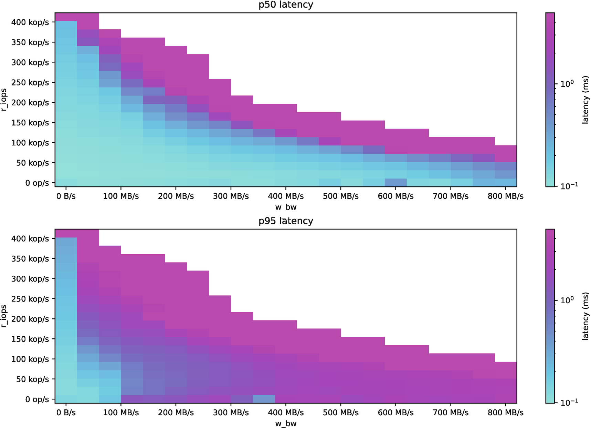
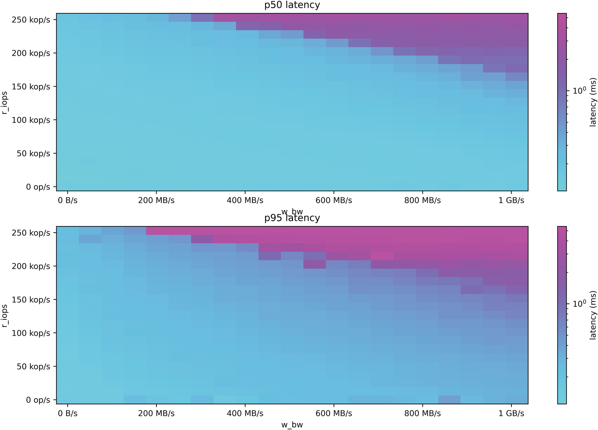
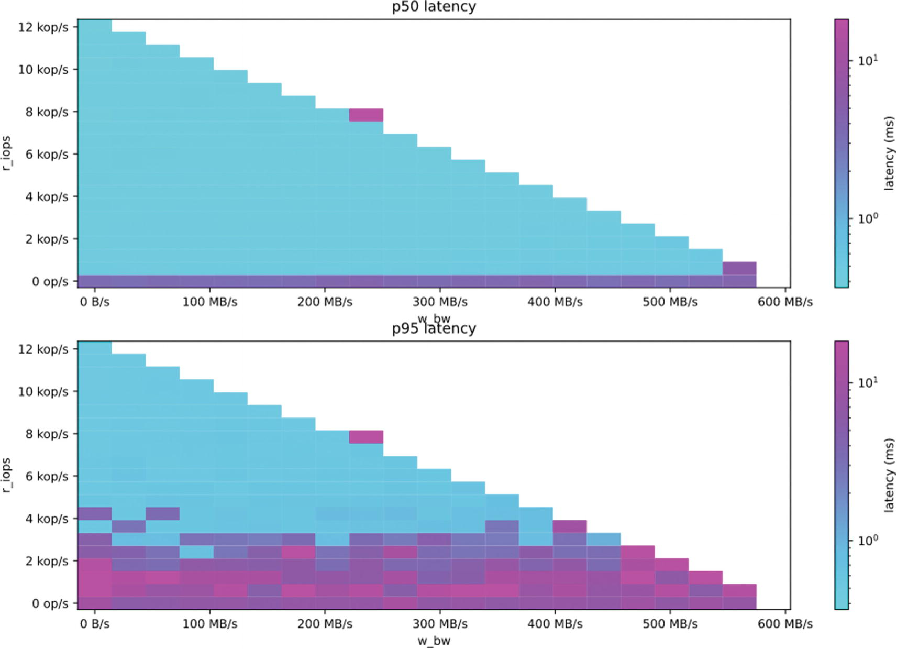
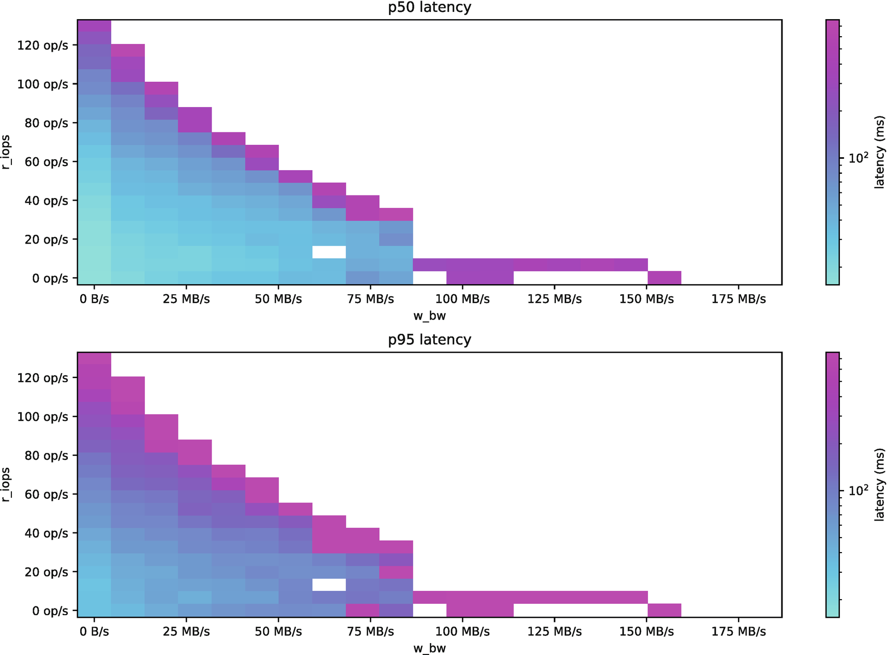

# الفصل 7: البنية التحتية ونماذج النشر

**Felipe Cardeneti Mendes, Piotr Sarna, Pavel Emelyanov, Cynthia Dunlop**

كما لاحظنا في الفصل السابق، تقدّم قواعد البيانات الحديثة قدرات تتجاوز «مجرد» تخزين البيانات واسترجاعها. لكن كل قواعد البيانات مبنية في النهاية من الأساس لتخدم الإدخال/الإخراج على النحو الأكثر كفاءة ممكن. ومن الضروري تذكّر ذلك عند اختيار بنيتك التحتية ونموذج النشر الذي تختاره.

من حيث المبدأ، غرض قاعدة البيانات بسيط إلى حد كبير: تُرسل طلبًا وتتوقع استقبال استجابة. لكنكما رأيت في الفصول السابقة، تُبذل جهود هندسية هائلة لتحسين هذه العملية وتسريعها باستمرار. من المرجّح جدًا أن سنوات وسنوات قد كُرِّست لتحسين خوارزميات قد تمنحك دفعة معالجة بمقدار دورات معالج قليلة، أو لتقليل تجزّؤ الذاكرة، أو لتقليل مقدار الإدخال/الإخراج التخزيني اللازم للبحث عن مجموعة بيانات محددة. كل هذه التطورات تلتقي في النهاية لتنتج قاعدة بيانات صالحة للأداء على نطاق واسع.

ومهما كان اختيارك لقاعدة البيانات، فقد تصطدم في النهاية بجدار لا يستطيع أي جهد هندسي اختراقه: العتاد الفيزيائي لقاعدة البيانات. فلا معنى كبير لامتلاك حلّ هندسي مصمّم للأداء بينما يكون العتاد الذي تخصّصه له دون المستوى الأمثل. وبالمثل، فمن المرجّح أن تعجز قاعدة بيانات أقل أداءً عن الاستفادة الكفؤة من وفرة الموارد الفيزيائية المتاحة.

ينظر هذا الفصل في اعتبارات ومقايضات حاسمة عند اختيار المعالجات والذاكرة والتخزين والشبكة لبنيتك التحتية الموزّعة. ويصف كيف تتعاون الموارد المختلفة وكيف تُضبط قاعدة البيانات لتقديم أفضل أداء. ويوجَّه اهتمام خاص إلى الإدخال/الإخراج التخزيني بوصفه المكوّن الأصعب في التعامل. كما يُلقي نظرة قريبة على عمليات النشر السحابية المثلى المناسبة لقواعد البيانات الموزّعة عالية الأداء (باعتبار أن هذه هي تفضيل النشر لدى معظم الشركات).

ومع أن نشر قاعدة البيانات كخدمة (Database-as-a-Service، DBaaS) سيحميك من كثير من قرارات البنية التحتية والعتاد خلال عملية اختيارك، فإن الفهم الجوهري لموارد الحوسبة العامة التي تحتاجها أي قاعدة بيانات مهم لتحديد الاختناقات المحتملة التي قد تحدّ من الأداء. وبعد مقدمة عن العتاد الذي يدخل في كل نموذج نشر — سواء فكّرت فيه أم لا — ينتقل الفصل إلى خيارات النشر المختلفة وأثرها على الأداء. ويغطّي الاعتبارات الخاصة المرتبطة بالنشر المستضاف سحابيًا، وقواعد البيانات كخدمة، والنشر بلا خادم، والحاويات، وتقنيات تنسيق الحاويات مثل Kubernetes.

## اعتبارات العتاد الأساسية للسرعة على نطاق واسع

عند تصميم أنظمة تتعامل مع كميات كبيرة من البيانات والطلبات على نطاق واسع، تكون اعتبارات العتاد الأساسية هي:

- التخزين
- المعالج (النوى)
- الذاكرة (RAM)
- واجهات الشبكة

وقد يكون كل منها اختناقًا محتملًا لزمن الوصول الداخلي في قاعدة البيانات: أي التأخير بين استقبال قاعدة البيانات (أو عقدة فيها) لطلب ما وتقديمها استجابة له.

### تحديد مصدر اختناقات الأداء لديك

معرفة مسارات الكتابة والقراءة في قاعدة بياناتك مفيدة لتحديد اختناقات الأداء المحتملة وتعقّب المتسبّب فيها. وهي أيضًا أساس لفهم الموارد الفيزيائية التي قد يكون حالة الاستخدام الخاصة بك مقيّدًا بها في الأساس.

على سبيل المثال، تحمل قواعد البيانات المحسّنة للكتابة هذا الاسم لأن الكتابات تذهب أساسًا إلى الذاكرة بدلًا من أن تُثبَّت في القرص فورًا. لكن معظم قواعد البيانات الحديثة تحتاج إلى استخدام آلية «استعادة بعد الانهيار» ما لتجنّب فقدان البيانات بسبب انقطاعات الخدمة غير المتوقعة. ونتيجة لذلك، ستلجأ حتى قواعد البيانات المحسّنة للكتابة إلى الوصول إلى القرص لتثبيت بياناتك سريعًا، تحسّبًا لأي طارئ. فمثلًا، تُثبَّت الكتابات في عناقيد Cassandra في بنية قرصية «سجل كتابة مسبقة» تُسمّى «سجل الالتزام» (commit log) وفي بنية ذاكرة تُسمّى «جدول الذاكرة» (memtable). ولا تُعتبر الكتابة ناجحة إلا بعد نجاح العمليتين معًا.

وعلى الطرف الآخر من الطيف، يتضمّن مسار القراءة في قاعدة البيانات عادةً عدة مكوّنات فيزيائية أيضًا. وبافتراض أنك لا تستخدم قاعدة بيانات في الذاكرة، فسيبدأ مسار القراءة بالتحقّق من وجود البيانات التي تبحث عنها في ذاكرة قاعدة البيانات المؤقتة. فإن لم تكن موجودة، تعيّن على قاعدة البيانات البحث عن البيانات واسترجاعها من القرص، وإلغاء تسلسلها، ثم الرد بالنتائج.

وتلعب الشبكة دورًا حاسمًا في العملية بأكملها. فعند الكتابة، يجب نسخ البيانات بسرعة إلى النسخ الأخرى. وعند القراءة، يجب أن تختار قاعدة البيانات النسخ (الشرائح) الصحيحة التي تحمل البيانات التي يطلبها التطبيق، وقد يقتضي ذلك التواصل مع عقد أخرى في العنقود. علاوة على ذلك، تتطلّب حالات الاستخدام ذات الاتساق القوي دائمًا استجابة أغلبية الأعضاء لنجاح العملية — لذا فإن استجابة متأخرة من نسخة واحدة قد ترفع بشكل جذري زمن الوصول الطرفي لطلب يُوجَّه إليها.

### تحقيق التوازن

التوازن أساس في أي نظام موزّع، بما في ذلك قواعد البيانات وما يتجاوزها. فليس ذا معنى كبير أن تحاول بلوغ مليون عملية في الثانية (OPS) في نظام يملك أسرع رابط شبكة متاح لكنه يعتمد على عدد قليل جدًا من المعالجات. وبالمثل، ليس فعّالًا أن تشتري أغلى بنية تحتية وأعلاها أداءً لحلّك بينما لا تتطلّب حالتك سوى 10 آلاف عملية في الثانية.

فضلاً عن ذلك، من المهم إدراك أن اختلال التوازن في عنقود قد يجرّ الأداء إلى الأسفل في نظامك الموزّع كله بسهولة. ويحدث ذلك لأن النظام الموزّع لا يمكن أن يكون أسرع من أبطأ مكوّناته — وهي حقيقة تفاجئ الناس كثيرًا.

وهذا مثال من الواقع: أبلغ أحد العملاء عن ارتفاع في أزمنة الوصول يصيب عنقوده المكوّن من 18 عقدة بكاملها. وبعد جمع معلومات النظام، لاحظنا أن أغلب عقده تستخدم على النحو الصحيح أقراص NVMe المحلية، باستثناء عقدة واحدة كانت مزوّدة بنظام RAID برمجي يخلط بين أقراص NVMe وأقراص متصلة بالشبكة. وأوضح العميل أنهم كانوا على وشك نفاد مساحة التخزين فقرّروا توصيل قرص آخر لتخفيف المشكلة. لكنهم لم يدركوا أن ذلك أدخل قنبلة موقوتة في عنقودهم بأسره. وفيما يلي شرح موجز لما حدث تقنيًا:

1. بوجود قرص بطيء داخل مصفوفة RAID، صارت عمليات الإدخال/الإخراج التخزيني في تلك النسخة تستغرق وقتًا أطول لإكمالها.
2. ونتيجة لذلك، صارت النسخ الأخرى تستغرق وقتًا إضافيًا كلما أرسلت استجابة أو انتظرت واحدة تتطلّب إدخالًا/إخراجًا تخزينيًا.
3. ومع تدفّق مزيد ومزيد من الطلبات، خلقت كل هذه التأخيرات في النهاية طابور انتظار على النسخ.
4. ومع استمرار نمو الطابور، أثّر ذلك في النهاية على أداء النسخ، وأفضى إلى التأثير على أداء العنقود بأسره.
5. ومن تلك اللحظة، صارت سرعة العنقود بأكمله مقيّدة بسرعة أبطأ عقدة فيه: العقدة التي كانت تحمل أبطأ قرص.

### وضع توقعات واقعية

حتى أقوى عتاد لا يستطيع ضمان زمن وصول مبهر من طرف إلى طرف (أو ذهابًا وإيابًا) — أي زمن الدورة الكامل من إرسال العميل طلبًا إلى الخادم حتى حصوله على استجابة. فقد يتأثر زمن الوصول من طرف إلى طرف بعوامل قد تكون خارج سيطرة قاعدة البيانات، مثل:

- التوجيه متعدد القفزات للحزم من تطبيق العميل إلى خادم قاعدة البيانات، ما يضيف مئات الميلي ثانية إلى زمن الوصول
- إعدادات مشغّل العميل، التي تتصل بمركز بيانات بعيد وترسل إليه الطلبات
- مستويات الاتساق التي تتطلّب استجابات من مراكز بيانات محلية وبعيدة معًا
- ضعف أداء الشبكة بين العملاء وخوادم قاعدة البيانات
- الأعباء الإضافية للبروتوكولات
- اختناقات الأداء على جانب العميل

## توصيات لمكوّنات عتاد محددة

يلقي هذا القسم نظرة أعمق على كل اعتبار من اعتبارات العتاد الأساسية:

- التخزين
- المعالج (النوى)
- الذاكرة (RAM)
- واجهات الشبكة

### التخزين

من أسرع الطرق إلى تقويض كل تحسينات الأداء الأخرى أن تُمرّر كل عملية قراءة وكتابة عبر قرص غير مناسب. ومع أن التطورات التقنية الحديثة حسّنت أداء أجهزة التخزين تحسينًا كبيرًا، فإن الأقراص لا تزال (وبفارق كبير) أبطأ مكوّن في نظام الحاسوب.

ومن منظور الأداء، يُقاس أداء القرص عادةً في بُعدين:

- عرض النطاق المتاح للقراءات والكتابات المتتابعة
- عدد عمليات الإدخال/الإخراج في الثانية (IOPS) للقراءات والكتابات العشوائية

ولهج مهندسو قواعد البيانات بتحسين أنماط الوصول إلى القرص وفق هذين البُعدين. أما من يختارون قاعدة بيانات أو يديرونها أو يستخدمونها فينبغي أن يركّزوا على اعتبارين إضافيين: تقنية التخزين وحجم القرص.

#### أنواع الأقراص

تُعدّ أقراص NVMe الصلبة (SSD) المحلية المعيار حين يكون زمن الوصول حرجًا. ومقارنة بواجهات الناقل الأخرى، تقدّم أقراص NVMe المتصلة بواجهة PCIe عمومًا أزمنة وصول أقل من واجهة SATA. فإن لم يكن عبء عملك شديد الحساسية لزمن الوصول، فقد تنظر أيضًا في استخدام أقراص عبر واجهة SATA. لكن تجنّب تمامًا استخدام الأقراص المتصلة بالشبكة إن كنت تتوقع أزمنة وصول برقم واحد من الميلي ثانية. فهذه الأقراص، لكونها متصلة بالشبكة، تحتاج إلى قفزة إضافية للوصول إلى خادم تخزين، وينتهي ذلك إلى زيادة زمن الوصول لكل طلب على قاعدة البيانات.

وإن كان تركيزك على القدرة الإنتاجية وكان زمن الوصول غير مهم فعلًا في حالتك (كما في نقل البيانات إلى مستودع بيانات)، فقد تنجح معك «الأقراص الدائمة» (persistent disks) — لكن ذلك غير مستحسن. ونعني بالأقراص الدائمة أجهزة تخزين شبكية متينة تستطيع أجهزتك الافتراضية الوصول إليها كأنها أقراص فيزيائية، لكنها موجودة باستقلال عنها. ولن ننتقد أي مورّد بعينه، لكن القليل من البحث سيكشف مشكلات مثل الأداء دون المستوى وعدم الاستقرار عمومًا. وإن أُلزمت بالعمل مع الأقراص الدائمة، فاستعد لابتكار حلّ إبداعي.^1

قد تصبح الأقراص الصلبة التقليدية (HDD) اختناقًا سريعًا. ولأن الأقراص الصلبة (SSD) تزداد رخصًا تدريجيًا، فاستخدام HDD غير مستحسن. وقد تنجح بعض أعباء العمل مع HDD، خصوصًا إن كانت تتلاءم معها وتقلّل من عمليات البحث العشوائي. ومن أمثلة أعباء العمل الملائمة لـHDD عبء عمل غالبه كتابة (98 بالمئة كتابة) مع حد أدنى من القراءات العشوائية. وإن قرّرت استخدام HDD، فحاول تخصيص قرص منفصل لسجل الالتزام.

نشرت ScyllaDB نتائج قياس مرجعي لعدة أجهزة تخزين مختلفة — موضّحة كيف تؤدي تحت حمل شديد يحاكي أنماط الوصول النموذجية إلى قواعد البيانات.^2 وعلى سبيل المثال، تُصوّر الأشكال من 7-1 إلى 7-4 خصائص الأداء المختلفة لاثنين من أقراص NVMe، وقرص دائم، وقرص HDD.

**الشكل 7-1. مخططان لعرض النطاق وزمن الوصول لأقراص NVMe في نوع نسخة AWS i3.2xlarge**

**الشكل 7-2. مخططان لعرض النطاق وزمن الوصول لنوع نسخة AWS Im4gn.4xlarge باستخدام أقراص AWS Nitro SSD**

**الشكل 7-3. مخططان لعرض النطاق وزمن الوصول لنوع نسخة Google Cloud n2-standard-8 مع قرص دائم SSD سعة 2 تيرابايت^3**

**الشكل 7-4. مخططان لعرض النطاق وزمن الوصول لقرص صلب Toshiba DT01ACA200^4**

#### إعداد الأقراص

نسمع كثيرًا من الأسئلة عن إعدادات RAID. فمصفوفات RAID العتادية شائعة لتفادي الانقطاعات الناتجة عن تعطّل الأقراص، ونتيجة لذلك يُستخدم إعداد RAID-5 (التكافؤ الموزّع) كثيرًا.

غير أن قواعد البيانات الموزّعة تملك عادةً آلية النسخ الداخلية الخاصة بها لضمان استمرارية الأعمال وتحقيق التوافر العالي. ولذلك ثبت أن إعدادات RAID التي تستخدم استنساخ البيانات أو التكافؤ الموزّع ضارّة جدًا بأداء الإدخال/الإخراج على القرص، وأنها تُستخدم زائدةً عن الحاجة في كثير من الأحيان. وفوق ذلك، وجدنا أن بعض مورّدي RAID العتادي يقدّمون نتائج أداء ضعيفة بحسب آليات الوصول إلى قاعدة بياناتك. ومن الأمثلة الجديرة بالذكر: مصفوفات RAID العتادية التي تعجز عن العمل بكفاءة عبر استدعاءات الإدخال/الإخراج غير المتزامن أو المباشر. فإن كنت تعتقد أن إدخال/إخراج قرصك دون المستوى الأمثل، ففكّر في كشف الأقراص من مصفوفة RAID العتادية مباشرةً لنظام التشغيل.

وعلى العكس، غالبًا ما يقدّم إعداد RAID-0 (التقشير) دفعة في أداء الإدخال/الإخراج على القرص، ويتيح لقاعدة البيانات بلوغ IOPS وعرض نطاق أعلى مما يقدّمه قرص واحد. والتوصية العامة لإنشاء إعداد RAID-0 هي استخدام جميع الأقراص من النوع نفسه والسعة نفسها لتفادي تفاوت الأداء خلال عبء عملك اليومي. ومع أنك ستفقد مصفوفة RAID بأكملها في حال تعطّل قرص، فمن المفترض أن يكون النسخ الذي تجريه قاعدة بياناتك الموزّعة كافيًا لضمان بقاء بياناتك متاحة.

وثمة اعتباران إضافيان متعلقان بإعداد القرص:

- **خوادم التخزين كثيرًا ما تخدم عدة مستخدمين وأعباء عمل أخرى في الوقت نفسه.** لذا، حتى لو كانت الأقراص مخصّصة لقاعدة البيانات، فقد يتأثر أداء وصولك بعوامل مثل مدى خدمة نظام التخزين لمستخدمين آخرين في الوقت نفسه. وفي معظم الأحيان لن يكون وسط التخزين المقدَّم لك مثاليًا لدعم عبء عمل قاعدة بيانات منخفض زمن الوصول. ويمكن غالبًا تخفيف ذلك بضمان تخصيص الأقراص من تجمّع أقراص عالي الأداء.
- **من المهم كشف أقراص بنيتك التحتية لقاعدة البيانات مباشرةً لنظام التشغيل الضيف من برنامج المحاكاة الافتراضية.** فقد رأينا حالات كثيرة تأثّرت فيها سعة الإدخال/الإخراج لقاعدة بيانات تأثرًا كبيرًا حين كانت الأقراص مُحاكاة افتراضيًا. ولإزالة أي اختناقات محتملة في بيئة منخفضة زمن الوصول، امنح قاعدة بياناتك وصولًا مباشرًا إلى أقراصك لتنفّذ الإدخال/الإخراج كما صُمّمت له.

#### حجم القرص

عند التفكير في مقدار التخزين الذي تحتاجه، احرص على حساب بياناتك الحالية — بنسخها المكرّرة — إضافة إلى نموّ بياناتك المتوقع في الأمد القريب، واترك أيضًا مساحة كافية للأعباء الإضافية للعمليات الداخلية (مثل عمليات الدمج [في قواعد البيانات القائمة على شجرة LSM]، وسجل الالتزام، والنسخ الاحتياطية، وما إلى ذلك).

وكما يناقش الفصل 8، فإن الطوبولوجيا الأكثر شيوعًا تتضمّن ثلاث نسخ لكل مجموعة بيانات. افترض أن لديك 5 تيرابايت من البيانات الخام وأنك تستخدم معامل نسخ يساوي ثلاثة:

- 5 تيرابايت بيانات × 3 معامل النسخ = 15 تيرابايت

لكن 15 تيرابايت مجرد نقطة بداية، إذ توجد معايير أخرى لتقدير الحجم:

- ما معدّل نموّ مجموعة بياناتك؟ (كم تستوعب في الساعة أو في اليوم؟)
- هل ستخزّن كل شيء إلى الأبد، أم ستكون لديك عملية إخلاء (مثلًا بناءً على مدة الصلاحية [TTL])؟
- هل معدّل نموّك مستقر (معدّل ثابت من الاستيعاب أسبوعيًا أو يوميًا أو ساعيًا) أم عشوائي ومتقطّع؟ الأول يجعل الأمر أكثر قابلية للتنبؤ؛ أما الثاني فقد يعني أن عليك منح نفسك هامشًا أكبر لاحتمالات أحداث غير متوقعة لكن محتملة.

يمكنك نمذجة معدّل نموّ بياناتك بناءً على عدد المستخدمين أو نقاط النهاية وكيف يُتوقع أن ينمو هذا العدد بمرور الوقت. أو قد تُثرى نماذج البيانات بمرور الوقت، فتنتج بيانات أكثر لكل مصدر. أو قد يزداد معدّل أخذ العيّنات لديك: فقد يبدأ نظامك باستيعاب البيانات كل خمس ثوانٍ بدلًا من كل دقيقة. كل هذه الاعتبارات تؤثر في حجم تخزين بياناتك.

يُوصى بشدة بأن تختار تخزينًا يلائم ما تتوقع الوصول إليه بعد فترة زمنية معينة. فإن كنت تشغّل قاعدة بياناتك على مزوّد سحابة عام (بإدارتك الذاتية أو كقاعدة بيانات كخدمة مُدارة بالكامل [DBaaS])، فلن تحتاج إلى وقت تحضير طويل لتزويد عتاد جديد وتوسيع عنقودك. أما في شراء عتاد محلي، فقد تحتاج إلى التزويد وفق عملية ميزانيتك الربعية أو السنوية. وقد تواجه أيضًا تأخيرات بسبب اضطرابات سلسلة التوريد التي صارت شائعة أكثر فأكثر.

واحرص أيضًا على ترك مساحة تخزين للعمليات الداخلية المؤقتة مثل الدمج والإصلاحات والنسخ الاحتياطية وسجلات الالتزام، فضلًا عن أي عملية خلفية أخرى قد تُدخل تضخيمًا مؤقتًا في المساحة. وعلى الجانب الآخر، إن كنت تستخدم الضغط، فاحسب مقدار المساحة التي يمكن أن توفّرها لك خوارزمية الضغط التي اخترتها.

وأخيرًا، ادرك أن لكل قاعدة بيانات نسبة مثلى بين الذاكرة والتخزين — مثلًا مقدار معيّن من التيرابايت أو الغيغابايت لكل عقدة يمكنها دعمه بأداء أمثل. فإن لم يكن ذلك ظاهرًا بسهولة في وثائق قاعدة بياناتك، فاستفسر من مورّدك عن توصيته.

#### الأجهزة الخام والمشغّلات المخصّصة

يشترط بعض مورّدي قواعد البيانات وصولًا مباشرًا إلى أجهزة التخزين — دون الحاجة إلى وجود نظام ملفات. ويُشار إلى هذا الوصول المباشر عادةً بأنه إنشاء جهاز «خام» (raw)، وهو يشير إلى أن نظام التشغيل لن يعرف كيف يديره، وأن أي إدخال/إخراج ستديره قاعدة البيانات مباشرة. وإصدار الإدخال/الإخراج مباشرةً إلى جهاز التخزين الأدنى قد يمنح قاعدة البيانات دفعة في الأداء. غير أن من المهم فهم بعض عيوب هذا النهج، التي قد لا تكون مهمة في نشرك بعينه.

1. **عرضة للخطأ**: إصدار الإدخال/الإخراج مباشرةً إلى قرص بدلًا من المرور بنظام الملفات عرضة للخطأ. فمع أنه يمنح مكسبًا في الأداء، قد تؤدي المعالجة الخاطئة للتخزين الأدنى إلى تلف البيانات أو فقدانها أو أخطاء غير متوقعة.
2. **معقّد**: الأجهزة الخام ليست شائعة كما قد يتوقع المرء. بل إن قلة قليلة من قواعد البيانات قرّرت اعتماد ذلك النهج. ومن المهم ملاحظة أنه، لأن الأجهزة الخام لا تُركّب عادةً كأنظمة ملفات عادية، فستكون قابليتها للإدارة معتمدة كليًا على ما يقدّمه مورّدك.
3. **تقييد بالمورّد**: حين تستخدم جهازًا خامًا، يصبح الانتقال بعيدًا عنه صعبًا للغاية. فلا يمكنك تركيب الأجهزة الخام أو استعلام استهلاكها للتخزين عبر آليات نظام التشغيل المعتادة. ويجب ترتيب كل أقراصك على نحو معيّن، ولا يمكنك العودة بسهولة إلى نظام ملفات عادي.

#### الحفاظ على أداء القرص بمرور الوقت

قواعد البيانات كثيفة الاستخدام للإدخال/الإخراج التخزيني، لذا ستبلى الأقراص بمرور الوقت. ويقدّم معظم مورّدي الأقراص تقديرات بشأن متانة أداء منتجاتهم. راجعها وقارن بينها.

ثمة أدوات وبرامج متعددة تساعد في الحفاظ على أداء أقراص SSD بمرور الوقت. ومن الأمثلة برنامج fstrim، الذي يُشغَّل أسبوعيًا في كثير من الأحيان لتحرير كتل نظام الملفات غير المستخدمة. وfstrim عملية خلفية في نظام التشغيل لا تتطلّب أي إجراء من قاعدة البيانات، وقد يحسّن الإدخال/الإخراج تحسينًا كبيرًا.

> **نصيحة**

> إن كان عليك اختيار مكان واحد للاستثمار — في المعالج أو التخزين أو الذاكرة أو الشبكة — فنوصي بالإسراف في التخزين. فقد تطوّر كل شيء آخر أسرع وأفضل من التخزين، وهو لا يزال أبطأ مكوّن في معظم الأنظمة.

#### التخزين المتدرّج

لحالات استخدام كثيرة متطلبات مختلفة لزمن الوصول بحسب مجموعات البيانات المختلفة. وبالمثل، قد تشهد بعض القطاعات نموًا هائلًا في استخدام التخزين بمرور الوقت. وليس من المرغوب فيه دائمًا — ولا الممكن — التخلّص من البيانات القديمة (مثلًا بسبب لوائح الامتثال أو عقود الأطراف الثالثة أو ببساطة لأنها لا تزال ذات صلة بالعمل).

وكثيرًا ما تبحث الفرق ذات حالات الاستخدام الكثيفة التخزين عن طرق لتقليل تكاليف استهلاك التخزين: بخفض معامل النسخ لمجموعة بياناتها، أو باستخدام أقراص تخزين أقل أداءً (وإن كانت أرخص)، أو بعملية تدوير يدوية للبيانات من أقراص أسرع إلى أقراص أبطأ.

التخزين المتدرّج حلّ تنفّذه بعض قواعد البيانات لمعالجة معظم هذه الهواجس. فهو يتيح للمستخدمين ضبط قاعدة البيانات لاستخدام طبقات تخزين متمايزة، وتحديد المعايير التي ينبغي أن تستخدمها قاعدة البيانات لضمان نسخ البيانات نسخًا صحيحًا إلى الطبقة المناسبة لها. فمثلًا، يتيح MongoDB تحديد كيفية نسخ البيانات إلى طبقة تخزين معيّنة عبر إسناد وسوم طبقات مختلفة إلى الشرائح، ما يتيح لموازِنه نقل البيانات بين الطبقات تلقائيًا. وفوق ذلك، يتيح Atlas Online Archive لقاعدة البيانات تفريغ مجموعات البيانات التاريخية إلى التخزين السحابي.

### المعالجات (النوى)

التالي هو المعالج. وحتى كتابة هذه السطور، فالأرجح أنك تنظر إلى خوادم حديثة تعمل بمعالجات Intel أو AMD أو ARM حديثة نسبيًا، وهي شائعة لدى معظم مزوّدي السحابة ومورّدي عتاد المؤسسات. وإلى جانب التخزين، تُعدّ المعالجات مورد حوسبة آخر قد — إن لم تُقدَّر سعتها تقديرًا صحيحًا — تُدخل تنافسًا على عبء عملك وتؤثر في أزمنة الوصول لديك. والعناقيد التي تتعامل مع مئات الآلاف وصولًا إلى ملايين العمليات في الثانية تميل إلى أحمال معالج عالية جدًا.

وعدد أكبر من النوى يعني عمومًا أداءً أفضل. وهذا مهم لتحقيق الأداء الأمثل من قواعد البيانات المصمّمة لتستفيد من تعدّد الخيوط، وهو ضروري تمامًا لقواعد البيانات المصمّمة بمعمارية «شريحة لكل نواة» — أي تشغيل شريحة منفصلة على كل نواة في كل خادم. وفي هذه الحالة، فكلما زاد عدد نوى المعالج زاد عدد الشرائح — وحسُن توزيع البيانات — في قاعدة البيانات.

ويمكن لمزيج من توصيات المورّد والقياس المرجعي (انظر الفصل 9) أن يساعدك في تحديد القدرة الإنتاجية التي يستطيع كل معالج متعدد النوى دعمها. والتوصية العامة هي تجنّب تشغيل أنظمة الإنتاج قريبة من حدود المعالج والبحث عن النقطة المثلى بين دعم أدائك المتوقع وترك مساحة لنموّ القدرة الإنتاجية. وفوق ذلك، تذكّر عند إجراء القياس المرجعي أن تحتسب أيضًا عمليات قاعدة البيانات الخلفية التي قد تضرّ بأدائك. فمثلًا، تحتاج Cassandra وقواعد البيانات المتوافقة معها غالبًا إلى تشغيل الإصلاح (repair): عملية أسبوعية لضمان اتساق البيانات عبر العنقود. وهذه العملية تتطلّب تنسيقًا وتواصلًا كثيفين عبر العنقود بأكمله. فإن لم يكن عبء عملك مقدّر الحجم تقديرًا صحيحًا ليستوعب عمليات قاعدة البيانات الخلفية وأحداثًا أخرى (مثل تعطّل العقد)، فقد يرتفع زمن الوصول لديك إلى مستوى يفاجئك.

وعند استخدام الأجهزة الافتراضية أو الحاويات أو السحابة العامة، تذكّر أن كل معالج افتراضي يُقابل نواة منطقية واحدة أو خيطًا واحدًا. وفي كثير من عمليات النشر السحابية تُقدَّم العقد على أساس المعالج الافتراضي (vCPU). والمعالج الافتراضي عادةً خيط معالجة واحد من نواة فيزيائية x86 بخيطين لمعالجات Intel وAMD، أو نواة واحدة لمعالجات ARM.

ومهما تضمّن نشرك الذي اخترته، فتجنّب الإفراط في الالتزام بموارد المعالج إن كان الأداء أولوية. فذلك سيمنع الضيوف الآخرين من سرقة وقت المعالج^5 من قاعدة بياناتك.

### الذاكرة (RAM)

إن كنت تعمل بقاعدة بيانات في الذاكرة، فامتلاك ذاكرة كافية لاستيعاب مجموعة بياناتك بأكملها شرط مطلق. لكن كل قاعدة بيانات تستخدم التخزين المؤقت في الذاكرة بدرجة ما. فمثلًا، تحتاج بعض قواعد البيانات إلى مساحة ذاكرة كافية للفهارس لتفادي رحلات ذهاب وإياب مكلفة إلى أقراص التخزين. ويستفيد غيرها من ذاكرة تخزين مؤقت داخلية للبيانات لتحقيق أزمنة وصول أقل عند استرجاع البيانات المستخدمة حديثًا، وتنفّذ Cassandra وقواعد البيانات الشبيهة بها جداول ذاكرة، وتتيح بعض قواعد البيانات التحكم في الجداول التي تُخدم بالكامل من الذاكرة. وكلما زادت الذاكرة المتاحة لقاعدة البيانات، حسُنت استفادتك من هذه الآليات. فحتى أسرع قرص NVMe لا يقترب من سرعة الوصول إلى RAM.

وبوجه عام، لا توجد توصية جامعة بشأن «مقدار الذاكرة الكافي» لقاعدة بيانات. فلكل مورّد متطلبات مختلفة، ولكل حالة استخدام أيضًا أحجام ذاكرة مختلفة. غير أن حالات الاستخدام الحساسة لزمن الوصول تتطلّب عادةً بصمة ذاكرة كبيرة لتحقيق معدّلات إصابة عالية في التخزين المؤقت وتقديم طلبات قراءة منخفضة زمن الوصول بكفاءة.

فمثلًا، تتطلّب حالة استخدام بحجم حِمل أكبر بصمة ذاكرة أكبر من حالة بحجم حِمل أصغر. ومن الجوانب المثيرة للاهتمام أيضًا مدى تكرار قراءة حالة الاستخدام المعنية لبيانات قد تكون في الذاكرة (بيانات ساخنة) مقابل بيانات لم تُقرأ قط (بيانات باردة). وكما ذُكر في الفصل 2، يمكن للأخيرة أن تقوّض أزمنة الوصول لديك بسهولة.

ودون نسبة كافية بين القرص والذاكرة، ستصطدم بتخزينك أكثر بكثير مما تريد إن كنت تنوي إبقاء أزمنة الوصول منخفضة. والنسبة المثلى تتفاوت من قاعدة بيانات إلى أخرى لأن كل تنفيذ للتخزين المؤقت مختلف، لذا احرص على سؤال مورّدك عن توصياته المحددة. فمثلًا، توصي ScyllaDB حاليًا بأنه مقابل كل 1 غيغابايت من الذاكرة المخصّصة لعقدة، يمكنك تخزين ما يصل إلى 100 غيغابايت من البيانات (فإن كانت لديك 32 غيغابايت من الذاكرة، يمكنك التعامل مع نحو 3 تيرابايت). وكلما ارتفعت نسبة الذاكرة إلى التخزين، قلّت المساحة المتاحة لتخزين مجموعة بياناتك كاملة في الذاكرة المؤقتة. ولكل قاعدة بيانات حدّ فيزيائي صارم من نوع ما. فإن لم تكن لديك ذاكرة كافية وكان عليك تشغيل عبء عمل على مجموعة بيانات ضخمة جدًا، فإما أن يكون بطيئًا إلى حد كبير أو أن يزيد خطر نفاد ذاكرة قاعدة البيانات.

وثمة نسبة أخرى يجدر تذكّرها: الذاكرة لكل نواة معالج. فنحن في ScyllaDB نوصي بما لا يقل عن 8 غيغابايت من الذاكرة لكل نواة معالج لأغراض الإنتاج (لأن كل شريحة، بحكم معماريتنا القائمة على عدم المشاركة، تعمل باستقلال ولها ذاكرتها المخصّصة للتخزين المؤقت). ونسبة 8 غيغابايت لكل معالج افتراضي هي النسبة نفسها التي يستخدمها معظم مزوّدي السحابة لأنواع النسخ الموجّهة إلى NoSQL أو البيانات الضخمة. ومرة أخرى، ستتفاوت النسبة الموصى بها بين المورّدين بحسب تنفيذ التخزين المؤقت الداخلي الخاص بقاعدة البيانات وتفاصيل تنفيذ أخرى. فمثلًا، في Cassandra وقواعد البيانات الشبيهة بها تُخصّص جزءًا من الذاكرة لبعض مكوّنات SSTable لتسريع عمليات البحث على القرص عند قراءة البيانات الباردة. أما Aerospike فيخزّن كل الفهارس في RAM عادةً. ويحتاج MongoDB في المتوسط إلى 1 غيغابايت من RAM لكل 100 ألف أصل.

قواعد البيانات الموزّعة مستهلكات ذاكرة معروفة بكثرة استهلاكها. ومهما كان تنفيذها، فستحتاج قاعدة البيانات دائمًا إلى تخزين بعض الأجزاء ذات الصلة من مجموعة بياناتك في الذاكرة لتفادي إهدار الوقت في الإدخال/الإخراج التخزيني. وقد تظهر الذاكرة غير الكافية على هيئة سلوك غير متوقّع ومتقلّب لقاعدة البيانات — وحتى أعطال.

### الشبكة

وأخيرًا، عليك ضمان ألا يصبح الإدخال/الإخراج الشبكي اختناقًا. فالشبكات مكوّن يُغفل كثيرًا. وكأي نظام موزّع، تتضمّن قاعدة البيانات حركة كثيرة بين كل أعضاء العنقود للتحقّق من الحياة، ونسخ الحالة وتغيّرات الطوبولوجيا، وما إلى ذلك. ونتيجة لذلك، لا تُضعف تأخيرات الشبكة زمن الوصول في تطبيقك فحسب، بل تمنع أيضًا التواصل بين العقد من العمل بفعالية.

نوصي في ScyllaDB بحد أدنى لعرض نطاق الشبكة قدره 10 غيغابت في الثانية، لأن عمليات قاعدة البيانات الداخلية مثل البث والإصلاحات والـgossip قد تصبح كثيفة الشبكة جدًا. وفوق ذلك، عليك أن تحتسب أيضًا القدرة الإنتاجية الفعلية المطلوبة لحالة الاستخدام المعنية؛ فعدد العمليات في الثانية سيكون بالتأكيد أكبر مستهلك لعرض النطاق في نشرك.

وكما في الذاكرة، سيتفاوت عرض النطاق الشبكي المطلوب. احرص على مراجعة توصيات مورّدك والنظر في طبيعة حالة استخدامك. فعبء عمل منخفض القدرة الإنتاجية يستهلك بطبيعة الحال حركة أقل من عبء عالي القدرة الإنتاجية.

> **نصيحة**: استخدم تثبيت المعالج (CPU pinning) لتخفيف أثر مقاطعات العتاد.

مقاطعات العتاد، التي تنشأ عادةً (دون حصر) من حركة الإنترنت الشبكية العالية، تُجبر نواة نظام التشغيل على إيقاف كل شيء والاستجابة للعتاد قبل العودة إلى العمل المطروح. وكثرة المقاطعات (مثل نسبة عالية من softirq) ستُضعف أداء قاعدة البيانات، لأن معالجاتك قد تتوقف أثناء المعالجة لخدمة حركة الشبكة. ومن طرق حلّ ذلك استخدام تثبيت المعالج. فهو يخبر النظام بأن كل مقاطعات الشبكة ينبغي أن تتعامل معها معالجات محددة لا تستخدمها قاعدة البيانات. وبهذا الإعداد، يمكنك أن تُغرق قاعدة البيانات بحركة الشبكة وتكون واثقًا إلى حدّ معقول من أنك لن تُرهقها أو توقف معالجتها أثناء العمليات العادية.

وفي عمليات النشر السحابية، يقدّم معظم مورّدي البنية التحتية كخدمة (IaaS) بنية شبكية حديثة بعرض نطاق وفير بين خوادم قاعدة بياناتك، وبين قاعدة البيانات وعملاء التطبيقات. واحرص على التحقّق من استهلاك عملائك لعرض النطاق الشبكي إن ساورتك شكوك في مشكلات الشبكة. ومن الأخطاء الشائعة التي نراها في عمليات النشر أن تُنشر عملاء التطبيقات بقدرة شبكية دون المستوى الأمثل.

واحرص أيضًا على وضع خوادم تطبيقاتك في أقرب مكان ممكن إلى قاعدة بياناتك. فإن كنت تنشرها في منطقة واحدة، فستترجم المسافة الفيزيائية الأقصر بين الخوادم إلى أداء شبكي أفضل (لأنها ستتطلّب قفزات شبكة أقل للتواصل) ونتيجةً لذلك إلى أزمنة وصول أقل. وإن احتجت إلى تعدّد المناطق وتطلّبت اتساقًا قويًا أو نسخًا عبر هذه المناطق، فعليك أن تدفع جزاء التأخير لعبور المناطق — إضافة إلى أنك ستدفع، حرفيًا، رسوم نقل الشبكة بين المناطق. وفي عمليات النشر متعددة المناطق مع النسخ بين المناطق، قد يُنشئ رابط شبكة بطيء تأخيرات في النسخ تجعل قاعدة البيانات تضغط على كتاباتك (backpressure) حتى تنجح في نسخ البيانات المتراكمة.

## اعتبارات في السحابة

يتوقّف قرار «محلي مقابل سحابي» اعتمادًا كبيرًا على متطلبات الأمن واللوائح في مؤسستك وعلى استراتيجيتها التجارية — وهو خارج نطاق هذا الكتاب بكثير. وبدلًا من السير في ذلك الطريق، لنركّز على استكشاف اعتبارات الأداء التي تنفرد بها عمليات النشر السحابية.

يقدّم معظم مزوّدي السحابة طائفة واسعة من أنواع النسخ التي قد تختار منها استضافة عبء عملك. ومن واقع خبرتنا، فمعظم الأخطاء واختناقات الأداء التي تُرى في قواعد البيانات الموزّعة داخل عمليات النشر السحابية سببها اختيار خاطئ لنوع النسخة أو نوع التخزين أثناء الإعداد الأولي للعنقود. ومن المفاهيم الخاطئة (والهواجس) الشائعة التي يحملها كثيرون أن التخزين القائم على NVMe قد يكون أغلى من التخزين المتصل بالشبكة. والأرجح أن هذا الفهم الخاطئ ينبع من افتراض أنه، بما أن أقراص NVMe أسرع، فستترتّب عليها تكاليف أعلى. لكن الواقع عكس ذلك تمامًا: فلأن أقراص NVMe في البيئات السحابية مرتبطة بدورة حياة النسخة، فإنها تنتهي أرخص من الأقراص الشبكية التي تتطلّب إبقاء مجموعة بياناتك لفترة ممتدة. ونشجّعك على مقارنة تكاليف التخزين المدعوم بـNVMe مقابل الأقراص المتصلة بالشبكة لدى مزوّد السحابة الذي تختاره.

ولبعض مزوّدي السحابة أنواع نسخ مختلفة لأعباء عمل قواعد البيانات الموزّعة المختلفة. فمثلًا، قد تستفيد بعض أعباء العمل أكثر من أنواع النسخ الكثيفة الحوسبة، ذات قدرة الحوسبة الأعلى من سعة التخزين. وعلى العكس، تتميّز أنواع النسخ الكثيفة التخزين عادةً بنسبة أعلى بين التخزين والذاكرة، ويستخدمها كثيرًا أعباء العمل الكثيفة التخزين.

ولزيادة التعقيد، قد يقدّم بعض مزوّدي السحابة أجيالًا مختلفة من المعالجات لنوع النسخة نفسه. فإن كان جيل معالج أبطأ إلى حد كبير من عقد أخرى، فقد يُدخل الخيار الخاطئ اختناقات أداء في عنقودك.

وقد رأينا حالات (وإن كانت نادرة) جرف فيها جار مزعج أداء عقدة بكاملها دون تفسير معقول. ويجعل انعدام الرؤية والتحكّم في النسخ السحابية تشخيص مثل هذه الحالات أصعب. وكثيرًا ما تحتاج إلى التواصل مع مزوّد السحابة مباشرةً لحلّ الموقف.

وحين تشرع في ضبط نسختك، تذكّر أن البيئة السحابية لم تُصنع لقواعد البيانات حصرًا. فلديك وصول إلى طائفة واسعة من الخيارات، لكن تحديد من أين تبدأ وأي الخيارات تستخدم قد يكون مُلبِسًا. وبوجه عام، من الأفضل مراجعة مورّد قاعدة بياناتك بشأن أنواع النسخ الموصى بها للنشر. والأفضل من ذلك أن تتجاوز ذلك وتقارن نتائج قياساتهم المرجعية على أنواع النسخ نفسها وهي تشغّل عبء عملك.

وبعد أن تقرّر أنواع النسخ وخيارات النشر، يحين وقت التفكير في موضع وضع النسخ. فمعظم السحابات ستتقاضى منك ثمنًا على الحركة بين المناطق والحركة بين النطاقات معًا، وقد يزيد ذلك — بشكل مفاجئ إلى حد ما — تكاليف الشبكة الإجمالية. وتحاول بعض الشركات تخفيف هذه التكلفة بوضع كل النسخ تحت نطاق توافر (AZ) واحد، وهو ما يحمل أيضًا خطر مواجهة انقطاع على مستوى العنقود كلّه إن سقط ذلك النطاق. ويختار آخرون تجاهل جانب التكلفة ونشر نسخهم في نطاقات توافر مختلفة لضمان نسخ البيانات نسخًا صحيحًا إلى بيئة معزولة. وأيًا كان اختيارك لوضع نسخك، فاعلم أن بعض مشغّلات قواعد البيانات تتيح لعملاء في نطاقات توافر محددة توجيه الاستعلامات إلى نسخ قاعدة البيانات الموجودة في النطاق نفسه فقط لتقليل التكاليف. وبالمثل، ستحرص أيضًا على أن تكون عملاء تطبيقك في النطاقات نفسها التي فيها قاعدة بياناتك لتقليل تكاليف شبكتك.

## قاعدة البيانات كخدمة مُدارة بالكامل

هل يساعد نموذج قاعدة البيانات كخدمة أداء قاعدة البيانات أم يضرّه؟ يعتمد ذلك فعلًا على ما يلي:

- مقدار العناية التي تحتاجها قاعدة بياناتك لتحقيق توقعات أدائك والوفاء بها باستمرار
- خبرة فريقك في التعامل مع قاعدة البيانات المحددة التي تستخدمها
- وقت فريقك ورغبته في العبث بتلك قاعدة البيانات
- مستوى الخبرة — خصوصًا فيما يتعلق بالأداء — الذي يخصّصه مزوّد خدمة DBaaS لحسابك

يمكن لحلول DBaaS المُدارة أن تسرّع طرحك في السوق بسهولة وأن تتيح لك التركيز على أولويات تتجاوز قاعدة بياناتك. ومعظم مورّدي قواعد البيانات يقدّمون الآن نوعًا من الحلول المُدارة. بل إن هناك شركات مستقلة تعمل في تقديم هذا النوع من الخدمة لطائفة متنوعة من قواعد البيانات الموزّعة المختلفة.

وقد رأينا أمثلة كثيرة نجح فيها حلّ مُدار في مساعدة المستخدمين، كما رأينا شكاوى عديدة من أن بعض الحلول المُدارة محدودة إلى حد كبير. وليس مقصدنا التوصية بأي مزوّد خدمة بعينه ولا انتقاده. وفيما يلي نصائح محايدة تجاه المورّدين بشأن أمور ينبغي التفكير فيها قبل اختيار حلّ مُدار:

- هل يستوفي المورّد متطلباتك الأمنية القائمة؟ وهل يقدّم أدلة كافية على شهادات أمنية صادرة عن شركة أمن معروفة؟
- ما خيارات الرصد (observability) وكيف تصدّر البيانات المعنية إلى منصة المراقبة التي تختارها؟
- أي نوع من المرونة لديك في نشرك؟ وما الخيارات القابلة للضبط المتاحة والدعم المقدَّم لها داخل حلّك المُدار؟
- هل يتيح لك ربط حركة المرور من شبكات تطبيقاتك القائمة إلى قاعدة بياناتك بطريقة خاصة وآمنة؟
- ما خيارات الدعم واتفاقيات مستوى الخدمة (SLA) المتاحة؟
- ما خيارات النشر المتاحة، وما المرونة في التبديل بينها، وما مقارنة التكلفة لو نشرتها وصنتها بنفسك؟
- ما مدى سهولة تصدير بياناتك إن احتجت إلى نقل نشرك إلى مورّد آخر في المستقبل؟
- ما خيارات الترحيل المتاحة، إن وُجدت، وما مقدار الجهد الذي تتطلّبه؟

هذه مجرد بعض الأسئلة والهواجس الكثيرة التي سمعنا الفرق تطرحها (أو تتمنى لو طرحتها قبل أن تقع في خيار غير مرغوب فيه). إن التفكير في مورّد طرف ثالث يدير جانبًا حرجًا نسبيًا من بنيتك التحتية يمثّل تحديًا في كثير من الأحيان. غير أن ذلك قد يكون، في الظروف المناسبة ومع التوافق الجيد بين المورّد والمستخدم، خيارًا ممتازًا لتقليل عبء الإدارة وتحسين أدائك.

## نماذج النشر بلا خادم

يشير «بلا خادم» (Serverless) إلى حلول قواعد البيانات التي تقدّم توسّعًا أو تقليصًا شبه فوري لبنية قاعدة البيانات التحتية — وتتقاضى منك ثمنًا مقابل السعة والتخزين الذي تستهلكه فعليًا.

ويمكن لنموذج بلا خادم أن يحقق نظريًا ميزة في الأداء. فقبل «بلا خادم»، واجهت مؤسسات كثيرة مقايضة:

- إمّا المبالغة (قليلًا أو بسخاء، بحسب تحمّلك للمخاطر) في تقدير السعة التي تحتاجها لضمان أداء ملائم.
- أو مشاهدة الأداء يتضرر إذا ثبت أن تقديرات السعة المتحفّظة أكثر من اللازم غير كافية.

ويستطيع «بلا خادم» المساعدة بعدة طرق وفي مواقف مختلفة.

أولًا، مع أعباء العمل المتغيرة. فلأن قاعدة البيانات تستطيع التوسّع سريعًا مع زيادة عبء عملك، يمكنك أن تقلق أقل بشأن مشكلات الأداء الناتجة عن سعة غير كافية. وإن كانت حركة مرورك تمدّ وتجزر عبر اليوم أو الأسبوع أو الشهر، فيمكنك أن تنفق أقل في الفترات الهادئة وتخصّص تلك الموارد لدعم فترات الذروة. وإن حقّقت شركتك فجأة «نجاحًا كارثيًا»، فلا داعي للقلق من الصداع المرتبط بالحاجة إلى توسيع بنيتك التحتية فجأة. وإن سار كل شيء على ما يرام، فسيضمن المورّد «سحريًا» أنك مغطّى بأداء مقبول. ولن تحتاج إلى شراء أي خوادم إضافية ولا حتى التواصل مع مزوّد السحابة.

ويُعدّ «بلا خادم» خيارًا ممتازًا كذلك إن كنت تعمل على مشروع جديد ولا تعرف مقدار السعة التي تحتاجها للوفاء بتوقعات الأداء. فهو يمنحك حرية البدء سريعًا والتوسّع (أو التقليص) بحسب الاستخدام الفعلي. ويصبح تقدير حجم قاعدة البيانات أمرًا أقل للقلق، ولا تحتاج إلى التنبؤ بالمستقبل.

وأخيرًا، يجعل «بلا خادم» تبرير الإنفاق داخليًا أبسط. فبهذا النموذج، يمكنك أن تطمئن مؤسستك إلى أنك لست مفرطًا في التزويد أبدًا — على الأقل ليس لفترة طويلة. فأنت تدفع بالضبط مقابل مقدار الأداء الذي يحدّده مورّد قاعدة البيانات على أنه ما تحتاجه في كل الأوقات.

غير أن النشر بلا خادم يحمل أيضًا خطر تجاوز التكاليف وعدم اليقين بشأن نفقات غير متوقعة. فمثلًا، قد لا يكون تسعير DynamoDB جذابًا كثيرًا لأعباء العمل الكثيفة الكتابة. وبالمثل، قد تتقاضى خدمات قواعد البيانات بلا خادم مبالغ باهظة بحسب عدد العمليات في الثانية التي تخطط للحفاظ عليها على مدى زمني ممتد. وقد يصبح في بعض الحالات سلاحًا ذا حدّين من منظور التكلفة إن كان هدفك الحفاظ على نظام عالي القدرة الإنتاجية وعالي الأداء على نطاق واسع.

وثمة جانب آخر ينبغي التفكير فيه عند التفكير في حلّ بلا خادم: هل الحل المعني متوافق مع مكوّنات بنيتك التحتية القائمة؟ فمثلًا، ستحرص على استكشاف مقدار الجهد المطلوب لربط أداة طوابير الرسائل أو التحليلات لديك بذلك الحل تحديدًا.

تذكّر أن الفكرة العامة وراء «بلا خادم» هي تجريد البنية التحتية الأدنى على نحو لا تكون فيه كل الخيارات القابلة لضبط قاعدة البيانات متاحة لك. ونتيجة لذلك، يصبح استكشاف مشكلات الأداء المحتملة أكثر تحديًا في كثير من الأحيان، لأنك قد تحتاج إلى الاعتماد على مدخلات مورّدك وإرشاده لمعرفة الإجراءات التي ينبغي اتخاذها. كما أن كونك «بلا خادم» يعني انعدام رؤيتك بشأن ما إذا كانت البنية التحتية التي تستهلكها مشتركة مع مستأجرين آخرين. وقد يقدّم لك كثير من مورّدي قواعد البيانات الموزّعة مستويات تسعير مختلفة للبيئات المشتركة والمخصّصة.

## الحاويات وKubernetes

صارت الحاويات وKubernetes منتشرة في كل مكان، حتى للأنظمة ذات الحالة مثل قواعد البيانات. فهل ينبغي أن تستخدمها؟ على الأرجح نعم — إلا إن كانت لديك حجة وجيهة لعدم ذلك.

لكن اعلم أن استخدام الحاويات يأتي بثمن في الأداء مقابل الراحة التشغيلية. وهذا متوقّع بسبب الطبقة الإضافية من التجريد (الحاوية نفسها)، وتخفيف عزل الموارد، وزيادة تبديلات السياق. والخبر السار أنه يمكن التغلّب عليه بالتأكيد. ففي اختباراتنا باستخدام ScyllaDB، وجدنا أنه يمكن تقليص انخفاض كان في الأصل 69 بالمئة في القدرة الإنتاجية القصوى إلى 3 بالمئة فقط من جزاء الأداء.^6

وفيما يلي الخلاصة السريعة لتلك التجربة تحديدًا:

- *حَاوِيَةُ التطبيقات ليست مجانية. وعلى وجه الخصوص، يجب تشغيل العمليات المكوّنة للحاويات داخل مجموعات Linux cgroups، وتتلقى الحاوية عرضًا مُحاكى افتراضيًا للشبكة. ومع ذلك، فأكبر تكلفة لتشغيل تطبيق قريب من العتاد وبخيط لكل نواة مثل ScyllaDB داخل حاوية Docker تأتي من التكلفة البديلة الناتجة عن اضطرارك إلى تعطيل معظم تحسينات الأداء التي تستخدمها قاعدة البيانات في بيئات الأجهزة الافتراضية والخوادم المباشرة لتمكينها من العمل على منصات قد تكون مشتركة ومفرطة الالتزام.*
- *أفضل النتائج مع Docker تُحقق حين تُقسَّم الموارد تقسيمًا ثابتًا ونستطيع استعادة تحسينات الخوادم المباشرة مثل تثبيت المعالج وعزل المقاطعات. وفي هذه الحالة لا يوجد سوى جزاء أداء قدره 10 بالمئة مقارنةً بالمنصة الأدنى — وهو جزاء يُعزى في معظمه إلى محاكاة الشبكة الافتراضية. وتتيح Docker للمستخدمين كشف شبكة المضيف مباشرةً لعمليات نشر متخصّصة. وفي الحالات التي يكون ذلك ممكنًا فيها، رأينا أن فرق الأداء مقارنةً بالمنصة الأدنى يهبط إلى 3 بالمئة.*

وبطبيعة الحال، سيتفاوت الجزاء المحتمل واستراتيجيات تخفيفه من قاعدة بيانات إلى أخرى. لكن الخلاصة الأساسية أن ثمة جزاء أداء كبيرًا على الأرجح — فاحرص على تعقّبه والبحث عن كيفية تخفيفه. ومن استراتيجيات التخفيف الشائعة:

- ضمان وصول حاوياتك مباشرةً إلى التخزين الأدنى لقاعدة البيانات.
- كشف شبكة نظام تشغيل المضيف للحاوية لتفادي جزاء الأداء الناتج عن طبقة محاكاة الشبكة.
- تخصيص موارد كافية للحاوية المعنية، وضمان عدم إفراط الالتزام بها مع حاويات أو عمليات أخرى تعمل داخل نظام تشغيل المضيف الأدنى.

ويضيف Kubernetes طبقة محاكاة افتراضية أخرى — ويفتح بذلك الباب لطبقة أخرى من مشكلات الأداء، ولاستراتيجيات مختلفة لتخفيفها. أولًا، إن كانت أمامك خيارات متعددة لنشر عناقيد قواعد البيانات على Kubernetes وإدارتها، فاختبرها بعين على الأداء. وبعد أن تستقرّ على الأنسب لاحتياجاتك، تعمّق في خيارات الضبط التي قد تؤثر في الأداء. وفيما يلي بعض نصائح الأداء المشتركة بين قواعد البيانات:

- فكّر في تخصيص عقد Kubernetes محددة ومستقلة لأعباء عمل قاعدة بياناتك واستخدم الارتباطات (affinities) لضبط موضعها.
- مكّن `hostNetworking` واحرص على إعداد معاملات النواة المطلوبة كما يوصي مورّدك (مثل `fs.aio-max-nr` لزيادة عدد الأحداث المتاحة لمعالجة الإدخال/الإخراج غير المتزامن في نواة Linux).
- تأكّد من أن حاويات قاعدة بياناتك (pods) تحمل فئة جودة خدمة Guaranteed^7 لتفادي أن تضرّ حاويات أخرى بعبء عملك الرئيسي.
- احرص على استخدام operator^8 لتنسيق دورة حياة عنقود قاعدة بياناتك على Kubernetes والتحكم فيها. فمثلًا، لدى ScyllaDB مشروعها ScyllaDB Operator.

## الخلاصة

افتتح هذا الفصل الجزء الأخير من الكتاب، الذي يركّز على مشاركة توصيات لاستخلاص أداء أفضل من نشر قاعدة بياناتك. وقد نظر في اعتبارات البنية التحتية ونموذج النشر التي يهمّ فهمها سواء كنت تدير نشرك بنفسك أو تختار نموذج قاعدة بيانات كخدمة (وربما بلا خادم). وينظر الفصل التالي في اعتبارات الأداء المتعلقة بالطوبولوجيا نفسها: النسخ، والتوزيع الجغرافي، والتوسّع رأسيًا و/أو أفقيًا، والوسطاء مثل ذاكرات التخزين المؤقت الخارجية وموازنات الحمل وطبقات التجريد.

هذا الفصل متاح بوصول مفتوح بموجب شروط ترخيص Creative Commons Attribution 4.0 International License ([http://creativecommons.org/licenses/by/4.0/](http://creativecommons.org/licenses/by/4.0/))، الذي يسمح بالاستخدام والمشاركة والتكيّف والتوزيع وإعادة الإنتاج بأي وسيط أو صيغة، بشرط الإسناد المناسب للمؤلف (المؤلفين) الأصلي وإضافة رابط إلى ترخيص Creative Commons والإشارة إلى ما إذا أُجريت تغييرات.

أما الصور أو المواد الأخرى التابعة لأطراف ثالثة في هذا الفصل، فهي مشمولة بترخيص Creative Commons الخاص بالفصل، ما لم يُذكر خلاف ذلك في سطر إسناد المادة. فإن لم تكن المادة مشمولة بترخيص Creative Commons الخاص بالفصل ولم يكن استخدامك المقصود مسموحًا بموجب اللوائح القانونية أو يتجاوز الاستخدام المسموح، فستحتاج إلى الحصول على إذن مباشرةً من صاحب حقوق النشر.

[^1]: للإلهام، انظر نهج Discord — لكن ادرك أنه ليس حلًا يصلح للجميع بالتأكيد. وهو موصوف في مدونتهم «How Discord Supercharges Network Disks for Extreme Low Latency» ([`https://discord.com/blog/how-discord-supercharges-network-disks-for-extreme-low-latency`](https://discord.com/blog/how-discord-supercharges-network-disks-for-extreme-low-latency)).

[^2]: يمكنك أن تجد النتائج، والأداة لإعادة إنتاجها، على [`https://github.com/scylladb/diskplorer#sample-results`](https://github.com/scylladb/diskplorer#sample-results).

[^3]: والغريب أن المئين 95 عند المعدلات المنخفضة أسوأ منه عند المعدلات العالية.

[^4]: لاحظ أنه سُمح للقدرة الإنتاجية وIOPS بأن تتخلّف بهامش 15 بالمئة بدلًا من هامش 3 بالمئة المعتاد.

[^5]: لمزيد عن وقت سرقة المعالج، انظر «Detecting CPU Steal Time in Guest Virtual Machines» بقلم Jamie Fargen ([`https://opensource.com/article/20/1/cpu-steal-time`](https://opensource.com/article/20/1/cpu-steal-time)).

[^6]: انظر «The Cost of Containerization for Your ScyllaDB» على مدونة ScyllaDB ([`https://www.scylladb.com/2018/08/09/cost-containerization-scylla/`](https://www.scylladb.com/2018/08/09/cost-containerization-scylla/)).

[^7]: لمزيد من التفاصيل، انظر «Create a Pod that Gets Assigned a QoS Class of Guaranteed» في وثائق Kubernetes ([`https://kubernetes.io/docs/tasks/configure-pod-container/quality-service-pod/#create-a-pod-that-gets-assigned-a-qos-class-of-guaranteed`](https://kubernetes.io/docs/tasks/configure-pod-container/quality-service-pod/#create-a-pod-that-gets-assigned-a-qos-class-of-guaranteed)).

[^8]: لمزيد من التفاصيل، انظر «Operator Pattern» في وثائق Kubernetes [`https://kubernetes.io/docs/concepts/extend-kubernetes/operator/`](https://kubernetes.io/docs/concepts/extend-kubernetes/operator/).
