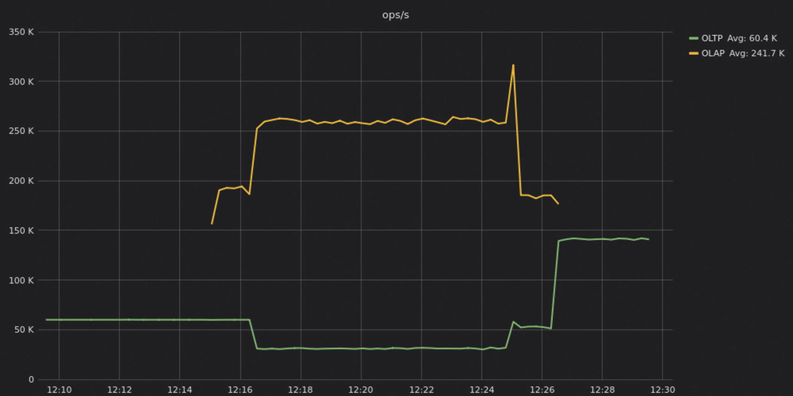
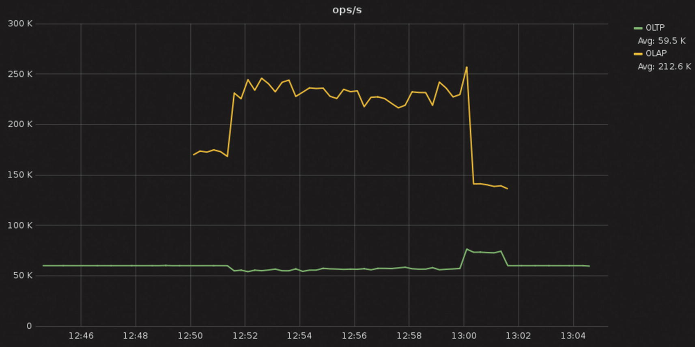

# الفصل 8: اعتبارات الطوبولوجيا

**Felipe Cardeneti Mendes, Piotr Sarna, Pavel Emelyanov, Cynthia Dunlop**

كما ذُكر في الفصل 5، تُجمَّع خوادم قواعد البيانات في الغالب في طوبولوجيات معقّدة، إذ تُجمَّع عقد معيّنة في موقع جغرافي واحد؛ وتُستخدم عقد أخرى طبقةً سريعةً للتخزين المؤقت فقط، وتخزّن عقد ثالثة بيانات باردة نادرًا ما تُطلَب في مكان رخيص، لأغراض الطوارئ فقط. وقد تناول ذلك الفصل كيفية عمل المشغّلات على فهم هذه الطوبولوجيا والتفاعل معها لتبادل المعلومات بكفاءة أكبر.

ويركّز هذا الفصل على الطوبولوجيا في ذاتها. كيف تُنسَخ البيانات عبر المناطق الجغرافية ومراكز البيانات؟ وما مخاطر الممارسة الشائعة في NoSQL بالتوسّع الأفقي إلى أقصى حدّ، وما بدائلها؟ وماذا عن الوسطاء بين تطبيقك وخوادم قاعدة بياناتك، مثل الذاكرات المؤقتة الخارجية وموازنات الحمل وطبقات التجريد؟ وتُغطّى هنا كل الآثار الأدائية لذلك وغيره.^1

## استراتيجية النسخ

أولًا، لننظر إلى النسخ (replication)، وهو كيفية توزيع بياناتك على نسخ أخرى في عنقودك.

> **ملاحظة**
>
> إذا أردت مقدّمة سريعة إلى مفهوم النسخ، فانظر الملحق A.

وجود نسخ أكثر سيبطئ الكتابة (لأن كل كتابة لا بدّ أن تُنسَخ إلى النسخ)، لكنه قد يسرّع القراءة (لأن نسخًا أكثر ستكون متاحة لخدمة مجموعة البيانات نفسها). وسيتيح لك كذلك الحفاظ على التشغيل وتجنّب فقدان البيانات في حال تعطّل العقد. وزيادةً على ذلك، فإن نسخ البيانات لتكون أقرب إلى تطبيقك وأقرب إلى مستخدميك سيقلّل زمن الاستجابة، خصوصًا إذا كانت قاعدة مستخدمي تطبيقك موزّعة جغرافيًّا توزيعًا كبيرًا.

معامل النسخ (RF) يساوي 1 يعني وجود نسخة واحدة فقط من الصف في العنقود، ولا سبيل لاستعادة البيانات إذا تعرّضت العقدة للخطر أو سقطت (سوى الاستعادة من نسخة احتياطية). ومعامل النسخ 2 يعني وجود نسختين من الصف في العنقود. ويُستخدم معامل نسخ لا يقلّ عن ثلاثة في معظم الأنظمة. وهذا يتيح لك القراءة والكتابة باتساق قوي، لأن نصابًا (quorum) من النسخ سيتحقّق حتى لو سقطت عقدة واحدة.

وتتيح لك قواعد بيانات كثيرة كذلك ضبط إعدادات النسخ ضبطًا دقيقًا على مستوى المنطقة. فمثلًا يمكن أن يكون لديك ثلاث نسخ في منطقة كثيفة الاستخدام، ونسختان فقط في منطقة أقل شعبية.

ولاحظ أن نسخ البيانات عبر مناطق متعدّدة (كما توصي Bigtable وقايةً من تعطّل منطقة توافر وتعطّل إقليمي معًا) قد يكون مكلفًا. فقبل أن تضبط ذلك، افهم كلفة نسخ البيانات بين المناطق.

وإذا كنت تعمل مع DynamoDB، فإنك تُنشئ جداول (لا عناقيد)، وتتولّى AWS النسخ عنك بمجرّد ضبط الجدول ليكون عالميًّا (Global). ومن العيوب الملحوظة في جداول DynamoDB العالمية أن المعاملات غير مدعومة عبر المناطق، وهو ما قد يكون عاملًا مقيّدًا في بعض حالات الاستخدام.

### تهيئة الرفوف

إذا كانت كل عقدك في مركز البيانات نفسه، فكيف تُهيّئ وضعها؟ والقاعدة العملية هنا أن يكون لديك عدد من الرفوف بعدد النسخ. فمثلًا إذا كان معامل النسخ لديك ثلاثة، فشغّله في ثلاثة رفوف. وبهذه الطريقة، حتى لو سقط رفّ كامل، يمكنك أن تستمرّ في تلبية طلبات القراءة والكتابة من أغلبية نسخك. وقد يتدهور الأداء قليلًا لأنك فقدت نحو 33 بالمئة من بنيتك التحتية (باعتبار تعطّل منطقة/رفّ كامل)، لكنك عمومًا ستبقى عاملًا. وعلى العكس، إذا كان لديك ثلاث نسخ موزّعة على رفّين، فقد يؤثر فقدان رفّ في اثنين من الأطراف الطبيعية الثلاثة لجزء من بياناتك. وهذا أمر مقعد إذا كانت حالة استخدامك تتطلّب قراءات/كتابات باتساق قوي.

### النسخ متعدّد المناطق أو العالمي

بوضع خوادم قاعدة بياناتك قريبة من مستخدميك، تخفض زمن استجابة الشبكة. ويمكنك كذلك تحسين التوافر وعزل عملك عن الانقطاعات الإقليمية.

وإذا كان لديك مراكز بيانات متعدّدة، فاحرص على أن تستخدم القراءات والكتابات، ما لم يتطلّب العمل خلاف ذلك، مستوى اتساق محصورًا في نسخ داخل مركز بيانات معيّن. فهذا النهج يتجنّب إضافة كلفة زمن استجابة بإيعاز قاعدة البيانات باختيار النسخ المحلية فقط (داخل المنطقة نفسها) لتحقيق مستوى الاتساق المطلوب. واحرص كذلك على أن يعرف كل عميل تطبيقي أيّ مركز بيانات يُعدّ مركزه المحلي؛ فينبغي أن يعطيه الأولوية في الاتصالات والطلبات، مع أن لديه استراتيجية احتياطية كذلك تحسّبًا لسقوط ذلك المركز.

ولاحظ أن عملاء التطبيقات قد يكونون مطّلعين على النشر متعدّد مراكز البيانات أو لا يكونون، والقرار في الوعي بالتحوّل الاحتياطي عبر المناطق متروك لمطوّر التطبيق. ومع أن إعدادات وملفات تعريف مختلفة لموازنة الحمل متاحة عبر مشغّلات قواعد بيانات متنوّعة، فإن المفهوم العام لتحوّل تطبيق إلى منطقة أخرى احتياطيًّا عند فشل محلي قد يخلّ بدلالات التطبيق في الغالب. ونتيجةً لذلك، يجب أن يتولّى مطوّر التطبيق نفسه التعامل مع ردّ فعله عند الفشل.

### تعدّد مناطق التوافر مقابل تعدّد المناطق

للتخفيف من احتمال تعطّل خادم أو رفّ، يقدّم مورّدو السحابة (ويوصون به) النشر متعدّد المناطق. فكّر في الأمر كأن لديك مركز بيانات في متناول يدك يمكنك فيه نشر كل نسخة خادم في رفّها الخاص، بمصدر طاقتها الخاص ومبدّلها الخاص أعلى الرفّ ونظام تبريدها الخاص. وسيكون نشر كهذا محصّنًا أمام أي تعطّل نظام مفرد أو تعطّل منطقة، لأن كل رفّ مكتفٍ بذاته. ولا تزال مناطق التوافر في المنطقة الجغرافية نفسها. غير أن تعطّل منطقة معيّنة لن يؤثر في النسخ المنشورة في منطقة أخرى.

فمثلًا في Google Compute Engine، تقع مناطق التوافر us-east1-b وus-east1-c وus-east1-d في منطقة us-east1 (مونكس كورنر، كارولاينا الجنوبية، الولايات المتحدة). لكن كل منطقة توافر مكتفية بذاتها. وزمن استجابة الشبكة بين مناطق التوافر في المنطقة نفسها ضئيل لا يُعتدّ به في سياق هذه المناقشة.

وباختصار، يساعد النشر متعدّد المناطق والنشر متعدّد مناطق التوافر على استمرارية العمل والتعافي من الكوارث على التوالي، لكن لتعدّد المناطق ميزة إضافية هي تقليل زمن استجابة التطبيقات المحلية في تلك المناطق المحلية. وقد يأتي ذلك بكلفة: فتكاليف نسخ البيانات عبر المناطق لا بدّ من أخذها في الحسبان في الطوبولوجيات متعدّدة المناطق.

ولاحظ أن النشر متعدّد مناطق التوافر سيفرض عليك كلفة مماثلة على النسخ بين المناطق. ومع أن النشر في منطقة توافر واحدة لقاعدة بياناتك ممكن تمامًا، فليس نهجًا موصى به في الغالب لأنه سيتعرّض فعليًّا كنقطة فشل واحدة أمام بنيتك التحتية. والخيار هنا بسيط جدًّا: هل تريد تقليل التكاليف قدر الإمكان والمخاطرة باحتمال انعدام التوافر، أم تريد ضمان توافر عالٍ في منطقة واحدة على حساب تكاليف نسخ الشبكة؟

## التوسّع الرأسي مقابل التوسّع الأفقي

أيّهما أفضل: عدد أكبر من العقد الأصغر (أي «الأقل قوة»)، أم عدد أصغر من العقد الأكبر؟ نوصي بالاستهداف إلى أقوى العقد وأصغر العناقيد التي تحقّق أهدافك في التوافر العالي والصمود — لكن فقط إذا كانت قاعدة بياناتك قادرة فعلًا على الاستفادة من القوة التي تضيفها العقد الأكبر.

لنفصّل ذلك قليلًا. فعلى مدى أكثر من عقد من الزمن، كان وعد NoSQL تمكين قابلية توسّع أفقية هائلة بعتاد تجاري رخيص نسبيًّا. وقد أتاح ذلك للمؤسّسات نشر معماريات كانت ستكون باهظة التكلفة بدرجة تحول دونها، ومستحيلة التوسّع باستخدام أنظمة قواعد البيانات العلائقية التقليدية.

وعلى مدى العقد نفسه، شهد «العتاد التجاري» تحوّلًا كذلك. لكن ليست كل قواعد البيانات تستفيد من موارد الحوسبة الحديثة. فكثير منها غير معمّر للاستفادة من الموارد التي تقدّمها العقد الكبيرة، مثل المعالج والذاكرة الإضافيين وأقراص الحالة الصلبة (SSDs)، ولا يستطيع تخزين كميّات كبيرة من البيانات على القرص بكفاءة. كما أن بيئات التشغيل المُدارة، مثل Java، مقيّدة أكثر بحجم الكومة (heap). والشيفرة متعدّدة الخيوط، بما فيها من كلفة إضافية للأقفال وتبديلات السياق وغياب اهتمام بمعمارية الذاكرة غير الموحّدة (NUMA)، تفرض عقوبة أداء كبيرة أمام معماريات العتاد الحديثة.

وإذا كانت قاعدة بياناتك في هذه المجموعة، فقد تجد أن التوسّع الرأسي يوصلك سريعًا إلى نقطة تناقص العائد. لكن حتى في هذه الحالة، الأفضل أن تستنزف إمكانات التوسّع الرأسي إلى أقصاها قبل أن تنتقل إلى التوسّع الأفقي.

والتركيز على التوسّع الأفقي يُفضي إلى تمدّد النظام (system sprawl)، وهو ما يعني كلفة تشغيلية إضافية، مع مساحة أكبر بكثير تحتاج إلى إدارة وتأمين. كما يُدخل تمدّد الخوادم كلفة شبكية إضافية على الأنظمة الموزّعة بسبب النسخ المستمر وفحوص السلامة التي يجريها كل خادم في عنقودك. ومع أن معظم المورّدين يزعمون أن التوسّع الأفقي سيمنحك أداءً خطيًّا، فإن آخرين أكثر تحفّظًا يقولون إنه سيمنحك «أداءً قريبًا من الخطي». فمثلًا، لا توصي إرشادات إنتاج Cassandra^2 بعناقيد تزيد على 50 عقدة باستخدام العدد الافتراضي 16 عقدة ظاهرية (vNode) لكل نسخة، لأنه قد يؤدي إلى انخفاض التوافر.

وعلاوةً على ذلك، هناك مزايا غير قليلة لاستخدام عقد كبيرة قوية.

- **جيران أقل إزعاجًا**: في منصّات السحابة، تعدّد المستأجرين هو القاعدة. فالمنصّة السحابية مبنية بحكم تعريفها على عرض نطاق شبكي ومدخلات/مخرجات وذاكرة وتخزين مشتركة، وما إلى ذلك. ونتيجةً لذلك، يكون نشر كثير من العقد الصغيرة عرضة لتأثير «الجار المزعج». ويُختبر هذا التأثير عندما يستهلك تطبيق أو آلة ظاهرية أكثر من نصيبه العادل من الموارد المتاحة. وكلّما زاد حجم العقد، قلّت الموارد المشتركة بين المستأجرين. بل إنه بعد حجم معيّن، من المرجّح أن تكون تطبيقاتك هي المستأجر الوحيد على الآلات المادية التي ينشر عليها نظامك.
- **أعطال أقل**: بما أن العقد الكبيرة والصغيرة تتعطّل بالمعدّل نفسه تقريبًا، فإن العقد الكبيرة تقدّم متوسط زمنًا بين الأعطال (MTBF) أعلى من العقد الصغيرة. والأعطال في طبقة البيانات تتطلّب تدخّل مشغّل، واستعادة عقدة كبيرة تتطلّب من الجهد البشري قدر ما تتطلّبه عقدة صغيرة. وفي عنقود من ألف عقدة، سترى أعطالًا كل يوم على الأرجح، وهذا يضخّم الكلفة الإدارية.
- **كثافة مركز البيانات**: تسعى كثير من المؤسّسات التي تملك مراكز بيانات داخلية إلى زيادة الكثافة بتجميع الخوادم في صناديق أقل عددًا وأكبر حجمًا وموارد حوسبة أكبر لكل خادم. وتساعد العناقيد الصغيرة من العقد الكبيرة في هذه العملية باستهلاك الموارد الأكثف بكفاءة، وهو ما يقلّل بدوره كلفة الطاقة والتشغيل.
- **بساطة التشغيل**: العناقيد الكبيرة من النسخ الصغيرة تتطلّب عناية أكبر، وتولّد تنبيهات أكثر، من العناقيد الصغيرة من النسخ الكبيرة. فكل تلك العقد الصغيرة تضاعف الجهد المبذول في المراقبة الفورية والصيانة الدورية، مثل الترقيات التدريجية.

ويقلق بعض المعماريين من أن وضع بيانات أكثر على عقد أقل يزيد المخاطر المرتبطة بالانقطاعات وفقدان البيانات. ويمكنك التفكير في ذلك بوصفه مشكلة «السلة الكبيرة». فقد يبدو بديهيًّا أن تخزين كل بياناتك على بضعة عقد كبيرة يجعلها أكثر عرضة للانقطاعات، كوضع كل بيضك في سلة واحدة. لكن ذلك لا يصحّ بالضرورة. فقواعد البيانات الحديثة تستخدم عددًا من التقنيات لضمان التوافر مع تسريع التعافي من الأعطال، وهو ما يجعل العقد الكبيرة أكثر أمانًا وأكثر اقتصادًا معًا. فكّر مثلًا في القدرات التي تقلّل الوقت اللازم لإضافة العقد واستبدالها، وآليات موازنة الحمل الداخلية التي تقلّل أثر الإنتاجية أو زمن الاستجابة عبر إعادة تشغيل قاعدة البيانات.^3

## عزل أحمال العمل

تجد كثير من الفرق نفسها في موقع يقتضي منها تشغيل أحمال عمل مختلفة متعدّدة على قاعدة البيانات. وكثيرًا ما يكون من المغري جمع أحمال مختلفة في عنقود واحد، خصوصًا عندما تحتاج إلى العمل على مجموعة البيانات نفسها بالضبط. ويمكن أن يقلّل إبقاء عدة أحمال معًا في عنقود واحد الكلفة كذلك. لكن من الضروري تجنّب تنازع الموارد عند تنفيذ أحمال حرجة من حيث زمن الاستجابة. فالإخفاق في ذلك قد يُدخل حالات أداء يصعب تشخيصها، إذ ينتهي حمل مسيء إلى إسقاط أداء العنقود كله.

وهناك طرق كثيرة لتحقيق عزل أحمال العمل لتقليل تنازع الموارد الذي قد يحدث عند تشغيل أحمال متعدّدة على عنقود واحد. وفيما يلي بعضها مما يعمل جيدًا. واعلم أن النهج الأفضل يعتمد على الخيارات المتاحة في قاعدة بياناتك الحالية، وكذلك على متطلبات حالة استخدامك:

- **العزل المادي**: يُستخدم هذا الإعداد في الغالب لعزل حمل عمل عن آخر عزْلًا تامًّا. وهو يتضمّن توسيع نشرك إلى منطقة إضافية (قد تكون ماديًّا نفس المنطقة الحالية، لكنها مختلفة منطقيًّا من جهة قاعدة البيانات). ونتيجةً لذلك، تنقسم الأحمال لتنسخ البيانات إلى موقع آخر، لكن تُنفَّذ الاستعلامات داخل موقع معيّن فقط، بحيث لا يُدهور عنق زجاجة في حمل عمل أداء الآخر ولا يعيقه. ولاحظ أن من عيوب هذا الحل مضاعفة كلفة بنيتك التحتية.
- **العزل المنطقي**: تتيح بعض قواعد البيانات أو خيارات النشر عزل أحمال العمل منطقيًّا دون حاجة إلى زيادة موارد بنيتك التحتية. فمثلًا لدى ScyllaDB ميزة إعطاء أولوية لأحمال العمل، إذ يمكنك إسناد أوزان مختلفة لأحمال معيّنة لمساعدة قاعدة البيانات على فهم أي حمل تريدها أن تعطيه الأولوية عند التنازع على النظام. وإذا لم تكن قاعدة بياناتك تقدّم ميزة كهذه، فقد يظلّ بإمكانك تشغيل حملين أو أكثر بالتوازي، لكن احذر التنازعات المحتملة في قاعدة بياناتك.
- **العزل المجدول**: في حالات كثيرة، قد تحتاج ببساطة إلى تشغيل مهامّ دفعية مجدولة على فواصل زمنية محدّدة لدعم أنشطة أعمال أخرى، مثل استخراج تقارير التحليلات. وفي تلك الحالات، فكّر في تشغيل الحمل المعني في فترات الذروة المنخفضة (إن وُجدت)، وجرّب إعدادات تزامن مختلفة لتجنّب الإضرار بزمن استجابة الحمل الأساسي الذي يعمل إلى جانبه.

### مزيد عن إعطاء أولوية لأحمال العمل من أجل العزل المنطقي

يستخدم مستخدمو ScyllaDB أحيانًا إعطاء أولوية لأحمال العمل للموازنة بين أحمال OLAP وOLTP. والهدف هو ضمان أن تكون لكل مهمة محدّدة حصة عادلة من موارد النظام، بحيث لا تحتكر مهمة واحدة موارد النظام وتحرم مهامّ أخرى من حدودها الدنيا اللازمة لمواصلة التشغيل.

في الشكل 8-1، لاحظ أن زمن الاستجابة للحملين يكاد يتقارب. فمعالجة OLTP بدأت عند 2 ميلي ثانية عند المئين 99 أو أقلّ حتى بدأ عمل OLAP عند الساعة 12:15. وعندما بدأ حمل OLAP، قفز زمن استجابة OLTP عند المئين 99 إلى 8 ميلي ثانية، ثم تدهور أكثر، فاستقرّ حول 11–12 ميلي ثانية حتى انتهى عمل OLAP بعد الساعة 12:26.

**الشكل 8-1. زمن الاستجابة بين حملي OLTP وOLAP على العنقود نفسه قبل تفعيل إعطاء الأولوية لأحمال العمل**

وأزمنة الاستجابة هذه أكبر بنحو ست مرات من زمن استجابة OLTP عندما يعمل وحده. (أزمنة استجابة OLAP تتراوح حول 12–14 ميلي ثانية، لكن OLAP مرة أخرى ليس حسّاسًا لزمن الاستجابة).

ويوضّح الشكل 8-2 أن إنتاجية OLTP تهبط من نحو 60 ألف عملية في الثانية إلى نصف ذلك، أي 30 ألف عملية في الثانية. ويمكنك أن ترى السبب. فـ OLAP، الجائع إلى الإنتاجية، يحافظ على نحو 260 ألف عملية في الثانية.

**الشكل 8-2. نتائج إنتاجية مقارنة لحملي OLTP وOLAP على العنقود نفسه دون تفعيل إعطاء الأولوية لأحمال العمل**

وفي النهاية يعاني OLTP من حيث زمن الاستجابة والإنتاجية معًا، ويختبر المستخدمون أزمنة استجابة أبطأ. وفي ظروف واقعية كثيرة، تخالف أزمنة استجابة OLTP هذه اتفاقية مستوى الخدمة (SLA) للعميل.

ويوضّح الشكل 8-3 أزمنة الاستجابة بعد تفعيل إعطاء الأولوية لأحمال العمل. ويمكنك أن ترى أن حمل OLTP يبدأ كذلك بأزمنة استجابة من ما دون الميلي ثانية إلى 2 ميلي ثانية عند المئين 99. ومتى أُضيف حمل OLAP، يتدهور أداء معالجة OLTP، لكن بأزمنة استجابة عند المئين 99 تتراوح بين 4–7 ميلي ثانية (نحو نصف أزمنة الاستجابة 11–12 ميلي ثانية عند المئين 99 عندما لم يكن إعطاء الأولوية مفعّلًا).

**الشكل 8-3. أزمنة استجابة OLTP وOLAP مع تفعيل إعطاء الأولوية لأحمال العمل**

ومن المهم ملاحظة أن أزمنة استجابة OLTP تظلّ متأثّرة بعض الشيء متى بدأ تنازع النظام، لكن ليس بالقدر نفسه الذي كانت عليه قبل إعطاء الأولوية لأحمال العمل. فإذا كان حمل عملك الفوري يتطلّب أزمنة استجابة عند المئين 99 ثابتة للغاية في نطاق رقم واحد من الميلي ثانية أو أقلّ، فنوصي بقوة بتجنّب إدخال أي شكل من أشكال التنازع.

أما حمل OLAP، فبما أنه أقل حسّاسية لزمن الاستجابة، فأزمنة استجابته عند المئين 99 تتراوح بين 25–65 ميلي ثانية. وهي أزمنة استجابة أعلى بكثير من قبل، وهي المقايضة في مقابل إبقاء أزمنة استجابة OLTP أقلّ.

أما من حيث الإنتاجية، فيوضّح الشكل 8-4 أن حركة OLTP مستقرة عند 60 ألف عملية في الثانية حتى يُفعَّل حمل OLAP كذلك.

**الشكل 8-4. إنتاجية حملي OLTP وOLAP مع تفعيل إعطاء الأولوية لأحمال العمل**

وهي تنخفض فعلًا في الأداء عند تلك النقطة، لكن انخفاضًا طفيفًا فقط، إذ تتراوح بين 54 ألفًا و58 ألف عملية في الثانية. وهذا انخفاض في الإنتاجية بنسبة 3–10 بالمئة فقط. أما حمل OLAP، من جهته، فيتراوح بين 215 ألفًا و250 ألف عملية في الثانية. وهذا انخفاض بنسبة 4–18 بالمئة، ما يعني أن حمل OLAP سيستغرق وقتًا أطول لإكماله. والحملان يعانيان التدهور، كما يُتوقّع من عنقود محمّل فوق طاقته، لكن ليس بالقدر المعطّل لأيّ منهما.

## طبقات التجريد

صار من الشائع إلى حدّ بعيد أن تكتب الفرق طبقة تجريد فوق قواعد بياناتها. فبدلًا من استدعاء واجهات قاعدة البيانات البرمجية مباشرةً، تتصل التطبيقات بهذه الطبقة المجرّدة من قاعدة البيانات، وهي تدير بعد ذلك لوجستيات الاتصال بقاعدة البيانات.

وعادةً ما تكون وراء هذه الخطوة بضعة دوافع رئيسية:

- **قابلية النقل**: إذا أراد الفريق الانتقال إلى قاعدة بيانات أخرى، فلن يحتاج إلى تعديل تطبيقاته واستعلاماته. غير أن الفريق المسؤول عن طبقة التجريد سيحتاج إلى تعديل تلك الشيفرة، وهو ما قد يكون أعقد.
- **بساطة المطوّر**: لا يحتاج المطوّرون إلى القلق بشأن التفاصيل الداخلية للعمل مع أي قاعدة بيانات بعينها. وهذا يسهّل تنقّل الناس بين الفرق.
- **قابلية التوسّع**: قد تكون طبقة التجريد أسهل في التوعية (containerization). فإذا حُمّلت الواجهة البرمجية فوق طاقتها، فعادةً ما يكون توسيع عدد الحاويات في Kubernetes أسهل من إنشاء حاويات إضافية لقاعدة البيانات نفسها.
- **واجهات برمجية موجّهة للعملاء**: عرّض قاعدة البيانات مباشرةً للمستخدمين النهائيين ليس فكرة جيدة عادةً. ونتيجةً لذلك، تعرّض شركات كثيرة نقاط نهاية شائعة، تُترجَم في النهاية إلى استعلامات قاعدة بيانات فعلية. ومن ثمّ تستطيع طبقة التجريد إسقاط الطلبات، وتحديد التزامن بين المستأجرين، وإجراء التدقيق والمساءلة على استدعاءاتها.

غير أن هناك احتمالًا مؤكّدًا لعقوبة أداء تعتمد اعتمادًا كبيرًا على مدى كفاءة تنفيذ الطبقة. فطبقة تجريد نفّذها فريق من مهندسي Rust المهرة تنفيذًا بالغ الدقّة من المرجّح أن يكون أثرها أقلّ بكثير من طبقة Java أو Python رُكِّبت على عجل كمشروع جانبي. وإذا قرّرت أن تسلك هذا الطريق، فتأكّد من أن الطبقة مطوّرة مع مراعاة الأداء، وأن تقيس أثرها بعناية بالقياس المرجعي والمراقبة المستمرة معًا. وتذكّر أن كل تواصل بين التطبيق وقاعدة البيانات سيمرّ عبر هذه الطبقة، لذا فإن قصورًا صغيرًا في الكفاءة قد يتضخّم بسرعة إلى مشكلة أداء كبيرة.

فمثلًا رأينا مرة عميلًا يبلّغ عن حالة ارتفاع في زمن الاستجابة آتية من طبقة تجريده المكتوبة بـ Golang. ومتى أدركنا أن زمن الاستجابة في جهة قاعدة البيانات داخل الحدود المقبولة لحالة استخدامه، انتقل التحقيق من قاعدة البيانات إلى الشبكة وجهة العميل. وباختصار، تبيّن أن ارتفاعات زمن استجابة التطبيق متأثّرة بشدة أثناء عملية جمع القمامة (garbage collection)، وهي تسقط أداء جهة العميل سقوطًا كبيرًا. وحُلّت المشكلة بعد توسيع عدد العملاء وضمان امتلاكهم موارد حوسبة كافية للعمل على نحو سليم.

ومثال آخر: أثناء عملنا مع عميل على ترحيل من PostgreSQL إلى NoSQL، أدركنا أن عملاءه يفتحون في كثير من الأحيان اتصالات متزامنة أكثر من اللازم مع قاعدة البيانات. ومع أن وجود عدد كبير من المقابس المفتوحة فكرة جيدة عادةً في الأنظمة الموزّعة، فإن عددًا بالغ الكبر منها يمكن أن يغمر بسهولة جهة العميل (التي تحتاج إلى تتبّع كل المقابس المفتوحة) وكذلك قاعدة البيانات. وبعد أن أبلغنا العميل بنتائجنا، اكتشف أنه يفتح جلسة قاعدة بيانات جديدة مع كل طلب يرسله إلى العنقود. وبعد تصحيح الشيفرة المعيبة، زادت إنتاجية التطبيق ككل زيادة كبيرة لأن طبقة التجريد صارت تستخدم المقابس النشطة المفتوحة عند توجيه الطلبات.^4

## موازنة الحمل

هل ينبغي أن تضع موازن حمل مخصّصًا أمام قاعدة بياناتك؟ في معظم الحالات، لا. فقواعد البيانات لها عادةً طريقتها الخاصة في موازنة حركة المرور على العنقود، لذا فإن إضافة موازن حمل فوق ذلك لن تساعد، بل قد تضرّ فعلًا. فكّر في 1) عدد الطلبات التي يستطيع موازن الحمل خدمتها دون أن يصبح عنق زجاجة، و2) سياسة موازنته. واعترف كذلك بأنه يُدخل نقطة فشل واحدة تقلّل صمود قاعدة بياناتك. ونتيجةً لذلك، تفرط في تعقيد طوبولوجيا بنيتك التحتية ككل لأنك صرت بحاجة إلى القلق بشأن توافر موازنة الحمل العالي.

وبالطبع، هناك استثناءات دائمًا. فمثلًا قل إنك كنت تستخدم سابقًا واجهة برمجية لقاعدة بيانات لا تعرف شيئًا عن تخطيط العنقود وعقده الفردية (مثل DynamoDB، حيث تُهيّأ نسخة العميل بعنوان نهاية واحد وكل الطلبات تُرسَل إليه). والآن تنتقل إلى قاعدة بيانات موزّعة بلا قائد مثل ScyllaDB، حيث العملاء واعون بالعقد، بل وواعون بالرموز (يدركون أي نطاقات رموز هي أطراف طبيعية لكل عقدة في طوبولوجيتك). وإذا هيّأت تطبيقًا ببساطة بعنوان IP لعقدة ScyllaDB واحدة كعنوان نهاية واجهته البرمجية الوحيد، فسيعمل التطبيق على نحو صحيح. ففي النهاية، أي عقدة تستطيع الإجابة عن أي طلب بتمريره إلى عقد أخرى عند الحاجة. غير أن هذه العقدة الواحدة ستكون أكثر تحميلًا من العقد الأخرى لأنها ستكون العقدة الوحيدة التي تخدم الطلبات فعليًّا. وستصبح كذلك نقطة فشل واحدة من منظور تطبيقك.

وفي هذه الحالة الطرفية الخاصة، تكون موازنة الحمل حرجة، لكن موازنات الحمل ليست كذلك. فموازنة الحمل في جهة الخادم معقّدة إلى حدّ بعيد من منظور المسؤول. والأهم من ذلك من حيث الأداء، أن حلول جهة الخادم تضيف زمن استجابة. فالحلول التي تتضمّن موازن حمل TCP أو HTTP تتطلّب قفزة أخرى لكل طلب، وهو ما يزيد كلفة كل طلب وزمن استجابته معًا. ونوصي بموازنة الحمل في جهة العميل: تعديل التطبيق ليُرسل الطلبات إلى العقد المتاحة بدلًا من عقدة واحدة.

والخلاصة المهمة هنا أن موازنة الحمل عمومًا غير لازمة، وحين تكون لازمة، فإن موازنات الحمل في جهة الخادم تُنتج عقوبة أداء شديدة إلى حدّ ما. وإذا كانت ضرورية قطعًا، فمن المرجّح أن موازنة الحمل في جهة العميل خيار أفضل.^5

## الذاكرات المؤقتة الخارجية

تنظر الفرق في الذاكرات المؤقتة الخارجية في الغالب عندما لا يستطيع عنقود قاعدة البيانات الحالي تلبية اتفاقية مستوى الخدمة المطلوبة. وهذا قرار موجّه إلى الأداء بوضوح. ووضع ذاكرة مؤقتة خارجية أمام قاعدة البيانات شائع للتعويض عن زمن استجابة دون المستوى ناتج عن العوامل المتنوّعة التي نوقشت في هذا الكتاب: داخليات قاعدة بيانات غير فعّالة، واستخدام المشغّل، وخيارات البنية التحتية، وارتفاعات حركة المرور، وما إلى ذلك.

وقد يبدو التخزين المؤقت حلًّا سريعًا وسهلًا لأن النشر يمكن تنفيذه دون عناء كبير ودون تحمّل الكلفة الكبيرة لتوسيع قاعدة البيانات أو إعادة تصميم مخطّطها أو حتى تحوّل تقني أعمق. غير أن الذاكرات المؤقتة الخارجية ليست بهذه البساطة التي تُصوَّر بها في الغالب. بل قد تكون واحدة من أكثر مكوّنات معمارية التطبيق الموزّع إشكالًا.

وفي بعض الحالات تكون شرًّا لا بدّ منه، خصوصًا إذا كانت لديك حالة استخدام بالغة الحساسية لزمن الاستجابة مثل مزايدة الإعلانات الفورية أو الوسائط المتدفّقة، وكنت قد جرّبت كل الوسائل الأخرى لتقليل زمن الاستجابة. لكن في حالات كثيرة، لا يستحقّ تعزيز الأداء هذه الكلفة. وتعرض الأقسام الآتية بعض المخاطر الرئيسية لتحكم أنت ما يناسب حالة استخدامك واتفاقيات مستوى الخدمة لديك.

### الذاكرة المؤقتة الخارجية تضيف زمن استجابة

الذاكرة المؤقتة المنفصلة تعني قفزة أخرى على الطريق. فعندما تحيط ذاكرة مؤقتة بقاعدة البيانات، يحدث الوصول الأول في طبقة الذاكرة المؤقتة. وإذا لم تكن البيانات فيها، يُرسَل الطلب إلى قاعدة البيانات. والنتيجة زمن استجابة إضافي على مسار بطيء أصلًا خاص بالبيانات غير المخزّنة مؤقتًا. وقد يزعم أحدهم أن زمن الاستجابة الإضافي لا يظهر عندما تتّسع الذاكرة المؤقتة لمجموعة البيانات كاملة. غير أن هناك عادةً أكثر من حمل عمل أو نمط واحد يضرب قاعدة البيانات، وبعضها سيتحمّل كلفة القفزة الإضافية.

### الذاكرة المؤقتة الخارجية كلفة إضافية

التخزين المؤقت يعني ذاكرة DRAM مكلفة، وهي تعني كلفة أعلى لكل غيغابايت من أقراص SSD. وحتى عندما تستطيع ذاكرة الوصول العشوائي حفظ العناصر المستخدمة بكثرة، فالأفضل استخدام ذاكرة قاعدة البيانات القائمة، بل وزيادتها للتخزين المؤقت الداخلي بدلًا من توفير بنية تحتية منفصلة بالكامل على نسخ موجّهة لذاكرة الوصول العشوائي. وقد يكون توفير ذاكرة مؤقتة بحجم مجموعة البيانات الدائمة كلها باهظًا بدرجة تحول دون ذلك. وفي حالات أخرى، يكون حجم مجموعة العمل كبيرًا جدًّا، فيبلغ التيرابايتات في الغالب، وهو ما يجعل التنفيذ الملائم لأقراص SSD الخيار المفضّل والأرخص.

### التخزين المؤقت الخارجي يقلّل التوافر

لا يمكن لحلّ توافر عالٍ لأي ذاكرة مؤقتة أن يضاهي حلّ قاعدة البيانات نفسها. فقواعد البيانات الموزّعة الحديثة فيها نسخ متعدّدة؛ وهي كذلك واعية بالطوبولوجيا وبالسرعة وتستطيع تحمّل أعطال متعدّدة دون فقدان بيانات.

فمثلًا من أنماط النسخ الشائعة ثلاثة نسخ محلية، وهو ما يتيح عمومًا موازنة القراءات على تلك النسخ لاستخدام آلية التخزين المؤقت الداخلية في قاعدة بياناتك استخدامًا فعّالًا. فكّر في عنقود من تسع عقد بمعامل نسخ ثلاثة: كل عقدة ستحمل في الجوهر نحو 33 بالمئة من حجم مجموعة بياناتك الكلية. وبما أن الطلبات تُوزَّن بين نسخ مختلفة، فإن ذلك يمنحك مساحة أكبر لتخزين بياناتك مؤقتًا، وهو ما قد يلغي الحاجة إلى ذاكرة مؤقتة خارجية إلغاءً تامًّا (احتمالًا). وفي المقابل، إذا أُبطلت مدخلات في ذاكرة مؤقتة خارجية قبيل موجة من الطلبات الباردة، فقد يتأثّر التوافر لبعض الوقت لأن قاعدة البيانات لن يكون لديها تلك البيانات في ذاكرتها المؤقتة الداخلية (مزيد عن ذلك في القسم المسمّى «التخزين المؤقت الخارجي يفسد التخزين المؤقت في قاعدة البيانات» لاحقًا في هذا الفصل).

وكثيرًا ما تفتقر الذاكرات المؤقتة إلى خصائص التوافر العالي، ويمكن أن تفشل بسهولة أو تُبطل سجلات بحسب آلياتها الاستدلالية. والأعطال الجزئية، وهي أكثر شيوعًا، أسوأ من حيث الاتساق. وعندما تفشل الذاكرة المؤقتة لا محالة، ستتلقّى قاعدة البيانات خرطوم الاستعلامات دون أي تخفيف، وستُفسد اتفاقيات مستوى الخدمة لديك على الأرجح. وزيادةً على ذلك، حتى لو كانت للذاكرة المؤقتة نفسها بعض خصائص التوافر العالي، فإنها لا تستطيع تنسيق التعامل مع هذا العطل مع قاعدة البيانات الدائمة التي تقع أمامها. والخلاصة: اعتمد على قاعدة البيانات، بدلًا من جعل اتفاقيات زمن الاستجابة لديك معتمدة على ذاكرة مؤقتة.

### تعقيد التطبيق: تطبيقك يحتاج إلى التعامل مع حالات أكثر

التعقيد في التطبيق والتشغيل مشكلتان في الذاكرات المؤقتة الخارجية. فمتى كانت لديك ذاكرة مؤقتة خارجية، صرت بحاجة إلى إبقائها محدّثة مع العميل وقاعدة البيانات. فمثلًا إذا أجرت قاعدة بياناتك عمليات إصلاح (repairs)، فتحتاج الذاكرة المؤقتة إلى المزامنة أو الإبطال. غير أن إبطال الذاكرة المؤقتة قد يُدخل فترة طويلة تنتظر فيها أن تسخن في النهاية. ويلزم أن تتوافق سياسات إعادة المحاولة والمهلات في عميلك مع خصائص الذاكرة المؤقتة، وأن تعمل كذلك عندما تنتهي الذاكرة المؤقتة. وعادةً ما يصعب اختبار مثل هذه السيناريوهات وتنفيذها.

### التخزين المؤقت الخارجي يفسد التخزين المؤقت في قاعدة البيانات

لقواعد البيانات الحديثة ذاكرات مؤقتة مدمجة وسياسات معقّدة لإدارتها. وعندما تضع ذاكرة مؤقتة أمام قاعدة البيانات، فمعظم طلبات القراءة ستصل إلى الذاكرة المؤقتة الخارجية فقط، ولن تُبقي قاعدة البيانات هذه الكائنات في ذاكرتها. ونتيجةً لذلك، تصبح ذاكرة قاعدة البيانات المؤقتة غير فعّالة. وعندما تصل الطلبات في النهاية إلى قاعدة البيانات، ستكون ذاكرتها المؤقتة باردة وستأتي الاستجابات من القرص أساسًا. ونتيجةً لذلك، فمن المرجّح أن تتكبّد الرحلة من الذاكرة المؤقتة إلى قاعدة البيانات ثم عودةً إلى التطبيق زمن استجابة إضافيًّا.

### التخزين المؤقت الخارجي قد يزيد المخاطر الأمنية

الذاكرة المؤقتة الخارجية تضيف سطح هجوم جديدًا بالكامل إلى بنيتك التحتية. فالتشفير والعزل وضبط الوصول إلى البيانات الموضوعة في الذاكرة المؤقتة من المرجّح أن تختلف عن نظيراتها في طبقة قاعدة البيانات نفسها.

### التخزين المؤقت الخارجي يتجاهل معرفة قاعدة البيانات ومواردها

قواعد البيانات معقّدة إلى حدّ بعيد ومبنية لأحمال إدخال/إخراج متخصّصة على النظام. وكثير من الاستعلامات يصل إلى البيانات نفسها، ويمكن تخزين قدر من حجم مجموعة العمل في الذاكرة لتوفير عمليات الوصول إلى القرص. وقاعدة البيانات الجيدة ينبغي أن تملك منطقًا متطوّرًا لتقرير أي الكائنات والفهارس وعمليات الوصول ينبغي أن تخزّنها مؤقتًا.

وينبغي أن تملك قاعدة البيانات كذلك سياسات إخراج متنوّعة (مثل سياسة الأقل استخدامًا مؤخرًا [LRU] كمثال بسيط) تحدّد متى ينبغي للبيانات الجديدة أن تحلّ محلّ الكائنات المخزّنة مؤقتًا (الأقدم).

ومن الأمثلة الأخرى التخزين المؤقت المقاوم للمسح (scan-resistant caching). فعند مسح مجموعة بيانات كبيرة، مثل نطاق كبير أو مسح جدول كامل، تُقرأ كائنات كثيرة من القرص. وتستطيع قاعدة البيانات أن تدرك أن هذا مسح (لا استعلام عادي)، فتختار ترك هذه الكائنات خارج ذاكرتها المؤقتة الداخلية. أما الذاكرة المؤقتة الخارجية فستتعامل مع مجموعة النتائج كأي شيء آخر وتحاول تخزينها مؤقتًا. وقاعدة البيانات تزامن محتوى الذاكرة المؤقتة مع القرص تلقائيًّا وفق معدّل الطلبات الواردة، ومن ثمّ لا يحتاج المستخدم ولا المطوّر إلى فعل أي شيء لضمان أن تكون عمليات البحث في البيانات المكتوبة حديثًا سريعة. ولذلك، إذا لم تستجب قاعدة بياناتك بسرعة كافية لسبب ما، فهذا يعني أن:

- الذاكرة المؤقتة مهيّأة تهيئة خاطئة
- ليس لديها ذاكرة وصول عشوائي كافية للتخزين المؤقت
- حجم مجموعة العمل ونمط الطلبات لا يناسبان الذاكرة المؤقتة
- تنفيذ التخزين المؤقت في قاعدة البيانات ضعيف

## الخلاصة

شارك هذا الفصل آراءً قوية في كيفية التعامل مع قرارات الطوبولوجيا. فمثلًا أوصينا بما يلي:

- استخدام معامل نسخ لا يقلّ عن 3 (مع ضبط دقيق جغرافيًّا إذا كان متاحًا)
- أن يكون عدد الرفوف بعدد النسخ
- عزل القراءات والكتابات داخل مركز بيانات معيّن
- ضمان أن يعرف كل عميل مركز البيانات المحلي وأن يعطيه الأولوية
- أخذ كلفة النشر متعدّد المناطق (نسخ البيانات عبر المناطق) في الحسبان إلى جانب فوائده
- التوسّع الرأسي إلى أقصى حدّ ممكن قبل التوسّع الأفقي
- النظر في بضعة خيارات مختلفة لتقليل تنازع الموارد الذي قد يحدث عند تشغيل أحمال متعدّدة على عنقود واحد
- النظر بعناية في المحاذير المرتبطة بالذاكرات المؤقتة الخارجية وموازنات الحمل وطبقات التجريد

وينظر الفصل التالي في أفضل الممارسات لاختبار طوبولوجيتك: قياسها المرجعي لمعرفة ما هي قادرة عليه وكيف تُقارَن بتهيئات وحلول بديلة.

هذا الفصل متاح بموجب شروط رخصة Creative Commons Attribution 4.0 International ([http://​creativecommons.​org/​licenses/​by/​4.​0/​](http://creativecommons.org/licenses/by/4.0/))، التي تسمح بالاستخدام والمشاركة والتكييف والتوزيع في أي وسيط أو صيغة، شرط أن تنسب العمل إلى مؤلفه (أو مؤلفيه) الأصليين، وتوفّر رابطًا إلى رخصة Creative Commons، وتشير إلى ما إذا أُجريت تغييرات.

وتُدرَج الصور أو المواد الأخرى التابعة لطرف ثالث في هذا الفصل ضمن رخصة Creative Commons الخاصة بالفصل، ما لم يُذكر خلاف ذلك في سطر نسبة إلى المادة. وإذا لم تكن المادة مشمولة بمثل هذه الرخصة وتعلّق استخدامك المقصود به أو يتجاوز الاستخدام المسموح به قانونيًّا، فستحتاج إلى الحصول على إذن مباشرةً من صاحب حقوق النشر.

[^1]: يستند هذا الفصل إلى مواد نُشرت أصلًا في مدوّنة ScyllaDB ([`www.scylladb.com/blog/`](http://www.scylladb.com/blog/))، ووثائق ScyllaDB ([`https://docs.scylladb.com/stable/`](https://docs.scylladb.com/stable/))، والورقة البيضاء لـ ScyllaDB «Why Scaling Up Beats Scaling Out for NoSQL» ([`https://lp.scylladb.com/whitepaper-scaling-up-vs-scaling-out-offer.html`](https://lp.scylladb.com/whitepaper-scaling-up-vs-scaling-out-offer.html))، ومقال كتبه المؤسّس المشارك والمدير التنفيذي لـ ScyllaDB Dor Laor لمجلّة *The New Stack*. ويُستخدم هنا بإذن من ScyllaDB.

[^2]: انظر [`https://cassandra.apache.org/doc/latest/cassandra/getting_started/production.html`](https://cassandra.apache.org/doc/latest/cassandra/getting_started/production.html).

[^3]: يوفّر ScyllaDB Heat Weighted Load Balancing خوارزمية أذكى لإعادة توزيع الطلبات مبنية على نسبة إصابة الذاكرة المؤقتة في عقد العنقود. لمعرفة المزيد: [`www.scylladb.com/2017/09/21/scylla-heat-weighted-load-balancing/`](http://www.scylladb.com/2017/09/21/scylla-heat-weighted-load-balancing/).

[^4]: اطّلع على استخدام طبقة التجريد في Discord في «How Discord Migrated Trillions of Messages from Cassandra to ScyllaDB» ([`www.youtube.com/watch?v=S2xmFOAUhsk`](http://www.youtube.com/watch?v=S2xmFOAUhsk))، وفي ShareChat في «ShareChat’s Path to High-Performance NoSQL with ScyllaDB» ([`www.youtube.com/watch?v=Y2yHv8iqigA`](http://www.youtube.com/watch?v=Y2yHv8iqigA)).

[^5]: لمثال على كيفية تنفيذ موازنة الحمل في جهة العميل، انظر [`www.scylladb.com/2021/04/13/load-balancing-in-scylla-alternator/`](http://www.scylladb.com/2021/04/13/load-balancing-in-scylla-alternator/).
