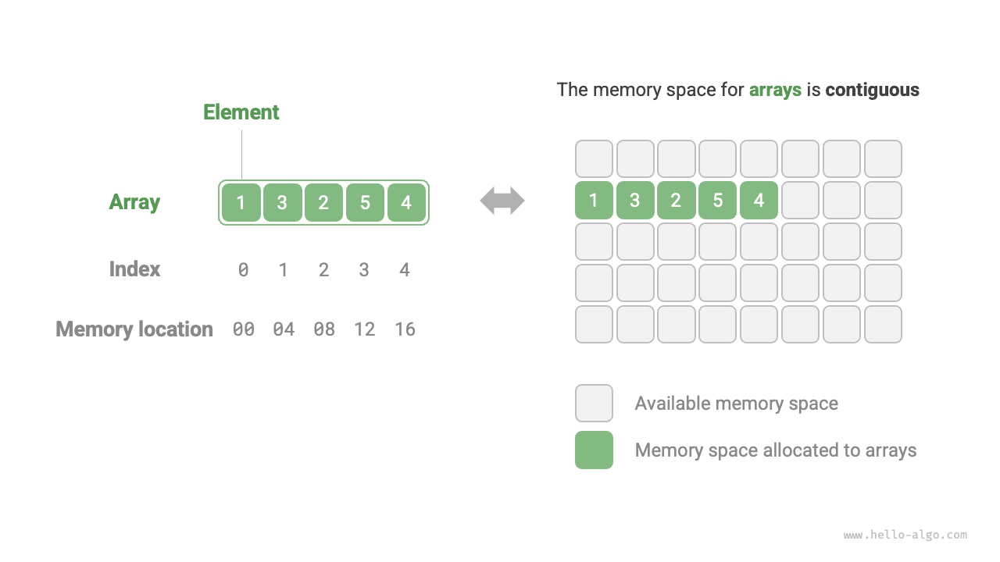
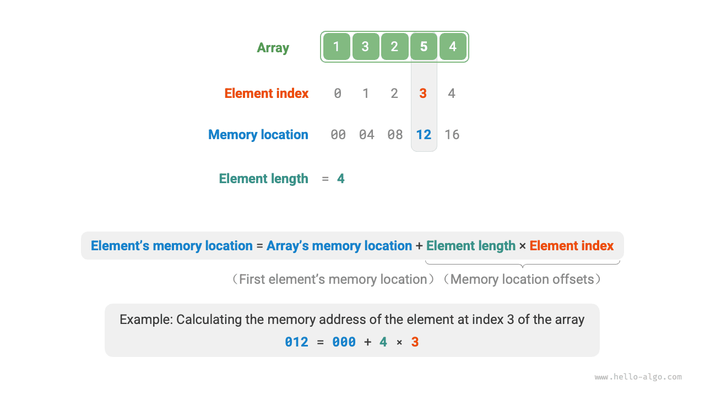
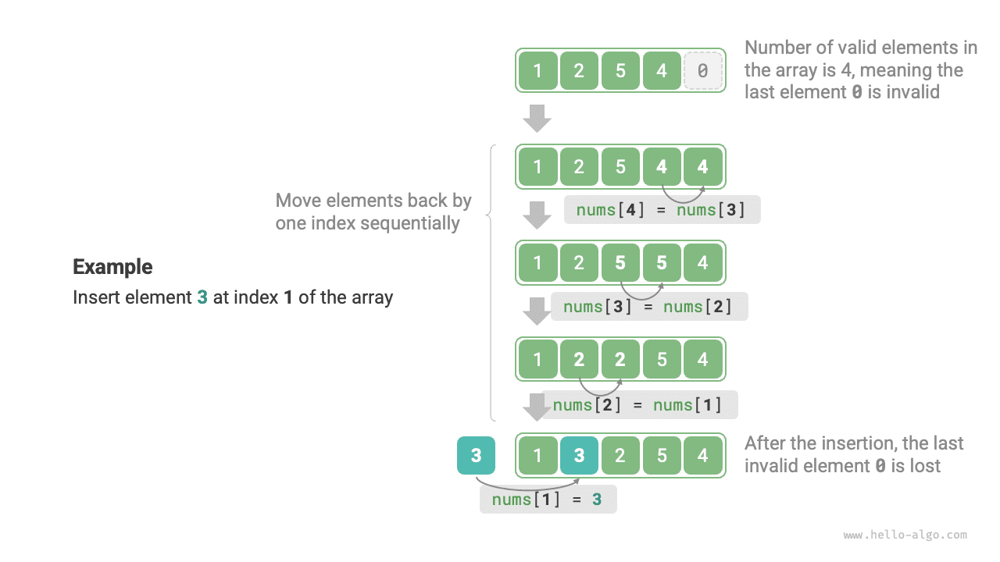
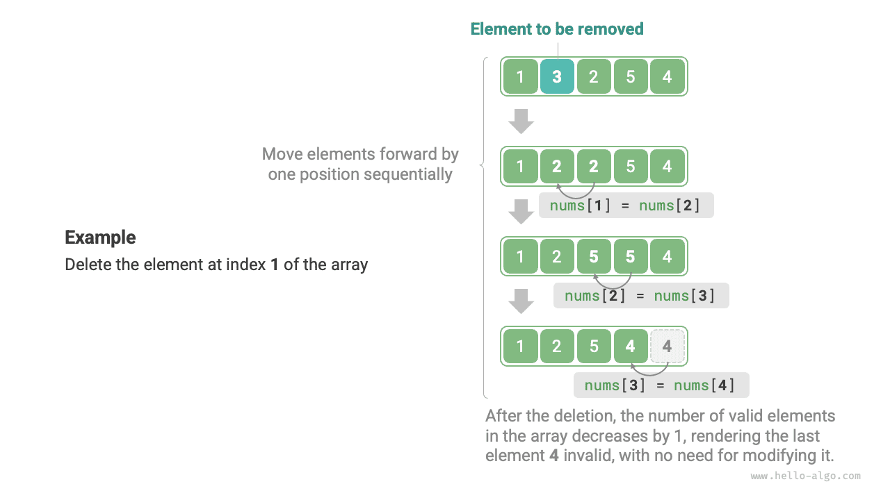

<u>المصفوفة</u> (array) بنية بيانات خطية تخزّن عناصر من النوع نفسه في مساحة ذاكرة متجاورة. ويُسمى موضع العنصر في المصفوفة <u>فهرس</u> العنصر. ويوضح الشكل أدناه المفاهيم الرئيسية للمصفوفات وطريقة تخزينها.



## عمليات المصفوفة الشائعة

### تهيئة المصفوفات

يمكننا الاختيار بين طريقتين لتهيئة المصفوفة حسب حاجتنا: مع قيم أولية أو دونها. وعندما لا تُحدَّد قيم أولية، تهيّئ معظم لغات البرمجة عناصر المصفوفة إلى $0$:

<div class="lang-tab">
<p class="lang-tab__label">Python</p>

```python title="array.py"
# Initialize array
arr: list[int] = [0] * 5  # [ 0, 0, 0, 0, 0 ]
nums: list[int] = [1, 3, 2, 5, 4]
```

</div>
### الوصول إلى العناصر

تُخزَّن عناصر المصفوفة في مساحة ذاكرة متجاورة، مما يعني أن حساب العنوان في الذاكرة لعناصر المصفوفة سهل للغاية. وبمعرفة عنوان المصفوفة في الذاكرة (عنوان أول عنصر فيها) وفهرس العنصر، يمكننا استخدام الصيغة الموضحة في الشكل أدناه لحساب عنوان العنصر في الذاكرة والوصول إليه مباشرةً.



وبمراقبة الشكل أعلاه، نجد أن فهرس أول عنصر في المصفوفة هو $0$، وهو ما قد يبدو مخالفاً للحدس لأن العدّ من $1$ أكثر طبيعية. غير أنه من منظور صيغة حساب العنوان، **ليس الفهرس في جوهره سوى إزاحة عن العنوان في الذاكرة**. وإزاحة عنوان العنصر الأول هي $0$، فمن المنطقي أن يكون فهرسه $0$.

والوصول إلى عناصر المصفوفة عالي الكفاءة؛ إذ يمكننا الوصول العشوائي إلى أي عنصر في المصفوفة في زمن $O(1)$.

<div class="lang-tab">
<p class="lang-tab__label">Python</p>

```py
def random_access(nums: list[int]) -> int:
    """وصول إلى عنصر عند فهرس عشوائي"""
    # اختر عددًا عشوائيًا في النطاق [0, len(nums)-1]
    random_index = random.randint(0, len(nums) - 1)
    # احصل على العنصر المختار عشوائيًا وأعده
    random_num = nums[random_index]
    return random_num
```

</div>
### إدراج العناصر

تتراصّ عناصر المصفوفة معاً بإحكام في الذاكرة، ولا توجد مساحة إضافية بينها لبيانات أخرى. وكما يوضح الشكل أدناه، إذا أردنا إدراج عنصر في منتصف المصفوفة، فعلينا إزاحة جميع العناصر اللاحقة موضعاً واحداً إلى اليمين ثم إسناد القيمة عند ذلك الفهرس.



وجدير بالذكر أنه بما أن طول المصفوفة ثابت، فسيؤدي إدراج عنصر حتماً إلى دفع العنصر الأخير خارج المصفوفة. وسنترك حل هذه المشكلة لمناقشته في فصل «القائمة».

<div class="lang-tab">
<p class="lang-tab__label">Python</p>

```py
def insert(nums: list[int], num: int, index: int):
    """إدراج العنصر num عند الفهرس `index` في المصفوفة"""
    # أزح كل العناصر من الفهرس `index` وما بعده موضعًا واحدًا إلى اليمين
    for i in range(len(nums) - 1, index, -1):
        nums[i] = nums[i - 1]
    # أسند num إلى العنصر عند الفهرس `index`
    nums[index] = num
```

</div>
### حذف العناصر

وبالمثل، وكما يوضح الشكل أدناه، لحذف العنصر عند الفهرس $i$، علينا إزاحة جميع العناصر بعد الفهرس $i$ موضعاً واحداً إلى الأمام.



لاحظ أنه بعد اكتمال الحذف لم يعد للعنصر الأخير الأصلي معنى، لذا لا حاجة إلى تعديله صراحةً.

<div class="lang-tab">
<p class="lang-tab__label">Python</p>

```py
def remove(nums: list[int], index: int):
    """حذف العنصر عند الفهرس `index`"""
    # أزح كل العناصر بعد الفهرس `index` موضعًا واحدًا إلى اليسار
    for i in range(index, len(nums) - 1):
        nums[i] = nums[i + 1]
```

</div>
إجمالاً، لعمليتي الإدراج والحذف في المصفوفة العيوب التالية:

- **تعقيد زمني مرتفع**: متوسط التعقيد الزمني للإدراج والحذف في المصفوفة معاً هو $O(n)$، حيث $n$ طول المصفوفة.
- **فقدان العناصر**: بما أن طول المصفوفة غير قابل للتغيير، فبعد إدراج عنصر ستُفقد العناصر التي تتجاوز طول المصفوفة.
- **تبذير في الذاكرة**: يمكننا تهيئة مصفوفة طويلة نسبياً واستخدام الجزء الأمامي منها فقط، فتصبح أي عناصر ذيلية تُستبدل مجرد حجوزات غير مستخدمة، لكن هذا يهدر بعض المساحة الذاكرية.

### اجتياز المصفوفات

في معظم لغات البرمجة، يمكننا اجتياز المصفوفة إما بالفهرس وإما بالتكرار المباشر على كل عنصر في المصفوفة:

<div class="lang-tab">
<p class="lang-tab__label">Python</p>

```py
def traverse(nums: list[int]):
    """اجتز المصفوفة"""
    count = 0
    # اجتز المصفوفة بالفهرس
    for i in range(len(nums)):
        count += nums[i]
    # تكرّر مباشرةً على عناصر المصفوفة
    for num in nums:
        count += num
    # تكرّر على الفهارس والعناصر معًا
    for i, num in enumerate(nums):
        count += nums[i]
        count += num
```

</div>
### البحث عن العناصر

يتطلب البحث عن عنصر محدد في المصفوفة اجتيازها والتحقق في كل تكرار مما إذا كانت قيمة العنصر مطابقة؛ فإن تطابقت، أخرج الفهرس المقابل.

وبما أن المصفوفة بنية بيانات خطية، تُسمى عملية البحث أعلاه «البحث الخطي».

<div class="lang-tab">
<p class="lang-tab__label">Python</p>

```py
def find(nums: list[int], target: int) -> int:
    """البحث عن عنصر محدد في المصفوفة"""
    for i in range(len(nums)):
        if nums[i] == target:
            return i
    return -1
```

</div>
### توسيع المصفوفات

في بيئات الأنظمة المعقّدة، لا تستطيع البرامج ضمان توفر مساحة الذاكرة بعد المصفوفة، مما يجعل توسيع سعة المصفوفة غير آمن. لذلك، في معظم لغات البرمجة، **طول المصفوفة غير قابل للتغيير**.

وإذا أردنا توسيع مصفوفة، فعلينا إنشاء مصفوفة جديدة أكبر ثم نسخ عناصر المصفوفة الأصلية إلى المصفوفة الجديدة عنصراً عنصراً. وهذه عملية بتعقيد $O(n)$، وتستهلك وقتاً طويلاً عندما تكون المصفوفة كبيرة. وتظهر الشيفرة أدناه:

<div class="lang-tab">
<p class="lang-tab__label">Python</p>

```py
# لاحظ أن قائمة Python مصفوفة ديناميكية يمكن مدّها مباشرةً
# لأغراض التعلم، تعامل هذه الدالة مع القائمة بوصفها مصفوفة ثابتة الطول
def extend(nums: list[int], enlarge: int) -> list[int]:
    """مدّ طول المصفوفة"""
    # مهّد مصفوفة بالطول الممدود
    res = [0] * (len(nums) + enlarge)
    # انسخ كل العناصر من المصفوفة الأصلية إلى المصفوفة الجديدة
    for i in range(len(nums)):
        res[i] = nums[i]
    # أعد المصفوفة الجديدة الممدودة
    return res
```

</div>
## مزايا المصفوفات وحدودها

تُخزَّن المصفوفات في مساحة ذاكرة متجاورة بعناصر من النوع نفسه. ويحتوي هذا الأسلوب على معلومات مسبقة غنية يمكن للنظام استخدامها لتحسين كفاءة عمليات بنى البيانات.

- **كفاءة مكانية عالية**: تخصص المصفوفات كتل ذاكرة متجاورة للبيانات دون عبء بنيوي إضافي.
- **دعم الوصول العشوائي**: تتيح المصفوفات الوصول إلى أي عنصر في زمن $O(1)$.
- **محلية ذاكرة التخزين المؤقت (cache locality)**: عند الوصول إلى عناصر المصفوفة، لا يحمّل الحاسوب العنصر فحسب، بل يخزّن البيانات المحيطة في ذاكرة التخزين المؤقت أيضاً، مستفيداً بذلك من الذاكرة المؤقتة لتحسين سرعة تنفيذ العمليات اللاحقة.

وتخزين البيانات في مساحة متجاورة سلاح ذو حدين، وله الحدود التالية:

- **كفاءة منخفضة في الإدراج والحذف**: عندما تحتوي المصفوفة على عناصر كثيرة، تتطلب عمليتا الإدراج والحذف إزاحة عدد كبير من العناصر.
- **طول غير قابل للتغيير**: بعد تهيئة المصفوفة يكون طولها ثابتاً. ويتطلب توسيع المصفوفة نسخ جميع البيانات إلى مصفوفة جديدة، وهو أمر مكلف جداً.
- **تبذير في المساحة**: إذا تجاوز الحجم المخصص للمصفوفة الحاجة الفعلية، تُهدر المساحة الزائدة.

## التطبيقات النموذجية للمصفوفات

المصفوفات بنية بيانات أساسية وشائعة، وتُستخدم كثيراً في خوارزميات متنوعة وفي تنفيذ بنى بيانات معقّدة مختلفة.

- **الوصول العشوائي**: إذا أردنا أخذ عينات عشوائية من بعض العناصر، يمكننا استخدام مصفوفة لتخزينها وتوليد متتابعة عشوائية لتنفيذ أخذ العينات العشوائي استناداً إلى الفهارس.
- **الترتيب والبحث**: المصفوفات هي بنية البيانات الأكثر استخداماً في خوارزميات الترتيب والبحث. فالترتيب السريع والترتيب بالدمج والبحث الثنائي وغيرها تُجرى أساساً على المصفوفات.
- **جداول البحث**: عندما نحتاج إلى العثور بسرعة على عنصر أو على علاقته المقابلة، يمكننا استخدام مصفوفة كجدول بحث. فمثلاً إذا أردنا تنفيذ إسقاط من المحارف إلى رموز ASCII، يمكننا استخدام قيمة رمز ASCII للمحرف كفهرس، مع تخزين العنصر المقابل في ذلك الموضع من المصفوفة.
- **تعلّم الآلة**: تستخدم الشبكات العصبية على نطاق واسع عمليات الجبر الخطي بين المتجهات والمصفوفات والموترات، وكلها تُبنى على هيئة مصفوفات. والمصفوفات هي بنية البيانات الأكثر استخداماً في برمجة الشبكات العصبية.
- **تنفيذ بنى البيانات**: يمكن استخدام المصفوفات لتنفيذ المكدسات والطوابير وجداول التجزئة والأكوام والرسوم البيانية وغيرها من بنى البيانات. فمثلاً تمثيل الرسم البياني بمصفوفة التجاور ليس في جوهره سوى مصفوفة ثنائية الأبعاد.
