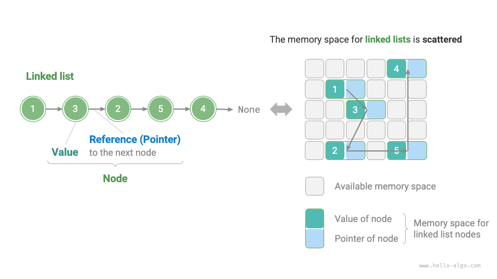
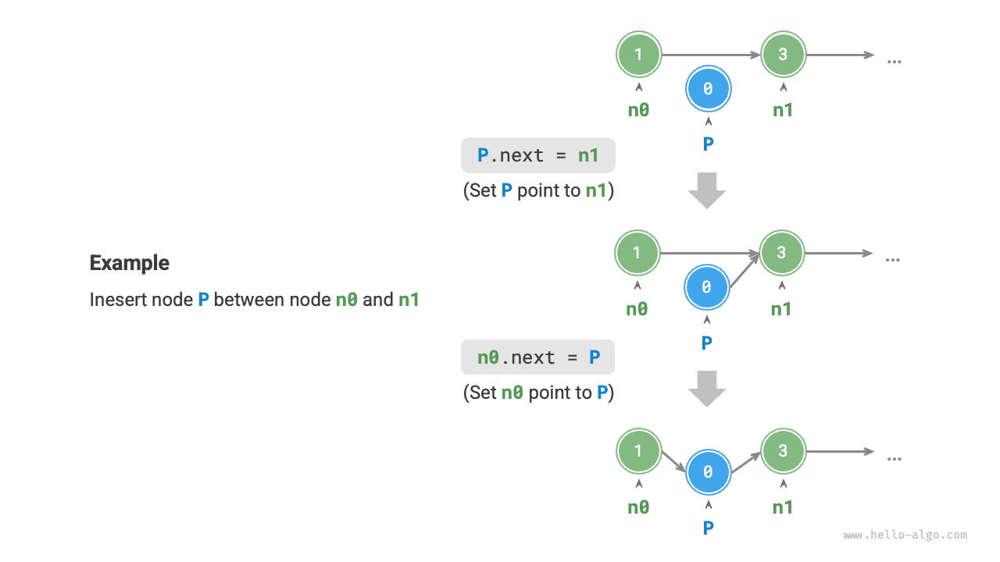
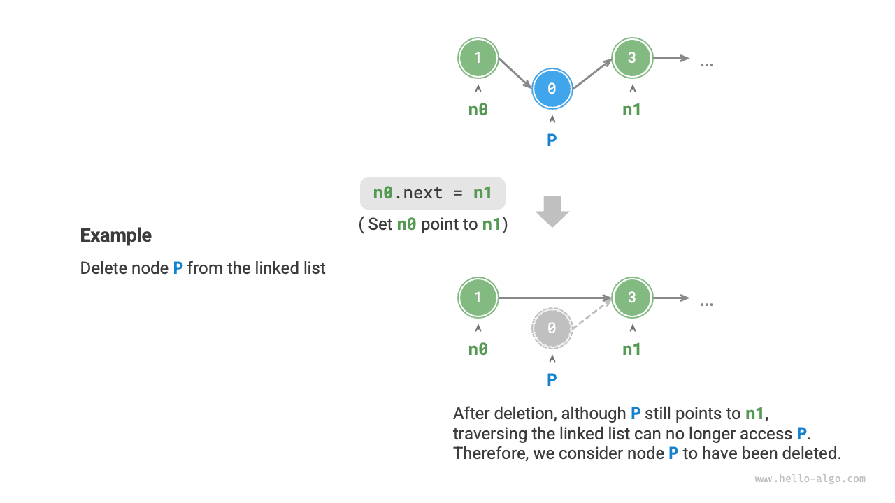
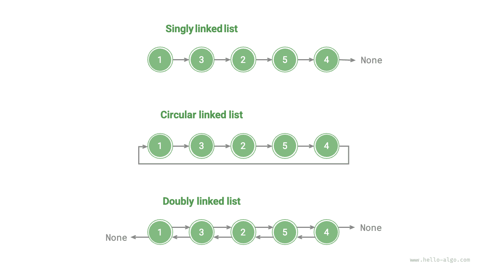

الذاكرة مورد مشترك بين جميع البرامج. وفي بيئة تشغيل معقدة، قد تكون الذاكرة الحرة موزعة في أنحاء فضاء العناوين. ونعلم أن المصفوفات تتطلب ذاكرة متجاورة، وعندما تكون المصفوفة كبيرة جداً، قد لا يتمكن النظام من توفير كتلة متجاورة بهذا الحجم. وهنا تبرز مرونة القوائم المترابطة.

<u>القائمة المترابطة</u> (linked list) بنية بيانات خطية يكون فيها كل عنصر كائن عقدة، وتُربط العقد عبر «المراجع». ويسجّل المرجع عنوان الذاكرة للعقدة التالية، ويمكن من خلاله الوصول من العقدة الحالية إلى العقدة التالية.

ويسمح هذا التصميم بتخزين عقد القائمة المترابطة في مواضع مختلفة من الذاكرة، دون حاجة عناوينها إلى أن تكون متجاورة.



وبمراقبة الشكل أعلاه، نجد أن الوحدة الأساسية للقائمة المترابطة هي كائن <u>عقدة</u> (node). وتحتوي كل عقدة على معلومتين: «قيمة» العقدة و«مرجع» إلى العقدة التالية.

- تسمى العقدة الأولى في القائمة المترابطة «العقدة الرأسية»، وتسمى العقدة الأخيرة «العقدة الذيلية».
- وتشير العقدة الذيلية إلى «null»، ويُرمز إليها بـ `null` و`nullptr` و`None` في Java وC++ وPython على التوالي.
- وفي اللغات التي تدعم المؤشرات، مثل C وC++ وGo وRust، ينبغي استبدال «المرجع» المذكور آنفاً بـ«المؤشر».

وكما توضح الشيفرة التالية، لا تحتوي عقدة القائمة المترابطة `ListNode` على قيمة فحسب، بل على مرجع (مؤشر) إضافي أيضاً. لذلك **تشغل القوائم المترابطة مساحة ذاكرة أكبر من المصفوفات عند تخزين الكمية نفسها من البيانات**.

<div class="lang-tab">
<p class="lang-tab__label">Python</p>

```python title=""
class ListNode:
    """Linked list node class"""
    def __init__(self, val: int):
        self.val: int = val               # Node value
        self.next: ListNode | None = None # Reference to the next node
```

</div>
## العمليات الشائعة على القوائم المترابطة

### تهيئة قائمة مترابطة

يتضمن بناء قائمة مترابطة خطوتين: أولاً تهيئة كل كائن عقدة؛ وثانياً إنشاء علاقات المرجع بين العقد. وبعد اكتمال التهيئة، يمكننا اجتياز جميع العقد بدءاً من العقدة الرأسية للقائمة المترابطة عبر المرجع `next`.

<div class="lang-tab">
<p class="lang-tab__label">Python</p>

```python title="linked_list.py"
# Initialize linked list 1 -> 3 -> 2 -> 5 -> 4
# Initialize each node
n0 = ListNode(1)
n1 = ListNode(3)
n2 = ListNode(2)
n3 = ListNode(5)
n4 = ListNode(4)
# Build references between nodes
n0.next = n1
n1.next = n2
n2.next = n3
n3.next = n4
```

</div>
المصفوفة متغير واحد؛ فمثلاً تحتوي المصفوفة `nums` على العناصر `nums[0]` و`nums[1]` وهكذا. أما القائمة المترابطة فتتكوّن من كائنات عقد مستقلة متعددة. **ونستخدم عادةً العقدة الرأسية ممثلاً للقائمة المترابطة بأكملها**؛ على سبيل المثال، يمكن الإشارة إلى القائمة المترابطة في الشيفرة أعلاه بالقائمة المترابطة `n0`.

### إدراج عقدة

إدراج عقدة في قائمة مترابطة سهل جداً. وكما يوضح الشكل أدناه، لنفترض أننا نريد إدراج عقدة جديدة `P` بين عقدتين متجاورتين `n0` و`n1`. **لا نحتاج إلا إلى تغيير مرجعَي عقدتين (مؤشرين)**، بتعقيد زمني $O(1)$.

وفي المقابل، فإن التعقيد الزمني لإدراج عنصر في مصفوفة هو $O(n)$، وهو غير فعّال عند التعامل مع كميات كبيرة من البيانات.



<div class="lang-tab">
<p class="lang-tab__label">Python</p>

```py
def insert(n0: ListNode, P: ListNode):
    """Insert node P after node n0 in the linked list"""
    n1 = n0.next
    P.next = n1
    n0.next = P
```

</div>
### حذف عقدة

وكما يوضح الشكل أدناه، فإن حذف عقدة في قائمة مترابطة مريح جداً أيضاً. **لا نحتاج إلا إلى تغيير مرجع عقدة واحدة (مؤشرها)**.

لاحظ أنه رغم أن العقدة `P` ما زالت تشير إلى `n1` بعد اكتمال عملية الحذف، فإن القائمة المترابطة لم تعد تستطيع الوصول إلى `P` عند الاجتياز، أي إن `P` لم تعد تنتمي إلى هذه القائمة المترابطة.



<div class="lang-tab">
<p class="lang-tab__label">Python</p>

```py
def remove(n0: ListNode):
    """Remove the first node after node n0 in the linked list"""
    if not n0.next:
        return
    # n0 -> P -> n1
    P = n0.next
    n1 = P.next
    n0.next = n1
```

</div>
### الوصول إلى عقدة

**الوصول إلى العقد في القائمة المترابطة أقل كفاءة**. وكما ذُكر في القسم السابق، يمكننا الوصول إلى أي عنصر في مصفوفة في زمن $O(1)$. أما القوائم المترابطة فليس الأمر كذلك فيها. إذ يحتاج البرنامج إلى البدء من العقدة الرأسية والاجتياز واحداً واحداً حتى العثور على العقدة الهدف. أي إن الوصول إلى العقدة رقم $i$ في قائمة مترابطة يتطلب $i - 1$ تكرار، بتعقيد زمني $O(n)$.

<div class="lang-tab">
<p class="lang-tab__label">Python</p>

```py
def access(head: ListNode, index: int) -> ListNode | None:
    """Access the node at index `index` in the linked list"""
    for _ in range(index):
        if not head:
            return None
        head = head.next
    return head
```

</div>
### البحث عن عقدة

اجتَز القائمة المترابطة للعثور على عقدة قيمتها `target`، وأخرج فهرس تلك العقدة في القائمة المترابطة. وهذه العملية بحث خطي أيضاً. وتُعرض الشيفرة أدناه:

<div class="lang-tab">
<p class="lang-tab__label">Python</p>

```py
def find(head: ListNode, target: int) -> int:
    """Find the first node with value target in the linked list"""
    index = 0
    while head:
        if head.val == target:
            return index
        head = head.next
        index += 1
    return -1
```

</div>
## المصفوفات مقابل القوائم المترابطة

يلخص الجدول أدناه خصائص المصفوفات والقوائم المترابطة ويقارن كفاءة عملياتهما. ولأنهما يستخدمان استراتيجيتي تخزين متعاكستين، فإن خصائصهما المختلفة وكفاءة عملياتهما تظهر أيضاً سمات متباينة.

<p align="center"> جدول <id> &nbsp; مقارنة كفاءة المصفوفة والقائمة المترابطة </p>

|                        | المصفوفة                                      | القائمة المترابطة          |
| ---------------------- | --------------------------------------------- | -------------------------- |
| طريقة التخزين          | مساحة ذاكرة متجاورة                           | مساحة ذاكرة متفرقة         |
| توسيع السعة            | طول غير قابل للتغيير                          | توسيع مرن                  |
| كفاءة الذاكرة          | تشغل العناصر ذاكرة أقل، لكن قد تُهدر المساحة | تشغل العناصر ذاكرة أكبر |
| الوصول إلى عنصر        | $O(1)$                                        | $O(n)$                     |
| إضافة عنصر             | $O(n)$                                        | $O(1)$                     |
| حذف عنصر               | $O(n)$                                        | $O(1)$                     |

## الأنواع الشائعة للقوائم المترابطة

وكما يوضح الشكل أدناه، هناك ثلاثة أنواع شائعة للقوائم المترابطة:

- **القائمة المترابطة الأحادية**: هذه هي القائمة المترابطة العادية التي قُدِّمت سابقاً. وتحتوي عقد القائمة المترابطة الأحادية على قيمة ومرجع إلى العقدة التالية. ونسمي العقدة الأولى العقدة الرأسية والعقدة الأخيرة العقدة الذيلية؛ وتشير العقدة الذيلية إلى `None`.
- **القائمة المترابطة الدائرية**: إذا جعلنا العقدة الذيلية لقائمة مترابطة أحادية تشير إلى العقدة الرأسية (وصل الذيل بالرأس)، حصلنا على قائمة مترابطة دائرية. وفي القائمة المترابطة الدائرية، يمكن اعتبار أي عقدة عقدةً رأسية.
- **القائمة المترابطة المزدوجة**: بالمقارنة مع القائمة المترابطة الأحادية، تسجّل القائمة المترابطة المزدوجة المراجع في الاتجاهين. ويتضمن تعريف عقدة القائمة المترابطة المزدوجة مرجعاً إلى العقدة اللاحقة (العقدة التالية) ومرجعاً إلى العقدة السابقة. وبالمقارنة مع القائمة المترابطة الأحادية، فإن القائمة المترابطة المزدوجة أكثر مرونة ويمكنها اجتياز القائمة المترابطة في الاتجاهين، لكنها تتطلب مساحة ذاكرة أكبر أيضاً.

<div class="lang-tab">
<p class="lang-tab__label">Python</p>

```python title=""
class ListNode:
    """Doubly linked list node class"""
    def __init__(self, val: int):
        self.val: int = val                # Node value
        self.next: ListNode | None = None  # Reference to the successor node
        self.prev: ListNode | None = None  # Reference to the predecessor node
```

</div>


## التطبيقات النموذجية للقوائم المترابطة

تُستخدم القوائم المترابطة الأحادية عادةً في تنفيذ المكدسات والطوابير وجداول التجزئة والرسوم البيانية.

- **المكدسات والطوابير**: عندما تحدث عمليتا الإدراج والحذف معاً عند أحد طرفي القائمة المترابطة، تظهر خاصية آخر ما يدخل يخرج أولاً، وهو ما يقابل المكدس. وعندما تحدث عمليات الإدراج عند أحد طرفي القائمة المترابطة وعمليات الحذف عند الطرف الآخر، تظهر خاصية أول ما يدخل يخرج أولاً، وهو ما يقابل الطابور.
- **جداول التجزئة**: السلسلة المنفصلة أحد الحلول السائدة لحل تصادمات التجزئة. وفي هذا الأسلوب تُوضع جميع العناصر المتصادمة في قائمة مترابطة.
- **الرسوم البيانية**: قائمة الجوار طريقة شائعة لتمثيل رسم بياني، حيث يرتبط كل رأس في الرسم البياني بقائمة مترابطة، ويمثل كل عنصر في القائمة المترابطة رأساً آخر متصلاً بذلك الرأس.

تُستخدم القوائم المترابطة المزدوجة عادةً في الحالات التي يلزم فيها الوصول السريع إلى العنصرين السابق والتالي.

- **بنى البيانات المتقدمة**: على سبيل المثال، في الأشجار الحمراء-السوداء وأشجار B، نحتاج إلى الوصول إلى العقدة الأب لعقدة ما، ويمكن تحقيق ذلك بحفظ مرجع إلى العقدة الأب في العقدة، على غرار القائمة المترابطة المزدوجة.
- **سجل المتصفح**: في متصفحات الويب، عندما ينقر المستخدم على زر التقدم أو الرجوع، يحتاج المتصفح إلى معرفة صفحتي الويب السابقة والتالية التي زارها المستخدم. وخصائص القوائم المترابطة المزدوجة تجعل هذه العملية بسيطة.
- **خوارزمية LRU**: في خوارزميات إخلاء ذاكرة التخزين المؤقت (LRU)، نحتاج إلى العثور بسرعة على البيانات الأقل استخداماً حديثاً ودعم الإضافة والحذف السريعين للعقد. واستخدام قائمة مترابطة مزدوجة مناسب جداً لذلك.

تُستخدم القوائم المترابطة الدائرية عادةً في الحالات التي تتطلب عمليات دورية، مثل جدولة موارد نظام التشغيل.

- **خوارزمية الجدولة الدورانية**: في أنظمة التشغيل، الجدولة الدورانية خوارزمية شائعة لجدولة المعالج (CPU) تحتاج إلى الدوران على مجموعة من العمليات. وتُخصَّص لكل عملية شريحة زمنية، وعندما تنتهي الشريحة الزمنية ينتقل المعالج إلى العملية التالية. ويمكن تنفيذ هذه العملية الدورية باستخدام قائمة مترابطة دائرية.
- **مخازن البيانات المؤقتة**: في بعض تطبيقات مخازن البيانات المؤقتة، قد تُستخدم القوائم المترابطة الدائرية أيضاً. فمثلاً في مشغلات الصوت والفيديو، قد يُقسَّم تدفق البيانات إلى عدة كتل مخزنة وتُوضع في قائمة مترابطة دائرية لتحقيق تشغيل سلس متواصل.
