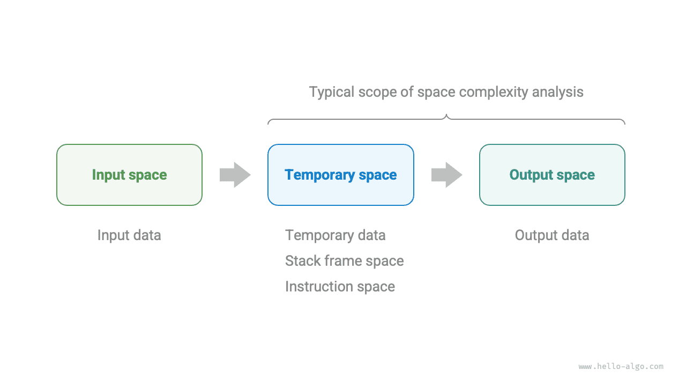
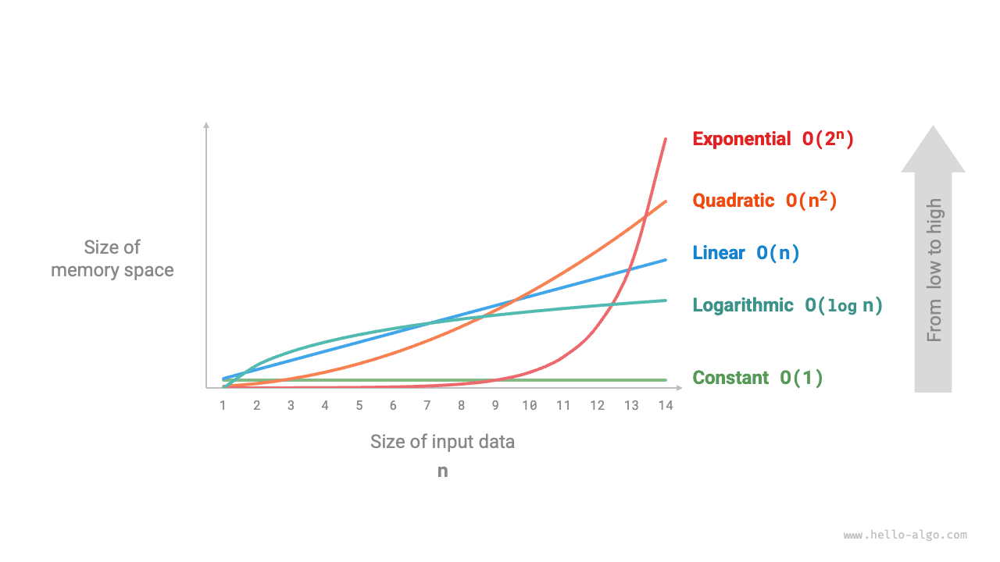
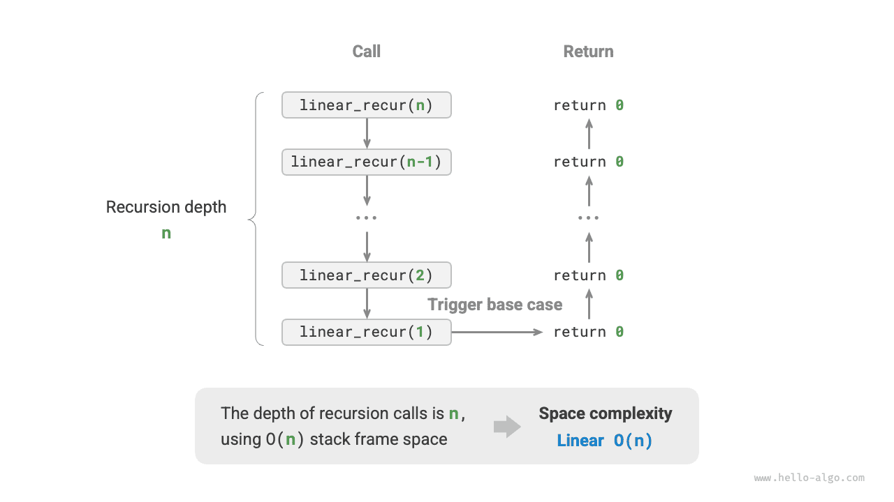
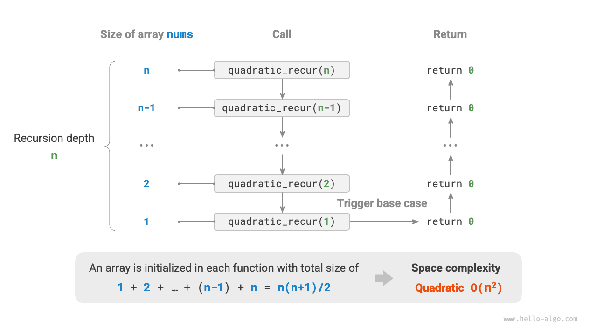
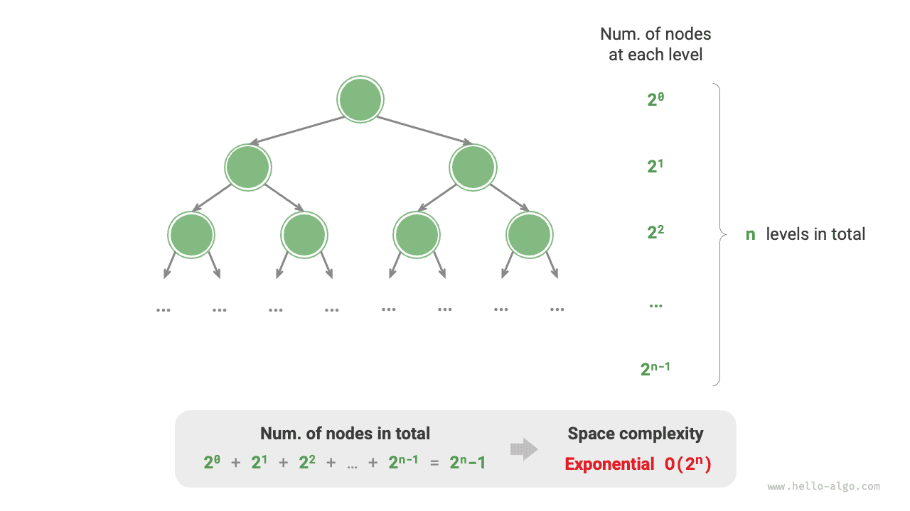

<u>التعقيد المكاني</u> (space complexity) يقيس اتجاه نمو مساحة الذاكرة التي تشغلها خوارزمية مع تزايد حجم البيانات. وهذا المفهوم يشبه كثيراً التعقيد الزمني، إلا أنه يستبدل «زمن التشغيل» بـ«مساحة الذاكرة المشغولة».

## المساحة المرتبطة بالخوارزمية

تشمل مساحة الذاكرة التي تستخدمها الخوارزمية أثناء تنفيذها الأنواع التالية أساساً.

- **مساحة الإدخال**: تُستخدم لتخزين بيانات الإدخال الخاصة بالخوارزمية.
- **المساحة المؤقتة**: تُستخدم لتخزين المتغيرات والكائنات وسياقات الدوال وغيرها من البيانات أثناء تنفيذ الخوارزمية.
- **مساحة الإخراج**: تُستخدم لتخزين بيانات الإخراج الخاصة بالخوارزمية.

وبشكل عام، يشمل نطاق إحصاء التعقيد المكاني «المساحة المؤقتة» مضافاً إليها «مساحة الإخراج».

ويمكن تقسيم المساحة المؤقتة كذلك إلى ثلاثة أجزاء.

- **بيانات مؤقتة**: تُستخدم لحفظ الثوابت والمتغيرات والكائنات المتنوعة أثناء تنفيذ الخوارزمية.
- **مساحة إطار المكدس**: تُستخدم لحفظ بيانات سياق الدوال المستدعاة. وينشئ النظام إطار مكدس في قمة المكدس في كل مرة تُستدعى فيها دالة، وتُحرَّر مساحة الإطار بعد عودة الدالة.
- **مساحة التعليمات**: تُستخدم لحفظ تعليمات البرنامج المترجمة، ويُتجاهلها عادةً في الإحصاء الفعلي.

عند تحليل التعقيد المكاني لبرنامج ما، **نأخذ عادةً ثلاثة أجزاء في الاعتبار: البيانات المؤقتة، ومساحة إطار المكدس، وبيانات الإخراج**، كما يوضح الشكل التالي.



والشيفرة ذات الصلة كما يلي:

<div class="lang-tab">
<p class="lang-tab__label">Python</p>

```python title=""
class Node:
    """Class"""
    def __init__(self, x: int):
        self.val: int = x              # Node value
        self.next: Node | None = None  # Reference to the next node

def function() -> int:
    """Function"""
    # Perform some operations...
    return 0

def algorithm(n) -> int:  # Input data
    A = 0                 # Temporary data (constant, usually represented by uppercase letters)
    b = 0                 # Temporary data (variable)
    node = Node(0)        # Temporary data (object)
    c = function()        # Stack frame space (function call)
    return A + b + c      # Output data
```

</div>## طريقة الحساب

طريقة حساب التعقيد المكاني مماثلة تقريباً لطريقة حساب التعقيد الزمني، إلا أن ما نقيسه يتغير من «عدد العمليات» إلى «مقدار المساحة المستخدمة».

وعلى عكس التعقيد الزمني، **نهتم عادةً بالتعقيد المكاني في أسوأ حالة فقط**. ويرجع ذلك إلى أن مساحة الذاكرة متطلب صارم، إذ يجب علينا ضمان حجز مساحة ذاكرة كافية لجميع بيانات الإدخال.

تأمل الشيفرة التالية. هنا، لـ«أسوأ حالة» في التعقيد المكاني في أسوأ حالة معنيان اثنان.

1. **بناءً على أسوأ بيانات الإدخال**: عندما $n < 10$، يكون التعقيد المكاني $O(1)$؛ لكن عندما $n > 10$، تشغل المصفوفة المهيّأة `nums` مساحة $O(n)$، لذا يكون التعقيد المكاني في أسوأ حالة $O(n)$.
2. **بناءً على ذروة الذاكرة أثناء تنفيذ الخوارزمية**: فمثلاً، قبل تنفيذ السطر الأخير، يشغل البرنامج مساحة $O(1)$؛ وعند تهيئة المصفوفة `nums`، يشغل البرنامج مساحة $O(n)$، لذا يكون التعقيد المكاني في أسوأ حالة $O(n)$.

<div class="lang-tab">
<p class="lang-tab__label">Python</p>

```python title=""
def algorithm(n: int):
    a = 0               # O(1)
    b = [0] * 10000     # O(1)
    if n > 10:
        nums = [0] * n  # O(n)
```

</div>**وفي الدوال التعاودية، يلزم إحصاء مساحة إطار المكدس**. تأمل الشيفرة التالية:

<div class="lang-tab">
<p class="lang-tab__label">Python</p>

```python title=""
def function() -> int:
    # Perform some operations
    return 0

def loop(n: int):
    """Loop has space complexity of O(1)"""
    for _ in range(n):
        function()

def recur(n: int):
    """Recursion has space complexity of O(n)"""
    if n == 1:
        return
    return recur(n - 1)
```

</div>التعقيد الزمني لكل من الدالتين `loop()` و`recur()` هو $O(n)$، لكن التعقيد المكاني لكل منهما مختلف.

- تستدعي الدالة `loop()` الدالة `function()` عدد $n$ من المرات في حلقة. وفي كل تكرار، تعود `function()` وتحرّر مساحة إطار مكدسها، لذا يبقى التعقيد المكاني $O(1)$.
- في الدالة التعاودية `recur()`، توجد $n$ من نسخ `recur()` غير العائدة في الوقت نفسه أثناء التنفيذ، لذا تشغل مساحة إطارات مكدس $O(n)$.

## الأنواع الشائعة

ليكن حجم بيانات الإدخال $n$. يوضح الشكل التالي الأنواع الشائعة للتعقيد المكاني (مرتبة من الأدنى إلى الأعلى).

$$
\begin{aligned}
& O(1) < O(\log n) < O(n) < O(n^2) < O(2^n) \newline
& \text{Constant} < \text{Logarithmic} < \text{Linear} < \text{Quadratic} < \text{Exponential}
\end{aligned}
$$



### الترتيب الثابت $O(1)$

الترتيب الثابت شائع في الثوابت والمتغيرات والكائنات التي لا يعتمد عددها على حجم بيانات الإدخال $n$.

ويجدر التنبيه إلى أن الذاكرة التي تشغلها تهيئة المتغيرات أو استدعاء الدوال داخل حلقة تُحرَّر عند الانتقال إلى التكرار التالي، لذا لا تتراكم المساحة، ويبقى التعقيد المكاني $O(1)$:

<div class="lang-tab">
<p class="lang-tab__label">Python</p>

```py
def constant(n: int):
    """Constant complexity"""
    # الثوابت والمتغيرات والكائنات تشغل مساحة O(1)
    a = 0
    nums = [0] * 10000
    node = ListNode(0)
    # المتغيرات في الحلقة تشغل مساحة O(1)
    for _ in range(n):
        c = 0
    # استدعاءات الدوال في الحلقة تشغل مساحة O(1)
    for _ in range(n):
        function()
```

</div>### الترتيب الخطي $O(n)$

الترتيب الخطي شائع في المصفوفات والقوائم المترابطة والمكدسات والطوابير وغيرها، حيث يتناسب عدد العناصر مع $n$:

<div class="lang-tab">
<p class="lang-tab__label">Python</p>

```py
def linear(n: int):
    """Linear complexity"""
    # قائمة بطول n تشغل مساحة O(n)
    nums = [0] * n
    # جدول تجزئة فيه n إدخالًا يشغل مساحة O(n)
    hmap = dict[int, str]()
    for i in range(n):
        hmap[i] = str(i)
```

</div>وكما يوضح الشكل التالي، فإن عمق التعاود لهذه الدالة هو $n$، أي أن هناك $n$ من دوال `linear_recur()` غير العائدة موجودة في الوقت نفسه، وتستخدم مساحة إطارات مكدس $O(n)$:

<div class="lang-tab">
<p class="lang-tab__label">Python</p>

```py
def linear_recur(n: int):
    """Linear complexity (recursive implementation)"""
    print("Recursion: n =", n)
    if n == 1:
        return
    linear_recur(n - 1)
```

</div>

### الترتيب التربيعي $O(n^2)$

الترتيب التربيعي شائع في المصفوفات والرسوم البيانية، حيث يرتبط عدد العناصر بـ$n$ ارتباطاً تربيعياً:

<div class="lang-tab">
<p class="lang-tab__label">Python</p>

```py
def quadratic(n: int):
    """Quadratic complexity"""
    # القائمة ثنائية الأبعاد تشغل مساحة O(n^2)
    num_matrix = [[0] * n for _ in range(n)]
```

</div>وكما يوضح الشكل التالي، فإن عمق التعاود لهذه الدالة هو $n$، وتُهيَّأ مصفوفة في كل دالة تعاودية بأطوال $n$ و$n-1$ و$\dots$ و$2$ و$1$، بمتوسط طول $n / 2$، وبذلك تشغل في الإجمال مساحة $O(n^2)$:

<div class="lang-tab">
<p class="lang-tab__label">Python</p>

```py
def quadratic_recur(n: int) -> int:
    """Quadratic complexity (recursive implementation)"""
    if n <= 0:
        return 0
    # أطوال المصفوفة nums هي n، n-1، ...، 2، 1
    nums = [0] * n
    return quadratic_recur(n - 1)
```

</div>

### الترتيب الأسي $O(2^n)$

الترتيب الأسي شائع في الأشجار الثنائية. تأمل الشكل التالي: شجرة ثنائية كاملة ذات $n$ من المستويات تضم $2^n - 1$ عقدة، وتشغل مساحة $O(2^n)$:

<div class="lang-tab">
<p class="lang-tab__label">Python</p>

```py
def build_tree(n: int) -> TreeNode | None:
    """Exponential complexity (building a perfect binary tree)"""
    if n == 0:
        return None
    root = TreeNode(0)
    root.left = build_tree(n - 1)
    root.right = build_tree(n - 1)
    return root
```

</div>

### الترتيب اللوغاريتمي $O(\log n)$

الترتيب اللوغاريتمي شائع في خوارزميات التقسيم والتغلب. فمثلاً، في الترتيب بالدمج: بمعطى مصفوفة إدخال طولها $n$، يقسم كل تعاود المصفوفة إلى نصفين من نقطة المنتصف، مكوّناً شجرة تعاود ارتفاعها $\log n$، وتستخدم مساحة إطارات مكدس $O(\log n)$.

ومثال آخر هو تحويل عدد إلى نص. فبمعطى عدد صحيح موجب $n$، يكون له $\lfloor \log_{10} n \rfloor + 1$ من الخانات، أي أن طول النص المقابل هو $\lfloor \log_{10} n \rfloor + 1$، لذا يكون التعقيد المكاني $O(\log_{10} n + 1) = O(\log n)$.

## المقايضة بين الزمن والمساحة

من الناحية المثالية، نأمل أن يصل التعقيد الزمني والتعقيد المكاني للخوارزمية كليهما إلى المستوى الأمثل. غير أنه من الصعب عملياً عادةً تحسين التعقيدين الزمني والمكاني في الوقت نفسه.

**عادةً ما يأتي تقليل التعقيد الزمني على حساب زيادة التعقيد المكاني، والعكس صحيح**. ويُسمى التضحية بمساحة الذاكرة مقابل تحسين سرعة التنفيذ «مقايضة المساحة بالزمن»؛ ويُسمى العكس «مقايضة الزمن بالمساحة».

ويعتمد اختيار أي من النهجين على الجانب الذي نوليه أهمية أكبر. وفي معظم الحالات، يكون الزمن أثمن من المساحة، لذا تكون «مقايضة المساحة بالزمن» هي الاستراتيجية الأكثر شيوعاً عادةً. وبالطبع، عندما يكون حجم البيانات ضخماً جداً، يكون التحكم في التعقيد المكاني مهماً أيضاً.
