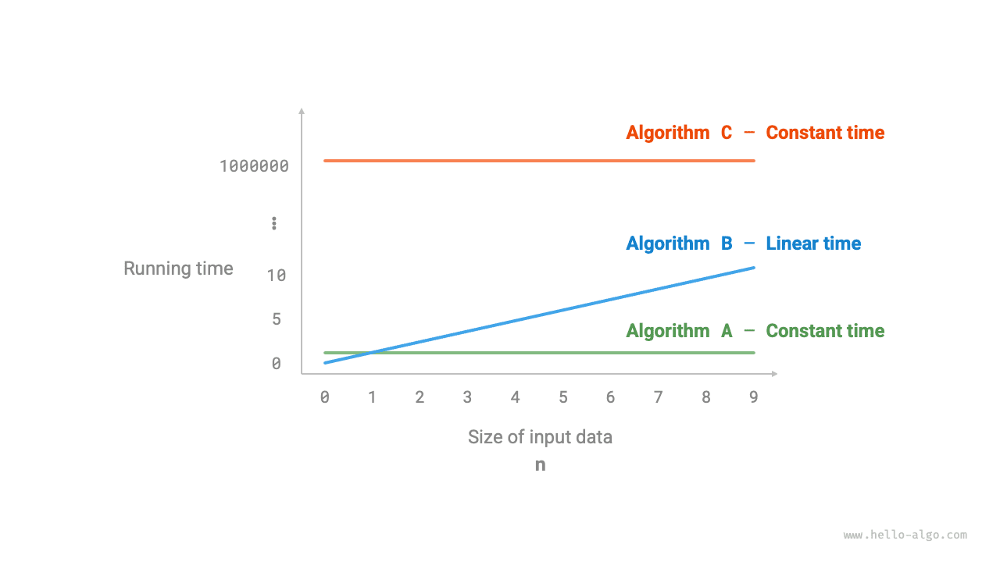
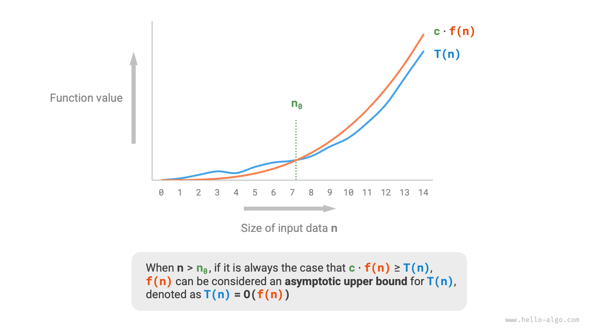
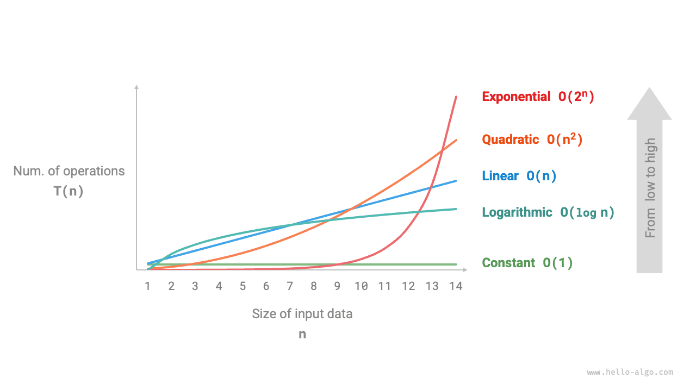
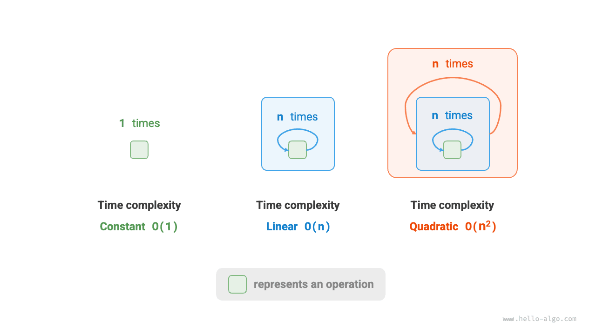
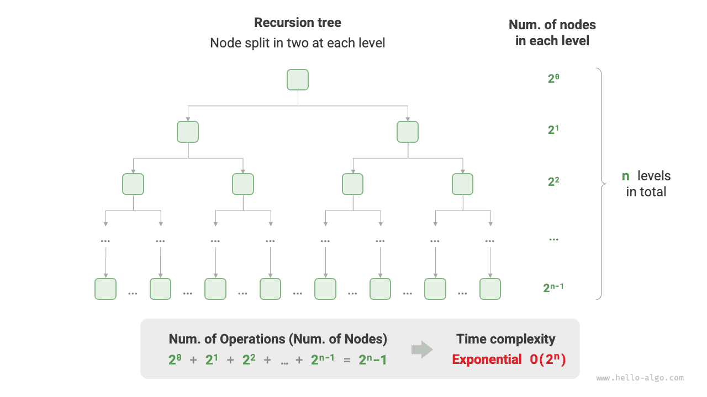
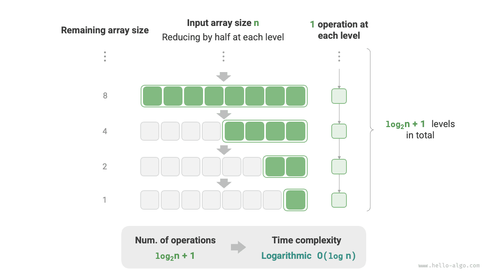
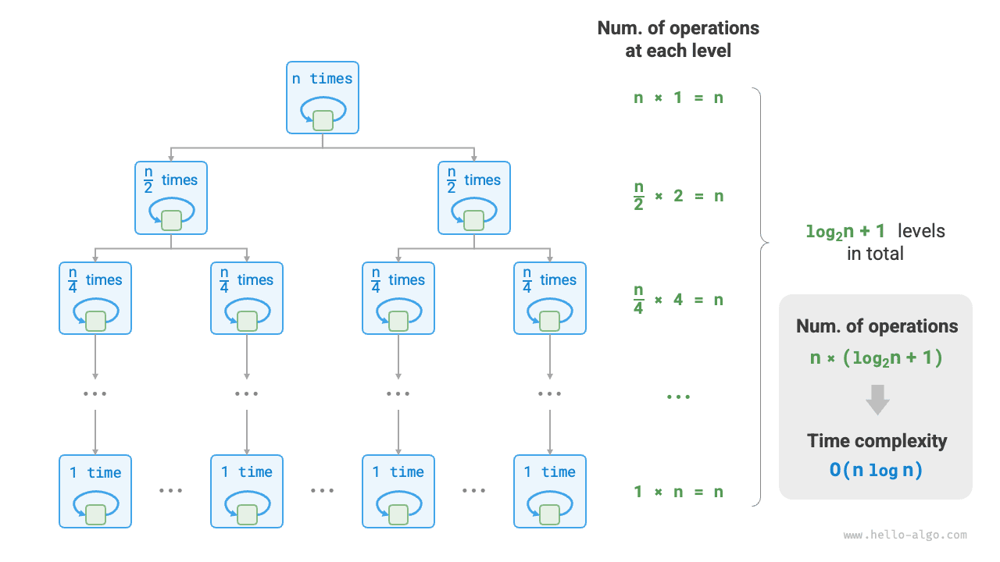
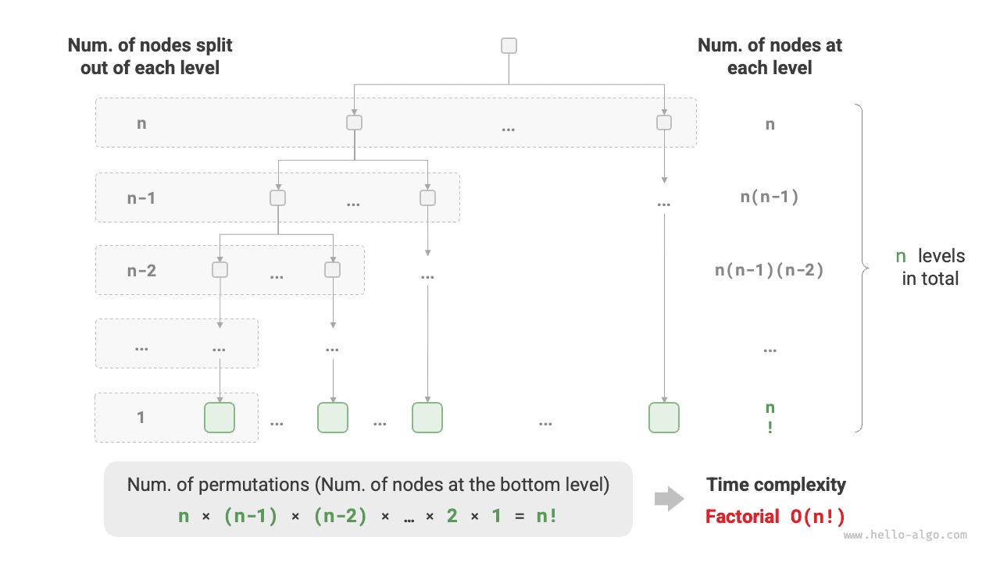

يعكس زمن التشغيل كفاءة الخوارزمية بطريقة بديهية ودقيقة. وإذا أردنا تقدير زمن تشغيل قطعة شيفرة تقديراً دقيقاً، فكيف نفعل ذلك؟

1. **حدّد منصة التشغيل**، بما فيها تكوين العتاد ولغة البرمجة وبيئة النظام وغيرها، لأن هذه العوامل كلها تؤثر في كفاءة تنفيذ الشيفرة.
2. **قدّر الزمن اللازم لمختلف العمليات الحسابية**، فمثلاً تحتاج عملية جمع `+` إلى 1 ns، وتحتاج عملية ضرب `*` إلى 10 ns، وتحتاج عملية طباعة `print()` إلى 5 ns، وهكذا.
3. **أحصِ جميع العمليات الحسابية في الشيفرة**، واجمع أزمنة تنفيذ جميع العمليات للحصول على زمن التشغيل.

فمثلاً، في الشيفرة التالية، حجم بيانات الإدخال هو $n$:

<div class="lang-tab">
<p class="lang-tab__label">Python</p>

```python title=""
# On a certain running platform
def algorithm(n: int):
    a = 2      # 1 ns
    a = a + 1  # 1 ns
    a = a * 2  # 10 ns
    # Loop n times
    for _ in range(n):  # 1 ns
        print(0)        # 5 ns
```

</div>
وبحسب الطريقة أعلاه، يمكن الحصول على زمن تشغيل الخوارزمية وهو $(6n + 12)$ ns:

$$
1 + 1 + 10 + (1 + 5) \times n = 6n + 12
$$

غير أن الواقع، **محاولة حساب زمن تشغيل الخوارزمية حساباً دقيقاً ليست عملية ولا واقعية**. فمن جهة، لا نريد ربط الزمن المقدَّر بمنصة التشغيل، لأن الخوارزميات تحتاج إلى العمل على منصات مختلفة كثيرة. ومن جهة أخرى، يصعب معرفة زمن تشغيل كل نوع من العمليات، مما يجعل عملية التقدير صعبة للغاية.

## إحصاء اتجاه نمو الزمن

لا يحصي تحليل التعقيد الزمني زمن تشغيل الخوارزمية، **بل يحصي اتجاه نمو زمن تشغيل الخوارزمية مع زيادة حجم البيانات**.

مفهوم «اتجاه نمو الزمن» مجرّد بعض الشيء؛ ولنفهمه عبر مثال. لنفترض أن حجم بيانات الإدخال هو $n$، وبمعطى ثلاث خوارزميات `A` و`B` و`C`:

<div class="lang-tab">
<p class="lang-tab__label">Python</p>

```python title=""
# Time complexity of algorithm A: constant order
def algorithm_A(n: int):
    print(0)
# Time complexity of algorithm B: linear order
def algorithm_B(n: int):
    for _ in range(n):
        print(0)
# Time complexity of algorithm C: constant order
def algorithm_C(n: int):
    for _ in range(1000000):
        print(0)
```

</div>
يوضح الشكل أدناه التعقيد الزمني لدوال الخوارزميات الثلاث أعلاه.

- تحتوي الخوارزمية `A` على عملية طباعة واحدة فقط، ولا ينمو زمن تشغيل الخوارزمية مع زيادة $n$. ونسمّي التعقيد الزمني لهذه الخوارزمية «الرتبة الثابتة».
- في الخوارزمية `B`، تحتاج عملية الطباعة إلى تكرار $n$ مرة، وينمو زمن تشغيل الخوارزمية خطياً مع زيادة $n$. ويُسمى التعقيد الزمني لهذه الخوارزمية «الرتبة الخطية».
- في الخوارزمية `C`، تحتاج عملية الطباعة إلى تكرار $1000000$ مرة. ورغم أن زمن التشغيل طويل جداً، فهو مستقل عن حجم بيانات الإدخال $n$. لذلك يكون التعقيد الزمني لـ`C` هو نفسه التعقيد الزمني لـ`A`، أي «الرتبة الثابتة» أيضاً.



مقارنةً بحساب زمن تشغيل الخوارزمية مباشرةً، فما خصائص تحليل التعقيد الزمني؟

- **يستطيع التعقيد الزمني تقييم كفاءة الخوارزمية تقييماً فعالاً**. فمثلاً، ينمو زمن تشغيل الخوارزمية `B` خطياً؛ فعندما $n > 1$ تكون أبطأ من الخوارزمية `A`، وعندما $n > 1000000$ تكون أبطأ من الخوارزمية `C`. وفي الواقع، ما دام حجم بيانات الإدخال $n$ كبيراً بما يكفي، فإن خوارزمية بتعقيد «الرتبة الثابتة» تكون دائماً أفضل من خوارزمية بتعقيد «الرتبة الخطية»، وهذا هو بالضبط معنى اتجاه نمو الزمن.
- **طريقة اشتقاق التعقيد الزمني أبسط**. فمن الواضح أن منصة التشغيل وأنواع العمليات الحسابية لا علاقة لهما باتجاه نمو زمن تشغيل الخوارزمية. لذلك يمكننا في تحليل التعقيد الزمني أن نعامل ببساطة زمن تنفيذ جميع العمليات الحسابية على أنه «زمن وحدة» واحد، فنختصر «تتبع زمن تشغيل كل عملية» إلى «إحصاء عدد العمليات»، مما يقلل صعوبة التقدير تقليلاً كبيراً.
- **للتعقيد الزمني أيضاً قيود معينة**. فمثلاً، رغم أن الخوارزميتين `A` و`C` لهما التعقيد الزمني نفسه، فإن زمن تشغيلهما الفعلي يختلف اختلافاً كبيراً. وبالمثل، رغم أن التعقيد الزمني للخوارزمية `B` أعلى من تعقيد `C`، فعندما يكون حجم بيانات الإدخال $n$ صغيراً تكون الخوارزمية `B` أفضل بوضوح من الخوارزمية `C`. وفي مثل هذه الحالات، يصعب غالباً الحكم على كفاءة الخوارزميات بالاعتماد على التعقيد الزمني وحده. وبالطبع، رغم المشكلات أعلاه، يظل تحليل التعقيد أنجع الطرق وأكثرها شيوعاً لتقييم كفاءة الخوارزميات.

## الحد الأعلى التقاربي للدوال

بمعطى دالة حجم إدخالها $n$:

<div class="lang-tab">
<p class="lang-tab__label">Python</p>

```python title=""
def algorithm(n: int):
    a = 1      # +1
    a = a + 1  # +1
    a = a * 2  # +1
    # Loop n times
    for i in range(n):  # +1
        print(0)        # +1
```

</div>
ولتكن عدد عمليات الخوارزمية دالةً في حجم بيانات الإدخال $n$، ويرمز إليها بـ$T(n)$. عندئذٍ يكون عدد عمليات الدالة أعلاه:

$$
T(n) = 3 + 2n
$$

$T(n)$ دالة خطية، مما يدل على أن اتجاه نمو زمن تشغيلها خطي، ومن ثمّ فإن تعقيدها الزمني من الرتبة الخطية.

ونرمز للتعقيد الزمني من الرتبة الخطية بـ$O(n)$. ويُسمى هذا الرمز الرياضي <u>ترميز $O$ الكبير</u>، وهو يمثّل <u>الحد الأعلى التقاربي</u> للدالة $T(n)$.

يحسب تحليل التعقيد الزمني في جوهره الحد الأعلى التقاربي لـ«عدد العمليات $T(n)$»، ولهذا تعريف رياضي واضح.

<div class="note">
<p class="note__title">الحد الأعلى التقاربي للدوال</p>

إذا وُجد عددان حقيقيان موجبان $c$ و$n_0$ بحيث يتحقق $T(n) \leq c \cdot f(n)$ لكل $n > n_0$، فيمكن اعتبار $f(n)$ حداً أعلى تقاربياً لـ$T(n)$، ويُرمز إلى ذلك بـ$T(n) = O(f(n))$.

</div>

وكما هو موضح في الشكل أدناه، فإن حساب الحد الأعلى التقاربي هو إيجاد دالة $f(n)$ بحيث عندما يؤول $n$ إلى اللانهاية يكون $T(n)$ و$f(n)$ في المستوى نفسه من النمو، ولا يختلفان إلا بمعامل ثابت $c$.



## طريقة الاشتقاق

فكرة الحد الأعلى التقاربي رياضية بعض الشيء. وإذا شعرت أنك لم تفهمها فهماً كاملاً، فلا تقلق. يمكننا أولاً إتقان طريقة الاشتقاق، ثم استيعاب معناها الرياضي تدريجياً بالممارسة المستمرة.

وفقاً للتعريف، بعد تحديد $f(n)$ يمكننا الحصول على التعقيد الزمني $O(f(n))$. فكيف نحدد الحد الأعلى التقاربي $f(n)$؟ إجمالاً، ينقسم ذلك إلى خطوتين: أولاً إحصاء عدد العمليات، ثم تحديد الحد الأعلى التقاربي.

### الخطوة 1: إحصاء عدد العمليات

بالنسبة إلى الشيفرة، أُحصِ من الأعلى إلى الأسفل سطراً سطراً. غير أنه بما أن المعامل الثابت $c$ في $c \cdot f(n)$ أعلاه يمكن أن يكون بأي مقدار، فإن **المعاملات والحدود الثابتة في عدد العمليات $T(n)$ يمكن تجاهلها جميعاً**. ووفقاً لهذا المبدأ، يمكن تلخيص تقنيات التبسيط التالية في الإحصاء.

1. **تجاهل الثوابت في $T(n)$**. لأنها كلها مستقلة عن $n$، فلا تؤثر في التعقيد الزمني.
2. **احذف جميع المعاملات**. فمثلاً، تكرار الحلقة $2n$ مرة أو $5n + 1$ مرة وغير ذلك يمكن تبسيطه كله إلى $n$ مرة، لأن المعامل قبل $n$ لا يؤثر في التعقيد الزمني.
3. **استخدم الضرب في الحلقات المتداخلة**. فعدد العمليات الإجمالي يساوي حاصل ضرب عدد العمليات في الحلقتين الخارجية والداخلية، مع إمكان تطبيق التقنيتين `1.` و`2.` على كل طبقة من الحلقة على حدة.

بمعطى دالة، يمكننا استخدام التقنيات أعلاه لإحصاء عدد العمليات:

<div class="lang-tab">
<p class="lang-tab__label">Python</p>

```python title=""
def algorithm(n: int):
    a = 1      # +0 (Technique 1)
    a = a + n  # +0 (Technique 1)
    # +n (Technique 2)
    for i in range(5 * n + 1):
        print(0)
    # +n*n (Technique 3)
    for i in range(2 * n):
        for j in range(n + 1):
            print(0)
```

</div>
تعرض الصيغة التالية نتائج الإحصاء قبل استخدام التقنيات أعلاه وبعدها؛ وكلاهما يؤدي إلى تعقيد زمني $O(n^2)$.

$$
\begin{aligned}
T(n) & = 2n(n + 1) + (5n + 1) + 2 & \text{Complete count (-.-|||)} \newline
& = 2n^2 + 7n + 3 \newline
T(n) & = n^2 + n & \text{Simplified count (o.O)}
\end{aligned}
$$

### الخطوة 2: تحديد الحد الأعلى التقاربي

**يتحدد التعقيد الزمني بالحد الأعلى رتبةً في $T(n)$**. ويعود السبب إلى أنه عندما يؤول $n$ إلى اللانهاية، سيؤدي الحد الأعلى رتبةً دوراً مهيمناً، ويمكن تجاهل تأثير الحدود الأخرى.

يعرض الجدول أدناه بعض الأمثلة، وقد استُخدمت فيه بعض القيم المبالغ فيها لتأكيد الاستنتاج القائل إن «المعاملات لا تزحزح الرتبة». فعندما يؤول $n$ إلى اللانهاية، تصبح هذه الثوابت ضئيلة.

<p align="center"> الجدول <id> &nbsp; التعقيدات الزمنية المقابلة لأعداد مختلفة من العمليات </p>

| عدد العمليات $T(n)$ | التعقيد الزمني $O(f(n))$ |
| ---------------------- | -------------------- |
| $100000$               | $O(1)$               |
| $3n + 2$               | $O(n)$               |
| $2n^2 + 3n + 2$        | $O(n^2)$             |
| $n^3 + 10000n^2$       | $O(n^3)$             |
| $2^n + 10000n^{10000}$ | $O(2^n)$             |

## الأنواع الشائعة

وليكن حجم بيانات الإدخال $n$. ويوضح الشكل أدناه أنواع التعقيد الزمني الشائعة (مرتبة من الأدنى إلى الأعلى).

$$
\begin{aligned}
& O(1) < O(\log n) < O(n) < O(n \log n) < O(n^2) < O(2^n) < O(n!) \newline
& \text{Constant} < \text{Logarithmic} < \text{Linear} < \text{Linearithmic} < \text{Quadratic} < \text{Exponential} < \text{Factorial}
\end{aligned}
$$



### الرتبة الثابتة $O(1)$

لا يعتمد عدد العمليات في الرتبة الثابتة على حجم بيانات الإدخال $n$، أي إنه لا يتغير بتغير $n$.

في الدالة التالية، رغم أن قيمة `size` قد تكون كبيرة، فهي مستقلة عن حجم بيانات الإدخال $n$، لذا يبقى التعقيد الزمني $O(1)$:

<div class="lang-tab">
<p class="lang-tab__label">Python</p>

```py
def constant(n: int) -> int:
    """تعقيد ثابت"""
    count = 0
    size = 100000
    for _ in range(size):
        count += 1
    return count
```

</div>
### الرتبة الخطية $O(n)$

ينمو عدد العمليات في الرتبة الخطية خطياً مع حجم بيانات الإدخال $n$. وتظهر الرتبة الخطية عادةً في الحلقات أحادية الطبقة:

<div class="lang-tab">
<p class="lang-tab__label">Python</p>

```py
def linear(n: int) -> int:
    """تعقيد خطي"""
    count = 0
    for _ in range(n):
        count += 1
    return count
```

</div>
عمليات مثل اجتياز المصفوفات واجتياز القوائم المترابطة لها تعقيد زمني $O(n)$، حيث $n$ طول المصفوفة أو القائمة المترابطة:

<div class="lang-tab">
<p class="lang-tab__label">Python</p>

```py
def array_traversal(nums: list[int]) -> int:
    """التعقيد الخطي (اجتياز مصفوفة)"""
    count = 0
    # عدد التكرارات يتناسب مع طول المصفوفة
    for num in nums:
        count += 1
    return count
```

</div>
ومن الجدير بالذكر أن **حجم بيانات الإدخال $n$ ينبغي أن يُحدَّد وفق نوع بيانات الإدخال**. فمثلاً، في المثال الأول يكون المتغير $n$ هو حجم بيانات الإدخال؛ وفي المثال الثاني يكون طول المصفوفة $n$ هو حجم البيانات.

### الرتبة التربيعية $O(n^2)$

ينمو عدد العمليات في الرتبة التربيعية تربيعياً مع حجم بيانات الإدخال $n$. وتظهر الرتبة التربيعية عادةً في الحلقات المتداخلة، حيث يكون التعقيد الزمني للحلقتين الخارجية والداخلية $O(n)$، فيكون التعقيد الزمني الإجمالي $O(n^2)$:

<div class="lang-tab">
<p class="lang-tab__label">Python</p>

```py
def quadratic(n: int) -> int:
    """تعقيد تربيعي"""
    count = 0
    # عدد التكرارات يتناسب مع مربع حجم المُدخل n
    for i in range(n):
        for j in range(n):
            count += 1
    return count
```

</div>
يقارن الشكل أدناه التعقيدات الزمنية للرتب الثابتة والخطية والتربيعية.



وبأخذ الترتيب الفقاعي مثالاً، تنفّذ الحلقة الخارجية $n - 1$ مرة، وتنفّذ الحلقة الداخلية $n-1$ ثم $n-2$ ثم $\dots$ ثم $2$ ثم $1$ مرة، بمتوسط $n / 2$ مرة، فيكون التعقيد الزمني $O((n - 1) n / 2) = O(n^2)$:

<div class="lang-tab">
<p class="lang-tab__label">Python</p>

```py
def bubble_sort(nums: list[int]) -> int:
    """التعقيد التربيعي (الترتيب الفقاعي)"""
    count = 0  # العدّاد
    # الحلقة الخارجية: النطاق غير المرتب هو [0, i]
    for i in range(len(nums) - 1, 0, -1):
        # الحلقة الداخلية: انقل أكبر عنصر في النطاق غير المرتب [0, i] إلى نهايته اليمنى بالتبديل
        for j in range(i):
            if nums[j] > nums[j + 1]:
                # بدّل nums[j] و nums[j + 1]
                tmp: int = nums[j]
                nums[j] = nums[j + 1]
                nums[j + 1] = tmp
                count += 3  # تستغرق مبادلة عنصرين 3 عمليات ابتدائية
    return count
```

</div>
### الرتبة الأسية $O(2^n)$

يُعدّ «انقسام الخلايا» البيولوجي مثالاً نموذجياً على النمو بالرتبة الأسية: فالحالة الابتدائية خلية واحدة، وبعد جولة انقسام واحدة تصبح $2$، وبعد جولتين تصبح $4$، وهكذا؛ وبعد $n$ جولة من الانقسام توجد $2^n$ خلية.

يحاكي الشكل أدناه والشيفرة التالية عملية انقسام الخلايا، بتعقيد زمني $O(2^n)$. لاحظ أن المدخل $n$ يمثّل عدد جولات الانقسام، وأن القيمة المعادة `count` تمثّل العدد الإجمالي للانقسامات.

<div class="lang-tab">
<p class="lang-tab__label">Python</p>

```py
def exponential(n: int) -> int:
    """التعقيد الأسي (تنفيذ تكراري)"""
    count = 0
    base = 1
    # تنقسم كل خلية إلى اثنتين في كل جولة، فينتج التتابع 1، 2، 4، 8، ...، 2^(n-1)
    for _ in range(n):
        for _ in range(base):
            count += 1
        base *= 2
    # count = 1 + 2 + 4 + 8 + .. + 2^(n-1) = 2^n - 1
    return count
```

</div>


وفي الخوارزميات الفعلية، تظهر الرتبة الأسية غالباً في الدوال التعاودية. فمثلاً، في الشيفرة التالية، تنقسم الدالة تعاودياً إلى قسمين، وتتوقف بعد $n$ انقسام:

<div class="lang-tab">
<p class="lang-tab__label">Python</p>

```py
def exp_recur(n: int) -> int:
    """التعقيد الأسي (تنفيذ تعاودي)"""
    if n == 1:
        return 1
    return exp_recur(n - 1) + exp_recur(n - 1) + 1
```

</div>
نمو الرتبة الأسية سريع جداً، وهو شائع في الطرق الاستنفادية (البحث الشامل، والتتبّع الرجعي، وغيرها). وبالنسبة إلى المسائل ذات أحجام البيانات الكبيرة، لا تُقبل الرتبة الأسية، وتتطلب عادةً حلولاً بالبرمجة الديناميكية أو الخوارزميات الجشعة.

### الرتبة اللوغاريتمية $O(\log n)$

وبالمقابل للرتبة الأسية، تعكس الرتبة اللوغاريتمية حالة «التنصيف في كل جولة». وليكن حجم بيانات الإدخال $n$. وبما أنه يُنصَّف في كل جولة، فعدد دورات الحلقة هو $\log_2 n$، وهو الدالة العكسية لـ$2^n$.

يحاكي الشكل أدناه والشيفرة التالية عملية «التنصيف في كل جولة»، بتعقيد زمني $O(\log_2 n)$، ويُختصر إلى $O(\log n)$:

<div class="lang-tab">
<p class="lang-tab__label">Python</p>

```py
def logarithmic(n: int) -> int:
    """التعقيد اللوغاريتمي (تنفيذ تكراري)"""
    count = 0
    while n > 1:
        n = n / 2
        count += 1
    return count
```

</div>


وعلى غرار الرتبة الأسية، تظهر الرتبة اللوغاريتمية أيضاً في الدوال التعاودية. وتشكّل الشيفرة التالية شجرة تعاود ارتفاعها $\log_2 n$:

<div class="lang-tab">
<p class="lang-tab__label">Python</p>

```py
def log_recur(n: int) -> int:
    """التعقيد اللوغاريتمي (تنفيذ تعاودي)"""
    if n <= 1:
        return 0
    return log_recur(n / 2) + 1
```

</div>
تظهر الرتبة اللوغاريتمية عادةً في الخوارزميات القائمة على استراتيجية التقسيم والتغلب، وتعكس فكرة تقسيم المسألة وتبسيطها مراراً. وهي تنمو ببطء، وهي التعقيد الزمني المثالي بعد الرتبة الثابتة.

<div class="note">
<p class="note__title">ما أساس $O(\log n)$؟</p>

للتدقيق، إن «التقسيم إلى $m$» يقابل تعقيداً زمنياً $O(\log_m n)$. وباستخدام صيغة تغيير أساس اللوغاريتم، نحصل على تعقيدات زمنية مختلفة الأساسات لكنها متساوية:

$$
O(\log_m n) = O(\log_k n / \log_k m) = O(\log_k n)
$$

أي إن الأساس $m$ يمكن تغييره دون التأثير في التعقيد. لذلك نحذف عادةً الأساس $m$ ونكتب الرتبة اللوغاريتمية ببساطة $O(\log n)$.

</div>

### الرتبة الخطية اللوغاريتمية $O(n \log n)$

تظهر الرتبة الخطية اللوغاريتمية عادةً في الحلقات المتداخلة، حيث يكون التعقيد الزمني لطبقتي الحلقة $O(\log n)$ و$O(n)$ على التوالي. والشيفرة ذات الصلة كما يلي:

<div class="lang-tab">
<p class="lang-tab__label">Python</p>

```py
def linear_log_recur(n: int) -> int:
    """التعقيد الخطي-اللوغاريتمي"""
    if n <= 1:
        return 1
    # قسّم إلى مسألتين جزئيتين كل واحدة نصف الحجم الأصلي
    count = linear_log_recur(n // 2) + linear_log_recur(n // 2)
    # تشمل المسألة الجزئية الحالية n عملية
    for _ in range(n):
        count += 1
    return count
```

</div>
يوضح الشكل أدناه كيف تنشأ الرتبة الخطية اللوغاريتمية. فكل مستوى من الشجرة الثنائية يحتوي في المجموع على $n$ عملية، وللشجرة $\log_2 n + 1$ مستوى، فيكون التعقيد الزمني $O(n \log n)$.



التعقيد الزمني لخوارزميات الترتيب السائدة هو عادةً $O(n \log n)$، مثل الترتيب السريع وترتيب الدمج والترتيب بالكومة.

### الرتبة العاملية $O(n!)$

تقابل الرتبة العاملية مسألة «التباديل» الرياضية. فبمعطى $n$ عنصراً مختلفاً، أوجد جميع مخططات التباديل الممكنة؛ وعدد المخططات هو:

$$
n! = n \times (n - 1) \times (n - 2) \times \dots \times 2 \times 1
$$

يُنفَّذ المضروب عادةً بالتعاود. وكما هو موضح في الشكل أدناه والشيفرة التالية، يتفرع المستوى الأول إلى $n$ فرعاً، ويتفرع المستوى الثاني إلى $n - 1$ فرعاً، وهكذا، حتى المستوى $n$ حيث يتوقف التفرع:

<div class="lang-tab">
<p class="lang-tab__label">Python</p>

```py
def factorial_recur(n: int) -> int:
    """التعقيد المضروبي (تنفيذ تعاودي)"""
    if n == 0:
        return 1
    count = 0
    # قسّم مسألة واحدة إلى n مسألة جزئية
    for _ in range(n):
        count += factorial_recur(n - 1)
    return count
```

</div>


لاحظ أنه بما أن $n! > 2^n$ دائماً عندما $n \geq 4$، فإن الرتبة العاملية تنمو أسرع من الرتبة الأسية، وهي أيضاً غير مقبولة لأجل $n$ الكبيرة.

## أسوأ التعقيدات الزمنية وأفضلها والمتوسطة

**كفاءة الزمن في الخوارزمية ليست ثابتة غالباً، بل ترتبط بتوزيع بيانات الإدخال**. لنفترض أننا ندخل مصفوفة `nums` طولها $n$، حيث تتكوّن `nums` من الأعداد من $1$ إلى $n$، ويظهر كل عدد مرة واحدة فقط، لكن ترتيب العناصر مبعثر عشوائياً. والمطلوب إعادة فهرس العنصر $1$. ويمكننا استخلاص الاستنتاجات التالية.

- عندما تكون `nums = [?, ?, ..., 1]`، أي عندما يكون العنصر الأخير هو $1$، يلزم اجتياز المصفوفة كاملة، **فيبلغ التعقيد الزمني في أسوأ حالة $O(n)$**.
- وعندما تكون `nums = [1, ?, ?, ...]`، أي عندما يكون العنصر الأول هو $1$، فلا حاجة إلى مواصلة الاجتياز مهما كان طول المصفوفة، **فيبلغ التعقيد الزمني في أفضل حالة $\Omega(1)$**.

يقابل «التعقيد الزمني في أسوأ حالة» الحد الأعلى التقاربي للدالة، ويُرمز إليه بترميز $O$ الكبير. وبالمقابل، يقابل «التعقيد الزمني في أفضل حالة» الحد الأدنى التقاربي للدالة، ويُرمز إليه بترميز $\Omega$:

<div class="lang-tab">
<p class="lang-tab__label">Python</p>

```py
def find_one(nums: list[int]) -> int:
    """العثور على فهرس العدد 1 في المصفوفة nums"""
    for i in range(len(nums)):
        # عندما يكون 1 في بداية المصفوفة، يكون التعقيد الزمني في أفضل الحالات O(1)
        # عندما يكون 1 في نهاية المصفوفة، يكون التعقيد الزمني في أسوأ الحالات O(n)
        if nums[i] == 1:
            return i
    return -1
```

</div>
ومن الجدير بالذكر أننا نادراً ما نستخدم التعقيد الزمني في أفضل حالة عملياً، لأنه لا يتحقق عادةً إلا باحتمال ضئيل جداً وقد يكون مضللاً بعض الشيء. **أما التعقيد الزمني في أسوأ حالة فهو أكثر عملية لأنه يعطي قيمة أمان للكفاءة**، مما يتيح لنا استخدام الخوارزمية بثقة.

ومن المثال أعلاه نرى أن التعقيد الزمني في أسوأ حالة وفي أفضل حالة ينشأ كلاهما فقط في ظل توزيعات إدخال معينة، قد تحدث باحتمال منخفض جداً وقد لا تعكس كفاءة تشغيل الخوارزمية انعكاساً حقيقياً. وفي المقابل، **يستطيع التعقيد الزمني المتوسط أن يعكس كفاءة تشغيل الخوارزمية في ظل بيانات إدخال عشوائية**، ويُرمز إليه بترميز $\Theta$.

وبالنسبة إلى بعض الخوارزميات، يمكننا اشتقاق الحالة المتوسطة في ظل توزيع بيانات عشوائي ببساطة. فمثلاً، في المثال أعلاه، بما أن مصفوفة الإدخال مبعثرة عشوائياً، فإن احتمال ظهور العنصر $1$ عند أي فهرس متساوٍ، لذا يكون متوسط عدد دورات الحلقة في الخوارزمية نصف طول المصفوفة $n / 2$، فيكون التعقيد الزمني المتوسط $\Theta(n / 2) = \Theta(n)$.

لكن بالنسبة إلى خوارزميات أكثر تعقيداً، يكون حساب التعقيد الزمني المتوسط صعباً جداً غالباً، لأن تحليل التوقع الرياضي الإجمالي في ظل توزيع البيانات أمر عسير. وفي هذه الحالة، نستخدم عادةً التعقيد الزمني في أسوأ حالة معياراً للحكم على كفاءة الخوارزمية.

<div class="note">
<p class="note__title">لماذا يُرى الرمز $\Theta$ نادراً؟</p>

قد يعود السبب إلى أن الرمز $O$ عالق في الأذهان أكثر، فنستخدمه غالباً للدلالة على التعقيد الزمني المتوسط. لكن هذا الاستخدام ليس معيارياً بالمعنى الدقيق. وفي هذا الكتاب ومواد أخرى، إذا صادفت عبارات مثل «التعقيد الزمني المتوسط $O(n)$»، فافهمها مباشرةً على أنها $\Theta(n)$.

</div>
