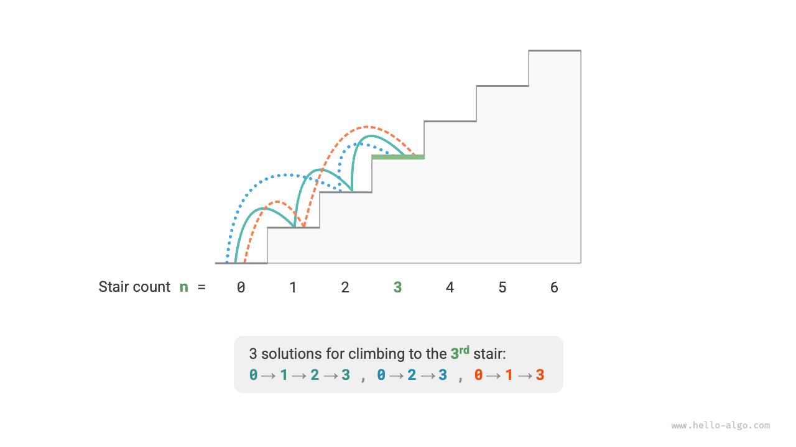
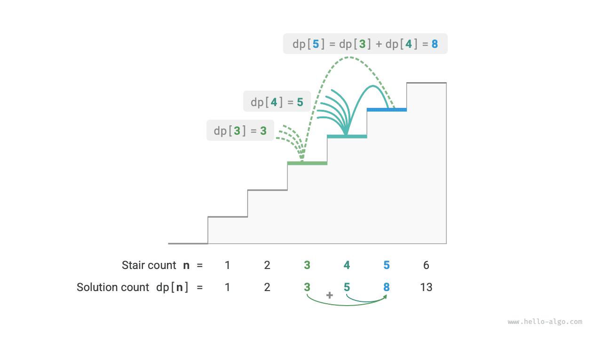
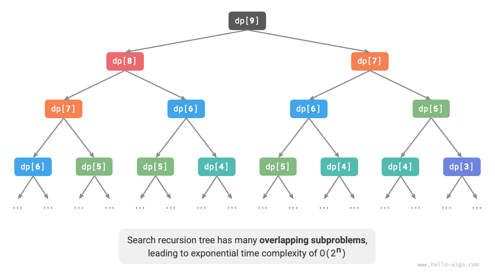
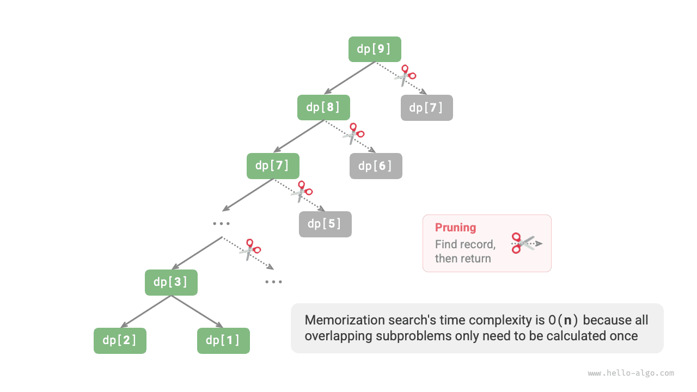
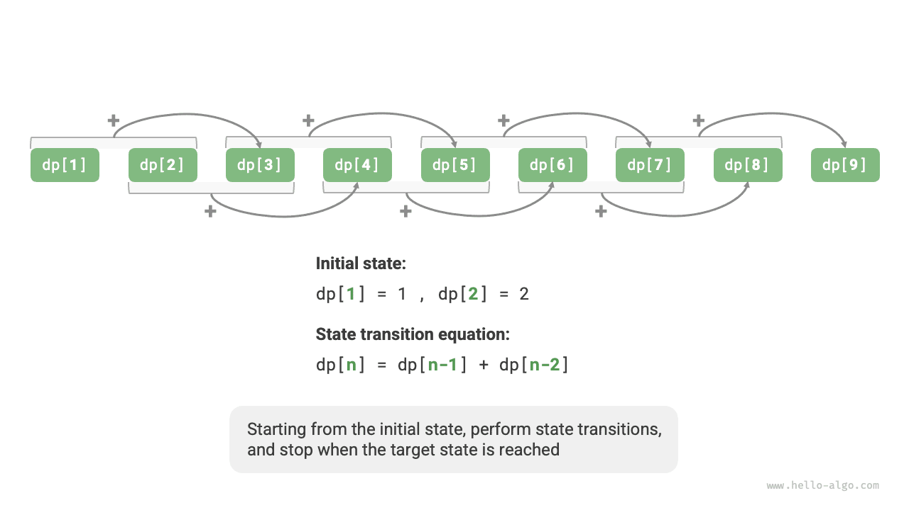

<u>البرمجة الديناميكية</u> (dynamic programming) نمط خوارزمي مهم يحلّل المسألة إلى سلسلة من المسائل الفرعية الأصغر، ويتجنّب الحساب المكرر بتخزين حلول المسائل الفرعية، محسّناً بذلك الكفاءة الزمنية تحسيناً كبيراً.

في هذا القسم نبدأ بمثال كلاسيكي، فنعرض أولاً حله بالتتبّع الرجعي بالقوة الغاشمة، ونلاحظ المسائل الفرعية المتداخلة فيه، ثم نستنتج تدريجياً حلاً أكثر كفاءة بالبرمجة الديناميكية.

<div class="note">
<p class="note__title">صعود الدرج</p>

معطى درج يتكوّن من $n$ درجة، ويمكنك صعود درجة واحدة أو درجتين في كل مرة، فكم طريقة مختلفة توجد للوصول إلى القمة؟

</div>

وكما يوضح الشكل أدناه، توجد للدرج المكوّن من $3$ درجات ثلاث طرق مختلفة للوصول إلى القمة.



هدف هذه المسألة هو تحديد عدد الطرق، لذا **يمكننا التفكير في استخدام التتبّع الرجعي لسرد جميع الاحتمالات**. وتحديداً، تخيّل صعود الدرج عملية اختيار متعددة الجولات: نبدأ من الأرض، ونختار في كل جولة الصعود درجة واحدة أو درجتين، ونزيد العدّاد بواحد كلما بلغنا قمة الدرج، ونشذّب عند تجاوز القمة. والشيفرة كما يلي:

<div class="lang-tab">
<p class="lang-tab__label">Python</p>

```py
        # Backtrack

def climbing_stairs_backtrack(n: int) -> int:
    """Climbing stairs: backtracking"""
    choices = [1, 2]  # Choose to climb 1 or 2 steps
    state = 0  # Start climbing from step 0
    res = [0]  # Use res[0] to record the number of ways
    backtrack(choices, state, n, res)
    return res[0]
```

</div>

## الطريقة الأولى: البحث بالقوة الغاشمة

لا تحلّل خوارزميات التتبّع الرجعي المسائل عادةً تحليلاً صريحاً، بل تعالج حل المسألة كسلسلة من خطوات القرار، وتبحث عن جميع الحلول الممكنة بالتجربة والتشذيب.

يمكننا محاولة تحليل هذه المسألة من منظور تحليل المسألة. لنكن عدد طرق الصعود إلى الدرجة رقم $i$ هو $dp[i]$؛ فحينئذٍ يكون $dp[i]$ هو المسألة الأصلية، وتشمل مسائلها الفرعية:

$$
dp[i-1], dp[i-2], \dots, dp[2], dp[1]
$$

وبما أننا لا نستطيع الصعود إلا درجة أو درجتين في كل جولة، فعندما نقف على الدرجة رقم $i$، لا يمكن أن نكون في الجولة السابقة إلا على الدرجة رقم $i-1$ أو رقم $i-2$. بعبارة أخرى، لا يمكننا الوصول إلى الدرجة رقم $i$ إلا من الدرجة رقم $i-1$ أو رقم $i-2$.

وهذا يقودنا إلى استنتاج مهم: **عدد طرق الصعود إلى الدرجة رقم $i-1$ زائد عدد طرق الصعود إلى الدرجة رقم $i-2$ يساوي عدد طرق الصعود إلى الدرجة رقم $i$**. والصيغة كما يلي:

$$
dp[i] = dp[i-1] + dp[i-2]
$$

وهذا يعني أنه توجد في مسألة صعود الدرج علاقة تعاودية بين المسائل الفرعية، وأن **حل المسألة الأصلية يمكن بناؤه انطلاقاً من حلول المسائل الفرعية**. ويوضح الشكل أدناه هذه العلاقة التعاودية.



ويمكننا الحصول على حل بالبحث بالقوة الغاشمة استناداً إلى صيغة التعاود. فبدءاً من $dp[n]$، **حلّل المسألة الأكبر تعاودياً إلى مجموع مسألتين أصغر**، حتى تبلغ أصغر مسألتين فرعيتين $dp[1]$ و$dp[2]$ فتعود. وحلّا أصغر مسألتين فرعيتين معروفان، وهما $dp[1] = 1$ و$dp[2] = 2$، ويمثلان طريقة واحدة وطريقتين للصعود إلى الدرجتين الأولى والثانية على التوالي.

راقب الشيفرة التالية: فهي، مثل شيفرة التتبّع الرجعي القياسية، تستخدم البحث بالعمق أولاً لكنها أكثر إيجازاً:

يوضح الشكل أدناه الشجرة التعاودية الناتجة عن البحث بالقوة الغاشمة. فبالنسبة إلى المسألة $dp[n]$، يكون عمق شجرتها التعاودية $n$، بتعقيد زمني $O(2^n)$. والنمو الأسي متفجر؛ فإذا أدخلنا قيمة $n$ كبيرة نسبياً، فقد يكون الانتظار طويلاً جداً.

<div class="lang-tab">
<p class="lang-tab__label">Python</p>

```py
def climbing_stairs_dfs(n: int) -> int:
    """Climbing stairs: search"""
    return dfs(n)
```

</div>


وبمراقبة الشكل أعلاه، نجد أن **التعقيد الزمني الأسي ناتج عن «المسائل الفرعية المتداخلة»**. على سبيل المثال، تُحلَّل $dp[9]$ إلى $dp[8]$ و$dp[7]$، وتُحلَّل $dp[8]$ إلى $dp[7]$ و$dp[6]$، وكلتاهما تحتويان المسألة الفرعية $dp[7]$.

وهكذا دواليك، تحتوي المسائل الفرعية على مسائل فرعية متداخلة أصغر، إلى ما لا نهاية. وتُهدَر الغالبية العظمى من موارد الحساب في هذه المسائل الفرعية المتداخلة.

## الطريقة الثانية: الحفظ

لتحسين كفاءة الخوارزمية، **نريد أن تُحسب جميع المسائل الفرعية المتداخلة مرة واحدة فقط**. وتحقيقاً لذلك، نعرّف مصفوفة `mem` لتسجيل حل كل مسألة فرعية، ونشذّب المسائل الفرعية المتداخلة أثناء عملية البحث.

1. عند حساب $dp[i]$ للمرة الأولى، نسجّله في `mem[i]` للاستخدام لاحقاً.
2. وعندما نحتاج إلى حساب $dp[i]$ مرة أخرى، يمكننا استرجاع النتيجة مباشرة من `mem[i]`، متجنّبين بذلك الحساب المكرر لهذه المسألة الفرعية.

والشيفرة كما يلي:

راقب الشكل أدناه: **بعد الحفظ، لا تحتاج جميع المسائل الفرعية المتداخلة إلى الحساب إلا مرة واحدة، فينخفض التعقيد الزمني إلى $O(n)$**، وهي قفزة هائلة.

<div class="lang-tab">
<p class="lang-tab__label">Python</p>

```py
def climbing_stairs_dfs_mem(n: int) -> int:
    """Climbing stairs: memoized search"""
    # mem[i] stores the number of ways to reach step i; -1 means no result has been recorded
    mem = [-1] * (n + 1)
    return dfs(n, mem)
```

</div>


## الطريقة الثالثة: البرمجة الديناميكية

**الحفظ أسلوب «من الأعلى إلى الأسفل»**: نبدأ من المسألة الأصلية (العقدة الجذرية)، ونحلّل المسائل الفرعية الأكبر تعاودياً إلى مسائل أصغر، حتى نبلغ أصغر المسائل الفرعية المعروفة (العقد الأوراق). ثم نجمع، بالرجوع للخلف، حلول المسائل الفرعية طبقةً طبقة لبناء حل المسألة الأصلية.

وفي المقابل، **البرمجة الديناميكية أسلوب «من الأسفل إلى الأعلى»**: تبدأ من حلول أصغر المسائل الفرعية، وتبني تكرارياً حلول المسائل الفرعية الأكبر حتى الحصول على حل المسألة الأصلية.

ولأن البرمجة الديناميكية لا تتضمن عملية رجوع للخلف، فهي لا تحتاج إلى التنفيذ إلا بحلقات تكرارية، ولا تحتاج إلى التعاود. وفي الشيفرة التالية نهيّئ مصفوفة `dp` لتخزين حلول المسائل الفرعية، وهي تؤدي وظيفة التسجيل نفسها التي تؤديها المصفوفة `mem` في الحفظ:

ويحاكي الشكل أدناه عملية تنفيذ الشيفرة أعلاه.

<div class="lang-tab">
<p class="lang-tab__label">Python</p>

```py
def climbing_stairs_dp(n: int) -> int:
    """Climbing stairs: dynamic programming"""
    if n == 1 or n == 2:
        return n
    # Initialize the dp table to store subproblem solutions
    dp = [0] * (n + 1)
    # Initial states: set the solutions to the smallest subproblems
    dp[1], dp[2] = 1, 2
    # State transitions: solve progressively larger subproblems using smaller ones
    for i in range(3, n + 1):
        dp[i] = dp[i - 1] + dp[i - 2]
    return dp[n]
```

</div>


ومثل خوارزميات التتبّع الرجعي، تستخدم البرمجة الديناميكية أيضاً مفهوم «الحالة» لتمثيل مراحل محددة من حل المسألة، حيث تقابل كل حالة مسألة فرعية والحل الأمثل المحلي المقابل لها. على سبيل المثال، تُعرَّف الحالة في مسألة صعود الدرج بأنها رقم الدرجة الحالية $i$.

واستناداً إلى ما سبق، يمكننا تلخيص المصطلحات الشائعة الاستخدام في البرمجة الديناميكية.

- تسمى المصفوفة `dp` <u>جدول dp</u>، حيث يمثل $dp[i]$ حل المسألة الفرعية المقابلة للحالة $i$.
- وتسمى الحالات المقابلة لأصغر المسائل الفرعية (الدرجتان الأولى والثانية) <u>الحالات الابتدائية</u>.
- وتسمى صيغة التعاود $dp[i] = dp[i-1] + dp[i-2]$ <u>معادلة انتقال الحالة</u>.

## تحسين المساحة

ربما لاحظ القارئ المتيقّظ أنه **بما أن $dp[i]$ لا يرتبط إلا بـ $dp[i-1]$ و$dp[i-2]$، فلا حاجة إلى استخدام مصفوفة `dp` لتخزين حلول جميع المسائل الفرعية**، ويمكن الاستعاضة عن ذلك بمتغيرين يتدحرجان إلى الأمام. والشيفرة كما يلي:
<div class="lang-tab">
<p class="lang-tab__label">Python</p>

```py
def climbing_stairs_dp_comp(n: int) -> int:
    """Climbing stairs: space-optimized dynamic programming"""
    if n == 1 or n == 2:
        return n
    a, b = 1, 2
    for _ in range(3, n + 1):
        a, b = b, a + b
    return b
```

</div>

وكما توضح الشيفرة أعلاه، بإلغاء المساحة التي تشغلها المصفوفة `dp`، ينخفض التعقيد المكاني من $O(n)$ إلى $O(1)$.

في مسائل البرمجة الديناميكية، غالباً ما تعتمد الحالة الحالية على عدد محدود فقط من الحالات السابقة، مما يسمح لنا بالاحتفاظ بالحالات الضرورية فقط وتوفير مساحة الذاكرة عبر «تقليل الأبعاد». **وتسمى تقنية تحسين المساحة هذه «المتغير المتدحرج» أو «المصفوفة المتدحرجة»**.
