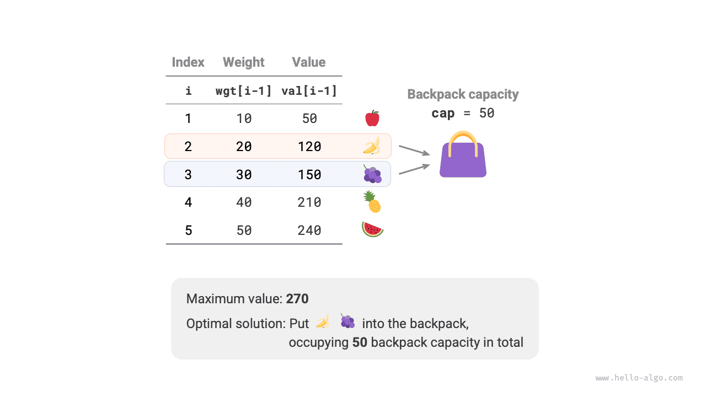
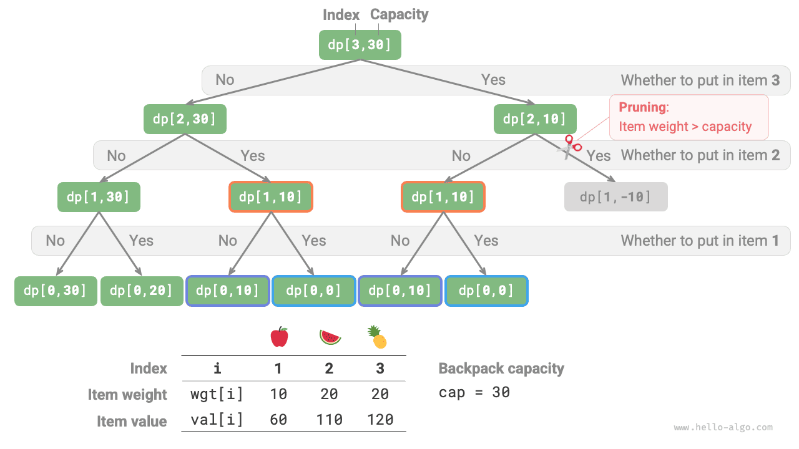
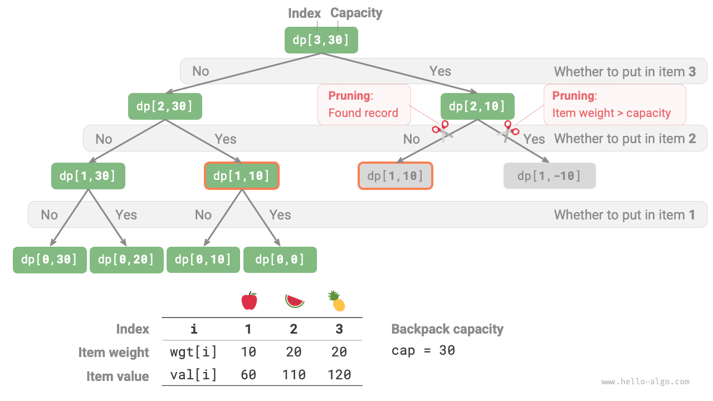

تُعدّ مشكلة الحقيبة مسألة تمهيدية ممتازة للبرمجة الديناميكية، وهي من أكثر صيغ المسائل شيوعاً في البرمجة الديناميكية. ولها متغيّرات كثيرة، مثل مشكلة الحقيبة 0-1، ومشكلة الحقيبة غير المحدودة، ومشكلة الحقيبة المتعددة.

في هذا القسم، سنحل أولاً مشكلة الحقيبة 0-1 الأكثر شيوعاً.

<div class="note">

بمعطى $n$ من العناصر وحقيبة سعتها $cap$، حيث وزن العنصر $i$ هو $wgt[i-1]$ وقيمته $val[i-1]$. ويمكن اختيار كل عنصر مرة واحدة على الأكثر. فما أقصى قيمة يمكن وضعها في الحقيبة ضمن حد السعة؟

</div>

تأمّل الشكل أدناه. بما أن ترقيم العنصر $i$ يبدأ العد من $1$ بينما تبدأ فهارس المصفوفة من $0$، فإن العنصر $i$ يقابل الوزن $wgt[i-1]$ والقيمة $val[i-1]$.



يمكننا النظر إلى مشكلة الحقيبة 0-1 على أنها عملية تتكوّن من $n$ جولة من القرارات، حيث يوجد لكل عنصر قراران: عدم وضعه ووضعه، وبذلك تحقق المسألة نموذج شجرة القرار.

هدف هذه المسألة هو إيجاد «أقصى قيمة يمكن وضعها في الحقيبة ضمن حد السعة»، لذا يُرجَّح أنها مسألة برمجة ديناميكية.

**الخطوة 1: فكّر في القرارات في كل جولة، وحدّد الحالة، وبذلك تحصل على جدول $dp$**

لكل عنصر، إذا لم يُوضع في الحقيبة تبقى سعة الحقيبة دون تغيير؛ وإذا وُضع فيها تنقص سعة الحقيبة. ومن ذلك يمكننا اشتقاق تعريف الحالة: رقم العنصر الحالي $i$ وسعة الحقيبة $c$، ويُرمز إليهما بـ$[i, c]$.

تقابل الحالة $[i, c]$ المسألة الفرعية: **أقصى قيمة يمكن تحقيقها باستخدام أول $i$ من العناصر في حقيبة سعتها $c$**، ويُرمز إليها بـ$dp[i, c]$.

وما نحتاج إلى إيجاده هو $dp[n, cap]$، لذا نحتاج إلى جدول $dp$ ثنائي الأبعاد بحجم $(n+1) \times (cap+1)$.

**الخطوة 2: حدّد البنية الفرعية المثلى، ثم استنتج معادلة انتقال الحالة**

بعد اتخاذ القرار بشأن العنصر $i$، يتبقى المسألة الفرعية الخاصة بأول $i-1$ من العناصر، ويمكن تقسيمها إلى الحالتين التاليتين.

- **عدم وضع العنصر $i$**: تبقى سعة الحقيبة دون تغيير، وتنتقل الحالة إلى $[i-1, c]$.
- **وضع العنصر $i$**: تنقص سعة الحقيبة بمقدار $wgt[i-1]$، وتزيد القيمة بمقدار $val[i-1]$، وتنتقل الحالة إلى $[i-1, c-wgt[i-1]]$.

يكشف التحليل أعلاه البنية الفرعية المثلى لهذه المسألة: **أقصى قيمة $dp[i, c]$ تساوي الأكبر بين القيمتين الناتجتين عن عدم وضع العنصر $i$ في الحقيبة ووضعه فيها**. ومن ذلك يمكن اشتقاق معادلة انتقال الحالة:

$$
dp[i, c] = \max(dp[i-1, c], dp[i-1, c - wgt[i-1]] + val[i-1])
$$

لاحظ أنه إذا تجاوز وزن العنصر الحالي $wgt[i - 1]$ السعة المتبقية للحقيبة $c$، فالخيار الوحيد هو عدم وضعه في الحقيبة.

**الخطوة 3: حدّد الشروط الحدية وترتيب انتقال الحالة**

عندما لا توجد عناصر أو تكون سعة الحقيبة $0$، تكون أقصى قيمة $0$، أي أن العمود الأول $dp[i, 0]$ والصف الأول $dp[0, c]$ يساويان $0$.

تنتقل الحالة الحالية $[i, c]$ من الحالة التي فوقها $[i-1, c]$ ومن الحالة الواقعة في أعلى اليسار $[i-1, c-wgt[i-1]]$، لذا يمكننا اجتياز جدول $dp$ بأكمله بالترتيب الأمامي باستخدام حلقتين متداخلتين.

واستناداً إلى التحليل أعلاه، سننفّذ تالياً حلول البحث بالقوة الغاشمة والحفظ والبرمجة الديناميكية بالترتيب.

### الطريقة 1: البحث بالقوة الغاشمة

تتضمن شيفرة البحث العناصر التالية.

- **المعاملات التعاودية**: الحالة $[i, c]$.
- **القيمة المُعادة**: حل المسألة الفرعية $dp[i, c]$.
- **شرط التوقف**: عند نفاد العناصر ($i = 0$) أو عندما تكون السعة المتبقية للحقيبة $0$، يتوقف التعاود وتُعاد القيمة $0$.
- **التشذيب**: إذا تجاوز وزن العنصر الحالي السعة المتبقية للحقيبة، فلا يتوفر إلا خيار عدم وضعه.

كما يوضح الشكل أدناه، بما أن كل عنصر يولّد فرعي بحث: استبعاده وتضمينه، يكون التعقيد الزمني $O(2^n)$.

وبمراقبة شجرة التعاود، يسهل ملاحظة مسائل فرعية متداخلة، مثل $dp[1, 10]$. وعندما تكون العناصر كثيرة وسعة الحقيبة كبيرة، ولا سيما عندما تكون العناصر ذات الوزن نفسه كثيرة، يزداد عدد المسائل الفرعية المتداخلة زيادة كبيرة.

<div class="lang-tab">
<p class="lang-tab__label">Python</p>

```py
def knapsack_dfs(wgt: list[int], val: list[int], i: int, c: int) -> int:
    """حقيبة 0-1: البحث بالقوة الغاشمة"""
    # إذا اعتُبرت كل العناصر أولم تبق سعة، أعد قيمة 0
    if i == 0 or c == 0:
        return 0
    # إذا تجاوز العنصر السعة المتبقية وجب استبعاده
    if wgt[i - 1] > c:
        return knapsack_dfs(wgt, val, i - 1, c)
    # احسب القيم العظمى الناتجة عن استبعاد العنصر i وتضمينه
    no = knapsack_dfs(wgt, val, i - 1, c)
    yes = knapsack_dfs(wgt, val, i - 1, c - wgt[i - 1]) + val[i - 1]
    # أعد القيمة الأكبر من بين الاختيارين
    return max(no, yes)
```

</div>


### الطريقة 2: الحفظ

لضمان ألا تُحسب المسائل الفرعية المتداخلة إلا مرة واحدة، نستخدم قائمة الحفظ `mem` لتسجيل حلول المسائل الفرعية، حيث يقابل `mem[i][c]` القيمة $dp[i, c]$.

بعد إدخال الحفظ، **يعتمد التعقيد الزمني على عدد المسائل الفرعية**، وهو $O(n \times cap)$. وتكون شيفرة التنفيذ كما يلي:

يوضح الشكل أدناه فروع البحث التي شُذّبت في الحفظ.

<div class="lang-tab">
<p class="lang-tab__label">Python</p>

```py
def knapsack_dfs_mem(
    wgt: list[int], val: list[int], mem: list[list[int]], i: int, c: int
```

</div>


### الطريقة 3: البرمجة الديناميكية

البرمجة الديناميكية في جوهرها عملية ملء جدول $dp$ أثناء انتقالات الحالة. وتكون الشيفرة كما يلي:

كما يوضح الشكل أدناه، يُحدَّد التعقيد الزمني والتعقيد المكاني معاً بحجم المصفوفة `dp`، وهو $O(n \times cap)$.

<div class="lang-tab">
<p class="lang-tab__label">Python</p>

```py
def knapsack_dp(wgt: list[int], val: list[int], cap: int) -> int:
    """حقيبة 0-1: البرمجة الديناميكية"""
    n = len(wgt)
    # مهّد جدول dp
    dp = [[0] * (cap + 1) for _ in range(n + 1)]
    # انتقالات الحالة
    for i in range(1, n + 1):
        for c in range(1, cap + 1):
            if wgt[i - 1] > c:
                # إذا تجاوز العنصر i السعة المتبقية فلا تختره
                dp[i][c] = dp[i - 1][c]
            else:
                # خذ القيمة الأكبر الناتجة عن استبعاد العنصر i وتضمينه
                dp[i][c] = max(dp[i - 1][c], dp[i - 1][c - wgt[i - 1]] + val[i - 1])
    return dp[n][cap]
```

</div>
### تحسين المساحة

بما أن كل حالة مرتبطة فقط بالحالة في الصف الذي فوقها، يمكننا استخدام مصفوفتين متدحرجتين لتقليل التعقيد المكاني من $O(n \times cap)$ إلى $O(cap)$.

وبالتفكير أكثر، هل يمكننا تحقيق التحسين المكاني باستخدام مصفوفة واحدة فقط؟ بالملاحظة، نرى أن كل حالة تنتقل من الخلية التي فوقها مباشرة أو الخلية الواقعة في أعلى اليسار. وإذا كانت هناك مصفوفة واحدة فقط، فحين نبدأ اجتياز الصف $i$، لا تزال تلك المصفوفة تخزّن حالة الصف $i-1$.

- إذا استخدمنا الاجتياز الأمامي، فحين نصل إلى $dp[i, j]$، تكون قيم أعلى اليسار $dp[i-1, 1]$ ~ $dp[i-1, j-1]$ قد كُتب فوقها بالفعل، مما يمنع انتقال الحالة الصحيح.
- إذا استخدمنا الاجتياز العكسي، فلن تظهر مشكلة الكتابة فوق القيم، ويمكن لانتقال الحالة أن يجري بصورة صحيحة.

يوضح الشكل أدناه عملية الانتقال من الصف $i = 1$ إلى الصف $i = 2$ باستخدام مصفوفة واحدة. يرجى التفكير في الفرق بين الاجتياز الأمامي والاجتياز العكسي.

في تنفيذ الشيفرة، نحتاج ببساطة إلى حذف البعد الأول $i$ من المصفوفة `dp` وتغيير الحلقة الداخلية إلى اجتياز عكسي:
<div class="lang-tab">
<p class="lang-tab__label">Python</p>

```py
def knapsack_dp_comp(wgt: list[int], val: list[int], cap: int) -> int:
    """حقيبة 0-1: البرمجة الديناميكية مع تحسين المساحة"""
    n = len(wgt)
    # مهّد جدول dp
    dp = [0] * (cap + 1)
    # انتقالات الحالة
    for i in range(1, n + 1):
        # اجتز بترتيب تنازلي
        for c in range(cap, 0, -1):
            if wgt[i - 1] > c:
                # إذا تجاوز العنصر i السعة المتبقية فلا تختره
                dp[c] = dp[c]
            else:
                # خذ القيمة الأكبر الناتجة عن استبعاد العنصر i وتضمينه
                dp[c] = max(dp[c], dp[c - wgt[i - 1]] + val[i - 1])
    return dp[cap]
```

</div>
