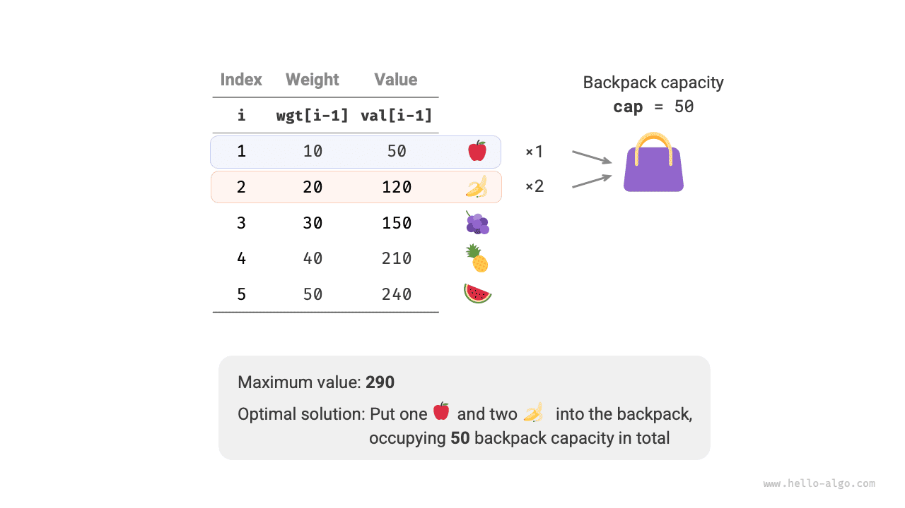
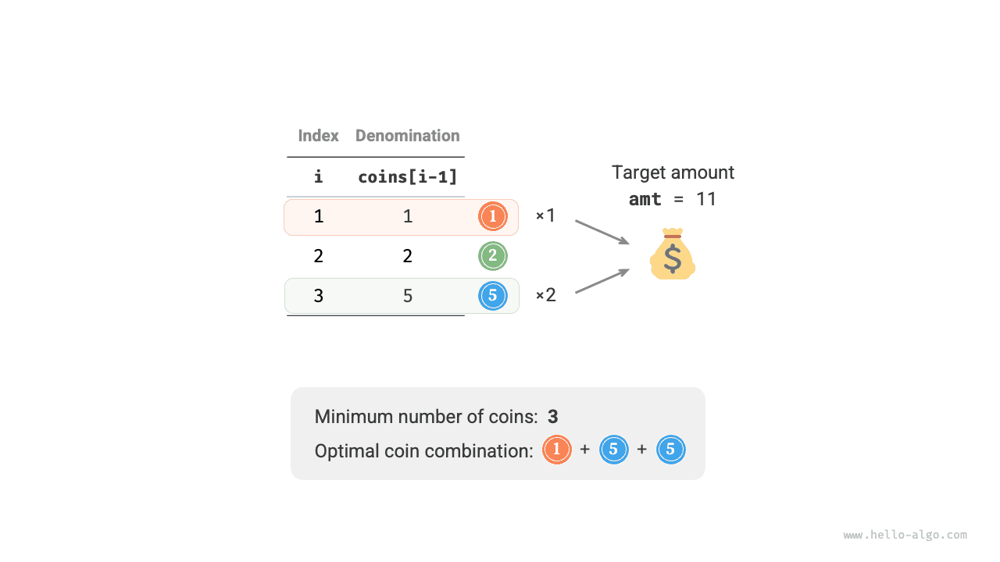
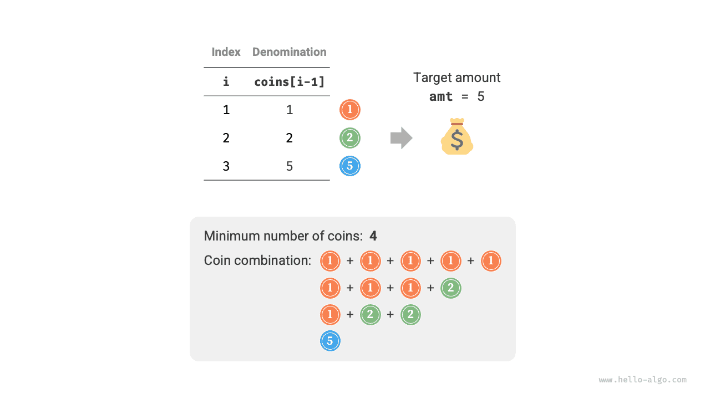

في هذا القسم، نحل أولاً مشكلة أخرى شائعة من مسائل الحقيبة: الحقيبة غير المحدودة، ثم نستكشف حالة خاصة منها: مشكلة تغيير العملات.

## مشكلة الحقيبة غير المحدودة

<div class="note">

بمعطى $n$ من العناصر، حيث وزن العنصر $i$ هو $wgt[i-1]$ وقيمته $val[i-1]$، وحقيبة سعتها $cap$. **يمكن اختيار كل عنصر عدة مرات**. فما أقصى قيمة يمكن وضعها في الحقيبة ضمن حد السعة؟ ويوضح الشكل أدناه مثالاً على ذلك.

</div>



### منهج البرمجة الديناميكية

تشبه مشكلة الحقيبة غير المحدودة مشكلة الحقيبة 0-1 إلى حد كبير، **ولا تختلف عنها إلا في عدم وجود حد لعدد مرات اختيار العنصر**.

- في مشكلة الحقيبة 0-1، توجد نسخة واحدة فقط من كل نوع من العناصر، لذا بعد وضع العنصر $i$ في الحقيبة، لا يمكننا الاختيار إلا من العناصر $i-1$ الأولى.
- في مشكلة الحقيبة غير المحدودة، كمية كل نوع من العناصر غير محدودة، لذا بعد وضع العنصر $i$ في الحقيبة، **يمكننا الاختيار من العناصر $i$ الأولى**.

وفي ظل قواعد مشكلة الحقيبة غير المحدودة، تنقسم تغيّرات الحالة $[i, c]$ إلى حالتين.

- **عدم وضع العنصر $i$**: كما في مشكلة الحقيبة 0-1، ننتقل إلى $[i-1, c]$.
- **وضع العنصر $i$**: على خلاف مشكلة الحقيبة 0-1، ننتقل إلى $[i, c-wgt[i-1]]$.

وبذلك تصبح معادلة انتقال الحالة:

$$
dp[i, c] = \max(dp[i-1, c], dp[i, c - wgt[i-1]] + val[i-1])
$$

### تنفيذ الشيفرة

وبمقارنة شيفرة المشكلتين، نجد تغييراً واحداً في انتقال الحالة من $i-1$ إلى $i$، مع تطابق كل ما عدا ذلك:

<div class="lang-tab">
<p class="lang-tab__label">Python</p>

```py
def unbounded_knapsack_dp(wgt: list[int], val: list[int], cap: int) -> int:
    """Unbounded knapsack: dynamic programming"""
    n = len(wgt)
    # Initialize the dp table
    dp = [[0] * (cap + 1) for _ in range(n + 1)]
    # State transitions
    for i in range(1, n + 1):
        for c in range(1, cap + 1):
            if wgt[i - 1] > c:
                # If item i exceeds the remaining capacity, do not choose it
                dp[i][c] = dp[i - 1][c]
            else:
                # Take the larger value obtained by excluding and including item i
                dp[i][c] = max(dp[i - 1][c], dp[i][c - wgt[i - 1]] + val[i - 1])
    return dp[n][cap]
```

</div>
### تحسين المساحة

بما أن الحالة الحالية تنتقل من حالات على اليسار وفوق، **فبعد تحسين المساحة ينبغي اجتياز كل صف في جدول $dp$ بالترتيب الأمامي**.

وترتيب الاجتياز هذا معاكس تماماً لما في الحقيبة 0-1. يُرجى الرجوع إلى الشكل أدناه لفهم الفرق بين الاثنين.

وتنفيذ الشيفرة بسيط نسبياً، إذ يكفي حذف البُعد الأول من المصفوفة `dp`:

<div class="lang-tab">
<p class="lang-tab__label">Python</p>

```py
def unbounded_knapsack_dp_comp(wgt: list[int], val: list[int], cap: int) -> int:
    """Unbounded knapsack: space-optimized dynamic programming"""
    n = len(wgt)
    # Initialize the dp table
    dp = [0] * (cap + 1)
    # State transitions
    for i in range(1, n + 1):
        # Traverse in increasing order
        for c in range(1, cap + 1):
            if wgt[i - 1] > c:
                # If item i exceeds the remaining capacity, do not choose it
                dp[c] = dp[c]
            else:
                # Take the larger value obtained by excluding and including item i
                dp[c] = max(dp[c], dp[c - wgt[i - 1]] + val[i - 1])
    return dp[cap]
```

</div>
## مشكلة تغيير العملات

تمثل مشكلة الحقيبة صنفاً واسعاً من مسائل البرمجة الديناميكية، ولها متغيّرات كثيرة، مثل مشكلة تغيير العملات.

<div class="note">

بمعطى $n$ من أنواع العملات، حيث فئة النوع $i$ من العملات هي $coins[i - 1]$، والمبلغ المستهدف $amt$. **يمكن اختيار كل نوع من العملات عدة مرات**. فما أقل عدد من العملات اللازمة لتكوين المبلغ المستهدف؟ وإذا تعذّر تكوين المبلغ المستهدف، فأعد $-1$. ويوضح الشكل أدناه مثالاً على ذلك.

</div>



### منهج البرمجة الديناميكية

**يمكن النظر إلى مشكلة تغيير العملات على أنها حالة خاصة من مشكلة الحقيبة غير المحدودة**، مع الروابط والاختلافات التالية.

- يمكن تحويل المشكلتين إحداهما إلى الأخرى: يقابل "العنصر" "العملة"، ويقابل "وزن العنصر" "فئة العملة"، وتقابل "سعة الحقيبة" "المبلغ المستهدف".
- هدفا التحسين متعاكسان: تهدف مشكلة الحقيبة غير المحدودة إلى تعظيم قيمة العناصر، بينما تهدف مشكلة تغيير العملات إلى تقليل عدد العملات.
- تبحث مشكلة الحقيبة غير المحدودة عن حلول "لا تتجاوز" سعة الحقيبة، بينما تبحث مشكلة تغيير العملات عن حلول "تكوّن بالضبط" المبلغ المستهدف.

**الخطوة 1: فكّر في القرارات في كل جولة، وحدد الحالة، وبذلك تحصل على جدول $dp$**

تقابل الحالة $[i, a]$ المسألة الفرعية: **أقل عدد من العملات بين أنواع العملات $i$ الأولى يمكنه تكوين المبلغ $a$**، ويُرمز إليه بـ$dp[i, a]$.

حجم جدول $dp$ ثنائي الأبعاد هو $(n+1) \times (amt+1)$.

**الخطوة 2: حدد البنية الفرعية المثلى، ثم استنتج معادلة انتقال الحالة**

تختلف هذه المشكلة عن مشكلة الحقيبة غير المحدودة في الجانبين التاليين فيما يتعلق بمعادلة انتقال الحالة.

- تبحث هذه المشكلة عن القيمة الدنيا، لذا يلزم تغيير المعامل $\max()$ إلى $\min()$.
- هدف التحسين هو عدد العملات لا قيمة العناصر، لذا عند اختيار عملة، أضِف $1$ فقط.

$$
dp[i, a] = \min(dp[i-1, a], dp[i, a - coins[i-1]] + 1)
$$

**الخطوة 3: حدد الشروط الحدية وترتيب انتقال الحالة**

عندما يكون المبلغ المستهدف $0$، يكون أقل عدد من العملات اللازمة لتكوينه $0$، لذا تساوي جميع قيم $dp[i, 0]$ في العمود الأول $0$.

وعندما لا توجد عملات، **يستحيل تكوين أي مبلغ $> 0$**، وهو حل غير صالح. ولتمكين دالة $\min()$ في معادلة انتقال الحالة من تمييز الحلول غير الصالحة واستبعادها، نفكر في استخدام $+ \infty$ لتمثيلها، أي تعيين جميع قيم $dp[0, a]$ في الصف الأول إلى $+ \infty$.

### تنفيذ الشيفرة

لا توفّر معظم لغات البرمجة متغيّراً بـ$+ \infty$، ولا يمكنها إلا استخدام القيمة العظمى للنوع الصحيح `int` بديلاً عنه. غير أن هذا قد يؤدي إلى تجاوز سعة الأعداد الصحيحة: إذ قد تتسبب عملية $+ 1$ في معادلة انتقال الحالة في التجاوز.

ولهذا السبب، نستخدم العدد $amt + 1$ لتمثيل الحلول غير الصالحة، لأن أقصى عدد من العملات اللازمة لتكوين $amt$ هو $amt$ على الأكثر. وقبل الإعادة، تحقق مما إذا كانت $dp[n, amt]$ تساوي $amt + 1$؛ فإن كان كذلك، فأعد $-1$، مما يدل على تعذّر تكوين المبلغ المستهدف. والشيفرة كما يلي:

يوضح الشكل أدناه عملية البرمجة الديناميكية لتغيير العملات، وهي تشبه مشكلة الحقيبة غير المحدودة إلى حد كبير.

<div class="lang-tab">
<p class="lang-tab__label">Python</p>

```py
def coin_change_dp(coins: list[int], amt: int) -> int:
    """Coin change: dynamic programming"""
    n = len(coins)
    MAX = amt + 1
    # Initialize the dp table
    dp = [[0] * (amt + 1) for _ in range(n + 1)]
    # State transitions: first row and first column
    for a in range(1, amt + 1):
        dp[0][a] = MAX
    # State transitions: remaining rows and columns
    for i in range(1, n + 1):
        for a in range(1, amt + 1):
            if coins[i - 1] > a:
                # If the coin value exceeds the current amount a, do not choose coin i
                dp[i][a] = dp[i - 1][a]
            else:
                # Take the smaller result of not choosing and choosing coin i
                dp[i][a] = min(dp[i - 1][a], dp[i][a - coins[i - 1]] + 1)
    return dp[n][amt] if dp[n][amt] != MAX else -1
```

</div>
### تحسين المساحة

يُعالَج تحسين المساحة لمشكلة تغيير العملات بالطريقة نفسها المتبعة في مشكلة الحقيبة غير المحدودة:

<div class="lang-tab">
<p class="lang-tab__label">Python</p>

```py
def coin_change_dp_comp(coins: list[int], amt: int) -> int:
    """Coin change: space-optimized dynamic programming"""
    n = len(coins)
    MAX = amt + 1
    # Initialize the dp table
    dp = [MAX] * (amt + 1)
    dp[0] = 0
    # State transitions
    for i in range(1, n + 1):
        # Traverse in increasing order
        for a in range(1, amt + 1):
            if coins[i - 1] > a:
                # If the coin value exceeds the current amount a, do not choose coin i
                dp[a] = dp[a]
            else:
                # Take the smaller result of not choosing and choosing coin i
                dp[a] = min(dp[a], dp[a - coins[i - 1]] + 1)
    return dp[amt] if dp[amt] != MAX else -1
```

</div>
## مشكلة تغيير العملات II

<div class="note">

بمعطى $n$ من أنواع العملات، حيث فئة النوع $i$ من العملات هي $coins[i - 1]$، والمبلغ المستهدف $amt$. ويمكن اختيار كل نوع من العملات عدة مرات. **فما عدد توليفات العملات التي يمكنها تكوين المبلغ المستهدف؟** ويوضح الشكل أدناه مثالاً على ذلك.

</div>



### منهج البرمجة الديناميكية

مقارنة بالمشكلة السابقة، هدف هذه المشكلة هو إيجاد عدد التوليفات، لذا تصبح المسألة الفرعية: **عدد التوليفات بين أنواع العملات $i$ الأولى التي يمكنها تكوين المبلغ $a$**. ويبقى جدول $dp$ مصفوفة ثنائية الأبعاد حجمها $(n+1) \times (amt + 1)$.

وعدد توليفات الحالة الحالية يساوي مجموع التوليفات الناتجة عن عدم اختيار العملة الحالية واختيارها. ومعادلة انتقال الحالة هي:

$$
dp[i, a] = dp[i-1, a] + dp[i, a - coins[i-1]]
$$

عندما يكون المبلغ المستهدف $0$، لا حاجة إلى اختيار أي عملات لتكوين المبلغ المستهدف، لذا ينبغي تهيئة جميع قيم $dp[i, 0]$ في العمود الأول إلى $1$. وعندما لا توجد عملات، يستحيل تكوين أي مبلغ $>0$، لذا تساوي جميع قيم $dp[0, a]$ في الصف الأول $0$.

### تنفيذ الشيفرة

<div class="lang-tab">
<p class="lang-tab__label">Python</p>

```py
def coin_change_ii_dp(coins: list[int], amt: int) -> int:
    """Coin change II: dynamic programming"""
    n = len(coins)
    # Initialize the dp table
    dp = [[0] * (amt + 1) for _ in range(n + 1)]
    # Initialize the first column
    for i in range(n + 1):
        dp[i][0] = 1
    # State transitions
    for i in range(1, n + 1):
        for a in range(1, amt + 1):
            if coins[i - 1] > a:
                # If the coin value exceeds the current amount a, do not choose coin i
                dp[i][a] = dp[i - 1][a]
            else:
                # Add the numbers of ways without and with coin i
                dp[i][a] = dp[i - 1][a] + dp[i][a - coins[i - 1]]
    return dp[n][amt]
```

</div>
### تحسين المساحة

يُعالَج تحسين المساحة بالطريقة نفسها، إذ يكفي حذف بُعد العملات:
<div class="lang-tab">
<p class="lang-tab__label">Python</p>

```py
def coin_change_ii_dp_comp(coins: list[int], amt: int) -> int:
    """Coin change II: space-optimized dynamic programming"""
    n = len(coins)
    # Initialize the dp table
    dp = [0] * (amt + 1)
    dp[0] = 1
    # State transitions
    for i in range(1, n + 1):
        # Traverse in increasing order
        for a in range(1, amt + 1):
            if coins[i - 1] > a:
                # If the coin value exceeds the current amount a, do not choose coin i
                dp[a] = dp[a]
            else:
                # Add the numbers of ways without and with coin i
                dp[a] = dp[a] + dp[a - coins[i - 1]]
    return dp[amt]
```

</div>
