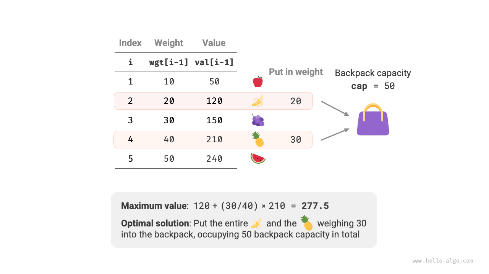
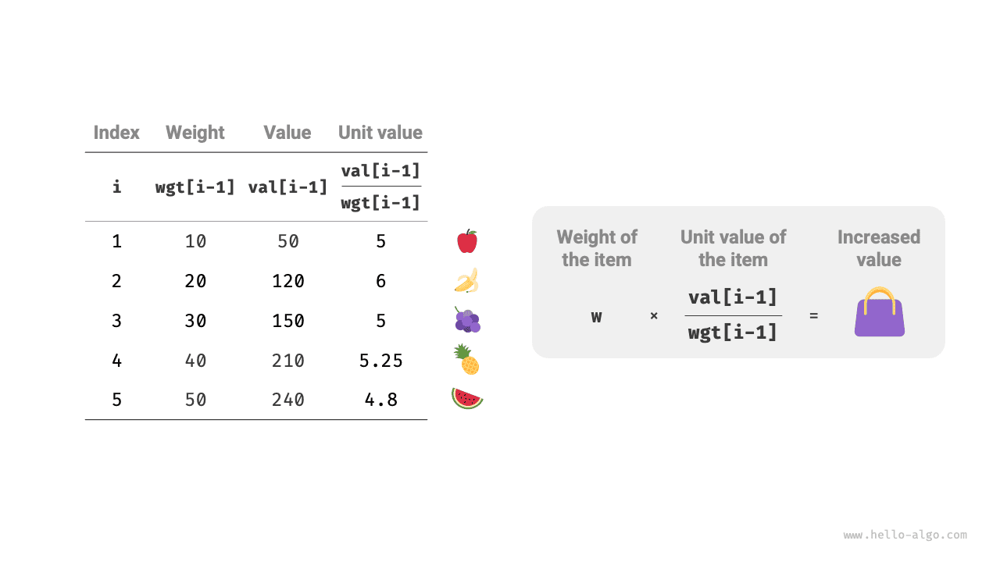
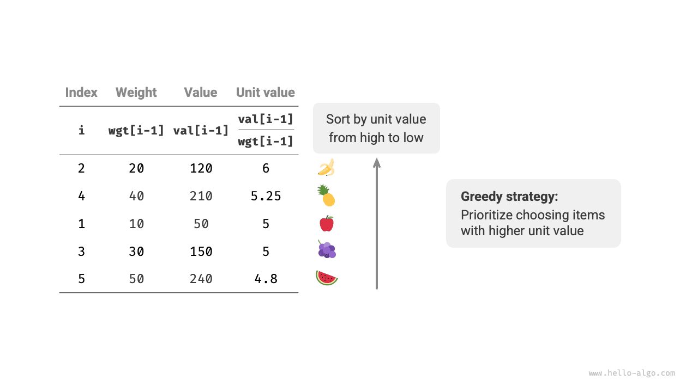
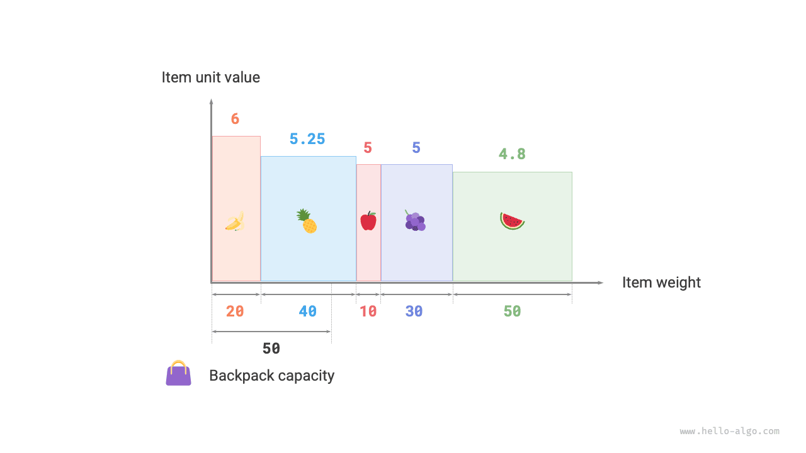

<div class="note">

بمعطى $n$ من العناصر، حيث وزن العنصر $i$ هو $wgt[i-1]$ وقيمته $val[i-1]$، وحقيبة سعتها $cap$. يمكن اختيار كل عنصر مرة واحدة فقط، **لكن يجوز اختيار جزء من العنصر، وتكون قيمته متناسبة مع الوزن المختار**. ما أقصى قيمة إجمالية يمكن وضعها في الحقيبة في حدود السعة؟ ويوضح الشكل أدناه مثالاً على ذلك.

</div>



تتشابه مسألة الحقيبة الكسرية إجمالاً كثيراً مع مسألة حقيبة 0-1، حيث تتضمن الحالات العنصر الحالي $i$ والسعة $c$، والهدف هو تعظيم القيمة في حدود سعة الحقيبة المحدودة.

الفرق أن هذه المسألة تسمح باختيار جزء من العنصر فقط. وكما يوضح الشكل أدناه، **يمكننا تجزئة العنصر كيفما شئنا وحساب قيمته بالتناسب مع الوزن المختار**.

1. بالنسبة إلى العنصر $i$، قيمته لكل وحدة وزن هي $val[i-1] / wgt[i-1]$، وتسمى القيمة الوحدية.
2. لنفترض أننا وضعنا في الحقيبة جزءاً من العنصر $i$ وزنه $w$، فإن القيمة المضافة إلى الحقيبة هي $w \times val[i-1] / wgt[i-1]$.



### تحديد الاستراتيجية الجشعة

إن تعظيم القيمة الإجمالية في الحقيبة **يعني جوهرياً إعطاء الأولوية للعناصر ذات القيمة الأعلى لكل وحدة وزن**. ومن هذه الملاحظة يمكننا استخلاص الاستراتيجية الجشعة الموضحة في الشكل أدناه.

1. رتّب العناصر حسب القيمة الوحدية من الأعلى إلى الأدنى.
2. اجتَز جميع العناصر، **واختر جشعاً في كل جولة العنصر ذا القيمة الوحدية الأعلى**.
3. إذا لم تكفِ سعة الحقيبة المتبقية، فاستخدم جزءاً من العنصر الحالي لملء الحقيبة.



### تنفيذ الشيفرة

نعرّف صنف `Item` بحيث يمكن ترتيب العناصر حسب القيمة الوحدية. ثم نجتاز العناصر المرتبة جشعاً، ونتوقف بمجرد امتلاء الحقيبة ونعيد النتيجة:

<div class="lang-tab">
<p class="lang-tab__label">Python</p>

```py
def fractional_knapsack(wgt: list[int], val: list[int], cap: int) -> int:
    """Fractional knapsack: greedy algorithm"""
    # أنشئ قائمة عناصر، لكل منها خاصيتان: وزن وقيمة
    items = [Item(w, v) for w, v in zip(wgt, val)]
    # رتّب بالقيمة لكل وحدة وزن item.v / item.w بترتيب تنازلي
    items.sort(key=lambda item: item.v / item.w, reverse=True)
    # كرّر الاختيارات الجشعة
    res = 0
    for item in items:
        if item.w <= cap:
            # إذا بقيت سعة كافية، ضع العنصر الحالي كله في الحقيبة
            res += item.v
            cap -= item.w
        else:
            # إذا لم تكفِ السعة المتبقية، ضع جزءًا من العنصر الحالي في الحقيبة
            res += (item.v / item.w) * cap
            # لم تبق سعة، فاخرج من الحلقة
            break
    return res
```

</div>تستغرق خوارزميات الترتيب المدمجة عادةً زمن $O(n \log n)$، ويكون تعقيدها المكاني عادةً $O(\log n)$ أو $O(n)$، حسب التنفيذ المحدد للغة البرمجة.

وفيما عدا الترتيب، يجب في أسوأ الحالات اجتياز قائمة العناصر كاملة، **لذا فإن التعقيد الزمني هو $O(n)$**، حيث $n$ عدد العناصر.

وبما أنه تُهيَّأ قائمة من كائنات `Item`، **فإن التعقيد المكاني هو $O(n)$**.

### إثبات الصحة

نستخدم البرهان بالتناقض. لنفترض أن العنصر $x$ ذو القيمة الوحدية الأعلى، وأن خوارزمية ما تنتج قيمة مثلى `res`، لكن الحل الناتج لا يتضمن العنصر $x$.

الآن أزل وحدة وزن واحدة من أي عنصر في الحقيبة، واستبدلها بوحدة وزن واحدة من العنصر $x$. وبما أن العنصر $x$ ذو القيمة الوحدية الأعلى، فلا بد أن تكون القيمة الإجمالية بعد الاستبدال أكبر من `res`. **وهذا يناقض افتراض أن `res` مثلى، مما يثبت أن أي حل أمثل لا بد أن يتضمن العنصر $x$**.

ويمكننا بناء التناقض نفسه للعناصر الأخرى في الحل أيضاً. وخلاصة القول، **العناصر ذات القيمة الوحدية الأعلى هي دائماً الخيار الأفضل**، مما يثبت فعالية الاستراتيجية الجشعة.

وكما يوضح الشكل أدناه، إذا اعتبرنا وزن العنصر وقيمته الوحدية المحورين الأفقي والعمودي لمخطط ثنائي الأبعاد، فيمكن النظر إلى مسألة الحقيبة الكسرية على أنها "إيجاد أكبر مساحة محصورة ضمن مجال محدود على المحور الأفقي". وتساعد هذه المقارنة على تفسير فعالية الاستراتيجية الجشعة من منظور هندسي.


