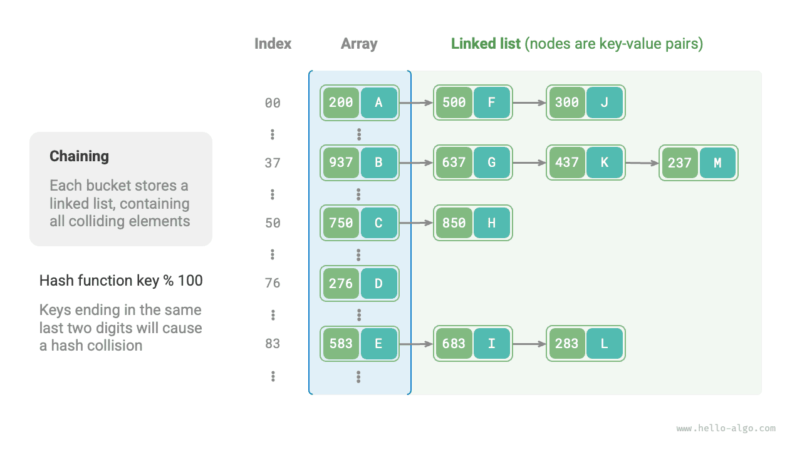
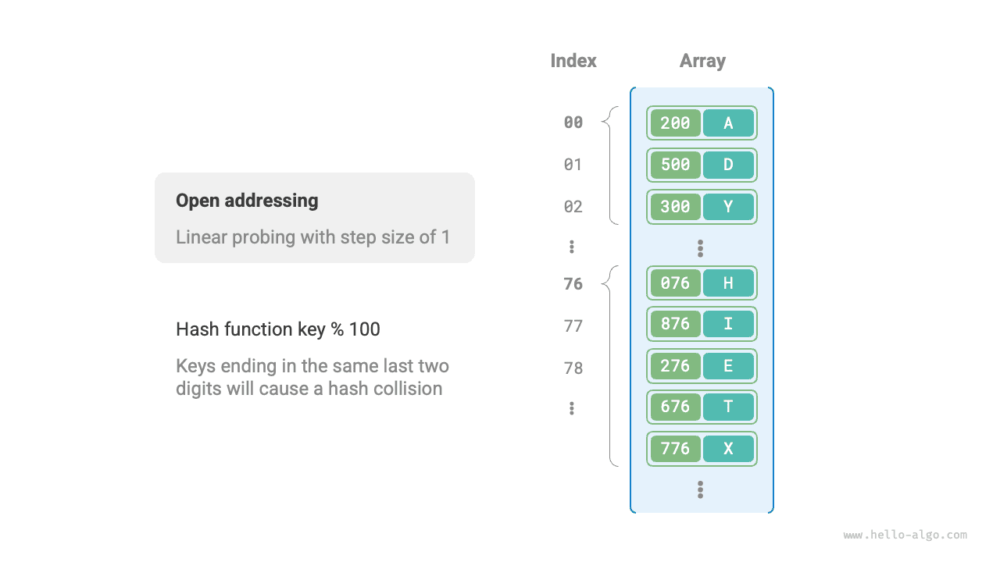
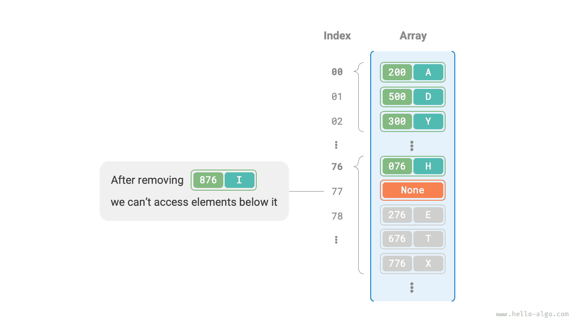

ذكر القسم السابق أنه، **في معظم الحالات، تكون مساحة إدخال دالة التجزئة أكبر بكثير من مساحة إخراجها**، لذا فإن تصادمات التجزئة حتمية نظرياً. فمثلاً، إذا كانت مساحة الإدخال جميع الأعداد الصحيحة وكانت مساحة الإخراج بحجم سعة المصفوفة، فستُعيَّن حتماً عدة أعداد صحيحة إلى فهرس الدلو نفسه.

وقد تؤدي تصادمات التجزئة إلى نتائج استعلام غير صحيحة، مما يؤثر تأثيراً شديداً في قابلية استخدام جدول التجزئة. ولمعالجة هذه المشكلة، يمكننا عند حدوث تصادم تجزئة إجراء توسيع لجدول التجزئة حتى يزول التصادم. وهذا النهج بسيط ومباشر وفعّال، لكنه غير فعّال إلى حد كبير لأن توسيع جدول التجزئة يتضمن قدراً كبيراً من نقل البيانات وإعادة حساب قيم التجزئة. ولتحسين الكفاءة، يمكننا اتباع الاستراتيجيات التالية:

1. تحسين بنية بيانات جدول التجزئة بحيث **يعمل جدول التجزئة بشكل طبيعي عند حدوث تصادمات تجزئة**.
2. التوسيع عند الضرورة فقط، أي فقط عندما تكون تصادمات التجزئة شديدة.

والطريقتان الرئيسيتان لتحسين بنية جدول التجزئة هما السلسلة المنفصلة والعنونة المفتوحة.

## السلسلة المنفصلة

في جدول التجزئة الأصلي، يمكن لكل دلو تخزين زوج مفتاح-قيمة واحد فقط. وتستبدل <u>السلسلة المنفصلة</u> العنصر الواحد في كل دلو بقائمة مترابطة، بمعالجة كل زوج مفتاح-قيمة كعقدة وتخزين جميع أزواج المفتاح-القيمة المتصادمة في القائمة نفسها. ويوضح الشكل أدناه مثالاً على جدول تجزئة بالسلسلة المنفصلة.



وفي جدول التجزئة المنفّذ بالسلسلة المنفصلة، تعمل العمليات الأساسية كما يلي:

- **الاستعلام عن العناصر**: أدخِل `key`، واحسب فهرس الدلو باستخدام دالة التجزئة، وادخل إلى رأس القائمة المترابطة المقابلة، واجتز القائمة مقارناً المفاتيح حتى يُعثر على زوج المفتاح-القيمة الهدف.
- **إضافة العناصر**: استخدم دالة التجزئة أولاً لتحديد موقع القائمة المترابطة المقابلة، ثم أدرِج العقدة (زوج المفتاح-القيمة) في القائمة.
- **حذف العناصر**: استخدم دالة التجزئة لتحديد موقع القائمة المترابطة المقابلة، ثم اجتزها لإيجاد العقدة الهدف وحذفها.

وللسلسلة المنفصلة القيود التالية:

- **زيادة استخدام المساحة**: تحتوي القائمة المترابطة على مؤشرات عقد، تستهلك مساحة ذاكرة أكبر من المصفوفات.
- **انخفاض كفاءة الاستعلام**: لأن العثور على العنصر المقابل يتطلب اجتيازاً خطياً للقائمة المترابطة.

وتوفّر الشيفرة أدناه تنفيذاً بسيطاً لجدول تجزئة بالسلسلة المنفصلة، مع ملاحظتين:

- تُستخدم القوائم (المصفوفات الديناميكية) بدلاً من القوائم المترابطة لتبسيط الشيفرة. وفي هذا الإعداد، يحتوي جدول التجزئة (المصفوفة) على عدة دلاء، كل منها قائمة.
- يتضمن هذا التنفيذ دالة لتوسيع جدول التجزئة. فعندما يتجاوز معامل الحمولة $\frac{2}{3}$، نوسّع جدول التجزئة إلى $2$ ضعف حجمه الأصلي.

<div class="lang-tab">
<p class="lang-tab__label">Python</p>

```py
class HashMapChaining:
    """Hash table with separate chaining"""

    def __init__(self):
        """Constructor"""
        self.size = 0  # Number of key-value pairs
        self.capacity = 4  # Hash table capacity
        self.load_thres = 2.0 / 3.0  # Load factor threshold that triggers capacity growth
        self.extend_ratio = 2  # Capacity growth factor
        self.buckets = [[] for _ in range(self.capacity)]  # Bucket array

    def hash_func(self, key: int) -> int:
        """Hash function"""
        return key % self.capacity

    def load_factor(self) -> float:
        """Load factor"""
        return self.size / self.capacity

    def get(self, key: int) -> str | None:
        """Lookup operation"""
        index = self.hash_func(key)
        bucket = self.buckets[index]
        # Traverse the bucket; if key is found, return its corresponding val
        for pair in bucket:
            if pair.key == key:
                return pair.val
        # Return None if key is not found
        return None

    def put(self, key: int, val: str):
        """Insert operation"""
        # Grow the capacity when the load factor exceeds the threshold
        if self.load_factor() > self.load_thres:
            self.extend()
        index = self.hash_func(key)
        bucket = self.buckets[index]
        # Traverse the bucket; if the specified key is found, update its val and return
        for pair in bucket:
            if pair.key == key:
                pair.val = val
                return
        # If key is absent, append the key-value pair at the end
        pair = Pair(key, val)
        bucket.append(pair)
        self.size += 1

    def remove(self, key: int):
        """Remove operation"""
        index = self.hash_func(key)
        bucket = self.buckets[index]
        # Traverse the bucket and remove the key-value pair
        for pair in bucket:
            if pair.key == key:
                bucket.remove(pair)
                self.size -= 1
                break

    def extend(self):
        """Grow the hash table capacity"""
        # Keep a reference to the original hash table
        buckets = self.buckets
        # Initialize a new hash table with the expanded capacity
        self.capacity *= self.extend_ratio
        self.buckets = [[] for _ in range(self.capacity)]
        self.size = 0
        # Move the key-value pairs from the original hash table to the new one
        for bucket in buckets:
            for pair in bucket:
                self.put(pair.key, pair.val)

    def print(self):
        """Print the hash table"""
        for bucket in self.buckets:
            res = []
            for pair in bucket:
                res.append(str(pair.key) + " -> " + pair.val)
            print(res)
```

</div>
وتجدر الإشارة إلى أنه عندما تصبح القائمة المترابطة طويلة جداً، يكون زمن الاستعلام $O(n)$ ضعيفاً. **وفي هذه الحالة يمكن تحويل القائمة المترابطة إلى شجرة AVL أو شجرة حمراء-سوداء**، مما يقلل التعقيد الزمني لعمليات البحث إلى $O(\log n)$.

## العنونة المفتوحة

لا تُدخل <u>العنونة المفتوحة</u> بنى بيانات إضافية. بل تعالج تصادمات التجزئة عبر الفحص المتكرر. وتشمل استراتيجيات الفحص الشائعة الفحص الخطي والفحص التربيعي والتجزئة المتعددة.

ولنأخذ الفحص الخطي مثالاً لتوضيح آلية جداول التجزئة بالعنونة المفتوحة.

### الفحص الخطي

يستخدم الفحص الخطي خطوة ثابتة للفحص بالتتابع، لذا تختلف عملياته بعض الشيء عن عمليات جدول التجزئة العادي.

- **إدراج العناصر**: احسب فهرس الدلو باستخدام دالة التجزئة. وإذا كان الدلو مشغولاً، فواصل الفحص إلى الأمام من موضع التصادم بخطوة ثابتة (عادةً $1$) حتى تجد دلواً فارغاً، ثم أدرِج العنصر فيه.
- **البحث عن العناصر**: إذا حدث تصادم، فواصل الفحص إلى الأمام بالخطوة نفسها حتى تجد العنصر المقابل وأعِد `value` الخاص به؛ وإذا صادفت دلواً فارغاً، فالعنصر الهدف ليس في جدول التجزئة، لذا أعِد `None`.

ويوضح الشكل أدناه توزيع أزواج المفتاح-القيمة في جدول تجزئة بالعنونة المفتوحة يستخدم الفحص الخطي. وفي ظل دالة التجزئة هذه، تُعيَّن المفاتيح ذات الرقمين الأخيرين المتشابهين إلى الدلو نفسه. ثم يضعها الفحص الخطي في ذلك الدلو والدلاء التالية له.



غير أن **الفحص الخطي عرضة للتكتّل**. وبشكل أدق، كلما طالت منطقة مشغولة متصلة في المصفوفة، زاد احتمال حدوث تصادمات جديدة داخل تلك المنطقة. ويؤدي ذلك بدوره إلى نمو التكتل أكثر فأكثر، ما يخلق حلقة مفرغة تُدهور تدريجياً كفاءة عمليات الإدراج والحذف والبحث والتحديث.

ومن المهم ملاحظة أنه **لا يمكننا حذف العناصر مباشرةً من جدول تجزئة بالعنونة المفتوحة**. فحذف عنصر ينشئ دلواً فارغاً `None` في المصفوفة. وأثناء البحث، بمجرد وصول الفحص الخطي إلى ذلك الدلو الفارغ فإنه يتوقف، ما يعني أن أي عناصر مخزّنة أبعد على مسار الفحص تصبح غير قابلة للوصول. ونتيجة لذلك، قد يستنتج البرنامج خطأً أن تلك العناصر غير موجودة، كما هو موضح في الشكل أدناه.



ولحل هذه المشكلة، يمكننا اعتماد <u>الحذف الكسول</u>: فبدلاً من إزالة عنصر من جدول التجزئة مباشرةً، **نستخدم ثابتاً `TOMBSTONE` لوسم الدلو**. وفي ظل هذه الآلية، يشير كل من `None` و`TOMBSTONE` إلى دلاء يمكنها استقبال أزواج المفتاح-القيمة. والفرق أن الفحص الخطي، عند مصادفته `TOMBSTONE`، يجب أن يواصل الفحص، لأن أزواج المفتاح-القيمة قد توجد أبعد على المسار.

غير أن **الحذف الكسول قد يسرّع تدهور أداء جدول التجزئة**. فكل عملية حذف تترك علامة خلفها، ومع نمو عدد مدخلات `TOMBSTONE`، يزداد زمن البحث أيضاً، لأن الفحص الخطي قد يحتاج إلى تجاوز عدة علامات حذف قبل إيجاد العنصر الهدف.

ولمعالجة ذلك، يمكننا تسجيل فهرس أول `TOMBSTONE` نصادفه أثناء الفحص الخطي وتبديل العنصر الهدف الذي عُثر عليه إلى ذلك الموضع. وتكمن الفائدة في أن كل استعلام أو إدراج يمكنه نقل العناصر أقرب إلى مواضعها المثالية، أي أقرب إلى نقطة بداية الفحص، مما يحسّن كفاءة البحث.

وتنفّذ الشيفرة أدناه جدول تجزئة بالعنونة المفتوحة (فحص خطي) مع الحذف الكسول. وللانتفاع بشكل أفضل بمساحة جدول التجزئة، نتعامل مع جدول التجزئة باعتباره «مصفوفة دائرية». وعند تجاوز نهاية المصفوفة، نعود إلى البداية ونواصل الاجتياز.

<div class="lang-tab">
<p class="lang-tab__label">Python</p>

```py
class HashMapOpenAddressing:
    """Hash table with open addressing"""

    def __init__(self):
        """Constructor"""
        self.size = 0  # Number of key-value pairs
        self.capacity = 4  # Hash table capacity
        self.load_thres = 2.0 / 3.0  # Load factor threshold that triggers capacity growth
        self.extend_ratio = 2  # Capacity growth factor
        self.buckets: list[Pair | None] = [None] * self.capacity  # Bucket array
        self.TOMBSTONE = Pair(-1, "-1")  # Tombstone marker

    def hash_func(self, key: int) -> int:
        """Hash function"""
        return key % self.capacity

    def load_factor(self) -> float:
        """Load factor"""
        return self.size / self.capacity

    def find_bucket(self, key: int) -> int:
        """Find the bucket index for key"""
        index = self.hash_func(key)
        first_tombstone = -1
        # Probe linearly until an empty bucket is reached
        while self.buckets[index] is not None:
            # If key is found, return its bucket index
            if self.buckets[index].key == key:
                # If a tombstone was encountered earlier, move the key-value pair to that index
                if first_tombstone != -1:
                    self.buckets[first_tombstone] = self.buckets[index]
                    self.buckets[index] = self.TOMBSTONE
                    return first_tombstone  # Return the bucket index after the move
                return index  # Return the bucket index
            # Record the first tombstone encountered
            if first_tombstone == -1 and self.buckets[index] is self.TOMBSTONE:
                first_tombstone = index
            # Calculate the bucket index, wrapping to the beginning after the end
            index = (index + 1) % self.capacity
        # If key is absent, return the index for insertion
        return index if first_tombstone == -1 else first_tombstone

    def get(self, key: int) -> str:
        """Lookup operation"""
        # Find the bucket index for key
        index = self.find_bucket(key)
        # If the key-value pair is found, return its val
        if self.buckets[index] not in [None, self.TOMBSTONE]:
            return self.buckets[index].val
        # Return None if the key-value pair is absent
        return None

    def put(self, key: int, val: str):
        """Insert operation"""
        # Grow the capacity when the load factor exceeds the threshold
        if self.load_factor() > self.load_thres:
            self.extend()
        # Find the bucket index for key
        index = self.find_bucket(key)
        # If the key-value pair is found, overwrite val and return
        if self.buckets[index] not in [None, self.TOMBSTONE]:
            self.buckets[index].val = val
            return
        # If the key-value pair is absent, insert it
        self.buckets[index] = Pair(key, val)
        self.size += 1

    def remove(self, key: int):
        """Remove operation"""
        # Find the bucket index for key
        index = self.find_bucket(key)
        # If the key-value pair is found, replace it with a tombstone
        if self.buckets[index] not in [None, self.TOMBSTONE]:
            self.buckets[index] = self.TOMBSTONE
            self.size -= 1

    def extend(self):
        """Grow the hash table capacity"""
        # Keep a reference to the original hash table
        buckets_tmp = self.buckets
        # Initialize a new hash table with the expanded capacity
        self.capacity *= self.extend_ratio
        self.buckets = [None] * self.capacity
        self.size = 0
        # Move the key-value pairs from the original hash table to the new one
        for pair in buckets_tmp:
            if pair not in [None, self.TOMBSTONE]:
                self.put(pair.key, pair.val)

    def print(self):
        """Print the hash table"""
        for pair in self.buckets:
            if pair is None:
                print("None")
            elif pair is self.TOMBSTONE:
                print("TOMBSTONE")
            else:
                print(pair.key, "->", pair.val)
```

</div>
### الفحص التربيعي

الفحص التربيعي مشابه للفحص الخطي، وهو إحدى الاستراتيجيات الشائعة للعنونة المفتوحة. فعند حدوث تصادم، لا يتخطى الفحص التربيعي ببساطة عدداً ثابتاً من الخطوات، بل يتخطى عدداً من الخطوات يساوي «مربع عدد عمليات الفحص»، أي $1, 4, 9, \dots$ خطوة.

وللفحص التربيعي المزايا التالية:

- يحاول الفحص التربيعي تخفيف أثر التكتّل في الفحص الخطي عبر تخطي مسافات تساوي مربع عدد عمليات الفحص.
- يتخطى الفحص التربيعي مسافات أكبر للعثور على مواضع فارغة، مما يساعد على توزيع البيانات بشكل أكثر توازناً.

غير أن الفحص التربيعي ليس مثالياً:

- لا يزال التكتّل موجوداً، أي إن بعض المواضع أكثر عرضة للشغل من غيرها.
- نظراً لنمو المربعات، قد لا يفحص الفحص التربيعي جدول التجزئة بأكمله، أي إنه قد لا يتمكن من الوصول إلى دلاء فارغة في جدول التجزئة حتى لو وُجدت.

### التجزئة المتعددة

كما يوحي الاسم، تستخدم التجزئة المتعددة دوال تجزئة متعددة $f_1(x)$، $f_2(x)$، $f_3(x)$، $\dots$ للفحص.

- **إدراج العناصر**: إذا صادفت دالة التجزئة $f_1(x)$ تعارضاً، فجرّب $f_2(x)$، وهكذا، حتى يُعثر على موضع فارغ ويُدرَج العنصر.
- **البحث عن العناصر**: ابحث بالترتيب نفسه لدوال التجزئة حتى يُعثر على العنصر الهدف وتُعيده؛ وإذا صادفت موضعاً فارغاً أو استُنفدت جميع دوال التجزئة، فهذا يشير إلى أن العنصر ليس في جدول التجزئة، فأعِد `None`.

وبالمقارنة مع الفحص الخطي، تقلّ احتمالية التكتّل في التجزئة المتعددة، لكن استخدام دوال تجزئة متعددة يضيف تكاليف حسابية إضافية.

<div class="note">

يرجى ملاحظة أن جداول التجزئة القائمة على العنونة المفتوحة، بما في ذلك الفحص الخطي والفحص التربيعي والتجزئة المتعددة، تواجه جميعاً مشكلة عدم إمكانية حذف العناصر مباشرةً.

</div>

## اختيار لغات البرمجة

تعتمد لغات البرمجة المختلفة استراتيجيات مختلفة لتنفيذ جداول التجزئة. وفيما يلي بعض الأمثلة:

- تستخدم Python العنونة المفتوحة. ويستخدم قاموس `dict` أعداداً شبه عشوائية للفحص.
- تستخدم Java السلسلة المنفصلة. ومنذ JDK 1.8، عندما يبلغ طول المصفوفة في `HashMap` القيمة 64 ويبلغ طول قائمة مترابطة القيمة 8، تُحوَّل القائمة المترابطة إلى شجرة حمراء-سوداء لتحسين أداء البحث.
- تستخدم Go السلسلة المنفصلة. وتنصّ Go على أن كل دلو يمكنه تخزين 8 أزواج مفتاح-قيمة على الأكثر، وإذا تجاوزت السعة ذلك، يُربط دلو فائض؛ وعندما تكثر الدلاء الفائضة، تُجرى عملية توسيع خاصة متساوية السعة لضمان الأداء.
