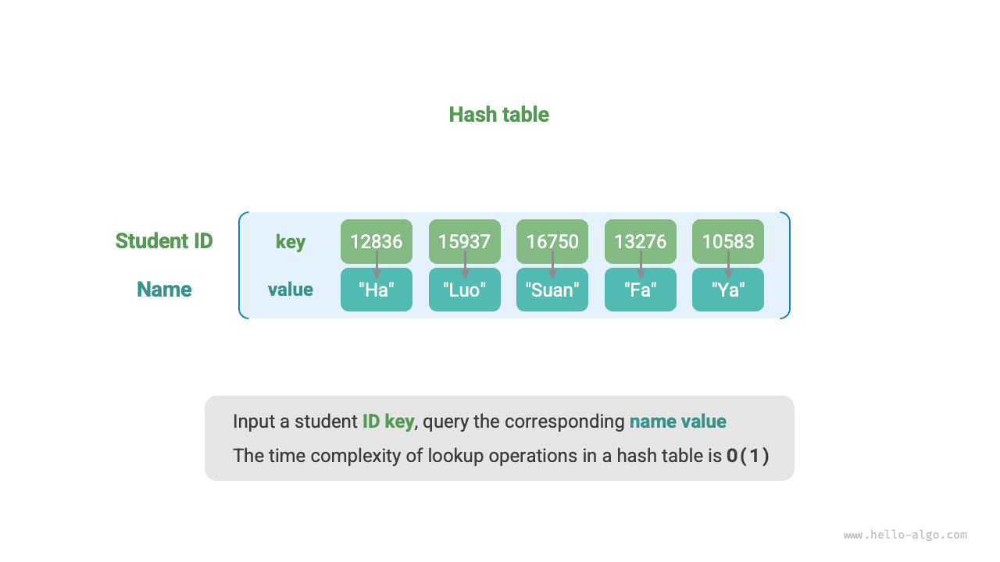
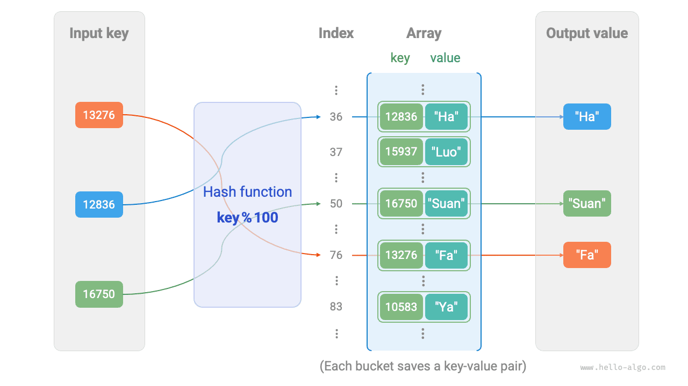
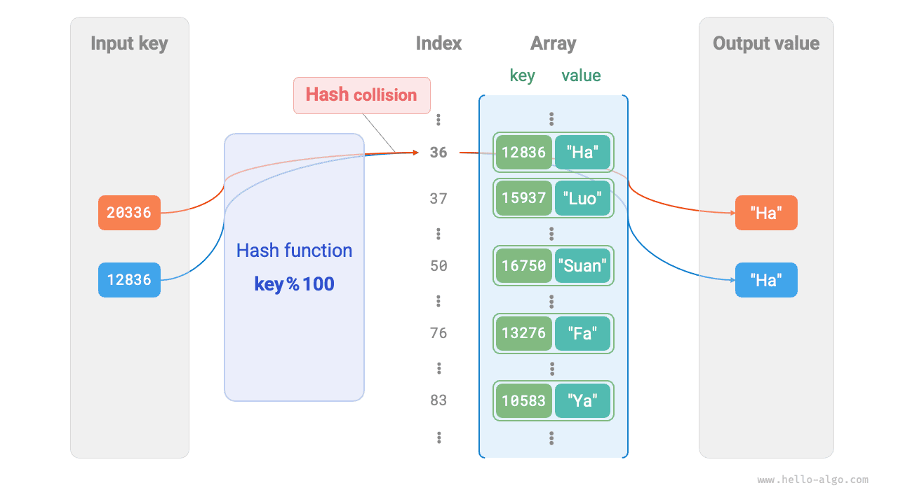
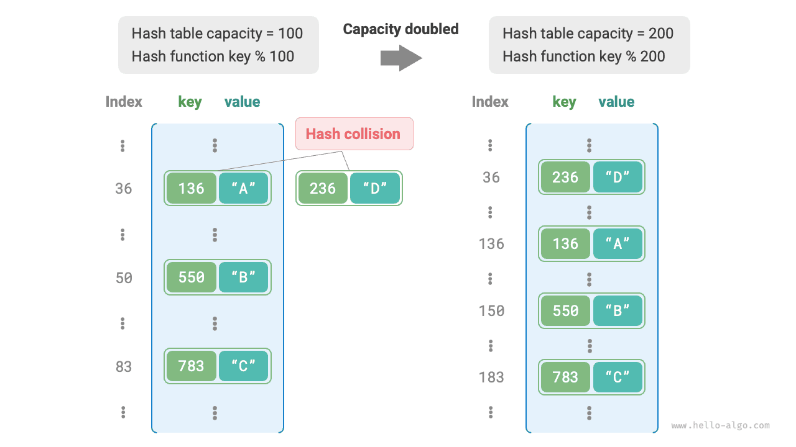

<u>جدول التجزئة</u> (hash table)، المعروف أيضاً بـ<u>خريطة التجزئة</u> (hash map)، يخزّن ارتباطات من المفاتيح `key` إلى القيم `value`، مما يتيح عمليات بحث فعّالة. وتحديداً، عند إعطاء مفتاح `key`، يمكننا استرجاع القيمة المقابلة `value` من جدول التجزئة في زمن $O(1)$.

وكما يوضح الشكل أدناه، لنفترض أن لدينا $n$ طالباً، ولكل طالب معلومتان: الاسم ورقم الهوية. وإذا أردنا دعم الاستعلام «أعطِ رقم الهوية وأعد الاسم المقابل»، فيمكننا استخدام جدول التجزئة الموضح أدناه.



إلى جانب جداول التجزئة، يمكن للمصفوفات والقوائم المترابطة أيضاً تنفيذ وظيفة الاستعلام. وتُعرض مقارنة كفاءتها في الجدول التالي.

- **إضافة العناصر**: ما عليك سوى إضافة العناصر إلى نهاية المصفوفة (القائمة المترابطة)، وهو ما يستغرق زمن $O(1)$.
- **الاستعلام عن العناصر**: بما أن المصفوفة (القائمة المترابطة) غير مرتبة، يلزم اجتياز جميع العناصر، وهو ما يستغرق زمن $O(n)$.
- **حذف العناصر**: يجب أولاً تحديد موقع العنصر، ثم حذفه من المصفوفة (القائمة المترابطة)، وهو ما يستغرق زمن $O(n)$.

<p align="center"> جدول <id> &nbsp; مقارنة كفاءة الاستعلام عن العناصر </p>

|                 | المصفوفة | القائمة المترابطة | جدول التجزئة |
| --------------- | ------ | ----------- | ---------- |
| العثور على عنصر | $O(n)$ | $O(n)$      | $O(1)$     |
| إضافة عنصر      | $O(1)$ | $O(1)$      | $O(1)$     |
| حذف عنصر        | $O(n)$ | $O(n)$      | $O(1)$     |

وكما نرى، **فإن عمليات الإدراج والحذف والبحث والتحديث في جدول التجزئة جميعها بتعقيد زمني $O(1)$**، مما يجعل جداول التجزئة عالية الكفاءة.

## العمليات الشائعة على جدول التجزئة

تشمل العمليات الشائعة على جداول التجزئة: التهيئة، وعمليات الاستعلام، وإضافة أزواج المفتاح-القيمة، وحذف أزواج المفتاح-القيمة. وتظهر الشيفرة المثالية أدناه:

<div class="lang-tab">
<p class="lang-tab__label">Python</p>

```python title="hash_map.py"
# Initialize hash table
hmap: dict = {}

# Add operation
# Add key-value pair (key, value) to hash table
hmap[12836] = "XiaoHa"
hmap[15937] = "XiaoLuo"
hmap[16750] = "XiaoSuan"
hmap[13276] = "XiaoFa"
hmap[10583] = "XiaoYa"

# Query operation
# Input key into hash table to get value
name: str = hmap[15937]

# Delete operation
# Delete key-value pair (key, value) from hash table
hmap.pop(10583)
```

</div>
هناك ثلاث طرق شائعة لاجتياز جدول التجزئة: اجتياز أزواج المفتاح-القيمة، واجتياز المفاتيح، واجتياز القيم. وتظهر الشيفرة المثالية أدناه:

<div class="lang-tab">
<p class="lang-tab__label">Python</p>

```python title="hash_map.py"
# Traverse hash table
# Traverse key-value pairs key->value
for key, value in hmap.items():
    print(key, "->", value)
# Traverse keys only
for key in hmap.keys():
    print(key)
# Traverse values only
for value in hmap.values():
    print(value)
```

</div>
## تنفيذ بسيط لجدول التجزئة

لنبدأ بأبسط حالة: **تنفيذ جدول تجزئة بمصفوفة فقط**. في جدول التجزئة، تسمى كل خانة فارغة في المصفوفة <u>دلواً</u> (bucket)، ويمكن لكل دلو تخزين زوج مفتاح-قيمة واحد. لذا يتلخّص البحث في إيجاد الدلو الخاص بالمفتاح `key` وقراءة القيمة `value` المخزنة فيه.

فكيف نجد الدلو الصحيح لمفتاح `key` معطى؟ نفعل ذلك باستخدام <u>دالة التجزئة</u> (hash function). فدالة التجزئة تربط فضاء إدخال أكبر بفضاء إخراج أصغر. وفي جدول التجزئة، يكون فضاء الإدخال هو مجموعة جميع المفاتيح `key`، وفضاء الإخراج هو مجموعة جميع الدلاء (فهارس المصفوفة). بعبارة أخرى، عند إعطاء `key`، **تخبرنا دالة التجزئة بمكان تخزين زوج المفتاح-القيمة المقابل في المصفوفة**.

وبالنسبة إلى `key` معطى، يتضمن حساب فهرس الدلو الخطوتين التاليتين:

1. استخدم خوارزمية تجزئة `hash()` لحساب قيمة تجزئة.
2. خذ باقي قسمة قيمة التجزئة على عدد الدلاء (طول المصفوفة) `capacity` للحصول على الدلو (فهرس المصفوفة) `index` المقابل للمفتاح `key`.

```shell
index = hash(key) % capacity
```

وبعد ذلك يمكننا استخدام `index` للوصول إلى الدلو المقابل في جدول التجزئة واسترجاع القيمة `value`.

لنفترض أن طول المصفوفة هو `capacity = 100` وأن خوارزمية التجزئة هي `hash(key) = key`. فحينئذٍ تكون دالة التجزئة هي `key % 100`. ويوضح الشكل أدناه كيفية عمل دالة التجزئة هذه، باستخدام رقم الهوية مفتاحاً `key` والاسم قيمةً `value`.



تنفّذ الشيفرة التالية جدول تجزئة بسيطاً. وهنا نغلّف `key` و`value` في فئة `Pair` لتمثيل زوج مفتاح-قيمة.

<div class="lang-tab">
<p class="lang-tab__label">Python</p>

```py
class ArrayHashMap:
    """Hash table implemented with an array"""

    def __init__(self):
        """Constructor"""
        # Initialize an array containing 100 buckets
        self.buckets: list[Pair | None] = [None] * 100

    def hash_func(self, key: int) -> int:
        """Hash function"""
        index = key % 100
        return index

    def get(self, key: int) -> str | None:
        """Lookup operation"""
        index: int = self.hash_func(key)
        pair: Pair = self.buckets[index]
        if pair is None:
            return None
        return pair.val

    def put(self, key: int, val: str):
        """Insert and update operations"""
        pair = Pair(key, val)
        index: int = self.hash_func(key)
        self.buckets[index] = pair

    def remove(self, key: int):
        """Remove operation"""
        index: int = self.hash_func(key)
        # Set to None to mark removal
        self.buckets[index] = None

    def entry_set(self) -> list[Pair]:
        """Get all key-value pairs"""
        result: list[Pair] = []
        for pair in self.buckets:
            if pair is not None:
                result.append(pair)
        return result

    def key_set(self) -> list[int]:
        """Get all keys"""
        result = []
        for pair in self.buckets:
            if pair is not None:
                result.append(pair.key)
        return result

    def value_set(self) -> list[str]:
        """Get all values"""
        result = []
        for pair in self.buckets:
            if pair is not None:
                result.append(pair.val)
        return result

    def print(self):
        """Print the hash table"""
        for pair in self.buckets:
            if pair is not None:
                print(pair.key, "->", pair.val)
```

</div>
## تصادم التجزئة وإعادة التحجيم

في جوهر الأمر، تربط دالة التجزئة فضاء الإدخال المكوّن من جميع المفاتيح `key` بفضاء الإخراج المكوّن من جميع فهارس المصفوفة، وغالباً ما يكون فضاء الإدخال أكبر بكثير من فضاء الإخراج. لذلك **يجب نظرياً أن تُسند مدخلات مختلفة أحياناً إلى الإخراج نفسه**.

وبالنسبة إلى دالة التجزئة في المثال أعلاه، عندما يكون للمفاتيح `key` المدخلة الرقمان الأخيران نفسهما، تنتج دالة التجزئة الإخراج نفسه. على سبيل المثال، عند الاستعلام عن طالبين برقمي هوية 12836 و20336، نحصل على:

```shell
12836 % 100 = 36
20336 % 100 = 36
```

وكما يوضح الشكل أدناه، يشير رقما هوية الآن إلى الاسم نفسه، وهو ما لا يصح قطعاً. ونسمي هذه الحالة، التي تُسند فيها مدخلات متعددة إلى الإخراج نفسه، <u>تصادم تجزئة</u> (hash collision).



من السهل أن نرى أنه كلما زادت سعة جدول التجزئة $n$، قلّ احتمال إسناد مفاتيح `key` متعددة إلى الدلو نفسه، وقلّت التصادمات. لذلك **يمكننا تقليل تصادمات التجزئة بتوسيع جدول التجزئة**.

وكما يوضح الشكل أدناه، قبل التوسيع تصادم الزوجان `(136, A)` و`(236, D)`، أما بعد التوسيع فيزول التصادم.



ومثل إعادة تحجيم مصفوفة، تتطلب إعادة تحجيم جدول التجزئة ترحيل جميع أزواج المفتاح-القيمة من الجدول الأصلي إلى الجدول الجديد، وهو أمر مكلف. وإضافة إلى ذلك، ولأن سعة جدول التجزئة `capacity` تتغير، يجب علينا إعادة حساب موضع تخزين كل زوج مفتاح-قيمة باستخدام دالة التجزئة، وهو ما يزيد تكلفة إعادة التحجيم أكثر. ولهذا السبب، تحجز لغات البرمجة عادةً سعة كافية لجدول التجزئة لتجنّب إعادة التحجيم المتكررة.

<u>عامل الحِمل</u> (load factor) مفهوم مهم في جداول التجزئة. ويُعرَّف بأنه عدد العناصر في جدول التجزئة مقسوماً على عدد الدلاء، ويُستخدم لقياس شدة تصادمات التجزئة. **ويُستخدم أيضاً عادةً عتبةً لتفعيل إعادة تحجيم جدول التجزئة**. على سبيل المثال، في Java، عندما يتجاوز عامل الحِمل $0.75$، يوسّع النظام جدول التجزئة إلى ضعف حجمه الأصلي.
