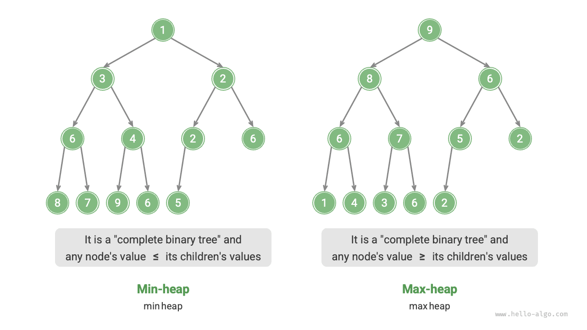
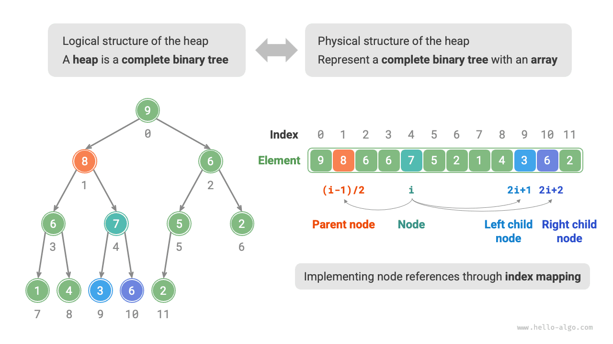

<u>الكومة (heap)</u> شجرة ثنائية كاملة تحقق شروطاً محددة، ويمكن تصنيفها أساساً إلى نوعين، كما هو موضح في الشكل أدناه.

- <u>الكومة الصغرى (min heap)</u>: قيمة أي عقدة $\leq$ قيم عقدها الفرعية.
- <u>الكومة العظمى (max heap)</u>: قيمة أي عقدة $\geq$ قيم عقدها الفرعية.



وباعتبارها حالة خاصة من الشجرة الثنائية الكاملة، تتمتع الأكوام بالخصائص التالية.

- تُملأ عقد الطبقة السفلى من اليسار إلى اليمين، وتكون عقد الطبقات الأخرى ممتلئة بالكامل.
- نسمي العقدة الجذرية للشجرة الثنائية «قمة الكومة»، ونسمي العقدة السفلى في أقصى اليمين «قاع الكومة».
- في الكومة العظمى (الصغرى)، تكون قيمة العنصر الأعلى في الكومة (العقدة الجذرية) هي الأكبر (الأصغر).

## عمليات الكومة الشائعة

يجدر بالذكر أن كثيراً من لغات البرمجة توفر <u>طابور الأولوية (priority queue)</u>، وهي بنية بيانات مجردة تُعرّف بأنها طابور تُرتَّب عناصره حسب الأولوية.

وفي الواقع، **تُستخدم الأكوام عادةً لتنفيذ طوابير الأولوية، حيث تقابل الكومة العظمى طابور أولوية تُسحب عناصره بترتيب تنازلي**. ومن منظور الاستخدام، يمكننا اعتبار «طابور الأولوية» و«الكومة» بنيتي بيانات متكافئتين. لذلك لا يميّز هذا الكتاب بينهما تمييزاً خاصاً، بل يشير إليهما بصفة موحدة باسم «الكومة».

عمليات الكومة الشائعة موضحة في الجدول أدناه، وتتحدد أسماء الدوال وفقاً للغة البرمجة.

<p align="center"> جدول <id> &nbsp; كفاءة عمليات الكومة </p>

| اسم الدالة | الوصف                                                       | التعقيد الزمني |
| ----------- | ----------------------------------------------------------------- | --------------- |
| `push()`    | إدراج عنصر في الكومة                                   | $O(\log n)$     |
| `pop()`     | حذف العنصر الأعلى في الكومة                                       | $O(\log n)$     |
| `peek()`    | الوصول إلى العنصر الأعلى في الكومة (القيمة العظمى/الصغرى في الكومة العظمى/الصغرى)     | $O(1)$          |
| `size()`    | الحصول على عدد عناصر الكومة                            | $O(1)$          |
| `isEmpty()` | فحص ما إذا كانت الكومة فارغة                                        | $O(1)$          |

في التطبيقات العملية، يمكننا استخدام فئة الكومة (أو فئة طابور الأولوية) التي توفرها لغات البرمجة مباشرةً.

وعلى غرار «الترتيب التصاعدي» و«الترتيب التنازلي» في خوارزميات الترتيب، يمكننا تنفيذ التحويل بين «الكومة الصغرى» و«الكومة العظمى» عبر ضبط `flag` أو تعديل `Comparator`. والكود كما يلي:

<div class="lang-tab">
<p class="lang-tab__label">Python</p>

```python title="heap.py"
# Initialize a min heap
min_heap, flag = [], 1
# Initialize a max heap
max_heap, flag = [], -1

# Python's heapq module implements a min heap by default
# Consider negating elements before pushing them to the heap, which inverts the size relationship and thus implements a max heap
# In this example, flag = 1 corresponds to a min heap, flag = -1 corresponds to a max heap

# Push elements into the heap
heapq.heappush(max_heap, flag * 1)
heapq.heappush(max_heap, flag * 3)
heapq.heappush(max_heap, flag * 2)
heapq.heappush(max_heap, flag * 5)
heapq.heappush(max_heap, flag * 4)

# Get the heap top element
peek: int = flag * max_heap[0] # 5

# Remove the heap top element
# The removed elements will form a descending sequence
val = flag * heapq.heappop(max_heap) # 5
val = flag * heapq.heappop(max_heap) # 4
val = flag * heapq.heappop(max_heap) # 3
val = flag * heapq.heappop(max_heap) # 2
val = flag * heapq.heappop(max_heap) # 1

# Get the heap size
size: int = len(max_heap)

# Check if the heap is empty
is_empty: bool = not max_heap

# Build a heap from an input list
min_heap: list[int] = [1, 3, 2, 5, 4]
heapq.heapify(min_heap)
```

</div>
## تنفيذ الكومة

التنفيذ التالي خاص بالكومة العظمى. ولتحويله إلى كومة صغرى، ما عليك سوى عكس كل منطق المقارنة المتعلق بالترتيب (على سبيل المثال، استبدال $\geq$ بـ $\leq$). ونشجّع القرّاء المهتمين على تنفيذ ذلك بأنفسهم.

### تخزين الكومة وتمثيلها

كما ذُكر في فصل «الشجرة الثنائية»، تلائم الأشجار الثنائية الكاملة التمثيل بالمصفوفات. ولأن الأكوام نوع من الأشجار الثنائية الكاملة، **فإننا سنستخدم المصفوفات لتخزين الأكوام**.

عند تمثيل شجرة ثنائية بمصفوفة، تمثل العناصر قيم العقد، وتمثل الفهارس مواضع العقد في الشجرة الثنائية. **وتُمثَّل علاقات الأب-الابن عبر صيغ ربط الفهارس**.

وكما هو موضح في الشكل أدناه، بمعطى فهرس $i$، يكون فهرس الابن الأيسر $2i + 1$، وفهرس الابن الأيمن $2i + 2$، وفهرس الأب $(i - 1) / 2$ (قسمة أرضية). وعندما يخرج الفهرس عن الحدود، فهذا يشير إلى عقدة فارغة أو إلى أن العقدة غير موجودة.



يمكننا تغليف صيغة ربط الفهارس في دوال لتسهيل استخدامها لاحقاً:

<div class="lang-tab">
<p class="lang-tab__label">Python</p>

```py
    def parent(self, i: int) -> int:
        """Get the parent index"""
        return (i - 1) // 2  # Floor division
```

</div>
### الوصول إلى العنصر الأعلى في الكومة

العنصر الأعلى في الكومة هو العقدة الجذرية للشجرة الثنائية، وهو أيضاً العنصر الأول في القائمة:

<div class="lang-tab">
<p class="lang-tab__label">Python</p>

```py
    def peek(self) -> int:
        """Access the top element of the heap"""
        return self.max_heap[0]
```

</div>
### إدراج عنصر في الكومة

بمعطى عنصر `val`، نضيفه أولاً إلى قاع الكومة. وبعد الإدراج، قد تُنتهك خاصية الكومة لأن `val` قد يكون أكبر من عناصر أخرى في الكومة. **لذلك نحتاج إلى استعادة خاصية الكومة على طول المسار من العقدة المُدرجة إلى الجذر**. وتسمى هذه العملية <u>تعديل الكومة (heapify)</u>.

بدءاً من العقدة المُدرجة، **ننفّذ تعديل الكومة من الأسفل إلى الأعلى**. وكما هو موضح في الشكل أدناه، نقارن العقدة المُدرجة بالعقدة الأب، وإذا كانت العقدة المُدرجة أكبر نبادلهما. ونواصل هذه العملية من الأسفل إلى الأعلى حتى نتجاوز الجذر أو نصل إلى عقدة لم تعد بحاجة إلى تبادل.

بالمجموع $n$ من العقد، يكون ارتفاع الشجرة $O(\log n)$. ومن ثم، فإن عدد تكرارات الحلقة في عملية تعديل الكومة لا يزيد عن $O(\log n)$، **وهو ما يجعل التعقيد الزمني لعملية إدراج العنصر $O(\log n)$**. والكود كما يلي:

<div class="lang-tab">
<p class="lang-tab__label">Python</p>

```py
    def sift_up(self, i: int):
        """Sift up starting from node i"""
        while True:
            # Get the parent of node i
            p = self.parent(i)
            # Stop sifting when the root has been passed or the node needs no repair
            if p < 0 or self.max_heap[i] <= self.max_heap[p]:
                break
            # Swap the two nodes
            self.swap(i, p)
            # Continue sifting up
            i = p
```

</div>
### حذف العنصر الأعلى في الكومة

العنصر الأعلى في الكومة هو العقدة الجذرية للشجرة الثنائية، وهو العنصر الأول في القائمة. وإذا حذفنا العنصر الأول من القائمة مباشرةً، فستتغير جميع فهارس العقد في الشجرة الثنائية، مما يصعّب الإصلاح اللاحق بتعديل الكومة. ولتقليل تغيّرات فهارس العناصر إلى أدنى حد، نتبع الخطوات التالية.

1. بادل العنصر الأعلى في الكومة بعنصر قاع الكومة (بادل العقدة الجذرية بالعقدة الورقية الأقصى يميناً).
2. بعد التبادل، احذف قاع الكومة من القائمة (لاحظ أننا في الواقع نحذف العنصر الأعلى الأصلي في الكومة لأننا بادلناه).
3. بدءاً من العقدة الجذرية، **نفّذ تعديل الكومة من الأعلى إلى الأسفل**.

وكما هو موضح في الشكل أدناه، **يكون اتجاه «تعديل الكومة من الأعلى إلى الأسفل» معاكساً لاتجاه «تعديل الكومة من الأسفل إلى الأعلى»**. نقارن قيمة العقدة الجذرية بقيم ابنيها ونبادلها مع الابن الأكبر. ثم نكرّر هذه العملية حتى نتجاوز عقدة ورقية أو نصادف عقدة لا تحتاج إلى تبادل.

وعلى غرار عملية إدراج العنصر، يكون التعقيد الزمني لعملية حذف العنصر الأعلى في الكومة أيضاً $O(\log n)$. والكود كما يلي:

<div class="lang-tab">
<p class="lang-tab__label">Python</p>

```py
    def sift_down(self, i: int):
        """Sift down starting from node i"""
        while True:
            # Find the node with the largest value among i, l, and r, and store its index in ma
            l, r, ma = self.left(i), self.right(i), i
            if l < self.size() and self.max_heap[l] > self.max_heap[ma]:
                ma = l
            if r < self.size() and self.max_heap[r] > self.max_heap[ma]:
                ma = r
            # Stop if node i is largest or both child indices l and r are out of bounds
            if ma == i:
                break
            # Swap the two nodes
            self.swap(i, ma)
            # Continue sifting down
            i = ma
```

</div>
## التطبيقات الشائعة للأكوام

- **طابور الأولوية**: الأكوام عادةً هي بنية البيانات المفضلة لتنفيذ طوابير الأولوية. فالتعقيد الزمني لكل من عمليتي الإدخال والإخراج هو $O(\log n)$، وبناء الكومة له تعقيد زمني $O(n)$، مما يجعل هذه العمليات عالية الكفاءة.
- **ترتيب الكومة**: بمعطى مجموعة من البيانات، يمكننا بناء كومة منها ثم تنفيذ عمليات حذف العناصر باستمرار للحصول على بيانات مرتبة. غير أننا نستخدم عادةً أسلوباً أكثر أناقة لتنفيذ ترتيب الكومة، كما هو مفصل في فصل «ترتيب الكومة».
- **الحصول على أكبر $k$ من العناصر**: هذه مسألة خوارزمية كلاسيكية وتطبيق نموذجي أيضاً، مثل اختيار الأخبار العشرة الأكثر رواجاً في «بحث ويبو الساخن» أو المنتجات العشرة الأكثر مبيعاً.
