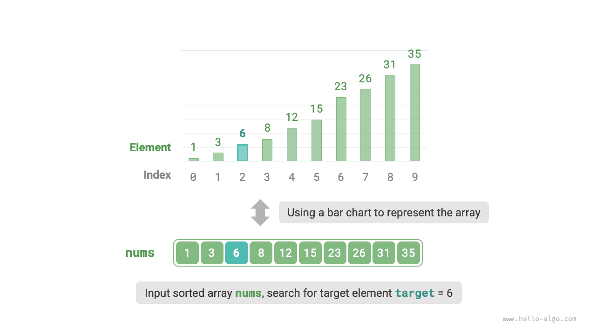
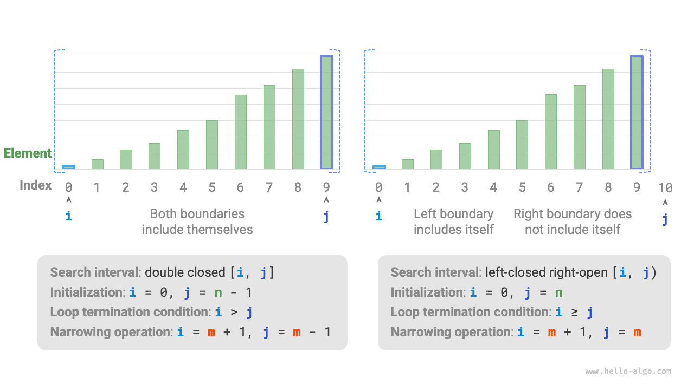

<u>البحث الثنائي</u> (binary search) خوارزمية بحث فعّالة قائمة على استراتيجية التقسيم والتغلب. وهو يستفيد من الترتيب المرتَّب للبيانات ليقلّص نطاق البحث إلى النصف في كل جولة، حتى العثور على العنصر المستهدف أو أن يصبح مجال البحث فارغاً.

<div class="note">

بمعطى مصفوفة `nums` طولها $n$، عناصرها مرتّبة ترتيباً تصاعدياً ولا تحتوي عناصر مكررة، ابحث عن فهرس العنصر `target` في المصفوفة وأعده. وإذا لم تحتوِ المصفوفة على هذا العنصر، فأعد $-1$. ويوضح الشكل أدناه مثالاً على ذلك.

</div>



كما يوضح الشكل أدناه، نهيّئ أولاً المؤشرين $i = 0$ و$j = n - 1$، وهما يشيران إلى العنصرين الأول والأخير من المصفوفة على التوالي، ويمثّلان مجال البحث $[0, n - 1]$. لاحظ أن الأقواس المربعة تشير إلى مجال مغلق يشمل القيمتين الحديتين أنفسهما.

بعد ذلك، نفّذ الخطوتين التاليتين في حلقة:

1. احسب فهرس المنتصف $m = \lfloor {(i + j) / 2} \rfloor$، حيث يشير الرمز $\lfloor \: \rfloor$ إلى عملية التقريب نحو الأسفل.
2. قارن `nums[m]` بـ`target`، وينتج عن ذلك ثلاث حالات:
    1. عندما يكون `nums[m] < target`، فهذا يعني أن `target` يقع في الفترة $[m + 1, j]$، لذا نفّذ $i = m + 1$.
    2. عندما يكون `nums[m] > target`، فهذا يعني أن `target` يقع في الفترة $[i, m - 1]$، لذا نفّذ $j = m - 1$.
    3. عندما يكون `nums[m] = target`، فهذا يعني أن `target` قد وُجد، لذا أعد الفهرس $m$.

إذا لم تحتوِ المصفوفة على العنصر المستهدف، فسيصبح مجال البحث فارغاً في النهاية. وفي هذه الحالة، أعد $-1$.

ومن الجدير بالذكر أنه بما أن $i$ و$j$ من النوع `int`، فإن **$i + j$ قد يتجاوز نطاق النوع `int`**. ولتجنّب تجاوز الأعداد الصحيحة الحد الأقصى، نستخدم عادةً الصيغة $m = \lfloor {i + (j - i) / 2} \rfloor$ لحساب نقطة المنتصف.

والشيفرة كما يلي:

<div class="lang-tab">
<p class="lang-tab__label">Python</p>

```py
def binary_search(nums: list[int], target: int) -> int:
    """Binary search (closed interval)"""
    # Initialize the closed interval [0, n-1], with i and j pointing to the first and last elements
    i, j = 0, len(nums) - 1
    # Loop until the search interval is empty (when i > j)
    while i <= j:
        # Python integers can grow arbitrarily large, subject to available memory, so integer overflow is not a concern
        m = (i + j) // 2  # Calculate the midpoint index m
        if nums[m] < target:
            i = m + 1  # In this case, target must be in [m+1, j] if it exists
        elif nums[m] > target:
            j = m - 1  # In this case, target must be in [i, m-1] if it exists
        else:
            return m  # The target element was found; return its index
    return -1  # The target element was not found; return -1
```

</div>

**التعقيد الزمني $O(\log n)$**: في حلقة البحث الثنائي، يُقلَّص المجال إلى النصف في كل جولة، لذا يكون عدد التكرارات $\log_2 n$.

**التعقيد المكاني $O(1)$**: يستخدم المؤشران $i$ و$j$ مساحة ثابتة الحجم.

## طرق تمثيل المجالات

بالإضافة إلى المجال المغلق المذكور أعلاه، ثمة تمثيل شائع آخر للمجال هو «مغلق من اليسار، مفتوح من اليمين»، ويُعرّف بـ $[0, n)$، أي أن الحد الأيسر مغلق بينما الحد الأيمن مفتوح. وفي ظل هذا التمثيل، يكون المجال $[i, j)$ فارغاً عندما $i = j$.

ويمكننا تنفيذ خوارزمية بحث ثنائي بالوظيفة نفسها استناداً إلى هذا التمثيل:

<div class="lang-tab">
<p class="lang-tab__label">Python</p>

```py
def binary_search_lcro(nums: list[int], target: int) -> int:
    """Binary search (left-closed, right-open interval)"""
    # Initialize the left-closed, right-open interval [0, n), with i at the first element and j one past the last
    i, j = 0, len(nums)
    # Loop until the search interval is empty (when i = j)
    while i < j:
        m = (i + j) // 2  # Calculate the midpoint index m
        if nums[m] < target:
            i = m + 1  # In this case, target must be in [m+1, j) if it exists
        elif nums[m] > target:
            j = m  # In this case, target must be in [i, m) if it exists
        else:
            return m  # The target element was found; return its index
    return -1  # The target element was not found; return -1
```

</div>

وكما يوضح الشكل أدناه، تختلف تهيئة خوارزمية البحث الثنائي وشرط الحلقة وعمليات تقليص المجال في ظل تمثيلي المجال كليهما.

وبما أن الحدين الأيسر والأيمن في تمثيل «المجال المغلق» معرّفان كليهما كمغلقين، فإن عمليتي تقليص المجال عبر المؤشرين $i$ و$j$ متماثلتان أيضاً. وهذا يجعل الأخطاء أقل احتمالاً، **لذا يُوصى عموماً بنهج «المجال المغلق»**.



## المزايا والقيود

يقدّم البحث الثنائي أداءً جيداً في الزمن والمساحة كليهما.

- للبحث الثنائي كفاءة زمنية عالية. ومع أحجام البيانات الكبيرة، يحمل التعقيد الزمني اللوغاريتمي مزايا واضحة. فمثلاً، عندما يكون حجم البيانات $n = 2^{20}$، يتطلب البحث الخطي $2^{20} = 1048576$ تكراراً، بينما يحتاج البحث الثنائي إلى $\log_2 2^{20} = 20$ تكراراً فقط.
- لا يتطلب البحث الثنائي مساحة إضافية. فمقارنةً بخوارزميات البحث التي تحتاج مساحة إضافية (مثل البحث القائم على التجزئة)، يكون البحث الثنائي أكثر كفاءة في استهلاك المساحة.

غير أن البحث الثنائي لا يلائم جميع الحالات، ويرجع ذلك أساساً إلى الأسباب التالية:

- لا ينطبق البحث الثنائي إلا على البيانات المرتّبة. فإذا كانت بيانات الإدخال غير مرتّبة، فإن ترتيبها خصيصاً لاستخدام البحث الثنائي يكون بنتيجة عكسية، لأن خوارزميات الترتيب عادةً ما يكون تعقيدها الزمني $O(n \log n)$، وهو أعلى من تعقيد البحث الخطي والبحث الثنائي معاً. وفي السيناريوهات التي تتكرر فيها عمليات إدراج العناصر، يتطلب الحفاظ على ترتيب المصفوفة إدراج العناصر في مواضع محددة بتعقيد زمني $O(n)$، وهو مكلف جداً أيضاً.
- لا ينطبق البحث الثنائي إلا على المصفوفات. فالبحث الثنائي يتطلب وصولاً غير متصل وقافزاً إلى العناصر، وهذا النوع من الوصول غير فعّال في القوائم المترابطة، مما يجعله غير مناسب للقوائم المترابطة أو بنى البيانات القائمة عليها.
- مع أحجام البيانات الصغيرة، يكون أداء البحث الخطي أفضل. ففي البحث الخطي، تتطلب كل جولة عملية مقارنة واحدة فقط؛ بينما في البحث الثنائي، يتطلب الأمر عملية جمع واحدة وعملية قسمة واحدة و1-3 عمليات مقارنة وعملية جمع (أو طرح) واحدة، أي ما مجموعه 4-6 عمليات وحدة. لذلك، عندما يكون حجم البيانات $n$ صغيراً، يكون البحث الخطي في الواقع أسرع من البحث الثنائي.
