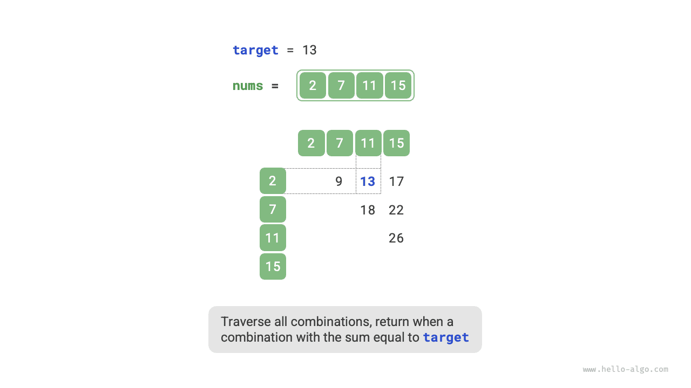

في مسائل الخوارزميات، **كثيراً ما نقلل التعقيد الزمني للخوارزميات عبر استبدال البحث الخطي بالبحث القائم على التجزئة**. ولنستخدم إحدى مسائل الخوارزميات لتعميق فهمنا.

<div class="note">

بمعطى مصفوفة أعداد صحيحة `nums` وقيمة مستهدفة `target`، ابحث عن عنصرين في المصفوفة يكون مجموعهما `target`، ثم أعد فهرسيهما. تكفي أي إجابة.

</div>

## البحث الخطي: مقايضة الزمن بالمكان

فكّر في اجتياز جميع التركيبات الممكنة مباشرة. وكما هو موضح في الشكل أدناه، نستخدم حلقات متداخلة ونتحقق في كل تكرار مما إذا كان مجموع عددين صحيحين يساوي `target`. فإن كان كذلك، نعيد فهرسيهما.



الكود موضح أدناه:

<div class="lang-tab">
<p class="lang-tab__label">Python</p>

```py
def two_sum_brute_force(nums: list[int], target: int) -> list[int]:
    """Method 1: brute-force enumeration"""
    # Two nested loops give a time complexity of O(n^2)
    for i in range(len(nums) - 1):
        for j in range(i + 1, len(nums)):
            if nums[i] + nums[j] == target:
                return [i, j]
    return []
```

</div>
التعقيد الزمني لهذه الطريقة هو $O(n^2)$ والتعقيد المكاني هو $O(1)$، مما يجعلها مستهلكة للوقت للغاية عند المدخلات الكبيرة.

## البحث القائم على التجزئة: مقايضة المكان بالزمن

فكّر في استخدام جدول تجزئة تكون مفاتيحه عناصر المصفوفة وقيمه فهارسها. اجتز المصفوفة ونفّذ الخطوات الموضحة في الشكل أدناه في كل تكرار:

1. تحقق مما إذا كان العدد `target - nums[i]` موجوداً في جدول التجزئة. فإن كان موجوداً، أعد فوريًا فهرسي هذين العنصرين.
2. أضف زوج المفتاح والقيمة المكوّن من `nums[i]` والفهرس `i` إلى جدول التجزئة.

التنفيذ موضح أدناه ولا يتطلب سوى حلقة واحدة:

<div class="lang-tab">
<p class="lang-tab__label">Python</p>

```py
def two_sum_hash_table(nums: list[int], target: int) -> list[int]:
    """Method 2: auxiliary hash table"""
    # The auxiliary hash table uses O(n) space
    dic = {}
    # A single loop with average O(1) hash operations gives an average time complexity of O(n)
    for i in range(len(nums)):
        if target - nums[i] in dic:
            return [dic[target - nums[i]], i]
        dic[nums[i]] = i
    return []
```

</div>
تقلل هذه الطريقة التعقيد الزمني من $O(n^2)$ إلى $O(n)$ عبر البحث القائم على التجزئة، مما يحسّن كفاءة زمن التشغيل تحسيناً كبيراً.

وبما أنه يلزم الاحتفاظ بجدول تجزئة إضافي، فإن التعقيد المكاني هو $O(n)$. **ومع ذلك، تقدم هذه الطريقة مقايضة زمنية-مكانية إجمالية أكثر توازناً، مما يجعلها الحل الأمثل لهذه المسألة**.
