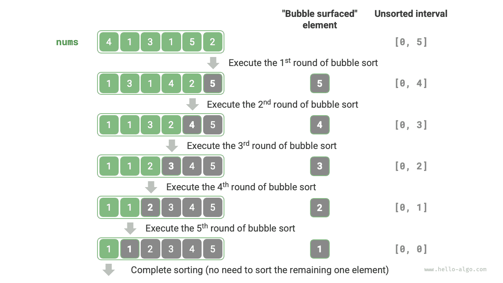

<u>ترتيب الفقاعات</u> (bubble sort) خوارزمية ترتّب مصفوفة بمقارنة العناصر المتجاورة وتبديلها باستمرار. تشبه هذه العملية فقاعات تصعد من الأسفل إلى الأعلى، ومن هنا جاء اسم ترتيب الفقاعات.

وكما يوضح الشكل أدناه، يمكن محاكاة عملية التفقيع بتبديل العناصر: بدءاً من الطرف الأيسر للمصفوفة والاجتياز نحو اليمين، قارن كل زوج من العناصر المتجاورة، وإذا كان "العنصر الأيسر > العنصر الأيمن" فبدّلهما. وبعد اكتمال الاجتياز، يكون أكبر عنصر قد انتقل إلى الطرف الأيمن للمصفوفة.

## سير الخوارزمية

لنفترض أن طول المصفوفة $n$. وتُعرض خطوات ترتيب الفقاعات في الشكل أدناه.

1. أولاً، نفّذ "التفقيع" على $n$ عنصراً، **فتبدّل أكبر عنصر في المصفوفة إلى موضعه الصحيح**.
2. ثم نفّذ "التفقيع" على العناصر $n - 1$ المتبقية، **فتبدّل ثاني أكبر عنصر إلى موضعه الصحيح**.
3. وهكذا. بعد $n - 1$ جولة من "التفقيع"، **تكون أكبر $n - 1$ عنصراً قد بدّلت جميعها إلى مواضعها الصحيحة**.
4. العنصر الوحيد المتبقي لا بد أن يكون أصغر عنصر، ولا يحتاج إلى ترتيب، وبذلك يكتمل ترتيب المصفوفة.



مثال الشيفرة كما يلي:

<div class="lang-tab">
<p class="lang-tab__label">Python</p>

```py
def bubble_sort(nums: list[int]):
    """الترتيب الفقاعي"""
    n = len(nums)
    # الحلقة الخارجية: النطاق غير المرتب هو [0, i]
    for i in range(n - 1, 0, -1):
        # الحلقة الداخلية: انقل أكبر عنصر في النطاق غير المرتب [0, i] إلى نهايته اليمنى بالتبديل
        for j in range(i):
            if nums[j] > nums[j + 1]:
                # بدّل nums[j] و nums[j + 1]
                nums[j], nums[j + 1] = nums[j + 1], nums[j]
```

</div>
## تحسين الكفاءة

يمكننا أن نلاحظ أنه إذا لم يحدث أي تبديل خلال جولة "تفقيع"، فالمصفوفة مرتبة بالفعل ويمكن للخوارزمية أن تعود فوراً. لذلك يمكننا إضافة علامة `flag` لكشف هذا الوضع والإنهاء بمجرد حدوثه.

بعد هذا التحسين، يبقى التعقيد الزمني لترتيب الفقاعات في أسوأ الحالات ومتوسطها $O(n^2)$؛ غير أنه عندما تكون مصفوفة الإدخال مرتبة بالفعل، يصبح التعقيد الزمني في أفضل الحالات $O(n)$.

<div class="lang-tab">
<p class="lang-tab__label">Python</p>

```py
def bubble_sort_with_flag(nums: list[int]):
    """الترتيب الفقاعي (تحسين العلم)"""
    n = len(nums)
    # الحلقة الخارجية: النطاق غير المرتب هو [0, i]
    for i in range(n - 1, 0, -1):
        flag = False  # مهّد العلم
        # الحلقة الداخلية: انقل أكبر عنصر في النطاق غير المرتب [0, i] إلى نهايته اليمنى بالتبديل
        for j in range(i):
            if nums[j] > nums[j + 1]:
                # بدّل nums[j] و nums[j + 1]
                nums[j], nums[j + 1] = nums[j + 1], nums[j]
                flag = True  # سجّل حدوث تبديل
        if not flag:
            break  # اخرج فورًا إذا لم تجري هذه الجولة أي تبديل
```

</div>
## خصائص الخوارزمية

- **التعقيد الزمني $O(n^2)$؛ ترتيب تكيّفي (adaptive)**: في الجولات المتتالية من "التفقيع"، تبلغ أطوال الجزء المجتاز من المصفوفة $n - 1$ و$n - 2$ و$\dots$ و$2$ و$1$، أي مجموع $(n - 1) n / 2$. وبعد إدخال تحسين `flag`، يمكن أن يصل التعقيد الزمني في أفضل الحالات إلى $O(n)$.
- **التعقيد المكاني $O(1)$، ترتيب في المكان (in-place)**: يستخدم المؤشران $i$ و$j$ مقداراً ثابتاً من المساحة الإضافية.
- **ترتيب مستقر**: لا تُبدَّل العناصر المتساوية أثناء "التفقيع".
