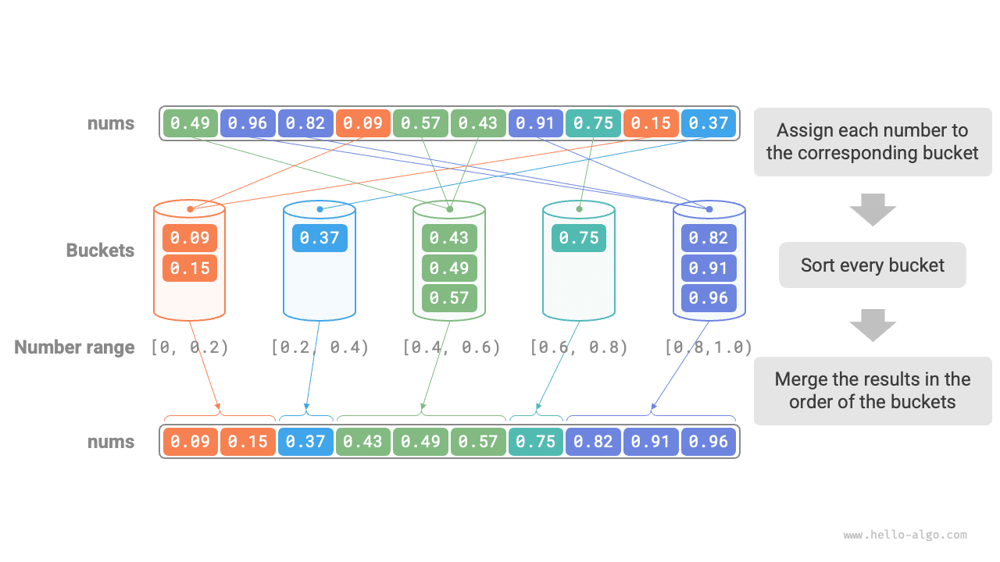
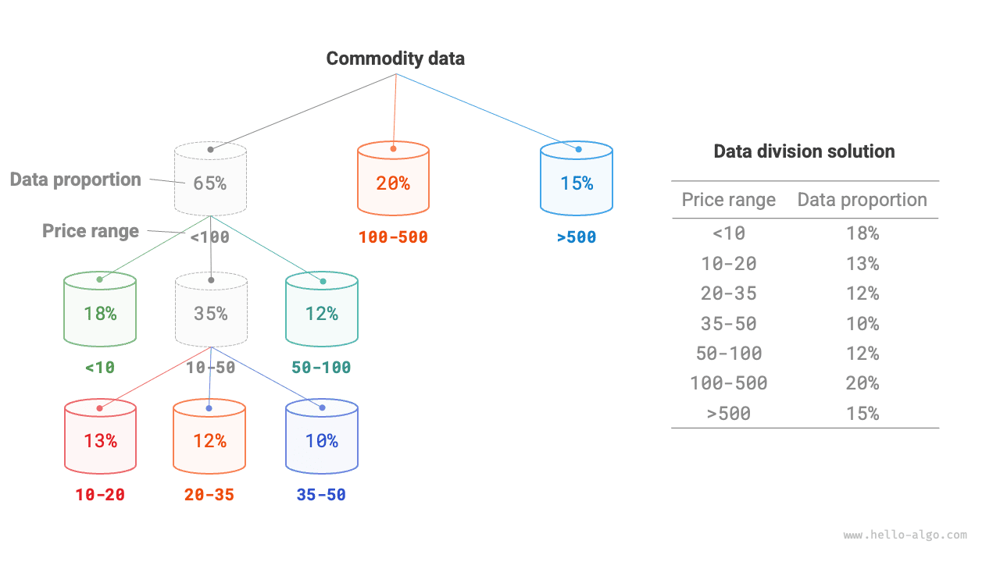
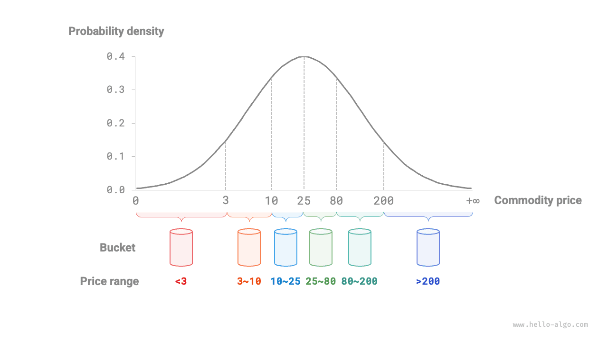

خوارزميات الترتيب التي ناقشناها سابقاً كلها خوارزميات ترتيب قائمة على المقارنة، وهي ترتّب عبر مقارنة الترتيب النسبي للعناصر. الحد الأدنى للتعقيد الزمني لهذه الخوارزميات في أسوأ الحالات هو $\Omega(n \log n)$. بعد ذلك، سنستكشف عدة خوارزميات ترتيب لا تعتمد على المقارنة، يمكن أن يكون تعقيدها الزمني خطياً.

<u>ترتيب الدلاء</u> تطبيق نموذجي لاستراتيجية التقسيم والتغلب. وهو يعمل عبر إنشاء سلسلة من الدلاء المرتبة، يقابل كل منها نطاقاً من البيانات، وتوزيع البيانات عليها بالتساوي. ثم تُرتَّب العناصر داخل كل دلو على حدة. وأخيراً تُدمج جميع الدلاء بالترتيب.

## تدفق الخوارزمية

لنأخذ مصفوفة طولها $n$، عناصرها أعداد عشرية عائمة في النطاق $[0, 1)$. يظهر تدفق ترتيب الدلاء في الشكل التالي.

1. هيّئ $k$ من الدلاء ووزّع العناصر $n$ على الدلاء $k$.
2. رتّب كل دلو على حدة (نستخدم هنا دالة الترتيب المدمجة في لغة البرمجة).
3. ادمج النتائج بالترتيب من أصغر دلو إلى أكبرها.



الشيفرة كما يلي:

<div class="lang-tab">
<p class="lang-tab__label">Python</p>

```py
def bucket_sort(nums: list[float]):
    """Bucket sort"""
    # مهّد k = n/2 سلة، متوقعًا 2 عنصر لكل سلة
    k = len(nums) // 2
    buckets = [[] for _ in range(k)]
    # 1. وزّع عناصر المصفوفة على السلال
    for num in nums:
        # نطاق المُدخل هو [0, 1)؛ استخدم num * k لربط كل قيمة بفهرس في [0, k-1]
        i = int(num * k)
        # أضف num إلى السلة i
        buckets[i].append(num)
    # 2. رتّب كل سلة
    for bucket in buckets:
        # استخدم دالة الترتيب المدمجة، أو استبدلها بخوارزمية ترتيب أخرى
        bucket.sort()
    # 3. اجتز السلال لدمج النتائج
    i = 0
    for bucket in buckets:
        for num in bucket:
            nums[i] = num
            i += 1
```

</div>## خصائص الخوارزمية

يناسب ترتيب الدلاء معالجة مجموعات بيانات ضخمة جداً. على سبيل المثال، لنفترض أن الإدخال يحتوي على مليون عنصر، وتمنع محدودية الذاكرة النظام من تحميلها كلها دفعة واحدة. في هذه الحالة يمكن تقسيم البيانات على 1000 دلو، وترتيب كل دلو على حدة، ثم دمج النتائج.

- **التعقيد الزمني هو $O(n + k)$**: بافتراض توزيع العناصر بالتساوي على الدلاء، يحتوي كل دلو على $\frac{n}{k}$ عنصراً. وإذا استغرق ترتيب دلو واحد زمن $O(\frac{n}{k} \log\frac{n}{k})$، فإن ترتيب جميع الدلاء يستغرق زمن $O(n \log\frac{n}{k})$. **وعندما يكون عدد الدلاء $k$ كبيراً نسبياً، يقترب التعقيد الزمني من $O(n)$**. ويتطلب دمج النتائج اجتياز جميع الدلاء والعناصر، وهو ما يستغرق زمن $O(n + k)$. وفي أسوأ الحالات، تُوضع كل البيانات في دلو واحد، ويستغرق ترتيبه زمن $O(n^2)$.
- **التعقيد المكاني هو $O(n + k)$، وترتيب الدلاء ليس في المكان**: فهو يتطلب مساحة إضافية لمقدار $k$ من الدلاء و$n$ من العناصر إجمالاً.
- يعتمد استقرار ترتيب الدلاء على ما إذا كانت الخوارزمية المستخدمة لترتيب العناصر داخل الدلاء مستقرة.

## كيف نحقق توزيعاً متساوياً

نظرياً، يمكن لترتيب الدلاء تحقيق تعقيد زمني $O(n)$. **المفتاح هو توزيع العناصر بالتساوي على الدلاء**، لأن بيانات العالم الواقعي غالباً لا تكون موزعة بانتظام. على سبيل المثال، لنفترض أننا نريد تقسيم جميع المنتجات على Taobao بالتساوي إلى 10 دلاء حسب نطاق السعر، لكن توزيع الأسعار غير متساوٍ: فهناك منتجات كثيرة يقل سعرها عن 100 يوان، ومنتجات قليلة جداً يتجاوز سعرها 1000 يوان. وإذا قُسّم نطاق السعر بالتساوي إلى 10 فترات، فستتباين أعداد المنتجات في الدلاء تبايناً كبيراً.

لتحقيق توزيع أكثر تساوياً، يمكننا أولاً اختيار حد تقريبي وتقسيم البيانات إلى 3 دلاء. **بعد ذلك، يمكن تقسيم الدلاء التي تحتوي على منتجات أكثر إلى 3 دلاء أخرى، حتى تصبح أعداد العناصر في جميع الدلاء متقاربة**.

كما يظهر في الشكل التالي، تبني هذه الطريقة في جوهرها شجرة تعاودية هدفها جعل العقد الورقية متوازنة قدر الإمكان. وبالطبع، لا يلزم تقسيم البيانات إلى 3 دلاء في كل جولة؛ إذ يمكن اختيار استراتيجية التقسيم المحددة بمرونة بناءً على خصائص البيانات.



إذا عرفنا التوزيع الاحتمالي لأسعار المنتجات مسبقاً، **يمكننا ضبط حدود الأسعار لكل دلو وفقاً لهذا التوزيع**. ومن الجدير بالذكر أن توزيع البيانات لا يلزم قياسه بدقة؛ إذ يمكن أيضاً تقريبه بنموذج احتمالي يُختار ليلائم خصائص البيانات.

كما يظهر في الشكل التالي، نفترض أن أسعار المنتجات تتبع توزيعاً طبيعياً، مما يتيح لنا ضبط فترات الأسعار بشكل معقول لتوزيع المنتجات بالتساوي على كل دلو.


