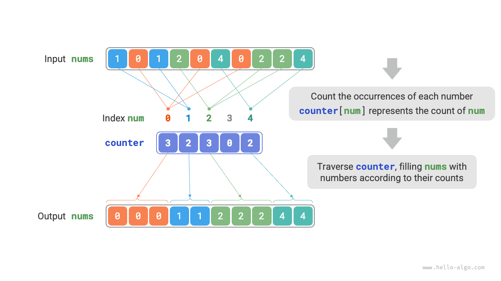

<u>الترتيب بالعد</u> (counting sort) يرتّب عبر عدّ مرات ظهور العناصر، ويُطبَّق عادةً على مصفوفات الأعداد الصحيحة.

## تنفيذ بسيط

لنبدأ بمثال بسيط. بمعطى مصفوفة `nums` طولها $n$، وجميع عناصرها «أعداد صحيحة غير سالبة»، يوضح الشكل أدناه التدفق الإجمالي للترتيب بالعد.

1. اجتز المصفوفة لإيجاد أكبر عدد، ورمزه $m$، ثم أنشئ مصفوفة مساعدة `counter` طولها $m + 1$.
2. **استخدم `counter` لعدّ عدد مرات ظهور كل عدد في `nums`**، حيث يخزّن `counter[num]` عدد مرات ظهور `num`. وهذا بسيط: اجتز `nums` (ورمز العدد الحالي بـ`num`) وزد `counter[num]` بمقدار $1$ في كل مرة.
3. **وبما أن فهارس `counter` مرتّبة ترتيباً طبيعياً، فإن الأعداد تكون فعلياً مرتّبة بالفعل**. بعد ذلك، اجتز `counter` واكتب الأعداد مرة أخرى في `nums` بترتيب تصاعدي وفقاً لأعداد ظهورها.



والشيفرة كما يلي:

<div class="lang-tab">
<p class="lang-tab__label">Python</p>

```py
def counting_sort_naive(nums: list[int]):
    """Counting sort"""
    # تنفيذ بسيط؛ لا يمكن استخدامه لترتيب الكائنات
    # 1. أوجد أكبر عنصر في المصفوفة m
    m = max(nums)
    # 2. عُد تكرارات كل عدد
    # يمثل counter[num] عدد تكرارات num
    counter = [0] * (m + 1)
    for num in nums:
        counter[num] += 1
    # 3. اجتز counter واملأ المصفوفة الأصلية nums بالعناصر
    i = 0
    for num in range(m + 1):
        for _ in range(counter[num]):
            nums[i] = num
            i += 1
```

</div><div class="note">
<p class="note__title">الصلة بين الترتيب بالعد وترتيب الدلاء</p>

من منظور ترتيب الدلاء، يمكن النظر إلى كل فهرس في مصفوفة العدّ `counter` باعتباره دلو، ويمكن اعتبار عملية العدّ توزيعاً للعناصر على الدلاء المقابلة لها. وفي جوهر الأمر، الترتيب بالعد حالة خاصة من ترتيب الدلاء لبيانات الأعداد الصحيحة.

</div>

## تنفيذ كامل

ربما لاحظ القراء المتنبّهون أن **عملية الإدخال إذا كانت تتكوّن من كائنات، فإن الخطوة `3.` أعلاه لم تعد صالحة**. لنفترض أن الإدخال يتكوّن من كائنات منتجات ونريد ترتيبها حسب السعر (وهو متغير عضو في الصنف)؛ فإن الخوارزمية أعلاه لن تنتج إلا ترتيب الأسعار نفسها.

فكيف يمكننا الحصول على ترتيب البيانات الأصلية؟ نحسب أولاً المجاميع البادئة (prefix sums) لـ`counter`. وكما يوحي الاسم، فإن المجموع البادئ عند الفهرس $i$، أي `prefix[i]`، يساوي مجموع العناصر من الفهرس `0` حتى `i`:

$$
\text{prefix}[i] = \sum_{j=0}^i \text{counter[j]}
$$

**وللمجموع البادئ تفسير واضح: `prefix[num] - 1` يعطي فهرس آخر ظهور للعنصر `num` في المصفوفة الناتجة `res`**. وهذه المعلومة بالغة الأهمية لأنها تخبرنا بالمكان الذي ينبغي أن يوضع فيه كل عنصر في المصفوفة الناتجة. بعد ذلك، نجتاز المصفوفة الأصلية `nums` بترتيب عكسي، ولكل عنصر `num` ننفّذ الخطوتين التاليتين.

1. ضع `num` عند الفهرس `prefix[num] - 1` في المصفوفة `res`.
2. قلّل المجموع البادئ `prefix[num]` بمقدار $1$ للحصول على فهرس الموضع التالي لـ`num`.

وبعد اكتمال الاجتياز، تحتوي المصفوفة `res` على النتيجة المرتّبة، وأخيراً يُستخدم `res` لاستبدال المصفوفة الأصلية `nums`. ويوضح الشكل أدناه تدفق الترتيب بالعد الكامل.

ويُعرض تنفيذ الترتيب بالعد أدناه:

<div class="lang-tab">
<p class="lang-tab__label">Python</p>

```py
def counting_sort(nums: list[int]):
    """Counting sort"""
    # تنفيذ كامل؛ مستقر وقابل للتكيف لترتيب الكائنات
    # 1. أوجد أكبر عنصر في المصفوفة m
    m = max(nums)
    # 2. عُد تكرارات كل عدد
    # يمثل counter[num] عدد تكرارات num
    counter = [0] * (m + 1)
    for num in nums:
        counter[num] += 1
    # 3. احسب مجاميع البادئة لـ counter لتحوّل أعداد التكرارات إلى مواضع نهاية
    # أي أن counter[num]-1 هو فهرس آخر تكرار لـ num في res
    for i in range(m):
        counter[i + 1] += counter[i]
    # 4. اجتز nums بالعكس وضع كل عنصر في مصفوفة النتيجة res
    # مهّد المصفوفة res لتخزين النتيجة
    n = len(nums)
    res = [0] * n
    for i in range(n - 1, -1, -1):
        num = nums[i]
        res[counter[num] - 1] = num  # ضع num في الفهرس المقابل
        counter[num] -= 1  # أنقص مجموع البادئة بمقدار 1 لتحديد موضع وضع التكرار التالي لـ num
    # اكتب مصفوفة النتيجة res فوق المصفوفة الأصلية nums
    for i in range(n):
        nums[i] = res[i]
```

</div>## خصائص الخوارزمية

- **التعقيد الزمني $O(n + m)$، والترتيب بالعد غير تكيّفي (non-adaptive)**: يستغرق اجتياز `nums` و`counter` زمناً خطياً. وبشكل عام، عندما $n \gg m$، يقترب التعقيد الزمني من $O(n)$.
- **التعقيد المكاني $O(n + m)$، وترتيب ليس في المكان (non-in-place)**: يستخدم المصفوفتين `res` و`counter` بطولين $n$ و$m$ على التوالي.
- **ترتيب مستقر**: بما أن العناصر تُملأ في `res` بترتيب «من اليمين إلى اليسار»، فإن اجتياز `nums` بترتيب عكسي يمكن أن يمنع تغيّر المواضع النسبية للعناصر المتساوية، وبذلك يتحقق ترتيب مستقر. وفي الواقع، يمكن أن يؤدي اجتياز `nums` بالترتيب الأمامي أيضاً إلى نتائج ترتيب صحيحة، لكن النتيجة ستكون غير مستقرة.

## القيود

في هذه المرحلة، قد تظن أن الترتيب بالعد بالغ البراعة، لأنه يحقق ترتيباً فعّالاً بمجرد عدّ مرات الظهور. غير أن المتطلبات المسبقة لاستخدام الترتيب بالعد مقيّدة إلى حد كبير.

**لا ينطبق الترتيب بالعد إلا على الأعداد الصحيحة غير السالبة**. ولتطبيقه على أنواع أخرى من البيانات، عليك التأكد من إمكانية تحويلها إلى أعداد صحيحة غير سالبة دون تغيير الترتيب النسبي للعناصر. فمثلاً، بالنسبة إلى مصفوفة أعداد صحيحة تحتوي على أعداد سالبة، يمكنك أولاً إضافة ثابت إلى كل عدد لإزاحتها إلى النطاق غير السالب، ثم إزاحتها مرة أخرى بعد الترتيب.

**يناسب الترتيب بالعد الحالات التي تحتوي على عناصر كثيرة لكن نطاق قيمها صغير**. فمثلاً، في السيناريو أعلاه، لا يمكن أن يكون $m$ كبيراً جداً؛ وإلا فسيستهلك مساحة كبيرة جداً. وعندما $n \ll m$، يستغرق الترتيب بالعد زمن $O(m)$، وقد يكون أبطأ من خوارزميات ترتيب بتعقيد زمني $O(n \log n)$.
