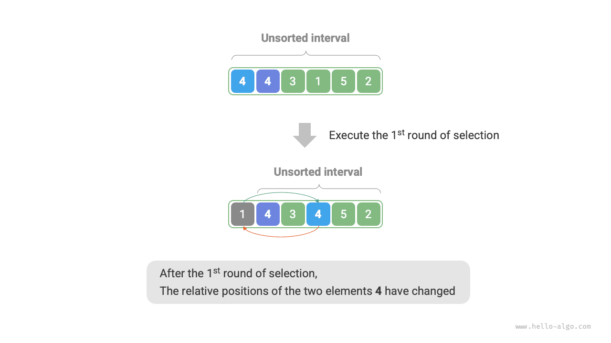

<u>ترتيب الاختيار</u> (selection sort) بسيط جداً في عمله: في كل جولة يختار أصغر عنصر من المجال غير المرتب ويضعه في نهاية المجال المرتب.

افترض أن طول المصفوفة $n$. ويوضح الشكل أدناه سير ترتيب الاختيار.

1. في البداية تكون جميع العناصر غير مرتبة، أي إن مجال الفهارس غير المرتب هو $[0, n-1]$.
2. اختر أصغر عنصر في المجال $[0, n-1]$ وبدّله مع العنصر عند الفهرس $0$. وبعد الانتهاء يصبح العنصر الأول من المصفوفة مرتباً.
3. اختر أصغر عنصر في المجال $[1, n-1]$ وبدّله مع العنصر عند الفهرس $1$. وبعد الانتهاء يصبح العنصران الأولان من المصفوفة مرتبين.
4. وهكذا دواليك. بعد $n - 1$ جولة من الاختيار والتبديل، تصبح العناصر $n - 1$ الأولى من المصفوفة مرتبة.
5. ولا بد أن يكون العنصر الوحيد المتبقي هو الأكبر، لذا لا حاجة إلى مزيد من الترتيب وتصبح المصفوفة مرتبة.

في الشيفرة نستخدم $k$ لتتبع أصغر عنصر داخل المجال غير المرتب:

<div class="lang-tab">
<p class="lang-tab__label">Python</p>

```py
def selection_sort(nums: list[int]):
    """Selection sort"""
    n = len(nums)
    # الحلقة الخارجية: النطاق غير المرتب هو [i, n-1]
    for i in range(n - 1):
        # الحلقة الداخلية: أوجد أصغر عنصر في النطاق غير المرتب
        k = i
        for j in range(i + 1, n):
            if nums[j] < nums[k]:
                k = j  # سجّل فهرس أصغر عنصر
        # بدّل أصغر عنصر مع أول عنصر في النطاق غير المرتب
        nums[i], nums[k] = nums[k], nums[i]
```

</div>## خصائص الخوارزمية

- **التعقيد الزمني $O(n^2)$؛ ترتيب غير تكيّفي (non-adaptive)**: تضم الحلقة الخارجية $n - 1$ جولة إجمالاً. وتُنفَّذ الحلقة الداخلية $n - 1$ مرة في الجولة الأولى ومرة واحدة في الجولة الأخيرة. وبذلك تُنفَّذ $n - 1$ و$n - 2$ و$\dots$ و$2$ و$1$ مرة على التوالي، ومجموعها $\frac{n(n - 1)}{2}$.
- **التعقيد المكاني $O(1)$؛ ترتيب في المكان (in-place)**: يستخدم المؤشران $i$ و$j$ مقداراً ثابتاً من المساحة الإضافية.
- **ترتيب غير مستقر**: كما يوضح الشكل أدناه، قد يُبدَّل العنصر `nums[i]` إلى يمين عنصر مساوٍ له، مما يغيّر ترتيبهما النسبي.


