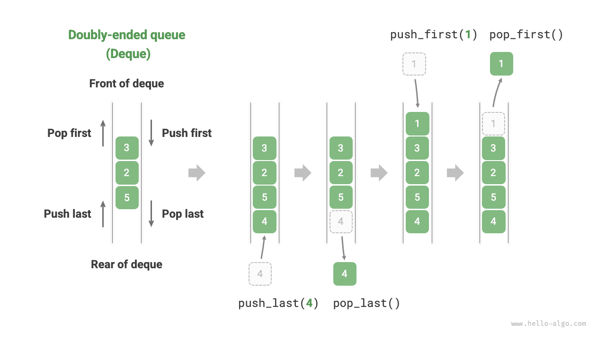

في الطابور، لا يمكننا سوى إزالة العناصر من المقدمة أو إضافة العناصر في المؤخرة. وكما هو موضح في الشكل أدناه، يوفّر <u>الطابور المزدوج (deque)</u> مرونة أكبر، إذ يتيح إضافة العناصر وإزالتها من المقدمة والمؤخرة معاً.



## العمليات الشائعة على الطابور المزدوج

يوضح الجدول أدناه العمليات الشائعة على الطابور المزدوج. وتتحدد أسماء الدوال المحددة بلغة البرمجة المستخدمة.

<p align="center"> جدول <id> &nbsp; كفاءة عمليات الطابور المزدوج </p>

| الدالة         | الوصف               | التعقيد الزمني |
| -------------- | ------------------------- | --------------- |
| `push_first()` | إضافة عنصر إلى المقدمة      | $O(1)$          |
| `push_last()`  | إضافة عنصر إلى المؤخرة       | $O(1)$          |
| `pop_first()`  | إزالة العنصر الأمامي      | $O(1)$          |
| `pop_last()`   | إزالة العنصر الخلفي       | $O(1)$          |
| `peek_first()` | الوصول إلى العنصر الأمامي      | $O(1)$          |
| `peek_last()`  | الوصول إلى العنصر الخلفي       | $O(1)$          |

وبالمثل، يمكننا استخدام فئات الطابور المزدوج التي توفّرها لغة البرمجة مباشرةً:

<div class="lang-tab">
<p class="lang-tab__label">Python</p>

```python title="deque.py"
from collections import deque

# Initialize deque
deq: deque[int] = deque()

# Enqueue elements
deq.append(2)      # Add to rear
deq.append(5)
deq.append(4)
deq.appendleft(3)  # Add to front
deq.appendleft(1)

# Access elements
front: int = deq[0]  # Front element
rear: int = deq[-1]  # Rear element

# Dequeue elements
pop_front: int = deq.popleft()  # Front element dequeue
pop_rear: int = deq.pop()       # Rear element dequeue

# Get deque length
size: int = len(deq)

# Check if deque is empty
is_empty: bool = len(deq) == 0
```

</div>
## تنفيذ الطابور المزدوج *

تنفيذ الطابور المزدوج مشابه لتنفيذ الطابور. ويمكنك اختيار قائمة مترابطة أو مصفوفة كبنية بيانات أساسية.

### التنفيذ بقائمة مترابطة مزدوجة

وبمراجعة القسم السابق، استخدمنا قائمة مترابطة أحادية عادية لتنفيذ طابور، لأنها تتيح بسهولة حذف العقدة الرأسية (المقابلة للإخراج من الطابور) وإضافة عقد جديدة بعد العقدة الذيلية (المقابلة للإدخال إلى الطابور).

أما الطابور المزدوج، فيمكن للمقدمة والمؤخرة فيه إجراء عمليتي الإدخال والإخراج معاً. وبعبارة أخرى، يحتاج الطابور المزدوج إلى تنفيذ عمليات في الاتجاه المعاكس أيضاً. لهذا السبب، نستخدم «قائمة مترابطة مزدوجة» كبنية بيانات أساسية للطابور المزدوج.

وكما هو موضح في الشكل أدناه، نتعامل مع العقدة الرأسية والعقدة الذيلية في القائمة المترابطة المزدوجة على أنهما مقدمة الطابور المزدوج ومؤخرته، منفّذين وظيفة إضافة العقد وحذفها من كلا الطرفين.

وتظهر شيفرة التنفيذ أدناه:

<div class="lang-tab">
<p class="lang-tab__label">Python</p>

```py
class LinkedListDeque:
    """Deque implemented with a doubly linked list"""

    def __init__(self):
        """Constructor"""
        self._front: ListNode | None = None  # Head node front
        self._rear: ListNode | None = None  # Tail node rear
        self._size: int = 0  # Deque size

    def size(self) -> int:
        """Get the deque size"""
        return self._size

    def is_empty(self) -> bool:
        """Check whether the deque is empty"""
        return self._size == 0

    def push(self, num: int, is_front: bool):
        """Enqueue operation"""
        node = ListNode(num)
        # If the linked list is empty, make both front and rear point to node
        if self.is_empty():
            self._front = self._rear = node
        # Enqueue at the front
        elif is_front:
            # Add node to the head of the linked list
            self._front.prev = node
            node.next = self._front
            self._front = node  # Update the head node
        # Enqueue at the rear
        else:
            # Add node to the tail of the linked list
            self._rear.next = node
            node.prev = self._rear
            self._rear = node  # Update the tail node
        self._size += 1  # Update the deque size

    def push_first(self, num: int):
        """Enqueue at the front"""
        self.push(num, True)

    def push_last(self, num: int):
        """Enqueue at the rear"""
        self.push(num, False)

    def pop(self, is_front: bool) -> int:
        """Dequeue operation"""
        if self.is_empty():
            raise IndexError("Deque is empty")
        # When the deque size is 1, the head and tail point to the same node
        if self._size == 1:
            val: int = self._front.val
            self._front = None
            self._rear = None
        # Dequeue from the front
        elif is_front:
            val: int = self._front.val  # Save the head node value
            # Remove the head node
            fnext: ListNode | None = self._front.next
            fnext.prev = None
            self._front.next = None
            self._front = fnext  # Update the head node
        # Dequeue from the rear
        else:
            val: int = self._rear.val  # Save the tail node value
            # Remove the tail node
            rprev: ListNode | None = self._rear.prev
            rprev.next = None
            self._rear.prev = None
            self._rear = rprev  # Update the tail node
        self._size -= 1  # Update the deque size
        return val

    def pop_first(self) -> int:
        """Dequeue from the front"""
        return self.pop(True)

    def pop_last(self) -> int:
        """Dequeue from the rear"""
        return self.pop(False)

    def peek_first(self) -> int:
        """Access the front element"""
        if self.is_empty():
            raise IndexError("Deque is empty")
        return self._front.val

    def peek_last(self) -> int:
        """Access the rear element"""
        if self.is_empty():
            raise IndexError("Deque is empty")
        return self._rear.val

    def to_array(self) -> list[int]:
        """Return an array for printing"""
        node = self._front
        res = [0] * self.size()
        for i in range(self.size()):
            res[i] = node.val
            node = node.next
        return res
```

</div>
### التنفيذ بالمصفوفة

وكما هو موضح في الشكل أدناه، على غرار تنفيذ طابور باستخدام مصفوفة، يمكننا أيضاً استخدام مصفوفة دائرية لتنفيذ طابور مزدوج.

واستناداً إلى تنفيذ الطابور، لا نحتاج إلا إلى إضافة دالتين: «الإدخال في المقدمة» و«الإخراج من المؤخرة»:

<div class="lang-tab">
<p class="lang-tab__label">Python</p>

```py
class ArrayDeque:
    """Deque implemented with a circular array"""

    def __init__(self, capacity: int):
        """Constructor"""
        self._nums: list[int] = [0] * capacity
        self._front: int = 0
        self._size: int = 0

    def capacity(self) -> int:
        """Get the deque capacity"""
        return len(self._nums)

    def size(self) -> int:
        """Get the deque size"""
        return self._size

    def is_empty(self) -> bool:
        """Check whether the deque is empty"""
        return self._size == 0

    def index(self, i: int) -> int:
        """Calculate an index in the circular array"""
        # Use modulo to connect the end of the array to its beginning
        # When i passes the end of the array, wrap around to the beginning
        # When i passes the beginning of the array, wrap around to the end
        return (i + self.capacity()) % self.capacity()

    def push_first(self, num: int):
        """Enqueue at the front"""
        if self._size == self.capacity():
            print("Deque is full")
            return
        # Move the front pointer one position to the left
        # Use modulo to wrap front to the end when it passes the beginning of the array
        self._front = self.index(self._front - 1)
        # Add num to the front
        self._nums[self._front] = num
        self._size += 1

    def push_last(self, num: int):
        """Enqueue at the rear"""
        if self._size == self.capacity():
            print("Deque is full")
            return
        # Calculate the rear pointer, which points one position past the last element
        rear = self.index(self._front + self._size)
        # Add num to the rear
        self._nums[rear] = num
        self._size += 1

    def pop_first(self) -> int:
        """Dequeue from the front"""
        num = self.peek_first()
        # Advance the front pointer by one position
        self._front = self.index(self._front + 1)
        self._size -= 1
        return num

    def pop_last(self) -> int:
        """Dequeue from the rear"""
        num = self.peek_last()
        self._size -= 1
        return num

    def peek_first(self) -> int:
        """Access the front element"""
        if self.is_empty():
            raise IndexError("Deque is empty")
        return self._nums[self._front]

    def peek_last(self) -> int:
        """Access the rear element"""
        if self.is_empty():
            raise IndexError("Deque is empty")
        # Calculate the index of the last element
        last = self.index(self._front + self._size - 1)
        return self._nums[last]

    def to_array(self) -> list[int]:
        """Return an array for printing"""
        # Convert only the list elements within the occupied range
        res = []
        for i in range(self._size):
            res.append(self._nums[self.index(self._front + i)])
        return res
```

</div>
## تطبيقات الطابور المزدوج

يجمع الطابور المزدوج منطق المكدسات والطوابير معاً. **لذلك يمكنه تنفيذ جميع حالات التطبيق لكليهما، مع توفير مرونة أكبر**.

نعلم أن وظيفة «التراجع» في البرمجيات تُنفَّذ عادةً باستخدام مكدس: إذ يدفع النظام كل عملية تغيير إلى المكدس ثم ينفّذ التراجع عبر الإخراج. غير أن البرمجيات تحدّ عادةً عدد خطوات التراجع مراعاةً لقيود موارد النظام (فمثلاً يُسمح بحفظ 50 خطوة فقط). وعندما يتجاوز طول المكدس 50، تحتاج البرمجية إلى إجراء عملية حذف في قاعدة المكدس (مقدمة الطابور). **لكن المكدس لا يستطيع تنفيذ هذه الوظيفة، لذا نحتاج إلى طابور مزدوج ليحل محل المكدس**. ولاحظ أن المنطق الجوهري لـ«التراجع» ما زال يتبع مبدأ آخر ما يدخل يخرج أولاً في المكدس؛ غير أن الطابور المزدوج يستطيع تنفيذ بعض المنطق الإضافي بمرونة أكبر.
