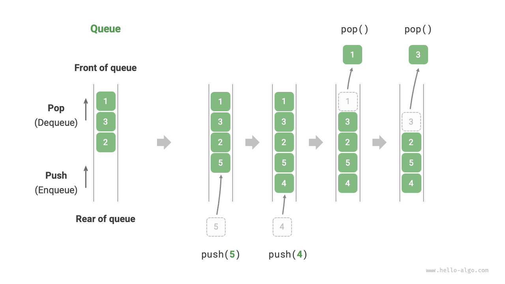

<u>الطابور (queue)</u> بنية بيانات خطية تتبع قاعدة «أول ما يدخل يخرج أولاً» (FIFO). وكما يوحي الاسم، فهو يحاكي اصطفاف الناس: يلتحق القادمون الجدد باستمرار بمؤخرة الطابور، بينما يغادر من في المقدمة واحداً تلو الآخر.

وكما هو موضح في الشكل أدناه، نسمي مقدمة الطابور «المقدمة» ونهايته «المؤخرة». وتسمى عملية إضافة عنصر إلى المؤخرة «الإدخال إلى الطابور»، بينما تسمى عملية إزالة العنصر الأمامي «الإخراج من الطابور».



## العمليات الشائعة على الطابور

يوضح الجدول أدناه العمليات الشائعة على الطابور. ولاحظ أن أسماء الدوال قد تختلف باختلاف لغات البرمجة. وسنستخدم هنا التسمية نفسها المتبعة مع المكدسات.

<p align="center"> جدول <id> &nbsp; كفاءة عمليات الطابور </p>

| الطريقة   | الوصف                                | التعقيد الزمني |
| -------- | ------------------------------------------ | --------------- |
| `push()` | إدخال عنصر، أي إضافة عنصر إلى المؤخرة       | $O(1)$          |
| `pop()`  | إخراج العنصر الأمامي من الطابور             | $O(1)$          |
| `peek()` | الوصول إلى العنصر الأمامي                   | $O(1)$          |

يمكننا استخدام فئات الطابور التي توفرها لغة البرمجة مباشرةً:

<div class="lang-tab">
<p class="lang-tab__label">Python</p>

```python title="queue.py"
from collections import deque

# Initialize queue
# In Python, we generally use the deque class as a queue
# Although queue.Queue() is a pure queue class, it is not very user-friendly, so it is not recommended
que: deque[int] = deque()

# Enqueue elements
que.append(1)
que.append(3)
que.append(2)
que.append(5)
que.append(4)

# Access front element
front: int = que[0]

# Dequeue element
pop: int = que.popleft()

# Get queue length
size: int = len(que)

# Check if queue is empty
is_empty: bool = len(que) == 0
```

</div>
## تنفيذ الطابور

لتنفيذ طابور، نحتاج إلى بنية بيانات تتيح إضافة العناصر من أحد الطرفين وإزالة العناصر من الطرف الآخر. وتلبي كل من القوائم المترابطة والمصفوفات هذا المطلب.

### التنفيذ بقائمة مترابطة

وكما هو موضح في الشكل أدناه، يمكننا اعتبار «العقدة الرأسية» و«العقدة الذيلية» في القائمة المترابطة مقدمة الطابور ومؤخرته على التوالي، مع قاعدة أنه لا يمكن إضافة العقد إلا في المؤخرة ولا حذفها إلا من المقدمة.

وفيما يلي الكود الخاص بتنفيذ طابور باستخدام قائمة مترابطة:

<div class="lang-tab">
<p class="lang-tab__label">Python</p>

```py
class LinkedListQueue:
    """طابور منفذ بقائمة مترابطة"""

    def __init__(self):
        """المنشئ"""
        self._front: ListNode | None = None  # عقدة الرأس front
        self._rear: ListNode | None = None  # عقدة الذيل rear
        self._size: int = 0

    def size(self) -> int:
        """احصل على حجم الطابور"""
        return self._size

    def is_empty(self) -> bool:
        """تحقق مما إذا كان الطابور فارغًا"""
        return self._size == 0

    def push(self, num: int):
        """إدخال"""
        # أضف num بعد عقدة الذيل
        node = ListNode(num)
        # إذا كان الطابور فارغًا، اجعل الرأس والذيل يشيران إلى هذه العقدة معًا
        if self._front is None:
            self._front = node
            self._rear = node
        # إذا لم يكن الطابور فارغًا، أضف هذه العقدة بعد عقدة الذيل
        else:
            self._rear.next = node
            self._rear = node
        self._size += 1

    def pop(self) -> int:
        """إخراج"""
        num = self.peek()
        # احذف العقدة الرأس
        self._front = self._front.next
        self._size -= 1
        return num

    def peek(self) -> int:
        """وصول إلى عنصر المقدمة"""
        if self.is_empty():
            raise IndexError("Queue is empty")
        return self._front.val

    def to_list(self) -> list[int]:
        """تحويل إلى قائمة للطباعة"""
        queue = []
        temp = self._front
        while temp:
            queue.append(temp.val)
            temp = temp.next
        return queue
```

</div>
### التنفيذ بالمصفوفة

حذف العنصر الأول في مصفوفة له تعقيد زمني $O(n)$، وهو ما يجعل عملية الإخراج من الطابور غير فعّالة. غير أننا يمكننا استخدام الطريقة الذكية التالية لتجنب هذه المشكلة.

يمكننا استخدام متغير `front` للإشارة إلى فهرس العنصر الأمامي، والاحتفاظ بمتغير `size` لتسجيل طول الطابور. ونعرّف `rear = front + size`، وهو ما يحسب الموضع الذي يلي العنصر الأخير في الطابور مباشرةً.

واستناداً إلى هذا التصميم، **يكون النطاق الصالح الذي يحتوي على عناصر المصفوفة هو `[front, rear - 1]`**. وتوضح الصورة أدناه طرق تنفيذ العمليات المختلفة:

- عملية الإدخال إلى الطابور: أسند العنصر المُدخل إلى الفهرس `rear` وزد `size` بمقدار 1.
- عملية الإخراج من الطابور: ما عليك سوى زيادة `front` بمقدار 1 وإنقاص `size` بمقدار 1.

وكما ترى، لا تتطلب كل من عمليتي الإدخال والإخراج سوى عملية واحدة، بتعقيد زمني $O(1)$.

وقد تلاحظ مشكلة: مع استمرارنا في الإدخال والإخراج، يتحرك كل من `front` و`rear` نحو اليمين. **وعندما يصلان إلى نهاية المصفوفة، لا يمكنهما مواصلة التحرك**. ولحل هذه المشكلة، يمكننا اعتبار المصفوفة «مصفوفة دائرية» يتصل رأسها بذيلها.

بالنسبة إلى المصفوفة الدائرية، نحتاج إلى إعادة `front` أو `rear` إلى بداية المصفوفة عند تجاوزهما النهاية. ويمكن تنفيذ هذا النمط الدوري باستخدام «عملية باقي القسمة» (modulo)، كما هو موضح في الكود أدناه:

<div class="lang-tab">
<p class="lang-tab__label">Python</p>

```py
class ArrayQueue:
    """طابور منفذ بمصفوفة دائرية"""

    def __init__(self, size: int):
        """المنشئ"""
        self._nums: list[int] = [0] * size  # المصفوفة التي تخزن عناصر الطابور
        self._front: int = 0  # مؤشر المقدمة، يشير إلى أول عنصر
        self._size: int = 0  # حجم الطابور

    def capacity(self) -> int:
        """الحصول على سعة الطابور"""
        return len(self._nums)

    def size(self) -> int:
        """احصل على حجم الطابور"""
        return self._size

    def is_empty(self) -> bool:
        """تحقق مما إذا كان الطابور فارغًا"""
        return self._size == 0

    def push(self, num: int):
        """إدخال"""
        if self._size == self.capacity():
            raise IndexError("Queue is full")
        # احسب مؤشر المؤخرة، وهو يشير إلى موضع واحد بعد آخر عنصر
        # استخدم باقي القسمة لالتفاف rear إلى البداية عندما يتجاوز نهاية المصفوفة
        rear: int = (self._front + self._size) % self.capacity()
        # أضف num إلى المؤخرة
        self._nums[rear] = num
        self._size += 1

    def pop(self) -> int:
        """إخراج"""
        num: int = self.peek()
        # ورّر مؤشر المقدمة موضعًا واحدًا، مع الالتفاف إلى البداية إن تجاوز النهاية
        self._front = (self._front + 1) % self.capacity()
        self._size -= 1
        return num

    def peek(self) -> int:
        """وصول إلى عنصر المقدمة"""
        if self.is_empty():
            raise IndexError("Queue is empty")
        return self._nums[self._front]

    def to_list(self) -> list[int]:
        """إعادة قائمة للطباعة"""
        res = [0] * self.size()
        j: int = self._front
        for i in range(self.size()):
            res[i] = self._nums[(j % self.capacity())]
            j += 1
        return res
```

</div>
لا يزال الطابور المنفّذ أعلاه محدوداً: فطوله غير قابل للتغيير. غير أن هذه المشكلة ليست صعبة الحل، إذ يمكننا استبدال المصفوفة بمصفوفة ديناميكية لإدخال آلية توسّع. ويمكن للقرّاء المهتمين محاولة تنفيذ ذلك بأنفسهم.

وتتفق استنتاجات المقارنة بين التنفيذين مع نظيراتها الخاصة بالمكدسات، ولن نعيدها هنا.

## التطبيقات النموذجية للطابور

- **طلبات تاوباو**. بعد قيام المتسوقين بالطلب، تُضاف الطلبات إلى طابور، ثم يعالج النظام الطلبات الموجودة في الطابور وفق تسلسلها. وخلال «الدبل إيليفن»، تتولد أعداد هائلة من الطلبات في وقت قصير، ويصبح التزامن العالي تحدياً رئيسياً يتعين على المهندسين مواجهته.
- **مهام قائمة الأعمال المتنوعة**. أي سيناريو يحتاج إلى تنفيذ وظيفة «من سبق يُخدم أولاً»، مثل طابور مهام الطابعة أو طابور طلبات المطعم، يمكنه الحفاظ على ترتيب المعالجة بفعالية باستخدام الطوابير.
