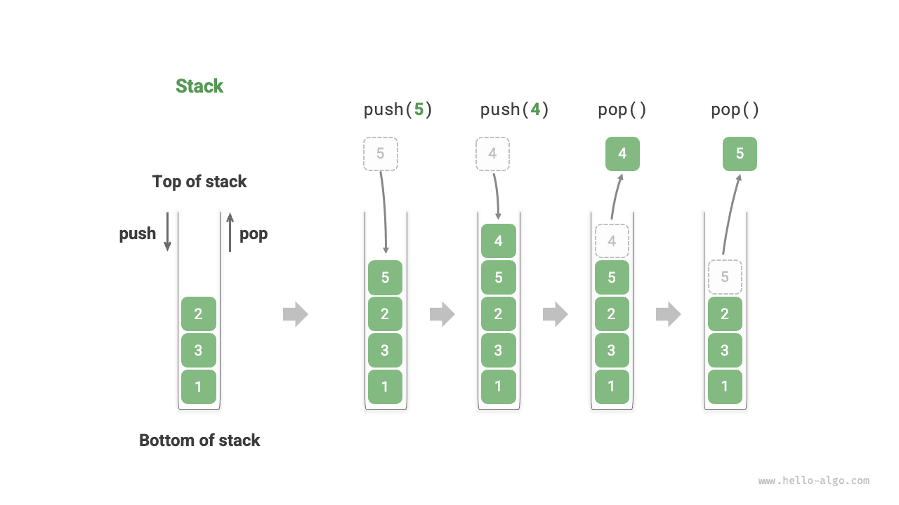

<u>المكدس</u> (stack) بنية بيانات خطية تتبع مبدأ آخر ما يدخل يخرج أولاً (LIFO).

يمكننا تشبيه المكدس بكومة من الأطباق على طاولة. فإذا اشترطنا أنه لا يمكن تحريك سوى طبق واحد في كل مرة، فعندئذٍ للحصول على الطبق السفلي يجب أولاً إزالة الأطباق التي فوقه واحداً تلو الآخر. وإذا استبدلنا الأطباق بأنواع مختلفة من العناصر (مثل الأعداد الصحيحة والمحارف والكائنات وغيرها)، نحصل على بنية بيانات المكدس.

كما يظهر في الشكل التالي، نسمي أعلى العناصر المكدسة "القمة" وأدناها "القاع". وتسمى عملية إضافة عنصر إلى القمة "الدفع" (push)، وتسمى عملية إزالة العنصر العلوي "السحب" (pop).



## عمليات المكدس الشائعة

تظهر العمليات الشائعة على المكدس في الجدول التالي. وتعتمد أسماء الدوال المحددة على لغة البرمجة المستخدمة. وهنا نستخدم التسمية الشائعة `push()` و`pop()` و`peek()`.

<p align="center"> جدول <id> &nbsp; كفاءة عمليات المكدس </p>

| الدالة   | الوصف                                    | التعقيد الزمني |
| -------- | ---------------------------------------------- | --------------- |
| `push()` | دفع عنصر إلى المكدس (إضافته إلى القمة)          | $O(1)$          |
| `pop()`  | سحب العنصر العلوي من المكدس                     | $O(1)$          |
| `peek()` | الاطّلاع على العنصر العلوي                             | $O(1)$          |

عادةً يمكننا استخدام فئة المكدس المدمجة التي توفرها لغة البرمجة مباشرة. ومع ذلك، قد لا توفر بعض اللغات فئة مكدس مخصصة. في هذه الحالات، يمكننا استخدام "المصفوفة" أو "القائمة المترابطة" في اللغة كمكدس، بشرط تجنّب استخدام العمليات غير المتعلقة بسلوك المكدس.

<div class="lang-tab">
<p class="lang-tab__label">Python</p>

```python title="stack.py"
# Initialize stack
# Python does not have a built-in stack class, can use list as a stack
stack: list[int] = []

# Push elements
stack.append(1)
stack.append(3)
stack.append(2)
stack.append(5)
stack.append(4)

# Access top element
peek: int = stack[-1]

# Pop element
pop: int = stack.pop()

# Get stack length
size: int = len(stack)

# Check if empty
is_empty: bool = len(stack) == 0
```

</div>
## تنفيذ المكدس

لفهم كيفية عمل المكدس فهماً أعمق، دعنا نحاول تنفيذ فئة مكدس بأنفسنا.

يتبع المكدس مبدأ LIFO، لذا يمكننا فقط إضافة العناصر أو إزالتها عند القمة. غير أن المصفوفات والقوائم المترابطة معاً تسمحان بإضافة العناصر وإزالتها في أي موضع. **لذلك، يمكن النظر إلى المكدس كمصفوفة أو قائمة مترابطة مقيّدة**. بعبارة أخرى، يمكننا "حجب" بعض العمليات غير ذات الصلة في المصفوفات أو القوائم المترابطة بحيث يتوافق منطقها الخارجي مع خصائص المكدس.

### التنفيذ بقائمة مترابطة

عند تنفيذ مكدس باستخدام قائمة مترابطة، يمكننا اعتبار العقدة الرأسية للقائمة المترابطة قمةَ المكدس والعقدة الذيلية قاعَه.

كما يظهر في الشكل التالي، في عملية الدفع نكتفي بإدراج عنصر عند رأس القائمة المترابطة. وتسمى طريقة إدراج العقد هذه "طريقة الإدراج الرأسي". وفي عملية السحب، نحتاج فقط إلى إزالة العقدة الرأسية من القائمة المترابطة.

فيما يلي شيفرة نموذجية لتنفيذ مكدس قائم على قائمة مترابطة:

<div class="lang-tab">
<p class="lang-tab__label">Python</p>

```py
class LinkedListStack:
    """Stack implemented with a linked list"""

    def __init__(self):
        """Constructor"""
        self._peek: ListNode | None = None
        self._size: int = 0

    def size(self) -> int:
        """Get the stack size"""
        return self._size

    def is_empty(self) -> bool:
        """Check whether the stack is empty"""
        return self._size == 0

    def push(self, val: int):
        """Push"""
        node = ListNode(val)
        node.next = self._peek
        self._peek = node
        self._size += 1

    def pop(self) -> int:
        """Pop"""
        num = self.peek()
        self._peek = self._peek.next
        self._size -= 1
        return num

    def peek(self) -> int:
        """Access the top element"""
        if self.is_empty():
            raise IndexError("Stack is empty")
        return self._peek.val

    def to_list(self) -> list[int]:
        """Convert to a list for printing"""
        arr = []
        node = self._peek
        while node:
            arr.append(node.val)
            node = node.next
        arr.reverse()
        return arr
```

</div>
### التنفيذ بمصفوفة

عند تنفيذ مكدس باستخدام مصفوفة، يمكننا اعتبار نهاية المصفوفة قمةَ المكدس. وكما يظهر في الشكل التالي، تقابل عمليتا الدفع والسحب إضافة عناصر وحذفها عند نهاية المصفوفة، وكلتاهما بتعقيد زمني $O(1)$.

بما أن العناصر المدفوعة إلى المكدس قد تزداد باستمرار، يمكننا استخدام مصفوفة ديناميكية، مما يلغي الحاجة إلى معالجة توسيع المصفوفة بأنفسنا. وإليك الشيفرة النموذجية:

<div class="lang-tab">
<p class="lang-tab__label">Python</p>

```py
class ArrayStack:
    """Stack implemented with an array"""

    def __init__(self):
        """Constructor"""
        self._stack: list[int] = []

    def size(self) -> int:
        """Get the stack size"""
        return len(self._stack)

    def is_empty(self) -> bool:
        """Check whether the stack is empty"""
        return self.size() == 0

    def push(self, item: int):
        """Push"""
        self._stack.append(item)

    def pop(self) -> int:
        """Pop"""
        if self.is_empty():
            raise IndexError("Stack is empty")
        return self._stack.pop()

    def peek(self) -> int:
        """Access the top element"""
        if self.is_empty():
            raise IndexError("Stack is empty")
        return self._stack[-1]

    def to_list(self) -> list[int]:
        """Return a list for printing"""
        return self._stack
```

</div>
## مقارنة بين التنفيذين

**العمليات المدعومة**

يدعم التنفيذان جميع العمليات التي يعرّفها المكدس. ويتميز التنفيذ بالمصفوفة بأنه يدعم إضافةً إلى ذلك الوصول العشوائي، لكن هذا يخرج عن تعريف المكدس ولا يُستخدم عادةً.

**الكفاءة الزمنية**

في التنفيذ القائم على المصفوفة، تحدث عمليتا الدفع والسحب معاً في ذاكرة متجاورة مخصصة مسبقاً، وهو ما يتمتع بمحلية جيدة لذاكرة التخزين المؤقت (cache locality)، وبالتالي يكون أكثر كفاءة. غير أنه إذا تجاوز الدفع سعة المصفوفة، فسيُفعِّل آلية توسيع، مما يجعل التعقيد الزمني لعملية الدفع تلك تحديداً $O(n)$.

في التنفيذ القائم على القائمة المترابطة، يكون توسيع القائمة مرناً جداً، ولا توجد مشكلة انخفاض الكفاءة بسبب توسيع المصفوفة. غير أن عملية الدفع تتطلب تهيئة كائن عقدة وتعديل المؤشرات، لذا فهي أقل كفاءة نسبياً. ومع ذلك، إذا كانت العناصر المدفوعة كائنات عقد بالفعل، فيمكن حذف خطوة التهيئة، مما يحسّن الكفاءة.

خلاصةً، عندما تكون العناصر المدفوعة والمسحوبة من أنواع بيانات أساسية مثل `int` أو `double`، يمكننا استخلاص الاستنتاجين التاليين:

- ينخفض أداء التنفيذ القائم على المصفوفة عند تفعيل التوسيع، لكن بما أن التوسيع عملية نادرة، فإن متوسط الكفاءة أعلى.
- يمكن للتنفيذ القائم على القائمة المترابطة تقديم أداء كفاءة أكثر استقراراً.

**الكفاءة المكانية**

عند تهيئة قائمة، يخصص النظام "سعة أولية" قد تتجاوز الحاجة الفعلية. وإضافة إلى ذلك، توسّع آلية التوسيع عادةً بنسبة محددة (مثل الضعف)، وقد تتجاوز السعة بعد التوسيع الحاجة الفعلية أيضاً. لذلك، **قد يسبب التنفيذ القائم على المصفوفة بعض التبذير في المساحة**.

غير أن عقد القائمة المترابطة تحتاج إلى تخزين مؤشرات إضافية، لذا **تكون المساحة التي تشغلها عقد القائمة المترابطة كبيرة نسبياً**.

خلاصةً، لا يمكننا الجزم ببساطة أيهما أكثر كفاءة في استخدام الذاكرة، بل نحتاج إلى تحليل الحالة المحددة.

## التطبيقات النموذجية للمكدس

- **الرجوع والتقدم في المتصفحات، والتراجع والإعادة في البرمجيات**. في كل مرة نفتح صفحة ويب جديدة، يدفع المتصفح الصفحة السابقة إلى المكدس، مما يتيح لنا العودة إلى الصفحة السابقة عبر عملية الرجوع. وعملية الرجوع هي في جوهرها تنفيذ لعملية سحب. ولدعم الرجوع والتقدم معاً، نحتاج إلى مكدسين يعملان معاً.
- **إدارة ذاكرة البرنامج**. في كل مرة تُستدعى دالة، يضيف النظام إطار مكدس (stack frame) إلى قمة المكدس لتسجيل معلومات سياق الدالة. وأثناء التعاود، تنفذ مرحلة التعاود النزولية عمليات دفع متواصلة، بينما تنفذ مرحلة التتبّع الرجعي الصعودية عمليات سحب متواصلة.
