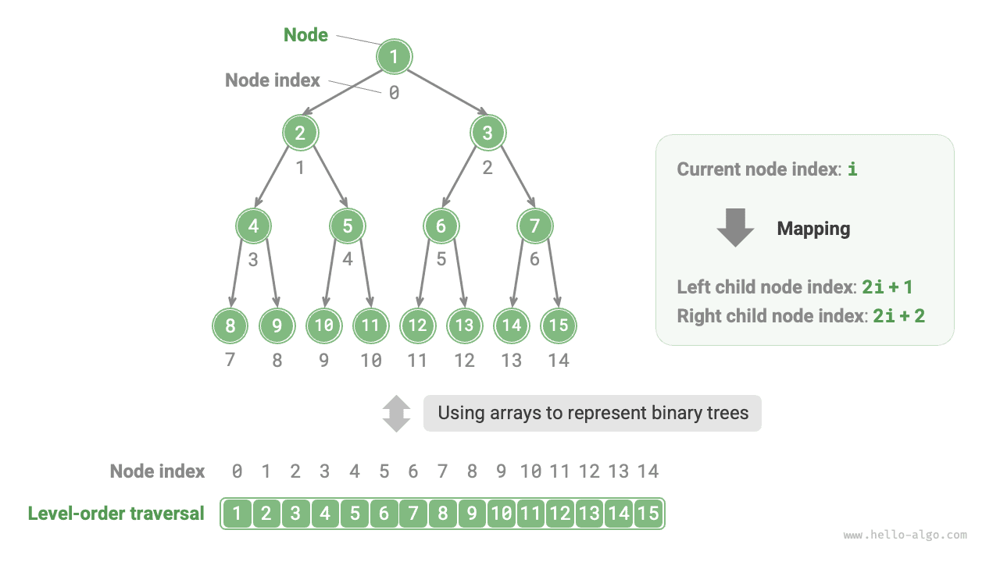
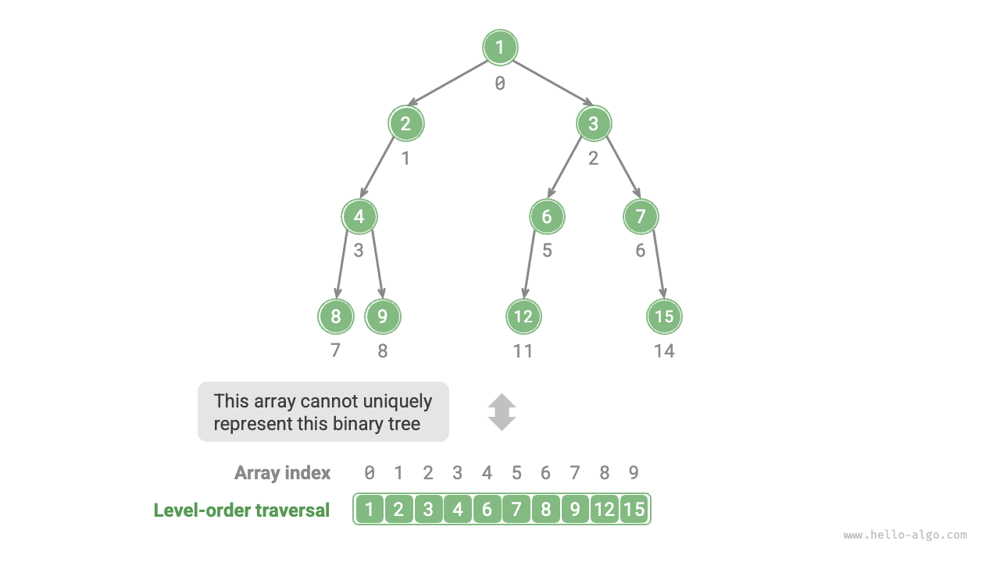
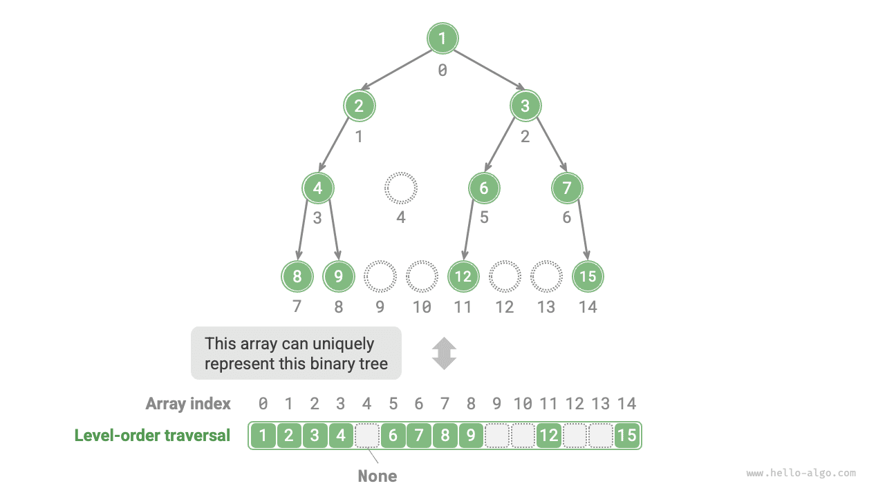
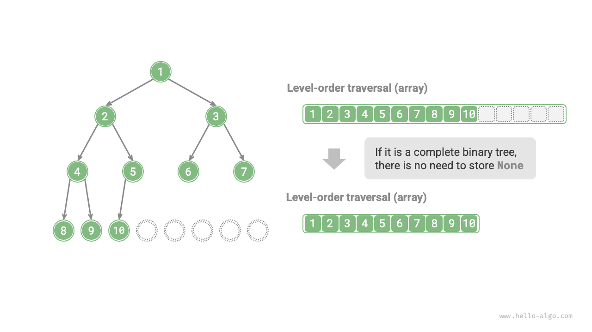

في تمثيل القوائم المترابطة، وحدة تخزين الشجرة الثنائية هي عقدة `TreeNode`، وتُربَط العقد بمؤشرات. وقد قدّم القسم السابق العمليات الأساسية للأشجار الثنائية في هذا التمثيل.

فهل يمكننا استخدام مصفوفة لتمثيل شجرة ثنائية؟ الجواب نعم.

## تمثيل الأشجار الثنائية التامة

لنحلّل أولاً حالة بسيطة. بمعطى شجرة ثنائية تامة (perfect binary tree)، نخزّن جميع العقد في مصفوفة وفق ترتيب الاجتياز بالمستويات، حيث يقابل كل عقدة فهرس فريد في المصفوفة.

واستناداً إلى خصائص الاجتياز بالمستويات، يمكننا استنتاج "صيغة تعيين" بين فهرس العقدة الأب وفهرسي العقدتين الابنتين: **إذا كان فهرس عقدة ما $i$، فإن فهرس ابنها الأيسر هو $2i + 1$ وفهرس ابنها الأيمن هو $2i + 2$**. ويوضح الشكل أدناه علاقات التعيين بين فهارس العقد المختلفة.



**تؤدي صيغة التعيين دوراً مشابهاً لدور مراجع العقد (المؤشرات) في القوائم المترابطة**. فبمعطى أي عقدة في المصفوفة، يمكننا الوصول إلى عقدة ابنها الأيسر (الأيمن) باستخدام صيغة التعيين.

## تمثيل أي شجرة ثنائية

الأشجار الثنائية التامة حالة خاصة؛ إذ توجد عادةً في المستويات الوسطى من الشجرة الثنائية قيم `None` كثيرة. ولأن تسلسل الاجتياز بالمستويات لا يتضمن قيم `None` هذه، لا يمكننا استنتاج عدد قيم `None` وتوزيعها اعتماداً على هذا التسلسل وحده. **وهذا يعني أن بنى أشجار ثنائية متعددة يمكن أن تقابل تسلسل الاجتياز بالمستويات نفسه**.

وكما يوضح الشكل أدناه، بمعطى شجرة ثنائية غير تامة، تفشل طريقة التمثيل المصفوفي أعلاه.



لحل هذه المشكلة، **يمكننا كتابة جميع قيم `None` صراحةً في تسلسل الاجتياز بالمستويات**. وكما يوضح الشكل أدناه، بمجرد فعل ذلك، يستطيع تسلسل الاجتياز بالمستويات تمثيل شجرة ثنائية تمثيلاً فريداً. والشيفرة المثالية كما يلي:

<div class="lang-tab">
<p class="lang-tab__label">Python</p>

```python title=""
# Array representation of a binary tree
# Using None to represent empty slots
tree = [1, 2, 3, 4, None, 6, 7, 8, 9, None, None, 12, None, None, 15]
```

</div>


جدير بالذكر أن **الأشجار الثنائية الكاملة ملائمة جداً للتمثيل المصفوفي**. وباستذكار تعريف الشجرة الثنائية الكاملة، لا تظهر `None` إلا في المستوى السفلي وفي الجهة اليمنى، **ما يعني أن جميع قيم `None` يجب أن تظهر في نهاية تسلسل الاجتياز بالمستويات**.

وهذا يعني أنه عند استخدام مصفوفة لتمثيل شجرة ثنائية كاملة، يمكن إغفال تخزين جميع قيم `None`، وهو أمر مريح للغاية. ويقدّم الشكل أدناه مثالاً على ذلك.



تُنفِّذ الشيفرة التالية شجرة ثنائية باستخدام التمثيل المصفوفي، وتشمل العمليات التالية:

- بمعطى عقدة، الحصول على قيمتها، وعلى عقدة ابنها الأيسر (الأيمن)، وعلى العقدة الأب.
- الحصول على تسلسلات الاجتياز المسبق والوسطي واللاحق وبالمستويات.

<div class="lang-tab">
<p class="lang-tab__label">Python</p>

```py
class ArrayBinaryTree:
    """Binary tree class using an array representation"""

    def __init__(self, arr: list[int | None]):
        """Constructor"""
        self._tree = list(arr)

    def size(self):
        """Length of the backing list"""
        return len(self._tree)

    def val(self, i: int) -> int | None:
        """Get the value of the node at index i"""
        # If the index is out of bounds, return None to represent an empty position
        if i < 0 or i >= self.size():
            return None
        return self._tree[i]

    def left(self, i: int) -> int | None:
        """Get the left child index of the node at index i"""
        return 2 * i + 1

    def right(self, i: int) -> int | None:
        """Get the right child index of the node at index i"""
        return 2 * i + 2

    def parent(self, i: int) -> int | None:
        """Get the parent index of the node at index i"""
        return (i - 1) // 2

    def level_order(self) -> list[int]:
        """Level-order traversal"""
        self.res = []
        # Traverse the array directly
        for i in range(self.size()):
            if self.val(i) is not None:
                self.res.append(self.val(i))
        return self.res

    def dfs(self, i: int, order: str):
        """Depth-first traversal"""
        if self.val(i) is None:
            return
        # Preorder traversal
        if order == "pre":
            self.res.append(self.val(i))
        self.dfs(self.left(i), order)
        # Inorder traversal
        if order == "in":
            self.res.append(self.val(i))
        self.dfs(self.right(i), order)
        # Postorder traversal
        if order == "post":
            self.res.append(self.val(i))

    def pre_order(self) -> list[int]:
        """Preorder traversal"""
        self.res = []
        self.dfs(0, order="pre")
        return self.res

    def in_order(self) -> list[int]:
        """Inorder traversal"""
        self.res = []
        self.dfs(0, order="in")
        return self.res

    def post_order(self) -> list[int]:
        """Postorder traversal"""
        self.res = []
        self.dfs(0, order="post")
        return self.res
```

</div>
## المزايا والقيود

يتمتع التمثيل المصفوفي للأشجار الثنائية بالمزايا التالية:

- تُخزَّن المصفوفات في مساحة ذاكرة متجاورة، وهو ما يلائم ذاكرة التخزين المؤقت (cache) ويتيح وصولاً واجتيازاً أسرع.
- لا يتطلب تخزين مؤشرات، وهو ما يوفّر المساحة.
- يتيح الوصول العشوائي إلى العقد.

ومع ذلك، فإن التمثيل المصفوفي له أيضاً بعض القيود:

- يتطلب التخزين المصفوفي مساحة ذاكرة متجاورة، لذا فهو غير مناسب لتخزين أشجار ذات كمية كبيرة من البيانات.
- تتطلب إضافة العقد أو إزالتها عمليات إدراج وحذف في المصفوفة، وهي عمليات أقل كفاءة.
- عندما تكثر قيم `None` في الشجرة الثنائية، تنخفض نسبة بيانات العقد التي تحتويها المصفوفة، مما يؤدي إلى انخفاض استخدام المساحة.
